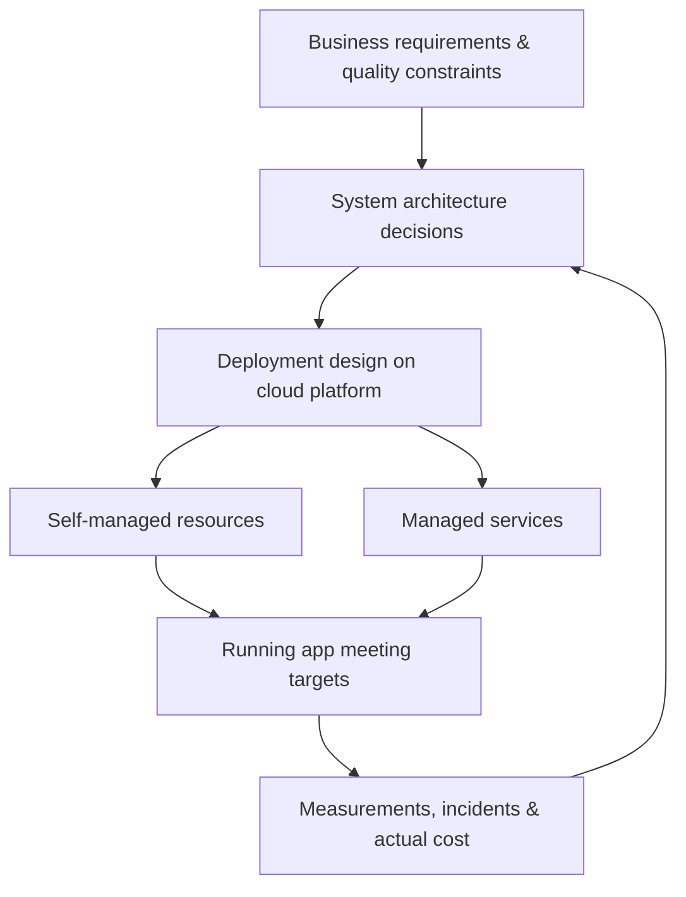
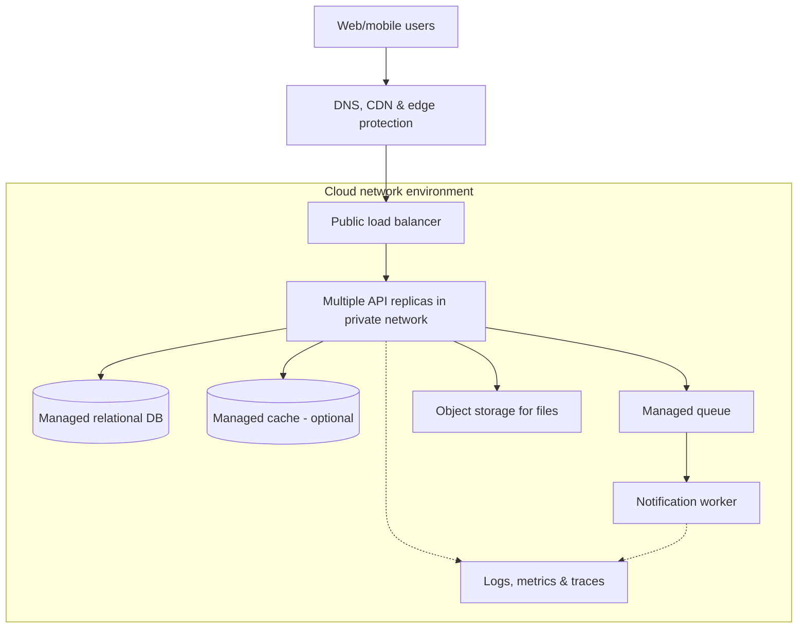

# The Relationship Between System Architecture, Cloud Platform, and Managed Services

When building applications on the cloud, three concepts frequently appear together: **system architecture**, **cloud platform**, and **managed services**. They are closely related yet answer different questions:

- **System architecture:** Which components does the application need, and how do they communicate and manage data to satisfy business and quality requirements?
- **Cloud platform:** On what infrastructure are those components run, connected, protected, monitored, and scaled?
- **Managed services:** Among the components deployed on the cloud, which parts will the provider operate on your behalf, and what does the development team remain responsible for?

Understanding this relationship properly prevents architects from picking services out of a product catalog and then searching for problems to solve. The starting point must be **system needs**; cloud services are the implementation options for realizing that design.

## 1. Three Concepts and Their Boundaries

| Aspect | System Architecture | Cloud Platform | Managed Service |
|---|---|---|---|
| Nature | A set of design decisions on structure, interactions, data, and quality attributes | Environment and set of capabilities for provisioning IT resources on demand | A delivery model where the provider assumes part of the operational work |
| Core question | *How should it be designed to meet requirements?* | *Where and with which capabilities is the design deployed?* | *Who operates which layer of the solution?* |
| Example | Stateless API, booking transactions requiring consistency, async notifications | Virtual network, VMs, containers, load balancers, storage, identity, observability | Managed database, managed queue, managed container execution service |
| Typical outputs | Component diagrams, data flows, API contracts, architecture decisions, quality targets | Deployment diagrams, network configs, resources, access permissions, ops policies | Responsibility split, service configs, service commitments/limits, incident procedures |

**System architecture is not synonymous with a cloud service diagram.** A diagram showing only VM, database, and queue names does not explain why those components exist, which data requires atomic transactions, when the system is considered available, or what happens if a component fails.

**A cloud platform is not a single application architecture style.** The same platform can run a *monolith*, *services*, *event-driven* architecture, or a hybrid. Conversely, the same logical architecture can be deployed on private servers, one cloud provider, or multiple environments, with differing operational details.

**A managed service is part of cloud platform capabilities, not a completely separate layer.** For example, a provider may offer both VMs to self-install a database and a managed database service. Both options address similar storage needs, yet drastically change operational responsibilities and control.

The arrows represent a **decision-making and feedback process**, not mandatory one-to-one mappings. One logical component can use multiple cloud resources; multiple logical components can also share one managed service if isolation and security requirements permit.

## 2. From Business Requirements to Cloud Choices

Suppose a team needs to build an online booking system allowing users to search, check availability, book, and receive notifications. Before choosing cloud products, the team must clarify:

1. **Business:** Two orders must never be confirmed for the same slot in the same time window; notification delays of a few seconds are acceptable.
2. **Traffic:** Reads/searches outnumber writes; traffic spikes sharply during peak windows.
3. **Reliability:** Availability targets, maximum recovery time (*RTO*), and maximum acceptable data loss upon recovery (*RPO*) must be quantified.
4. **Security and legal:** Personal data, role-based access, audit logs, storage location, and retention duration must be specified.
5. **Resources:** Operations team size, budget, existing skills, and launch deadline directly shape the deployment approach.

Only then should requirements be mapped to concrete architectural decisions and services:

| Requirement | Architectural Decision | Cloud Capability or Deployment Option |
|---|---|---|
| Prevent double-booking | Perform checks and writes inside concurrency-controlled transactions; use appropriate data constraints | Relational database, optionally as a managed service |
| Handle sudden traffic spikes | API does not store sessions in local memory; multiple replicas handle requests | Load balancer, horizontally scalable compute |
| Send notifications without blocking bookings | Decouple notification handling from main transaction via events/queues | Queue and background worker, optionally managed |
| Protect personal data | Network segmentation, authentication and authorization, encryption, secret management | Private network, IAM, keys/encryption, secret manager, audit logging |
| Recover from failures | Eliminate single points of failure, backups, and recovery drills | Multiple availability zones, backups, point-in-time recovery if supported |
| Monitor quality | Collect metrics, logs, traces, and configure alerts aligned to user behavior | Monitoring service, centralized logging, tracing, and alerting |

Service selection is an **output** of requirement evaluation. If the system is small, traffic is steady, and the ops team is limited, a cleanly structured monolith running on a managed application service may fit better than splitting into many microservices. Increasing the number of services does not automatically make a system more scalable or reliable.

## 3. Deployment Architecture Example for a Booking System

An illustrative option is shown below. The *managed* labels represent deployment choices, not mandatory constraints of the logical architecture.

The booking flow can proceed as follows:

1. Users send requests to the API through the public access layer; the API and database do not need direct Internet-reachable addresses.
2. The API authenticates the user, checks business rules, and writes the booking in a **database transaction**. For contested data, use locks, atomic conditional updates, or appropriate unique constraints per the data model; running a separate `SELECT` check followed by `INSERT` is usually insufficient to prevent double-booking under concurrent requests.
3. After booking data is successfully written, the system creates an event for the queue. If writing data and emitting the event must stay consistent, use a **transactional outbox** or equivalent mechanism to avoid committing the transaction while losing the event.
4. The worker receives the notification task, processes it, and marks the result. Because queues can redeliver messages, the worker must process **idempotently** (repeating produces no unintended side effects), have a retry policy, and route persistent failures to a *dead-letter queue* when appropriate.
5. Metrics, logs, and traces are used to detect failed bookings, rising latency, or queue backlogs, rather than merely checking whether servers are running.

Here, system architecture dictates that **booking transactions require consistency**, **sending notifications can be asynchronous**, and **the API must scale horizontally**. The cloud provides the building blocks to implement this. Managed services reduce setup, patching, and operational work for some components, but do not replace designing business flows, error handling, or guaranteeing data correctness.

### How Do Logical Architecture and Deployment Architecture Differ?

- **Logical architecture** states that there is a booking API, a transactional data store, and a notification processor. It expresses responsibilities, boundaries, and data flows.
- **Deployment architecture** states how many availability zones the API runs across, which subnets it traverses, which endpoints it connects to, which permission groups it uses, and which metrics drive scaling.
- **Operational design** adds alerting, backups, recovery plans, change control, resource limits, and incident response procedures.

These three views must align. For example, if the logical architecture requires the booking service to remain available when one availability zone fails, the deployment diagram must prove there is no single point of failure on the critical path—including compute, network paths, data dependencies, and related configurations.

## 4. Managed Services Shift Responsibility, Not Eliminate It

Service models form a spectrum of control and operational burden:

| Option | Provider Typically Handles | Application Team Still Handles |
|---|---|---|
| Self-managed VMs (IaaS) | Hardware, virtualization layer, and physical infrastructure | OS, OS patches, runtime, app deployment, data, security config, and workload monitoring |
| Managed app/container platform (PaaS or equivalent) | Part of infrastructure, orchestration, runtime, or deployment platform depending on service | App code, configuration, access permissions, versions, resources, quality monitoring, and data |
| Managed database | Usually engine installation, server ops, patching, and backup/HA features per chosen tier | Schema, queries, indexes, permissions, choosing HA/backup configs, recovery drills, data and cost control |
| Managed queue | Broker infrastructure, service availability, and broker operations per SLA | Message format, permissions, retries, idempotency, backlog handling, ordering/TTL, and app logic |
| SaaS | Most of the SaaS product's application and infrastructure | Usage config, account/data management, permissions, integrations, compliance, and org business workflows |

Exact scope depends on **each product, configuration, and service terms**. For example, a container service may manage the control plane while still requiring the application team to update worker nodes, images, network policies, and permission configs. You cannot infer “everything is managed” solely from a service's name.

This ties directly to the **shared responsibility model**: the provider is responsible for the infrastructure/service layers they commit to; the customer remains responsible for protecting data, identities, configurations, applications, and service usage within their scope. Built-in encryption does not ensure safety if access permissions are overly broad; automatic backups do not ensure meeting RTO if restore procedures have never been tested.

## 5. Architectural Trade-offs When Using a Cloud Platform

No single option is best for every requirement. Decisions must be evaluated against measurable targets and total cost of ownership.

| Goal | Cloud & Managed Services Help With | Limits or Trade-offs Requiring Extra Design |
|---|---|---|
| **Reliability** | Multi-AZ deployment, auto-replacing instances, backups, HA-capable services | Individual service SLAs do not equal overall system SLO; shared dependencies, misconfigs, and app bugs still cause outages |
| **Security** | IAM, private networking, encryption, secret management, audit logs | Still must enforce least privilege, classify data, configure networks correctly, secure app code, and check compliance |
| **Scalability** | Scaling compute replicas up/down, load balancing, capacity-scaling services | DBs, quotas, connections, transaction locks, and external dependencies can bottleneck; horizontal scaling doesn't solve everything |
| **Performance** | Deployment regions near users, caches, CDNs, flexible resources | Caches can serve stale data; cross-zone/cross-region calls raise latency and transfer fees; must measure under realistic load |
| **Cost** | Pay-as-you-go, reduced ops staffing, wide range of instance sizes | Storage, backups, logs, egress traffic, idle resources, and managed service fees can grow unexpectedly |
| **Operations** | Automated provisioning, upgrades, and partial monitoring | Still need release pipelines, end-to-end observability, incident response, limit management, and recovery testing |
| **Agility** | Fast deployment, less time building platform plumbing | Proprietary APIs and data formats can create *vendor lock-in* |

### Three Trade-offs Frequently Misjudged

**1. High availability differs from disaster recovery.** Running multiple API replicas and a multi-AZ database helps handle machine failures or single-zone outages. However, full regional outages, accidental data deletion, or cascading logic bugs may still require other recovery mechanisms: isolated replicas, protected backups, region-failover procedures, or cross-region redundancy if requirements demand it. **RTO** and **RPO** must be verified through drills, not marketing specs alone.

**2. Autoscaling differs from guaranteed performance.** Adding API instances can increase request intake capacity while also increasing database connection counts. If the database overloads, latency can actually worsen. Architecture must address connection pooling, load shedding, safe caching, indexing, queues, and resource limits. Before setting scaling thresholds, measure requests/second, percentile response times (such as p95), queue depth, and error rates.

**3. Managed differs from automatically cost-optimized.** For example, a managed database reduces maintenance toil, yet oversized instances, unused read replicas, overly long log retention, or unchecked backup retention remain expensive. Evaluate total cost including service fees, operations, downtime, and migration cost. A cheaper configuration that causes recovery targets to fail may be the wrong choice.

## 6. Choosing Between Self-Managed and Managed Services

A practical selection process compares **control needs** against **operational capability and cost**:

| Evaluation Question | Favors Managed Services When... | Can Consider Self-Managed When... |
|---|---|---|
| Does the team have 24/7 operational capacity? | Small team wanting to focus on product features | Dedicated team with mature patching, backup, monitoring, and incident response processes |
| How deep is the customization need? | Service features, versions, and configs meet requirements | Need extensions, runtimes, tuning, or control unsupported by managed services |
| RTO/RPO and availability targets? | Service provides and allows testing configs meeting targets | Need specialized setups unsupported by managed services, and team can build/operate them |
| Data and compliance? | Data residency, encryption, audit, contracts, and access controls fit | Legal/technical constraints mandate a different operating model |
| Long-term cost? | Service fee plus ops cost is lower and more predictable | Large, steady traffic plus internal ops capability yield a measured cost advantage |
| Vendor lock-in risk? | Speed-to-market benefits outweigh projected switching costs | Need frequent portability and have resources to maintain compatibility |

For databases, for example, using a managed service is often a sensible choice for a team launching a product: the provider supports engine operations while the team focuses on data modeling, queries, backup policies, and recovery. If the application requires a specialized unsupported extension, self-managing may be viable, provided the full cost of patching, security, backups, replication, and on-call is accounted for.

Portability is also an **intentional trade-off**. Lock-in can be reduced via open standards, *infrastructure as code*, data export/import mechanisms, and limiting application code coupled to proprietary APIs. However, abstracting every cloud service typically adds complexity; invest in portability only to a degree commensurate with identified risks.

## 7. Evaluating Solutions with Well-Architected Thinking

*Well-Architected* frameworks help ask systematic questions rather than merely checking if a diagram has enough cloud icons. A solution can be evaluated across six common dimensions:

| Dimension | Verification Question | Expected Evidence |
|---|---|---|
| **Operational Excellence** | Can it be deployed, observed, remediated, and improved safely? | CI/CD, runbooks, dashboards, alerts, rollback procedures, incident drills |
| **Security** | Who accesses which data? Are privileges bounded, and anomalies detected and investigated? | Data flow diagrams, IAM, encryption policies, threat models, audit logs |
| **Reliability** | What happens if a component or availability zone fails? Are RTO/RPO met? | Single-point-of-failure analysis, failover/restore tests, SLO measurements |
| **Performance Efficiency** | How does the system meet target load and adapt to demand? | Load tests, p95/p99 latency, throughput, limit metrics, and scaling plans |
| **Cost Optimization** | How does cost scale with users, data, and traffic? | Estimates by load assumptions, cost allocation tags, budgets, alerts, usage reviews |
| **Sustainability** | Is resource waste reduced while maintaining quality targets? | Right-sizing, scale-to-demand, data lifecycles, and resource utilization tracking |

These are **evaluation lenses**, not certification that a design is correct. For instance, having two API replicas backed by a single database without redundancy leaves a single point of failure intact. Conversely, a multi-AZ database configuration is insufficient if the application lacks proper timeouts, retries, connection management, or connection recovery during failover.

To verify a quantitative example, suppose the system sets targets:

- **99.9% monthly availability** for booking, measured client-side. In a 30-day month, this corresponds to roughly 43.2 minutes of missed target if measured by time; which requests count as successful must be clearly defined.
- **Maximum 60-minute RTO** for major incidents: from outage start until critical functionality recovers to a defined level.
- **Maximum 15-minute RPO:** upon recovery, tolerate losing at most 15 minutes of data relative to the recovery point.
- **Booking API P95 latency under 500 ms** at the agreed test load, not counting database latency in isolation.

These numbers are **design assumptions only**, not universal recommendations. Each target drives verifiable decisions: HA configuration, backup and recovery strategy, load testing plan, user-experience telemetry, budget, and breach handling. SLOs, RTO, and RPO are requirements negotiated based on business impact and cost, not features guaranteed merely by picking a cloud service.

## 8. Architecture Design Process from Start to Operations

When starting a cloud project, you can follow this sequence:

1. **Clarify requirements:** identify critical business flows, load scale, data needs, security constraints, budget, and measurable targets such as SLOs, RTO, and RPO.
2. **Design logically first:** sketch components, data boundaries, sync/async communication, where strong consistency is needed, and error handling; document unverified assumptions.
3. **Map to cloud platform:** choose network topology, compute, storage, databases, IAM, secrets, observability, and deployment model; identify regions, availability zones, and service limits.
4. **Decide managed level:** for each component, specify who manages OS/runtime, configuration, data, backups, scaling, security, and incident response; select based on requirements and team capability.
5. **Verify trade-offs:** run load tests, inject failures, test data restores, review access permissions, calculate costs across load scenarios, and check quotas. Adjust the design using real measurements.
6. **Operate and iterate:** use infrastructure as code where appropriate, monitor service targets, control changes, and periodically re-evaluate the architecture as load, features, pricing, or constraints shift.

A short **Architecture Decision Record** (*ADR*) helps preserve decision rationale. Example:

> **Decision:** Use a managed relational database configured with multi-availability-zone redundancy for booking data.  
> **Rationale:** Requires consistent transactions and reduced operational burden so the team can focus on feature delivery.  
> **Trade-offs:** Service fees exceed some self-managed options; the team must still optimize queries and test failover and restore.  
> **Revisit conditions:** Load or cost exceeds projected thresholds, the service lacks needed features, or RTO/RPO targets change.

## 9. Misconceptions to Avoid

- **“Moving to the cloud means the app automatically gets high availability.”** Availability depends on whole-system architecture, deployment configuration, and how the application handles failures.
- **“Using a managed database means no need for a DBA or backup testing.”** Someone must still own schemas, queries, capacity, data security, and recovery verification.
- **“With autoscaling enabled, the database can never overload.”** Adding compute can sometimes increase pressure on the database and downstream dependencies.
- **“Cloud-native architecture necessarily means microservices.”** A cleanly designed monolith can still apply cloud-native principles like deployment automation, observability, resilience, and elastic scaling.
- **“The provider's SLA is the application's SLA.”** Provider SLAs apply to specific service scopes and conditions; user features may depend on multiple services, application code, and network paths.

## 10. Applied Exercise

A team deploys an order-processing API on a **single VM**, uses a **managed database** without redundancy enabled, and sends emails synchronously inside the order-creation request. When email is slow, requests frequently time out; when the VM fails, the API goes down. The team claims the system is “already highly available because it runs on the cloud and uses a managed database.”

Analyze this using the three concepts learned:

1. **At the system architecture level:** decouple email sending from the order-creation transaction; ensure retry processing prevents duplicates; clearly define commit points and error handling. Clarify availability and recovery-time targets.
2. **At the cloud platform level:** consider multiple API replicas behind a load balancer, deployed across multiple availability zones if needed to meet targets; define network topology, measure errors/latency, and check resource limits.
3. **At the managed service level:** inspect database HA, backup, and restore capabilities; consider a managed queue for email. Even with managed services, the team still needs business rules, access controls, and recovery drills.

If budget does not permit redundancy for every component, prioritize by **business impact** and transparently document residual risk. For example, brief email delays may be acceptable, whereas recording corrupt orders or losing transactional data carries far greater consequences. That is how architecture guides platform and service selection: **starting from requirements, explaining trade-offs, and verifying through operational results**.
