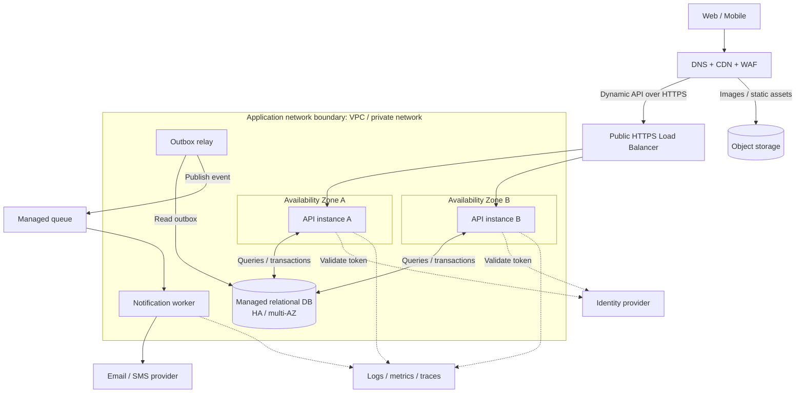
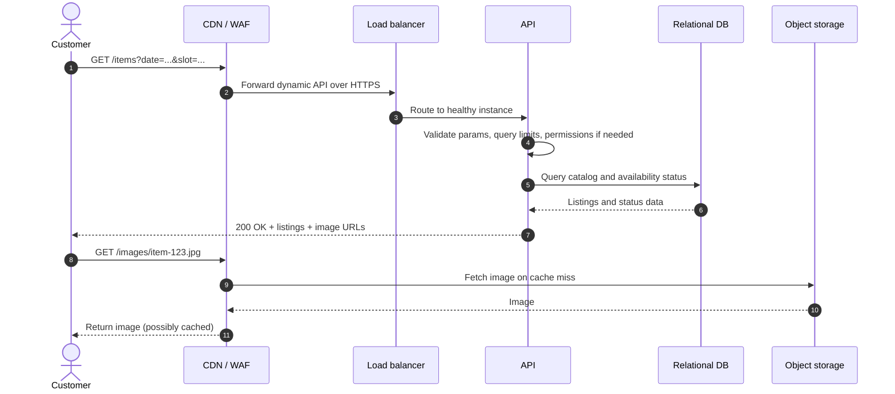

# Reading a Reference Architecture: From Requirements to Processing Flows

## 1. Lesson Objectives

A **reference architecture** describes how groups of components can work together to solve a class of problems. It helps kick off design, discuss system boundaries, and identify decisions that must be verified. It is **not** a pre-built configuration guaranteeing the system will meet latency, availability, or security targets.

After this lesson, you can:

- Translate business and quality requirements into elements to look for on a cloud architecture diagram.
- Read a diagram from three angles: **components**, **trust boundaries**, and **processing/data flows**.
- Trace a read request and a write request from the user to data storage, including failure branches and asynchronous processing.
- Explain why the architecture selects specific networking, compute, database, queue, and deployment choices.
- Ask evaluation questions based on reliability, security, performance/scalability, cost, and operability using **Well-Architected** thinking.

In the **CLOUD_ARCHITECTURE** module, reading a diagram is only the first step. The goal is traceability: **which requirement drives which decision, which flow that decision impacts, and what evidence verifies it**.

## 2. Context: Equipment Rental Booking System

Suppose a business wants to build a web/mobile application for customers to browse available equipment by time slot and make bookings. After a successful booking, the customer receives a notification; staff can view bookings. This is a **hypothetical learning scenario**, not a final production deployment design.

### 2.1. From Business Needs to Measurable Criteria

| ID | Assumed Requirement | Architectural Implications to Examine |
|---|---|---|
| F1 | View catalog, images, and search equipment by time | Fast read path; store images separately from transactional data; optionally cache catalog data |
| F2 | Book equipment for a time slot | Check booking conflicts **inside the write transaction**, not relying solely on search results |
| F3 | Send notifications upon successful booking | Can process via a queue so email provider failures do not break the booking transaction |
| Q1 | At an assumed peak of **200 HTTP requests/second**, roughly **15%** are writes | Must measure read/write load, DB connections, CPU, instance counts, and autoscaling capability |
| Q2 | Test targets: search **p95** under **400 ms** and booking under **1.5 seconds** | Must define measurement start/end points, allocate latency budgets, and monitor each hop |
| Q3 | Core API availability target **99.9% monthly** | Avoid single points of failure, place app across at least two Availability Zones (AZs), test recovery |
| Q4 | If one AZ fails: recovery target **RTO ≤ 60 minutes**, max data loss **RPO ≤ 15 minutes** | Need failover mechanisms, backups/restores, and drills; clearly define failure scope |
| Q5 | Accounts, contact info, and rental schedules must be protected | Authentication, authorization, encryption, secret management, network access limits, audit logs |
| Q6 | Limited operating budget, small operations team | Prefer managed services when appropriate; track billing, recoverability, and complexity |

Figures Q1–Q4 are **assumptions for analytical practice**, not benchmarks or cloud provider commitments. For instance, if the actual write ratio is 15%, a 200 req/s peak averages about 30 writes/s; distribution may be uneven, and contention on **the same item/time slot** is what determines booking safety.

Before locking in the architecture, the team must also ask about projected growth, item count, history retention duration, geographic distribution, data residency requirements, regulatory compliance, notification priority, and quantitative budget. **Without these details, the diagram is only a hypothesis-based proposal.**

## 3. Reading the Overall Diagram

The diagram below depicts a reasonable option for an application with one primary geographic region, using a **stateless** application, a managed relational database, and asynchronous notification processing.



**How to read the notation:** solid arrows represent primary flows/business dependencies; dashed arrows represent supporting integrations. The diagram is **logical**: queues, object storage, identity provider, and observability systems may be cloud services outside the VPC accessed via appropriate secure endpoints/methods. The VPC box also does not yet show full route tables, firewalls, private endpoints, or physical network zones. Actual deployment configurations must add them.

### 3.1. Reading from Outside In

| Block | Role | Verification Questions |
|---|---|---|
| DNS/CDN | Domain resolution; serving images and static assets close to users | What content is cached? What are the TTL and invalidation mechanisms? |
| WAF and rate limiting | Filters risky request patterns; limits abuse | Which rules protect public APIs? Could they block legitimate users? |
| Load balancer | Terminates or forwards TLS, health checks, distributes requests to healthy APIs | Across how many AZs do APIs run? How are requests handled when an instance/AZ dies? |
| Stateless API | Executes business logic, authN/authZ, coordinates with DB | Is session state held in one instance's memory? Can replicas scale up/down safely? |
| Managed relational DB | Holds primary transactional data, booking constraints, backup/failover | Which node is the writer? How do transactions and indexes prevent double-booking? |
| Object storage | Stores images/files instead of large blobs in transactional tables | Are files public? Are origin access controls or signed URLs configured properly? |
| Outbox relay + queue + worker | Converts committed events into notification delivery tasks | Can events be published/consumed multiple times? How are retries and dead-letter queues handled? |
| Identity provider | Sign-in, issuing/verifying identities via protocols like OIDC/OAuth 2.0 | How does the API verify signatures, expiration, issuer/audience, and access scopes? |
| Observability | Collects signals to detect, isolate, and resolve incidents | Can an entire request journey be traced by trace/request ID? |

### 3.2. Reading Trust Boundaries

Dividing the diagram into access domains clarifies why **networking** is an architectural decision:

1. **User devices and Internet:** all input data must be validated; HTTPS protects data in transit. WAF does not replace authorization checks inside the API.
2. **Public ingress tier:** only intentionally public endpoints (e.g., load balancer) are exposed to the Internet. Restrict ports, protocols, methods, and access levels as needed.
3. **Private application tier:** API/worker run in a private network whenever possible; API receives requests via the load balancer and does not need direct public IPs.
4. **Data tier:** DB accepts no direct Internet connections; only application security groups/firewalls and approved admin tasks are permitted access under least privilege.
5. **Managed or third-party services:** use private endpoints when supported and appropriate; if outbound Internet access is required, restrict egress, manage credentials, set timeouts, and observe integration failures.

Connection paths require matching authentication, authorization, and encryption mechanisms. For example, a request carrying a valid token must still be checked for whether the caller is authorized to view **another person's booking**. That is per-resource authorization, distinct from identity authentication.

## 4. Read Flow: Customer Searching Equipment

Suppose a user opens the listings page and searches for equipment available tomorrow from 09:00–10:00.



**Points to trace:**

- **Where is caching placed?** CDN fits images and static assets. Infrequently changing listings may use short-lived caches, whereas `available` status changes rapidly. A stale lookup result must never be treated as a guaranteed right to book.
- **What does the database return?** The API should paginate and avoid returning entire histories; queries by `item_id`, time range, and status need proper indexes verified via query execution plans.
- **Where does latency come from?** Total latency comprises network, WAF/LB, API processing, DB connection wait, query execution, and response serialization. A low DB p95 does not automatically mean a low end-to-end p95.
- **Which data is sensitive?** The API returns only fields needed for the screen; logs must not record tokens, phone numbers, or personal info unnecessarily.

Search queries can be optimized with caches or read replicas, but the decision to **tolerate slightly stale data** must be explicit. Final booking must still be protected on the transactional write path.

## 5. Write Flow: Safe Booking and Emitting Notifications

This flow carries higher business criticality: two people may simultaneously see the same equipment as available before both click **Book**.

### 5.1. Define Business Invariants Before Choosing Technology

**Invariant:** an item must not have two active/occupying bookings for the same time slot. Running an independent `SELECT shows available` followed by `INSERT` **does not enforce** this invariant when two requests execute concurrently.

For systems using discrete time slots, a unique constraint on `(item_id, slot_id)` for held/confirmed states combined with a transaction can be used. For flexible time-interval rentals, overlap checks must be designed using appropriate locks, DB range exclusion constraints if supported, or equivalent concurrency-safe reservation mechanisms. There is no single universal SQL statement for all DBs and all time-slot rules.

Every booking submission should carry an **idempotency key** so retries after a timeout do not create duplicate orders. Key scope (e.g., `user_id + key`) and retention period must be defined. The API must distinguish **retrying the same request** from **two distinct requests competing for the same slot**.

### 5.2. Tracing the Happy Path

```mermaid
sequenceDiagram
    autonumber
    actor User as Customer
    participant API as API service
    participant DB as Transactional DB
    participant Relay as Outbox relay
    participant Queue as Queue
    participant Worker as Worker
    participant Mail as Email/SMS

    User->>API: POST /bookings + token + Idempotency-Key
    API->>API: Check permissions, input, rate limits
    API->>DB: BEGIN; check key; write booking + outbox; COMMIT
    alt Slot available
        DB-->>API: Commit succeeded, booking_id
        API-->>User: 201 Created + booking_id
        Relay->>DB: Read committed outbox events
        DB-->>Relay: booking.created
        Relay->>Queue: Publish event_id + booking_id
        Queue-->>Worker: Deliver message
        Worker->>Worker: Check if event_id already processed
        Worker->>Mail: Send notification
        Mail-->>Worker: Delivery result
        Worker-->>Queue: Ack on success
    else Slot conflict
        DB-->>API: Constraint violation / conflict
        API-->>User: 409 Conflict + suggest alternative slots
    end
```

`booking` and `outbox` are written **in the same transaction**. This prevents a situation where the DB commits the booking but the app crashes before sending the event to the queue. The relay reads outbox rows and may republish after timeouts; thus queue/consumer must be designed for **at-least-once** semantics and the worker must be idempotent. Marking events as published, retrying with backoff, and monitoring stale events stuck in the outbox are mandatory parts of operational design.

Close-to-business-logic pseudocode:

```text
POST /bookings (user_id, item_id, slot_id, idempotency_key)
  1. Authenticate caller; validate item, slot, and booking permissions.
  2. Begin transaction.
  3. If (user_id, idempotency_key) already has a recorded result: return previous result.
  4. Otherwise: create booking; DB prevents item + slot conflict
     via constraint/lock designed for occupying states.
  5. Create outbox record "booking.created" in the same transaction.
  6. Commit; return booking_id after commit succeeds.

Outbox relay: find unpublished events -> publish to queue -> record progress.
Worker: receive event -> deduplicate by event_id -> send notification
        -> record processing status -> ack.
```

In real implementations, the idempotency-key lookup branch needs atomic/DB-constraint enforcement to prevent two concurrent requests with the same key from both running simultaneously. If an external side effect is not idempotent, track delivery state separately or pass the provider's idempotency key when supported. This design achieves **zero double-bookings**, while **exactly-once email delivery** must still be verified against provider capabilities and retry mechanisms.

### 5.3. Tracing Failure Branches, Not Just the Happy Path

| Failure | What Could Happen? | Required Response |
|---|---|---|
| Two customers book the same slot | Both requests read the slot as free | Constraint/transaction lets only one write succeed; the other receives a clear conflict error |
| API times out after DB commit | User assumes booking failed and retries | Retry with same idempotency key; API returns the earlier result |
| API crashes before commit | Transaction does not complete | DB rolls back; request can be safely retried |
| API crashes right after commit | Order exists but response was lost | Retry by key; outbox row still exists for relay to publish event |
| Queue or email provider temporarily fails | Booking is saved, notification is delayed | Retry with backoff, max attempts, dead-letter queue, and backlog alerts |
| Worker receives same message twice | Might send duplicate email | Deduplicate by `event_id` and track delivery state; accept external side-effect limits |
| DB failover mid-write | Transaction commit status may be uncertain | Do not guess; query by idempotency key once connectivity recovers |

If payments are added later, you need states such as `PENDING_PAYMENT`/`CONFIRMED`, hold expiration times, signature-verified webhooks, and reconciliation. **Never treat opening a payment page or receiving an unverified callback as a successful payment transaction.** That expansion changes hold invariants and order lifecycles, so state flows must be redesigned before changing schemas.

## 6. From Components to Design Decisions

Do not conclude an architecture is good just because a diagram has many cloud services. For each component, trace **requirement → choice → trade-off → verification method**.

| Decision | Rationale in Example | Trade-off / Risk | How to Verify |
|---|---|---|---|
| Stateless API across multiple AZs | Easy to add instances and keep serving if one fails | More instances increase DB connections; transient state cannot stay in one machine's RAM | Peak load test, kill instance/AZ, check connection pool |
| Managed relational DB | Needs transactions and consistency constraints for bookings | Connection limits, storage/IO scaling and pricing; brief failover interruption | Booking contention test, query p95 checks, failover/restore drills |
| Object storage + CDN | Many images, infrequent changes, suited for static delivery | Stale cache, origin access controls, and data transfer costs | Check cache headers, invalidation, signed URL/private access, egress bills |
| Queue + worker for notifications | Slow or failing email/SMS shouldn't block bookings | Async flows harder to trace; messages may repeat or arrive late | Test queue backlog, retries, DLQ, and deduplication behavior |
| Single region, multi-AZ | Simpler than multi-region ops; improves resilience to AZ faults | Does not automatically survive full-region outages | Explicitly state RTO/RPO scope; assess when cross-region DR is needed |
| Infrastructure as Code + phased deployment | Reproducible environments and fewer manual config errors | Requires secret/state management and data migration plans | Review changes, test rollout/rollback, rehearse rebuilding environment |

A minimal **Architecture Decision Record (ADR)** can state:

> **Decision:** use a managed relational database for the bookings table.  
> **Context:** each equipment item may be booked only once per time slot; concurrent write requests occur.  
> **Options considered:** relational DB with transactions and constraints; key-value store with custom locking.  
> **Rationale:** consistency needs align with relational transactions and constraints; small team avoids building custom distributed locking.  
> **Consequences:** must design indexes, test contention, bound connections, and establish failover procedures.

An ADR explains **why** a block exists; a diagram only shows **where it sits and what it connects to**.

## 7. Evaluating Quality Attributes

### 7.1. Reliability and Recoverability

Placing two API instances across two AZs solves only part of the problem. Inspect the entire path: DNS/CDN, load balancer, API, DB writer, queue, worker, and notification provider. If the DB has only a single node without failover, multi-instance APIs still share a single point of failure.

Distinguish clearly:

- **Availability/SLO:** ratio of valid requests served per commitment over a time window, e.g., 99.9%/month target. Clearly define which requests count and which error classes are excluded.
- **RTO (Recovery Time Objective):** target maximum duration to restore service after a defined incident.
- **RPO (Recovery Point Objective):** maximum acceptable data loss measured in time at the recovery point; not the time needed to fix a bug.
- **HA/failover:** limits interruption when a component fails; **backup/restore** enables recovery from data loss, logic corruption, or human error. HA does not replace backups.

In the example scenario, the RTO/RPO in section 2 apply to **losing one AZ**. There is not yet a target for losing an entire region. Committing to region-outage recovery requires clarifying business needs, then evaluating replication, cross-region backups, DNS failover, consistency, and corresponding cost. Never interpret `multi-AZ` as `multi-region`.

A valuable drill is terminating one instance, then simulating an AZ outage and DB failover in a test environment. Measure failed requests, recovery time, double-booking occurrences, and outbox/queue event status. Backups are only meaningful when **a test restore succeeds**.

### 7.2. Security Along the Data Path

Read security architecture backwards from **the data to protect** to the access sources:

1. Classify accounts, contact details, rental schedules, public/private images, and log data; define retention, deletion, and access permissions.
2. Protect data in transit with HTTPS/TLS; encrypt data at rest appropriately and manage keys/secrets in dedicated services.
3. Separate runtime permissions for API, relay, worker, and admins; each role accesses only necessary resources (least privilege).
4. Validate tokens, object-level authorization, inputs, rate limits, and abuse protections. WAF is an extra layer, not a replacement for authorization.
5. Audit critical operations, protect logs from leaking personal data, and implement credential rotation/revocation mechanisms.

For non-public images, CDN/object storage needs access controls such as signed URLs or application-mediated authorization. Do not make an entire bucket public just to display a few images.

### 7.3. Performance and Scaling

`200 requests/second` is not enough to size machines. You need to know which requests are heavy, payload sizes, cache hit ratios, queries per request, query durations, DB connection counts, and burst multipliers. As the API scales horizontally, the DB often becomes the first bottleneck.

An effective verification sequence:

1. Measure **p50, p95, p99** of APIs and queries; separate client-perceived latency from server processing latency.
2. Run load tests with realistic traffic mixes (reads/writes, growing datasets, multiple users competing for the same slot), including sudden spikes and sustained load.
3. Observe CPU/memory, connection pools, failed/conflicted transaction counts, lock waits, queue depth, and message age.
4. Fix measured bottlenecks (indexes, query limits, appropriate caching, batching, autoscaling), then re-measure.

Cache only data allowed to be stale. Search results may be stale; the final decision on whether a booking succeeds must rely on a protected transaction against the authoritative data store.

### 7.4. Cost and Operations

Cost is not just API instance count. Include database and standby instances, storage/backups, queues, email/SMS, CDN/egress, logs/traces, NAT or private endpoints, test environments, and standby headroom. Autoscaling can trim compute cost during low load, whereas HA databases usually carry fixed baseline costs.

Set budget alerts, tag by environment/service, and track **cost per successful booking** to spot abnormal growth. Never slash logs, backups, or security configurations in ways that break SLO/RPO targets; weigh cost savings against measured risk.

From an operational perspective, describe deployment steps: IaC creates networks and services, pipelines run tests and migration checks, API versions roll out gradually, health checks verify readiness, and rollbacks trigger when metrics degrade. For DB schemas, prefer backward-compatible **expand → migrate → contract** migrations; rolling back code does not always roll back data.

### 7.5. Reviewing with Well-Architected Thinking

Well-Architected frameworks organize questions into pillars. For example, the **AWS Well-Architected Framework** has six pillars: *Operational Excellence, Security, Reliability, Performance Efficiency, Cost Optimization, Sustainability*. This evaluation mindset remains valuable even when designing provider-agnostically.

| Lens | Question to Ask the Sample Diagram | Expected Evidence |
|---|---|---|
| Operational Excellence | Who receives alerts when notification backlogs grow or DB fails over? | Dashboards, alerts, runbooks, on-call process, and incident drills |
| Security | Does the DB allow public connections? Who can read contact details? | Network/IAM rules, permission tests, audit logs, secret rotation |
| Reliability | Can bookings still succeed if one AZ goes down? | Failover scenarios, RTO/RPO metrics, and restore results |
| Performance Efficiency | Does API p95 still meet targets at peak load and during cache misses? | Load tests, traces, slow queries, and saturation metrics |
| Cost Optimization | Which components drive high fixed or egress costs? | Bill breakdown, tags, budgets, and cost/transaction |
| Sustainability | Are resources sitting idle or retaining data longer than needed? | Utilization tracking, retention/deletion policies, capacity tuning |

A useful review always pairs questions with **measurable evidence or inspectable configurations**, rather than checking a box as “done” just because a service icon appears on a diagram.

## 8. A 7-Step Process to Read Any Reference Architecture

1. **Frame the system.** Identify actors, critical functions, sensitive data, and external dependencies; explicitly note missing assumptions.
2. **Bind requirements to criteria.** Separate functional items, SLOs/SLIs, RPO/RTO, security, cost, and operations; avoid words like “fast” or “stable” without units of measurement.
3. **Identify components and boundaries.** Categorize edge, public/private networks, compute, DB, object storage, message brokers, identity, and observability; look for shared failure points.
4. **Trace the read path.** Walk from client to data and back to response; inspect caching, queries, auth, pagination, and latency budgets.
5. **Trace the write path.** Walk from request to transaction, side effects, events, and response; identify invariants, idempotency, commit order, and data ownership.
6. **Walk failure branches.** Simulate timeouts, retries, concurrent requests, dead instances, DB failover, queue backlogs, and AZ loss; ask what happens to committed data.
7. **Record decisions and evidence.** For each key choice, state rationale, alternatives, trade-offs, and tests/metrics; list remaining unanswered questions.

You can capture a traceability table after reading a diagram:

| Requirement | Related Flow | Responsible Components | Residual Risk | Evidence to Collect |
|---|---|---|---|---|
| No double-bookings | POST /bookings | API + DB transaction/constraints | Race condition if reservation algorithm changes | Concurrency test on same slot |
| Search p95 < 400 ms | GET /items | CDN/LB/API/DB | Cache misses and slow queries | Tracing + end-to-end p95 load test |
| Receive notifications | booking.created | Outbox/queue/worker | Duplicate events, delayed delivery, provider errors | Retry/DLQ test, backlog metrics, and `event_id` logs |
| Lose one AZ | Both read and write flows | LB/multi-AZ API/HA DB | Dropped connections during failover | Recovery drill and RTO/RPO measurement |

## 9. Practice Exercise: Critique the Sample Architecture

**Scenario A.** The development team proposes removing transactions and simply calling `GET /availability` before `POST /bookings`. Two users click book simultaneously. Identify which invariant could be violated, which component must enforce protection, and a test scenario sufficient to reproduce it.

**Scenario B.** The email provider fails for 15 minutes. Bookings must still succeed, yet customers need visibility into status. Draw the queue retry branch, dead-letter queue, alerts, and how to verify no excessive duplicate emails are sent.

**Scenario C.** Traffic triples and booking latency spikes sharply even though API CPU remains low. Propose at least three measurements to take before deciding to add API instances; explain why the bottleneck could be in the DB or contention on a single slot.

**Scenario D.** Management requires recovery within 30 minutes after losing an entire region. Explain why the current diagram is insufficient, what decisions must be added, and what extra cost and complexity arise.

**Self-check hint:** a strong answer clearly traces the request path, identifies the authoritative data store, defines commit conditions, names failure modes, assigns component ownership, and specifies measurement tests. You do not need to name specific AWS/Azure/GCP services if the logical diagram and reasoning are clear.

## 10. Red Flags to Question When Reviewing an Architecture Diagram

- Many service icons appear, yet it is unclear what data each arrow carries or whether calls are synchronous or asynchronous.
- Labels like `multi-AZ`, `autoscaling`, or `high availability` appear without specifying which components are redundant, failover assumptions, and test methods.
- A cache is shown without stating data types, TTLs, refresh mechanisms, and acceptable staleness.
- A queue is shown without specifying idempotency, retries, dead-letter queues, duplicate handling, or stuck events.
- A DB is shown without identifying the authoritative source of truth, invariant-protecting transactions, backup methods, and restore procedures.
- WAF/TLS are present, yet object-level authorization, secret management, or network boundaries are missing.
- SLO/RPO/RTO targets exist without metrics, failure scopes, or verification drills.
- A scaling plan exists without load data, DB load capacity, rollback plans, or projected costs.

Successfully reading a reference architecture means being able to **recount and verify** the journey of a request from business need to storage, response, and incident handling. A diagram is a map; transactions, permission boundaries, consistency, operational metrics, and trade-off decisions determine whether that map works under real-world conditions.
