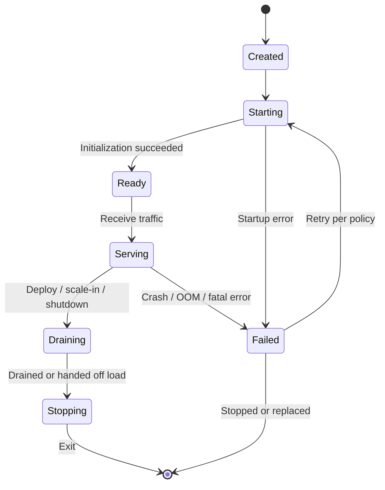
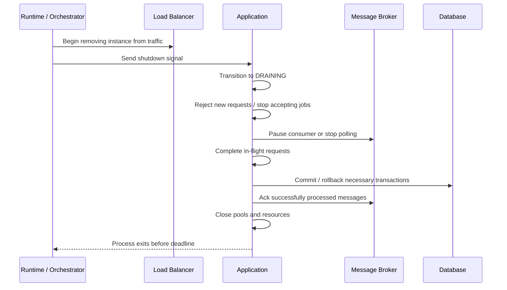
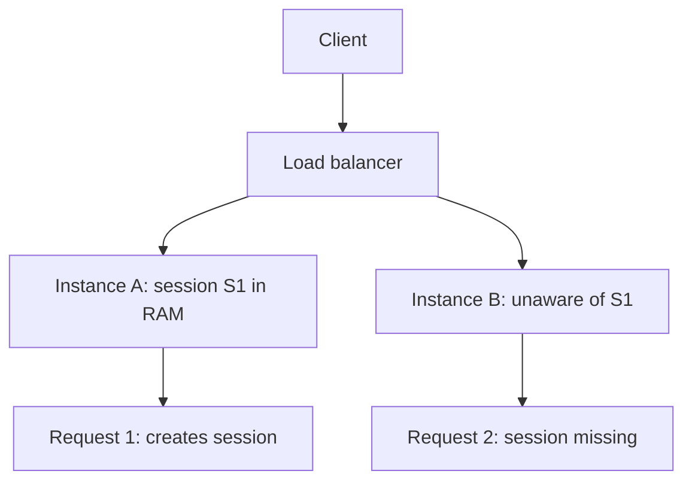
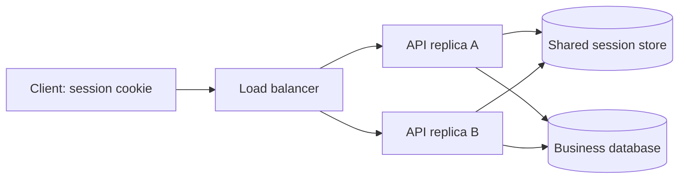
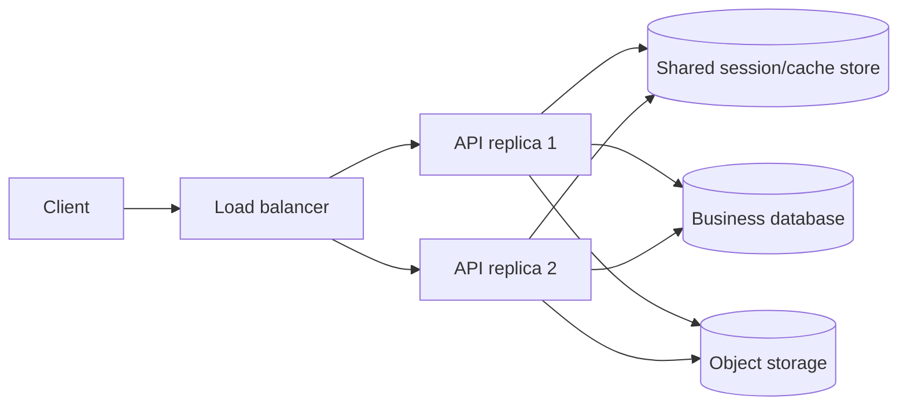

# Process Lifecycle, Session State, and Temporary Storage

## 1. Why Is Process Lifecycle an Architectural Concern?

Cloud applications commonly run on resources that can be created, replaced, scaled, or reclaimed automatically. A VM may be rebooted for maintenance; a container may be replaced after deployment; an instance may be scaled in; a function may terminate right after finishing one invocation. Consequently, an application that works well on a developer's machine may fail under restarts, node loss, or fluctuating replica counts in production.

Three concepts must be designed together:

- **Process lifecycle:** how a process starts up, receives traffic, stops accepting new work, drains in-flight work, and exits.
- **Session state:** data tied to a user's experience or interaction sequence, such as authentication state, a shopping cart, or checkout steps.
- **Temporary/ephemeral storage:** data that only needs to persist for a bounded duration or within the lifetime of an instance, container, or execution.

In the **CLOUD_ARCHITECTURE** module, the **Compute Architecture** chapter frames these concepts within compute selection, reliability, security, scalability, cost, and operations using a Well-Architected mindset.

After this lesson, you will be able to:

1. Describe the startup, readiness, serving, draining, and shutdown stages of a process.
2. Distinguish liveness, readiness, and startup checks, and configure controlled shutdown.
3. Recognize why in-memory local session state causes issues during scaling, restarts, or request routing.
4. Choose where to store sessions and temporary data based on lifespan, durability, and shareability.
5. Design applications to withstand retries, restarts, scale-ins, deployments, and infrastructure failures.
6. Write test scenarios and operational criteria for lifecycle, sessions, and temporary storage.

## 2. A Process Is Not a Server

A **process** is a running program instance with its own memory space, threads, file descriptors, sockets, environment variables, and OS resources. A process can live inside a VM, container, pod, worker, or serverless execution environment.

| Component | Meaning | What Can Happen |
| --- | --- | --- |
| Physical machine | Datacenter hardware | Hardware faults, maintenance |
| VM/instance | Virtual machine allocated CPU, RAM, network, and disk | Stop, reboot, terminate, replace |
| Container | Packaged and isolated process and filesystem per runtime | Restart, recreate, reschedule |
| Pod/workload | Deployment unit in an orchestration system | Reschedule to another node, scale replicas |
| Process | Executing program | Crash, exit, signal, OOM kill |
| Request/job | A unit of work handled by a process | Timeout, retry, cancellation, duplicate processing |

A healthy VM does not guarantee the process is healthy. A container in `Running` status does not guarantee the application is ready for traffic. Nor does a healthy process guarantee that databases or partner services are responding.

**Never tie business data durability to a process's lifecycle.** Heap memory, static variables, local files, and temp directories can disappear when a process or instance is replaced.

## 3. Stages of a Process Lifecycle

A web service typically progresses through these stages:

1. **Created:** runtime creates the process/container/instance and attaches configuration.
2. **Starting:** reads configuration, loads dependencies, connects to required services, warms caches, or initializes pools.
3. **Ready:** satisfies minimum conditions to accept valid requests.
4. **Serving:** handles requests, messages, or jobs.
5. **Draining:** stops accepting new work, while finishing or handing off in-flight work.
6. **Stopping:** closes connections, releases resources, and flushes required state.
7. **Exited:** process terminates; runtime may retain, restart, or replace the container per policy.



This diagram is a conceptual model. Every runtime has its own state machine and grace windows. Kubernetes defines a Pod lifecycle and termination grace period; VMs have stop/terminate lifecycles; FaaS invocations have execution deadlines. Application design must match the actual contract of the execution environment.

### 3.1. Startup Needs Deadlines and Error Distinction

Startup can fail due to missing environment variables, bad secrets, incompatible schemas, temporarily unreachable dependencies, or invalid config. Never retry a permanent configuration error indefinitely.

- **Permanent/configuration error:** missing secret, wrong port, unsupported schema version; log clearly and exit to be fixed.
- **Transient dependency error:** database or secret service temporarily disrupted; retry with bounded backoff.
- **Slow initialization:** prolonged warm-up or cache building; set appropriate startup timeouts and withhold traffic until ready.
- **Partial capability:** a non-critical feature is unavailable; consider intentional degradation if business rules permit.

Startup must emit logs/metrics showing which stage the process is in and whether startup duration changes across releases.

## 4. Readiness, Liveness, and Startup Probes

Three health check types answer three distinct questions:

| Check | Question | What Does the System Typically Do on Failure? |
| --- | --- | --- |
| **Startup probe** | Has the application finished starting? | Suppresses liveness/readiness checks per policy until startup succeeds or hits its limit |
| **Readiness probe** | Can this instance accept new requests? | Removes the endpoint from traffic/load balancing or marks it not ready |
| **Liveness probe** | Is the process functioning well enough to continue running? | Runtime may restart the container/process per policy |

Never use one endpoint for every purpose without understanding what each means.

- Readiness can verify conditions genuinely needed for incoming requests, such as loaded configuration and a healthy connection pool.
- Liveness should generally check the process, event loop, or core internal state, avoiding direct dependence on a database during transient DB outages. If every replica fails liveness when the DB is down, the runtime can trigger mass restarts and worsen the incident.
- Startup probes prevent slow-starting applications from being prematurely killed by liveness checks.

**A health check is not a comprehensive test of every dependency.** An overly deep health endpoint can hammer the database continuously or trigger cascading service outages. Separate internal health, readiness, and dependency/observability checks by clear intent.

### 4.1. Example Health Endpoints in a Java Application

The snippet below illustrates the concept, not a complete framework configuration:

```java
@RestController
class HealthController {
    private final ApplicationLifecycle lifecycle;

    HealthController(ApplicationLifecycle lifecycle) {
        this.lifecycle = lifecycle;
    }

    @GetMapping("/health/live")
    ResponseEntity<Map<String, String>> live() {
        return ResponseEntity.ok(Map.of("status", "alive"));
    }

    @GetMapping("/health/ready")
    ResponseEntity<Map<String, String>> ready() {
        if (!lifecycle.isReady() || lifecycle.isDraining()) {
            return ResponseEntity.status(503)
                    .body(Map.of("status", "not-ready"));
        }
        return ResponseEntity.ok(Map.of("status", "ready"));
    }
}
```

In practice, liveness endpoints must reflect process failures that a restart can actually fix. Readiness must match request-serving ability. If the database fails, readiness may need to become false, whereas liveness does not necessarily become false. If only a non-core feature fails, consider continuing to serve independent APIs.

## 5. Graceful Shutdown: Controlled Termination

**Graceful shutdown** is the process by which an application stops accepting new load, finishes or hands off in-flight work, closes resources, and exits before the runtime forcibly kills the process.



Exact ordering depends on protocol and runtime. The load balancer may need to stop sending traffic before the process closes its listener; workers must pause message intake while keeping permission to finish in-flight messages. If the process cannot finish before the deadline, messages must be safely redelivered or requests must fail in a client-retry-safe manner.

### 5.1. Required Steps

1. Switch internal state to draining so no new work is accepted.
2. Mark readiness false and update the load balancer/service discovery.
3. Stop pulling new messages or reduce consumer concurrency to zero.
4. Wait for in-flight requests/jobs up to a bounded timeout.
5. Commit completed transactions or roll back incomplete ones.
6. Acknowledge messages only after durable changes are confirmed.
7. Close the HTTP server, database pools, telemetry exporters, and executors.
8. Exit the process before the termination deadline; log the shutdown reason.

A request that returns a success response before committing data is a design bug. Responses returned to clients must remain consistent with durable business outcomes.

### 5.2. Signals and Time Limits

In Linux environments, processes typically receive `SIGTERM` when asked to shut down gracefully; after a grace period, the runtime or OS may send `SIGKILL`. Application hooks cannot catch `SIGKILL`. On Windows or serverless platforms, termination signals and mechanisms may differ—always check runtime documentation.

Illustrative Kubernetes configuration example:

```yaml
spec:
  terminationGracePeriodSeconds: 45
  containers:
    - name: api
      lifecycle:
        preStop:
          exec:
            command: ["/bin/sh", "-c", "sleep 5"]
```

This example only illustrates a grace period and hook. Never blindly copy `sleep` as a default draining solution: hooks consume shutdown time budget, do not guarantee the load balancer has stopped sending traffic, and do not replace application-level graceful shutdown logic. Real designs must coordinate readiness, deregistration delays, `preStop`, shutdown hooks, and request processing durations.

**The shutdown time budget** must cover drain duration, transaction completion, connection closure, and a safety margin. If requests can run for 2 minutes while termination grace is 30 seconds, adjust request limits, support checkpointing/handoff, or choose a different deployment strategy.

## 6. Managing Workers and Messages During Shutdown

Background workers typically consume messages from queues. Suppose a worker reads a `ProcessPayment` message, calls a partner API, updates the database, and then acks. If the process dies after the partner completes the charge but before the ack, the message can be redelivered.

Therefore:

- **At-least-once delivery** is common: a message may arrive multiple times.
- Consumers need idempotency or an inbox/deduplication mechanism so repeated logical commands do not produce duplicate side effects.
- Ack only when durable work meets the contract conditions.
- If a message is mid-flight during shutdown, let the timeout/visibility timeout expire or actively release/requeue it according to broker semantics.
- Cap processing time, renew visibility/leases when appropriate, and handle poison messages via bounded retries and a DLQ.

Do not assume every queue/broker shares identical semantics. Some use ack/nack, while others use visibility timeouts, partition offsets, or leases. Design shutdown around the specific broker semantics.

### 6.1. Duplicate-Resistant Consumer Example

This is pseudo-code; checking/marking messages and applying business updates must use proper concurrency control:

```java
public void handle(Message message) {
    if (inboxRepository.isProcessed(message.id())) {
        acknowledge(message);
        return;
    }

    transactionTemplate.executeWithoutResult(tx -> {
        if (inboxRepository.tryMarkProcessing(message.id())) {
            orderService.apply(message.payload());
            inboxRepository.markProcessed(message.id());
        }
    });

    acknowledge(message);
}
```

If checking/marking lacks a unique constraint or proper transaction boundaries, two consumers can still process concurrently. If acknowledgement fails after commit, redelivery must recognize the message is already processed.

## 7. What Is Session State?

A **session** is a sequence of interactions that an application recognizes as belonging to the same user, client, or workflow. A session may store authentication state or identity references, shopping carts, filters, checkout steps, CSRF tokens, or session metadata.

Distinguish **authentication** from **session data**:

- The identity provider authenticates the user and issues tokens/credentials per the chosen mechanism.
- The session store or token carries references/data needed to maintain context across requests.
- Authorization must be evaluated per request and resource; holding a valid session does not mean a user can access every booking.

Never store all authoritative business data inside the session. Sessions should hold interaction/experience state; authoritative records like orders, balances, and ownership must live in their respective business stores.

## 8. Local Sessions and Scaling Problems

Traditional Java applications can store sessions in the JVM heap. On a single instance, subsequent requests naturally hit the same process. Once you add a load balancer and multiple replicas:



Consequences:

- Users are randomly logged out or shopping carts vanish.
- Requests fail when autoscaling shifts traffic to new instances.
- Deployments creating fresh instances wipe local sessions.
- Scale-ins terminate instances holding active sessions.
- Zone/region failovers do not carry RAM-resident sessions across.
- Uneven load distribution occurs if sticky sessions pin heavy traffic to a few instances.

### 8.1. Sticky Sessions Are Only a Partial Fix

Load balancers can route the same client back to a familiar backend. That preserves in-memory sessions in some cases, yet if a backend fails or scales in, the session is lost; traffic can skew unevenly; and rollouts or failovers still move clients between instances. Sticky sessions work as a stopgap or for specialized workloads, but should not be relied upon for durability of critical state.

## 9. Session Management Strategies

| Strategy | How It Works | Advantages | Limitations |
| --- | --- | --- | --- |
| In-memory per instance | Session lives in process heap | Simple, fast | Lost on restart, hard to share |
| Sticky sessions | LB pins client to one backend | Minimal initial code change | Fails on backend loss; load imbalance |
| External session store | Redis/database/session service | Shared state across all replicas | Extra dependency, cost, HA requirements |
| Stateless signed token | Client carries signed/encrypted token | Reduces server-side lookups | Revocation, token bloat, key rotation, stale data |
| Hybrid | Token identifier + store for revocable/shared state | Balanced trade-offs | More operational complexity |

### 9.1. External Session Stores

When sessions must be shared across replicas, Redis or a suitable managed cache can be used:



Design considerations:

- **Availability:** if the store fails, does the session fail closed or have a bounded fallback?
- **TTL:** distinguish absolute lifetime from idle timeout.
- **Data model:** store only necessary fields, cap payload sizes, and version the schema.
- **Atomicity:** renewals, session ID rotation, logouts, and updates must avoid race conditions.
- **Security:** encrypt in transit and at rest as needed, enforce ACLs/network isolation, and rotate credentials.
- **Capacity:** concurrent sessions, average size, read/write throughput, eviction, and failover.
- **Observability:** lookup latency, store errors, evictions, expirations, and revoked session counts.

Never assume Redis is automatically durable storage. Caches can evict keys or lose data during failover/restart depending on configuration; choose appropriate durability or use a database/session service when data must be strictly preserved.

### 9.2. Protecting Cookies and Tokens

Session cookies should carry appropriate attributes such as `Secure`, `HttpOnly`, `SameSite`, scoped `Domain`/`Path`, and sensible lifetimes. Prevent session fixation: generate a new session identifier upon login or privilege elevation. Logout or breach detection must support revocation/rotation by design.

For JWTs or self-contained tokens:

- Signing a token does not hide its payload; payloads are typically readable unless encrypted.
- Never place excessive sensitive data in tokens.
- Enforce short expirations, audience/issuer validation, and key rotation.
- Leaked access tokens remain valid until expiry without revocation/introspection mechanisms.
- Never use tokens to store mutable, bulky cart or transaction state.

A valid session only proves authentication context is active. For every action, the application must still verify authorization against the specific target resource. Never trust a client-supplied `userId` to determine session or record ownership. Multi-tenant systems must enforce tenant context across APIs, queries, and background jobs.

## 10. Session Timeouts vs. Workflow State

Two concepts are frequently conflated:

- **Session timeout:** how long a user session remains valid for continued interaction.
- **Business workflow expiry:** the deadline of a business operation such as a room hold, verification code, or payment session.

A user may log out while a booking remains awaiting payment; an expired session must not automatically delete a valid order. Conversely, a workflow hold can expire even while the browser session stays active.

| State | Authoritative Store | TTL / Expiration Policy |
| --- | --- | --- |
| Login session | Identity/session service | Per security policy |
| Temporary cart | Session store or cart service | Per business/idle timeout |
| Booking | Booking database | Per order lifecycle |
| Inventory hold | Inventory store | E.g., 5 minutes per business policy |
| Payment transaction | Payment context/provider reference | Per reconciliation and retention policy |
| CSRF token | Session/cookie per framework | Tied to session and policy |

Never use one blanket TTL for all data types. The system should check whether a hold is still valid and clearly display how to resume or cancel.

## 11. Temporary Storage: Classifying by Durability and Shareability

"Temporary" is not a single storage tier. Determine how long data must survive, when it is allowed to vanish, and who must access it.

| Type | Examples | Lifespan | Durability |
| --- | --- | --- | --- |
| Process memory | In-process caches, buffers, temp objects | Within process | Lost when process exits |
| Container writable layer | Temp files written inside container | Container instance/lifecycle | May vanish on recreate/replace |
| VM ephemeral/local disk | Scratch files, temporary workspaces | Per VM/instance or hardware | May vanish on stop/terminate/replace depending on type |
| OS temporary directory | `/tmp` on Linux | Per machine/container and cleanup policy | Not guaranteed durable |
| Persistent block volume | Disk attached to VM/compute | Survives restarts/replacements if configured properly | More durable than scratch; still needs backups/HA |
| Object storage | Uploads, exports, artifacts | Per retention/lifecycle policy | Durable per service SLA/config |
| Database | Persistent sessions, workflows, business data | Per record lifecycle | Needs backups/replication/retention |
| Shared filesystem | Files shared across instances | Per filesystem lifecycle | Depends on service and configuration |

Terms like ephemeral disk, local SSD, container layer, and `/tmp` carry different semantics across providers and runtimes. Never assume local storage survives stop/restart/relocation without checking instance-type and service documentation.

### 11.1. Selecting Storage by Questions

1. Is the file business data that must be recovered after a failure?
2. Do other instances need to read this data?
3. Must the data outlive the process or container?
4. Can it be regenerated from another source, or does it require backups?
5. What speed, IOPS, throughput, and latency are required?
6. Is the data sensitive—what encryption, access policy, and retention are needed?
7. During scale-out, could replicas overwrite or collide on filenames?

If data has business value, local temp should only hold a reproducible working copy. The canonical source must live in storage with proper lifecycle management and backups.

## 12. Temporary Files and Safe Cleanup

Applications frequently create temporary files when handling uploads, rendering PDFs, extracting archives, exporting reports, or converting media. Ensure you:

- Write files into a configured temporary directory, avoiding accidental writes to a read-only image filesystem.
- Use unpredictable filenames or safe temp-file APIs; never concatenate client-supplied filenames directly into paths.
- Bound file sizes, file types, concurrent file counts, and processing times.
- Close streams/file descriptors in `finally` blocks or equivalent resource-management constructs.
- Delete temp files upon completion, even when exceptions occur.
- Run a cleanup job for orphan files left after crashes, using explicit file-age and path bounds.
- Never rely solely on shutdown cleanup hooks: `SIGKILL` or host power loss bypasses hooks.
- Never write secrets, tokens, PII, or sensitive payloads to temp files without appropriate protection.

### 12.1. Java Example for Handling Temporary Files

```java
Path tempFile = Files.createTempFile("report-", ".csv");
try {
    try (OutputStream out = Files.newOutputStream(tempFile)) {
        reportExporter.writeCsv(out);
    }
    uploadToObjectStorage(tempFile);
} finally {
    Files.deleteIfExists(tempFile);
}
```

If an upload fails and must retry after the process terminates, you cannot rely on the local file; persist the job durably and store source files in shared/object storage, or regenerate the file on retry. Enforce filesystem quotas so instances do not run out of disk space.

### 12.2. Preventing Path Traversal and Symlink Attacks

Never join `uploadDir` directly with a user-supplied `originalFilename`. Sanitize names, generate internal IDs, verify the resolved path stays inside the allowed directory, and open files safely to avoid overwriting other resources. Permit only required file types and sizes; never trust client-provided MIME types. Shared temp directories require strict filesystem permissions so other processes cannot read files mid-processing.

## 13. In-Memory Caches vs. Business State

An in-process cache is not durable storage. Caches can be cleared, evicted, or stale; source data must have a clear owner.

| Data | Is In-Process Caching Acceptable? | Authoritative Source |
| --- | --- | --- |
| Slowly changing product/catalog reference | Yes, with TTL/invalidation | Catalog database/service |
| Search results | Can use cache/read models | Search index or catalog source |
| Account balances | Never use local cache for write decisions | Ledger/accounting store |
| Booking status | Read-only bounded caching only | Booking store |
| Payment final state | Never use cache to confirm transactions | Payment provider/ledger per policy |
| Feature flags/config | Cacheable per defined freshness and fallback rules | Configuration service |

If process A updates a local cache while the next request hits process B, data becomes inconsistent. If cache keys omit tenant/user scope, data can leak across users. Account for TTLs, invalidation, versioning, cache stampedes, stale-if-error, and distinguishing a cache miss from missing source data.

## 14. Stateless and Stateful Applications

**Stateless compute** means requests/jobs do not depend on state held solely inside a single process's local environment to keep functioning. It does not mean the system has no data or holds no business state.

A stateless application typically carries needed context in authenticated requests/tokens or external stores; persists business state in authoritative databases/services; routes requests to any replica interchangeably; handles retries and duplicate requests safely; and avoids relying on local files across invocations.

Stateful workloads still have legitimate uses: in-memory simulations, protocol-specific session affinity, windowed stream/cache processors, or game servers. However, you must define snapshotting, replication, checkpointing, sharding, and recovery. Never treat pinning to a fixed VM as durable state management without backups and failover.



This model lets replicas be replaced without relying on local sessions or files. Still, external stores themselves become dependencies requiring HA, capacity planning, IAM, network controls, and latency monitoring.

## 15. Retries, Idempotency, and Ambiguous Request Outcomes

A dangerous scenario occurs when a client disconnects after the server commits a write. Unsure whether the operation succeeded, the client retries. A process crash can also happen right after commit before sending the HTTP response.

Design business protocols with **idempotency**:

- Clients send a unique idempotency key per logical intent.
- The server stores the key mapping, actor/scope, and outcome in an authoritative store.
- If the same key arrives again with a compatible payload, return the previous outcome or a queryable status.
- If the same key arrives with a mismatched payload, reject per contract.
- The idempotency record's TTL must exceed the accepted retry and reconciliation window.

This is critical for payments, bookings, resource provisioning, message handling, and multipart upload completion. Recording the key, applying business changes, and linking outcomes must use proper transaction/concurrency controls.

## 16. Compute-Specific Lifecycles: VM, Container, Kubernetes, and Serverless

| Environment | Typical Lifecycle | Stop/Replacement Behavior | Local Data |
| --- | --- | --- | --- |
| VM/instance | Boot, service start, health, stop/reboot/terminate | Graceful OS shutdown if given time; hard failures still occur | Ephemeral/local disks may vanish; persistent volumes have distinct semantics |
| Container runtime | Create, start, running, stop, remove | Runtime sends stop signal and waits up to timeout | Writable layer belongs to container; volumes have separate lifecycles |
| Kubernetes | Pod scheduled/started/ready/terminating/removed | Controller may launch replacement Pod; readiness, `preStop`, grace period govern drain | `emptyDir` follows Pod lifecycle; PVCs follow storage class/access mode |
| Serverless/FaaS | Invocation, possible runtime reuse, exit/timeout | Environment may freeze/retire; invocations have deadlines | `/tmp` or local scratch is not durable shared state |
| Batch/worker | Job queued, running, checkpointed, completed/failed | Retries/replaces per job policy; may be preempted | Scratch is working copy only; checkpoints/inputs/outputs must be durable |

### 16.1. VM

For VMs, distinguish OS reboots, instance stop/start, terminate/recreate, and host failures. Persistent block volumes may survive several operations; local/ephemeral disks can be wiped on stop, host migration, or termination depending on the provider. Verify boot/root volume configuration, deletion behavior, and backups.

Startup scripts/user data are useful for initial bootstrapping, but should not serve as the sole mechanism holding long-lived secrets or performing uncontrolled app updates. Prefer golden images, IaC, configuration management, patching processes, and secret management.

### 16.2. Container

Treat containers as replaceable artifacts. Immutable images hold code and runtime dependencies; configs/secrets come from dedicated mechanisms; durable data is never written to the container writable layer. When a container is removed, changes in its writable layer can be lost.

If multiple containers must share files, consider object storage or a shared filesystem with suitable semantics and throughput. If a process needs scratch files for one execution, local temp works provided quotas and cleanup are enforced.

### 16.3. Kubernetes

- **Pods** have their own lifecycle; when a Pod is deleted, its controller can schedule a replacement Pod.
- **`emptyDir`** is created with the Pod and typically deleted when the Pod leaves the node; it is not durable storage.
- **`PersistentVolumeClaim (PVC)`** requests storage provisioned by CSI/providers; durability, access modes, performance, and attach behavior depend on the volume type.
- **Readiness/liveness/startup probes** govern traffic routing and container restarts.
- **`preStop` and `terminationGracePeriodSeconds`** support draining, but must be coordinated with the application and load balancer.
- **`PodDisruptionBudget`** limits certain voluntary disruptions; it does not protect against unexpected node/zone failures.

Never assume a PVC can always be mounted read-write concurrently from every node; verify access modes and drivers. Persistent volumes also do not replace backups and restore testing.

### 16.4. Serverless/FaaS

Some platforms reuse execution environments to reduce cold starts. Global variables or `/tmp` contents may linger across some invocations, but never rely on that persistence as a durability contract. An invocation may land on a brand-new environment or after an old one was recycled.

Functions should take enough input to complete the unit of work, read durable state from stores, write outcomes using idempotency keys, and finish before the deadline. Avoid opening unbounded long-lived connections or assuming local files will exist on the next run. Watch concurrency limits and database connection storms during rapid scaling.

## 17. Processes and Data During Rolling Deployments

During a rolling deployment, old and new process versions run side by side. This affects session schemas, message payloads, caches, and file formats.

- Database migrations should follow **expand–migrate–contract**: add backward-compatible schema changes, deploy new code, backfill data, and only then drop old fields.
- Session schemas must be versioned or mutually readable while old and new versions serve concurrently.
- Messages/events can sit in queues longer than a deployment window; new workers must read older messages per contract.
- Cache keys should include a version when serialization formats change so new processes do not choke on old cached objects.
- Temporary files might be picked up by a newer process/worker; document formats and metadata explicitly.

Rollback is not merely redeploying the old image. If the new version wrote sessions or database rows in an incompatible format, rolling back binaries can corrupt or break data reads. Maintain backward compatibility, avoid destructive migrations, handle live sessions and queue backlogs, keep backup/restore points, and verify business state after rollbacks.

## 18. Security and Privacy for Sessions and Temporary Storage

### 18.1. Sessions

- Use high-entropy session cookies/tokens, transmit over TLS, and set secure cookie flags.
- Rotate session IDs after authentication and significant privilege changes.
- Enforce idle timeouts and absolute timeouts; account logout/disablement must trigger revocation policies.
- Minimize data stored in sessions; store references rather than duplicating PII or payment details.
- Grant session store access strictly to workloads that need it.
- Never log raw cookies, tokens, or session payloads in access logs, exceptions, or trace attributes.

### 18.2. Temporary Storage

- Set least-privilege directory and file permissions; avoid world-readable files.
- Never let client-supplied filenames dictate destination paths.
- Encrypt disks/volumes/objects as required; manage keys properly.
- Implement cleanup, retention, and secure deletion workflows for sensitive data.
- Never treat file deletion as guaranteeing all copies, snapshots, or backups are erased.
- Never write heap/core dumps containing secrets or sessions to broadly accessible locations.
- Bound `/tmp` and ephemeral disk capacity; prevent DoS via disk quotas and concurrency limits.

### 18.3. Data Minimization Principle

Before storing data, ask whether it is genuinely required to serve the request. Unnecessary data should never appear in sessions, local files, queues, or logs. For data that must be buffered temporarily, set an expiration and owner, and purge or destroy it on schedule per policy.

## 19. Capacity Planning for RAM, Disk, and Session Stores

### 19.1. Estimating Session Storage

Preliminary formula:

```text
Session memory ≈ concurrent sessions
               × average serialized size
               × overhead factor

Hypothetical example:
100,000 sessions × 4 KB × 1.5
≈ 600,000 KB (approx. 586 MiB, excluding replication/fragmentation).
```

Measure actual serialized sizes, metadata, key overhead, replication, allocator fragmentation, TTL distribution, and peak concurrent sessions. If sessions hold large lists or files/images, keep large payloads in object storage or a database and store only IDs in the session.

### 19.2. Estimating Temporary Disk

If each task creates 20 MB files, up to 30 concurrent tasks run at once, and each task creates 2 working files:

```text
Peak scratch ≈ 20 MB × 30 × 2
             = 1,200 MB
```

Add margin for logs, uncleaned files, and upload/download buffering. Set quotas/limits, monitor disk utilization, and apply backpressure before filesystems fill up. Stream very large files directly to object storage or use multipart uploads instead of buffering entire files in RAM or local disk.

### 19.3. Connection Pools and Scale-Out

If 20 replicas each open up to 50 DB connections, the database can receive 1,000 app connections—excluding admin, worker, and migration connections. Scaling out processes can trigger a connection storm. Size connection pools against maximum replica counts, use proxies/poolers where suitable, cap concurrency, and monitor connection wait queues.

## 20. Observability: Measuring Lifecycle, Sessions, and Storage

| Group | Metrics | Operational Questions |
| --- | --- | --- |
| Startup | startup duration, startup failure count | Is the new release starting slowly or failing? |
| Readiness | ready replica count, unready duration | Are enough instances serving traffic? |
| Shutdown | drain duration, forced termination count | Are requests/jobs being forcibly killed? |
| Process | restarts, OOM kills, exit reasons | Why did the process die? |
| Request | in-flight count, latency, error rate | Do shutdowns or high load trigger request errors? |
| Queue | unacked/in-flight, redeliveries, DLQ, lag | Are workers dropping or duplicating work? |
| Session | active sessions, lookup latency, expirations, evictions | Are users losing sessions or overloading the store? |
| Temporary storage | disk usage, temp file count, cleanup failures | Is disk exhaustion or file leakage occurring? |
| Connection pool | active/idle/pending connections, timeouts | Is scale-out overloading the DB? |

Logs should include `instance_id`, `process_id`, `deployment_version`, `trace_id`, `request_id`, and correlation IDs per policy; never log raw session IDs or tokens. Use hashes or opaque correlation references if event linking is needed.

### 20.1. Distinguishing Intentional Restarts from Failures

Rolling deployments cause intentional restarts; OOM kills indicate resource limits; liveness failures can point to deadlocks or overly sensitive probes. Inspect exit reasons, orchestrator events, CPU/RAM/GC/thread-pool metrics, and traces to isolate root causes. Raising restart limits or adding RAM without diagnosing the cause merely masks bugs.

## 21. Lifecycle Testing and Fault Injection

| Scenario | How to Test | Pass Criteria |
| --- | --- | --- |
| Slow startup | Simulate a slow-starting dependency | Receives no traffic before readiness; avoids unintended restart loops |
| Unavailable dependency | Temporarily drop DB connectivity while running | Errors surface cleanly; liveness does not cause cascading restarts |
| Graceful shutdown | Send shutdown signal while requests are in flight | Stops accepting new requests; in-flight completes or fails retry-safely |
| Scale-in | Reduce replicas while queue has messages | No message loss; retries create no duplicate side effects |
| OOM | Push load/buffers to controlled limits | Alerts/limits trigger; replacement process does not corrupt data |
| Session failover | Create session on replica A, route next request to B | Session works seamlessly via externalized/stateless design |
| Session store down | Temporarily sever store connectivity | System enforces policy without bypassing authorization |
| Temporary disk full | Fill scratch filesystem in test | Requests throttle/roll back/clean up without destabilizing the host |
| Node/instance loss | Simulate losing a node | Durable data remains accessible; temp files can be regenerated |
| Schema rollout | Run old and new versions concurrently | Both handle compatible sessions/messages/schemas |
| Queue redelivery | Kill worker after committing side effects, before ack | Consumer receives redelivery without duplicating effects |
| Request timeout | Client disconnects after server commits | Client queries status or retries with the same idempotency key |

Fault injection must stay within controlled environments and blast radii with clear rollback plans. Game days validate runbooks and SLOs.

## 22. Design Workflow for a New Workload

1. **Define the workload:** API, consumer, batch, realtime session, or function; actors and business goals.
2. **Specify process lifecycle:** startup dependencies, readiness, request deadlines, draining, shutdown deadlines, restart policy.
3. **Identify state:** request-scoped data, sessions, business state, caches, and checkpoints.
4. **Define durability:** what data may be lost; RPO, RTO, retention, owners, and authoritative sources.
5. **Select storage:** heap, local scratch, ephemeral disk, persistent volume, object storage, database, or shared store.
6. **Design for scale/replacement:** can requests hit any replica; can workers re-run safely; are sessions shared?
7. **Design security:** identity, authorization, cookies, secrets, file permissions, encryption, and retention.
8. **Instrument telemetry:** startup/drain metrics, process exits, sessions, temp disk, queues, and connection pools.
9. **Write failure scenarios:** crashes, scale-ins, timeouts, node loss, deployments, dependency failures, duplicate deliveries.
10. **Test and record an ADR:** prove behavior, cost, operational readiness, and re-evaluation triggers.

## 23. Practical Scenario: Booking API and Report Worker

**Context:** A Java booking system runs on Kubernetes. The API has 5 replicas with login sessions stored in the JVM HTTP session; workers consume messages to generate PDF reports; PDFs are written to `/tmp` and emailed. The team plans to enable autoscaling and rolling deployments.

Risks:

- Subsequent requests may hit another replica and lose the session.
- New Pods may receive traffic before warm-up completes.
- Workers may be terminated mid-PDF generation.
- `/tmp` may fill up when multiple reports run concurrently.
- An email sends successfully, then the worker dies before acking, causing duplicate emails on retry.
- User logout or session timeout may be conflated with booking hold expiration.

### 23.1. Architectural Proposal

- **Stateless API:** adopt an external session store or suitable token/session hybrid so any replica can authenticate and read session state.
- **Authoritative booking state:** persist booking workflows in the database, independent of login session lifetimes.
- **Lifecycle:** readiness returns true only when ready; `SIGTERM` flips state to draining; stop receiving new traffic; bound in-flight work within termination deadlines.
- **Worker:** process messages idempotently, commit outcomes transactionally, and ack only after output is durably stored per contract.
- **PDFs:** treat local files as scratch; upload final outputs to object storage under stable/versioned keys with access metadata; clean up `/tmp` after upload.
- **Email:** track delivery state or use an outbox/event pattern; deduplicate by business key and provider reference where supported.
- **Capacity:** cap concurrent jobs by RAM/disk, connection pools, and object storage throughput.
- **Observability:** dashboards for restarts, draining, queue age, retries, temp disk usage, session lookups, and report completion.

### 23.2. Verification Matrix

| Scenario | Test | Expected Result |
| --- | --- | --- |
| Login on replica A, request to B | Disable sticky sessions and distribute requests | Valid session works identically |
| Rolling deploy under traffic | Trigger deployment during steady load | No committed requests lost; transient errors retry-safe |
| Kill worker after PDF upload | Terminate worker before ack | Message redelivers without duplicate report or email |
| `/tmp` nearing full | Generate concurrent temp files in test | Backpressure/limits/cleanup protect the process |
| Session store temporary outage | Inject store timeout | No unauthorized access; errors logged cleanly |
| Booking hold expires while login active | Wait for workflow expiry | UI shows hold expired even while user remains logged in |
| Worker scale-in | Reduce replicas mid-job | Worker drains cleanly or message redelivers safely |

## 24. Sample ADR: Externalizing Sessions and Treating Filesystems as Scratch

```text
ADR-032: Stateless API, session store, and object storage for reports

Context:
- API runs multiple replicas on Kubernetes with autoscaling and rolling deployments.
- JVM in-memory login sessions drop when traffic shifts replicas.
- Workers generate PDFs in /tmp; jobs can be terminated mid-flight.

Options:
A. Sticky sessions and keep local files.
B. External session store, object storage for outputs, local disk as scratch only.
C. Run one fixed replica and store files long-term on a VM.

Decision:
- Choose B.
- Sessions enforce TTL/rotation, minimal payloads, and access control.
- Booking/report jobs maintain separate durable state.
- Workers are idempotent; PDFs upload under deterministic queryable keys.
- Shutdown enters draining, stops new jobs, and completes or hands off safely.

Trade-offs:
- Adds session store and object storage dependencies plus request costs.
- Requires HA, quotas, IAM, network policies, retries, and observability for stores.
- May require streaming instead of buffering huge files on local disk.

Verification:
- Requests moving across replicas remain seamless.
- Store unavailability never causes authorization bypass.
- Worker redeliveries produce no duplicate side effects.
- Node loss never loses committed PDFs.
- Disk usage is bounded and cleanup is measured.

Review triggers:
- Latency or session consistency requirements change.
- Store becomes a bottleneck or TCO exceeds threshold.
- Workloads require a persistent/shared filesystem with specific semantics.
```

## 25. Common Design Mistakes

1. **Storing business state in RAM:** restarts or scale-outs wipe valuable data.
2. **Assuming `Running` means `Ready`:** traffic hits apps still initializing.
3. **Tying liveness to every DB/service:** dependency outages trigger cascading restart storms.
4. **Skipping graceful shutdown:** in-flight requests/messages are severed mid-work.
5. **Acking messages before commit:** messages are lost even when work fails.
6. **Acking after commit without idempotency:** redeliveries cause duplicate side effects.
7. **Using sticky sessions for persistence:** sessions vanish when backends are replaced.
8. **Stuffing business state into JWTs:** tokens go stale, resist revocation, and bloat headers.
9. **Treating `/tmp` as durable storage:** files vanish when containers or nodes rotate.
10. **Unbounded disk or session growth:** leads to OOMs, full disks, and DoS vectors.
11. **Relying only on shutdown hooks for cleanup:** `SIGKILL` and crashes bypass hooks.
12. **Incompatible session/message schemas during rolling deploys:** old sessions or queued jobs break on new code.
13. **Scaling compute without sizing DB connections:** causes connection storms.
14. **Using local caches as sources of truth:** peer replicas hold stale or missing data.
15. **Ignoring lifecycle telemetry:** misses slow startups, forced kills, redeliveries, and temp storage leaks.

## 26. Pre-Production Workload Checklist

- [ ] Startup has deadlines, valid configs/secrets, and diagnostic logs.
- [ ] Startup, readiness, and liveness probes are separated by purpose.
- [ ] Processes implement controlled draining/shutdown with realistic deadlines.
- [ ] Load balancers/ingress stop routing new traffic before processes terminate.
- [ ] Workers pause intake, ack at the right step, and handle redeliveries safely.
- [ ] Critical requests/jobs are idempotent with queryable status.
- [ ] Sessions do not depend on single-replica RAM where scaling or failover is required.
- [ ] TTLs, rotation, revocation, and cookie/token security are defined.
- [ ] Business state resides in authoritative stores with backup/restore policies.
- [ ] Temporary storage enforces capacity caps, cleanup, and proper file permissions.
- [ ] Data needing to survive restarts lives in persistent/object/database stores per semantics.
- [ ] Cache, session, and message schemas remain compatible across rolling deployments.
- [ ] RAM, disk, connection pools, and session stores are capacity-planned.
- [ ] Metrics/logs never expose session IDs, tokens, or sensitive data.
- [ ] Restarts, scale-ins, node loss, dependency failures, and redeliveries have been tested.
- [ ] Owners, dashboards, runbooks, RTO/RPO, and review triggers are established.

---

**Remember:** Processes, sessions, and temporary storage all have lifecycles. A reliable compute architecture assumes processes can stop and be replaced, requests can retry, workers can receive duplicate messages, and temporary data can vanish. Keep business state in authoritative stores, externalize sessions when sharing or durability is needed, treat local storage as bounded scratch space, and design startup, readiness, draining, shutdown, and recovery so every behavior can be verified.
