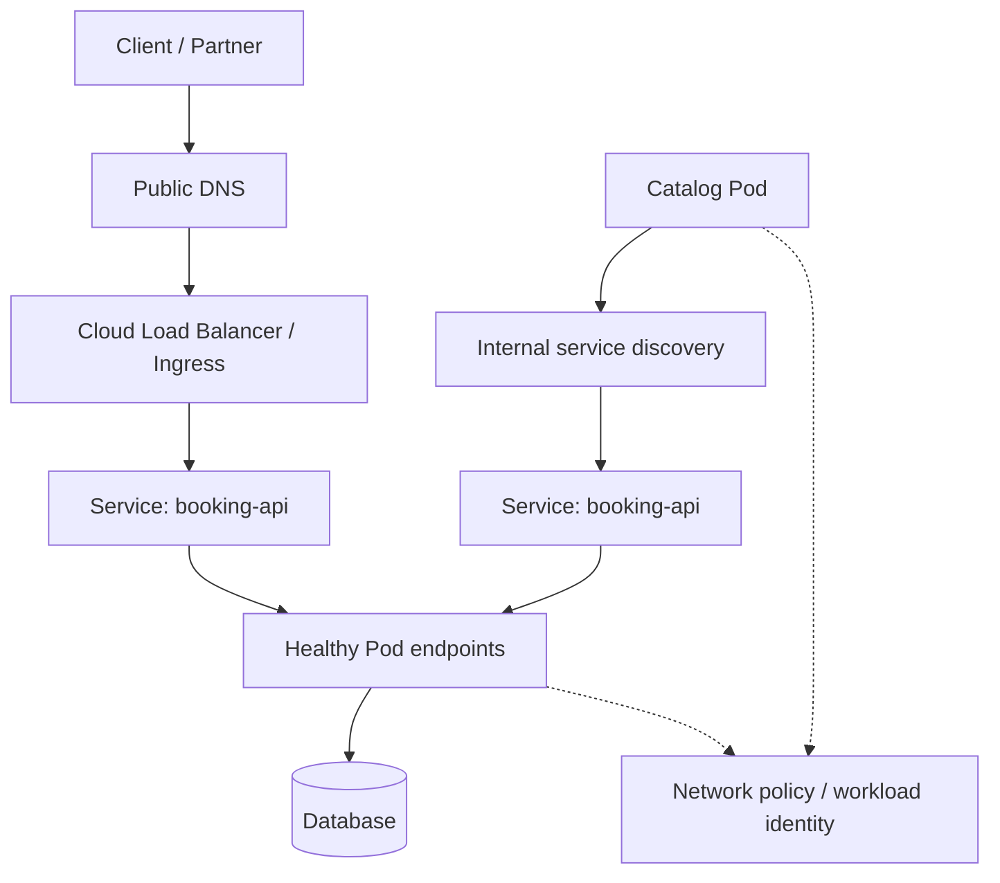
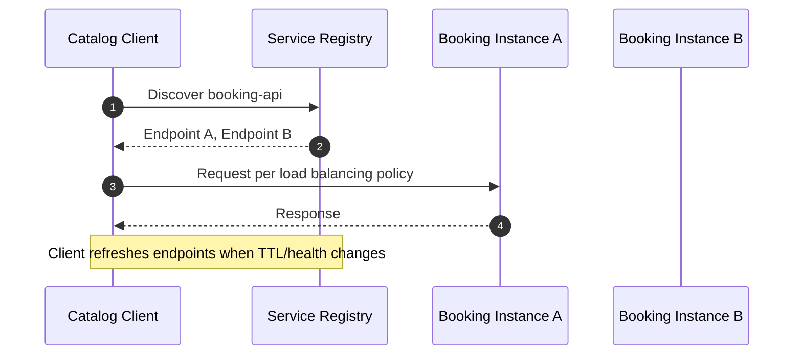
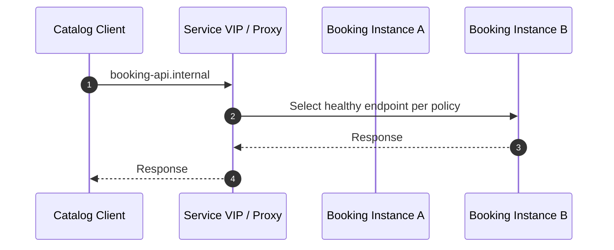
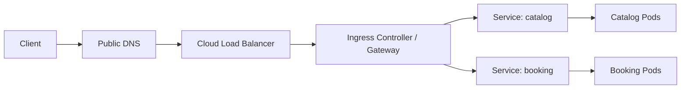
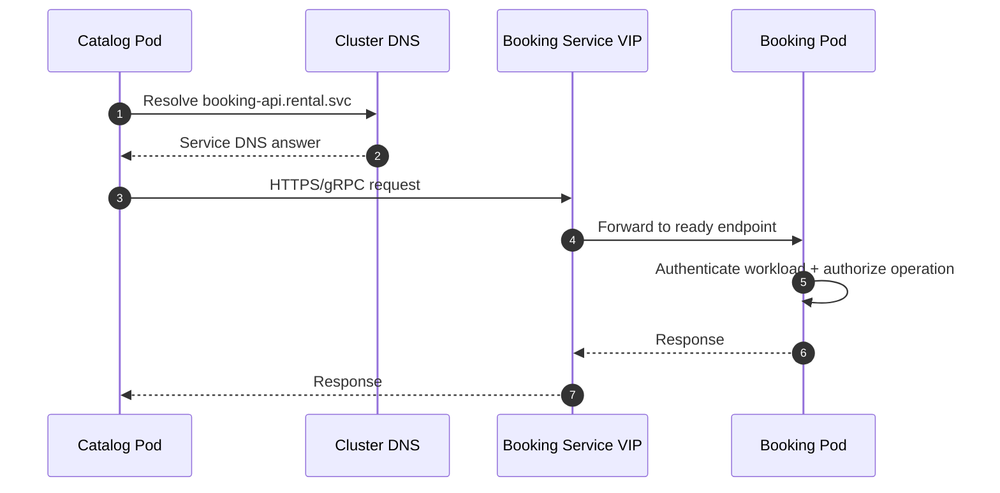
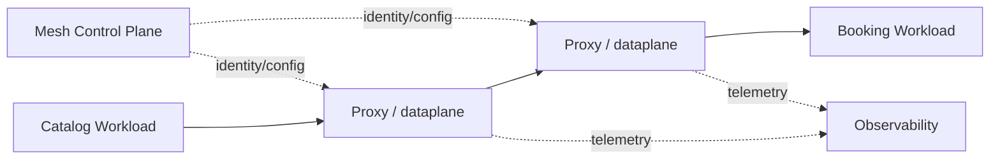
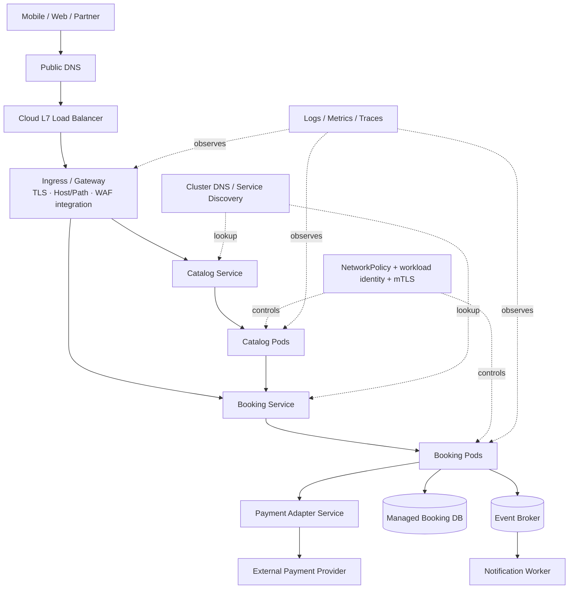

# Service Discovery, Ingress, and Internal Service Connectivity

In a container-based system, an instance's address is inherently unstable. Pods can be replaced after deployments, containers can restart on different nodes, replicas scale up and down with traffic, and workloads can shift across zones. If components call one another using hardcoded IPs or manually maintained machine lists, every deployment change risks breaking connectivity.

Three mechanisms solve this problem: **service discovery**, **ingress**, and **internal service connectivity**. Service discovery helps clients find healthy endpoints serving a logical service. Ingress provides a controlled entry path from the outside to workloads inside the cluster or container platform. Internal connectivity governs how workloads communicate, authenticate, authorize, load-balance, and handle failures with one another.

In the **CLOUD_ARCHITECTURE** module, this is part of designing networking, compute, and deployment models. Design must start from business requirements and balance trade-offs across reliability, security, scalability, cost, and operations under a Well-Architected mindset. The Kubernetes examples in this lesson are common illustrations; service discovery and ingress can also be provided by managed container platforms, service platforms, or other cloud load balancers.

## 1. Three Problems to Solve

| Mechanism | Question | Typical Role |
| --- | --- | --- |
| **Service discovery** | Which endpoints for a logical service are currently healthy and able to accept requests? | Registering/watching workloads, mapping service names to endpoints, updating as replicas change |
| **Ingress** | Through which path do external clients enter workloads, and under what policies? | HTTP(S) entry point, TLS, host/path routing, WAF integration, rate limiting |
| **Internal connectivity** | Over which network and trust boundaries do internal services call each other? | Internal DNS, service endpoints, load balancing, network policies, identity, mTLS, timeouts |

They are related, not interchangeable. Ingress typically forwards to a target service, while service discovery finds the endpoints behind that service; internal connectivity must also protect paths that do not pass through ingress.



The diagram distinguishes **north-south** paths (clients entering the system) from **east-west** paths (workloads calling workloads). Public DNS and ingress belong to the entry path; internal DNS/service discovery helps workloads locate one another. Network policies and identity are separate control layers over communication paths—they are not created automatically just because DNS exists.

## 2. Why Should Container Addresses Never Be Hardcoded?

Container workloads have dynamic lifecycles:

- A deleted and recreated Pod/instance can receive a new IP.
- Replicas can scale from 2 up to 10 or down to 1.
- A rollout can run old and new versions side by side.
- A node failure or autoscaler can move workloads onto other nodes.
- A single service may have multiple endpoints spanning multiple nodes/zones.

Suppose Catalog calls the IP of a Booking Pod directly. Once that Pod is replaced, the old IP may vanish or get reassigned to a different workload. If Catalog keeps using the old IP, requests will fail or reach the wrong target. With 20 replicas, updating IP lists in every client becomes unmanageable.

Instead, clients call a **stable logical name**, such as `booking-api`. Service discovery maps that name to the current endpoints. Clients may connect through a virtual IP/load balancer or receive a list of endpoints depending on the platform and discovery mechanism.

**Principle:** clients depend on a service contract and logical name, not on the lifecycle of a specific instance.

## 3. Service Discovery Models

### 3.1. Client-Side Discovery

In client-side discovery, the client queries a registry or control plane to obtain a list of endpoints; the client then selects an endpoint and performs load balancing itself.



The advantage is that the client controls endpoint selection algorithms, locality preferences, and retries. The downside is that every client must understand the registry, caching, health checks, load balancing, TLS, and endpoint refresh policies. Across multiple languages and frameworks, maintaining discovery libraries can become expensive.

### 3.2. Server-Side Discovery

The client calls a stable endpoint such as a virtual IP, DNS name, or proxy. Server-side components choose the backend endpoint.



This model simplifies clients and centralizes health checking, routing, and load balancing. In return, the proxy/load balancer/DNS control plane becomes a critical dependency requiring adequate capacity, availability, and observability. A VIP or DNS record does not perform health-aware routing on its own unless the underlying platform provides that capability.

### 3.3. Comparing the Two Models

| Criterion | Client-Side Discovery | Server-Side Discovery |
| --- | --- | --- |
| Client | Needs registry logic/library and endpoint selection | Calls a stable name or virtual endpoint |
| Load balancing | Handled by client or SDK | Handled by proxy, load balancer, or platform |
| Control | Client can apply context-aware algorithms | Centralized policies, minimal client logic |
| Complexity | Grows with diverse client types | Shifts into proxy/control plane infrastructure |
| Observability | Must instrument each client and endpoint | Can centralize at proxy plus backend metrics |
| Best fit | Uniform SDK/service platforms with consistent discovery clients | Heterogeneous clients, DNS/VIP services, managed gateways/proxies |

The two models can be combined. For example, a Kubernetes Service provides a DNS name and virtual IP while `kube-proxy` or the dataplane forwards traffic; a service mesh can add application-layer proxies for endpoint selection.

## 4. Service Registry, DNS, and Kubernetes Service

Service discovery typically involves three operations:

1. **Registration:** a workload or controller publishes endpoints able to accept traffic along with required metadata.
2. **Health/readiness:** determines whether an endpoint is eligible to serve requests.
3. **Lookup:** a client or proxy resolves endpoints from a logical name or service identity.

The registry may be a dedicated system, the platform control plane, or an endpoint mechanism integrated with a cloud load balancer. Not every deployment requires the application to register/deregister itself manually.

### Internal DNS

DNS maps a service name to an IP or other record. On a container platform, names like:

- `booking-api` can resolve within the same namespace.
- `booking-api.rental.svc.cluster.local` can be used as the fully qualified name in a Kubernetes cluster with the corresponding default cluster domain.
- `booking-api.internal.example` can be an organization-configured private DNS name.

The fully qualified domain name may differ if the cluster domain or DNS zone is customized. Never hardcode assumptions about `cluster.local` if the platform permits customization.

DNS answers the question **"which address is bound to this name?"**—it does not inherently answer **"is the endpoint healthy, ready, and authorized to serve this request?"** TTLs, caching, negative caching, and propagation delays can leave clients seeing stale results temporarily.

### Kubernetes Service

In Kubernetes, a Service object provides a logical endpoint for a set of Pods matched via a label selector. A ClusterIP Service typically receives a stable cluster-internal virtual IP; EndpointSlices track backend endpoints; the DNS plugin publishes the service name for client resolution.

Example:

```yaml
apiVersion: v1
kind: Service
metadata:
  name: booking-api
  namespace: rental
spec:
  type: ClusterIP
  selector:
    app: booking-api
  ports:
    - name: http
      port: 80
      targetPort: 8080
      protocol: TCP
```

This Service defines logical port 80 and forwards to port 8080 on Pods matching the selector. **A Service does not create workloads** and does not guarantee Pods are ready. The Deployment/Pods, readiness probes, selectors, and ports must align.

Pod IPs can change while clients continue calling `booking-api.rental.svc` or the corresponding name. Without a selector, Kubernetes also allows a Service to connect to manually managed EndpointSlices/endpoints in appropriate scenarios, such as integrating external services outside the cluster—in which case endpoint lifecycle must be managed carefully.

### ClusterIP, NodePort, and LoadBalancer

| Service Type | Access Scope | Common Uses | Notes |
| --- | --- | --- | --- |
| **ClusterIP** | Internal to the cluster | Service-to-service communication | Not directly exposed to the public Internet |
| **NodePort** | Via a port opened on cluster nodes | Basic exposure mechanism or certain infra integrations | Must protect node ports and control firewalls |
| **LoadBalancer** | Typically integrates with a cloud load balancer | Exposes a Service outside the cluster or into a configured network | Behavior and annotations depend on cloud controller/provider |

In many architectures, an Ingress/Gateway acts as the HTTP entry point with host/path routing; backend Services remain internal endpoints. Do not provision a separate public LoadBalancer for every microservice when a centralized L7 entry point meets fault-isolation and throughput needs.

### Headless Service

A Kubernetes Headless Service (`clusterIP: None`) does not allocate a ClusterIP virtual IP; DNS can return the individual addresses of matching Pods/endpoints. This pattern is useful for workloads that need to address specific members, such as StatefulSets or distributed protocols with their own membership logic.

Because clients may receive individual Pod IPs, they must handle DNS updates, readiness, reconnections, and endpoint selection. Headless Services do not provide a complete L4/L7 load balancer.

## 5. Readiness, Liveness, and Startup: Which Endpoints Receive Traffic?

Service discovery is only effective if endpoints are advertised at the right time. Distinguish between the three common Kubernetes probes:

| Probe | Question | Action on Failure |
| --- | --- | --- |
| **Startup probe** | Has the application finished starting up so other probes can run? | Delays liveness/readiness checks during initialization |
| **Liveness probe** | Is the process in a broken state requiring a restart to recover? | Kubelet restarts the container |
| **Readiness probe** | Can the Pod accept traffic for this workload right now? | Pod is excluded from ready endpoints for the Service |

Example: a Java application takes 40 seconds to load configuration and warm up. If the liveness probe begins too early, the container may be restarted repeatedly before ever serving traffic. If the readiness probe only checks that the process is alive while the database connection pool is uninitialized, requests will still fail.

```yaml
apiVersion: apps/v1
kind: Deployment
metadata:
  name: booking-api
  namespace: rental
spec:
  replicas: 3
  selector:
    matchLabels:
      app: booking-api
  template:
    metadata:
      labels:
        app: booking-api
    spec:
      containers:
        - name: app
          image: registry.example.com/booking-api:v1
          ports:
            - name: http
              containerPort: 8080
          startupProbe:
            httpGet:
              path: /actuator/health/liveness
              port: http
            periodSeconds: 5
            failureThreshold: 24
          livenessProbe:
            httpGet:
              path: /actuator/health/liveness
              port: http
            periodSeconds: 10
            failureThreshold: 3
          readinessProbe:
            httpGet:
              path: /actuator/health/readiness
              port: http
            periodSeconds: 5
            failureThreshold: 2
```

This manifest is illustrative. Health endpoint paths must be configured in the application; for instance, Spring Boot Actuator provides readiness/liveness health groups when enabled and configured properly. Never copy probe thresholds blindly: startup duration, load, shutdown, and dependency behavior must be measured.

**Readiness must not turn into liveness.** A brief database disconnect may make the app unready to accept new requests, yet continuously restarting all Pods can worsen the incident. Decide which dependencies are truly mandatory for readiness and how degraded modes should behave.

## 6. Ingress: Bringing External Traffic into the Cluster

Ingress is the boundary receiving north-south traffic. In Kubernetes, an **Ingress resource** describes HTTP(S) rules such as hosts/paths and backend Services; an **Ingress controller** watches those resources and enforces the configuration. Creating an Ingress YAML without a compatible controller running will do nothing.



### HTTP Ingress Routing Example

```yaml
apiVersion: networking.k8s.io/v1
kind: Ingress
metadata:
  name: rental-public
  namespace: rental
spec:
  ingressClassName: public-nginx
  rules:
    - host: api.example.com
      http:
        paths:
          - path: /catalog
            pathType: Prefix
            backend:
              service:
                name: catalog-api
                port:
                  number: 80
          - path: /reservations
            pathType: Prefix
            backend:
              service:
                name: booking-api
                port:
                  number: 80
```

This manifest illustrates host/path routing. You must also configure DNS, load balancers, IngressClass/controller, TLS, and health/observability accordingly. To strip the `/catalog` prefix or rewrite paths, use controller-specific configuration; the core Kubernetes Ingress spec does not standardize every extension.

### Ingress and Gateway API

The Kubernetes Ingress API standardizes basic HTTP routes, but many advanced features depend on controller-specific annotations. **Gateway API** is an extensible API suite modeling `GatewayClass`, `Gateway`, `HTTPRoute`/`TLSRoute`, and clearer separation between platform operators and developers. Choosing between Ingress and Gateway API depends on cluster version, controller maturity, and feature support. Do not assume every controller supports the exact same feature set.

Common options:

| Model | Strengths | Considerations |
| --- | --- | --- |
| Cloud-managed L7 load balancer + controller | Integrates cloud certificates, WAF, health checks, and routing | Tied to controller, cloud quotas/costs, annotations, and IAM permissions |
| Self-managed NGINX/Envoy ingress controller | Full proxy configuration control and portability | Team must manage scaling, patching, HA, certificates, and capacity |
| Gateway API controller | Declarative role/listener/route APIs with strong extensibility | Feature compatibility varies by controller/version |
| Managed API Gateway in front of internal ingress | Edge API management, quotas, identity, consumer plans | Adds a hop and cost; avoid duplicate/conflicting policies across layers |

Ingress is only **one component of the entry point**; it does not replace DNS, WAF, DDoS protection, IAM, or backend authorization.

## 7. Internal Service Connectivity: DNS Is the First Step, Not the Whole Design

A service-to-service call typically involves:

1. Workload A resolves service B's name via internal DNS/discovery.
2. Selects an endpoint or sends traffic to a virtual IP/proxy.
3. Establishes a TCP/HTTP/gRPC connection; if TLS/mTLS is required, verifies identity and certificates.
4. Applies timeouts, connection pooling, concurrency limits, retries, and circuit breaking with clear ownership.
5. Backend B authenticates the caller, authorizes the action, and validates business rules.
6. Telemetry traces requests across services.



In practice, a ClusterIP Service does not necessarily spawn a user-space proxy per request; the dataplane may use `iptables`, `IPVS`, or `eBPF` depending on cluster configuration. The diagram illustrates the logical role of a service endpoint rather than asserting a specific kernel packet path.

### Using DNS vs. Calling Endpoints Directly

For most applications, calling the Service name is simple and stable. Some stateful applications need per-Pod member discovery, or client libraries need specialized endpoint selection; in those cases, headless services, SRV records, registry APIs, or a service mesh can be used. Balance flexibility against the burden of cache invalidation, handling disappearing endpoints, and managing connections.

**DNS is not a complete service health checker.** Clients may cache IPs beyond TTL, and long-lived keep-alive connections may continue pointing to a drained endpoint. Service meshes/proxies may use xDS/control planes and outlier detection; examine how your stack handles connection reuse, endpoint removal, and draining.

## 8. Network Policies: Who Can Connect to Whom?

Service discovery makes services easy to find; that **does not mean every workload should be allowed to call every other workload**. Network policies reduce lateral movement surfaces if a container is compromised.

Example minimal allowed flows:

- The ingress controller may call the Booking API on its application port.
- The Catalog API may call the Booking API per contract.
- The Booking API may access the database and Payment API as needed.
- Unrelated Pods cannot arbitrarily connect to the database.

Sample NetworkPolicy (requires a CNI that enforces network policies):

```yaml
apiVersion: networking.k8s.io/v1
kind: NetworkPolicy
metadata:
  name: booking-ingress
  namespace: rental
spec:
  podSelector:
    matchLabels:
      app: booking-api
  policyTypes:
    - Ingress
  ingress:
    - from:
        - podSelector:
            matchLabels:
              app: catalog-api
        - namespaceSelector:
            matchLabels:
              kubernetes.io/metadata.name: ingress-system
      ports:
        - protocol: TCP
          port: 8080
```

This policy only illustrates ingress controls using namespace/pod selectors. Verify CNI semantics, namespaces, default-deny behavior, egress rules, and traffic originating from load balancers. Not all network plugins enforce NetworkPolicy; creating the resource without enforcement creates a false sense of security.

### Default-Deny and Allowlists

A common pattern applies default-deny ingress/egress to a workload namespace, then explicitly opens required connections such as DNS, telemetry, databases, or dependent services. However, default-deny egress can break DNS, certificate/status endpoints, cloud metadata, or vital services if rules are missed.

Design policies around **permitted flows**, then test both allowed and blocked paths. Never use static Pod IPs in policies when label/identity selectors are appropriate; IPs change throughout the Pod lifecycle.

## 9. Workload Identity and mTLS for Internal Connectivity

An internal network does not equal a trusted network. If one Pod is compromised on a flat network, an attacker can attempt lateral connections to other services. You must authenticate **which workload** is calling and authorize **what that workload** is permitted to do.

| Layer | Evidence | Protection |
| --- | --- | --- |
| Network policy | Namespace/label/IP/selector via CNI enforcement | Restricts network connection paths |
| Workload identity | Service account, cloud workload identity, SPIFFE-like identity, or securely issued credentials | Establishes the caller workload's identity |
| TLS/mTLS | Certificates, trust chains, client/server private keys | Encrypts transport and authenticates peers at the TLS layer |
| Application authorization | Scope/role/relationship/tenant/object policies | Restricts business operations |

No single layer replaces all others. A NetworkPolicy allowing a TCP connection does not mean a request is legitimate; mTLS verifying a peer does not prove the caller is allowed to cancel a specific user's reservation.

### mTLS

With mutual TLS, both client and server present certificates under a trust policy. This helps services verify peers and protect data in transit. Implementing it requires:

- Issuing distinct identities/certificates per workload or trust group.
- Distributing and protecting private keys, with automated certificate rotation before expiry.
- Managing CAs/trust bundles and revoking compromised identities.
- Mapping verified identities to service authorization rules.
- Monitoring handshake errors, expirations, trust mismatches, and policy denials.

A service mesh like Istio or Linkerd can handle identity, certificate rotation, mTLS, and inter-service policies, at the cost of a control plane, proxies/sidecars or ambient dataplanes, compute overhead, and operational complexity. mTLS can also be implemented in applications or load balancers without a mesh; choose based on requirements and team capacity.

## 10. Service Mesh: When Is It Worth Using?

A service mesh introduces a governance layer for inter-workload communication. It typically provides:

- **Identity and mTLS** between workloads.
- **Traffic management** such as timeouts, retries, circuit breaking, and traffic splitting.
- **Telemetry** for latency, errors, request volume, and distributed tracing.
- **Policies** at the service-to-service or workload identity level.



A service mesh is not a prerequisite for microservices. It makes sense when service counts are large, communication policies must be uniform, cross-team identity/mTLS is required, and measurable benefits outweigh operational costs.

| When a Mesh Is Not Yet Needed | When to Evaluate a Mesh |
| --- | --- |
| Few services, straightforward communication | Many services across multiple teams |
| Existing frameworks/client libraries handle retries/telemetry adequately | Need uniform policies across multiple languages/runtimes |
| No complex workload mTLS requirements | Need centralized identity/mTLS and rotation |
| Team lacks capacity to operate a control plane | Team can monitor, upgrade, and debug the mesh dataplane |
| Extra proxy overhead is disproportionate | Need traffic splitting, policy, and distributed observability at scale |

**A mesh cannot fix flawed business design.** Automatic sidecar retries can duplicate non-idempotent operations; misconfigured route policies can block the entire application; proxies add latency and consume CPU/memory.

## 11. Load Balancing, Connections, and Fault Handling Between Services

DNS and service endpoints only help clients find destinations. Production applications require explicit behavior when multiple endpoints exist, endpoints are draining, or backends fail.

| Layer | Mechanism | Effect |
| --- | --- | --- |
| DNS | Returns records for one or more endpoints | Useful for discovery, though caching/TTLs prevent instant updates |
| L4 | TCP/UDP load balancing | Distributes connections; minimal HTTP awareness |
| L7 | HTTP/gRPC routing | Routes by host/path/headers, health, and weights |
| Client library | Picks endpoints from registry/discovery | Customizable per client, but logic must be maintained |
| Service mesh | Proxy selects endpoints and enforces policies | Centralizes traffic policies; adds dataplane/control plane |

With HTTP keep-alive or long-lived gRPC connections, a single connection can serve many requests. Updating endpoints in DNS or a Service does not force already-open connections to switch immediately to new Pods. During rollouts or scale-downs, you need **connection draining**, termination grace periods, and readiness turning false before stopping new requests.

### Readiness and Graceful Shutdown

Scale-down sequence:

1. The controller decides to reduce replicas.
2. The Pod is marked terminating and endpoints are updated to stop receiving new traffic per platform mechanics.
3. The application stops accepting new requests and finishes in-flight requests within the timeout window.
4. The application closes connections/consumers and exits.
5. If the grace period expires, the process may be forcefully terminated.

Applications must handle `SIGTERM`, stop pulling new work, drain HTTP/gRPC servers, and complete or checkpoint tasks. Queue workers must ACK/NACK properly to avoid losing messages. **Graceful shutdown does not guarantee every request finishes** if clients time out or a node dies abruptly; idempotency and recovery remain mandatory.

### Timeouts, Retries, and Circuit Breakers

Set timeouts according to end-to-end latency budgets. If an API client has a 2-second deadline, do not give three sequential internal calls 2-second timeouts each plus unbounded retries. Per-hop timeouts must be shorter than the remaining deadline, propagating context/deadlines where protocols support it.

Apply retries only when:

- The failure is likely transient and retrying helps.
- The request is safe to repeat, or uses an idempotency key/reconciliation.
- Total duration and retry attempts are bounded, with backoff and jitter.
- Simultaneous retries across every layer (client, gateway, mesh, application) are avoided to prevent retry storms.

Circuit breakers shed calls to failing dependencies; bulkheads isolate resources per downstream group. They do not replace fixing root causes or handling business state.

## 12. Headless Services, StatefulSets, and Communicating with Specific Members

Some workloads cannot just call any instance of a service—they must address **individual nodes/members**, such as database clusters, distributed caches, or brokers with dedicated topologies.

A Kubernetes StatefulSet paired with a Headless Service creates stable ordinal DNS names, such as:

- `db-0.database.rental.svc`
- `db-1.database.rental.svc`
- `db-2.database.rental.svc`

These names bind to Pod identity within the StatefulSet, aiding peer discovery. However, a stable DNS name does not guarantee the member is healthy, synchronized, or currently the leader. Clients/protocols must know how to check quorum, leader election, replication lag, and handle failover.

For databases, never let clients write to arbitrary Pods simply because DNS returns three addresses. Use role-aware read/write endpoints or proxies that understand leader, replica, and consistency guarantees supported by the database.

## 13. Communicating Across Namespaces, Clusters, Accounts, and Regions

Service discovery has a scope. Kubernetes Service DNS names typically resolve only within the configured cluster/DNS zone. Calling workloads in another cluster requires explicit identity and routing mechanisms:

| Scope | Common Connectivity Approach | Questions to Resolve |
| --- | --- | --- |
| Same namespace | Short Service DNS or FQDN | Can permissions be restricted with NetworkPolicy? |
| Different namespace, same cluster | Service FQDN or internal gateway | Which namespace/tenant owns the endpoint? |
| Different cluster | Private DNS, service mesh federation, gateway, private LB, or platform discovery | Trust, routing, certificates, endpoint health, failover |
| Different account/project/subscription | Private network links, peering, transit hub, private endpoints | Cross-account IAM, DNS resolution, overlapping CIDRs, egress cost |
| Different region | Global routing, region-local endpoints, multi-region discovery | Data residency, replication, latency, failover, and split-brain |

Do not expose all ClusterIPs across clusters by default. Use intentional endpoints, explicit contracts, and consumer-specific policies. For cross-region calls, prefer keeping call paths in the region closest to data to reduce latency and cost, while designing for regional unavailability.

### DNS and Networking Can Drift Out of Sync

For example, a private DNS record may point to an internal load balancer while route tables/firewalls block the source subnet from connecting. DNS resolves cleanly, yet TCP connections time out. Conversely, network routes may exist while stale DNS records send clients to deleted addresses.

When debugging, check in order:

1. Does the service name resolve properly within the right namespace/VPC/cluster?
2. Are the returned IP/endpoints within the right scope and state?
3. Do routes, subnets, security groups/firewalls, and NetworkPolicies permit the port/protocol?
4. Does the TLS/mTLS handshake succeed, and do certificates/SANs/trust chains match?
5. Is the backend listening on the right interface and port, and is readiness passing?
6. Is the application returning authz/validation/timeout errors after the network connection succeeds?

## 14. Securing Entry Points and Internal Connectivity

Design in layers:

- **Ingress:** expose only required listeners and hosts/routes; apply TLS and appropriate WAF/DDoS protection; never expose dashboards/admin endpoints publicly.
- **Service discovery:** avoid leaking unnecessary internal topology; separate public/private DNS zones; protect permissions to update records/registries.
- **Network:** default-deny where CNI supports it, open allowlists, separate subnets/zones by risk; control egress to external services.
- **Identity:** dedicated workload identities, short-lived credentials, least privilege; avoid shared admin service accounts.
- **Transport:** TLS/mTLS across trust boundaries, rotation, and certificate validation.
- **Application:** authentication and authorization by object, tenant, and action; input validation and replay protection.
- **Operations:** audit changes to ingress/routes/policies, monitor connections and policy denials, review configuration via IaC.

### Exposure Paths to Audit

A supposedly private service can still leak via:

- A Service of type `LoadBalancer` accidentally provisioned as public.
- A wildcard Ingress routing to internal services.
- A `NodePort` left open in firewall/security group rules.
- Node public IPs or management endpoints.
- Port-forward/debug tools with overly broad permissions bypassing policies.
- Unrestricted egress allowing a compromised workload to reach command-and-control servers or exfiltrate data.
- A public DNS zone accidentally holding internal system records.

Audit public routes, policies, IAM, and operator permissions periodically. **Never assume a namespace named `internal` means resources are isolated.**

## 15. Observability: Monitoring Both Discovery and Connectivity

Measuring Pod CPU and memory alone cannot tell you whether service discovery and connectivity are healthy. Monitor:

| Area | Key Metrics / Logs | Warning Signs |
| --- | --- | --- |
| Ingress | Request count, status codes, p95/p99 latency, TLS errors, active connections | Rising 4xx/5xx, handshake failures, connection saturation |
| Service discovery/DNS | Query volume, NXDOMAIN, SERVFAIL, latency, cache/endpoint updates | Slow service resolution, stale records, DNS overload |
| Endpoint readiness | Ready/NotReady counts, endpoint churn, rollout status | Zero endpoints or flapping endpoints |
| Network | Connection resets, timeouts, packet drops, flow logs | Misconfigured policy/firewall/routes or overloaded backend |
| mTLS/identity | Certificate expiry, handshake failures, authz denials | Expired certificates, mismatched trust bundles, wrong roles |
| Backend | Request latency, saturation, pool/queue depth, dependency errors | Healthy gateway while backend is degraded |
| Control plane | Controller reconciliation errors, config rollouts, pending resources | Ingress rules or service endpoints failing to apply |

Traces should propagate context through ingress and service-to-service calls; logs need correlation/request IDs. Never log bearer tokens, session cookies, private keys, or sensitive payloads. Route alerts to the rightful owners of the ingress controller, DNS/network platform, and backend services.

## 16. Testing and Failure Mode Drills

| Scenario | How to Trigger | Expected Result |
| --- | --- | --- |
| Pod IP changes | Delete a Pod so the controller recreates it | Clients calling via Service still find a healthy endpoint |
| Scale up/down | Increase and decrease replicas | Endpoints update; latency and errors stay within bounds |
| Readiness failure | Make a required dependency unavailable | Pod stops receiving new traffic; liveness does not trigger useless restarts |
| Temporary DNS failure | Simulate resolver timeout/NXDOMAIN | Reasonable client timeouts; caches/retries do not cause storms; alerts fire |
| Invalid ingress route | Deploy an invalid route config in staging | Tests/policies catch it or rollout halts; rollback works |
| Slow backend | Artificially increase response times | Timeouts/circuit breakers/backpressure activate; threads do not exhaust |
| NetworkPolicy block | Remove an allow rule in test | Unauthorized flows are blocked; legitimate flows continue |
| Certificate expiry/rotation | Rotate trust/certs in test | Rotation causes zero outage; failures are observable |
| Node/zone failure | Drain or stop simulated node/zone | Pods reschedule; ingress shifts endpoints; SLOs hold |
| Mesh/proxy failure | Kill dataplane or disconnect control plane in a drill | Verify proxy stale-config behavior, requests, and policies behave as expected |

Not every platform guarantees identical behavior when the control plane loses connectivity. Read specific platform semantics: does the dataplane keep using the last known configuration, can endpoints refresh, how long do certificates remain valid, and what happens if a proxy restarts?

## 17. Trade-Offs Across Well-Architected Pillars

| Pillar | Benefits of Good Design | Trade-Offs / Risks | Evaluation Questions |
| --- | --- | --- | --- |
| **Operational excellence** | Stable service names, versioned policies, easier debugging and rollouts | Multiple controllers/meshes increase components to upgrade | Do owners monitor ingress, DNS, CNI, mesh, and runbooks? |
| **Security** | Network segmentation, workload identity, mTLS, least privilege | Overly complex policies risk outages or bypasses when misconfigured | Are both allowed and blocked paths tested? |
| **Reliability** | Endpoint readiness, health-aware routing, graceful shutdown, multi-zone | DNS caches, control planes, proxies, and gateways become shared dependencies | How are requests handled during endpoint churn or DNS errors? |
| **Performance efficiency** | Load balancing, locality, connection reuse, fewer unnecessary hops | Sidecars/proxies and cross-zone/region calls add latency and CPU | What are p95/p99 latency and throughput after adding a mesh? |
| **Cost optimization** | Per-service scaling, shared ingress, avoiding an LB per workload | Extra LBs, data transfer, proxies, observability, and control planes add cost | How are cost/request, egress, and platform overhead measured? |
| **Sustainability** | Scaling endpoints/replicas to load and cutting idle capacity | Redundant replicas, proxies, and control planes consume resources | Can resource footprint be trimmed while keeping SLOs and recovery? |

There is no fixed number of ingresses, clusters, or meshes that fits every system. A small group of services can use Kubernetes Services and a managed ingress controller; a large multi-team system with multiple trust boundaries may need Gateway API, a mesh, and centralized policies. Base decisions on traffic, risk, recovery targets, on-call capacity, and cost.

## 18. Synthesis Example: Entry Path and Internal Connectivity for an Equipment Rental Platform

Assume deployment on a managed Kubernetes cluster:

- Mobile/Web clients access `api.rental.example`.
- A cloud load balancer forwards HTTP(S) to Ingress/Gateway.
- Ingress routes `/catalog` to the Catalog Service and `/reservations` to the Booking Service.
- Catalog must call Booking to check reservation details via an authenticated internal API.
- Booking calls the Payment Adapter and database; notifications are processed asynchronously through a broker.
- Services reside in the `rental` namespace; the Platform team operates ingress, DNS, and CNI, while product teams own their services and data.



### Design Choices and Rationale

1. **One ingress/gateway per public domain** reduces public entry points; routes by host/path to internal services. If Payment webhooks require different policies or trust boundaries, separate listeners/domains can be used.
2. **Stable Service DNS** for Catalog, Booking, and Payment Adapter. Clients remain unaware of Pod IPs.
3. **Readiness probes** remove unready Pods from endpoints; rollouts wait for ready status.
4. **NetworkPolicies** restrict flows to Catalog → Booking and Booking → database/Payment as required, with matching rules for DNS, monitoring, and the broker.
5. **Workload identity and mTLS** are applied on paths requiring strong peer authentication; backends still enforce business authorization.
6. **Timeouts and retries** are designed around deadlines, never retrying reservation/payment commands without idempotency.
7. **Telemetry** links requests from ingress to backends, with redacted logs and owner-routed alerts.

### Assumptions Still Requiring Verification

- Do the ingress/controller support required host/path/TLS/WAF integration and meet throughput limits?
- Does the active CNI enforce Kubernetes NetworkPolicies, and how does it handle egress?
- Can the DNS resolver/cache handle lookup volume and endpoint churn?
- Can workloads obtain short-lived identities from the cloud provider without storing static keys in images?
- Is mTLS needed between every service or only across specific trust boundaries?
- Are the Booking DB and broker in the same region/zone, or are there cross-region dependencies?
- Do RTO/RPO and data residency requirements demand a different topology?
- Do the Platform/Product teams have the operational capacity to manage ingress, network policies, and certificate rotation?

These assumptions must be validated through load testing, security testing, node/zone failure drills, and provider documentation before declaring the design production-ready.

## 19. Checklist for Designing Service Discovery, Ingress, and Internal Connectivity

### Service Discovery

- Do clients call stable logical names rather than instance IPs?
- By what mechanism are endpoints registered, updated, and removed?
- Do health/readiness checks accurately reflect traffic-serving readiness?
- Are DNS TTLs/caches, stale connections, and headless endpoints well understood?
- Do clients/proxies handle endpoint churn, retries, and connection draining?

### Ingress

- Are only necessary routes exposed publicly, with no leaked listeners/admin endpoints?
- Have DNS, certificates, TLS, WAF/DDoS, and host/path rules been verified?
- Does the controller/Gateway API implementation support required features/versions?
- Can backends be accessed by bypassing ingress outside policy?
- Have route rollouts/rollbacks, quotas, autoscaling, and HA been rehearsed?

### Internal Connectivity

- Is there a map of east-west flows and service owners?
- Do NetworkPolicies/firewalls restrict exact sources, destinations, ports, and protocols?
- Are workload identity, mTLS, and application authorization properly separated by role?
- Are timeouts, retries, circuit breakers, graceful shutdown, and backpressure bounded?
- Do DNS, CNI, proxies/mesh, and databases/brokers have sufficient capacity and observability?
- Does cross-cluster/account/region routing control latency, data residency, and split-brain risks?

### Operations and Cost

- Are metrics collected for DNS, endpoint readiness, ingress, networking, mTLS, and backends?
- Do logs/traces avoid leaking tokens, secrets, or sensitive data?
- Are alerts routed to owners equipped with runbooks?
- Are load balancer, proxy, cross-zone/region traffic, and telemetry costs accounted for?
- Have failure tests been executed and SLOs/RTO/RPO measured rather than relying on diagrams alone?

Service discovery makes dynamic endpoints findable; ingress creates a controlled entry point; internal connectivity ensures workloads communicate within designed permissions, reliability, and performance boundaries. When all three align with readiness, identity, network policies, observability, and operational processes, a container architecture can scale and evolve without forcing clients to depend on individual instances.
