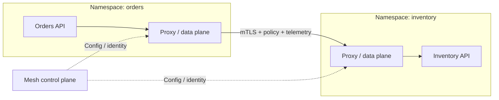
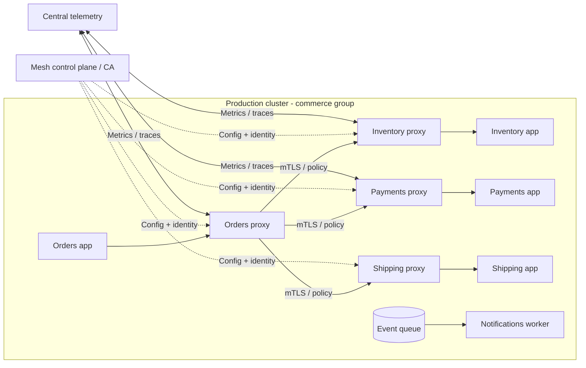

# Service Mesh: When to Use It, Benefits, and Operational Costs

## 1. What Problem Does a Service Mesh Solve?

In a system with many services, components do not merely call one another to execute business logic—they also perform repetitive tasks: locating target addresses, establishing secure connections, authenticating service identities, enforcing timeouts/retries, collecting metrics, and tracing requests. If each team builds these mechanisms independently inside applications, policies easily diverge; if everything is placed in a shared library, upgrades, runtime compatibility, and multi-language support can become difficult.

A **service mesh** is an infrastructure layer dedicated to service-to-service communication, providing capabilities such as connection encryption and authentication, traffic control, observability, and policy enforcement between workloads. Many mesh architectures place proxies or traffic-handling components alongside workloads in a **data plane**, paired with a **control plane** that distributes configuration and identities. Newer models reduce reliance on sidecars using node-shared proxies or ambient modes; specifics depend on the product.

A service mesh does not automatically make an application well-architected microservices, does not replace an API gateway for all north-south flows, does not replace business IAM, and does not guarantee high availability on its own. It adds a management layer for **east-west traffic** (service-to-service communication), sometimes also applying policies to ingress/egress flows depending on platform capabilities.

This lesson belongs to the **Container Architecture** chapter of the **CLOUD_ARCHITECTURE** module. We will focus on adoption criteria, benefits, costs, and how to evaluate a service mesh in cloud architectures that must balance reliability, security, scalability, cost, and operations under Well-Architected principles.

After this lesson, you will be able to:

- Explain the roles of the data plane, control plane, proxies, and workload identity.
- Recognize when a mesh delivers clear value and when complexity outweighs benefits.
- Distinguish a service mesh from an API gateway, ingress controller, network policies, and in-app communication libraries.
- Evaluate mTLS, authorization policies, traffic management, and telemetry within a mesh scope.
- Plan controlled deployment, failure testing, resource sizing, and mesh operations.

## 2. Core Architecture: Control Plane and Data Plane

### 2.1. Data Plane — Where Actual Traffic Is Processed

The data plane consists of components that handle connections between workloads. In the common sidecar model, a proxy is deployed alongside each Pod/instance or workload. The application sends traffic through the local proxy; the proxy connects to the destination service's proxy, enforces policies, and emits telemetry.

Proxies can handle:

- Connection establishment and management, connection pooling, timeouts, and rate limits.
- TLS/mTLS encryption and peer certificate/identity verification.
- Routing by version, weight, headers, or matching conditions.
- Enforcing certain access policies and recording metrics/logs/traces.

Because the proxy sits in the data path, it can increase latency, CPU, memory, and hop counts. If a proxy becomes overloaded, misconfigured, or unhealthy, the application may lose connectivity even while the main application process remains healthy.

### 2.2. Control Plane — Where Configuration and Identity Are Managed

The control plane manages mesh configuration and pushes it to the data plane. Depending on the product, it can:

- Discover workloads/services and update endpoint addresses.
- Distribute route, cluster, timeout, retry, policy, and telemetry configurations.
- Issue/rotate certificates or integrate with identity systems.
- Monitor proxy health, configuration validity, and versions.

The control plane typically does not forward individual business requests. When it temporarily loses connectivity, proxies that already received configuration can continue forwarding traffic; however, endpoint updates, certificate rotation, policy changes, and failure recovery depend on the implementation. Verify actual behavior rather than assuming a control plane outage is always harmless or always halts the entire mesh.

### 2.3. East-West Flow Diagram



This diagram illustrates the concept only. Some platforms route through sidecar proxies; others use node-level gateway proxies, tunnels, or other mechanisms. Read product documentation on where TLS terminates, how identity is verified, how traffic is intercepted, and how policies are enforced.

## 3. Service Mesh Deployment Models

| Model | How It Works | Strengths | Costs / Limits |
|---|---|---|---|
| **Sidecar proxy** | Each Pod/workload runs its own proxy | Isolates resources and policies per workload; common, intuitive model | Increases container count, CPU/RAM, startup time, config, and upgrade effort |
| **Node-level/ambient proxy** | Certain network functions use shared node-level proxies/tunnels; advanced L7 features may use waypoint/shared proxies | Cuts sidecar count and per-Pod resource duplication | Must understand trust scope, shared components, L7 enforcement points, and compatibility |
| **Centralized proxy gateway** | A pool of proxies/gateways handles traffic between zones or service groups | Centralizes certain policies; fits inter-cluster/inter-network boundaries | Can become a bottleneck/SPOF; requires HA, capacity, and clear routing |
| **No mesh (in-app libraries)** | Each app embeds client, TLS, retry, and telemetry libraries | Minimal mesh infra and flexible control over business logic | Policies can drift; upgrading across many apps and languages is hard |

No single model is universally best. Sidecars keep policies close to each workload but duplicate overhead; ambient reduces proxy count but elevates shared node-level components; centralized gateways fit specific boundaries while concentrating load onto fewer points. Base the decision on workload count, security needs, team skills, and performance benchmarks.

## 4. What Capabilities Does a Service Mesh Provide?

### 4.1. Service Identity and mTLS

**mTLS (mutual TLS)** authenticates both client and server in a TLS connection and encrypts traffic in transit. In a mesh, identity is typically tied to a workload identity/service account and represented by certificates or credentials issued by the mesh.

Benefits:

- Verifies both calling and receiving workloads, reducing reliance on network location or IP addresses.
- Encrypts east-west traffic without requiring every team to implement full TLS handshake management.
- Enables policies based on service identity, namespace, or principal depending on the system.
- Supports certificate rotation and trust bundle version tracking via platform mechanisms.

Design considerations:

- Identity issuance: which workloads receive which identities, who approves them, and how service account spoofing is prevented.
- Certificate lifetimes, rotation, clock synchronization, and behavior when the CA/control plane is unavailable.
- Trust domains across clusters/regions; cross-trust must have clear ownership and bounded scope.
- Non-mesh flows, legacy applications, and connections leaving the mesh.

**mTLS does not equal authorization.** A client holding a valid certificate may still lack permission to call a specific endpoint or business action. Enforce authorization policies and application-level checks as needed; APIs must still authenticate end users/tenants rather than relying on proxy identity in place of business authorization.

### 4.2. Authorization and Service Segmentation

A mesh can use identities to enforce policies such as:

- `orders-api` is allowed to call `inventory-api` on required routes.
- `reporting-worker` can only read reporting endpoints, not invoke order-write operations.
- The `dev` namespace cannot call databases or APIs in `prod`.

This is **network/service authorization**, which does not automatically replace user role checks, record ownership, tenant controls, or business rules. Even when the mesh permits one service to call another, the application must still verify whether the end user can view or modify a given record.

### 4.3. Traffic Management

A mesh can provide capabilities such as:

| Feature | Purpose | Conditions / Risks |
|---|---|---|
| Timeouts | Cap waiting time | Timeouts must align with end-to-end deadlines without cutting off valid transactions |
| Retries | Retry transient failures | Retry only safe/idempotent operations; retries can amplify load |
| Circuit breaker / outlier detection | Shed traffic to failing upstreams | Needs calibrated thresholds and recovery windows; avoid ejecting healthy instances |
| Load balancing | Distribute requests across endpoints | Algorithms and health signals must match connection types and workloads |
| Traffic shifting | Shift a percentage of traffic to a new version | Needs evaluation metrics and rollback; traffic weights do not replace testing |
| Fault injection | Simulate latency/errors to test resilience | Run strictly in approved scopes with clear stop criteria |

A mesh cannot determine on its own whether a business request is safe to retry. For instance, a payment creation API sends a request, and the client times out before receiving the response; blind retries can create a duplicate charge. Applications need idempotency keys and reconciliation; mesh timeouts/retries must coordinate with client, server, and dependency timeouts.

### 4.4. Observability

A mesh can standardize metrics for request counts, latency, error rates, connections, retries, TLS, and inter-service traffic. It can also integrate trace propagation to follow requests across multiple services.

However, **network telemetry does not fully understand business outcomes**. An HTTP 200 response can still wrap a business failure; proxy metrics do not replace metrics for successful orders, failed payments, or inventory accuracy.

Combine:

- Proxy metrics: RPS, latency percentiles, response codes, retries, connection pools.
- Application metrics: transaction successes/failures, queue backlogs, and business KPIs.
- Distributed tracing: cross-service trace IDs, watching header propagation and sampling.
- Logs: sufficient for investigation while avoiding tokens, personal data, or sensitive payloads.

## 5. When Should You Consider a Service Mesh?

A service mesh begins delivering clear value when the cost of manually managing inter-service communication becomes a measurable problem. Common indicators:

1. **Many services or many teams:** service count grows, and teams implement TLS, retries, telemetry, and policies inconsistently.
2. **East-west identity requirements:** consistent workload authentication and mTLS are needed across many services or application groups.
3. **Complex communication policies:** service-to-service restrictions by identity, environment, route, or tenant boundary are needed at the infrastructure layer.
4. **Frequent canary/traffic shifting:** release teams need percentage-based traffic shifting, testing, and controlled rollbacks across many services.
5. **Cross-service observability pain:** hard to pinpoint which service adds latency or triggers retries across hops.
6. **Mature container platform:** the team already operates Kubernetes or a suitable orchestrator with CI/CD, IaC, SRE, and capacity to manage the control plane/proxies.

### 5.1. When Not to Adopt One Yet

| Context | Why a Mesh May Not Be Worth It Yet |
|---|---|
| Monolith or only a few stable services | Minimal policy/traffic benefits compared to added operational components |
| Communication mostly hits external managed services/APIs | Mesh may not govern flows bypassing its data plane |
| Team lacks capacity for Kubernetes/networking/certificates | Adding a control plane, proxies, and policies increases operational risk |
| Apps already have standardized TLS, retries, and telemetry meeting goals | Must prove the mesh closes a real gap rather than duplicating functionality |
| Latency-sensitive or tightly resource-constrained systems | Proxy overhead must be benchmarked before committing |
| Lack of timeout/retry standards or service ownership | Mesh can obscure retry behavior, deadlines, and accountability |

Never adopt a mesh solely because you run Kubernetes, because a competitor uses one, or to "check the zero trust box." Zero trust is an architectural strategy spanning identity, policies, devices/workloads, data, and observability; a mesh supports only part of that model.

## 6. Evaluating Benefits and Operational Costs Together

| Aspect | Potential Benefits | New Costs or Risks |
|---|---|---|
| Security | mTLS, workload identity, centralized east-west policies | CA/certificate management, rotation, trust domains; bad policies can block services |
| Reliability | Timeouts/retries, circuit breakers, traffic shifting, fault isolation | Proxy/control plane failures, retry amplification, slow config propagation |
| Observability | Uniform metrics/traces showing inter-service latency | Cardinality, log/trace volume, sampling, overhead, analysis effort |
| Delivery | Canaries, version-based routing, controlled rollbacks | Complex routing policies requiring release engineering and multi-path testing |
| Development | Reduces per-app networking boilerplate | Harder debugging with extra hops; developers must understand proxy/mesh behavior |
| Resources | Centralizes shared platform functions | CPU/RAM for proxies/gateways, control plane, telemetry, and spare headroom |
| Operations | Single control point for communication policies and config | Platform team owns versions, upgrades, incidents, and user support |

### 6.1. Resource Overhead

In a sidecar model, proxy count scales with Pod count. A rough initial estimate:

\[
CPU_{proxy,total} \approx N_{proxy}\times CPU_{proxy,avg}
\]

\[
RAM_{proxy,total} \approx N_{proxy}\times RAM_{proxy,avg}
\]

With 80 Pods where each proxy averages 0.08 vCPU and 120 MiB RAM under measured load, total proxy consumption is roughly 6.4 vCPU and 9,600 MiB RAM. This is only an illustrative sum; real consumption depends on request rate, connections, TLS, filters, telemetry, buffers, configuration, and proxy version.

Never size production using averages. Measure p95/p99 proxy resource usage at peak load, concurrent connections, and retry/failover scenarios. Include init containers, agents, the control plane, gateways, log/trace collectors, and headroom.

### 6.2. Observability Costs and Telemetry Volume

A mesh can generate rich metrics keyed by source, destination, response code, route, and version. High-cardinality labels (such as user IDs, request IDs, or dynamic URLs) can cause storage/query costs and collector load to skyrocket. Never use personal identifiers or unbounded dynamic values as metric labels.

Set policies:

- Sample traces by percentage or meaningful conditions while still capturing rare errors needed for debugging.
- Set metric/log retention aligned with operational goals and data regulations.
- Focus dashboards on service SLIs, errors, and latency; avoid building unused dashboards for every attribute.
- Test telemetry overhead and behavior when the observability backend slows down or becomes unavailable.

### 6.3. Human Cost

An often underestimated cost is the team's **cognitive load**: understanding two request paths, certificate verification, where policies execute, reading proxy metrics, ingress/egress interactions, and debugging timeouts. You need platform owners, standard documentation, templates, runbooks, test environments, and application support workflows.

If a mesh eliminates a bit of library code while forcing every developer to wrestle with complex network configs, net value can turn negative. Measure cross-service incidents, time to root cause, and library maintenance effort before and after adoption to compare objectively.

## 7. Technical Risks to Understand Before Enabling a Mesh

### 7.1. Retry Storms and Inconsistent Timeouts

Suppose A calls B, and B calls C. If each hop allows three uncontrolled retries, one request can trigger many downstream calls. When C slows down, traffic multiplies and pushes C deeper into overload. You need:

- An end-to-end deadline from client to transaction completion; per-hop timeouts must stay within that deadline budget.
- Retries restricted to identified transient errors and safe idempotent operations; cap attempts and use exponential backoff with jitter.
- Circuit breakers/rate limits/bulkheads where appropriate, without treating them as substitutes for fixing bottlenecks.
- Monitoring retry rates and upstream errors alongside throughput and latency.

### 7.2. Certificates and the Control Plane

Misconfigured trust bundles, expired certificates, or broken rotation can sever connectivity across many workloads at once. Test:

- Issuing and rotating certificates ahead of expiration.
- Proxies starting up while the control plane is temporarily unreachable.
- Workloads reopening connections after certificate rotation or endpoint updates.
- Cross-cluster/region trust and identity revocation.

Do not set certificate lifetimes excessively long just to avoid operational work; equally, avoid lifetimes so short that the system cannot rotate safely. Verify CA policies and product mechanics.

### 7.3. Misconfigured Policies Can Block the Entire System

A default-deny authorization policy is valuable once you have a complete inventory/allowlist; applying it abruptly while forgetting health checks, DNS, telemetry, secret services, or migration jobs can break applications. Roll out policies per namespace/service, watch denial logs, require tests, reviews, and rollbacks. Never open all traffic temporarily to restore service and forget to close it back down.

### 7.4. Harder Debugging

When a request fails, the fault may lie in app code, the local proxy, destination proxy, DNS, routing, mTLS, policy, endpoint discovery, or the upstream service. Use correlation/trace IDs, log access, and runbooks to distinguish:

- App failed to send the request.
- Proxy rejected it or could not find a cluster/endpoint.
- TLS handshake or identity verification failed.
- Authorization policy returned deny.
- Proxy received an upstream response, yet the app mishandled it.

A mesh boosts observability, while simultaneously adding another layer that must be observed.

## 8. A Service Mesh Does Not Replace Other Networking Components

| Component | Primary Role | Relationship to Service Mesh |
|---|---|---|
| **Ingress controller / gateway** | Receives external client traffic into cluster/app | Can integrate with the mesh, yet ingress remains a north-south boundary needing dedicated protection |
| **API gateway** | Consumer API management: auth, quotas, versioning, API products, policies | Mesh focuses on east-west; overlapping functions require clear ownership |
| **Network policy / firewall** | Restricts network/transport connections per product capabilities | Mesh adds identity/L7 policies, while network policies remain useful to shrink attack surface |
| **Load balancer** | Distributes connections/requests to backends | Mesh handles inter-service load balancing; infra LBs handle entry points or suitable paths |
| **Service discovery** | Locates service endpoints | Mesh typically integrates discovery or consumes data from the orchestrator/DNS |
| **Client libraries** | Retries, timeouts, tracing, or app logic | Mesh offloads some network concerns to infra; business logic stays in the app |

For example, an Internet web client traverses a CDN/WAF and ingress/API gateway. Afterward, Orders API calls Inventory API through the mesh. The mesh does not automatically verify that the WAF is configured properly or that the end user is authorized to place an order; each boundary needs its own controls.

## 9. Decision Process for Adopting a Service Mesh

### Step 1 — Identify Measurable Problems

List concrete pain points: missing mTLS, inconsistent service-to-service policies, painful traffic shifting, insufficient cross-service telemetry, or fragmented client libraries. Establish a baseline: incident counts, MTTR, mTLS coverage, timeout/retry sprawl, and current overhead.

### Step 2 — Inventory Architecture and Scope

Catalog services, namespaces, clusters, languages/runtimes, east-west flows, external dependencies, throughput, latency, and latency-sensitive workloads. Identify what can join the mesh and what bypasses it (database drivers, UDP, managed services, on-prem).

### Step 3 — Compare Less Complex Alternatives

Evaluate network policies, workload identity, standardized client libraries, in-app TLS, centralized telemetry, or API gateways. If these tools meet goals at lower cost, a mesh may not be needed yet.

### Step 4 — Select a Narrow Pilot Scope

Choose a representative group of services with measurable traffic, low business risk, clear owners, and a staging environment. Avoid turning on the mesh cluster-wide at once. Start with telemetry or permissive/observability-mode mTLS before enforcing strict authorization/traffic policies.

### Step 5 — Define Acceptance Criteria

Example criteria:

- mTLS is active between pilot service pairs; unauthenticated workloads are rejected.
- p95/p99 latency and throughput stay within acceptable overhead thresholds.
- Proxy and control plane CPU/RAM stay within budget, including under load surges.
- Timeouts/retries do not cause duplicate transactions or retry storms.
- Policies can be rolled out/rolled back, with denial logs and owner approvals.
- Debugging, certificate issuance, and upgrades are executed by operations using runbooks.

### Step 6 — Evaluate and Expand in Phases

Expand only when benefits satisfy criteria; monitor proxy errors, resource consumption, policy denials, certificate status, upgrade compatibility, and telemetry costs. Every new cluster/namespace must have mesh onboarding rules, baselines, owners, and rollback plans.

## 10. Example: Multi-Service E-Commerce System

Suppose a platform runs Orders, Inventory, Payments, Shipping, and Notifications services. Orders calls Inventory synchronously to reserve stock and publishes events to a queue for Payments/Shipping/Notifications to process. The organization has 15 services, 3 dev teams, 2 production clusters, and needs workload mTLS plus per-service access policies.

### 10.1. Without a Mesh

- Each service configures TLS and credentials differently.
- Retries and timeouts are scattered across libraries or individual codebases.
- Metrics/traces vary across services.
- During a service outage, operators must correlate logs across disconnected systems.

### 10.2. Scoped Mesh Proposal

- Participating services use workload identity and mTLS; policies restrict Orders → Inventory and required flows.
- Traffic shifting supports Inventory v2 rollouts, while stock-reservation logic still maintains version compatibility and business controls.
- Proxies emit request/latency/error metrics; application metrics still track orders placed, stock reserved, and payment success.
- Queues and consumers outside the mesh are explicitly documented; events still require independent authentication, encryption, and policies.

### 10.3. Conceptual Diagram



This diagram is simplified to highlight relationships; a complete design must also map ingress, databases, queue security, end-user identity systems, external providers, and telemetry storage. Never assume the queue automatically sits inside the mesh just because it runs in the same cluster.

### 10.4. Decision Evaluation

A mesh can pay off here because service and team counts are substantial, mTLS/policy needs are clear, and a platform team exists. Before production rollout, however, teams must prove proxy overhead, stock-reservation latency, certificate rotation, control plane failover, policy denial behavior, and incident workflows. If staffing is insufficient for operations, start with workload identity + in-app TLS + network policies, standardize telemetry, and revisit a mesh once demand grows.

## 11. Mesh Security and Lifecycle Operations

### 11.1. Managing Identities and Certificates

- Define trust domains, service accounts, and workload-to-identity mappings.
- Allow identity issuance only from trusted sources; prevent Pods or users from impersonating another service's identity.
- Rotate CAs/intermediates and workload certificates on schedule; monitor expirations, issuance errors, and system clock drift.
- Manage cross-cluster/region trust bundles via reviewed processes; revoke access when workloads are deleted or suspected compromised.
- Test connectivity with out-of-mesh services, legacy apps, webhooks, and health probes.

### 11.2. Upgrades and Policy Changes

Proxies and control planes have strict version compatibility; API or configuration changes can alter runtime behavior. Recommended practices:

1. Maintain a version inventory, compatibility matrix, and a representative staging environment.
2. Roll out control plane and proxy upgrades incrementally per workload group/cluster.
3. Monitor config rejections, proxy restarts, latency, error rates, and resource consumption.
4. Maintain version/config rollback capability and runbooks for certificate/policy incidents.
5. Re-test load, mTLS, authorization, and traffic shifting after every major change.

### 11.3. Clarifying Ownership

| Responsibility | Platform / Mesh Team | Product / Service Team |
|---|---|---|
| Control plane, proxy versions, CA/identity integration | Design, upgrades, HA, security, and alerts | Coordinate testing during changes |
| Policy templates and traffic configs | Provide templates/guardrails, review platform scope | Declare permitted flows, validate cross-service business policies |
| Timeouts/retries/deadlines | Provide defaults and observability tools | Confirm business semantics, idempotency, and deadlines |
| SLIs/telemetry | Pipeline infrastructure, proxy metrics/traces | Define business KPIs and handle app errors |
| Incidents | Own control plane/proxy/identity failures | Own code, data correctness, and business behavior |

Never let a platform team guess business flows to author policies. Permitted service-to-service matrices must be confirmed by product/service owners and reviewed periodically.

## 12. Evaluating a Service Mesh with Well-Architected

| Pillar | Evaluation Questions |
|---|---|
| **Operational Excellence** | Are owners, runbooks, automation, canary upgrades, rollbacks, compatibility tests, and proxy/cert incident drills in place? |
| **Security** | How are identities issued, does mTLS cover intended flows, what are default policies, and how are CAs and trust domains protected? |
| **Reliability** | Are control plane, proxy, DNS, and certificate dependencies HA? Can retries amplify load? How do apps behave if a proxy fails? |
| **Performance Efficiency** | What is CPU/RAM/latency/throughput overhead at peak load? Are telemetry cardinality and connection counts reasonable? |
| **Cost Optimization** | Are per-Pod proxies, control plane, gateways, telemetry storage/egress, and operational staffing accounted for? |
| **Sustainability** | Are excess proxies/resources minimized, telemetry sampled, and duplicate logging avoided? |

### 12.1. Pre-Decision Comparison Matrix Template

| Criterion | No Mesh | Scoped Mesh Pilot | Broad Mesh |
|---|---|---|---|
| mTLS/identity | Self-implemented in apps or existing tools | Standardized for selected flows | Covers most eligible services |
| Policies | Network policies/client auth | Per-service policies in pilot | Centralized policies with full inventory |
| Overhead | Fewer proxy layers | Measurable in a small scope | Higher proxy/telemetry overhead and blast radius |
| Operations | Fewer platform components | Requires pilot owner | Requires platform team and mature upgrade/incident processes |
| Fit | Small systems, simple needs | Specific pain points needing validation | Many services/teams with significant communication governance needs |

Evaluation scores should not be binary "yes/no." Record baseline metrics, targets, evidence, and accountable owners. If the pilot fails to reduce pain points or breaches latency/CPU/staffing budgets, pause or narrow the scope.

### 12.2. Sample Architecture Decision Record (ADR)

The template below records the rationale for introducing a mesh in a specific scope. Replace placeholder numbers with project measurements:

```yaml
decision_id: ADR-MESH-001
title: Introduce service mesh for selected east-west traffic
status: proposed
context:
  service_count: 15
  clusters: 2
  pain_points:
    - inconsistent_service_identity
    - fragmented_mtls_and_telemetry
decision:
  rollout: pilot_then_incremental
  initial_scope:
    - orders
    - inventory
  capabilities:
    - workload_identity
    - mtls
    - service_authorization
    - request_telemetry
alternatives:
  - network_policy_and_application_tls
  - standardized_client_libraries
acceptance:
  - proxy_cpu_and_memory_within_budget
  - p95_latency_overhead_within_threshold
  - certificate_rotation_test_passed
  - denied_identity_cannot_call_protected_route
  - rollback_and_incident_runbook_verified
review_triggers:
  - mesh_operating_cost_exceeds_budget
  - application_or_protocol_compatibility_issue
  - security_requirements_change
```

This YAML illustrates a decision record, not an actual mesh configuration manifest. A formal ADR requires authors, approvers, decision dates, alternatives considered, pilot results, and links to dashboards/runbooks. If the pilot misses acceptance criteria, keep the status as proposed or revise—never expand blindly simply because the control plane is already installed.

## 13. Pre-Production Checklist for Service Mesh

- [ ] A measurable problem exists that the mesh solves; compared against existing network policies, workload identity, TLS/client libraries, and gateways.
- [ ] Services, namespaces, clusters, protocols, external dependencies, and bypass flows are inventoried.
- [ ] Data plane/control plane architecture and sidecar/ambient/gateway trade-offs are well understood.
- [ ] Workload identity, certificate issuance/rotation, trust domains, and mTLS have been tested.
- [ ] Authorization policies are backed by validated flow inventories, owners, phased rollouts, and rollbacks.
- [ ] Timeouts/retries/circuit breakers preserve deadlines and avoid duplicates/retry storms; business actions enforce idempotency.
- [ ] Proxy overhead is benchmarked for p95/p99 latency, CPU, RAM, throughput, and peak load.
- [ ] Control plane, CA, DNS, telemetry, and proxies have redundancy, monitoring, and runbooks.
- [ ] Metrics/traces enforce sampling, retention, and cardinality controls without collecting sensitive data arbitrarily.
- [ ] Upgrade procedures, compatibility testing, incident response, and platform/product ownership boundaries are established.
- [ ] Total cost—including data plane/control plane compute, gateways, telemetry, networking, and staffing—is approved.

**Adoption principle:** a service mesh provides value when an organization needs to govern communication across many workloads with consistent security, policy, and observability. Prove benefits with a pilot and measurements while fully accounting for resource overhead, debugging complexity, certificates, policies, telemetry, and on-call duties. Start small, and expand only when the team can operate it safely and effectively.
