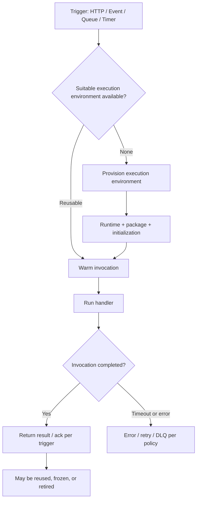
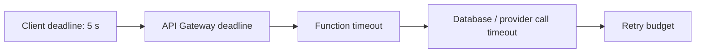
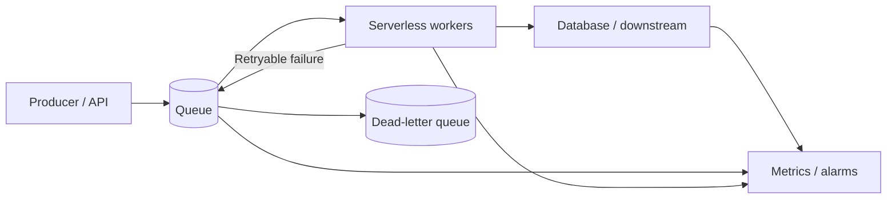
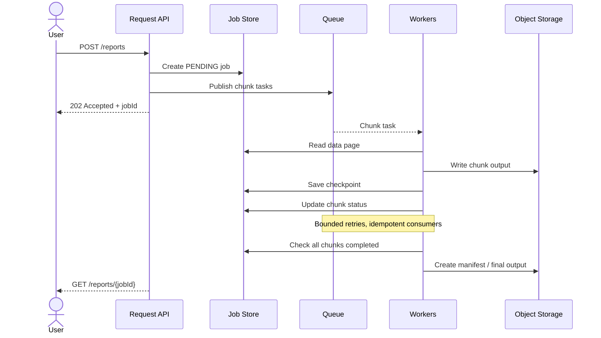

# Startup Latency, Execution Limits, and Concurrency Limits

## 1. Why Do These Three Limits Shape Serverless Architecture?

Serverless lets development teams focus on application functionality while the provider handles most of the provisioning, maintenance, and scaling of the execution infrastructure. However, serverless applications still run within bounded environments: an invocation may have to wait for runtime initialization, a function cannot run longer than its allowed deadline, and the system can be constrained by simultaneous executions or invocation rates.

Three factors must be understood together:

- **Startup latency (cold start):** the time required for an execution environment to become ready to accept and process a new invocation, especially when the platform must create a new execution environment.
- **Execution limits:** limits on execution duration, memory, CPU, payload size, package size, connections, invocation counts, or other resources enforced by the runtime and service.
- **Concurrency limits:** the number of invocations or requests that can execute simultaneously, encompassing function, account, region, event source, and dependency limits.

In the **CLOUD_ARCHITECTURE** module, the **Serverless Architecture** chapter treats these limits as design inputs for reliability, performance, security, scalability, cost, and operations under the Well-Architected mindset.

After this lesson, learners will be able to:

1. Explain cold starts, warm executions, initialization, and sources of startup latency.
2. Distinguish timeout, memory/CPU, payload, concurrency, quota, and rate limits.
3. Estimate concurrency from arrival rate and service time.
4. Design retries, queues, backpressure, reserved/provisioned capacity, and downstream limits.
5. Choose strategies for long-running tasks, burst traffic, and latency-sensitive workloads.
6. Establish telemetry, load tests, fault tests, and criteria for re-evaluating limits.

## 2. What Stages Does an Invocation Go Through?

Functions are typically triggered by an HTTP request, event, timer, queue message, or another service. General lifecycle model:

1. **Trigger receives event:** the platform receives the request or message and evaluates the trigger condition.
2. **Search for a reusable execution environment:** if available, the platform routes the invocation to an already initialized environment.
3. **Provisioning:** if no suitable environment exists, the platform provisions a new execution environment.
4. **Initialization:** loads the runtime, package, libraries, configuration, and executes initialization code.
5. **Invocation:** runs the handler with the specific input.
6. **Completion or idle retention:** the environment may be retained, frozen, scaled down, or reclaimed according to platform policy.



This model describes only general concepts. Platforms differ in provisioning, runtime reuse, freeze/resume behavior, invocations per environment, event handling, and when timeout clocks start. Never assume one provider's mechanism applies to another.

### 2.1. Cold Starts and Warm Invocations

**Cold start** generally refers to an invocation that must wait for an execution environment to be provisioned and initialized before the handler executes. A **warm invocation** uses an environment that is already ready or reused, typically avoiding most initialization overhead.

A cold start does not necessarily happen only on the very first call system-wide. Each environment has its own lifecycle; a function may simultaneously have multiple environments, some warm and some new. Sudden scale-out frequently creates additional new environments even when warm invocations are already running.

Factors that can increase startup latency:

- Runtime or runtime version initialization time.
- Large packages, excessive dependencies, classpath/module scanning, or dynamic imports.
- Initialization code connecting to databases, fetching secrets/configs, or loading models.
- VPC/VNet networking, DNS, endpoints, or secure connection setup depending on the platform.
- Extensions, instrumentation, tracing agents, and logging exporters.
- SDK initialization, compilation/JIT, cache warm-up, or loading reference data.
- Rising concurrency forcing the platform to spin up many new environments.

Do not assume cold starts stem solely from the runtime. A function with a lightweight runtime can still start slowly if it performs heavy synchronous work during initialization.

## 3. Measuring Latency Properly

User-perceived response time includes more than handler execution time:

```text
End-to-end latency =
    trigger / queue delay
  + environment provisioning (if any)
  + runtime initialization (if any)
  + handler execution
  + downstream dependency time
  + response / acknowledgement overhead
```

For HTTP functions, this total appears directly in request latency. For queue-triggered functions, users may not wait on an HTTP response, yet latency still affects message processing time, backlog age, and business SLAs.

### 3.1. Understanding Percentiles

- **Average/mean:** useful for spotting overall trends, but can mask a subset of very slow requests.
- **p50:** the duration within which half of requests complete.
- **p95:** 95% of requests complete at or below this threshold.
- **p99:** sensitive to tail latency, often critical for systems with strict SLOs.

Hypothetical example:

| Metric | Before optimization | After optimization |
| --- | ---: | ---: |
| p50 | 90 ms | 85 ms |
| p95 | 1.2 s | 450 ms |
| p99 | 2.8 s | 1.1 s |
| New environment startup duration p95 | 1.5 s | 650 ms |

In this example, p50 barely changes while tail latency improves markedly. That can matter significantly when checkout flows or interactive APIs require consistent responsiveness. These figures are illustrative, not default targets.

### 3.2. Measuring Cold Starts Without Skewing Results

To measure startup latency, separate invocations that actually create a new environment from those reusing an existing one. Use platform initialization logs/telemetry, runtime markers, or dedicated metrics if provided.

A useful measurement setup should:

1. Record trigger arrival time, handler start time, and handler end time.
2. Attach an invocation ID and environment identifier when exposed by the platform.
3. Classify cold vs. warm runs using reliable signals rather than guessing from high duration alone.
4. Measure across runtimes, regions, memory sizes, package versions, and network setups.
5. Repeat under low load, traffic bursts, and scale-out scenarios.
6. Document sample sizes and percentiles; never draw conclusions from a single invocation.

### 3.3. SLOs Must Reflect the User Journey

A function with a 100 ms handler p95 can still make checkout slow if queue delay is 3 seconds or the payment provider takes 2 seconds. Therefore, measure:

- Percentage of HTTP requests completing within the latency objective.
- Time from event emission to business workflow completion.
- Queue age or event age at processing start.
- Timeout, retry, duplicate, and dead-letter rates.
- Business transaction success rate, not just invocation success rate.

## 4. How Can Cold Starts Be Reduced?

No single cold-start reduction technique fits every function. Identify the root cause of slow startup before making changes.

### 4.1. Reduce Initialization Work

- Import only dependencies actually needed by the handler.
- Never load large datasets or run database migrations during every environment initialization.
- Avoid chaining multiple external service calls at startup if they can be performed lazily or on demand.
- Initialize shared clients outside the handler when the runtime reuses environments, without relying on reuse to hold business state.
- Use connection reuse/pooling within runtime limits and semantics.
- Optimize packages, container images/layers, and strip unused dependencies.
- Measure class loading, SDK initialization, secret retrieval, and network connection time separately.

**Note on global variables:** static/global variables may persist across invocations within the same environment, but they are not shared state across environments and can vanish at any time. Never store booking ownership, idempotency records, or durable data in global variables.

### 4.2. Choose the Right Runtime and Resource Configuration

Runtime, memory, and CPU settings can affect both startup and handler execution. Some platforms tie CPU capacity to memory allocation; raising memory can sometimes speed up a function enough to reduce total billed duration, even if the unit price per millisecond rises. Benchmark rather than guessing from MB numbers.

Test representative configurations:

| Configuration | What to observe | Conclusion needed |
| --- | --- | --- |
| Low memory | CPU throttling, GC, slow startup and handler | Is it starved for CPU/RAM? |
| Medium memory | p50/p95, peak memory, duration | Does it balance latency and cost well? |
| High memory | Reduced duration, cost per invocation | Does performance gain offset unit cost? |
| Minimal package | Init duration and cold-start frequency/impact | Which dependencies slow initialization? |
| Private networking | DNS/connectivity/init delay | How much private networking is needed and what is its impact? |

### 4.3. Provisioned / Pre-Warmed Capacity

Some platforms let you keep a pool of initialized execution environments or pre-allocated capacity ready. The aim is to reduce the likelihood that requests wait for cold initialization.

Advantages:

- Useful for predictable traffic and low-latency endpoints.
- Reduces tail latency caused by environment creation within the provisioned capacity.
- Fits peak hours or scheduled events well.

Trade-offs:

- Higher cost for idle capacity or ongoing maintenance.
- Requires forecasting environment counts by concurrency, not just requests per minute.
- Cold starts can still occur when traffic exceeds provisioned capacity or when the provider replaces environments.
- Does not solve downstream latency, queue delays, timeouts, or account quotas.

**Provisioned concurrency is not a universal term across providers.** Azure Functions has various hosting plans and pre-warmed instances; Google Cloud Run offers minimum instances; AWS Lambda provides Provisioned Concurrency. Exact mechanisms, billing, startup, and scaling semantics must be verified against the specific product.

### 4.4. Scheduled Warm-Up

Sending periodic ping requests is sometimes used to keep environments warm, though it offers no guarantees. Platforms can still retire environments, warm-ups do not provision enough capacity for bursts, and repeated pings can raise costs without improving SLOs.

Use warm-ups only when supported/recommended by the provider or backed by measurement showing improved experience at reasonable cost. Do not turn synthetic pings into uncontrolled background load.

## 5. Execution Time Limits (Timeouts)

Functions typically enforce a maximum execution duration per invocation. Once the deadline expires, the runtime or platform can terminate execution; code has no guarantee of completing cleanup or committing final steps.

Timeouts exist to:

- Prevent hanging work from holding compute indefinitely.
- Protect shared platform capacity.
- Enable the managed service to govern scaling and billing.
- Define clear contracts with clients and event sources.

### 5.1. Choosing Timeouts Based on Duration Distribution and Consequences

A timeout should not simply be the average duration plus an arbitrary buffer. Consider p95/p99 under target load, dependency variance, retry budgets, and business deadlines.

For example, an image-processing API normally takes 1.2 seconds with a p99 of 4 seconds. If the client deadline is 5 seconds while the function timeout is 30 seconds, a hung downstream service causes the function to keep consuming capacity long after the client has given up. Design deadline propagation and per-hop timeouts so work halts within the remaining budget.

### 5.2. Aligning Timeouts Across Layers



This diagram does not prescribe exact numbers. The rule is that a downstream timeout must be shorter than the caller's remaining time; budget margin for response/cleanup; and stop retrying once the deadline expires. When a request spans multiple sequential steps, the overall budget must cover them all.

Illustrative deadline table:

| Component | Illustrative timeout | Role |
| --- | ---: | --- |
| Client | 5.0 s | User experience wait limit |
| API gateway | 4.5 s | Return result or timeout at the edge |
| Function | 4.0 s | Leave margin to format and return response |
| Payment API call | 1.5 s | Prevent hanging the entire function |
| Database operation | 800 ms | Protect connection pool and transactions |

If a timeout cuts off a request right after the payment provider has processed it, the client must not assume failure and charge again. Maintain idempotency keys, pending states, and reconciliation.

### 5.3. Break Long-Running Tasks into Workflows

If a task lasts minutes or hours, waits on external steps, or needs recovery after failure, do not force it into one long function. Split it into:

- Processing steps that complete comfortably within invocation limits.
- Queues or workflow orchestrators to persist state and coordinate steps.
- Checkpoints to resume from completed steps.
- Bounded retries and compensation for side effects.
- Final outputs saved in durable storage.

For example, processing a 100,000-record report: one function can create a manifest and enqueue chunks; workers process each chunk and write output to object storage; a workflow aggregates the final result. This allows retrying a single failed chunk instead of rerunning the entire job.

## 6. Execution Limits Beyond Timeouts

Timeouts are only one part of the execution contract. Review these limits for the exact service, region, and tier in use:

| Limit type | Consequence if exceeded | Preventive design |
| --- | --- | --- |
| Memory | Out-of-memory/termination, heavy GC | Profiling, streaming, chunking, right-sized memory |
| CPU | Slow handler or throttling | Benchmark configs, optimize algorithms |
| Package/image size | Deploy/startup failure or slow init | Trim dependencies, optimize layers/images |
| Request/event payload | Rejection or forced splitting | Store large files in object storage, pass references |
| Runtime duration | Invocation times out | Split into workflows, queues, checkpoints |
| File descriptors/sockets | Cannot open new connections | Connection pooling, proper resource closure |
| Ephemeral disk | Write failures or disk exhaustion | Quotas, cleanup, streaming, object storage |
| Environment variables/config | Cannot configure or secrets exceed limit | Managed secret/config stores |
| Concurrency | Throttling or queue backlog | Capacity reservation, backpressure |
| API/request rate | 429/503 from dependencies or gateway | Rate limiting, retry policies, load shaping |
| Connection limits | Database/proxy overload | Pooling, proxies, bounded fan-out |

Limits may be hard limits (cannot be exceeded), soft/quota limits (increasable on request), or operational limits set by your own team. Never record a number in architecture docs without citing its source, region, version, and verification date.

### 6.1. Large Payloads and File Data

Never stuff large files into event payloads when triggers or platforms enforce size caps. Common pattern:

1. Client uploads the file directly to object storage via an authorized path.
2. Event carries only the object key, version, tenant/reference, and minimal metadata.
3. Function streams or processes the file in chunks.
4. Output is written to a durable location with a stable name/version.
5. Completion events are emitted only after outputs are saved and access rights verified.

This lowers memory pressure, payload size, and transfer overhead, at the trade-off of extra storage, IAM, and file lifecycle management.

## 7. Concurrency: Simultaneous Invocations

**Concurrency** is the number of invocations executing simultaneously at a given instant. It differs from **request rate** (requests per second) and **throughput** (work units completed per second).

An initial estimate using Little's Law:

```text
Average concurrency ≈ arrival rate × average service time

If a function receives 120 invocations/second
and each invocation runs 0.5 seconds on average:

Average concurrency ≈ 120 × 0.5 = 60
```

This is an average; peak concurrency also depends on bursts, service-time distribution, queueing, batch sizes, and platform limits. If p95 duration jumps from 0.5 to 2 seconds during heavy load, required concurrency can surge sharply even if the request rate stays flat.

### 7.1. Peak Calculation Example

Assume an API receives 400 requests/second during a campaign, with a function averaging 250 ms:

```text
Average concurrency at peak
= 400 × 0.25
= 100 invocations
```

If average duration climbs to 700 ms due to a slow database:

```text
New average concurrency
= 400 × 0.70
= 280 invocations
```

Downstream latency alone can increase concurrency nearly 2.8x. As concurrency climbs, the function sends even more queries to the database, slowing it further and creating an overload feedback loop.

### 7.2. Concurrency Limits Protect the System

Many platforms enforce concurrency limits at function, service, project/account, and region levels. Options may include min/max concurrency, reserved capacity, max instances, queue consumer concurrency, or per-event-source parallelism limits.

Distinguish clearly:

- **Platform/account quota:** total capacity allowed across the account.
- **Function-level cap:** limit applied to a specific function.
- **Reserved capacity/concurrency:** capacity set aside or capped for a function, per provider semantics.
- **Provisioned/pre-warmed capacity:** pre-initialized environments to reduce startup delay.
- **Event source parallelism:** number of partitions, shards, message batches, or consumers processed in parallel.
- **Downstream capacity:** how many connections/requests databases, caches, payment APIs, and other dependencies can sustain.

Not every problem can be fixed by raising quotas. If a database supports only 150 concurrent connections, raising function concurrency to 2,000 can make matters worse.

## 8. Reserved, Provisioned, and Maximum Concurrency

Names and semantics vary across providers, so read the specific service documentation. Conceptually:

| Mechanism | Objective | Key caveats |
| --- | --- | --- |
| Maximum concurrency/instances | Cap simultaneous invocations/instances | Protects downstream; may cause queueing or throttling |
| Reserved concurrency/capacity | Dedicate capacity to a workload or cap its usage | Does not automatically mean environments are kept warm |
| Provisioned concurrency/instances | Pre-initialize execution environments/instances | Cuts cold starts within allocated capacity; incurs ongoing cost |
| Minimum instances | Keep at least a configured number of instances ready | Reduces scale-to-zero delay; billing varies by product |
| Queue consumer concurrency | Limit parallel work processed by consumers | Controls backpressure and downstream impact |

### 8.1. Capping by Downstream Capacity

Suppose a database is sized for up to 250 application connections, with 80 reserved for other backend APIs and operations, leaving 170 for serverless. If each invocation opens its own connection, function concurrency must not exceed that budget. However, connection pooling/proxies alter the ratio between invocations and DB connections; measure actual connections rather than applying a blind ratio.

An initial governance formula:

```text
Allowed function concurrency
≤ downstream connection budget
  / maximum connections per invocation
```

Then reserve headroom for bursts, reconnects, admin tasks, and failover. If an invocation holds a connection for only part of its execution, multiplexing or a proxy can improve efficiency, though proxies introduce their own quotas and limits.

### 8.2. Fan-Out Multiplies Concurrency

A single request to function A can fan out to 10 invocations of function B, each making 3 calls to service C. A burst of 100 incoming requests can generate thousands of downstream operations if fan-out is unbounded.

Design controls:

- Cap parallel tasks per request.
- Cap global consumer concurrency.
- Use semaphores/worker pools or queues with bounded max in-flight items.
- Pick batch sizes that avoid connection bursts.
- Enforce deadline budgets and cancel work that is no longer useful.
- Prevent a single client or tenant from monopolizing capacity.

## 9. Throttling, Backpressure, and Queueing

When requests arrive faster than processing capacity, the system must decide whether to wait, queue, reject, or slow down.

- **Throttling:** rejecting or limiting requests once thresholds are exceeded.
- **Backpressure:** signaling upstream producers to slow down or pause sending.
- **Queueing:** buffering work for later processing, smoothing bursts.
- **Load shedding:** dropping or rejecting lower-priority work early under overload.
- **Admission control:** admitting work only when capacity exists or policy conditions are met.



Queues remove the need to process every request instantaneously, but they do not create infinite capacity. Bound message age, queue depth, publish rate, consumer count, concurrency, and DLQ policies. If queue age exceeds the business deadline, work that succeeds too late may still count as a business failure.

### 9.1. Controlled Retries

Retries help with transient errors like throttling or network resets, but can worsen an overload if every client retries simultaneously.

Sound policies typically include:

- Exponential backoff and jitter.
- Maximum retry counts and overall deadlines.
- Separating retryable errors from non-retryable business errors.
- Idempotency for side effects.
- DLQs or quarantine mechanisms.
- Alerts on message age and error rates, not just retry counts.

Never retry an ambiguous payment operation with a new transaction key. First query or reconcile the result using the idempotent reference.

### 9.2. Batch Size and Processing Efficiency

Consumers can pull batches of messages to lower overhead. Batches that are too small increase overhead and invocations; batches that are too large raise memory usage, duration, retry blast radius, and timeout risk. Benchmark against payload size, service time, parallelism, and event source semantics.

If one message in a batch fails, check whether the provider supports partial batch failures. Without it, a single failing message can force the entire batch to retry, duplicating work for already-completed items.

## 10. Scale-Out and Scale-In in Practice

Serverless platforms typically scale execution environments/instances automatically with load, but scaling is neither instantaneous, infinite, nor independent of quotas.

### 10.1. Scale-Out

When a burst arrives:

1. The platform receives additional events/requests.
2. Existing warm environments absorb part of the load if capacity remains.
3. The platform provisions additional environments/instances per policy.
4. New invocations may incur cold starts.
5. Downstream systems receive more connections and queries.

If scale-out outpaces the scaling speed of databases or partner APIs, the bottleneck shifts downstream.

### 10.2. Scale-In

When traffic drops, the platform reclaims idle environments. Never rely on processes receiving advance shutdown notice in every scenario. Durable state must live outside the environment; messages need ack/retry semantics; temporary files must be reconstructible.

### 10.3. Bursts and Ramp-Up

Two workloads with identical average request rates can behave very differently:

- Steady 100 requests/s.
- 0 requests/s for 59 seconds followed by 6,000 requests arriving in a single second.

Both yield similar per-minute averages, yet the second requires completely different capacity, concurrency, and downstream burst handling. Load tests must model realistic arrival distributions, not just average RPS.

## 11. Patterns for Long-Running Tasks

### 11.1. Queue-Based Workers

An API validates the request, enqueues the job, and returns a job ID; workers consume messages within invocation limits. Clients poll status via another API.

Well suited for tasks not needing synchronous completion, such as report generation, image processing, data imports, or notifications. Requires a job status store, idempotent retries, queue-age monitoring, and a DLQ.

### 11.2. Workflow Orchestration

When work spans multiple steps, human approvals, delays, or compensations, use a workflow orchestrator to persist state and coordinate each function/service step. Never keep a single invocation open waiting minutes or hours when the platform bills and enforces timeouts on execution time.

### 11.3. Chunking and Checkpoints

Split large datasets into chunks with stable IDs; each chunk tracks its own state, retries, and output. Checkpoints record completed work so a failure does not force reprocessing from scratch.

### 11.4. Streaming

For continuous data processing, a streaming platform may fit better than discrete request/response functions. Consider partitioning, consumer groups, ordering, checkpoints/offsets, replay, and retention.

## 12. Design Example: Report Generation API

Suppose a user requests a report spanning 2 million rows. A synchronous function reading all rows, building a CSV, and returning the file in one request risks exceeding timeout, memory, and payload limits.

Decoupled design:



The job store holds authoritative states such as `PENDING`, `RUNNING`, `PARTIAL`, `COMPLETED`, and `FAILED`; outputs live in object storage; the queue merely coordinates work. Returning `202` from the API does not mean the report is finished. Users poll the job ID or receive a notification upon completion.

### 12.1. Choosing Chunk Size

Chunks that are too large risk timeouts or high memory consumption; chunks that are too small inflate message counts and overhead. Benchmark with representative data and define:

- Records or bytes per chunk.
- Target processing duration comfortably below the timeout with safety margin.
- Concurrent chunk count within DB/query capacity.
- Idempotency keys scoped by report ID and chunk ID.
- Checkpoints and handling for repeatedly failing chunks.
- Temporary output cleanup and intermediate file lifecycle.

## 13. Coordinating Concurrency with Databases and Caches

A rapidly scaling function can easily overload a database:

- Per-invocation pools cause connection explosions.
- Fan-out queries multiple tables or external APIs at once.
- Simultaneous cold starts trigger connection storms.
- Retries multiply query volume.
- A single noisy tenant sends a burst that consumes all capacity.

Mitigations:

1. Use a connection proxy/pooler compatible with serverless and the database engine.
2. Cap function concurrency based on the connection budget.
3. Minimize connection hold times and transaction durations.
4. Optimize queries/indexes and apply pagination/chunking.
5. Cache infrequently changing data with clear TTLs and an authoritative source.
6. Separate read/write workloads or use read replicas where appropriate.
7. Apply queues and admission control for background tasks.
8. Monitor connection counts, wait times, locks, IOPS, and p95/p99 query latency.

**Raising concurrency does not fix a slow database.** When the DB is the bottleneck, adding invocations only deepens the queue and increases cost.

## 14. Partner Rate Limits and Multi-Tenant Fairness

A payment provider may permit 100 requests/s while a function platform can launch thousands of concurrent invocations. If every invocation calls the provider directly, 429 throttling responses quickly follow.

Strategies:

- Queue outbound calls and cap consumer concurrency to the rate budget.
- Apply token bucket/leaky bucket or distributed rate limiters as needed.
- Isolate queues or quotas by tenant/priority.
- Add circuit breakers when providers fail continuously.
- Retry 429s respecting `Retry-After` when provided, plus jitter.
- Persist pending states so workflows can resume later.
- Provide manual reconciliation tooling for ambiguous transactions.

Fairness ensures one tenant or workload type cannot exhaust all function concurrency, queue capacity, or dependency quotas. Apply per-tenant limits, priority queues, weighted fair scheduling, or API gateway throttling.

## 15. Choosing Deployment Models by Load Pattern and Latency Needs

| Workload | Characteristics | Options to evaluate |
| --- | --- | --- |
| Interactive API | Low latency, variable traffic | Trim init, pre-warmed capacity for peaks, cap concurrency, keep endpoints close to clients |
| Event burst | Spiky events, deferrable processing | Queues, batching, backpressure, consumer scaling |
| Scheduled batch | Periodic, high volume, predictable schedule | Chunking, workflows, batch services, or dedicated compute |
| Long-running process | Long duration, holds memory/state, needs signals | Containers/workers/services instead of forcing short invocations |
| Streaming | Continuous data, needs ordering/checkpoints | Streaming services with consumer groups and offsets |
| Ultra latency-sensitive | Tight p99, startup heavily impacts UX | Provisioned/pre-warmed capacity or always-on services if TCO makes sense |
| Unpredictable workload | Highly variable traffic, demand-based scaling preferred | Scale-to-zero can fit if cold starts are acceptable |

Serverless is not always the best default. For steady, CPU-intensive, long-running, or ultra-low-latency workloads, always-on containers/services can be simpler and cheaper. Compare TCO and operations against the exact same SLO.

## 16. Security Under High Concurrency and Event Processing

High concurrency multiplies parallel executions, allowing authorization bugs, race conditions, and secret leaks to spread faster.

- Assign per-function or per-capability workload identities/roles with least privilege to queues, objects, secrets, and databases.
- Never share a single administrative credential across all functions.
- Authenticate and authorize events/webhooks; never trust a payload merely because it arrived via a queue.
- Enforce input size limits, schema validation, and tenant scoping.
- Use idempotency and transactions to prevent duplicate side effects.
- Never log tokens, PII payloads, or secrets.
- Govern retries and DLQs: poison messages must never cause infinite loops.
- Isolate functions handling sensitive data with appropriate network boundaries and permissions.
- Monitor per-tenant concurrency and anomalous spikes.

A function having access to a secret store does not make its incoming payload trustworthy. Event source authentication, schema validation, replay protection, and business authorization remain essential.

## 17. Cost: Duration, Memory, Concurrency, and Idle Capacity

Serverless pricing varies by product, but typically reflects requests/invocations, execution duration, memory/CPU or instance resources, pre-warmed capacity, network transfer, and supporting services.

A simple estimation model:

```text
Compute usage ≈ invocation_count × billed_duration × configured_resource_size

Total cost ≈ compute usage cost
           + request/event cost
           + provisioned/minimum capacity cost
           + network/data transfer
           + queue, storage, logs, monitoring and workflow costs
```

Hypothetical example to learn comparison:

- 10 million invocations per month.
- Each invocation uses 512 MB and averages 300 ms.
- Billed duration in this example is assumed equal to execution time for simplicity.

```text
Memory-time ≈ 10,000,000 × 0.5 GB × 0.3 s
            = 1,500,000 GB-seconds
```

This figure is not a price quote and omits free tiers, request charges, CPU models, billing rounding, minimum duration floors, provisioned capacity, logging, and data transfer. Consult the current pricing calculator and documentation of your chosen provider.

### 17.1. Optimizing Cost per Business Outcome

Do not optimize duration in isolation. A super-fast function that retries 20% of the time or fails frequently can have a high cost per successful job.

Measure:

- Cost per completed report or confirmed booking.
- Retry rates and duplicate execution counts.
- Timeout and failure rates.
- Utilization of provisioned/pre-warmed capacity.
- Queue, object storage, logging, and data transfer charges.
- Downstream overload and reprocessing costs.

### 17.2. Cold Start vs. Cost Trade-Offs

Keeping pre-warmed capacity lowers startup latency but incurs idle charges; scale-to-zero saves idle spend at the risk of higher tail latency. A hybrid strategy can maintain warm capacity during peak hours, scale down off-hours, and offload background work to queues. Back decisions with traffic patterns and SLOs rather than guesswork.

## 18. Observability and Alerting

Metrics should capture both platform health and business outcomes:

| Category | Metrics | Meaning |
| --- | --- | --- |
| Startup | cold start count/rate, init duration | Impact of fresh environment initialization |
| Latency | handler duration, end-to-end latency, p95/p99 | User experience quality |
| Execution | timeouts, errors, OOMs, throttling | Incomplete or rejected invocations |
| Concurrency | current/max concurrency, utilization, rejections | Proximity to scaling caps |
| Queue | age, depth, receive count, DLQ | Whether work is backing up or retrying |
| Dependency | DB connections, query latency, provider 429/5xx | Downstream bottlenecks |
| Cost | billed duration, invocation count, provisioned utilization | Cost efficiency |
| Business | jobs completed, jobs overdue, bookings confirmed | Actual business value delivered |

### 18.1. Actionable Alerting

Alerts should trigger when:

- p95/p99 breaches SLO continuously over an evaluation window.
- Queue age exceeds business deadlines.
- Concurrency approaches hard quotas or configured caps.
- Throttling/429 rates spike abnormally.
- Timeout or cold-start rates degrade user journeys.
- New messages land in the DLQ or backlog grows.
- Payments/bookings/reports remain pending beyond expected thresholds.
- Session/DB connection or object storage errors exceed limits.

Every alert needs an owner, a runbook, and concrete remediation steps. An alert saying "concurrency at 80%" is insufficient without visibility into how dependencies are coping.

## 19. Load Testing and Fault Injection

A test suite should exercise both traffic shapes and failure modes:

| Scenario | Test design | Pass criteria |
| --- | --- | --- |
| Cold start | Force fresh environments or use platform test hooks, gather many samples | Known init duration distribution and p95/p99 impact |
| Burst | Step up requests then spike sharply | SLOs and downstream limits remain intact |
| Concurrency cap | Set cap below incoming demand | Throttling/queue/backpressure works per policy, zero lost events |
| Slow dependency | Inject latency into DB/provider | Timeout budgets and circuit breakers engage properly |
| Retry storm | Induce widespread transient failures | Backoff/jitter dampens load instead of amplifying it |
| Mid-workflow timeout | Kill invocation mid-step | State persists, retries resume safely |
| Duplicate events | Replay identical events repeatedly | No duplicate side effects created |
| DLQ | Inject unprocessable malformed payloads | Isolated and alerted with a working redrive procedure |
| Provisioned capacity | Drive traffic above pre-warmed capacity | Overflow behaves as designed; cost/latency impact understood |
| Downstream saturation | Push DB/provider to its limit | Concurrency caps protect dependency without connection storms |

Do not limit load tests to flat steady-state RPS for 30 seconds. Include ramp-ups, bursts, extended soak tests, tenant skew, varied payload sizes, and realistic workload mixes.

## 20. Process for Designing Limits on a New Function

1. **Define trigger and goal:** synchronous API, queue event, timer, or streaming.
2. **Set end-to-end deadlines:** establish client/business deadlines, latency SLOs, and per-dependency time budgets.
3. **Benchmark startup:** measure cold/warm initialization across runtimes, packages, memory sizes, and network setups.
4. **Determine execution ceilings:** timeouts, memory, payloads, ephemeral disk, file descriptors, packages, and quotas.
5. **Estimate concurrency:** compute peak arrival rate × service time, adding burst headroom.
6. **Calculate downstream budgets:** DB connections, provider rate limits, storage throughput, and API quotas.
7. **Select scaling/backpressure:** maximum concurrency, queues, batching, reserved/pre-warmed capacity, and admission control.
8. **Design retries/idempotency:** error classification, DLQs, deduplication, checkpoints, and reconciliation.
9. **Configure telemetry:** startup, duration, concurrency, throttling, queue age, cost, and business completion.
10. **Run load and fault tests:** simulate scale-out, slow dependencies, timeouts, duplicates, and capacity exhaustion.
11. **Write an ADR:** document choices, trade-offs, costs, and review triggers.

## 21. Practical Scenario: Serverless Checkout System

**Context:** A ticketing platform uses an HTTP function to accept checkout requests, a queue-triggered worker to confirm payments, and another function to send emails. During ticket drops, traffic can jump from 20 requests/s to 700 requests/s within seconds. The database reliably supports around 180 connections from this application group; the payment provider enforces a rate budget of 120 requests/s. The checkout creation API targets a 800 ms p95; final confirmation can be asynchronous but must be queryable.

### 21.1. Risks

- Bursts force the platform to create many new environments, increasing cold starts.
- Rapid API concurrency growth causes a DB connection storm.
- Payment workers exceed the provider's 120 requests/s budget and receive 429s.
- Synchronized retries compound overload.
- Timeouts after provider processing cause clients to resubmit checkouts.
- Slow email delivery backs up queues, which must never corrupt ticket states.

### 21.2. Design Approach

- The API validates requests, enforces idempotency keys, and persists checkout state durably in a transaction.
- Keep synchronous execution strictly for immediate feedback; drive payment confirmation via an asynchronous state-machine workflow.
- Cap API maximum concurrency to match the DB connection budget; consider a proxy/pooler and open connections only when needed.
- Queue payment processing and cap worker concurrency/rate to stay within the provider's budget.
- Apply backoff/jitter retries, a DLQ for unprocessable errors, and reconciliation for ambiguous states.
- Run email as an independent consumer with retries and deduplication, decoupled from checkout status.
- Evaluate pre-warmed capacity for interactive endpoints during ticket drops based on projected concurrency.
- Monitor p95/p99, queue age, concurrency, DB connections, provider 429s, checkout states, and cost per confirmed sale.

### 21.3. Test Plan

| Test | Execution | Pass criteria |
| --- | --- | --- |
| 700 RPS burst | Ramp rapidly from 20 to 700 RPS | API meets SLO or sheds load gracefully per policy |
| Database cap | Constrain connection budget below concurrency demand | Functions do not overload DB; queueing/backpressure holds |
| Provider rate limit | Mock provider returning 429 beyond budget | Consumers pace requests and retry with jitter |
| Ambiguous timeout | Provider succeeds but response is dropped | No double charge; checkout reconciles cleanly |
| Cold start | Compare no-prewarm vs. prepared capacity | Quantified impact on p95/p99 and TCO |
| Queue backlog | Intentionally pause workers then restart | Zero lost events; backlog age returns to target |
| Duplicate checkout | Send identical key concurrently multiple times | Single logical outcome produced |

## 22. Sample ADR: Capping Concurrency to Protect Dependencies

```text
ADR-041: Set concurrency budget and queue for payment worker

Context:
- Checkout experiences sharp traffic bursts.
- Database and payment provider capacities are lower than the maximum scale
  the function platform can generate.
- Payment outcomes may be asynchronous and require reconciliation.

Options:
A. Allow functions to autoscale freely up to account quotas.
B. Cap concurrency, offload payment work to a queue, and throttle consumers.
C. Increase concurrency and raise retries when the provider rejects requests.

Decision:
- Choose B.
- API writes state and events idempotently.
- Worker concurrency/rate is tuned to the dependency budget.
- Retries use exponential backoff + jitter; persistent failures route to DLQ.
- Reconciliation workflow resolves ambiguous outcomes.

Trade-offs:
- Queueing increases latency to final confirmation.
- Requires operating backlogs, DLQs, and intermediate states.
- Capacity may not be maximized at every instant.

Verification:
- Load tests covering bursts, provider 429s, DB saturation, and duplicate events.
- Measure end-to-end latency, queue age, and cost per completion.
- Confirm zero duplicate charge or booking logic errors.

Review triggers:
- Dependency quotas change.
- Workload or latency SLOs change.
- New pooling/throughput capabilities or payment architecture changes are introduced.
```

## 23. Common Design Mistakes

1. **Measuring only handler duration:** misses trigger delays, cold starts, queue age, and downstream time.
2. **Treating warm-up pings as a guarantee:** environments can still retire; pings may simply waste money.
3. **Increasing memory without benchmarking:** does not always reduce latency or TCO.
4. **Setting arbitrarily long timeouts:** invocations hold capacity long after clients abandon requests.
5. **Forcing long-running jobs into single functions:** invites timeouts, prevents checkpointing, and forces full restarts.
6. **Letting concurrency scale unboundedly against dependencies:** causes connection storms and 429 errors.
7. **Retrying immediately on failure:** triggers retry storms and amplifies overload.
8. **Omitting idempotency:** timeouts and duplicates produce repeated side effects.
9. **Using overly large batches:** raises memory, duration, and retry blast radius.
10. **Confusing request rate with concurrency:** ignores service time and burstiness.
11. **Using provisioned capacity without forecasting:** pays for idle resources or still hits cold starts on overflow.
12. **Lacking DLQ/queue-age alarms:** failed events stall unnoticed.
13. **Relying on local environment state:** loses caches/sessions whenever environments are recycled.
14. **Testing only steady-state traffic:** overlooks bursts, cold starts, scale-out, and downstream degradation.
15. **Optimizing invocation success while ignoring business outcomes:** fast responses even when bookings or payments fail to finalize.

## 24. Pre-Production Checklist

- [ ] Startup/cold-start and warm latencies are measured on the chosen runtime, memory, and network configuration.
- [ ] p50/p95/p99 metrics exist for both handlers and end-to-end user journeys.
- [ ] Client, gateway, function, and downstream timeouts align within a shared deadline budget.
- [ ] Work exceeding execution limits is chunked or moved to appropriate workflows/workers.
- [ ] Service hard limits, quotas, and soft limits are documented by region and tier.
- [ ] Concurrency is estimated from peak arrival rate × service time with burst headroom.
- [ ] Maximum, reserved, provisioned, and minimum capacity settings match provider semantics.
- [ ] Dependency connection budgets and provider rate limits are actively enforced.
- [ ] Queues, batches, backpressure, admission control, and DLQs align with business deadlines.
- [ ] Retries are bounded with exponential backoff/jitter and clear error classification.
- [ ] Critical side effects implement idempotency, deduplication, and reconciliation.
- [ ] Session and business state do not rely on the execution environment.
- [ ] Metrics and alerts cover latency, timeouts, throttling, concurrency, queue age, and business completion.
- [ ] Load tests exercise bursts, soak runs, slow dependencies, duplicates, and scale-out.
- [ ] Cost models include invocations, duration, resource size, prepared capacity, queues, logs, and data transfer.
- [ ] Owners, runbooks, and review conditions for quotas/SLOs under traffic growth are defined.

---

**Takeaway:** Serverless automatically scales execution environments, but it does not eliminate runtime, duration, quota, and dependency limits. Cold starts shape tail latency; timeouts define each execution's contract; concurrency governs pressure across the entire system. Sound design measures end-to-end, bounds load to downstream capacity, applies queues/backpressure and idempotency, and adopts pre-warmed capacity only when latency gains justify the cost.
