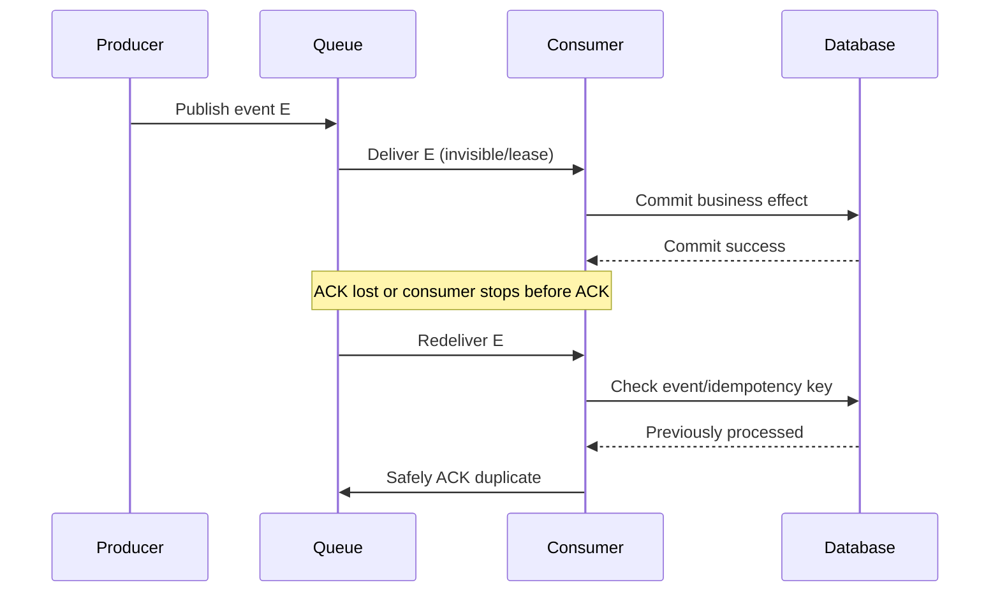
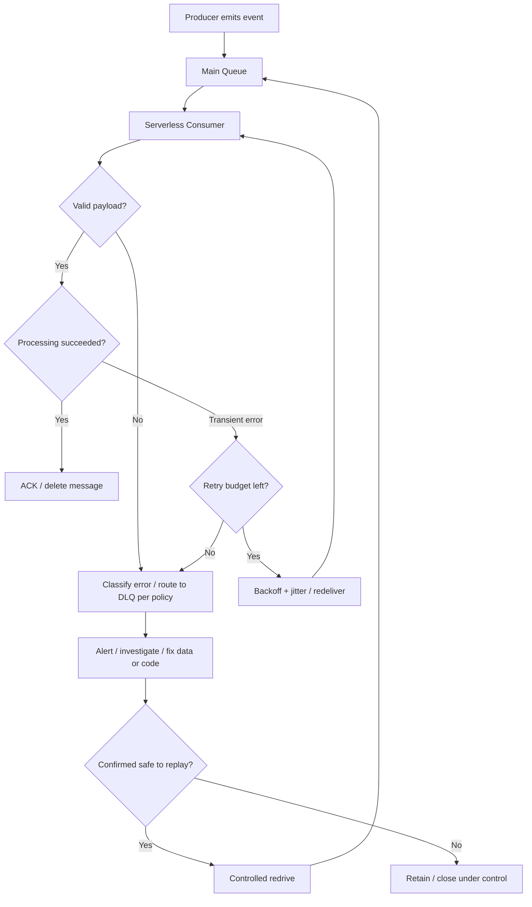
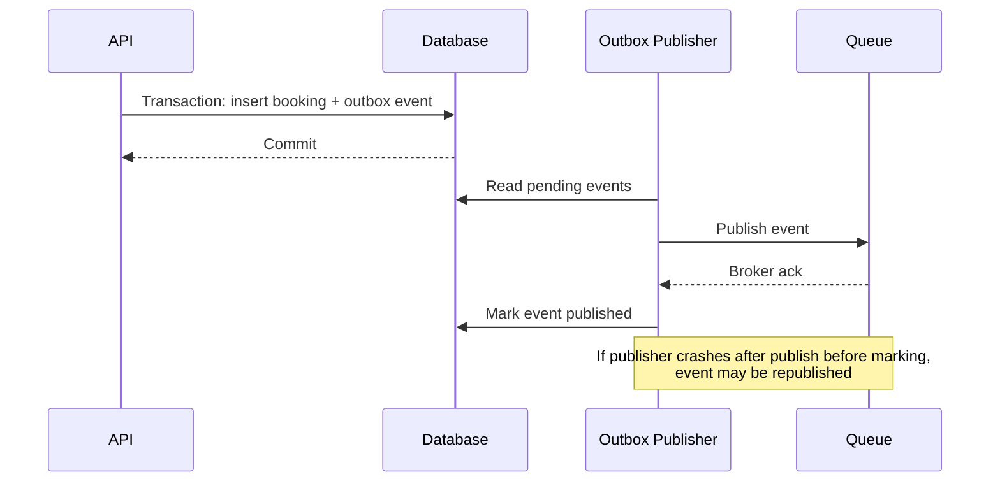
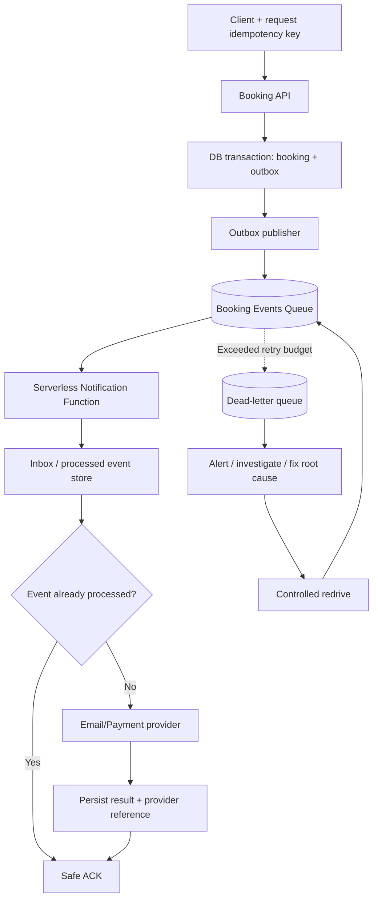

# Retries, Dead-Letter Queues, and Handling Duplicate Events

## 1. Why Must Serverless Systems Be Designed for Retries and Duplicates?

In a serverless architecture, an event typically traverses multiple independent components: the API receiving the request, an event emitter, a queue, functions/workers, and storage systems or external partners. Any of these components can temporarily lose connectivity, time out, hit quota limits, restart, or return errors. Platforms commonly redeliver messages to avoid losing work; consequently, the same event can reach a consumer multiple times.

Consider a user clicking **Book Appointment**. The API creates a booking record and emits a `BookingCreated` event; a function then sends a confirmation email and asks the payment service to process a deposit. If the function sends the email but loses connectivity before acknowledging completion, the queue may redeliver the event. If the function creates another payment transaction on retry, the user could be charged twice.

Therefore, three mechanisms must be designed together:

- **Retries:** re-attempting an operation on potentially transient failures, with proper bounds and backoff intervals.
- **Dead-letter queue (DLQ):** quarantining events that fail past policy limits for controlled investigation and remediation.
- **Idempotency/deduplication:** ensuring that processing the same request or event multiple times causes no unintended business side effects.

This lesson belongs to the **Serverless Architecture** chapter of the **CLOUD_ARCHITECTURE** module. It focuses on building reliable event processing while balancing latency, throughput, security, cost, and operations.

After this lesson, you will be able to:

- Distinguish at-most-once, at-least-once, and processing guarantees in distributed systems.
- Classify transient vs. unrecoverable errors; design retry/backoff/jitter and retry caps.
- Design DLQs, redrive procedures, and poison-message handling.
- Construct idempotency keys, deduplication stores, and safe data-write transactions.
- Explain transactional outbox/inbox, event ordering, and leases/visibility timeouts.
- Test scenarios involving function re-execution, post-side-effect timeouts, and duplicate or out-of-order events.

## 2. Understand Delivery Semantics Before Writing Retries

In distributed systems, producers and consumers may not know with certainty whether the other side completed an operation. For example, a consumer might commit to the database, yet the ACK response gets lost. The queue sees only a missing ACK and redelivers the message; the consumer cannot assume the prior attempt never processed.

### 2.1. Three Common Delivery Semantics

| Model | Meaning | Consequence |
|---|---|---|
| **At-most-once** | Each message is delivered/processed at most once per system mechanism | Messages can be lost if failures occur before processing or ACK |
| **At-least-once** | System keeps redelivering until a success acknowledgment is received | Messages can be delivered multiple times; consumers must tolerate duplicates |
| **Exactly-once** | Guarantees an effect happens once within a defined boundary | Feasible only with explicit boundaries, state, and transaction coordination; never infer solely from a queue feature name |

**Key point:** many popular queueing and event-driven services provide at-least-once delivery or can deliver duplicates in certain scenarios. Read the exact semantics of the specific service: ACK timing, visibility timeouts, retention, ordering, redelivery, event source retries, and behavior on function timeouts.

"Exactly-once delivery" and "exactly-once business effect" are also two different things. A message might arrive once through a broker yet the application still produces duplicate side effects due to client retries. Conversely, a message delivered multiple times to a well-designed idempotent consumer can still yield exactly one business outcome.

### 2.2. ACK, Visibility, and Redelivery

In some queues, when a consumer receives a message, it becomes **invisible** to other consumers for a set period (visibility timeout or lease). Once the consumer finishes processing and ACKs/deletes the message, the queue removes it. If the timeout expires before ACK, the message may be redelivered.



In the diagram, the database commit succeeded, but the ACK never reached the queue; the second delivery must recognize that the event was already completed and avoid re-applying side effects.

The visibility timeout/lease must match processing duration. If shorter than function runtime, a message can be delivered to multiple consumers simultaneously. If too long, failed messages wait excessively before redelivery. Some services support extending visibility or heartbeats; you must still handle cases where a function dies and stops renewing.

## 3. Error Classification: Not Every Error Should Be Retried

Retries help only when **the failure is likely temporary** and repeating the operation is safe. Retrying configuration errors or malformed data merely prolongs incidents, inflates costs, and clogs the pipeline.

### 3.1. Transient Errors

Examples:

- Network resets, brief connection timeouts, temporary DNS resolution failures.
- Dependencies returning HTTP 429 (rate limited) or transient 5xx codes.
- Database primary failover, temporary connection pool exhaustion, or resolvable lock contention.
- Function throttling during sudden traffic spikes while quotas/capacity recover.

For these errors, retry after a wait, cap total attempts, and honor dependency signals such as `Retry-After` when present.

### 3.2. Permanent or Data-Correction Errors

Examples:

- Invalid schema or payload, missing required fields.
- Unsupported event version, invalid webhook signature, or failed validation rules.
- Insufficient identity permissions (403) or deleted/renamed target resources.
- Legitimate business rejections, such as no remaining inventory.

Repeated retries generally cannot fix these errors. Log the root cause and route to an appropriate error path or DLQ for investigation; valid business rejections can be marked handled by convention so the queue does not loop forever.

### 3.3. Ambiguous-Outcome Errors

This is the most dangerous category: the consumer sends a write or API call that succeeds at the destination, then times out before receiving the response. It is unknown whether the side effect occurred. Examples:

- Payment charge sent; partner processed it, but the response was dropped.
- Database committed, but the connection severed before the client received confirmation.
- Email sent successfully, but the function terminated before ACKing the queue.

Never treat a timeout as proof that the operation failed. Use idempotency keys, status lookups by request ID, or partner APIs supporting idempotency/status queries before deciding whether to re-execute.

## 4. Designing Retries: Caps, Backoff, and Jitter

### 4.1. Exponential Backoff

Rather than retrying immediately, exponential backoff increases the delay after each failure:

\[
delay_n = \min(delay_{max},\ delay_{base}\times 2^n)
\]

Example with `delay_base = 1 second`, `delay_max = 30 seconds`:

| Retry attempt | Wait time without jitter |
|---:|---:|
| 1 | 1 second |
| 2 | 2 seconds |
| 3 | 4 seconds |
| 4 | 8 seconds |
| 5 | 16 seconds |
| 6 onward | Max 30 seconds |

Capping the wait prevents prolonged incidents from spacing retries unreasonably far apart; capping total attempts or elapsed time prevents one message from consuming resources indefinitely.

### 4.2. Jitter to Prevent Synchronized Retries

If thousands of functions fail together and all retry after exactly 8 seconds, they trigger another synchronized load spike (**thundering herd**). Jitter adds randomness to the delay:

\[
delay = random(0,\ \min(delay_{max}, delay_{base}\times 2^n))
\]

This is full jitter. Several variants exist; choose based on library/platform support and latency requirements. The goal is to spread attempts out—not to introduce uncontrolled arbitrary waits.

### 4.3. Retry Limits

A retry policy should specify:

- Maximum attempts, clarifying whether that includes the initial attempt or retries only.
- Overall deadline or maximum time an event remains eligible for processing.
- Which error types trigger retries vs. routing straight to a DLQ or business failure branch.
- Backoff, jitter, max delay, and handling for `Retry-After`.
- Where retries happen: SDK, application code, queue, event source mapping, workflow, or partner.
- Impact when multiple layers retry simultaneously.

**Avoid unbounded nested retries.** For example, if a function does 3 HTTP retries, the event source redelivers 5 times, and a workflow attempts 4 times, total calls to a dependency multiply dramatically. Define an end-to-end retry budget and per-layer attempt caps.

### 4.4. Retry Budgets and Backpressure

When a dependency continuously fails, high retry ratios cause self-inflicted load amplification. Limit the ratio of retry traffic to fresh requests, max concurrent messages, receive rates, and queue depth. If queue backlog surges, lowering concurrency or pausing consumers protects dependencies, though you must weigh message retention/visibility expiration risks.

Design backpressure across the entire chain:

1. Producers apply rate limits or buffering.
2. Queues absorb bursts within retention and capacity limits.
3. Consumers cap concurrency to match database/partner capacity.
4. Retries use backoff/jitter rather than turning queues into endless load loops.
5. Alerts fire when oldest message age, backlog, throttling, or DLQ counts cross thresholds.

## 5. Dead-Letter Queues (DLQs) and Poison Messages

### 5.1. What Is a DLQ?

A **dead-letter queue** holds messages that failed processing after exhausting redelivery policies or cannot be handled in the normal flow. DLQs quarantine failing messages so primary consumers keep processing healthy traffic while preserving data for investigation.

A **poison message** is a message that consistently causes a consumer to fail, typically due to an invalid payload, incompatible schema, or condition preventing progress. Repeatedly pulling and retrying the same head-of-line message can stall a partition/queue or waste compute endlessly.

### 5.2. Flow When a Message Exceeds Retry Thresholds



A DLQ is not a trash bin to forget. Assign an owner, alerts, retention, access controls, investigation procedures, and resolution SLAs.

### 5.3. Metadata to Retain with Failed Messages

Preserve:

- Original event ID/message ID and correlation/trace IDs.
- Event type, schema version, producer, consumer, creation timestamp, and receive timestamps.
- Failure timestamp, error category/code, final error details, and essential retry history.
- Original payload or reference to securely stored payload, adhering to data classification rules.
- Consumer version, environment, deployment/build ID, and queue/source identifier.

Never dump secrets, access tokens, or sensitive personal data carelessly into logs or DLQs. Because a DLQ can hold raw failing payloads containing customer data, enforce encryption, dedicated IAM policies, auditing, retention, and policy-compliant deletion.

### 5.4. Redrive: Controlled Replay

**Redrive** moves messages from a DLQ back into the processing pipeline after the root cause has been identified and fixed. Before replaying:

1. Determine whether the failure stemmed from code, schema, dependency, permissions, or business data.
2. Fix the bug and deploy a tested consumer version.
3. Confirm messages are still valid, have not passed business expiration, and did not already apply side effects.
4. Check that the idempotency/deduplication store still retains corresponding keys; avoid premature key expiry.
5. Replay in small batches with rate and concurrency limits while watching backlog, errors, and DLQ counts.
6. Be ready to halt the redrive and keep messages quarantined if failures recur.

Never blindly redrive an entire DLQ right after a code fix without inspecting payloads, as some messages may belong to expired workflows or partially completed operations.

## 6. Handling Duplicate Events: Idempotency and Deduplication

### 6.1. What Is Idempotency?

An **idempotent** operation can execute multiple times with the same key/input while producing a final business outcome equivalent to running once. For example, "mark booking B as confirmed" can be idempotent via conditional state updates; "add 100,000 VND to balance" is not idempotent if re-execution adds the amount again.

Define idempotency by **business effect**:

- Creating a booking: one booking intent creates at most one booking.
- Payment: one payment intent creates at most one charge.
- Sending email: one confirmation event sends at most one email per policy, provided the provider supports idempotency or status reconciliation exists.
- Loyalty points: one business transaction credits points only once.

### 6.2. Where Do Idempotency Keys Come From?

Prefer stable IDs generated by the producer for **a single business intent** or **a single event**. Never generate a fresh UUID on every consumer retry, as each attempt gets a different key and fails to catch duplicates.

Distinguish key scopes:

| Key | Scope |
|---|---|
| Request idempotency key | One client request, e.g., one booking submission |
| Event ID | One emitted event, stable across redeliveries |
| Business key | Domain identity, e.g., `booking_id + action_type` |
| Provider idempotency key | Key sent to an external system so the partner prevents duplicate operations |

Avoid using a payload hash as the sole key when two distinct valid actions share identical payloads. For example, a user intentionally buys the same item twice in two separate orders; payloads match, yet they represent two distinct intents. Keys must reflect true transaction boundaries.

### 6.3. Deduplication Store

Consumers can use a database table to track processed keys:

```sql
CREATE TABLE processed_events (
  consumer_name  VARCHAR(100) NOT NULL,
  event_id       VARCHAR(200) NOT NULL,
  processed_at   TIMESTAMP NOT NULL,
  result_ref     VARCHAR(200),
  PRIMARY KEY (consumer_name, event_id)
);
```

The primary key prevents two executions of the same event in the same consumer from inserting two rows. However, **inserting the key first and executing side effects separately** remains unsafe:

- If you insert the key first and crash before updating business state, the next delivery sees the key and skips incomplete work.
- If you update business state first and crash before inserting the key, the next delivery repeats the side effect.

Therefore, when deduplication and business updates share the same database, **write the dedup marker and business change in the same transaction** or use a recoverable state model.

### 6.4. Transactional Inbox Pattern

A transactional consumer can:

1. Begin a database transaction.
2. Insert `(consumer_name, event_id)` into `processed_events`.
3. On unique-key conflict, conclude the event was already processed and skip side effects.
4. If the insert succeeds, apply business changes within the same database transaction.
5. Commit.
6. Acknowledge the message only after the commit succeeds.

Pseudocode example:

```text
handle(event):
    begin database transaction

    inserted = insert processed_events(
        consumer_name, event.id, now()
    ) on conflict do nothing

    if not inserted:
        commit
        acknowledge(event)
        return ALREADY_PROCESSED

    apply_business_change(event, transaction)
    commit

    acknowledge(event)
```

If the process dies after commit but before ACK, the queue redelivers; the consumer sees the existing key and safely ACKs. If the transaction rolls back, both the key and business change roll back together, allowing the next delivery to retry.

This pattern covers only side effects inside that database transaction. If `apply_business_change` calls a payment API or sends email while the transaction is open, a database rollback cannot undo external side effects. Avoid holding DB transactions open across network calls and assuming synchronous rollback across external systems.

## 7. Transactional Outbox: Avoiding Lost Events After Data Writes

Another failure gap occurs on the producer side. An API might:

1. Commit a booking to the database.
2. Publish `BookingCreated` to a queue.

If the DB commits and publishing fails, the booking exists without an event; consumers never send the email. If publishing happens before commit and the transaction rolls back, the event announces a nonexistent booking.

**Transactional outbox** writes business data and the event record inside the same database transaction. A separate publisher reads the outbox and emits events. Publishing may repeat on failure, so consumers still need idempotency.



The publisher can use polling or change-data capture depending on architecture. Use locks/leases so multiple publishers do not race on the same event, bounded retries with backoff, pending-event age monitoring, and recovery for stuck rows. While an outbox eliminates the DB-commit-to-publish gap, **it does not make queues or consumers exactly-once**; duplicates can still happen between publish and marking published.

### 7.1. Outbox Table Design

```sql
CREATE TABLE outbox_events (
  event_id       VARCHAR(200) PRIMARY KEY,
  aggregate_id   VARCHAR(200) NOT NULL,
  event_type     VARCHAR(150) NOT NULL,
  schema_version INTEGER NOT NULL,
  payload        JSON NOT NULL,
  created_at     TIMESTAMP NOT NULL,
  published_at   TIMESTAMP,
  attempts       INTEGER NOT NULL DEFAULT 0
);
```

In production implementations, add status/lease columns, next-retry timestamps, partition or sequence numbers if ordering is needed, correlation metadata, and retention policies. Prevent concurrent publishers from emitting the same row via claim/lease mechanisms or CDC. Clean up published outbox rows per retention and replay/audit requirements.

## 8. Event Ordering and Out-of-Order Events

Queues may not guarantee global ordering; even when a service offers FIFO/partition ordering modes, verify the exact scope of guarantees and requirements to preserve order.

Example of two events:

- `BookingConfirmed(version=2)`
- `BookingCancelled(version=3)`

If a consumer receives version 3 first and then version 2, blindly applying the older event reverts a cancelled booking back to confirmed. Mitigations include:

- **Aggregate ID/partition key:** route events for the same entity to one partition/group when supported.
- **Sequence/version checks:** apply events only when incoming version exceeds stored version and satisfies state rules.
- **Valid state transitions:** validate current state before mutating; never overwrite newer state with stale events.
- **Reconciliation:** query the source of truth when gaps or out-of-order sequences appear instead of guessing from a single event.

Not every domain requires strict ordering. If only latest state matters, version checks and independent handling suffice; where strict sequence matters (such as financial ledgers), explicitly define aggregates, partitions, transactions, and recovery rules.

## 9. Where Do Retries Happen in Serverless Architecture?

An event-driven pipeline can have retries at multiple layers. Document owners and semantics clearly:

| Layer | Example retry | Configuration needed |
|---|---|---|
| Client/API | Client retries on HTTP timeout | Idempotency keys, deadlines, status codes, retry-safe methods |
| Service SDK | SDK retries 429/5xx | Attempts, backoff, jitter, timeouts; avoid clashing with outer layers |
| Producer/outbox publisher | Message publish failures | Leases/claims, attempts, next retry, outbox backlog |
| Queue/event source | Redelivers unacknowledged messages | Visibility/lease, receive count, max attempts, retention, DLQ |
| Function/workflow | Function errors or timeouts | Event retry policy, execution timeout, concurrency, failure destination/DLQ |
| Downstream API | Errors calling DB/payment/email | Idempotency, circuit breakers, retry budgets, timeouts |

**There is no single "retry" switch.** Map the full path and assign layer responsibilities. If a function retries internally and then lets the queue redeliver on failure, partner call volume can multiply rapidly.

### 9.1. Comparing Queue-Triggered vs. Event-Triggered Functions

| Characteristic | Queue-triggered consumer | Event notification / event bus trigger |
|---|---|---|
| Delivery | Usually provides message visibility/ACK or equivalent | Event source/service may push to functions with distinct semantics |
| Retries | Driven by receive count, visibility, and redrive policy | Driven by retry age, max attempts, or failure destination |
| Batching | Single invocation may receive multiple messages | Batch/event envelope varies by event source |
| Partial failure | Must understand per-message ACK within a batch | Must understand partial failure reporting vs. full-batch retry |
| Ordering | Depends on queue/partition/FIFO | Depends on event bus, source, and consumer config |

Never apply queue visibility-timeout assumptions blindly to every event source. For instance, an event bus may retry deliveries on its own schedule and route failures to a DLQ without using message-queue lease semantics.

## 10. Batch Processing and Partial Batch Failures

When a function receives a batch of 10 messages where 9 succeed and 1 fails, two behaviors exist:

- The platform treats the whole batch as failed and redelivers all 10 messages.
- The consumer reports exactly which message failed (partial batch response) if supported by the event source, avoiding re-execution of the 9 succeeded messages.

Without partial failure support, per-message deduplication is critical to prevent 9 duplicate side effects. Review batch size, batch window, retry, max concurrency, and error-reporting settings for each event source.

Larger batches raise throughput and lower invocation counts, but increase memory usage, processing duration, and the blast radius of retries. Size batches based on p95 processing time, payload size, function timeout, and downstream limits.

## 11. End-to-End Example: Booking and Notifications

Suppose a user creates a booking. The API must persist data and emit `BookingCreated`; a worker sends email and submits a payment request. Timing figures in examples are **hypothetical for design practice**, not provider specifications.

### 11.1. Happy Path

1. Client sends `POST /bookings` with a stable idempotency key for one booking intent.
2. API begins a database transaction; checks the key, creates the booking, and writes an outbox event in the same transaction.
3. Outbox publisher emits the event with a stable `event_id` to the queue.
4. Notification worker receives the message, opens an inbox transaction, claims the event ID, and records delivery state as needed.
5. Worker calls the provider with a provider idempotency key if supported; persists provider reference and outcome, commits, and ACKs the message.

### 11.2. Worker Crashes After Successful Send

Suppose the email provider accepts and sends the email, then the worker crashes before saving the result or ACKing. The queue redelivers the message. If the provider supports idempotency on that key, the retry returns the prior response instead of sending a second email. If the provider does **not** support idempotency, the application cannot guarantee single-send solely via DB deduplication; use status-lookup APIs, provider message IDs, delivery webhooks, or explicitly accept duplicate risk per business policy.

### 11.3. Payment Times Out

The worker submits a charge using `payment_intent_id` as the provider idempotency key. On timeout, the worker queries status by intent or retries with the exact same key per provider guidelines. Never generate a new key per retry. When the final outcome remains unclear, transition the transaction to `PENDING_RECONCILIATION` and reconcile—never mark it failed and recharge under a new key.

### 11.4. Processing Flow Diagram



Key takeaway: the API, outbox publisher, queue, function, and provider can each fail independently at different moments. Every boundary requires stable IDs, reconcilable states, and explicit retry rules.

## 12. Retention Policies and Idempotency Windows

A deduplication store cannot retain every event forever. Set key retention based on:

- How long the queue/event source can redeliver messages.
- Maximum DLQ retention and likelihood of redrives days later.
- How long clients can resend stale requests.
- How long payment/email partners retain provider idempotency keys.
- Audit, regulatory, and business replay requirements.

If a dedup key expires before an old message is redriven, duplicate side effects can recur. Conversely, retaining keys forever bloats dedup tables; plan partitioning, indexing, TTLs, and archival accordingly. Key purging must align with redrive policies and business history.

## 13. Data Security and Operational Permissions

Message queues and DLQs often hold business payloads. Design controls:

- Encrypt messages in transit and at rest per cloud service and policy standards.
- Scope permissions: producers publish only, consumers consume only, operators inspect/redrive per role.
- Isolate queues/DLQs across dev/test/staging/prod; never use production credentials in lower environments.
- Avoid logging full payloads containing PII, tokens, or payment details.
- Audit purge, replay, redrive, and message-edit actions.
- Store secrets in a secret manager, never inside events or outbox payloads.
- Account for sensitive data sitting in long-lived DLQs and purge per approved retention.

Redrives trigger real business actions. Require risk-appropriate review or approval, support dry runs, bound batch sizes, and audit the operator, timestamp, filter criteria, and outcome.

## 14. Observability and Alerting

Do not monitor invocation counts alone. Useful metrics:

| Metric | Meaning | When to alert |
|---|---|---|
| Queue depth/backlog | Messages awaiting processing | Growing steadily or exceeding processing capacity |
| Age of oldest message | How long the oldest message has waited | Threatens SLOs or business deadlines |
| Retry/receive count | Redelivery rate | Sudden spikes or messages crossing thresholds |
| DLQ message count | Quarantined events | Any unexpected increase or breached investigation SLA |
| Function errors/throttles/timeouts | Consumer health | Errors/timeouts/throttling above thresholds |
| Duplicate suppression count | Events flagged as duplicates | Abnormal spikes signaling ACK/timeout or publisher issues |
| Outbox pending age | Unpublished outbox events | Age exceeds publishing deadline |
| Provider error/latency | Dependency health | Rising 429/5xx/timeouts or open circuit breakers |
| Redrive outcome | DLQ replay results | High recurrence of failures |

Propagate trace/correlation IDs from requests through events, functions, and provider references whenever possible. Log event IDs and business IDs safely, while avoiding high-cardinality metric labels such as request IDs or customer IDs. Alerts should carry owners, runbooks, and investigation steps.

## 15. Intentional Fault Testing

| Scenario | Simulation | Pass criteria |
|---|---|---|
| Lost ACK after commit | Consumer commits DB then terminates before ACK | Redelivery creates no second side effect |
| Function timeout | Test handler stalls past timeout | Message redelivered per policy; idempotency protects outcome |
| Dependency 429/5xx | Mock provider returning throttling/transient errors | Backoff/jitter engages; no retry storm |
| Invalid payload | Inject schema-invalid message | No infinite retries; quarantined/DLQ with needed metadata |
| Poison message | Event consistently triggers deterministic failure | Consumer progresses on other messages; DLQ and alerts fire |
| Duplicate delivery | Publish identical event ID multiple times | Single logical business effect; duplicate logged |
| Out-of-order events | Deliver version 3 before version 2 | State never regresses; reconciles if needed |
| Publisher crash after publish | Publish succeeds before marking outbox | Republish handled cleanly by idempotent consumer |
| Overly fast DLQ redrive | Replay large batch against constrained dependency | Rate/concurrency bounded, pausable, no overload |
| Expired dedup key | Redrive event after key retention window | No unintended extra side effect; expiry handled explicitly |

Run tests in staging with synthetic data or provider sandboxes, clear stop conditions, and cleanup procedures. Never simulate real charges or emails against production customers without an approved process.

## 16. Trade-Offs and Policy Selection

| Decision | Reliability gain | Associated cost/risk |
|---|---|---|
| More retries | Higher transient recovery rate | Higher latency, invocation cost, and dependency load |
| Longer backoff | Relieves overloaded dependencies | Longer waits, higher risk of missing deadlines |
| Longer DLQ retention | More time for investigation/redrive | Storage cost, data protection, and operational overhead |
| Long-lived dedup store | Lower duplicate risk on late replays | Larger storage/indexes/cleanup and complexity |
| Larger batches | Higher throughput, fewer invocations | Complex partial failures, full-batch retries, higher memory |
| High concurrency | Drains backlog faster | Risk of saturating databases/providers or hitting quotas |
| Strict ordering | Preserves business event sequence | Reduces parallelism, increases head-of-line blocking |

Do not pick retry counts by guesswork. Define SLOs for event completion time, business deadlines, consumer capacity, dependency rate limits, function costs, and queue retention—then derive backoff, max attempts, DLQs, and redrive rules from those constraints.

## 17. Well-Architected Evaluation

| Pillar | Questions for retries, DLQs, and duplicates |
|---|---|
| **Operational Excellence** | Do DLQs have owners/runbooks? Are retries/redrives observable and automated? Are poison-message and replay drills practiced? |
| **Security** | Do messages/DLQs hold sensitive data? How are IAM, encryption, auditing, and retention enforced? |
| **Reliability** | Do producers use transactional outboxes? Are consumers idempotent? Do retry budgets, backpressure, and recovery meet deadlines? |
| **Performance Efficiency** | Are batch sizes, concurrency, queue depth, provider throughput, and DB pools properly sized? |
| **Cost Optimization** | What is the cost of unnecessary retries, invocations, DLQ retention, outbox polling, and telemetry? |
| **Sustainability** | Are infinite loops and redundant work eliminated; do consumers scale with backlog instead of idling oversized capacity? |

## 18. Sample ADR for Reliable Event Processing

Example documenting decisions for the `BookingCreated` flow:

```yaml
decision_id: ADR-SERVERLESS-006
title: Reliable booking event processing
delivery_assumption: at_least_once
producer:
  persistence: transactional_outbox
  stable_event_id: true
consumer:
  idempotency:
    store: processed_events
    transaction_with_business_update: true
  retry:
    policy: bounded_exponential_backoff_with_jitter
    max_attempts: 5
  failure_handling:
    destination: booking-events-dlq
    alert_owner: booking-platform
redrive:
  require_review: true
  batch_limit: 100
  rate_limit: approved_consumer_capacity
acceptance_tests:
  - ack_loss_after_database_commit
  - duplicate_event_delivery
  - poison_message_to_dlq
  - provider_timeout_with_idempotency_key
  - controlled_dlq_redrive
review_triggers:
  - event_schema_change
  - retry_or_queue_limits_change
  - provider_idempotency_policy_change
```

This is a documentation template, **not a directly deployable queue or workflow configuration**. Retry counts, batch limits, retention, alert owners, and service names must be finalized against real load, deadlines, SLOs, data policies, and platform limits.

## 19. Pre-Production Checklist for Event Pipelines

- [ ] Delivery semantics of the queue/event source—along with ACK, redelivery, batching, and retention behavior—are understood.
- [ ] Errors are classified into transient, permanent, and ambiguous outcomes.
- [ ] Retries have max attempts, deadlines, exponential backoff/jitter, retry budgets, and clear owners.
- [ ] Unbounded nested retries are eliminated; total dependency calls across layers are accounted for.
- [ ] Poison messages are quarantined; DLQs have encryption, IAM, retention, alerts, and runbooks.
- [ ] Redrives are batch- and rate-controlled with code-version checks, validity checks, and approvals.
- [ ] Idempotency keys are stable per business intent/event; dedup stores enforce unique constraints and appropriate TTLs.
- [ ] Writing dedup markers and business effects shares a transaction or equivalent recovery model.
- [ ] Producers prevent event loss between DB commit and publish using an outbox or equivalent mechanism.
- [ ] External side effects use provider idempotency keys, status queries, or reconciliation where supported; timeouts are never assumed to be guaranteed failures.
- [ ] Event ordering, versioning, duplicates, partial batch failures, and concurrency are addressed.
- [ ] Metrics track backlog, oldest age, retries, DLQs, duplicate suppression, outbox age, and provider health.
- [ ] ACK loss, function crashes, timeouts, poison messages, redrives, dependency throttling, and duplicates are tested.
- [ ] Compute, invocations, DLQ/dedup/outbox storage, telemetry, and operational effort fit within budget.

**Applied principle:** in serverless architectures, assume messages can be redelivered and consumers can terminate at any moment. Retries overcome transient glitches; DLQs isolate persistent failures; idempotency shields business effects from repeated execution. Only when all three are engineered alongside transactions, explicit state, observability, and operational procedures can an event pipeline recover safely instead of turning transient errors into duplicate transactions or lost data.
