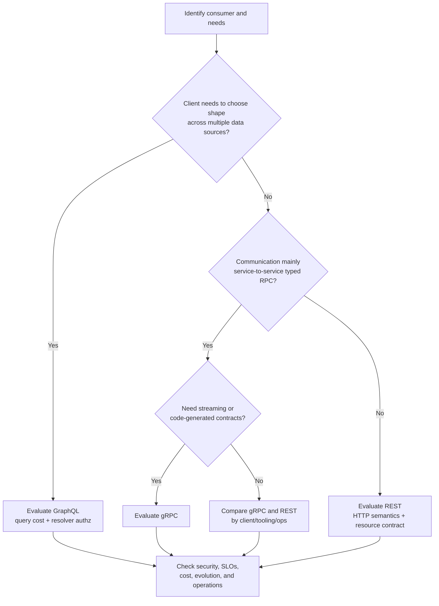
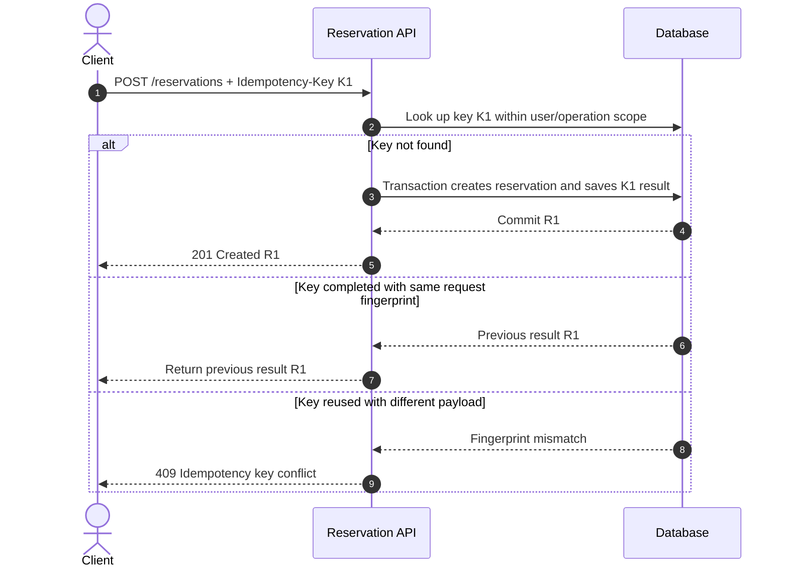

# Designing API Contracts and Choosing REST, gRPC, or GraphQL

An API is a contract between components that must collaborate to deliver a business capability. A good API lets consumers know **what they can request, what data they must provide, what results they will receive, how errors are represented, and which changes remain compatible**. An API contract is not just a list of URLs or function signatures; it also encompasses business semantics, access permissions, consistency, performance limits, and support lifecycle.

In the **CLOUD_ARCHITECTURE** module, API contract design connects business requirements with application boundaries, data, and cloud infrastructure. Choosing between **REST, gRPC, or GraphQL** affects how clients call services, network routing, authentication, observability, scaling, and operations. There is no single best choice for every scenario: you must balance reliability, security, performance, cost, and team capability following a Well-Architected mindset.

This lesson uses an equipment rental platform example with capabilities for viewing the catalog, checking availability, making reservations, processing payments, and looking up orders. The domain names, payloads, and limits in the examples are illustrative; real contracts must be validated with consumers, business owners, and operational requirements.

## 1. What is an API contract and why is it necessary?

Think of an API as a clearly scoped promise between the provider and the consumer. The contract should answer:

| Aspect | Question | Example |
| --- | --- | --- |
| **Purpose and semantics** | Which business action does the API solve? | Create a hold request for a piece of equipment over a time period |
| **Request** | Which fields does the consumer send, what types, and which are required? | equipmentId, startAt, endAt, idempotencyKey |
| **Response** | What does success mean and what state is returned? | Reservation is created in the HELD status |
| **Error model** | How are business errors and technical errors distinguished? | 409 when the slot is already held; 503 when the service is temporarily unavailable |
| **Identity and authorization** | Who can call it, and what can they do on which resources? | Token has scope booking:create; backend checks permission on the order |
| **Consistency and concurrency** | How are two concurrent requests resolved? | Only one request can hold the same slot |
| **Performance** | What are the deadline, payload size, pagination, and throughput? | Lookup API has a target p95 and page size limit |
| **Evolution** | How do fields and behavior change without breaking existing clients? | Add compatible optional fields, with a deprecation window for old versions |
| **Operations** | Which metrics, traces, quotas, and owners are responsible? | Track 4xx/5xx rate, latency, and request ID |

If you only define paths and sample JSON, the team still has not agreed on what happens when a request is retried, when data is missing, when permissions change, or when clients upgrade more slowly than the backend.

### Contract-first and code-first

**Contract-first** starts by describing the API independently of the implementation, reviewing it with consumers, and then generating code/interfaces or implementing the service. This approach is useful when multiple teams develop in parallel, when APIs are published to partners, or when automated compatibility checks are needed.

**Code-first** starts from controllers, methods, schemas, or annotations in code and then generates documentation/contracts. It can be fast for internal services, but it makes it easy for implementation details to accidentally become the contract without semantic review. Code-first can still produce good APIs if the contract is checked, published, and managed as a versioned artifact.

Both approaches can be combined: agree on the contract first for critical boundaries, then generate types, clients, and server stubs to reduce repetitive work.

## 2. Starting from consumers and business capabilities

Before choosing REST, gRPC, or GraphQL, determine **who calls the API, from what environment, and what job they want to complete**.

| Consumer | Characteristics | What to prioritize |
| --- | --- | --- |
| Web/mobile app | Unstable networks, long-lived client versions, needs screen-fitted payloads | Ease of use, backward compatibility, user security, pagination, and latency |
| Backend service | Both ends can be controlled, frequent calls, needs performance and clear data types | Machine-readable contract, deadlines, workload identity, tracing |
| B2B partner | Multiple systems, long integration cycles, needs documentation and onboarding | Versioning, SDKs/examples, quotas, sandbox, error contract, and support |
| Internal analytics | Multi-dimensional data queries, needs filtering/aggregation | Governed schema, data authorization, query cost, and resource limits |
| Event consumer | Receives asynchronous messages, producer/consumer deployed independently | Event schema, compatibility, idempotency, retry, and dead-letter policy |

For example, a "rent equipment" requirement needs to be decomposed into operations:

1. Look up equipment details and rental conditions.
2. Check whether a time range is available.
3. Create a reservation hold and protect against two concurrent requests.
4. Create a payment session and receive results from the provider.
5. Look up order status or cancel according to policy.

You should not bundle everything into a single do-it-all endpoint. Each operation has different semantics, permissions, and retry characteristics. An API that creates a hold mutates data; a search API is primarily read-only; an API receiving webhooks has a different trust boundary from a user-facing API.

### Identifying resources, operations, and workflows

- **Resource-oriented:** models objects and states, such as Equipment, Reservation, Payment.
- **Operation-oriented:** describes a specialized action, such as checking availability or confirming a cancellation.
- **Workflow-oriented:** represents a multi-step process, often requiring a state machine or job resource.

REST typically fits resources and representations; gRPC typically describes service methods; GraphQL describes a data graph whose fields are selected by the client. All three can represent the same business logic, but with different expressions and constraints.

## 3. Protocol-independent contract design principles

### 3.1. Names and semantics must be consistent

Field names should convey business meaning, units, and points in time. For example, startAt must consistently indicate UTC or local time; amount must be accompanied by currency; status must have a defined set of values and transition rules.

Avoid generic fields like value, data, or type if consumers cannot understand their meaning without reading the implementation. If a field can have multiple units, express the unit explicitly, such as durationSeconds instead of duration.

### 3.2. Distinguishing required, optional, empty, and absent

Schema languages represent optional/null differently. The contract must clarify:

- Does an omitted field mean use the default, leave unchanged, or no permission to view?
- Does a null value differ from a missing field?
- Does an empty list mean there are no elements yet or the consumer is not allowed to see them?
- During a partial update, does an omitted field keep its previous value?

Especially with PATCH, you must specify how omitted fields, null fields, and valued fields are handled; otherwise, the client and server may interpret them differently.

### 3.3. Data types and limits

Define:

- What format, length, and scope of uniqueness do IDs have?
- Do timestamps use ISO 8601/RFC 3339 or epoch? Which timezones are accepted?
- Does currency use decimal, integer minor units, or an amount/currency structure?
- Do strings have character, encoding, and normalization limits?
- Do collections have size limits, page sizes, and allowed sort keys?
- Does the payload have max size, nesting depth, and file upload limits?

Avoid using floating point for monetary calculations if currency precision is required. You can use integers in the smallest currency unit or decimal with defined precision/scale, depending on the currency and business rules.

### 3.4. Defining states and invariants

For example, a reservation has the following states:

| State | Meaning | Typical transitions |
| --- | --- | --- |
| HELD | A slot is temporarily held | CONFIRMED, EXPIRED, CANCELLED |
| CONFIRMED | The order has been confirmed | CANCELLED based on business conditions |
| EXPIRED | The hold has expired | Does not auto-confirm when a late payment arrives |
| CANCELLED | The order is cancelled | May require REFUND_PENDING/REFUNDED if already paid |

The contract must clearly state invariants such as **a slot must never be confirmed for two reservations with overlapping rental periods**. Do not just write "the API returns 201"; you need to know which commit determines success and when a repeated request returns the previous result.

## 4. REST: resources, HTTP semantics, and representations

REST is an architectural style for distributed systems, not just "JSON over HTTP". A RESTful API typically uses resource URIs, HTTP methods, and representations to manipulate state. Commonly cited principles include client-server, stateless, cacheable, uniform interface, layered system, and optional code-on-demand.

### 4.1. Designing URIs and methods

Rental API example:

| Method and path | Purpose | Typical behavior |
| --- | --- | --- |
| GET /v1/equipment | List equipment | Read-only, supports filter/sort/page |
| GET /v1/equipment/{equipmentId} | Read a single equipment item | 404 if non-existent or not disclosed |
| GET /v1/availability?equipmentId=... | Check time range | Read-only per contract; does not hold a slot |
| POST /v1/reservations | Create a reservation | Creates a resource, requires idempotency for safe retries |
| GET /v1/reservations/{id} | Read a reservation | Checks ownership/authorization |
| PATCH /v1/reservations/{id} | Partial update | Clearly defines semantics of omitted/null fields |
| POST /v1/reservations/{id}/cancellation | Request cancellation | Operation with specific business preconditions |

Resource names usually use plural nouns, but what matters is consistent conventions and clear HTTP semantics. Do not force every operation into CRUD if business actions such as cancel, approve, or capture payment have distinct conditions that need to be expressed.

### 4.2. HTTP methods and safety properties

| Method | General meaning | Safe? | Idempotent per HTTP semantics? |
| --- | --- | --- | --- |
| GET | Retrieve representation | Yes | Yes |
| HEAD | Retrieve metadata similar to GET, without response body | Yes | Yes |
| POST | Process or create a subordinate resource per contract | No | Not by default |
| PUT | Create/replace representation at a known URI | No | Yes |
| PATCH | Partial update according to patch semantics | No | Not by default |
| DELETE | Delete resource | No | Yes in terms of intended effect |

**Safe** means the client does not request the server to make a business state change; **idempotent** means repeating the same operation has the same intended effect on server state. A GET that writes a technical audit log does not make it an unsafe business operation, but a GET endpoint must never be used to cancel an order or capture money.

Idempotent does not mean every repeated response is byte-for-byte identical. For example, a first DELETE returning 204 and a subsequent one returning 404 can still be idempotent in terms of the end effect that the resource no longer exists. For a POST creating a reservation, you must design an idempotency key if clients might retry when a response is lost.

### 4.3. Semantic status codes

| Status | Typical usage | Example |
| --- | --- | --- |
| 200 OK | Request succeeded, has response | GET reservation |
| 201 Created | Resource created; may return Location | POST creating a new reservation |
| 202 Accepted | Accepted for asynchronous processing | Create a report export request |
| 204 No Content | Succeeded, no body needed | DELETE or update operation without returning a representation |
| 400 Bad Request | Malformed syntax/unparseable request | Malformed JSON |
| 401 Unauthorized | Missing or invalid authentication credentials | Expired access token |
| 403 Forbidden | Authenticated but insufficient permissions | User lacks required scope/action |
| 404 Not Found | Resource/route does not exist or intentionally undisclosed | Reservation ID not found |
| 409 Conflict | Conflicts with current state | Rental slot is already held |
| 412 Precondition Failed | HTTP precondition such as If-Match not met | ETag has changed |
| 422 Unprocessable Content | Valid syntax but content violates validation/semantics | endAt before startAt |
| 429 Too Many Requests | Rate limit/quota exceeded | Client calling too fast |
| 500 Internal Server Error | Unexpected error inside service | Bug or violated invariant |
| 502 Bad Gateway | Gateway received an invalid response from upstream | Upstream protocol error |
| 503 Service Unavailable | Temporarily unable to serve | Service under maintenance/overloaded |
| 504 Gateway Timeout | Gateway did not receive upstream response in time | Upstream too slow |

You do not need to use every status code in every API. Choose a consistent error contract and avoid returning 200 for all situations while burying error codes in the body, because clients, proxies, monitoring, and caches will misinterpret the semantics.

### 4.4. Illustrative request/response

```http
POST /v1/reservations HTTP/1.1
Host: api.rental.example
Authorization: Bearer <access-token>
Content-Type: application/json
Idempotency-Key: 8fd7a2d1-example

{
  "equipmentId": "eq-123",
  "startAt": "2026-12-01T09:00:00Z",
  "endAt": "2026-12-03T09:00:00Z"
}
```

Response:

```http
HTTP/1.1 201 Created
Location: /v1/reservations/res-456
Content-Type: application/json

{
  "id": "res-456",
  "equipmentId": "eq-123",
  "status": "HELD",
  "expiresAt": "2026-11-18T05:20:00Z"
}
```

The date values and IDs are only examples. The contract must agree on hold duration, timezone, permission to create a reservation, ensuring the slot is committed before responding, and retry rules using the same key.

### 4.5. Pagination and filtering

Never return an unbounded list. Two common approaches:

- **Offset pagination:** page/size or limit/offset, easy to understand and supports jumping to pages, but data changing between reads can cause duplicates/skips; large offsets can be costly.
- **Cursor pagination:** response returns nextCursor based on a stable sort key, useful for large or frequently changing datasets; hard to jump to an arbitrary page, and cursor expiration/semantics must be defined.

List APIs should have default/max page sizes, allowed sort fields, filter whitelists, and deterministic ordering. Never allow clients to send arbitrary query expressions directly to the database.

### 4.6. Cache semantics

GET can use Cache-Control, ETag, Last-Modified, and conditional requests to reduce load. However, caching must consider privacy and freshness:

- Public catalogs can be cached at a CDN if the representation does not depend on the user.
- Personal reservations usually require private/no-store or a carefully designed cache policy.
- Availability changes rapidly; caching too long can display slots that are no longer free.
- Cached responses must never be used as the final guarantee for a hold transaction.

## 5. gRPC: service-method contracts and Protocol Buffers

gRPC is an RPC framework that typically uses HTTP/2 as transport and Protocol Buffers as its default message/service definition system. It fits well when services control both ends, need typed contracts, code generation, streaming, or efficient internal communication.

### 5.1. Defining a service

```proto
syntax = "proto3";

package rental.booking.v1;

service BookingService {
  rpc GetReservation(GetReservationRequest) returns (Reservation);
  rpc CreateReservation(CreateReservationRequest) returns (Reservation);
  rpc WatchReservation(WatchReservationRequest) returns (stream ReservationEvent);
}

message GetReservationRequest {
  string reservation_id = 1;
}

message CreateReservationRequest {
  string equipment_id = 1;
  string start_at = 2;
  string end_at = 3;
  string idempotency_key = 4;
}

message Reservation {
  string id = 1;
  string equipment_id = 2;
  string status = 3;
  string expires_at = 4;
}

message WatchReservationRequest {
  string reservation_id = 1;
}

message ReservationEvent {
  string event_type = 1;
  Reservation reservation = 2;
}
```

This is a simplified example to illustrate a service definition. In an actual contract, timestamps can use google.protobuf.Timestamp instead of strings; statuses should consider enums and evolution rules; idempotency keys can be placed in metadata or request messages according to organizational conventions. Whichever approach is chosen must be consistent and documented.

### 5.2. Four types of RPC

| Type | Description | Use cases |
| --- | --- | --- |
| Unary | One request, one response | Fetch or create a reservation |
| Server streaming | One request, multiple responses | Continuously watch events/status updates |
| Client streaming | Multiple requests, one response | Upload/transfer a data stream in chunks |
| Bidirectional streaming | Both sides send independent streams | Real-time collaboration, telemetry, or interactive protocols |

Streaming holds connections open longer, requiring connection management, backpressure, cancellation, flow control, and deadlines. Do not use streaming just because you want it to be "fast"; if simple request-response meets the requirements, unary is easier to scale and debug.

### 5.3. gRPC status and error model

gRPC uses its own status codes such as INVALID_ARGUMENT, UNAUTHENTICATED, PERMISSION_DENIED, NOT_FOUND, ALREADY_EXISTS, FAILED_PRECONDITION, RESOURCE_EXHAUSTED, UNAVAILABLE, DEADLINE_EXCEEDED, and INTERNAL. They must be mapped intentionally to HTTP if there is transcoding/proxying or a public gateway.

Distinguish between:

- **INVALID_ARGUMENT:** invalid request data.
- **FAILED_PRECONDITION:** current system state does not allow the action.
- **ALREADY_EXISTS:** resource/key conflicts or already exists per contract.
- **RESOURCE_EXHAUSTED:** quota, flow-control, or resource limit reached.
- **UNAVAILABLE:** service temporarily unavailable.
- **DEADLINE_EXCEEDED:** deadline expired; the server may have partially processed or completed the request before the client received the result.

Like HTTP timeouts, deadline exceeded does not prove a transaction did not commit. For mutating methods, idempotency and status querying are required.

### 5.4. Deadlines, cancellation, and metadata

Clients should send a finite deadline for RPCs; servers should propagate the remaining time budget to dependencies if the framework supports it. When a client cancels, the server must stop cancellable work, release resources, and avoid continuing unbounded processing.

Metadata is commonly used to pass authorization tokens, correlation IDs, tracing context, or routing information. Do not put arbitrarily large data into metadata; do not log tokens; the server must verify identity and permissions rather than trusting every header.

### 5.5. Advantages and limitations

| Advantages | Limitations/trade-offs |
| --- | --- |
| Typed schema, generates client/server stubs | Requires managing .proto files and code generation toolchain |
| Efficient via HTTP/2 and binary serialization in many scenarios | Manual debugging with browser/curl is generally less convenient than REST/JSON |
| Supports streaming | Gateways, browsers, proxies, and observability need appropriate support |
| Clear service contract for backend-to-backend | Can be less convenient for external public APIs/multi-platform consumers without SDKs/tooling |
| Structured deadlines/status/metadata | Requires understanding cancellation, retry, and compatibility semantics |

gRPC is commonly well-suited for internal service-to-service communication, though it can still be exposed to partners if consumer tooling, security, firewall/proxy setup, and contract support are in place. Do not decide based solely on theoretical throughput numbers.

## 6. GraphQL: clients choose data shape from a graph

GraphQL provides a typed schema that lets clients request the exact set of fields needed and can combine data from multiple sources through a single logical endpoint. It is often suitable for UI clients whose data needs vary by screen or when multiple consumers want different representations.

### 6.1. Illustrative schema

```graphql
type Equipment {
  id: ID!
  displayName: String!
  category: String
}

type Reservation {
  id: ID!
  equipment: Equipment!
  status: ReservationStatus!
  expiresAt: String
}

enum ReservationStatus {
  HELD
  CONFIRMED
  EXPIRED
  CANCELLED
}

type Query {
  equipment(id: ID!): Equipment
  reservation(id: ID!): Reservation
}

type Mutation {
  createReservation(input: CreateReservationInput!): CreateReservationPayload!
}

input CreateReservationInput {
  equipmentId: ID!
  startAt: String!
  endAt: String!
  idempotencyKey: String!
}

type CreateReservationPayload {
  reservation: Reservation
  userErrors: [UserError!]!
}

type UserError {
  code: String!
  message: String!
  field: [String!]
}
```

### 6.2. Illustrative query

```graphql
query ReservationSummary($id: ID!) {
  reservation(id: $id) {
    id
    status
    expiresAt
    equipment {
      id
      displayName
    }
  }
}
```

The client requests only the fields needed for display. The response structure follows the selection set, reducing over-fetching; however, if resolvers query each item individually, the system can suffer from the **N+1 query problem** and increase DB load.

### 6.3. Query, mutation, and subscription

| Operation | Meaning | Example |
| --- | --- | --- |
| Query | Read data | Read a reservation and equipment |
| Mutation | Perform changes | Create or cancel a reservation |
| Subscription | Receive updates on events | Watch reservation changes |

Subscriptions typically rely on WebSockets or other transports depending on the implementation. They introduce long-lived connections, connection management, auth on connect/refresh, fan-out, and backpressure. Not all GraphQL servers or gateways support subscriptions in the same way.

### 6.4. GraphQL does not solve authorization automatically

Having a schema field reservation(id) does not mean every field shares the same policy. The fact that a user is allowed to call Query.reservation does not mean they can view every reservation ID or fields like payment/internalNote. Permissions must be checked in resolvers/services, and field-level authorization should be considered.

At the same time, queries can be deeply nested or request too many nodes. You need to limit:

- Query depth or complexity/cost.
- Number of items via pagination.
- Timeouts, concurrency, and total resolver execution time.
- Aliases/batching and repeated query costs.
- Introspection and schema exposure appropriate to the environment.
- Rate limits calculated by query cost or client tier, not just HTTP request count.

### 6.5. Advantages and trade-offs

| Advantages | Limitations/trade-offs |
| --- | --- |
| Client selects fields, reduces over-fetching | Custom queries make HTTP/CDN caching more complex |
| Aggregates multiple sources in one graph | Resolvers require orchestration, N+1 handling, and error propagation |
| Typed schema and introspection | Schema evolution, deprecation, and governance require process |
| Useful for diverse screens/clients | Query complexity and authorization must be protected |
| Supports mutations/subscriptions | Streaming/real-time demands connection and fan-out management |

GraphQL is not mandatory for every API. If consumers all need stable resource representations, REST may be simpler. If backend-to-backend needs typed RPC and streaming, gRPC may be a better fit.

## 7. Comparing REST, gRPC, and GraphQL

| Criterion | REST | gRPC | GraphQL |
| --- | --- | --- | --- |
| Primary model | Resources and HTTP semantics | Service methods/RPC | Data graph and selection sets |
| Schema/contract | OpenAPI or equivalent description | Protocol Buffers/service definition | GraphQL schema |
| Common transport | HTTP/1.1 or HTTP/2; possibly HTTP/3 depending on platform | HTTP/2 in common usage; transport support depends on implementation | Usually HTTP; subscriptions may use WebSocket/other transport |
| Typical payload | JSON | Protobuf binary | JSON response from GraphQL query |
| Browser friendliness | High | Requires gRPC-Web/proxy or appropriate client support | High via HTTP client |
| Streaming | Not the primary model of standard HTTP REST; separate SSE/streams exist | Supports streaming RPCs | Subscriptions depending on implementation |
| Caching | Clear HTTP cache semantics with GET | Usually managed by application/proxy | Harder to do simple HTTP caching because queries are often POST |
| Data access pattern | Predefined resources/endpoints | Predefined method inputs/outputs | Client selects fields and relationships |
| Typical risks | Loose versioning/contracts, endpoint proliferation | Tooling/debugging and transport compatibility | Query cost, resolvers, N+1, field authorization |
| Typical use cases | Public APIs, partner APIs, CRUD/resource-oriented | Internal RPC, typed service communication, streaming | Frontend aggregation, UIs with flexible data needs |

These models are not mutually exclusive. One system can:

- Provide a public REST API via an API Gateway.
- Use gRPC between Booking and Inventory services on an internal network.
- Have a GraphQL BFF for mobile/web to aggregate data across domains.
- Use events/queues for asynchronous processing and analytics updates.

What you must avoid is creating multiple protocol layers for the exact same behavior without a clear reason. Each adapter/translation adds contracts, telemetry, retries, and security policies to manage.

## 8. Protocol selection decision tree

Answer based on the consumer and interaction characteristics:



Practical guidelines:

1. **Consumers are browsers/mobile/partners** needing HTTP interoperability, human-readable documentation, and cache semantics: start by evaluating REST.
2. **Multiple backend services**, controlling both client and server, needing typed RPC, latency/throughput, and streaming: evaluate gRPC.
3. **Multiple screens needing different data shapes**, data spanning multiple domains, and capability to manage query complexity: evaluate GraphQL.
4. If work is long-running and asynchronous, a job resource/queue/event may be needed instead of forcing a synchronous request over any protocol.

Do not pick a protocol simply because it is trendy or based on an isolated benchmark. Measure using your actual workload's payloads, concurrency, network hops, TLS, serialization, data access, query shapes, and failure behavior.

## 9. Versioning and evolution: changing without breaking consumers

An API outlives a single deployment. Mobile apps can remain outside backend control for months; partners have their own upgrade schedules; internal services still experience version-skewed rollouts.

### 9.1. Changes that are usually compatible

Typically safer (though still must be verified against the contract and generators):

- Adding **optional** response fields that older clients can ignore.
- Adding new operations/endpoints.
- Adding enum values only when clients are designed to handle unknown values.
- Relaxing limits in a controlled manner without changing semantics.
- Adding non-mandatory metadata.

### 9.2. Changes likely to break compatibility

- Removing or renaming fields, endpoints, or methods.
- Changing data types or units.
- Turning an optional field into a required one.
- Changing status or error code semantics.
- Changing pagination or sort order/meaning.
- Narrowing permissions or changing behavior that consumers rely on.
- Adding enum values when generated clients use exhaustive switches.
- In Protobuf: reusing deleted field numbers or changing field numbers.
- In GraphQL: removing fields/arguments or making incompatible nullability changes.

**Syntactic compatibility is not enough**; behavioral changes can still be breaking changes. For example, keeping the status field as a string while changing the meaning of HELD to "paid" in a new release will break consumers.

### 9.3. Versioning approaches

| Strategy | Example | Advantages | Trade-offs |
| --- | --- | --- | --- |
| URI version | /v1, /v2 | Visible, easy to route and debug | Multiple versions coexist |
| Header/media type | Accept versioned media type | Stable URLs, flexible negotiation | Less intuitive; caching requires proper Vary headers |
| gRPC package/service version | rental.booking.v1 | Clear scope in schemas/stubs | Client/server must manage packages and migrations |
| GraphQL schema evolution | Add fields, mark deprecated, then remove on schedule | Can evolve field by field | Requires usage analytics, owners, and deprecation process |

Do not create a new version for every minor change. Before versioning, try **additive evolution** and time-bound deprecation. At the same time, do not prolong a contract with broken semantics just to avoid upgrading.

### 9.4. Deprecation process

A responsible process typically:

1. Identifies the field/route/schema to be deprecated and the reason.
2. Publishes the replacement version, migration guide, and support window.
3. Measures active consumers via telemetry or registry; contacts partner owners if applicable.
4. Allows parallel execution during the agreed transition period.
5. Adds warning/deprecation headers or GraphQL deprecation metadata where appropriate.
6. Retires support after conditions and deadlines are met, with a rollback plan if retirement causes widespread errors.

## 10. Error contracts: structured and actionable errors

An API must help clients distinguish between **fixable client errors**, **errors needing re-authentication/re-authorization**, **conflict errors**, **transient errors**, and **errors with unknown outcomes**.

### 10.1. REST error response

You can use a Problem Details format:

```json
{
  "type": "https://api.rental.example/problems/slot-unavailable",
  "title": "Requested time is unavailable",
  "status": 409,
  "detail": "The selected equipment is no longer available for this period.",
  "instance": "/v1/reservations",
  "code": "SLOT_UNAVAILABLE",
  "requestId": "req-123"
}
```

Illustrative example. Never include stack traces, SQL, secrets, token contents, or other users' data in detail. A stable code field enables client decision logic; human-readable messages can be localized and modified within contract bounds.

### 10.2. Errors in GraphQL

GraphQL can return HTTP 200 while the body contains both data and errors, depending on execution semantics and the server. Therefore, clients must not assume every HTTP 200 request succeeded completely. You must specify:

- How errors provide stable extensions.code values.
- Which fields may become null when a resolver fails.
- Whether mutations return userErrors or top-level errors.
- Whether partial data is accepted and displayed.
- Whether errors could leak information about fields/permissions.

### 10.3. Retry contract

Do not tell clients to retry all 5xx errors. You must specify:

- Which errors are retryable and when to retry.
- Maximum retry count and total deadline.
- Whether Retry-After or retry metadata is provided.
- Whether the operation has an idempotency key or status query.
- On timeout, which request ID the client can use to look up status.

### 10.4. Correlation and supportability

Each request should have a request ID/correlation ID to connect gateways, backends, logs, and traces. Clients can provide this ID when contacting support, but should not send the ID as proof of authorization to view data. Trace context serves observability, not authorization.

## 11. Idempotency and concurrency in API contracts

APIs that create orders, capture payments, cancel orders, or issue side-effecting commands must handle cases where the client does not receive the response even though the server already committed.

### Idempotency example



To ensure reliability:

- Keys are scoped appropriately by consumer/user/tenant and operation type.
- Store a fingerprint or payload comparison info; never use user A's key to retrieve user B's result.
- Writing the key and the business state change happen in the same transaction or an equivalent consistency mechanism.
- Define key retention period, IN_PROGRESS handling, and concurrent requests with the same key.
- Do not let a key become a way to re-read sensitive data when access permissions have changed.

### Concurrency control

For holds, never design a "read available then insert" flow if two transactions could both observe availability. Use transactions with unique constraints, conditional updates, locks, or an appropriate database mechanism. The API contract must represent conflicts consistently, such as 409, and clearly state that the client can pick another time slot.

ETag/If-Match in REST can also protect updates based on resource version: the client sends the version it read; if it has changed, the server returns 412 so the client can re-read and decide. This is optimistic concurrency and cannot replace all multi-row invariants or complex booking constraints.

## 12. API contract security

The API contract is where the data surface and permissions needing protection are defined.

### Authentication and authorization

| Question | Measures/contract details to clarify |
| --- | --- |
| Who is calling? | OAuth 2.0/OIDC access token, mTLS, workload identity, or API key per use case |
| Which operations can be called? | Scope/role/client policy at gateway and backend |
| Which objects can be acted upon? | Object-level authorization, tenant boundary, resource ownership |
| Which fields can be seen? | Field-level filtering/redaction in service or resolver |
| Token expiration/revocation? | TTL, refresh/revoke strategy, key rotation, cache behavior |
| What permissions do partners have? | Client credentials and partner-specific contract/quotas |

A valid JWT does not automatically prove authorization for every reservation; an API key identifies a client application, not automatically an end user. In GraphQL, permissions must apply down to fields/relationships; in gRPC, every method needs its own authorization; in REST, every route and object must be controlled.

### Input validation and resource limits

Schema validation is not enough. You must bound body size, string length, array count, nested depth, file type, timeouts, pagination, query complexity, and concurrency. Prevent clients from causing the API to invoke thousands of resolvers or unbounded queries.

### Data minimization

Only include fields the consumer needs. Do not return internals such as DB keys, provider secrets, stack traces, internal URLs, or unrelated customer data. Log only necessary metadata; request/response logging can accidentally capture tokens, emails, phone numbers, or payment details.

### Transport and secrets

TLS for external connections; mTLS can fit B2B or service-to-service traffic. Secrets/API keys need rotation, scoping, expiration where supported, and storage in a secret manager. Never put credentials in query strings because URLs are easily logged and stored in history/intermediaries.

## 13. Schemas and contract description tools

### OpenAPI for REST

OpenAPI describes paths, methods, parameters, request/response schemas, security schemes, response codes, and metadata. From one contract you can generate documentation, client stubs, mock servers, test skeletons, or API linting.

```yaml
openapi: 3.1.0
info:
  title: Rental Booking API
  version: 1.0.0
paths:
  /v1/reservations:
    post:
      operationId: createReservation
      summary: Create a temporary reservation
      security:
        - bearerAuth: []
      parameters:
        - in: header
          name: Idempotency-Key
          required: true
          schema:
            type: string
            minLength: 8
      requestBody:
        required: true
        content:
          application/json:
            schema:
              $ref: '#/components/schemas/CreateReservationRequest'
      responses:
        '201':
          description: Reservation created
          content:
            application/json:
              schema:
                $ref: '#/components/schemas/Reservation'
        '409':
          description: Requested slot conflicts with current state
        '401':
          description: Authentication is required
components:
  securitySchemes:
    bearerAuth:
      type: http
      scheme: bearer
      bearerFormat: JWT
  schemas:
    CreateReservationRequest:
      type: object
      required: [equipmentId, startAt, endAt]
      properties:
        equipmentId:
          type: string
        startAt:
          type: string
          format: date-time
        endAt:
          type: string
          format: date-time
    Reservation:
      type: object
      required: [id, equipmentId, status]
      properties:
        id:
          type: string
        equipmentId:
          type: string
        status:
          type: string
```

This is a shortened excerpt for illustration. A real contract needs additional definitions for error response bodies, headers, pagination, examples, constraints, servers, tags, policy versions, operation owners, and shared schemas. OpenAPI declares bearer authentication, but does not enforce object-level authorization by itself.

### Protocol Buffers for gRPC

A .proto file is the schema/service contract for code generation. Manage:

- Package and service naming/versioning.
- Stable field numbers; never reuse deleted field numbers.
- Reserved fields/names to prevent accidental reuse.
- Adding enum values in ways older consumers can handle.
- Compatibility checks when changing schemas and generated code.

### GraphQL SDL

GraphQL Schema Definition Language (SDL) describes types, fields, arguments, enums, inputs, and directives. You must manage owners, resolvers, nullability, deprecation, authz, complexity, and version/evolution policies. A schema registry/federation can be used when the graph spans multiple domains, but ownership and breaking changes must be governed at the graph level.

### AsyncAPI for event contracts

If an API publishes/subscribes via Kafka, RabbitMQ, MQTT, or another broker, HTTP OpenAPI does not fully describe the message lifecycle. AsyncAPI can describe channels, operations, messages, schemas, protocols, and security for event-driven interfaces. Event contracts need identifiers, event versions, keys/ordering, delivery semantics, and replay rules.

## 14. Contract and compatibility testing

Do not test only the current implementation; you must test **the relationship between provider and consumer**.

| Test type | What does it verify? | Example |
| --- | --- | --- |
| Schema validation/lint | Is the contract valid and convention-compliant? | OpenAPI lint, GraphQL schema validation, protobuf compile |
| Unit test | Isolated mapping/validation logic? | Producing conflict response status on slot collision |
| Provider contract test | Does the server fulfill the contract? | 201 has valid schema, 409 has stable error code |
| Consumer-driven contract test | Provider does not break how consumers use it | Web/mobile only use published fields |
| Compatibility test | Is the new schema compatible with old versions? | Protobuf/API schema diff |
| Integration test | Do gateway, identity, DB, broker interact properly? | Token, database transaction, event |
| Load/performance test | Payload/concurrency/latency under realistic load? | p95/p99, saturation, cost per request |
| Security test | Any bypass paths, improper object access, query abuse? | BOLA, scope bypass, GraphQL depth abuse |
| Fault test | Do timeouts/retries/partial failures preserve invariants? | Lost response after DB commit, slow dependency |

### Consumer-driven contract testing

Consumers describe how they call the API and their key assumptions; providers run verification to prove changes still satisfy those expectations. This reduces the risk of a service provider changing fields or behavior without knowing which consumers are affected.

However, a test suite only protects **recorded expectations**. It does not replace security reviews, data validation, performance tests, or complete public contracts. You must manage consumer versions, test ownership, and avoid coupling contract tests too tightly to implementation details.

### Compatibility checks in CI

A pipeline can:

1. Validate OpenAPI/proto/GraphQL SDL/AsyncAPI.
2. Lint naming, security, pagination, and error conventions.
3. Diff the current schema against the previous release to detect breaking changes.
4. Run provider/consumer contract tests.
5. Generate docs/SDKs or versioned artifacts.
6. Require review when changing auth, sensitive fields, status semantics, or deprecations.

## 15. Designing for the cloud: gateways, networking, and deployment

Contracts do not exist independently of infrastructure. You must determine how public APIs traverse API Gateways/WAFs/load balancers, whether internal services call directly or through a mesh, how gRPC/HTTP2 is supported, and whether GraphQL resolvers depend on many downstreams.

### Public edge and internal APIs

| API type | Common entry path | Key requirements |
| --- | --- | --- |
| Public REST | DNS + CDN/WAF/API Gateway + backend | TLS, OAuth, quotas, versioning, caching |
| Partner REST/gRPC | Public/private endpoint + mTLS/client credentials + gateway | Onboarding, cert rotation, quotas, sandbox |
| Internal gRPC | Private network/service discovery/mesh | Workload identity, mTLS, deadlines, tracing |
| GraphQL BFF | Public gateway → BFF/GraphQL server → domain services | Query complexity, resolver authz, N+1 protection |
| Event API | Producer → broker → consumer | ACL/topics, schema registry, DLQ, idempotency |

### Gateways do not replace service contracts

A gateway can authenticate tokens, route, rate limit, and transform. Yet domain services remain responsible for data invariants and fine-grained authorization. Do not move all business logic into the API Gateway just to keep the backend simple.

### Connections, timeouts, and protocol support

gRPC streaming requires end-to-end HTTP/2 or compatible gateway/proxy support; an HTTP/1.1-only load balancer in the middle can break streams. WebSocket/GraphQL subscriptions need appropriate idle timeouts and connection limits. Long REST requests need deadlines and payload limits; do not use huge timeouts to mask batch work that should run asynchronously.

When deploying multiple replicas, monitor connection pools, max concurrent streams, proxy buffers, keep-alives, and autoscaling. Low CPU does not mean a service still has capacity if it is exhausting connections or threads.

## 16. Observability and operating API contracts

APIs need both technical and business metrics:

| Signal | Meaning |
| --- | --- |
| Request count by operation/version/client | Usage levels and consumers still on old versions |
| 2xx/4xx/5xx or gRPC status | Success rate and error classification |
| p50/p95/p99 latency | User experience and tail latency |
| Payload size, query complexity, stream count | Resources consumed by clients |
| Rate limit/quota hits | Clients exceeding limits, abuse, or overly strict policies |
| Authn/Authz denials | Token errors, role/scope changes, or unauthorized access |
| Dependency latency/errors | Which services the backend depends on |
| Idempotency replays/conflicts | Client retries and request-key misuse |
| Deprecated endpoint/field usage | Readiness to retire support |
| Cost per operation | Which services/APIs incur high costs |

Logs need correlation IDs, operation names, and client/tenant IDs in policy-compliant form; never log access tokens, API keys, private data, or sensitive payloads. Traces should connect across gateways, services, and databases/brokers whenever possible.

Every API needs an owner, SLOs, quotas, a version support schedule, runbooks, and escalation paths. Changing a schema or semantics is a product change, not merely editing a YAML file.

## 17. Well-Architected: choosing an API is also an operational choice

| Pillar | REST | gRPC | GraphQL |
| --- | --- | --- | --- |
| **Operational excellence** | Ubiquitous tooling, easy-to-share docs; requires endpoint/version management | Code generation and typed contracts; requires appropriate tooling/diagnostics | Flexible queries; requires schema governance and resolver observability |
| **Security** | Broad HTTP middleware; still requires object-level authz | Strong identity and mTLS for service calls; per-method authorization | Field-level/relationship authorization and query cost are critical |
| **Reliability** | Clear HTTP cache/status semantics; needs idempotency for mutations | Deadline/cancellation/stream handling; proxy support must be right | Partial data/resolver errors; query complexity can overload services |
| **Performance efficiency** | GET caching, easy-to-debug JSON payloads; can be verbose | Binary/HTTP2/streaming can be efficient | Reduces over-fetching, but risks N+1 and heavy queries |
| **Cost optimization** | Easy to classify requests and leverage CDNs; must avoid huge payloads | CPU/serialization can be efficient; operational/tooling effort | Fewer client round trips, though resolvers can trigger many backend queries |
| **Sustainability** | Easy to leverage caching and simple APIs | Reduces overhead in appropriate RPC flows | On-demand querying can cut excess data, but complexity must be bounded |

Any choice must be validated under realistic load and operations. Using gRPC does not automatically make a system fast; using GraphQL does not automatically reduce query counts; REST does not equate to slow or outdated.

## 18. Case study: choosing contracts for the equipment rental platform

### Context

The platform has a mobile app, B2B partners, and domain services for Catalog, Booking, Payment, and Analytics. Mobile needs screen-aggregated data; Booking backend calls Inventory frequently; partners need clear, easy-to-integrate APIs with quotas.

### Options considered

| Need | Proposed option to test | Rationale and conditions |
| --- | --- | --- |
| Public API for partners | REST + OpenAPI | HTTP interoperability, docs/SDKs, pagination, OAuth/client credentials, and quotas |
| Mobile screens aggregating multiple domains | REST BFF or GraphQL BFF | Choose based on query diversity, resolver governance capability, caching, and authz |
| Internal Booking ↔ Inventory | Evaluate gRPC | Typed RPC, deadlines, code generation; requires private networking and proxy support |
| Payment webhook | Dedicated REST endpoint | Provider signature verification, idempotency, replay protection, and reconciliation |
| Booking confirmed event | Event contract via broker | Asynchronous consumers, schema evolution, outbox/inbox, and DLQ |

This is a reference approach, not the only architecture. If mobile only has a few stable screens, a REST BFF can reduce complexity. If multiple clients need different data shapes and the organization can protect GraphQL queries, GraphQL may be worth investing in.

### Decision matrix

| Criterion | Illustrative weight | REST | gRPC | GraphQL |
| --- | ---: | ---: | ---: | ---: |
| Ease of public/partner integration | 5 | 5 | 3 | 4 |
| Typed internal service contract | 4 | 3 | 5 | 4 |
| Flexible client data selection | 4 | 2 | 2 | 5 |
| HTTP/CDN caching | 3 | 5 | 2 | 2 |
| Existing tooling and capability | 5 | 5 | 3 | 3 |
| Simple query governance | 3 | 5 | 5 | 2 |

Scores from 1 to 5 are only illustrative assumptions to show how to compare; an actual team must set its own weights, survey consumers, and measure a PoC. Do not sum scores mechanically if a criterion is a mandatory requirement.

### Decisions and validation plan

1. Public partner API uses REST/OpenAPI; publish authentication, pagination, quotas, error codes, and version policy.
2. Pilot gRPC on one high-frequency internal call path; compare p95/p99, CPU, connections, tooling, and debuggability against REST.
3. Build a GraphQL BFF PoC for one mobile screen with aggregation needs; measure query complexity, DB query counts, caching, and field authorization capabilities.
4. Payment webhooks use REST with signature verification and reconciliation; do not use gateway success as proof that payment is completed.
5. Booking emits events via outbox with idempotent consumers; event schemas have versioning and compatibility checks.

### Risks to mitigate

- Do not allow mobile/partners to bypass backend authorization.
- Do not let GraphQL field resolvers read data across tenants.
- Do not retry charge/capture when the outcome is unknown.
- Do not roll out breaking schemas all at once when consumers upgrade slowly.
- Do not let a gateway transform hold all Booking/Payment logic.
- Alerts must route to owners and have corresponding runbooks for each contract.

## 19. API contract design checklist

### Consumers and semantics

- Who are the consumers, what platforms do they run on, and what are their upgrade lifecycles?
- Does the API reflect a resource, operation, or workflow?
- Are the source of truth, data invariants, and commit point defined?
- Are fields, units, timezones, nullability, defaults, and pagination clearly defined?

### Protocol selection

- Does REST properly leverage method/status/cache semantics?
- Does gRPC genuinely need typed RPC, streaming, or internal performance?
- Does GraphQL have a real need for client-selected shapes, and is there capability to manage query cost?
- Are events/async jobs more suitable than long synchronous requests?
- Do gateways, browsers, proxies, SDKs, and toolchains support the chosen protocol?

### Security and resilience

- Are authentication and object/field-level authorization clear?
- Are payloads, query depth, concurrency, timeouts, and quotas bounded?
- Do mutating requests have idempotency, concurrency control, and handling for unknown outcomes?
- Does the error contract tell clients whether to retry or require human intervention?
- Are tokens, secrets, and sensitive data prevented from leaking into URLs/logs/traces?

### Evolution and operations

- Are schemas versioned artifacts with compatibility checks?
- Is there a deprecation policy, usage tracking, and migration guide?
- Are there provider/consumer contract tests, integration, load, and security tests?
- Are SLOs, metrics, traces, owners, runbooks, and support windows defined?
- Have costs per request/operation, egress, proxies, resolvers, logging, and quota stores been measured?

Good API design begins with **semantics and contracts**, and only then chooses a protocol. REST, gRPC, and GraphQL are tools to express contracts according to different needs. When contracts are clear, versioned, compatibility-tested, properly bounded, and observable in operations, teams can evolve implementations or cloud infrastructure while preserving trust between providers and consumers.
