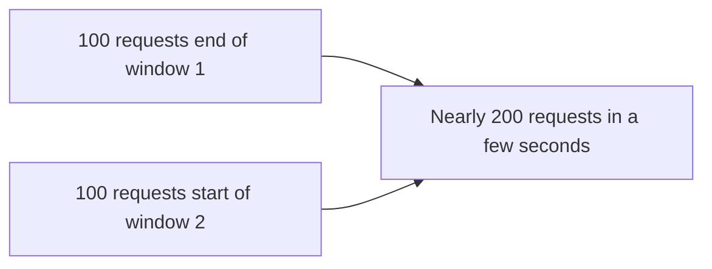
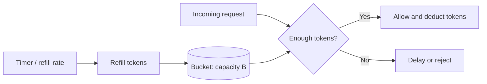
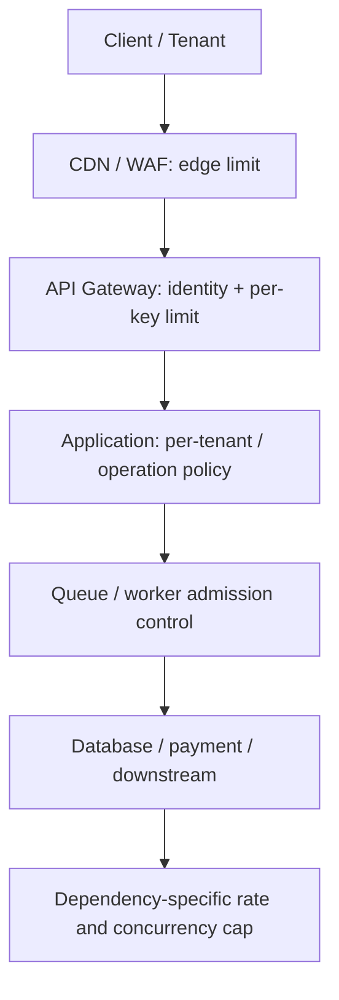

# Rate Limiting, Quotas, and Fair Allocation

## 1. Why do APIs need rate limiting?

A cloud API can scale its instance count automatically, but downstream dependencies do not scale infinitely. Databases have connection limits; payment providers have request quotas; queues and workers have finite capacity. If one client sends requests too fast or one tenant generates a massive burst, the system can become overloaded and degrade the experience for every user.

Three concepts must be designed together:

- **Rate limiting:** capping the number of requests or work units within a time window.
- **Quota:** capping total usage over a period or by a resource, such as API calls per month or storage volume.
- **Fairness:** rules for dividing shared capacity across clients, tenants, users, or job types, preventing one party from monopolizing all resources.

These three mechanisms do not replace one another. A rate limit can stop a client from sending 1,000 requests per second; a quota caps that client at 1 million requests per month; fairness ensures a tenant with a huge backlog does not force other tenants to wait indefinitely.

In the **CLOUD_ARCHITECTURE** module, the **API Architecture** chapter places these limits in the context of reliability, security, scalability, cost, and operations under Well-Architected principles.

After this lesson, learners will be able to:

1. Distinguish rate limits, quotas, concurrency limits, admission control, and fairness.
2. Choose between fixed window, sliding window, token bucket, or leaky bucket algorithms.
3. Design limits by client, tenant, API key, user, endpoint, and dependency.
4. Determine enforcement across gateways, applications, and shared services.
5. Handle over-limit requests using HTTP semantics, Retry-After, backoff, and idempotency.
6. Design periodic quotas, reservations, resets, alerts, and limit increases.
7. Test bursts, contention, distributed counter failures, and fairness under load.

## 2. Distinguishing types of limits

| Concept | Question | Example |
| --- | --- | --- |
| **Rate limit** | How many requests are allowed per unit of time? | 100 requests/minute per API key |
| **Quota** | What is the total permitted usage in a period? | 2 million API calls/month |
| **Concurrency limit** | How many requests/jobs can run simultaneously? | Max 20 export jobs |
| **Burst allowance** | How far above the average rate can traffic spike briefly? | Bucket accumulates up to 50 tokens |
| **Fairness** | By what rules is capacity divided among groups? | Each tenant receives a minimum worker share |
| **Admission control** | Should new work be accepted given remaining capacity? | Reject exports when backlog exceeds threshold |
| **Circuit breaker** | Should calls to a failing dependency pause temporarily? | Open circuit to payment provider after repeated errors |
| **Backpressure** | How do we signal upstream to slow down when downstream is congested? | Consumer lowers pull rate or returns 429/503 |

### 2.1. Rate limit vs. concurrency

An API with a 60 requests/minute limit can still receive all 60 requests nearly simultaneously if the algorithm permits bursts. Conversely, a cap of 10 concurrent requests can still process thousands of requests/minute if each completes very quickly.

Rate limits protect intake speed over time; concurrency limits protect the number of in-flight jobs holding resources at any instant. Use both when APIs have variable processing times, such as data exports, PDF generation, or calling slow dependencies.

### 2.2. Every policy must define its scope

"100 requests/minute" is ambiguous unless you specify:

- 100 requests per IP, API key, user, tenant, or globally?
- Applied per endpoint, endpoint group, or the entire API?
- Are only successful requests counted, or all requests?
- Are retries, webhooks, batch items, and rejected requests counted?
- Are counters shared across replicas and regions?
- When does the window start/reset?

Example of a complete definition: "Tenant X may send up to 120 read requests/minute for the Search group, with a max burst of 30 and max 8 concurrent requests; the limit applies per region. 429 responses provide an appropriate retry wait time."

## 3. Why are limits essential in the cloud?

Rate limits and quotas serve several goals:

- **Service protection:** prevent buggy client loops, bots, or abusive behavior from exhausting CPU, DB connections, queues, and thread pools.
- **Dependency protection:** APIs can scale faster than databases or payment providers; limits prevent flooding slower tiers.
- **Multi-tenant fairness:** prevent a single SaaS customer from consuming all platform capacity.
- **Cost governance:** cap expensive APIs such as OCR, AI inference, exports, or SMS delivery.
- **Contract enforcement:** product plans offer distinct usage allowances.
- **Blast-radius reduction:** bounding retries and fan-out keeps one component's failure from becoming a system-wide outage.
- **Security:** throttle password guessing, enumeration, spam, and scraping.

Rate limiting does not replace authentication, authorization, WAFs, input validation, or fraud detection.

## 4. Defining cost units and capacity budgets

Before choosing an algorithm, identify which requests consume more resources. A cached read can be hundreds of times cheaper than a data export. If every request deducts one token equally, the limiter may protect the wrong bottleneck.

### 4.1. Cost units

Units can be measured by HTTP requests, records read/written, bytes uploaded/downloaded, CPU time, job count, provider calls, or product-defined weights.

| Endpoint | Illustrative cost weight | Rationale |
| --- | ---: | --- |
| GET profile | 1 | Small lookup, easily cached |
| GET search | 2 | Multi-criteria query |
| POST booking | 5 | Data write, contention, and multiple steps |
| POST reports | 20 | Heavy export job using workers |
| POST SMS | 10 | Incurs third-party charges |

A request with weight 20 consumes 20 quota units. Weights should be grounded in benchmarks, dependency costs, and product pricing.

### 4.2. Estimating throughput

```text
Required throughput = expected requests / time window

Example:
600,000 requests/hour
= 600,000 / 3,600
≈ 166.7 requests/second
```

This is average throughput. Design capacity must account for bursts, p95/p99 service time, concurrency, traffic mix, and retry amplification.

### 4.3. Estimating concurrency

By Little's Law, for a stable system:

```text
Average concurrency ≈ arrival rate × average service time
```

For example, 200 requests/second with an average processing time of 0.4 seconds yields an average concurrency of about 80. If downstream slows down and processing time rises to 1.5 seconds, concurrency jumps to around 300 even though the arrival rate stayed constant.

Concurrency caps and rate limits belong together. With only a rate limit, slow requests can pile up and exhaust every connection, thread, or memory buffer.

## 5. Rate-limiting algorithms

### 5.1. Fixed window counter

Divides time into fixed windows, such as one-minute buckets; each request increments the current window's counter. Once the threshold is exceeded, requests are rejected.

**Advantages:** simple, minimal state, easy to implement.

**Limitation:** boundary bursts. A client can send 100 requests at the end of one minute and 100 requests at the start of the next minute, producing nearly 200 requests within a few seconds.



Suitable for periodic quotas or coarse limits where boundary bursts are acceptable. Pair with a concurrency cap if downstream is sensitive.

### 5.2. Sliding window log

Stores the timestamp of each request within a sliding interval. When a new request arrives, purge old timestamps and count the remaining requests.

The advantage is exact accuracy at every point in time. The limitation is that memory and atomic operations scale with request volume. Suitable for moderate volume or sensitive actions requiring strict precision.

### 5.3. Sliding window counter

Combines the current window's counter and the previous window's counter, estimating the portion of the previous window's requests still inside the sliding interval.

```text
estimated_count =
    current_window_count
  + previous_window_count × remaining_fraction

remaining_fraction =
    1 - (elapsed_in_current_window / window_size)
```

Lower state cost than sliding log and smoother than fixed window, though it is an approximation; concentrated bursts in the previous window can introduce estimation error.

### 5.4. Token bucket

A token bucket has a maximum capacity of B tokens and a refill rate of r tokens/second. Each request requires one or more tokens. If enough tokens exist, the request is allowed and tokens are deducted; otherwise, the request is delayed or rejected.

Example with bucket capacity 60 tokens, refill 1 token/second:

- When full, a client can send a burst of up to 60 units immediately.
- Once drained, the average rate settles back to 1 unit/second.
- After 10 seconds of inactivity, the bucket refills up to 10 tokens, never exceeding capacity.



Token bucket fits APIs that need to permit bounded bursts while maintaining an average rate. Weighted tokens can be used for endpoints with differing costs.

### 5.5. Leaky bucket

Incoming requests enter a queue and are processed at a fixed or near-fixed rate. If the queue is full, requests are rejected.

The advantage is smoothing bursts and keeping output rate steady. The limitation is added queueing latency and needing a backlog cap. Suitable for workers and dependencies requiring steady processing rates.

### 5.6. Comparison

| Algorithm | Burst handling | Accuracy | State | Best fit |
| --- | --- | --- | --- | --- |
| Fixed window | Can spike at boundaries | Moderate | One counter/window | Periodic quotas |
| Sliding log | Strictly bounded | High | Timestamp per request | Sensitive actions |
| Sliding counter | Smoother than fixed | Approximate | Two counters | General APIs |
| Token bucket | Up to capacity | Good for average rate + burst | Tokens and timestamp | Public APIs |
| Leaky bucket | Bounded queue, steady output | Good smoothing | Queue/backlog | Workers |

## 6. Token bucket and Retry-After calculation

Key parameters:

- **Capacity (B):** maximum number of tokens.
- **Refill rate (r):** tokens added per second.
- **Request cost (c):** tokens consumed by a request.
- **Current tokens (T):** currently available tokens.
- **Last refill time:** timestamp of the previous update.

Update at time t:

```text
elapsed = max(0, now - last_refill)
tokens = min(capacity, tokens + elapsed × refill_rate)

if tokens >= request_cost:
    tokens = tokens - request_cost
    allow request
else:
    reject or calculate retry_after

last_refill = now
```

Refilling, checking, and deducting tokens must be atomic across requests contending for the same bucket. If multiple replicas concurrently read T=1 and each allows a request, the policy is violated.

If tokens are insufficient, minimum wait time to accumulate enough tokens (excluding contention from other requests):

```text
tokens_needed = request_cost - current_tokens
retry_after = tokens_needed / refill_rate
```

This is an estimate. If other requests keep consuming tokens, actual wait time will be longer. Do not promise an exact timestamp if the limiter cannot guarantee it.

## 7. Periodic quotas

Quotas typically span longer intervals:

- API calls per day/month.
- File size or storage volume.
- Number of users/seats.
- Number of export jobs, transactions, or SMS messages.
- Usage of a third-party service.

Attributes to define:

| Attribute | Question |
| --- | --- |
| Scope | By tenant, account, user, or API key? |
| Period | Minute, day, calendar month, or billing cycle? |
| Reset | UTC, tenant timezone, or signup anniversary? |
| Consumption | Deduct on receipt or on completion? |
| Reservation | Reserve quota upfront for async jobs? |
| Refund/adjustment | Do failed requests refund quota? |
| Hard/soft | Block on overage or warn only? |
| Rollover | Does unused allowance carry over to next period? |
| Audit | Can you explain why a request was rejected? |

### 7.1. Hard and soft quotas

**Hard quotas** block once the limit is reached. Appropriate for hard resource limits or third-party provider costs.

**Soft quotas** warn while allowing overage or manual review. You can set warning thresholds at 70%, 90%, and a contractual hard stop. Thresholds must be product/financial decisions, not arbitrary defaults.

### 7.2. Reservations for asynchronous jobs

If quota is only deducted when a job completes, a user could enqueue thousands of jobs before counters update. Reserve quota when accepting the job:

1. Check remaining quota.
2. Atomically reserve usage units.
3. Enqueue job with job ID.
4. On completion, convert reservation into usage.
5. If cancelled/failed per policy, release or adjust reservation.
6. Reconcile if enqueueing and state persistence are not in the same transaction.

Use idempotency/outbox or workflows to avoid deducting quota while losing the job, or creating a job without reserving quota.

## 8. Fairness in multi-tenant systems

Multi-tenant platforms share compute, databases, queues, and networks. A large tenant or a client bug can monopolize almost every worker, connection, or unit of API capacity.

Fairness does not necessarily mean strictly equal shares. Higher tiers can be allocated more capacity. What must be ensured is transparent, bounded rules that prevent starvation.

### 8.1. Allocation scopes

Capacity can be allocated by tenant/account, API key, user, operation, service plan, priority class, job type, or region.

Do not rely solely on IP addresses: many users can share one NAT address, and clients can change IPs. IP is a supplementary signal for unauthenticated traffic, not always a primary identity.

### 8.2. Per-tenant limits and global limits

Illustrative example:

| Plan | Refill rate | Burst capacity | Concurrent jobs |
| --- | ---: | ---: | ---: |
| Basic | 10 units/s | 20 | 2 |
| Growth | 50 units/s | 100 | 10 |
| Enterprise | Per contract | Per contract | Per capacity agreement |

Per-tenant limits stop one tenant from consuming the entire API, but a global limit is still needed. If 1,000 tenants each have 50 requests/s, potential aggregate demand is 50,000 requests/s—potentially exceeding backend budgets.

### 8.3. Weighted fair sharing

If there are 100 worker slots and tenants A/B/C have weights 1/2/1, when all three have backlogs, their reference shares are 25/50/25 slots.

A work-conserving scheduler can lend idle capacity to other tenants, but must ensure higher-weight tenants reclaim their share when demand returns. Maximum shares must be capped and unbounded burst accumulation avoided.

### 8.4. WFQ, DRR, and starvation

- **Weighted fair queueing (WFQ):** approximates weighted resource sharing via virtual finish times.
- **Deficit round robin (DRR):** each tenant has a queue and deficit counter; each round adds a quantum, dispatches a job if its cost does not exceed the deficit, and subtracts the cost.

DRR works well when jobs have varying costs and a relatively simple scheduler is desired. Bound queue counts and state; inactive tenants should not accumulate infinite capacity.

Prevent starvation using minimum shares, ageing to boost priority of long-waiting jobs, separate queues for maintenance, and oldest-job-age metrics per tenant. Measure fairness by service time and completed work, not merely request counts.

## 9. Multi-layer limiting



- **Edge/WAF:** shed unwanted traffic before compute. Avoid falsely blocking many users behind a shared IP.
- **API gateway:** authenticate API keys/JWTs, apply limits per key/route/stage, return consistent responses. Gateways do not always understand billing usage or quota reservations.
- **Application:** understands tenants, actors, permissions, and operation costs; well-suited for business quotas.
- **Dependency:** concurrency caps, pools, queue consumer limits, or bulkheads protecting databases and providers.

Bulkheads isolate resources so failures in one call group do not exhaust threads/connections for another. For example, payments and report exports use separate pools.

## 10. Distributed counters and atomicity

On a single instance, a limiter can use in-memory counters. Across multiple replicas, isolated counters multiply the effective limit.

For example, if a tenant gets 100 requests/minute and the app runs 5 replicas, allowing 100 per replica lets the tenant send nearly 500 requests/minute.

### 10.1. Shared counters

You can use Redis or an atomic datastore. Refilling, checking, and deducting tokens must execute atomically via an appropriate script/transaction/primitive.

The advantage is all replicas observe shared state. The trade-off is an extra network hop and making the store a dependency; it requires HA, capacity planning, eviction, and persistence policies.

Normalize limiter keys and set TTLs to prevent key cardinality attacks.

### 10.2. Local quota leases

Another option is granting an allocated budget to each replica. For example, a global budget of 1,000 tokens/s split across 10 replicas gives each replica a lease of 100 tokens/s.

This reduces network coordination, though capacity can sit unused if a replica does not consume its lease; rebalancing is needed when scaling. If leases are misallocated or split-brain occurs, aggregate allowance can exceed the global budget.

Choose consistency based on impact: billing/hard resource caps require high accuracy; abuse protection can tolerate slight overshoot if global overload is still prevented.

### 10.3. Clocks and time drift

- Use monotonic clocks for local elapsed time.
- Use synchronized time sources when counters coordinate across hosts.
- Never let backward clock jumps inflate tokens or reset windows unexpectedly.
- Define semantics when a key is recreated after eviction/restart.

## 11. Identity and limiter keys

```text
rate_limit_key =
    tenant_id + ":" + api_plan + ":" + route_group

possible scopes:
    user_id
    api_key_id
    client_application_id
    source_ip
    tenant_id + operation
    global_dependency_name
```

Principles:

- Determine identity after authentication; never trust a tenant ID in the request body without verification.
- Keys should be stable across requests with controlled cardinality.
- For unauthenticated routes, IP can be an initial scope, keeping NAT/proxies in mind.
- Use route groups/cost classes rather than creating a separate bucket for every dynamic path ID.
- Avoid putting raw PII into keys/logs; use opaque IDs/hashes appropriately.
- Version keys when policies/schemas change.
- Identify trusted proxies before trusting X-Forwarded-For.

If one API key represents multiple tenants or service-to-service calls, determine the exact principal and billable tenant.

## 12. HTTP behavior when limits are exceeded

For HTTP APIs, **429 Too Many Requests** is the appropriate status when a client exceeds policy limits. Include the Retry-After header and quota/remaining/reset headers if published in the contract.

```http
HTTP/1.1 429 Too Many Requests
Content-Type: application/problem+json
Retry-After: 3

{
  "type": "https://api.example.com/problems/rate-limit",
  "title": "Request rate exceeded",
  "status": 429,
  "detail": "The tenant request budget is temporarily exhausted.",
  "code": "RATE_LIMIT_EXCEEDED",
  "retryAfterSeconds": 3
}
```

Never expose internal details such as Redis cluster names, counter keys, or policy secrets. Error details should tell clients how to act without revealing how to bypass controls.

### 12.1. Distinguishing status codes

| Status | Meaning | Client behavior |
| --- | --- | --- |
| 401 | Unauthenticated or invalid credentials | Re-authenticate |
| 403 | Authenticated but unauthorized/policy forbidden | Do not retry as a transient error |
| 429 | Rate or quota exceeded per client policy | Wait per Retry-After, slow down |
| 503 | Service temporarily unable to accept more load/availability issue | Retry with backoff if safe |
| 504 | Gateway timeout | Side-effect outcome may be unknown; look up before retrying |

Do not use 429 for every backend failure. Error contracts must reflect root causes accurately enough.

## 13. Retries, backoff, and idempotency

Immediate retries cause all clients to resend simultaneously and create a new burst.

Sensible client policy:

1. Honor Retry-After if present.
2. Use bounded exponential backoff.
3. Add jitter to spread out retry timing.
4. Cap retry attempts and total deadline.
5. Only retry safe operations or those with an idempotency key.
6. Stop retrying when the business deadline expires.
7. Never retry deterministic validation/authorization errors.

### 13.1. Exponential backoff with full jitter

```text
cap_n = min(max_delay, base_delay × 2^attempt)
sleep = random(0, cap_n)
```

Jitter prevents synchronized retry storms. If the server sends Retry-After, the client honors at least that duration and may add jitter afterward, never retrying sooner.

### 13.2. Idempotency with side effects

If POST /payments receives a 429 before processing, retrying after waiting can be safe per contract. However, if a timeout happens after the provider processed it, the client does not know the state. Reuse the same idempotency key and query status rather than generating a new payment key.

Rate limits protect capacity; idempotency ensures resending does not create duplicate business effects.

## 14. Usage metering and quota ledgers

For usage-based billing products, metering must be explainable and auditable. A usage record can include:

- Opaque tenant/account ID.
- Operation/resource type.
- Unit count/cost weight.
- Timestamp, billing period, and source event ID.
- Billable/non-billable/adjustment status.
- Correlation/reference ID and policy version.

Do not store only a total counter if you need to explain how charges were calculated. You can use an append-only usage ledger alongside aggregate counters for fast decisions.

### 14.1. Handling duplicate usage events

A worker might commit to the ledger and crash before acknowledging; the event gets replayed. Ensure stable event IDs, unique constraints/deduplication, and sufficiently atomic ledger/inbox updates. If counters and ledgers live in different stores, use outbox/reconciliation to fix drift.

### 14.2. Quota resets

Clearly define UTC vs. tenant timezone, subscription start date, rollover, overage, mid-cycle plan changes, and requests starting before reset but finishing after reset.

Never wipe counters and hope no concurrent requests arrive. Scope usage by period key and use transactions/atomic updates to transition periods.

## 15. Fairness in queues and workers

If all jobs share a single FIFO queue, a large tenant can build a huge backlog and push small tenants' jobs to the back.

Options:

- Per-tenant queues: strong isolation, though queue count can grow large.
- Priority-class queues: simple, though tenants in the same class still contend.
- Round-robin or weighted fair job schedulers.
- Per-tenant caps on in-flight jobs.
- Partitioning by tenant when ordering is required, while guarding against hot partitions.
- Age-based promotion to prevent starvation.

Jobs have differing costs; fairness by job count can be unfair if job A runs 10 seconds while job B runs 10 ms. Use weighted costs or service-time estimates.

## 16. Multi-region and global quotas

If an API runs in two regions and each holds an independent 100 requests/s bucket, the aggregate can approach 200 requests/s.

| Model | Advantages | Limitations |
| --- | --- | --- |
| Global coordinated counter | Higher accuracy | Adds latency and central store dependency |
| Per-region allocation | Fast local enforcement | Can waste capacity, needs reallocation |
| Eventual reconciliation | Fast local path | Tolerates temporary overshoot |
| Home-region per tenant | Single clear owner | Cross-region routing and failover complexity |

Billing quotas or hard dependency protection need strict enforcement. Abuse limits can tolerate small inaccuracies if global overload protection remains intact.

During failover, define budget and ownership transfer; if two regions both believe they are primary, split-brain can breach quotas. Leases/fencing tokens or clear ownership mechanisms may be required.

## 17. Limiter failure modes

A rate limiter is itself a dependency that can fail:

- **Fail-open:** let requests pass; preserves availability, but risks quota overruns and overload.
- **Fail-closed:** reject requests; protects dependencies/costs, but reduces availability.
- **Degraded local limit:** fall back to a conservative local limit when the shared store fails; does not guarantee global accuracy.
- **Queue/defer:** buffer work if business deadlines allow.

There is no single choice for every operation:

| Operation | Policy on limiter store failure | Rationale |
| --- | --- | --- |
| Public/cacheable search | Conservative local fallback or controlled fail-open | Prioritizes user experience while protecting backend |
| Charge payment | Fail-safe per workflow/idempotency | Financial impact |
| Large export | Fail-closed or defer | Expensive resources |
| Health endpoint | No dependency on shared limiter | Monitoring availability required |
| Login/password verification | Conservative fallback | Brute-force risk |

Limiters need short timeouts, dedicated connection pools, circuit breakers/fallbacks, and telemetry. Never let a limiter failure take down health/diagnostic paths.

## 18. Security and anti-abuse

- Authenticate before applying per-tenant quotas; never trust client-supplied tenant IDs.
- Only trust forwarding headers from managed proxies.
- Enforce dedicated limits on login, password reset, OTP, and expensive endpoints.
- Combine multiple signals: account, user, IP, device risk, and operation.
- Bound payload size, concurrency, and request size.
- Prevent key cardinality attacks; clients must not be able to spawn unbounded limiter keys.
- Admin overrides require authorization, auditing, and expiration.
- Pair with bot management/WAF and fraud detection when necessary.

### 18.1. Tenant isolation

Tenant A must never consume Tenant B's quota or read Tenant B's usage ledger. Every operation must derive tenant from authenticated identity; query/cache keys must be tenant-scoped; admin overrides must be audited.

If one API key represents multiple tenants, identify the principal and billable tenant on each request. Never infer from a single credential if credentials can be shared.

## 19. Observability and alerting

| Metric | Meaning |
| --- | --- |
| Requests allowed/rejected | Request acceptance ratio |
| 429s by tenant/route | Who is hitting limits and on which endpoints |
| Tokens remaining/bucket utilization | Bucket consumption level |
| Quota used/remaining/projected | Tenants approaching quota exhaustion |
| Concurrency/in-flight jobs | Actively held resources |
| Queue depth/oldest age by tenant | Work waiting too long |
| Scheduler share/service time | Actual resource allocation |
| Limiter backend latency/errors | Whether the limiter is becoming a bottleneck |
| Retry/duplicate rate | Retry storms or duplicate processing |
| Downstream 429/5xx/timeouts | Overloaded dependencies |

Avoid metric labels with request IDs or unbounded key cardinality. Tenant-level dashboards must control PII and viewing permissions.

Useful alerts include approaching quotas, abnormal 429 spikes, global concurrency nearing hard caps, queue age exceeding deadlines, one tenant consuming excessive worker time, limiter store errors, rising provider 429s, and usage ledger vs. counter drift.

## 20. Testing and verifying limits

| Scenario | Test method | Passing criteria |
| --- | --- | --- |
| Exceed token bucket | Send burst larger than capacity | Allowance matches B/refill |
| Refill | Wait across different intervals | Tokens rise at exact rate, never exceed capacity |
| Boundary burst | Send at end and start of fixed windows | Boundary behavior matches policy |
| Multi-replica | Send concurrently across multiple instances | Total allowance stays within policy beyond design tolerance |
| Weighted cost | Call endpoints with differing costs | Usage deducts accurate units |
| Concurrent jobs | Enqueue past cap | In-flight jobs stay strictly capped |
| Fairness | Tenant A floods while Tenant B sends lightly | B continues getting served per contract |
| Retry storm | Dependency returns 429/503 en masse | Backoff/jitter reduces load |
| Limiter outage | Disconnect shared store | Fallback follows policy |
| Clock drift | Simulate timestamp skew | Counters do not reset/refill abnormally |
| Quota reset | Send requests across period boundary | No lost usage or double deduction |
| Duplicate event | Replay same event ID | Ledger does not double-count usage |
| Multi-region | Send to two regions simultaneously | Global budget/regional allocation holds |
| Tenant spoofing | Tamper with tenant ID in body/headers | Cannot access or consume another tenant's quota |

### 20.1. Token bucket invariants

- Tokens always remain between 0 and capacity.
- Requests are allowed only when sufficient tokens exist at atomic decision time.
- Tokens never grow faster than the refill rate.
- Bucket never exceeds capacity after long idle periods.
- Total consumed tokens never exceed initial tokens plus valid refills.
- Rejected requests produce zero side effects.

## 21. Design workflow

1. **Define goals:** anti-abuse, DB protection, billing, or capacity sharing.
2. **Build workload profile:** arrival rate, bursts, service time, cost units, peaks, and tenant mix.
3. **Choose scope/keys:** tenant, user, API key, route, dependency, or global.
4. **Set global budgets:** compute, DB, queues, and providers.
5. **Select algorithms:** windows, token bucket, leaky bucket, or schedulers.
6. **Add concurrency caps:** cap in-flight work and admission control.
7. **Design fairness:** per-tenant budgets, weights, minimum shares, and aging.
8. **Define failure behavior:** fail-open/closed/degraded, Retry-After, retry budgets, DLQs.
9. **Build usage metering:** ledger, periods, resets, reservations, adjustments, audits.
10. **Observe and test:** 429s, quotas, fairness, backend saturation, and limiter outages.
11. **Publish contracts:** clients understand limits, error codes, resets, and limit-increase workflows.
12. **Re-evaluate:** using production data, costs, plans, and dependency capacity.

## 22. Practice scenario: SaaS booking platform

The platform offers three plans:

| Plan | Rate budget | Burst | Concurrent jobs |
| --- | ---: | ---: | ---: |
| Basic | 20 units/s | 40 | 2 |
| Growth | 80 units/s | 160 | 10 |
| Enterprise | Per contract | Per contract | Per capacity agreement |

Operation costs: GET profile = 1, GET search = 2, POST booking = 5, POST export = 20, POST SMS = 10. Database has a budget of 250 query units/s; payment provider 100 requests/s; SMS provider 30 requests/s. Exports can run 2–5 minutes.

### 22.1. Risks

- A Growth tenant can burst and push the DB past its budget.
- Search cache misses raise query costs.
- Exports tie up workers and connection pools.
- Payment/SMS providers have lower limits than API scaling speed.
- Limiter store failures either break the system or let traffic exceed budgets.
- Usage event replays double-deduct quotas.

### 22.2. Proposed design

- Gateway enforces token buckets per tenant/plan and route group.
- Application calculates cost units after authorization.
- Global limiter/admission cap protects the database budget.
- Booking has dedicated concurrency caps and connection budgets.
- Exports go to queues with per-tenant job quotas and weighted fair scheduling.
- Payment/SMS use dedicated queues, rate caps matching provider budgets, and retries with Retry-After/jitter.
- Usage ledger records event IDs; counters drive fast decisions; reconciliation verifies against the ledger.
- Tenants receive 429 on rate limits; hard quota exhaustion returns a dedicated error code and usage dashboard link.
- Limiter outages apply per-operation policies: exports fail-closed, health paths bypass, search uses conservative fallback.
- Dashboards track per-tenant usage, queue age, limiter latency, and dependency utilization.

### 22.3. Test cases

1. Basic tenant floods search while Enterprise books: both are served according to their plans.
2. 100 Growth tenants burst simultaneously: database budget is not breached.
3. Payment provider returns 429: consumers throttle down and create zero duplicate payments.
4. One tenant enqueues 10,000 export jobs: other tenants retain their service share.
5. Limiter store disconnected: fallback follows policy.
6. Replay usage event: ledger does not increment twice.
7. Quota reset: usage before/after reset is recorded accurately.
8. Client spoofs tenant ID: cannot consume another tenant's quota.

## 23. Sample ADR: dependency protection and tenant fairness

```text
ADR-052: Per-tenant token buckets and fair scheduling for exports

Context:
- SaaS API serves multiple tenants and service plans.
- Search/booking share a database; exports hold workers for long durations.
- Payment/SMS have provider-imposed quotas.

Options:
A. Global rate limit at the gateway for all tenants.
B. Per-tenant token buckets + global dependency caps + fair queues.
C. No limits; simply scale compute with load.

Decision:
- Choose B.
- Gateway enforces preliminary limits by identity/plan.
- Application calculates cost units after authorization.
- Global concurrency/connection budgets protect dependencies.
- Export queues enforce per-tenant limits and weighted fair scheduling.
- Usage ledger and idempotent events support quotas/billing.

Trade-offs:
- Adds shared limiter state and scheduler complexity.
- Requires operating queues, reconciliation, and fairness metrics.
- May reject valid requests when quotas/capacity are exhausted.

Verification:
- Multi-tenant bursts do not breach dependency budgets.
- Low-volume tenants do not suffer starvation.
- Limiter outages follow per-operation fallback policies.
- Retries/replays create no duplicate side effects or usage.
- Costs and 429 rates meet product targets.

Revisit conditions:
- Database/provider capacity changes.
- Plan/usage pricing changes.
- Fairness or tail latency misses SLOs.
```

## 24. Common design mistakes

1. **Global limit only:** large tenants still monopolize most capacity.
2. **Per-tenant limit only:** aggregate demand can still breach global budgets.
3. **Confusing rate and concurrency:** slow requests cause in-flight counts to skyrocket.
4. **Fixed window ignoring boundary bursts:** requests cluster across two adjacent windows.
5. **Local counters per replica:** effective allowance multiplies by instance count.
6. **Non-atomic limiter updates:** concurrent requests spend the same token.
7. **Relying solely on IP:** NAT/proxies cause false blocks.
8. **Retrying immediately after 429:** triggers retry storms.
9. **Uniform cost counting:** heavy exports are under-accounted.
10. **Counter-only quotas:** hard to audit, adjust, and recover on replay.
11. **No reservations for async jobs:** jobs and quotas drift out of sync.
12. **No queue fairness:** high-backlog tenants starve others.
13. **Fail-open everywhere:** limiter outages flood dependencies.
14. **Fail-closed everywhere:** health/diagnostic and low-risk paths go down too.
15. **No per-tenant 429 observability:** hard to find root causes and impacted users.
16. **Missing contract semantics:** clients do not know windows, bursts, resets, or retry rules.
17. **No quota-increase workflow:** support cannot explain limits.

## 25. Pre-production checklist

- [ ] Purpose of each limit is documented: anti-abuse, dependency protection, billing, or fairness.
- [ ] Cost units are benchmark-backed and versioned.
- [ ] Scopes/identities are authenticated; client-supplied tenant IDs are never trusted.
- [ ] Both per-tenant and global budgets exist.
- [ ] Rate limits are paired with concurrency caps when service times vary.
- [ ] Algorithms fit burst profile, accuracy needs, and state cost.
- [ ] Shared counters have atomic updates and sound clock semantics.
- [ ] Quota periods/resets/reservations/refunds/overages are defined.
- [ ] Usage ledgers have event IDs, deduplication, auditing, and reconciliation.
- [ ] Worker fairness includes minimum shares/aging or anti-starvation policies.
- [ ] Dependency-specific limits protect DBs, payments, SMS, and external services.
- [ ] HTTP 429/error contracts and Retry-After are clear; clients use backoff/jitter.
- [ ] Side-effect retries are safe via idempotency.
- [ ] Limiter outages have per-operation policies.
- [ ] Queues, DLQs, backlog age, and tenant utilization are monitored.
- [ ] Metric cardinality and logs do not leak PII/credentials.
- [ ] Multi-replica, bursts, clock drift, limiter outages, and fairness have been tested.
- [ ] Runbooks, owners, quota-increase workflows, and revisit conditions are in place.

---

**Remember:** Rate limits protect speed, quotas govern total usage, and fairness decides how capacity is shared across parties. Reliable API architecture combines all three with concurrency control, global dependency budgets, disciplined retries, and per-tenant telemetry. The goal is not merely rejecting over-limit requests, but ensuring the system keeps serving fairly, faithfully to its contracts, and within verified operational capacity.
