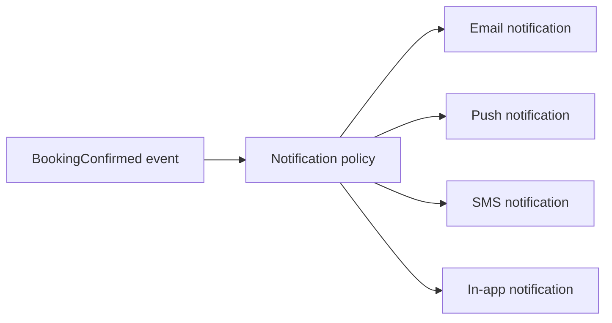
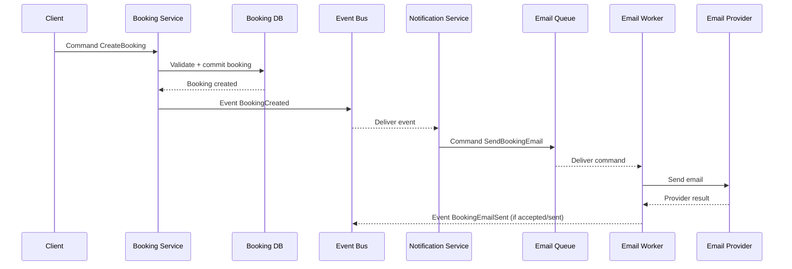
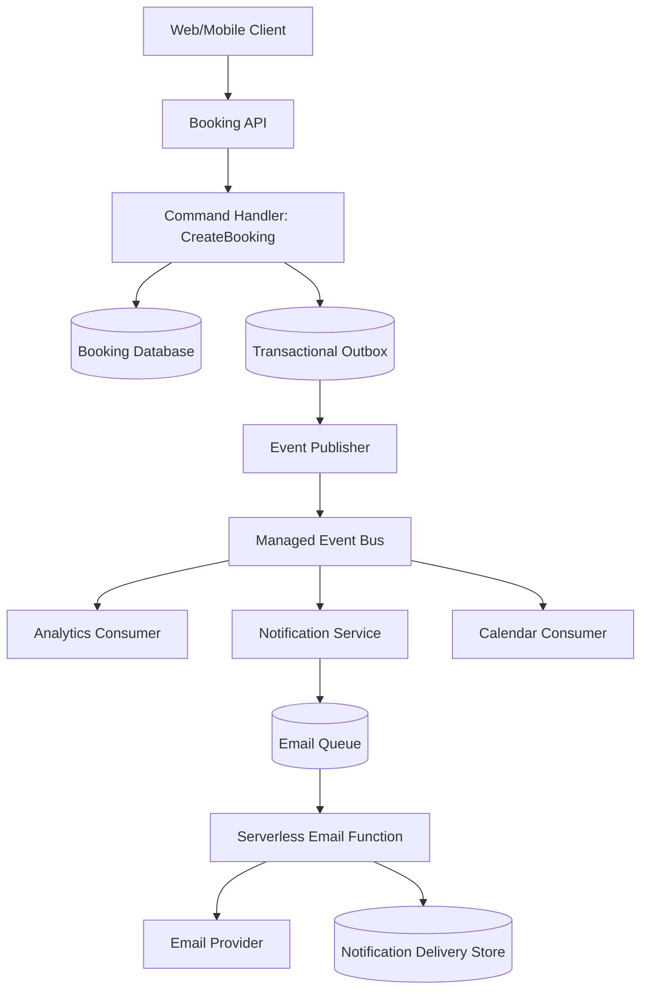

# Distinguishing Commands, Events, and Notifications

## 1. Three Related Concepts with Different Meanings

In an event-driven architecture, services exchange information to coordinate business processing. A system might send a request to create an order, emit a signal that the order has been created, and then send information to the customer for confirmation. All three flows can be represented as messages or API calls, but their semantics and responsibilities differ.

- **A command** requests a component to perform an action.
- **An event** describes something that has happened or a change that has been recorded.
- **A notification** delivers information to a recipient or group of recipients so they are aware of something; depending on the context, this can be a user-facing notification or a notification message between systems.

Mixing up these three concepts easily creates wrong dependencies: a consumer arbitrarily performs an action when it should only observe an event, a producer emits an event before the business operation is committed, or a notification is treated as the source of truth. Clearly distinguishing them helps determine who owns the action, who owns the state, who is authorized to emit the message, and what happens when a message is redelivered.

This lesson belongs to the **Event Architecture** chapter of the **CLOUD_ARCHITECTURE** module. We will connect message semantics with APIs, queues, event buses, functions, databases, and managed cloud services, while also examining reliability, security, scalability, cost, and operations according to Well-Architected principles.

After this lesson, you will be able to:

- Identify commands, events, and notifications based on purpose, timing, and recipients.
- Design names, schemas, and metadata for each message type.
- Choose between synchronous APIs, queues, or event buses based on coordination needs.
- Define ownership, response authority, idempotency, and error handling.
- Build an example event flow that is scalable and observable.

## 2. Command: Requesting an Action

A **command** is an imperative message: the sender wants a responsible party to execute a specific action. A command typically has a logical owner/handler with the authority to decide whether to execute or reject the action.

Examples:

- `CreateBooking`: create a new booking.
- `CancelBooking`: cancel a booking.
- `ReserveInventory`: reserve item quantities for an order.
- `CapturePayment`: request capturing funds for a payment intent.

### 2.1. Characteristics of a Command

| Aspect | Meaning |
|---|---|
| Semantics | Request to do something |
| Direction | Usually sent to a specific handler/owner |
| Timing | Before or at the time the action is performed |
| Response | Can succeed, be rejected, fail, or be pending |
| Decision authority | The handler can validate and reject |
| Impact | Can mutate business state |

Commands are typically named with **verb + noun**. `ApproveLoan` is clearer than `LoanApproved`, because the latter describes an outcome that has already occurred.

A command is not synonymous with an HTTP request. It can be transported via synchronous HTTP/gRPC, an asynchronous queue, or a workflow. What matters is the intent to perform an action and where responsibility lies.

### 2.2. A Command Can Be Accepted Without Being Completed

With synchronous processing, an API can return the result immediately after the action completes. With an asynchronous command, the system may return `202 Accepted` along with a command ID or operation ID. That only confirms the request was accepted under the API contract—**it does not mean the business operation has completed**.

Example:

```http
POST /bookings
Idempotency-Key: 0c2b...
Content-Type: application/json

{
  "customerId": "C-100",
  "slotId": "S-202"
}
```

The asynchronous response might be:

```http
HTTP/1.1 202 Accepted
Content-Type: application/json

{
  "commandId": "cmd-789",
  "status": "accepted",
  "statusUrl": "/operations/cmd-789"
}
```

The client needs to use the operation ID to query the status or receive a notification when processing completes. Do not display "booking successful" solely based on the command being accepted.

## 3. Event: Recording What Has Happened

An **event** describes an occurrence or change that has already happened in the business domain. It is usually named in the past tense or as a completed state:

- `BookingCreated`
- `BookingCancelled`
- `InventoryReserved`
- `PaymentCaptured`

An event states **what happened**, without requiring consumers to perform a specific action. Consumers decide for themselves whether they care and how to react within their own scope of responsibility.

### 3.1. Characteristics of an Event

| Aspect | Meaning |
|---|---|
| Semantics | A fact that has been recorded |
| Direction | Can be broadcast to multiple subscribers |
| Timing | After the triggering condition has occurred; usually after state commit |
| Response | Consumers do not necessarily reply to the producer |
| Decision authority | An event does not require a single handler to perform one specific action |
| Impact | The event itself is a recorded fact; consumers may produce their own side effects |

For example, after a booking is committed, the system emits `BookingCreated`. Consumers can update a calendar, send an email, generate an analytics event, or trigger a reminder workflow. The producer does not need to know everything consumers are doing.

### 3.2. An Event Is Not a Renamed Command

Comparison:

| Command | Event |
|---|---|
| `ReserveRoom` | `RoomReserved` |
| `CancelBooking` | `BookingCancelled` |
| `CapturePayment` | `PaymentCaptured` |
| `ShipOrder` | `OrderShipped` |

`ReserveRoom` requests a service to reserve a room; the handler has the right to reject it due to lack of availability. `RoomReserved` announces that the reservation succeeded. A consumer receiving the event should not interpret it as a call requesting to reserve a room again.

The difference in timing is critical. Do not emit `PaymentCaptured` before the system has proof that the payment has been successfully recorded. If you have only asked a partner to capture funds, you can emit a more semantically accurate event such as `PaymentCaptureRequested` or `PaymentCaptureInitiated`, if that represents a true state in your model.

## 4. Notification: Delivering Information to a Recipient

A **notification** is information sent to a person or system so they are aware of a state, result, or change. In practice, the term "notification" can be used in two scopes:

1. **User notification:** email, SMS, push notification, in-app alert, or alerts for operations staff.
2. **System notification:** a message informing another system that an event or outcome requires attention.

A notification is oriented toward the recipient and the communication goal. For example: "Your booking has been confirmed for 10:00 tomorrow." It may be generated from `BookingConfirmed`, but it is **not necessarily the original domain event**.

### 4.1. How Do Events and Notifications Relate?

One event can trigger multiple personalized or channel-specific notifications:



An event is a fact in the business domain. A notification is how information is conveyed to a recipient; it can apply language, templates, send timing, opt-in preferences, and delivery status. A notification can be retried multiple times without triggering business changes such as confirming the booking again.

Examples:

| Message | Kind | Meaning |
|---|---|---|
| `ConfirmBooking` | Command | Request to confirm a booking |
| `BookingConfirmed` | Event | The booking has transitioned to the confirmed state |
| `BookingConfirmationEmailRequested` | Command to notification service | Request to generate and send a confirmation email |
| “Your booking has been confirmed” | User notification | Content displayed to the customer |

Having the word "notification" in the name does not automatically make a message a command or an event. Evaluate the actual semantics: if it instructs a service to send an email, it is a command; if it records that an email was sent, it can be an event `EmailSent`; if it is content delivered to a user, it is a notification.

## 5. Comparing the Three Message Types

| Criterion | Command | Event | Notification |
|---|---|---|---|
| Purpose | Request an action | Record what has happened | Convey information to a recipient |
| Common naming | Imperative verb | Past-tense occurrence | Content/status for the recipient |
| Target | Specific handler/owner | One or more subscribers | User, group, or system that needs to know |
| Can be rejected? | Yes, the handler decides | An event that already happened cannot be "rejected"; a subscriber may ignore it or fail while processing | The recipient may not receive it; the delivery service must manage failures |
| Completion state | Accepted/processed/rejected/failed | Emitted/recorded, subscribers process independently | Queued/sent/delivered/read depending on channel |
| Coupling level | Usually knows the target responsible for execution | Reduces producer dependency on specific consumers | Depends on channel and recipient |
| Example | `CancelOrder` | `OrderCancelled` | “Your order has been cancelled” |

### 5.1. An Illustrative Business Flow

1. The client sends the `CreateBooking` command.
2. The booking service checks slot availability and permissions, then writes the booking.
3. After committing, the system emits the `BookingCreated` event.
4. The notification service receives the event, decides to send an email, and issues the `SendBookingEmail` command to the email worker.
5. The email provider responds; the worker updates delivery status and may emit the `BookingEmailSent` event.
6. The client reads the booking status from the authoritative data source; it does not rely on whether the email was sent to conclude that the booking is valid.

Diagram:



In a real system, the producer must ensure events are not lost between database commit and publish, for example via a transactional outbox. Queues and consumers can deliver duplicate messages, so workers must be idempotent. The "provider accepted" status must also be distinguished from "delivered" or "read"; do not conflate these states.

## 6. Choosing a Communication Channel: API, Queue, or Event Bus?

Message semantics dictate the design, while the transport is chosen based on interaction requirements:

| Channel | Best suited when | Example | Risks to manage |
|---|---|---|---|
| Synchronous HTTP/gRPC | Immediate result is needed or current state is being read | `GetBooking`, `CreateBooking` with immediate response | Coupling on availability/latency, timeouts, retries, backpressure |
| Queue | Asynchronous processing, burst absorption, or delegating work to a consumer is needed | `SendBookingEmail`, `GenerateInvoice` | Duplicates, retries, ordering, DLQ, backlog |
| Event bus/pub-sub | One event needs to be independently observed by multiple subscribers | `BookingCreated` to analytics, notification, calendar | Schema evolution, fan-out, subscriber lag, delivery semantics |
| Workflow/orchestration | Multi-step processes with explicit state and branching logic | Booking → Payment → Confirmation | Orchestration cost, step timeouts, compensation, and state retention |

Commands can also be placed on a queue, events can also be delivered over HTTP webhooks, and notifications can also be generated by a workflow. **Command/event/notification is the semantics; HTTP/queue/event bus is the transport.** Do not assume "a message on Kafka" is automatically a true event, or "an HTTP POST" is automatically a command.

## 7. Designing Schemas and Metadata

A useful message needs enough data for consumers to understand, validate, process, and observe it. However, do not embed entire database records or unnecessary sensitive data.

### 7.1. Reference Envelope

```json
{
  "messageId": "msg-901",
  "messageType": "BookingCreated",
  "schemaVersion": 1,
  "occurredAt": "2026-11-18T10:00:00Z",
  "producer": "booking-service",
  "correlationId": "req-123",
  "causationId": "cmd-789",
  "subject": "booking/B-456",
  "data": {
    "bookingId": "B-456",
    "customerRef": "C-100",
    "slotId": "S-202"
  }
}
```

The envelope is a standalone example; field names should be standardized across the organization. Commonly useful fields include:

- **messageId/eventId:** unique identifier that remains stable across redeliveries.
- **messageType:** distinguishes the message type according to its schema.
- **schemaVersion:** identifies the data structure version.
- **occurredAt:** when the business occurrence happened, distinct from when the consumer receives it.
- **producer/source:** the service emitting the message.
- **correlationId:** groups operations belonging to the same end-to-end journey.
- **causationId:** identifies the message/command that caused the current message.
- **subject/aggregateId:** the related business entity.
- **data/payload:** the minimal data needed by consumers.

### 7.2. Command Payloads Differ from Event Payloads

A command typically contains **intent and request parameters**:

```json
{
  "commandId": "cmd-789",
  "commandType": "CancelBooking",
  "bookingId": "B-456",
  "reason": "customer_request",
  "requestedBy": "customer:C-100"
}
```

An event typically contains **what occurred and the facts needed to understand it**:

```json
{
  "eventId": "evt-456",
  "eventType": "BookingCancelled",
  "bookingId": "B-456",
  "version": 4,
  "occurredAt": "2026-11-18T10:05:00Z",
  "reason": "customer_request"
}
```

Do not forward `requestedBy` as a final verified fact if the handler has not checked authorization. Similarly, an event should not describe "will cancel" when the booking has only received a cancellation request. If you need to record an asynchronous process, name it after the state that has already occurred, such as `BookingCancellationRequested`, and then emit `BookingCancelled` or `BookingCancellationRejected` depending on the outcome.

### 7.3. Schema Evolution

Consumers may not be deployed simultaneously. Therefore:

- Prefer backward-compatible changes: add optional fields with clear defaults.
- Avoid changing the meaning of or removing fields in use by consumers without a versioning plan.
- Consumers should ignore unknown fields if the contract allows it.
- Validate schemas with contract tests and manage a registry/catalog when the system requires it.
- Maintain a support window for multiple versions, along with migration and deprecation policies.

Events are historical records: schema changes must not render older events unreadable. You may need an upcaster/translator or consumers that support previous versions.

## 8. Ownership and Data Boundaries

An event should be emitted by **the service that owns the business truth**. If the Booking Service decides a booking is confirmed, it is responsible for emitting `BookingConfirmed`. The Notification Service should not emit that event just because it successfully sent an email.

| Component | Responsibility |
|---|---|
| Command sender | States intent, provides required data, handles result/operation ID |
| Command handler | Authenticates, checks rules, decides accept/reject, persists state |
| Event producer | Emits events for occurrences within its owned state, guarantees no lost events |
| Event consumer | Subscribes to relevant events, processes independently, idempotently, and tracks errors |
| Notification service | Decides channel, template, preferences, delivery timing, and delivery status |
| Message broker | Transports messages according to configured delivery semantics and policies |

Do not let consumers directly read or write the producer's internal database to infer events. When a consumer needs data, the event can carry the necessary fields or the consumer can call a well-published API. The choice depends on consistency needs, coupling tolerance, and how much data is permitted to be shared.

## 9. Common Design Mistakes

### 9.1. Emitting Events Before Committing

If you publish `BookingCreated` and then the database rolls back, consumers may have already sent an email for a nonexistent booking. Write business state and the outbox event in the same database transaction; let the publisher emit after commit.

### 9.2. Using Events as Action Requests

The name `PaymentCaptured` cannot be used to tell a payment provider to capture funds. Use a `CapturePayment` command; only emit the event after the capture outcome is confirmed per the integration contract.

### 9.3. Consumers Relying on Unguaranteed Ordering

If `BookingCancelled` arrives before `BookingCreated`, the consumer may record an invalid state. Use aggregate versions, appropriate partition keys/ordering guarantees, or reconciliation against the source of truth.

### 9.4. Treating Notifications as the Source of Truth

An email delivery failure does not mean the booking was cancelled. Booking state must live in the domain service/database; email delivery state belongs to the notification service.

### 9.5. Sharing One Message for Multiple Purposes

Using a single payload as a command, an event, and email content makes the schema hard to evolve and grants excessive data access. Separate messages by semantics and minimal data; use correlation IDs to link the flow.

### 9.6. Sending Sensitive Data in Events

Events can be fanned out to many consumers and retained in the broker for a long time. Do not include passwords, tokens, card details, or unnecessary personal data; use a reference with appropriate access controls if consumers need to fetch additional data.

## 10. Cloud Example: Event-Driven Booking Architecture

Suppose a booking application runs its API on a managed container/serverless platform, stores bookings in a managed database, emits events through an event bus, and uses a queue for an email worker.



These components represent logical roles; specific services, HA capabilities, private connectivity, and delivery semantics must be verified against the chosen cloud provider.

### 10.1. Operational Flow

1. The client sends `CreateBooking` with an idempotency key. The API authenticates the user and validates the request.
2. The command handler checks slot availability, writes the booking, and writes an outbox record within a transaction.
3. The publisher emits `BookingCreated` to the event bus. If publishing succeeds before the outbox record is marked as sent, the event may be redelivered; consumers must be idempotent.
4. The analytics consumer updates metrics. The calendar consumer creates a calendar entry. The notification service applies preferences and issues an email-sending command.
5. The email function calls the provider, saving the provider reference and delivery status. Transient errors are retried with bounds; persistent failures go to the DLQ.
6. The Booking API continues to return booking state from the source of truth; email delivery status is tracked separately.

### 10.2. Message Classification in the Flow

| Message | Kind | Rationale |
|---|---|---|
| `CreateBooking` | Command | Client asks the handler to create a booking |
| `BookingCreated` | Event | The booking has been recorded |
| `CreateCalendarEntry` (if using a queue/command) | Command | Requests the calendar consumer to perform an action |
| `CalendarEntryCreated` | Event | A calendar entry has been created |
| `SendBookingEmail` | Command | Requests sending an email |
| `BookingEmailSent` | Event | The system records that the provider accepted/sent the email as defined |
| Email “Your booking has been created” | User notification | Content delivered to the customer |

The name `BookingEmailSent` needs a precise definition: provider accepted, delivered, or read by the user. If there is only an API acceptance response, use a name/status that accurately reflects that confirmation level without claiming the email reached the inbox.

## 11. Security, Reliability, Observability, and Cost

### 11.1. Security

- Authenticate producers and consumers; only the producer owning a domain may emit that domain's events.
- Grant permissions per message type/topic/queue rather than system-wide publish/consume permissions.
- Encrypt data in transit and at rest; manage keys and secrets separately.
- Classify payloads; avoid putting tokens, payment data, or unnecessary sensitive information into events or logs.
- Audit schema changes, subscriptions, access permissions, and replay/purge operations.

### 11.2. Reliability

- Persist business state and events via an outbox or equivalent mechanism to prevent a commit/publish gap.
- Ensure idempotent consumers; handle duplicates, out-of-order events, and retries.
- Implement DLQs, controlled redrive, and reconciliation for ambiguous outcomes.
- Monitor backlog, oldest event age, retry rate, and subscriber errors.
- Define retention and replay strategies; do not treat the event bus as a business data backup in place of a database.

### 11.3. Observability

Track commands accepted/rejected/processed, events published/delivered, consumer processing latency, notifications queued/sent/delivered, and errors by message type. Propagate `messageId`, `correlationId`, and `causationId` end-to-end for tracing, but avoid using high-cardinality IDs as uncontrolled metric labels.

Distinguish between:

- **Command latency:** time from request submission until accepted or completed per contract.
- **Event lag:** time from `occurredAt` until processed by the consumer.
- **Notification delivery latency:** time from send request until provider acknowledgment/delivery status.

### 11.4. Cost and Operations

Costs include API requests, event publishing/delivery, queue operations, function invocations/duration, event/outbox storage, logs/traces, and data transfer. Fan-out to many subscribers multiplies deliveries; large payloads increase bandwidth and storage costs. Only subscribe necessary consumers, set appropriate retention, and monitor inactive consumers.

Do not create events for every minor internal change if there is no clear consumer or audit purpose. Every new event type introduces a contract requiring versioning, security, operational support, and compatibility management.

## 12. Well-Architected Evaluation

| Pillar | Questions to Ask |
|---|---|
| **Operational Excellence** | Who owns the command handler, event schema, and notification delivery? Are there runbooks, replay procedures, dashboards, and a consumer deprecation process? |
| **Security** | Do producers/consumers have least-privilege access? Do payloads contain sensitive data? Are encryption, auditing, and subscription controls in place? |
| **Reliability** | Are events emitted after commit? Do consumers handle duplicates? Are retries/DLQ/outbox/reconciliation in place? |
| **Performance Efficiency** | Is sync used where immediate responses are needed and async for bursts/fan-out? Are payloads, concurrency, and partitioning sized appropriately? |
| **Cost Optimization** | Is there unnecessary fan-out, oversized events, overly long retention/logging, or unneeded consumers? |
| **Sustainability** | Are duplicate notification sends/processing avoided, payloads minimized, and only valuable consumers retained? |

## 13. Message Contract Design and Review Process

1. **Describe the intent or fact.** Asking "who wants whom to do what?" usually points to a command; "what happened?" is an event; "who needs to be informed of what?" is a notification.
2. **Choose the owner.** Identify the service responsible for deciding the action and owning the state/event.
3. **Select the transport.** Consider synchronous APIs if an immediate response is required; queues to absorb bursts; event buses for multiple independent subscribers.
4. **Design the schema.** Include ID, type, version, timestamp, correlation/causation, and a minimal payload.
5. **Define semantics.** Delivery guarantees, duplicates, ordering, retries, timeouts, retention, ACKs, and DLQs.
6. **Protect the contract.** Authentication, authorization, encryption, data classification, and auditing.
7. **Test.** Contract compatibility, consumer behavior, duplicates, out-of-order delivery, broker outages, and replay.
8. **Operate.** Dashboards, alerts, owners, runbooks, schema evolution, and consumer decommissioning procedures.

### 13.1. Sample Message Catalog

| Message type | Kind | Producer/owner | Consumer | Transport | Data contract |
|---|---|---|---|---|---|
| `CreateBooking` | Command | Booking API | Booking handler | HTTP/API | Request schema v1 |
| `BookingCreated` | Event | Booking service | Notification, analytics, calendar | Event bus | Event schema v1 |
| `SendBookingEmail` | Command | Notification service | Email worker | Queue | Command schema v1 |
| `BookingEmailAccepted` | Event | Email worker | Delivery tracking | Event bus | Event schema v1 |

Each real-world row should also specify the technical owner, SLA, publish/consume permissions, retention, PII classification, retry/DLQ policy, and links to the schema/ADR.

## 14. Sample ADR for Command and Event Decisions

Example:

```yaml
decision_id: ADR-EVENT-001
title: Separate booking commands from domain events
context:
  - "Booking creation has a clear domain owner"
  - "Multiple subscribers need booking lifecycle changes"
decision:
  commands:
    - CreateBooking
    - CancelBooking
    - SendBookingEmail
  events:
    - BookingCreated
    - BookingCancelled
    - BookingEmailAccepted
  notification_channels:
    - email
    - push
transport:
  command_submission: synchronous_api
  domain_events: managed_event_bus
  email_delivery: managed_queue
reliability:
  producer_outbox: true
  consumer_idempotency: required
  dead_letter_handling: required
security:
  least_privilege_publish_subscribe: true
  payload_data_classification: required
review_triggers:
  - "New consumer or message type"
  - "Event schema breaking change"
  - "Business ownership changes"
```

The YAML template is for documentation purposes, not broker deployment configuration. A formal decision record must state the alternatives compared, approvers, test results, and remaining limitations.

## 15. Pre-Publication Message Contract Checklist

- [ ] Name and description accurately reflect whether it is a command, event, or notification.
- [ ] Commands have an accountable handler/owner, rejection rules, and clear status reporting.
- [ ] Events are emitted only when the occurrence has happened as defined; commit/publish timing is guaranteed.
- [ ] Notifications specify recipients, channels, preferences, and delivery statuses to track.
- [ ] Schemas include message ID, type, version, timestamp, and appropriate correlation/causation fields.
- [ ] Payloads are minimal and contain no secrets or unnecessary sensitive data.
- [ ] Producers/consumers have publish/subscribe permissions scoped to specific messages.
- [ ] Synchronous vs. asynchronous mode, delivery semantics, duplicates, ordering, and retention are defined.
- [ ] Consumers are idempotent; retries, DLQ, redrive, and replay have documented procedures.
- [ ] Schema evolution and contract tests have a compatibility maintenance plan.
- [ ] Metrics, tracing, owners, runbooks, and cost estimates are established for brokers and consumers.

**Rule of thumb:** a command says **do this**, an event says **this happened**, and a notification says **the recipient needs to know this**. When semantics and ownership are cleanly separated, cloud systems can coordinate asynchronously while preserving business clarity, testability, and operational risk control.
