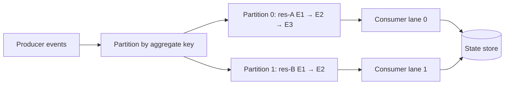
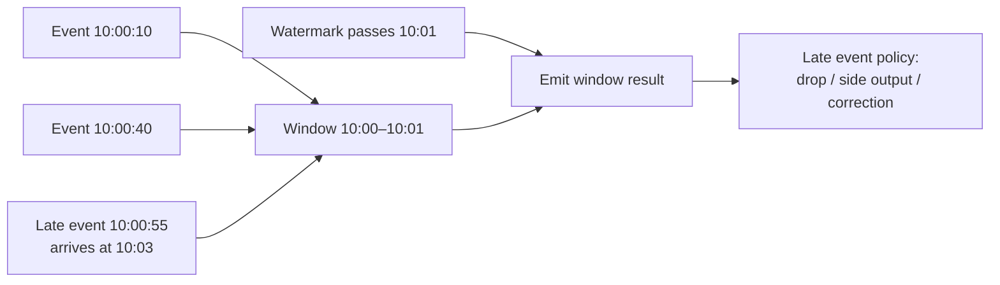
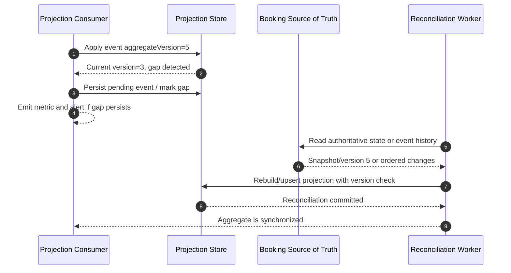
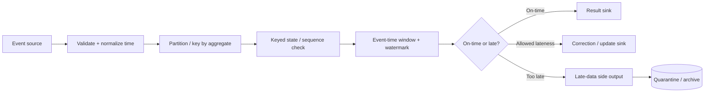
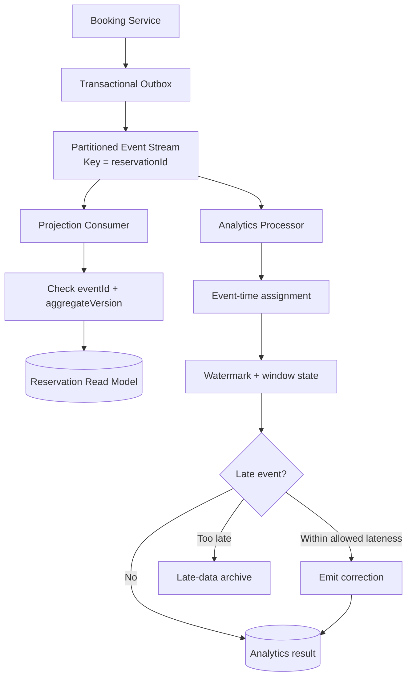

# Event Ordering, Event Time, and Late Events

In an event-driven architecture, an event may be created in one service, transmitted through a broker, queued, processed by a consumer, and finally used to update another data model. Those steps do not necessarily happen simultaneously or in the exact order observed by users. Network delays, retries, multiple producers, partitions, clock skew, and stopped consumers can all cause events to arrive late or out of order.

Therefore, when designing an event-driven architecture, three distinct questions must be answered:

1. **Which event occurred first in business terms?** This is the problem of ordering and causality.
2. **When did the event actually happen?** This is event time—the moment tied to the business action or state change.
3. **When did the system receive and process the event?** This is ingestion time/processing time—when the system observes or executes it.

In the **CLOUD_ARCHITECTURE** module, these three questions directly impact reliability, data consistency, scalability, stream processing cost, and cloud system operations. This lesson uses an equipment rental platform example to analyze event ordering, event time, watermarks, late events, and recovery. Time thresholds, partitions, and policies in the examples are illustrative assumptions; they must be determined from actual business requirements and empirical measurement.

## 1. Why Can Events Arrive Out of Order?

Suppose a reservation transitions through the states:

HELD → CONFIRMED → CANCELLED

Booking Service emits two events:

- ReservationConfirmed at 10:00:05.
- ReservationCancelled at 10:00:20.

Due to network delays and retries, a consumer might receive ReservationCancelled first, and then receive ReservationConfirmed. If the consumer blindly overwrites state in arrival order, the final record could revert to CONFIRMED even though the booking was cancelled.

Common causes:

| Cause | What happens? | Risk |
| --- | --- | --- |
| Multiple producers | Each service emits events on its own cadence and clock | No natural global order exists |
| Network delay | One message takes longer over the wire than another | Older events can arrive after newer ones |
| Retry/redelivery | Broker or producer resends unacknowledged messages | Duplicates or altered observed order |
| Multiple partitions | Messages for one workflow land in different partitions | Consumers read in parallel without global order |
| Multiple consumers | Messages take varying processing durations | Completion order diverges from arrival order |
| Replay/backfill | Consumers reread historical data while ingesting new messages | Old events interleave with current state |
| Clock skew | Producer clocks drift or are unsynchronized | Timestamps fail to reflect true causality |
| Consumer outage | Messages back up and are processed after consumer recovery | Old event time but recent processing time |

One crucial distinction: **the order messages are written to the broker**, **the order consumers receive messages**, and **the order business effects are committed** are three different things. A broker may guarantee ordering within a certain scope, yet a consumer making parallel database or external service calls can still finish out of order.

## 2. Three Types of Time in Event Processing

### 2.1. Event Time

**Event time** is when an event occurred according to the business source semantics. Examples:

- A customer clicks confirm payment at 10:00:05.
- Equipment leaves the warehouse at 10:12:00.
- A reservation expires by business rule at 11:00:00.

Event time is typically attached to the event by the producer or authoritative source. It should follow a clear time convention, usually expressed as a UTC timestamp with appropriate precision. For events originating on edge devices, the timestamp may come from the device clock and its trustworthiness must be assessed.

### 2.2. Ingestion Time

**Ingestion time** is when the platform receives or records the event into the processing system. For example, an event occurred at 10:00:05, but the broker only received it at 10:00:12 due to producer retries.

Ingestion time is useful for measuring delay from producer to platform, inspecting backlogs, and debugging data pipelines. It is not necessarily when the event happened.

### 2.3. Processing Time

**Processing time** is when the consumer/operator actually processes the event. If a consumer is down for 30 minutes, an event that occurred at 10:00 may not be processed until 10:30.

Processing time is useful for measuring processing duration, worker load, queue lag, and operations. It is usually unsuitable as the sole basis for business calculations such as "in which hour was revenue generated?"

### 2.4. Comparison

| Time type | Answers the question | Common source | Used for |
| --- | --- | --- | --- |
| **Event time** | When did the event happen? | Business timestamp recorded by producer/authoritative source | Business windows, analysis by actual occurrence time |
| **Ingestion time** | When did the system receive the event? | Recorded by broker/ingestion service | Measuring transit latency, detecting slow producers |
| **Processing time** | When did the consumer process it? | Recorded by runtime/stream processor | Tracking throughput, queue lag, resources, and execution time |

Example:

| Event | Event time | Ingestion time | Processing time |
| --- | --- | --- | --- |
| ReservationConfirmed E1 | 10:00:05 | 10:00:06 | 10:00:07 |
| ReservationCancelled E2 | 10:00:20 | 10:00:21 | 10:00:22 |
| PaymentCaptured E3 | 10:00:15 | 10:01:10 | 10:01:12 |

E3 occurred before E2 in event time, yet reached the system after E2. If a revenue report aggregates by event minute, E3 belongs in the 10:00 minute despite being processed after 10:01. If an operations dashboard tracks processing time, E3 appears at the 10:01 processing mark.

### 2.5. Time Alone Does Not Establish Causality

Two services can have skewed clocks. Timestamp A being earlier than timestamp B is insufficient proof that A caused or preceded B in business terms. For critical workflows, causal metadata is required, such as:

- aggregateVersion or a per-entity monotonic sequence.
- causationId indicating which event/command triggered the new event.
- correlationId linking an end-to-end workflow.
- State transition validation enforced by the authoritative data source.
- Logical clocks/vector clocks when a distributed problem genuinely requires representing causality across multiple nodes.

Do not use wall-clock timestamps as a substitute for a business sequence when exact ordering is needed for the same aggregate.

## 3. What Is a Late Event?

An event is considered a **late event** when it arrives at a processor/window after the system expected to finish or close that corresponding data interval. What counts as "late" depends on:

- The message's event time.
- How far system time has advanced (watermark or processing progress).
- The lateness policy of each operator/window.
- State window retention and data retention windows.

For example, a business wants to count confirmed reservations per minute. The 10:00–10:01 window has already emitted a result of 15 reservations. Later, a ReservationConfirmed event with event time 10:00:42 arrives at 10:03. The business-accurate count should be 16, but the system has already emitted the earlier result.

Late events can occur because:

- A producer went offline and later flushed a batch.
- An IoT device lost connectivity and synced afterward.
- Consumer/broker backlogs built up.
- A downstream service retried for a long period.
- Events were recovered from an outbox after an outage.
- Historical data was backfilled.
- Source clocks or timestamps were inaccurate.

Not every event arriving later is a late event in processing terms. For instance, a new ReservationCancelled emitted after ReservationConfirmed is a new business change, not a late event merely because it arrived later. You must compare event time and aggregate/version relationships rather than looking only at arrival order.

## 4. Ordering: At What Scope Can a System Guarantee Order?

### 4.1. Global Ordering

Global ordering means every event across the entire system is observed in a single total order. This is a very strong requirement that typically restricts throughput and concurrency. Many distributed brokers do not provide automatic global ordering across all partitions.

Only require global ordering when the business truly demands it, and analyze the cost of serializing all messages through a single stream. Most systems can rely on per-entity/per-aggregate ordering instead.

### 4.2. Per-Key / Per-Aggregate Ordering

Events for the same entity, such as a reservation or order, are routed to the same partition/stream key. The broker can preserve append order for records within that partition; consumers must process them according to partition semantics and avoid parallelizing in ways that break per-key order.

For example, using reservationId as the key routes events for res-123 together, while events for res-456 can process in parallel on another partition.

Advantages:

- Preserves ordering within the required business scope.
- Allows independent aggregates to be processed in parallel.
- Makes it straightforward to attach a sequence/version to an aggregate.

Trade-offs:

- An overly hot key can create a hot partition.
- Changing partition counts or partitioning strategies can disrupt key/order mapping.
- Multiple aggregates in a single workflow do not automatically share a total order.

### 4.3. Per-Partition Ordering

In a partitioned log model, ordering is typically guaranteed within a single partition per broker semantics. A message in partition A is not ordered relative to a message in partition B.

Producers must pick suitable keys. Using customerId preserves ordering across all events for a customer but risks hot load; using reservationId boosts parallelism but does not order events across two separate reservations belonging to the same customer. The key must reflect **the unit of state that must be updated sequentially**.

### 4.4. Processing Order in Consumers

Even when a broker delivers sequentially, a consumer can still:

1. Receive record E1 and hand it off to a thread pool.
2. Receive E2 next and process it faster.
3. Commit E2's effects before E1.

If ordering must be preserved, serialize processing per key/partition or use per-key sequencing; do not run concurrent tasks blindly based on arrival order. In databases, you can check the expected version inside the update statement.



The diagram illustrates key-based ordering. Exact partitioning, consumer assignment, and offset commit mechanics depend on the platform.

## 5. Aggregate Versions and Sequence Numbers

For events mutating the same aggregate, a common pattern is attaching a **monotonically increasing version** to each change.

| reservationId | version | eventType | eventTime |
| --- | ---: | --- | --- |
| res-123 | 1 | ReservationHeld | 10:00:00 |
| res-123 | 2 | ReservationConfirmed | 10:00:20 |
| res-123 | 3 | ReservationCancelled | 10:04:10 |

The consumer applies an event only if its version matches the current state:

- State is at version 1, receives version 2: can apply.
- State is at version 2, receives version 2 again: duplicate, ignore or confirm already processed.
- State is at version 2, receives version 4: missing version 3; hold, retry, query source, or signal reconciliation per contract.
- State is at version 3, receives version 2: stale event; do not overwrite newer state.

This is a simplified illustration. You must define precisely how sequences increment per aggregate, whether sequences are assigned at commit or before commit, and how gaps are handled. If sequences are generated by multiple independent producers without consensus, they do not automatically guarantee valid ordering.

### Conditional Update Example

```sql
UPDATE reservation_projection
SET status = :new_status,
    aggregate_version = :incoming_version,
    event_time = :incoming_event_time
WHERE reservation_id = :reservation_id
  AND aggregate_version = :incoming_version - 1;
```

If affected rows equal 0, the consumer must read the current state to classify whether it is a duplicate, stale event, or version gap. Do not automatically treat every case as a transient error to retry forever.

### State Transitions Must Still Be Validated

Even with a valid sequence, invalid behavior can occur due to producer bugs or misattributed events. For instance, HELD → EXPIRED → CONFIRMED might be forbidden by business rules despite increasing versions. Pure projection consumers may mirror the source of truth, whereas actions producing side effects should verify legal transitions and authorization.

## 6. Event Envelope: Recording Enough Information for Time and Causality

An event envelope should include at least the attributes needed to identify, trace, and order within the proper scope:

```json
{
  "eventId": "evt-01JXYZ",
  "eventType": "ReservationConfirmed",
  "eventVersion": 1,
  "aggregateType": "Reservation",
  "aggregateId": "res-123",
  "aggregateVersion": 2,
  "eventTime": "2026-11-18T10:00:20.125Z",
  "producedAt": "2026-11-18T10:00:20.130Z",
  "correlationId": "workflow-789",
  "causationId": "cmd-456",
  "producer": "booking-service",
  "payload": {
    "reservationId": "res-123",
    "status": "CONFIRMED"
  }
}
```

Field meanings:

| Field | Role | Notes |
| --- | --- | --- |
| eventId | Uniquely identifies an event instance | Used for inbox/deduplication; retries of the same event keep the same ID |
| eventType | Type of event | Should use stable, semantically clear names |
| eventVersion | Event schema version | Distinct from aggregateVersion |
| aggregateId | Affected entity/aggregate | Often used as the partition key |
| aggregateVersion | State sequence of the aggregate | Supports ordering, gap, and stale-event detection |
| eventTime | Time the business occurrence happened | Requires clear timezone/clock conventions |
| producedAt | Time the producer constructed the envelope | Useful for measuring producer delay |
| correlationId | Links a workflow | Used for tracing across services |
| causationId | Identifies the command/event causing this event | Expresses direct causal relationship |
| producer | Emitting source | Useful for auditing and schema ownership |

Field names and formats are examples, not mandatory standards. You can adopt CloudEvents or another organizational envelope standard. Never copy fields without defining their semantics; in particular, never treat eventTime, producedAt, and broker timestamps as interchangeable.

**Do not put secrets or unnecessary personal data into events.** Messages may persist in brokers, DLQs, archives, replay stores, and traces for long periods; transmit only data consumers need and enforce access controls by classification.

## 7. Watermarks: Estimating Event-Time Progress

In stream processing, the system needs to know how complete data is for a given event-time interval. However, it can never know with absolute certainty that "no older events will ever arrive again" when networks and producers can lag arbitrarily.

A **watermark** is an estimate of event-time progress: the system assumes most data with event times earlier than the watermark has arrived or been processed. Once the watermark passes a window's end time, the operator can emit results and consider the window complete per policy.

A watermark is **neither the timestamp of the newest event**, nor an absolute promise that older events are finished. Watermark generation differs across frameworks, sources, and configurations.

### Event-Time Window Example

Suppose a stream counts confirmed reservations per minute. The first window covers from 10:00:00 (inclusive) up to before 10:01:00.



If the watermark has already passed 10:01 when E3 arrives, the framework/operator can drop E3, route it to a late-data output, or update the result according to allowed lateness/retraction semantics. The choice must align with downstream consumers of the output.

### Allowed Lateness

**Allowed lateness** is an extra grace period during which the system still accepts updates for a window after the watermark passes its end time. For example, if a window ends at 10:01 with 2 minutes of allowed lateness, the system retains state to accept late events up to the policy cutoff around 10:03 per framework semantics.

Once allowed lateness expires, window state is typically purged to free resources. Events arriving even later may be dropped or routed to a separate channel.

Key decisions to clarify:

- Should preliminary results be emitted before the window closes?
- When a late event arrives, is the old result replaced, incremented by a delta, or updated via a correction event?
- Do downstream consumers understand updates/retractions?
- How long is state retained, and what is the memory/state-backend cost?
- Where are overly late events stored, and who handles them?

Watermarks and allowed lateness are **stream processing mechanisms**; they do not automatically solve stale-event business logic when updating a current reservation record.

## 8. Event-Time Windows vs. Processing-Time Windows

### Tumbling Window

Fixed-size, non-overlapping windows. For example, one window per minute:

- 10:00:00–10:01:00
- 10:01:00–10:02:00

Suited for per-minute/per-hour booking counts, periodic revenue reports, or event counts in fixed buckets.

### Sliding Window

Windows that advance by a slide interval and typically overlap. For example, total bookings over the last 5 minutes, updated every minute. A single event can belong to multiple windows.

### Session Window

Windows formed by periods of inactivity between events. For example, grouping a user's actions into a session until an inactivity timeout expires.

### Comparison

| Window type | Partitioning | Example | Watch-outs |
| --- | --- | --- | --- |
| Tumbling | Fixed interval, non-overlapping | Total bookings per minute | Late events and window boundaries |
| Sliding | Fixed-length window sliding periodically | Requests in the last 5 minutes | Events appear in multiple windows, raising state/cost |
| Session | By inactivity gaps between events | Customer interaction session | Gaps can merge when a late event bridges two sessions |

### Event Time or Processing Time?

Choose event time when reports must reflect business occurrence times, data arrives unevenly, or historical replays must reproduce the same results as when events occurred. Choose processing time when the goal is operational visibility ("how much did we process in the last minute?"), minimizing reliance on producer timestamps, or reacting immediately on processing cadence.

Not every pipeline needs watermarks. A queue worker updating a projection by aggregate version may not need event-time windows; an analytics system counting orders per minute usually needs event time and a late-data policy.

## 9. Late-Event Handling Policies

No single late-event policy fits all data types. Classify according to business requirements.

| Policy | Behavior | Suitable when | Cost / trade-off |
| --- | --- | --- | --- |
| **Drop** | Discard events past the cutoff | Near-real-time data where very old events add little value | Results may be incomplete; must measure drop rate |
| **Side output / late-data stream** | Route late events to a separate stream | Investigation, backfill, or deferred processing is needed | Extra storage, consumers, and operations |
| **Update/retract result** | Update previously emitted window results | Dashboards/reports can accept corrections | Downstream must support updates and versioning |
| **Recompute window** | Recalculate buckets from raw data | Accuracy outweighs cost and latency | Compute/IO intensive; requires idempotent output |
| **Manual review** | Escalate anomalies to human operators | High financial/legal impact | Slow, increases operational toil |
| **Compensating event** | Emit a corrective event adjusting prior totals | Ledgers/reports need a clear audit trail | Consumers must understand correction events and avoid double counting |

### Distinguishing Late Events from Stale Events

These two concepts are easily confused:

- **Late event:** an event arriving for processing after the system has passed an event-time watermark or emitted the window.
- **Stale event:** an event reflecting an older state/version than the aggregate's current state.

An event can arrive late yet still represent a valid newer version—for example, a source system generated ReservationCancelled at 10:05 but due to an outage only published it at 10:20. Conversely, an event arriving quickly can still be stale if the consumer already processed a newer version.

A late-event policy governs time progress and windows. A stale-event policy governs aggregate state and sequencing. Both are needed when a pipeline computes time windows while also updating business projections.

## 10. Example: Per-Minute Booking Report with Late Events

Assumptions:

- 1-minute event-time windows.
- Watermark estimated 30 seconds behind the maximum observed event time.
- Window results emitted once the watermark passes window end time.
- Allowed lateness is 2 minutes.

All values are **illustrative exercise assumptions**, not framework defaults.

| Event | Event time | Ingestion time | Interpretation |
| --- | --- | --- | --- |
| E1 ReservationConfirmed | 10:00:10 | 10:00:11 | Arrived close to occurrence time |
| E2 ReservationConfirmed | 10:00:42 | 10:00:44 | Belongs to the same 10:00 window |
| E3 ReservationConfirmed | 10:00:55 | 10:03:00 | Arrived very late, still belongs to 10:00 window |
| E4 ReservationCancelled | 10:01:10 | 10:01:12 | Belongs to 10:01 window if counting by event type |

Possible emitted results:

1. Initially, the 10:00 window emits count 2.
2. After E3 arrives within allowed lateness, the system emits a correction or updated count of 3.
3. Downstream receiving the correction must replace/adjust the prior result rather than adding the new snapshot as an increment, unless the contract explicitly defines deltas.

### Pseudocode for Event-Time and Late-Data Handling

```text
onEvent(event):
    validateEnvelope(event)
    eventTime = parse(event.eventTime)
    window = assignWindow(eventTime)

    if eventTime is behind finalizedWatermark:
        if withinAllowedLateness(window):
            updateWindowState(window, event)
            emitWindowCorrection(window)
        else:
            writeLateEventSideOutput(event)
    else:
        updateWindowState(window, event)

onWatermarkAdvance(newWatermark):
    emitWindowsWhoseEndPassed(newWatermark)
    finalizeAndExpireStateAfterAllowedLateness(newWatermark)
```

This is illustrative pseudocode, not a specific API for Flink, Spark Structured Streaming, Kafka Streams, or a cloud stream service. Frameworks differ in watermark generation, state retention, triggers, update modes, and output semantics.

## 11. Data Design and Duplicate Handling

Ordering and late events frequently coincide with duplicates. A producer may republish after missing an ACK; a broker may redeliver; a consumer may succeed in processing and crash before committing its offset/ACK.

### Event ID and Inbox

Consumers can maintain an inbox/deduplication store:

| Field | Role |
| --- | --- |
| consumerName | Isolates processing progress per consumer |
| eventId | Identifies the received message |
| processedAt | Timestamp of processing/recording |
| aggregateId | Related entity |
| aggregateVersion | Sequence to detect stale events or gaps |
| result/reference | Result or business effect ID if needed |

Record the inbox entry and state change in the same transaction when backed by the same database. If side effects hit external APIs like refunds or email, use downstream idempotency keys where available, persist attempt state, and reconcile ambiguous outcomes.

### Why Must "Exactly Once" Specify Its Scope?

A platform may offer exactly-once semantics across a bounded scope such as reading partitions, computing state, and writing to an integrated sink under specific mechanics. That does not automatically guarantee that **a business effect spanning multiple external systems occurs exactly once**.

Separate:

- Message delivery: at-most-once, at-least-once, or a specific delivery guarantee.
- Stream processing state: framework checkpoints/transactions and recovery.
- Sink commit: whether output writes are transactional/idempotent.
- Business side effect: charging cards, sending emails, issuing access codes, or cancelling orders.

Practical designs typically embrace at-least-once delivery paired with idempotent processing, version checks, and outbox/inbox patterns to achieve accurate business effects. Do not advertise exactly-once without explicitly stating boundaries and assumptions.

## 12. Reconciliation and Projection Repair for Late or Out-of-Order Events

Event-driven systems often maintain projections/read models to serve queries. If a projection misses an event, applies events out of order, or suffers a consumer bug, you need a way to converge it back to the source of truth.

A reconciliation process:

1. Detect projections with version gaps, invalid states, or divergence from the source of truth.
2. Identify the affected aggregates and relevant event ranges.
3. Query the authoritative data source or run a controlled log replay.
4. Recompute the projection from a snapshot plus events in valid sequence order.
5. Write the repaired projection using checked versions/cursors; avoid overwriting newer state.
6. Monitor counts of repaired aggregates, replay errors, and convergence time.



Querying the source database directly for every single event is not always necessary. With replayable event logs and well-managed snapshots, projections can be rebuilt from the stream. However, avoid replaying concurrently with live traffic without clear checkpoints/ownership; otherwise, new and old writes will overwrite one another.

## 13. Partition Key Design and Throughput

The partition key governs ordering scope, concurrency, and load distribution. A strong key balances:

- **Ordering:** events requiring relative order land in the same partition or processing lane.
- **Load distribution:** data does not concentrate excessively on one hot key.
- **Consumer parallelism:** enough partitions exist to scale useful consumers.
- **State locality:** an aggregate's state is updated in the same processor/scope when possible.
- **Operational evolution:** changing partition counts or strategies does not break semantics of already-written data.

| Key candidate | Benefit | Risk |
| --- | --- | --- |
| reservationId | Per-reservation ordering | Does not order across multiple reservations of the same customer |
| customerId | Can preserve per-customer ordering | A large customer can create a hot partition |
| equipmentId | Useful if all availability changes must serialize per device | Popular equipment can bottleneck throughput |
| eventId | Even distribution | Loses business ordering per aggregate |
| constant key | Global ordering in one narrow lane | Eliminates parallelism, easily becomes a bottleneck |

If the invariant to enforce is **no overlapping bookings on the same equipment**, partitioning by equipmentId helps serialize related commands, while the authoritative datastore still needs constraints/transactions. Broker ordering alone cannot protect against mutations arriving via another API or out-of-band database writer.

### Hot Partitions

A high-traffic aggregate or tenant can create a hot partition. Mitigations depend on business rules:

- Split hot-key workloads if they can be subdivided without breaking invariants.
- Apply quotas/backpressure on producers.
- Scale consumers and partitions within permitted ordering boundaries.
- Handle hot aggregates via dedicated serialization mechanisms or isolated partitions.
- Monitor per-partition lag, throughput, processing duration, and state size.

Do not change partition counts arbitrarily when the broker maps keys based on partition count. Before resizing, understand key distribution, consumer rebalancing, old/new ordering behavior, and the migration procedure.

## 14. Event Time, Clock Skew, and Timestamp Quality

Timestamps are only useful when you understand their source and reliability:

### System Clocks

Workloads should synchronize clocks against a reliable time service and monitor clock drift. Even so, NTP/PTP and UTC do not create absolute causality across multiple nodes. Clock skew can cause event timestamps to move backward or jump ahead of current time.

### Device Timestamps

IoT devices can stay offline for long stretches, run low on battery, or have manually altered clocks. Device-originated event times need metadata such as device ID, boot/session ID, sequence number, and gateway receipt time. When anomalies arise, policies can use sequences to infer order within a device session and retain both deviceTime and ingestionTime for auditing.

### Server Timestamps

When the backend is the authoritative issuer, it can assign eventTime at the transaction/domain boundary. Record the timestamp close to when business state commits; avoid stamping too early while commands can still fail.

### Anomalous Data

| Anomaly | Suggested handling |
| --- | --- |
| Future timestamp past threshold | Quarantine, flag clock issue, or apply audited fallback policy |
| Timestamp too old | Apply late-event policy, side output, or backfill |
| Missing timestamp | Reject or stamp ingestion time per explicit contract; never silently assume event time |
| Timestamp missing timezone | Reject or apply published source rules; avoid interpreting using server local timezone |
| Timestamp earlier than prior version | Check clock, sequence, and causal metadata; do not roll back aggregate version |
| Identical timestamps | Use aggregateVersion/eventId to disambiguate; never rely on timestamps as unique keys |

Never silently mutate original events to "clean up" data. If normalization/fallback is applied, preserve raw timestamp, normalized timestamp, and reason for traceability.

## 15. Backfill, Replay, and Historical Late Data

Backfill uses older data to recreate or supplement results. Replay reprocesses from an event log. Both can feed old events into the system while consumers are processing live traffic.

| Approach | Description | When suitable |
| --- | --- | --- |
| Replay on main stream | Reuse existing consumers/groups or cursors according to plan | Projection needs a full rebuild and can be paused/coordinated |
| Shadow consumer | Separate consumer writing to a new table/index | Comparing new projection against current one before cutover |
| Time/partition-scoped backfill | Process bounded slices of data incrementally | Large datasets requiring load control |
| Side input/late stream | Route late data into a dedicated pipeline | Infrequent late events needing controlled handling |

Before running a replay/backfill, verify:

- Event schema versions and ability to read historical schemas.
- Whether consumers are idempotent and external side effects are disabled/safe-moded.
- Where state/offsets/checkpoints start.
- Whether live data continues arriving and how old and new events merge.
- Replay rate throttling to avoid overloading databases or downstream systems.
- How results are compared, cut over, and rolled back for projections.

**Never replay events that trigger external side effects like charges, refunds, or emails into production handlers without a safe replay mode.** A projection consumer can rebuild; a payment consumer needs idempotency keys, transaction state, and policies preventing repeated side effects.

## 16. Applying This in Kafka and Stream Processing

### Kafka-Style Partitioned Logs

In Kafka-style partitioned log systems:

- Ordering is guaranteed within a partition by record offset.
- Producer keys normally determine which partition is chosen.
- Consumer groups divide partitions among consumer members; one partition is assigned to one member of a group at a time under the standard model.
- Consumers commit offsets after processing; commit timing governs redelivery on crashes.
- Rebalances can temporarily pause or transfer partition ownership.

This does not guarantee consumers process business logic in order if code dispatches records to a thread pool and completes arbitrarily. Design per-partition/per-key execution and commit offsets only after required effects are durable per contract.

### Stateful Stream Processors

Stream processing frameworks can maintain keyed state, event-time windows, watermarks, checkpoints, and state backends. A typical pipeline:



This is a logical pipeline. Checkpoints, exactly-once state, sink transactions, and event-time semantics depend on the specific framework and sink. Read the product's actual semantics instead of treating the diagram as an implementation guarantee.

### Checkpoints and Recovery

Checkpoints let stream processors save state/offsets to recover from failures. A consistent checkpoint coordinates source positions, operator state, and sink behavior per framework rules. If a sink is neither transactional nor idempotent, recovering from a checkpoint can still produce duplicate outputs.

## 17. Event Ordering and Time in Cloud Services

Cloud providers offer many options: queues, pub/sub, event buses, partitioned streaming logs, stream analytics, and workflow services. They vary in ordering, delivery, deduplication, retention, and retry semantics.

| Platform type | What to verify in service documentation |
| --- | --- |
| Partitioned event log | Ordering scope per partition/key, retention, consumer offsets, rebalances, and replay |
| Standard queue | Delivery semantics, visibility timeout, duplicate delivery, and ordering |
| FIFO/ordered queue | Ordering groups, throughput limits, deduplication scope/window, and retry behavior |
| Pub/sub topic | Ordering keys if supported, redelivery, ack deadlines, subscriber parallelism |
| Event bus | Rule matching, retry policies, archive/replay, dead-letter destinations |
| Managed stream processing | Event-time support, watermarks, window triggers, state retention, checkpoints, and output semantics |

Product names alone are not enough to infer guarantees. A queue named FIFO may guarantee order only within a message group; pub/sub with ordering keys may have caveats during redelivery or regional failovers. Always review the actual contract for your chosen service, region, and configuration.

### Deployment Placement and Latency

Placing producers, brokers, and consumers in different regions can increase latency, egress costs, and late-event windows. If data is governed by geographic or regulatory rules, archives, replays, DLQs, and analytics sinks must also satisfy data residency.

Not every consumer needs to be co-located with the producer. Balance latency, resilience, data locality, DR capability, and data transfer cost. For events not needing real-time reactions, batch or near-real-time pipelines may be cheaper than continuous streaming while still meeting business needs.

## 18. Reliability, Security, and Operations

### Reliability

- Use stable event IDs for deduplication.
- Use aggregate keys/versions to protect ordering within required bounds.
- Persist outbox/inbox records or equivalent transactional mechanisms to avoid losing publish/consume intent.
- Implement retries, backoff, DLQs, replays, and reconciliation.
- Size retention adequately for consumer recovery; measure backlog and catch-up duration.
- Test consumer crashes before/after commits, broker outages, and duplicates.

### Security

- Authenticate producers and consumers; restrict publish/subscribe permissions per topic/stream.
- Encrypt data in transit and at rest per data classification.
- Exclude unnecessary PII/secrets from events.
- Protect schema registries, archives, and DLQs; they often contain payloads identical to the original messages.
- Audit replays/backfills and administrative actions.
- Enforce tenant authorization in consumers rather than trusting an arbitrary tenantId field sent by producers.

### Operations

Monitor at minimum:

| Signal | Used to detect |
| --- | --- |
| Consumer lag / backlog age | Consumers falling behind producers |
| Event-time to ingestion-time delay | Producers/networks emitting events late |
| Ingestion-to-processing delay | Slow queue/consumer processing |
| Watermark lag | Stalled event-time progress |
| Late-event rate and drop count | Clock/data delays or overly short allowed lateness |
| Duplicate rate | Redeliveries, producer retries, or deduplication behavior |
| Version gap/stale count | Lost events, out-of-order arrival, or replays |
| DLQ size/age | Failing events not yet handled |
| State size/checkpoint duration | Stateful processing cost and recovery risk |
| Reconciliation count | Projections diverging from source of truth |

Metrics need owners and alert thresholds. Rising consumer lag is not necessarily an incident if a batch job runs on a schedule; a stalled watermark may stem from an idle source or bad timestamp rather than insufficient worker CPU.

## 19. Scenarios and Remediation Patterns

### Scenario A — Cancellation Arrives Before Confirmation

A reservation emits Confirmed version 2 and Cancelled version 3. A consumer receives version 3 first due to two partitions or a replay.

**Handling:** if current state is version 1 and version 3 arrives, do not apply blindly; flag a gap and query the source or replay versions 2 then 3, or reconcile from an authoritative snapshot. If state is already version 3 and version 2 arrives, ignore the stale event. Partitioning by reservationId reduces broker reordering, though consumers still need version guards.

### Scenario B — Event Occurs in Previous Hour but Arrives in Next Hour

Warehouse equipment emits EquipmentCheckedOut with device event time 10:59:55, loses connectivity, and the broker receives it at 11:08.

**Handling:** business reports using event time should assign the event to the 10:59 window; ingestion/processing time tracks latency and operations. If the window already emitted, apply allowed lateness, corrections, or a late-data side output per reporting contract. If device timestamps are unreliable, use sequence/session metadata and an audited normalization process.

### Scenario C — Watermark Stalls

One partition receives no new events because its source is idle. The minimum watermark across the entire job is held back by that partition.

**Handling:** inspect idle source/partition semantics and configure an idle timeout if supported by the framework; weigh watermark accuracy, late events, and window closure before marking a source idle. Do not blindly advance watermarks just to make dashboards update faster, as doing so can drop late events.

### Scenario D — Consumer Crashes After Sending Email but Before ACK

The broker redelivers the message. The consumer sends the email a second time.

**Handling:** if the mail provider supports idempotency/request references, supply a stable key; otherwise, record delivery state and accept that end-to-end exactly-once email delivery has limits. You can use a notification job/outbox with appropriate retry/compensation logic; never treat an offset commit as proof of non-duplicate external effects.

### Scenario E — One Customer Creates a Hot Partition

Partitioning by customerId causes one major partner to generate most events.

**Handling:** measure partition skew; evaluate keying by reservation/equipment if ordering is only required at a finer aggregate scope; enforce quotas or isolate high-volume tenant streams. Before changing keys, verify that business invariants do not require customer-wide ordering.

## 20. Practical Design: Reservation and Analytics Flows

Suppose Booking Service emits an event whenever reservation state changes. Two consumers:

- **Reservation Projection** must maintain the latest state for lookup APIs.
- **Analytics Processor** must count confirmed reservations per event-time minute.

The two consumers have different requirements:

| Attribute | Reservation Projection | Analytics Processor |
| --- | --- | --- |
| Goal | Accurate current state | Metrics aligned to business occurrence time |
| Ordering | Per reservation aggregate | By event time/window; aggregate version helps deduplicate |
| Late events | Classify stale/gap, reconcile | Allowed lateness, corrections, or side output |
| Duplicates | Inbox/eventId + aggregateVersion | Dedup by eventId/business key |
| State | Per-reservation projection | Window aggregates and watermark state |
| Output | Read model serving APIs | Dashboards/reports or datasets |



### Event Contract for Both Consumers

An event may contain:

```json
{
  "eventId": "evt-1002",
  "eventType": "ReservationConfirmed",
  "eventVersion": 1,
  "aggregateId": "res-123",
  "aggregateVersion": 2,
  "eventTime": "2026-11-18T10:00:20Z",
  "producedAt": "2026-11-18T10:00:21Z",
  "correlationId": "workflow-889",
  "payload": {
    "reservationId": "res-123",
    "status": "CONFIRMED"
  }
}
```

Do not include full customer profiles in the event if Analytics only needs to count reservations. Data minimization reduces exposure risks and retention/replay costs.

### Design Decisions

1. Partition by aggregateId so events for a single reservation share an ordering scope.
2. Increment aggregateVersion per commit in the Booking source of truth; the projection consumer validates stale events and gaps.
3. Persist booking state and outbox entries in the same transaction or equivalent guarantee.
4. Analytics uses eventTime for windowing and producedAt/ingestion/processing time to measure delay.
5. Define watermark/allowed lateness based on how much dashboard correction is acceptable.
6. Route overly late events to an archive/backfill rather than silently folding them into current-time reports.
7. Consumers enforce deduplication and replay safety; external side effects use dedicated idempotency/reconciliation.

### What to Test

- Send event version 3 before version 2.
- Send the same eventId multiple times.
- Crash the consumer after writing to the DB but before committing its offset.
- Interrupt the broker from accepting events and then recover.
- Send an event with an old eventTime after the window closes.
- Send an event with a future timestamp or missing timezone.
- Spike load on a single aggregate key to observe hot-partition behavior.
- Replay historical data concurrently with the live stream in staging.

## 21. Trade-offs Under Well-Architected Principles

| Pillar | What good design brings | Trade-offs to manage | Verification question |
| --- | --- | --- | --- |
| **Operational excellence** | Event traceability, replayability, and discrepancy investigation | Adds schema registries, state stores, DLQs, watermark monitoring, and runbooks | Do we know why an event was delayed or dropped? |
| **Security** | Scoped publish/consume permissions and reduced excess data | Archives/DLQs/replays create additional places holding sensitive data | Who can replay or inspect historical payloads? |
| **Reliability** | Version guards, idempotency, outboxes, and reconciliation prevent loss/reordering | Complex state and retries; event gaps may require investigation | After a crash or replay, do invariants still hold? |
| **Performance efficiency** | Parallel processing by aggregate/partition | Hot keys, slow watermarks, and large state cause bottlenecks | How do throughput, lag, and state size behave under load? |
| **Cost optimization** | Retain state and late data only as needed | Long allowed lateness, archives, and replays raise storage/compute | Is state retention cost proportional to required accuracy? |
| **Sustainability** | Avoid redundant recomputation and unnecessary data transfer | Frequent replays and overly long retention waste resources | Can shorter retention/lateness windows still satisfy requirements? |

Increasing allowed lateness makes results more complete but retains state longer. Global ordering simplifies some consumers but limits throughput. Per-aggregate partitioning boosts parallelism but requires version checks per aggregate. Trade-offs must tie to business value rather than broker features alone.

## 22. Design Process and Checklist

### Process

1. **Define business semantics:** which events are emitted, which state is the source of truth, and at what scope ordering is needed.
2. **Define the envelope:** eventId, eventType, aggregateId, aggregateVersion, eventTime, producer, correlation/causation.
3. **Choose the partition key:** guarantee necessary ordering with acceptable load distribution.
4. **Choose time semantics:** event-time vs. processing-time; whether windows/watermarks are needed.
5. **Define late-event policies:** drop, side output, correction, recompute, or manual review.
6. **Design duplicates and replay:** inbox/dedup, idempotency, checkpoints, sink semantics, and side-effect handling.
7. **Define recovery:** version gaps, reconciliation, DLQs, archives, replays, and runbooks.
8. **Measure:** lag, watermarks, late rates, duplicates, state size, checkpoints, and cost.
9. **Test failure modes:** crashes, delays, duplicates, reordering, clock skew, backfills, and hot partitions.

### Review Checklist

- Are event time, ingestion time, and processing time clearly distinguished?
- Do timestamps specify timezone, source, and trustworthiness?
- Is global ordering truly needed, or only per-aggregate/per-key ordering?
- Does the partition key reflect the unit of state requiring sequential updates?
- Can consumers finish processing in an order different from arrival order?
- Are aggregateVersion/sequences in place to detect stale events and gaps?
- Is event ID stable across retries and redeliveries?
- How are watermarks generated, and are idle sources handled?
- How long are allowed lateness and state retention configured?
- Do window outputs have clear correction/retraction semantics?
- Are overly late events dropped, archived, replayed, or manually reviewed?
- How are duplicate side effects like charges, refunds, or emails prevented or reconciled?
- Are replays/backfills safe while live traffic continues flowing?
- Do producers, consumers, and archives have proper IAM, encryption, retention, and auditing?
- Do dashboards track event delay, watermark lag, late rate, consumer lag, and DLQs?
- Have RTO/RPO, data residency, cost, and owners been defined?

Event ordering is a question of **relationships between state changes**; event time is **business occurrence time**; late events are **data arriving behind expected processing progress**. Sound design combines partitioning/keys, versioning, watermarks, late-data policies, idempotency, and reconciliation at the right scopes. When these semantics are explicit in event contracts and tested against realistic failure modes, cloud systems can process asynchronous data reliably while scaling cleanly and controlling costs.
