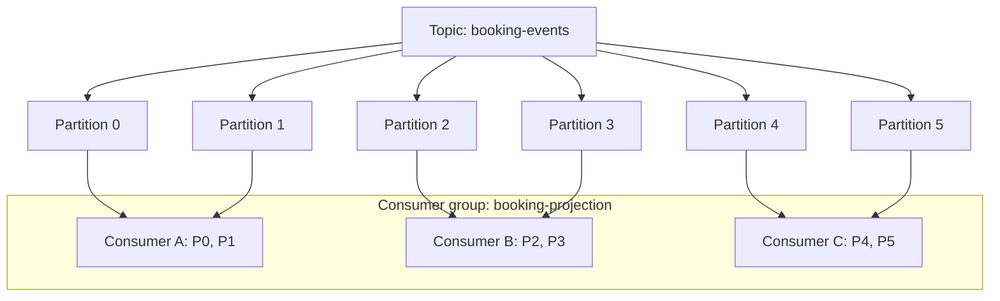
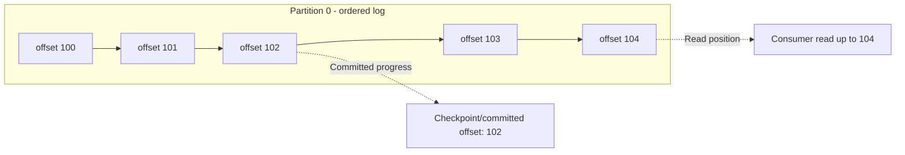
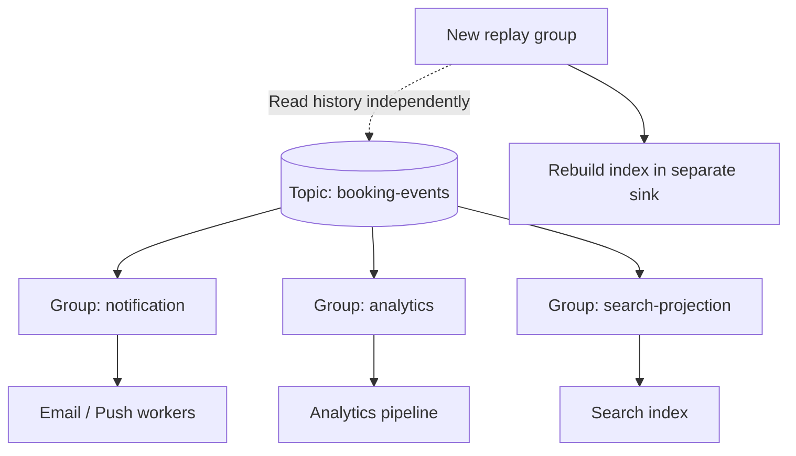
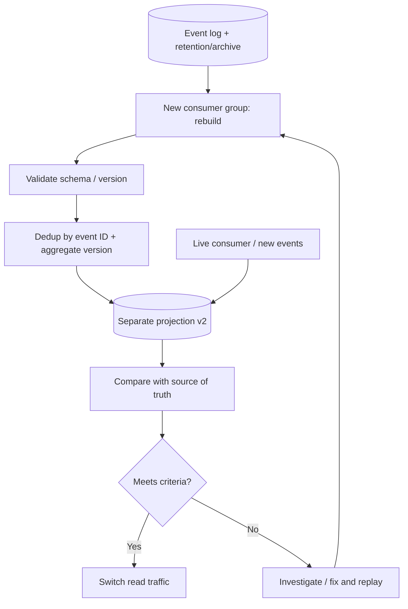

# Consumer Groups, Checkpoints, and Event Replay

## 1. Why Must Event Consumption Progress Be Managed?

In an event-driven architecture, producers can emit millions of events without waiting for every consumer to finish processing. Brokers retain data for a configured duration; consumers read at their own pace and according to their own responsibilities. When a consumer restarts, loses network connectivity, deploys a new version, or handles an error, the system must determine **how far it has read, which records are complete, and from what position it can reread**.

Three key concepts to understand:

- **Consumer group:** a group of consumers coordinating to divide processing of a data stream according to the platform's mechanism. One group typically represents a single processing purpose or subscriber application.
- **Checkpoint:** state indicating how far a consumer has processed/completed or where it can resume from. Naming and semantics depend on the broker—for example, offset commits, acknowledgments, cursors, or continuation tokens.
- **Replay:** rereading events retained in a broker or archive from a specified position or point in time to recover, rebuild projections, inspect, or reprocess data.

These concepts directly affect reliability, scalability, retention costs, and operations. If a checkpoint advances too early, events can be skipped after a consumer failure. If it advances too late, events can be processed twice. If replay is uncontrolled, consumers can recreate transactions, resend emails, or corrupt data.

This lesson belongs to the **Event Architecture** chapter of the **CLOUD_ARCHITECTURE** module. After this lesson, you will be able to design consumer groups, partition assignments, checkpoints, replays, and recovery procedures for cloud event streaming/queues; distinguish semantics across brokers; and evaluate impacts on security, performance, cost, and operations under Well-Architected principles.

## 2. Consumers, Subscriptions, and Consumer Groups

### 2.1. What Is a Consumer?

A **consumer** is a process, function, or application that receives messages/events from a broker and performs work. Examples:

- `booking-projection` reads events to update a calendar view.
- `analytics-consumer` reads the same event stream to aggregate metrics.
- `notification-worker` receives booking events to send notifications.

A consumer can run multiple instances to boost throughput or maintain availability. How multiple instances coordinate depends on the broker type.

### 2.2. Consumer Groups in Partitioned Systems

With partitioned log brokers (e.g., Kafka-compatible), a topic's data is divided into **partitions**. A consumer group consists of consumer instances sharing the workload; at any given time, each partition is typically assigned to at most one consumer in the group, depending on the protocol and assignment strategy.

Example topic `booking-events` with 6 partitions:



In this example, three instances divide six partitions. Running more consumers than partitions leaves excess consumers unassigned and adds no parallel reading capacity for that topic. If there is only one partition, scaling from one to ten consumers in the same group does not increase partition parallelism.

**A consumer group is not the same as multiple independent subscribers.** If Analytics and Notification both need to receive every event, you normally create two independent groups/subscriptions. Each group tracks its own progress. Putting all Analytics and Notification instances into the same group would cause the broker to split messages between them, leaving each application with only a subset of the stream instead of the full stream.

### 2.3. Groups, Subscriptions, and Queues Are Not Identical Concepts

| Concept | Typical model | Meaning |
|---|---|---|
| Consumer group | Kafka-compatible event streaming | Multiple consumers share partitions using group-specific progress |
| Subscription | Pub/Sub or subscription-based event broker | A logical subscription receiving matching messages; supports multiple independent subscribers |
| Queue consumer | Message queue | Consumers pull messages; ACK/delete or visibility/lease governs redelivery |
| Event source mapping | Serverless function source integration | Bridge that polls/batches messages from a source and invokes functions per service semantics |

Avoid calling every parallel worker pool a "consumer group" in the Kafka sense. SQS queues, Pub/Sub subscriptions, and Kafka consumer groups differ in progress tracking, acknowledgments, ordering, and replay. Read the contract of your chosen service before applying a design.

## 3. Partitions, Keys, and Parallelism

### 3.1. Why Do Partitions Matter?

A partition is the unit of storage and parallel reads in log-based streaming. Brokers typically store each partition in ascending offset order; ordering is usually guaranteed within a partition, not by default across an entire topic.

Partitions determine:

- Maximum parallelism for a consumer group under the one-consumer-per-partition-at-a-time model.
- How load and data are distributed across consumers.
- The ordering scope an application can rely upon.
- Checkpoint granularity and offset-based replay capability.
- Overhead for managing metadata, files/segments, and consumer assignments.

### 3.2. Partition Keys and Ordering

If events for the same booking must be processed in order, you can use `bookingId` as the partition key. The broker selects a partition from the key (via platform-specific hashing/distribution); the same key consistently routes to the same partition under a stable configuration.

Example:

| Event | Key | Goal |
|---|---|---|
| `BookingCreated` | `B-100` | Initialize booking state |
| `BookingConfirmed` | `B-100` | Update the same aggregate |
| `BookingCancelled` | `B-100` | Must not process ahead of prerequisite events when ordering is required |

Drawback: a hot key can concentrate heavy traffic onto a single partition, creating skew. A single booking with massive load cannot be parallelized across partitions while keeping simple per-booking ordering. Balance ordering against throughput by modeling smaller aggregates, using versions/sequences, or parallelizing safe operations.

Increasing partition counts can also alter how hashed keys map to partitions under some strategies, so evaluate impacts on ordering and consumer state before resizing partitions.

## 4. Offsets and Checkpoints: Read Is Not Processed

### 4.1. Offsets in Log-Based Brokers

In Kafka-like brokers, an **offset** is a record's position within a partition. A consumer reads offsets 100, 101, 102... Offsets increase per partition rather than forming a single global sequence across all partitions.

Consumer groups store committed offsets so restarts can resume smoothly. However, clarify the semantics of committing an offset:

- **Commit offset after processing completes:** lowers the risk of skipping events on failure, though crashing after processing and before committing can reprocess the event.
- **Commit offset before processing:** avoids rereads in some cases, yet crashing between commit and side effects can skip the event.

Therefore, checkpoints/offsets alone do not guarantee an exactly-once business effect. Combine them with transactions, idempotency, or atomicity mechanisms supported by the broker and sink.

### 4.2. Read Position and Checkpoint Diagram



The diagram shows a consumer that has read up to 104 while its checkpoint confirms progress only up to 102 per broker convention. If the consumer stops, records after the checkpoint may be reread. Note that in Kafka's API, the committed offset is typically **the next offset to read**, so after processing through 102, you commit 103. Do not treat the numbers in this diagram as a universal offset convention across all products.

### 4.3. Checkpoints Across Event Source Types

| Source | Common progress concept | Confirmation mechanism |
|---|---|---|
| Kafka-compatible log | Offset per partition and consumer group | Commit offset |
| Shard-managed event stream | Sequence number/checkpoint per shard | Persist checkpoint or continuation token |
| Message queue | ACK/delete, visibility/lease, receive count | ACK on completion; unacknowledged messages may redeliver |
| Pub/Sub subscription | Ack deadline/ack ID and subscription state | ACK or NACK/let deadline expire per service |
| Function event source | Batch progress/partial batch failure or integration-managed checkpoint | Follow event source mapping semantics |

Checkpoints may be stored by the broker, persisted by the consumer in a database, or managed by a runtime. Clarify **who owns the checkpoint**, its format, commit cadence, recovery behavior, and how checkpoints migrate when topology changes.

## 5. Updating Checkpoints Safely

### 5.1. Core Rule

In processing with side effects, advance the checkpoint only to the position where **all preceding records in the acknowledgment scope have completed safely**. If processing records in the same partition concurrently, never commit past a record still in flight.

Example partition with offsets 20, 21, 22:

- 20 is complete.
- 21 is still writing to the database.
- 22 is complete.

A safe checkpoint must still stop before 21; committing past 22 before crashing could skip record 21. Consumers must track a contiguous range of completed offsets, not merely the highest completed offset.

### 5.2. Side Effects and Checkpoints in Two Separate Systems

Suppose a consumer updates PostgreSQL and then commits a Kafka offset. These are two independent systems:

1. DB commit succeeds, consumer crashes before offset commit → the event may be reread (duplicate).
2. Offset commit succeeds before DB commit, consumer crashes → the event may be skipped even though the DB never changed.

A common safe pattern is **DB transaction + inbox/dedup marker**, followed by committing the offset. When an event is reread after a DB commit, the consumer recognizes the duplicate and avoids repeating the side effect.

Pseudocode:

```text
for record in partition:
    begin database transaction
    if insert_inbox(record.event_id) succeeds:
        apply_business_update(record, transaction)
    commit database transaction
    mark record completed

commit only highest contiguous completed offset
```

If both broker and destination support an integrated transaction framework, you can use transactions or connectors designed to coordinate them. Never assume a standard database transaction is atomic with a broker offset.

### 5.3. Batch Checkpointing

Batch consumers process multiple records at once before checkpointing. This lowers overhead but widens the range of records reread on failure. As batch sizes grow, pay closer attention to:

- Maximum processing duration relative to timeouts/leases.
- Memory holding payloads and intermediate results.
- Partial failures: which records succeeded and which need retries?
- Ordering within the batch and within the partition.
- Checkpoint granularity and crash impact.

If the source supports partial batch acknowledgment, report the exact failing records to minimize reprocessing. Otherwise, every record needs idempotency because the entire batch may be redelivered.

## 6. Replay: Why Reread Events?

**Replay** means having a consumer reread retained or archived events starting from a specific offset, timestamp, sequence, checkpoint, or business milestone. It is a vital capability for consumer recovery, rebuilding read models, or reprocessing after bug fixes.

Common use cases:

1. **Outage recovery:** a consumer stops for several hours, restarts from its last checkpoint, and catches up on backlog.
2. **Rebuilding projections/read models:** reconstructing search tables, caches, reports, or materialized views from the event log.
3. **Fixing consumer bugs:** an older version mishandled a set of events; a patched version rereads that data.
4. **Onboarding new subscribers:** an analytics app reads historical events to bootstrap state before consuming live events.
5. **Investigation and reconciliation:** replaying a copy in an isolated environment to analyze behavior.

Replay is not always the same as redriving a DLQ. Replay reads a historical range from a log or archive; redrive moves failed messages from a DLQ back into processing. The two carry different risks and operational tooling.

## 7. Replay Strategies

### 7.1. Replay from Offset/Checkpoint

Suitable when you know the exact position a consumer needs to read from, such as offset 500 on partition 2. It offers precise, repeatable bounds. The risk is having to specify accurate offsets across all partitions and respect retention limits; if an offset no longer exists or has expired, the consumer cannot read from it.

### 7.2. Replay from Timestamp

Suitable when you know when an incident began: "reread events from 10:00 UTC." Brokers may look up offsets matching a timestamp or expose time-based APIs. Keep in mind:

- Timestamps may reflect event time or broker append time.
- Producer clocks can skew; late events may be appended after their business occurrence time.
- Timestamp-to-offset mapping is resolved independently per partition/shard.
- Timestamp-based replay does not guarantee an exact business boundary.

### 7.3. Replay into a New Consumer Group

Creating a new group lets a consumer read from earliest or a configured starting point without disturbing the existing production group's checkpoints. This works well for new projections or shadow comparisons. Restrict permissions, compute resources, target sinks, and side effects; a new group must never accidentally trigger real emails or payments.

### 7.4. Replay to a Separate Environment or Sink

To test a fix, read events using a dedicated consumer group or staging environment, writing to a separate database/namespace to compare outputs. This is typically the safest way to validate logic before replacing production state. Still, account for data regulations, masking, residency regions, and historical read permissions.

## 8. Safe Replay: Avoiding Duplicate Side Effects

Replay can expose a consumer to an event again even if that event already triggered business actions. Before running one, classify consumers:

| Consumer type | Safe replay approach |
|---|---|
| Rebuildable projection/read model | Write to a new sink or clear/rebuild a bounded scope; preserve versions and compare outputs |
| Analytics/warehouse | Deduplicate by event ID or partition by batch/run; avoid double-counting totals |
| Email/push delivery | Never automatically resend already-sent notifications; check delivery history and idempotency |
| Payments/transaction creation | Never replay side-effect commands directly; reconcile provider references and business state |
| Audit log | Preserve integrity; do not overwrite history, distinguish replayed records from original events |

Key safeguards:

- Use stable event IDs, consumer-specific deduplication stores, and business keys.
- Record `replayRunId`, execution timestamp, offset range, and consumer version.
- Separate replay mode from normal live mode; allow disabling external side effects.
- Define sink cleanup or rebuild procedures; never reset production data without a plan.
- Rate-limit and cap concurrency so replays do not starve live traffic.
- Audit all runs and provide pause/stop controls.

### 8.1. Replay Does Not Replace Backups

An event log can reconstruct state if it contains all required events, retains them long enough, and emitted every mutation accurately. However, not every system emits events for all changes, includes full payloads, or retains logs forever. An event broker **is not automatically a database backup**.

Databases still require backups and restores aligned with RPO/RTO. Replay fits rebuilding projections or event-driven workflows; do not depend on it to recover arbitrary data or secrets.

## 9. Consumer Lag and Catch-Up Capacity

### 9.1. What Is Consumer Lag?

**Consumer lag** measures the distance between the broker's latest position and the consumer's confirmed progress. In log-based brokers, lag can be measured in record/offset count or elapsed time from the newest event to the checkpoint. Exact calculation depends on partitions and monitoring tools.

Rising lag can stem from:

- Producers emitting faster than consumers process.
- Consumers lacking CPU/RAM or hitting throttling.
- Slow databases/downstream APIs or exhausted connection pools.
- Frequent consumer group rebalances.
- A partition with a hot key or slow-to-process events.
- Retries, timeouts, or poison messages reducing throughput.

Lag does not automatically equal an outage. A batch pipeline may tolerate hours of lag if business SLAs allow; fraud detection may require lag of only a few seconds.

### 9.2. Estimating Backlog Catch-Up Time

Suppose:

- The broker receives 800 events/second.
- The consumer group can process 1,000 events/second total outside replay.
- Current backlog is 3,600,000 events.

Surplus throughput available to drain backlog is:

\[
R_{surplus}=1,000-800=200\ \text{events/sec}
\]

Approximate catch-up time:

\[
T=\frac{3,600,000}{200}=18,000\ \text{seconds}=5\ \text{hours}
\]

If consumer throughput is equal to or lower than producer rate, the backlog cannot shrink. This is an idealized estimate; real calculations must factor in partition distribution, event sizes, processing times, downstream capacity, rebalances, bursts, and retries. Scaling consumers past the partition count will not increase throughput.

### 9.3. Alerts to Have in Place

Monitor:

- Lag per partition and total per group.
- Age of the oldest unprocessed event.
- Consumer throughput and processing latency.
- Rebalance count/duration, failed heartbeats, and consumer availability.
- Retry count, DLQ count, and error rate.
- Downstream latency, connection saturation, and throttling.
- Remaining log/retention headroom relative to projected catch-up time.

Tie alerts to business deadlines. For instance, if events must be processed within 2 minutes, alerting as the age of the oldest event approaches that threshold is often more actionable than alerting on a static record count.

## 10. Retention and Replay Boundaries

Replay is only possible while data remains retained. Brokers may bound retention by time or size; some streams retain until expiration, while queues may delete messages upon ACK.

| Policy | Impact |
|---|---|
| Short retention | Lower cost; prolonged outages may lose broker replay capability |
| Long retention | Supports backfills and longer outages; increases storage cost and data governance |
| Key-based compaction | Retains latest state per key on some brokers; does not preserve every historical event |
| Archive/object storage | Keeps data longer at lower cost; requires compatible replay tooling and formats |
| Delete-on-ACK queue | Suited to task execution; deleted messages generally cannot be rewound without separate archiving/replication |

Retention must exceed expected outage, investigation, and replay windows **with safety margin**. If auditing requires 1 year of history while the broker retains 7 days, you need an archive or dedicated event store. Account for storage, replication, indexing, read requests, and egress costs.

## 11. Consumer Group Changes and Rebalances

### 11.1. What Is a Rebalance?

In Kafka-style consumer groups, the broker/client redistributes partitions whenever members join or leave, heartbeats time out, or partition/topic subscriptions change. A **rebalance** temporarily disrupts reading and can spike lag.

Common triggers:

- Consumer crashes or missed heartbeats.
- Long batch processing durations causing a consumer to look inactive.
- Rolling deployments repeatedly cycling instances out of and into the group.
- Scaling consumers or altering topic/partition subscriptions.
- Network instability or resource throttling.

Minimizing rebalances does not mean freezing the group forever. Configure suitable timeouts/poll intervals, implement graceful shutdown, commit progress before leaving, and avoid processing loops that exceed runtime limits without a strategy.

### 11.2. Graceful Shutdown

When deploying a new version:

1. Stop accepting new partitions/messages per client/broker mechanisms.
2. Finish in-flight records within the shutdown deadline or stop cleanly.
3. Commit checkpoints safely without advancing past unfinished records.
4. Close connections/leave group cleanly per protocol.
5. Let the new consumer join and resume from the checkpoint.

If work cannot finish before shutdown timeout, stop before losing partition ownership and let the broker reassign; idempotency protects side effects. Never commit an entire batch merely because the process is exiting.

## 12. Replays and Parallel Processing Across Multiple Groups

One topic can serve multiple groups:



Each group tracks its own progress. When creating a replay group, decide:

- Start from earliest, latest, a timestamp, or a specific checkpoint?
- Process live events concurrently or separate the replay window?
- Which sink receives output: a new projection, staging, or production?
- Will duplicates be filtered by event ID or handled via idempotent upserts?
- Do we need rate limits to avoid impacting live groups?

If replay and live traffic write to the same sink concurrently, newer events may apply before older ones. Use a two-phase approach—replay up to a high-water mark, then switch to live—or enforce sequences/versions so state never regresses.

## 13. Practical Example: Rebuilding a Booking Projection After a Consumer Bug

Suppose a booking app emits `BookingCreated`, `BookingConfirmed`, and `BookingCancelled` to `booking-events`. Group `booking-projection-v1` updates the read model for a lookup API. A bug in an older version miscalculated timezones for display dates.

### 13.1. Incident Analysis

- Original events in the broker are accurate; the bug lived in consumer/projection logic.
- The read model is corrupted; merely restarting the consumer will not repair already-written rows.
- The read model must be rebuilt from history in retention or archives.
- Email or payment consumers must not be replayed because those side effects already occurred.

### 13.2. Recovery Plan

1. Fix the logic and test consumer v2 against a representative event set.
2. Create a new group `booking-projection-v2-rebuild` reading from the required historical point.
3. Write to a separate table/index `booking_projection_v2`; use upserts keyed by booking ID and version to prevent duplicates/out-of-order overwrites.
4. Throttle replay throughput to protect live consumers and the database.
5. Compare booking totals, statuses, timezones, and edge cases against the source of truth; account for events beyond broker retention.
6. Catch up to live events at the high-water mark; enforce versions/sequences so older events never overwrite newer state.
7. Shift read traffic to projection v2 via controlled rollout; retain v1 for rollback during a defined window.
8. Once verified, document the recovery, stop the rebuild group, and clean up temporary resources per policy.

### 13.3. Replay Flow Illustration



In this example, replaying into a separate sink lets you validate before cutting over the projection. If historical data has already aged out of retention, use archives or the authoritative datastore to rebuild; never assume the broker still retains every event.

## 14. Distinguishing Checkpoints, Replay, Retry, and Redrive

| Term | Question answered | Scope |
|---|---|---|
| Checkpoint/offset commit | How far has the consumer confirmed progress? | Read/processing progress |
| Replay | From which position/time can history be reread? | Event stream/log or archive |
| Retry/redelivery | Will a failed message be attempted again? | One unfinished message or batch |
| Redrive | Can quarantined DLQ messages be returned to processing? | Set of quarantined messages |
| Rebuild/reconciliation | How is accurate state restored and verified against the source of truth? | Target/business data |

A consumer can replay events from an old offset with zero messages in the DLQ. Conversely, redriving a DLQ does not rewind the entire topic offset. Keeping these distinct prevents using the wrong recovery tool.

## 15. Security and Governance During Replay

Replays can read historical records containing personal or financial data. Implement:

- Dedicated IAM permissions for consuming, reading archives, resetting group offsets, and redriving.
- Approval workflows for resetting production group checkpoints or replaying into production sinks.
- Encryption in transit and at rest; restrict geographic regions permitted for archives/sinks.
- Never log sensitive payloads; use event IDs/correlation IDs for troubleshooting.
- Audit who modified checkpoints, created groups, replayed which partitions, over which time ranges, and into which sinks.
- Constrain replayed records via controlled filters or transforms without altering event semantics.
- Enforce retention and deletion policies; replays must not resurrect deleted personal data unless legally/business-wise permitted.

Never grant topic-wide offset-reset permissions to every developer. A single mistaken reset can trigger massive replay load or repeat production side effects.

## 16. Cost and Performance Trade-offs

| Decision | Benefit | Cost/risk |
|---|---|---|
| Increase partition count | Greater parallelism and load distribution | Added broker overhead, metadata, files/segments, and ops complexity |
| Increase consumers in group | Can raise throughput up to partition count | Idle consumers past partition limit; more connections and downstream load |
| Longer retention | Replay after long outages, bootstrap new groups | Storage/replication costs and data governance |
| Fast replay | Shortens rebuild time | Competes with live traffic for CPU, DB, and network; higher read/compute cost |
| Larger batches | Lower consumer/commit overhead | Higher memory, latency, partial failure blast radius, and duplicate range |
| Frequent checkpoints | Fewer records reread on crash | Higher request/transaction overhead |
| Infrequent checkpoints | Lower overhead | More records reread after a crash |

To quantify trade-offs, track cost per million successfully processed events, storage cost per GB/day, partition replay duration, and remaining headroom for live traffic. Budget dedicated capacity for replays on shared infrastructure.

## 17. Well-Architected Evaluation

| Pillar | Evaluation questions |
|---|---|
| **Operational Excellence** | Are lag dashboards, rebalance/replay runbooks, group owners, checkpoint-reset procedures, and recovery drills in place? |
| **Security** | Who can consume/reset/replay? Are archives/DLQs encrypted, audited, and retention-governed? |
| **Reliability** | Do checkpoints advance only after safe processing? Are duplicates/out-of-order events handled? Does retention cover outages and rebuilds? |
| **Performance Efficiency** | Are partitions/keys/consumer counts/batches sized for throughput? Do replays protect live traffic? |
| **Cost Optimization** | Are retention, archives, partition counts, telemetry, and replay compute within budget? |
| **Sustainability** | Are unnecessary full replays avoided, temporary sinks cleaned up, batches tuned, and data retained only as needed? |

## 18. Sample ADR for Consumer Groups and Replay

Example documenting decisions for the booking flow:

```yaml
decision_id: ADR-EVENT-007
title: Consumer group checkpoint and replay policy
topic: booking-events
partition_key: booking_id
consumer_groups:
  - name: booking-projection
    purpose: production_read_model
    checkpoint_owner: consumer_group
  - name: booking-analytics
    purpose: analytics_pipeline
    checkpoint_owner: consumer_group
checkpoint_policy:
  commit_after: durable_sink_write
  preserve_contiguous_partition_progress: true
replay_policy:
  target: isolated_projection_sink
  start_position: approved_offset_or_timestamp
  rate_limit: defined_by_live_capacity
  require_approval: true
idempotency:
  key: event_id
  aggregate_version_check: true
retention:
  broker_window: approved_service_setting
  archive_required: true
acceptance_tests:
  - crash_before_checkpoint_commit
  - consumer_rebalance
  - duplicate_and_out_of_order_events
  - replay_without_external_side_effect
  - replay_catchup_under_live_load
review_triggers:
  - partition_count_change
  - retention_or_schema_change
  - consumer_slo_change
```

This is a documentation template, not a direct broker configuration. Partition counts, retention, checkpoint placement, reset permissions, and replay rates must derive from business requirements, volume, SLOs, service characteristics, and cost.

## 19. Practical Recovery Workflow for Consumers

1. **Identify the incident:** is the consumer stopped, lag rising, data corrupted, or messages lost? Distinguish processing bugs from dashboard display glitches.
2. **Freeze risky changes:** avoid resetting offsets or bulk-replaying before finding the root cause; throttle concurrency or pause consumers cleanly if needed.
3. **Inspect checkpoints and retention:** check group, partitions, committed positions, read positions, high-water marks, archives, and when data will expire.
4. **Verify the sink:** which events already produced side effects? Are dedup stores and version states intact? Are any transactions in ambiguous states?
5. **Select a strategy:** resume from checkpoint, replay a range, use a new group, rebuild the projection, redrive the DLQ, or reconcile.
6. **Plan capacity:** estimate backlog, surplus throughput, catch-up time, quotas, and database/downstream capacity.
7. **Approve and dry-run:** replay into an isolated sink or dataset copy; verify duplicates, ordering, sensitive data handling, and cost.
8. **Run monitored production recovery:** cap rate/concurrency, enable alerts, tag `replayRunId`, and keep a kill switch ready.
9. **Reconcile and close:** compare counts/aggregates against the source of truth, confirm SLOs, clean up temporary resources, and update ADRs/runbooks.

## 20. Pre-Production Consumer Checklist

- [ ] Identified the broker model: consumer group, subscription, or queue consumer; semantics are not mixed.
- [ ] Partition key satisfies both ordering and load distribution; hot partitions are identified.
- [ ] Consumer count aligns with partition count and downstream capacity.
- [ ] Checkpoints/offsets advance only across completed records; batch and partial-failure rules are explicit.
- [ ] Side effects and checkpoints coordinate via appropriate transactions, inbox tables, or idempotency.
- [ ] Graceful shutdown, rebalance handling, lag/oldest-event alerts, and runbooks are in place.
- [ ] Retention/archives cover outages, investigations, bootstrapping, and required replays.
- [ ] Replay procedures define start position, sink, group, rate limit, versions, and `replayRunId`.
- [ ] Replay side effects have deduplication, disable switches, or approvals; no unintended emails or charges occur.
- [ ] Handling exists for old events, out-of-order events, legacy schema versions, and deleted data per policy.
- [ ] Permissions for consuming, checkpoint resets, archive reads, and redrives are restricted and audited.
- [ ] Tested crashes before/after checkpoints, rebalances, backlog catch-up, and replays alongside live load.
- [ ] Costs for partitions, retention, archives, replay compute, and telemetry have been estimated.

**Rule of thumb:** consumer groups decide who divides reading a stream; checkpoints record recoverable progress; replay lets you reread historical data. Together they form a reliable recovery mechanism only when paired with idempotency, ordering, retention, side-effect controls, and bounded operational procedures.
