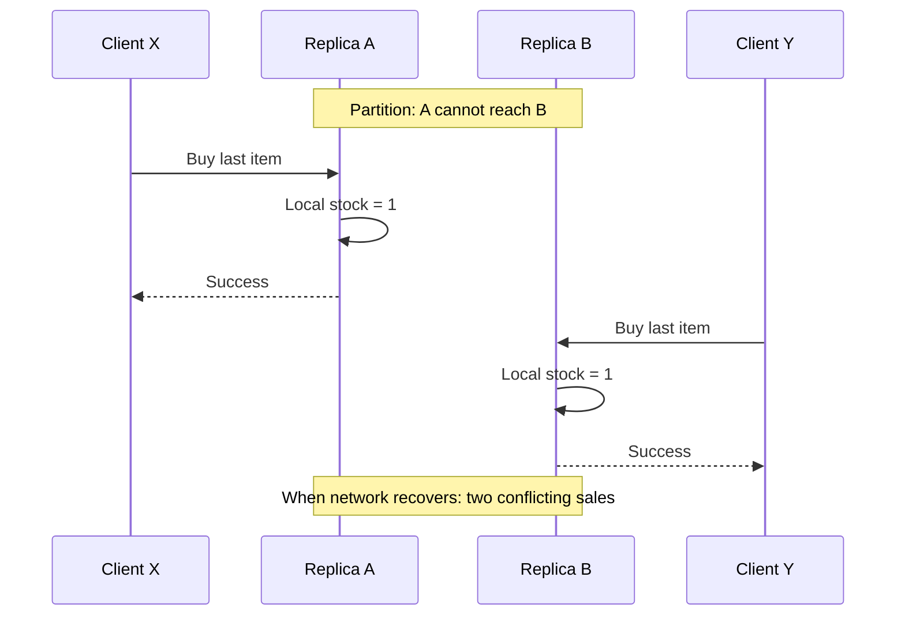
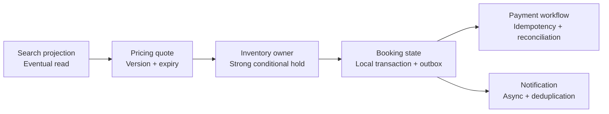
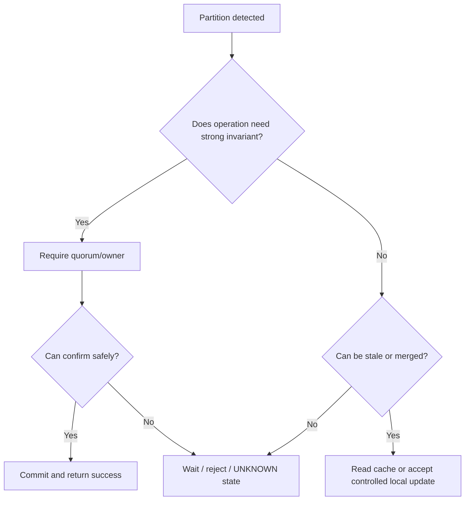

# CAP and System Behavior During Network Partitions

## 1. Why is network partitioning an architectural concern?

Cloud applications typically run across multiple machines, availability zones, or regions. Nodes must exchange data and messages to coordinate state. However, the network can partition: one group of nodes cannot communicate with the other group, even though each individual node is still running.

In that situation, write requests can arrive on different sides; one replica may not know another replica just updated; a coordinator may be unable to reach a quorum. The system must decide whether to continue serving certain requests at the risk of inconsistent data, or reject/wait to maintain a consistent update order.

The **CAP** theorem is a foundational lens for this trade-off. CAP is commonly summarized by three properties:

- **Consistency (C):** read/write operations obey a strong consistency model; in the CAP formulation, consistency is close to *linearizability*.
- **Availability (A):** every request to a non-failing node receives a valid response within a finite time as defined by CAP.
- **Partition tolerance (P):** the system continues operating at some level when messages between nodes are lost or arbitrarily delayed—that is, when the network is partitioned.

CAP is not a menu to pick two out of three checkboxes to enable in a console. In real distributed systems, partitions can occur; the architectural question is **what behavior is acceptable while nodes cannot coordinate**. A system prioritizing consistency may reject operations it cannot safely confirm; a system prioritizing availability may keep accepting operations and resolve conflicts or converge later.

In the **CLOUD_ARCHITECTURE** module, the **Consistency** chapter places CAP in the context of cloud data and service design, where reliability, latency, security, scalability, cost, and operations must be evaluated together.

After this lesson, learners will be able to:

1. Correctly explain the three properties C, A, P and the limits of the CAP formulation.
2. Describe system behavior when a network is split into partitions.
3. Distinguish linearizability, serializability, strong consistency, eventual consistency, and intermediate models.
4. Understand the role of quorums, leader election, consensus, and fencing in preventing split-brain.
5. Connect CAP and PACELC to cloud database/topology choices.
6. Design graceful degradation, timeouts, retries, idempotency, and reconciliation.
7. Build partition test scenarios, measure SLOs, and document architecture decisions.

## 2. What does CAP precisely say?

CAP analyzes a distributed data service that accepts read/write operations from clients while nodes communicate over a network. The three properties must be understood by their technical definitions, not everyday wording.

### 2.1. Consistency in CAP

In CAP, **Consistency is typically understood as atomic consistency / linearizability**: every read/write operation can be viewed as taking effect instantaneously at some point between its invocation and its completion, and all clients observe a single global order consistent with real-time ordering.

For example:

1. Client A writes a new account balance of 800. The system confirms the operation succeeded.
2. After receiving confirmation, Client B reads that account.
3. If the system provides linearizability, Client B must see 800 or a newer update; it must not see the old value of 1,000.

The key point is **real-time ordering**. A read that begins before a write completes may be ordered before or after the write depending on the execution schedule; however, a read that begins after the write has returned success must observe that write or a newer one.

Consistency in CAP does not mean everything is written in a single SQL transaction, nor does it mean data integrity, schema validation, or the broader consistency models found across distributed systems literature.

### 2.2. Availability in CAP

Availability means every request to a non-failing node must receive a valid response within a finite time, even during a partition.

"Valid response" does not mean arbitrarily returning wrong data. In the classic CAP definition, a service cannot reject all write requests simply because it cannot guarantee consistency and still claim to be fully available for those operations.

For example, during a partition:

- Node group A cannot reach node group B.
- A client issues a write on A and receives acknowledgment.
- Another client issues a write on B and also receives acknowledgment.
- After the network recovers, the two updates may conflict.

If the system continues accepting both writes without an arbiter, it prioritizes availability during the partition but cannot preserve linearizability for the same data.

### 2.3. Partition tolerance

A partition is a condition where nodes or groups of nodes cannot exchange required messages. Causes include:

- Loss of connectivity between availability zones or regions.
- Misrouting, ACL/firewall changes, or DNS failures.
- Packet loss, severe latency spikes, or continuous TCP timeouts.
- Gateway, transit network, or interconnect hardware failures.
- Network congestion causing response times to exceed timeouts.
- One side becoming isolated from the quorum or leader.

A partition does not necessarily mean the entire network is down. Only certain node pairs may be unable to communicate; traffic may work in one direction and fail in the reverse direction; or a node may become so slow that peers treat it as lost.

In real distributed systems, **you cannot assume P will never happen**. The design problem is choosing guarantees and behavior during a partition while reducing its probability and blast radius through topology, network engineering, and operations.

## 3. Why can't both C and A be preserved under P?

Consider two replicas R1 and R2 storing the same key, with inventory equal to 1, meaning one unit remains.

Before the partition, both replicas are in sync. Then:

- Client X sends a request to buy the last unit to R1.
- Client Y sends a request to buy the last unit to R2.
- R1 and R2 cannot exchange messages.
- If both confirm success based on local state, two customers are granted the last item.
- If only one side is allowed to confirm, the other side must wait, reject, or redirect to the authoritative side.



If both writes are confirmed, the system cannot claim that both replicas maintained the same linearizable order for the last resource. If R2 waits for confirmation from R1 while unable to reach it, R2 cannot return a result within a finite time.

This is the core intuition of CAP: during an actual partition separating nodes that must coordinate, you cannot simultaneously preserve linearizability and answer every request as if the network were healthy.

### 3.1. Username ownership example

Suppose the username `@clouduser` is unclaimed. Two registration requests arrive concurrently at two partitioned replicas:

- If both sides accept, the system can create two different owners for one username.
- If only one side has write authority, the other side must wait or reject when it cannot reach the owner.

For data involving uniqueness, slot allocation, balances, or ownership, prioritizing consistency is usually more important than always returning "success."

## 4. Two behavioral groups commonly called CP and AP

The CP/AP labels describe behavior during a partition, but should not be turned into simplistic labels for every database or service.

### 4.1. CP: prioritizing consistency during a partition

A **CP** design preserves operations requiring strong consistency by confirming only when coordination/quorum conditions of the protocol are satisfied. A side that cannot reach quorum may wait or reject certain operations.

For example: a system uses consensus to maintain a single log order. If a majority cannot reach a minority, the majority group can continue; the minority group cannot commit new writes.

Trade-offs:

- Data correctness is well protected.
- Some operations are unavailable on the isolated side.
- Requires designing timeouts, transient errors, retries, and degraded experiences.
- Latency may increase due to multi-node coordination.

### 4.2. AP: prioritizing availability during a partition

An **AP** design allows multiple sides to continue accepting and writing data during a partition, then synchronizes/converges when the network recovers. Depending on the model, it may use last-write-wins, version vectors, CRDTs, or business merge rules.

Trade-offs:

- Can continue accepting operations on both sides.
- Clients may temporarily read different values.
- Conflicts must be detected and resolved.
- Not suitable for every business invariant.

Better-suited examples: certain view counts, likes, statistical counters, or event logs that can be summed/merged. For account balances or the last unit of inventory, naive automatic merging can cause severe discrepancies.

### 4.3. Behavior comparison

| Aspect | CP-oriented | AP-oriented |
| --- | --- | --- |
| During partition | Only one side/quorum can commit; other side waits/rejects | Multiple sides can continue writing per policy |
| Reads | May block or route to leader/quorum for strong reads | May return local copy, accepting staleness |
| Conflicts | Prevents conflicting updates from being confirmed | Can create conflicts requiring merge/reconciliation |
| Latency | May increase due to coordination | Local operations can respond faster |
| Business availability | Reduced on sides unable to reach quorum | Higher for operations allowed to proceed |
| Suitable data | Inventory, ownership, balances, unique constraints | Views, activity, certain mergeable preferences/counters |
| Complexity | Consensus, leaders, quorums, retries | Conflict resolution, versioning, reconciliation |

A single service can have different behaviors per operation. For example, the same product can allow view counts to be recorded in an AP manner while enforcing order reservation through a stronger store.

## 5. Systems do not have to pick CP or AP permanently

A common misconception is labeling a database CP or AP and assuming every operation always has the same semantics.

In reality:

- Many databases allow configuring different consistency levels per request or transaction.
- A system may prioritize consistency for writes while allowing stale reads from replicas.
- A service may return cached data when the primary source is unavailable while rejecting writes to critical fields.
- Some APIs can intentionally degrade while others stop serving.
- A system can partition data so some keys keep working while keys needing coordination are blocked.

What matters is documenting **per-operation guarantees**: which operations require linearizable writes, how stale reads may be, and what the system does when the guarantee cannot be met.

### 5.1. Infrastructure availability vs. business availability

A load balancer can be healthy, compute can still be running, and an API can return HTTP 200 for cache-backed read endpoints. Yet checkout may fail to confirm inventory when the DB quorum is lost.

Therefore, measure availability by user journey:

- Search still returns results, though possibly stale.
- Add-to-cart can write to a temporary cart.
- Reserve inventory must preserve the non-duplication invariant.
- Capture payment may wait for reconciliation if the outcome is unclear.
- Confirmation is issued only when required conditions are met.

A dashboard showing healthy instance counts cannot substitute for metrics of orders completed accurately.

## 6. Linearizability, serializability, and consistency levels

CAP is usually taught with linearizability, but data architecture involves many other guarantees. Do not use these terms interchangeably.

| Model | General meaning | Guarantee example |
| --- | --- | --- |
| **Linearizability** | Operations appear to follow a single global order consistent with real time | A read after a confirmed write sees that write or a newer version |
| **Sequential consistency** | All clients see the same operation order, though the order need not match real time | No conflicting ordering across processes |
| **Serializability** | Transaction outcomes are equivalent to some serial execution order | Transactions never produce results impossible under a serial schedule |
| **Strict serializability** | Serializability combined with real-time ordering | Stronger guarantee than plain serializability |
| **Read-your-writes** | A client sees its own writes | User updates address and sees the new address on reload |
| **Monotonic reads** | A client never moves backward to an older version it already saw | Never reads version 12 and later sees version 9 |
| **Causal consistency** | Causally related operations are observed in order | A comment never appears before the post |
| **Eventual consistency** | If updates stop and sync continues, replicas eventually converge | Search index gradually reflects confirmed bookings |

Linearizability describes operation ordering and real time; serializability describes transaction schedules. A database with serializable transaction isolation does not automatically mean every read from every replica is linearizable.

### 6.1. Verify service guarantees

Providers may use terms like strong, strict, session, or bounded staleness with their own definitions. When choosing a service, verify:

- Guarantee scope: single key, partition, region, or multi-region?
- Which endpoint serves reads/writes: primary, replica, cache, or global endpoint?
- Does the guarantee hold during failover or partitions?
- Which transaction isolation levels are supported?
- Is read-your-writes guaranteed?
- Is maximum staleness measurable/configurable or best effort only?

Do not rely solely on the phrase "strong consistency" in marketing documentation to infer the behavior of every API.

## 7. Quorum: coordinating by votes

A common way to build a replicated data service is using quorums. With N replicas, the system requires a specified number of replicas to acknowledge reads/writes.

In the simple quorum model:

- N: total number of replicas.
- W: number of replicas required to acknowledge a write.
- R: number of replicas participating in a read.

Commonly cited overlap conditions:

```text
R + W > N
W > N / 2
```

Overlap can help a read contact at least one replica that received the most recent write, depending on protocol and semantics. It **does not automatically guarantee linearizability** without appropriate versioning, ordering rules, conflict handling, and protocol behavior.

Example with N=3:

| Configuration | W | R | Notes |
| --- | ---: | ---: | --- |
| Quorum write/read | 2 | 2 | R+W=4>3; overlaps at least one replica |
| Write all, read one | 3 | 1 | Writes require all three |
| Write one, read all | 1 | 3 | Reads must resolve versions/conflicts |

You must inspect behavior when a replica fails, when a recovering replica holds stale data, hinted handoff/repair, version conflicts, read repair, and leader election. W/R is part of a protocol, not a standalone complete guarantee.

### 7.1. Partition example with three nodes

Three nodes A, B, C; the network splits with A on one side and B+C on the other.

If the quorum is 2:

- B+C can reach quorum and continue committing under the protocol.
- A lacks quorum and therefore cannot confirm strong writes.
- When the network recovers, A synchronizes according to the system's mechanism.

If the system lets A accept writes independently to increase availability, it must have a way to resolve potentially conflicting changes. It cannot allow both A and B+C to confirm conflicting writes and still claim all operations are linearizable.

## 8. Consensus, leader election, and split-brain

Many strongly consistent systems use a consensus protocol so replicas agree on a single log or decision order. Raft and Paxos are well-known protocol families; concrete implementations have many details regarding terms/epochs, log replication, membership, and snapshots.

General idea:

1. A group of nodes elects a leader or reaches decisions via quorum.
2. The leader proposes changes.
3. Changes are replicated/committed once quorum conditions are met.
4. New or recovering nodes catch up their logs to converge.
5. Nodes without sufficient authority/quorum cannot unilaterally commit new writes.

### 8.1. Split-brain

**Split-brain** occurs when two sides simultaneously believe they hold write/control authority for the same resource, creating two independent update histories. This is a risk in manual failovers or leader elections lacking fencing.

Preventive measures:

- Use a proper consensus/quorum protocol rather than simple heartbeats.
- Use monotonically increasing terms/epochs and fencing tokens to invalidate old owners.
- Do not let a minority partition self-promote without proving authority.
- Failover must enforce write authority at the storage/transaction layer, not just via DNS changes.
- Have a recovery procedure for old nodes and validate data before allowing them to accept writes again.

### 8.2. Heartbeats do not prove a node is dead

If node A stops receiving heartbeats from B, B might be dead, or the network might be partitioned, or B might simply be very slow. In an asynchronous environment, you cannot reliably distinguish a failed node from a delayed message using timeouts alone.

A timeout is **failure suspicion**, not absolute proof. A safe protocol must ensure that multiple suspecting nodes do not simultaneously claim write authority.

### 8.3. Fencing tokens

Suppose storage accepts a lease holder with epoch 42. When a new leader is elected, it receives epoch 43. Storage rejects commands carrying an epoch older than 43. Even if the old leader wakes up and still thinks it is primary, it can no longer write.

Fencing must be enforced where the resource is protected. Merely sending a "please stop" message to the old leader is insufficient if the old node is partitioned and cannot receive the message.

## 9. When a partition occurs, how should an API behave?

CAP is a property of distributed systems; the API must translate that decision into clear client behavior.

An API can:

- Continue reading from replicas/caches and attach freshness metadata if the business allows.
- Allow mergeable operations, such as draft saves or preference updates, into a local log/outbox.
- Reject operations requiring strong invariants such as allocating the last unit, transferring funds, or creating unique ownership.
- Return `PENDING`/`UNKNOWN` when the outcome cannot be determined rather than claiming failure or success.
- Enqueue work if it can complete after quorum/network connectivity recovers.
- Restrict writes for critical data to one owning region and route clients to the owner.

### 9.1. A timeout is not a business failure

A POST payment request may have been processed by the provider while the response was lost due to a partition. A client seeing a timeout does not prove the payment failed.

Safe design:

1. Client sends a stable idempotency key.
2. Service records the operation intent and reference before calling the provider.
3. On timeout, status transitions to `UNKNOWN` or `RECONCILING`.
4. Worker queries the provider by reference or receives a webhook.
5. Only with evidence does it transition to `AUTHORIZED`, `CAPTURED`, or a failed state.
6. Client polls status instead of creating a new operation.

This separates **transport outcome** from **business outcome**.

### 9.2. Behavior by operation

| Operation | During partition | Selectable behavior |
| --- | --- | --- |
| Search catalog | Read replica/index still works but may be stale | Return latest available data, include timestamp/version |
| View booking | Read from owner/replica per published guarantee | Show status with appropriate freshness |
| Reserve last item | Cannot reach quorum/owner does not confirm | Wait or reject; do not double-allocate |
| Update preference | Can accept local update if safely mergeable | Queue sync and show pending |
| Transfer funds | No confirmation from ledger/consensus | Do not return success; query status or pending |
| Send notification | Can be queued | Idempotent events, retry later |
| Add page view | Can record locally / accumulate | Merge/aggregate later |

Search is allowed to be stale, but when a customer clicks Reserve, the system must check the authoritative source and protect the invariant.

## 10. PACELC: trade-offs even without a partition

CAP focuses on partitions. Under normal conditions, a system still trades off latency and consistency. Extending this thinking gives the **PACELC** model:

- If there is a **P**artition: choose between **A**vailability and **C**onsistency.
- **E**lse (no partition): choose between **L**atency and **C**onsistency.

Shorthand: **P → A/C; Else → L/C**.

For example:

- When the network is healthy, reading a local replica is faster but can be stale; reading the leader/quorum is slower but offers stronger guarantees.
- During a partition, the system can either continue local reads/writes or be forced to wait for quorum.

PACELC reminds us that trade-offs do not appear only when the network breaks. Read routing, synchronous replication, cross-region commits, and cache policies already create latency/consistency trade-offs in everyday operation.

### 10.1. Local read or leader read?

| Read strategy | Latency | Consistency | Use case |
| --- | --- | --- | --- |
| Local replica read | Lower, closer to client | May be stale | Catalog/search/dashboards |
| Leader read | Depends on network path to leader | Can be strong per protocol | Balances, ownership |
| Quorum read | Requires coordinating multiple replicas | Depends on protocol/version handling | Distributed data |
| Cache read | Typically low | Staleness per TTL/invalidation | Infrequently changing content |

You cannot assume every leader read is linearizable or every quorum read is strong; verify the product, transaction mode, and API.

## 11. From CAP to cloud data architecture

Key decisions include replication within a single AZ, multi-AZ, or multi-region; primary/standby, single-leader, or multi-leader; synchronous or asynchronous replication; reading from primary, replicas, or caches; quorum, failover, and leader election; and how to handle writes when a replica/region loses connectivity.

### 11.1. Single-writer with replicas

A common pattern has one primary/leader accepting writes; replicas receive replicated data and serve certain reads.

Advantages:

- Easy to identify the owner for write operations.
- Avoids multiple places independently writing the same key.
- Read scaling can use replicas if staleness is acceptable.

Trade-offs:

- Failover must promote a new primary safely.
- The primary can become a bottleneck.
- Read replicas experience lag.
- If quorum cannot be reached or primary cannot be determined, writes may halt to prevent split-brain.

### 11.2. Multi-writer

Multi-writer allows multiple regions/nodes to accept writes. It can improve local write availability and geographic UX, but requires handling same-key conflicts, update ordering, concurrent deletes/updates, global unique constraints, merge strategies, and manual reconciliation.

Multi-writer is not always AP, and single-writer is not automatically CP across all implementations. Guarantees depend on protocol, consistency level, and partition behavior.

### 11.3. Synchronous and asynchronous replication

| Replication mode | Characteristics | Trade-offs |
| --- | --- | --- |
| Synchronous | Commit waits for replica/quorum acknowledgment per protocol | Higher latency; lost connectivity can block writes |
| Asynchronous | Primary acknowledges before all replicas receive data | Lower latency; failover can lose unreplicated writes |
| Semi-synchronous / quorum | Waits for a specific subset of replicas/quorum | Balanced per protocol; guarantees must be understood |

Do not use the term multi-AZ as proof that every write is synchronously replicated to all zones. Verify the database's guarantees, HA mode, and failover behavior.

## 12. Consistency boundaries in an application

Not all data needs the same level of consistency. Classify by invariants and consequences:

| Data / operation | Suggested guarantee | Reason |
| --- | --- | --- |
| Inventory unit | Strong/atomic allocation | Do not allocate the same resource twice |
| Balance / ledger | Strong transaction / ordered update | Avoid creating or losing value |
| Booking confirmation | Confirm only with evidence from owner | Avoid promising services that cannot be delivered |
| Search index | Eventual consistency | Short update delay is acceptable |
| Page-view counter | Eventual / mergeable | Statistical data can be summed |
| Notification status | Eventual with deduplication | Redelivery creates no uncontrolled business side effects |
| User preference | Read-your-writes or eventual per UX | Smooth experience after editing |

### 12.1. A single flow can combine multiple consistency models

Room booking example:

1. Search reads a projection that may lag by a few seconds.
2. Pricing returns a quote with version and expiry.
3. Inventory uses a strong conditional write to hold the resource.
4. Booking writes state and outbox in a local transaction.
5. Payment processes through a provider; timeouts enter a state requiring reconciliation.
6. Notification receives events asynchronously and delivers with idempotency.

There is no need to force Search into strong consistency if Inventory revalidates before granting allocation. However, Search results cannot be used as sole proof for confirmation.



## 13. Conflict resolution when choosing AP or multi-writer

If an application allows writes on both sides of a partition, it must have conflict resolution rules. You cannot simply "sync back later" while ignoring business meaning.

- **Last-write-wins (LWW):** chooses the update with the larger timestamp/version. Simple, but can lose valid updates; clock skew is dangerous if using unsuitable wall clocks.
- **Version vectors:** track version/causal relationships between replicas and detect concurrent updates.
- **CRDTs:** choose data structures and merge operations whose properties allow replicas to converge when exchanging state.
- **Domain merge:** uses specific business rules, such as summing counters by event ID or combining independent fields.
- **Manual reconciliation:** routes critical conflicts into a workflow handled by authorized personnel.

### 13.1. When is LWW dangerous?

Suppose user A updates the delivery address and user B updates delivery notes in the same JSON document. Whole-document LWW can keep one copy and lose the other change, even though the two fields do not semantically conflict.

For account balances, LWW is even more dangerous: two concurrent transfers cannot be resolved by keeping whichever record has the latest timestamp.

### 13.2. CRDTs do not solve every conflict

CRDTs are useful for data types with mathematically defined merge operations, such as grow-only counters or appropriate sets. However, not every business invariant can be merged independently.

A CRDT counter can converge like counts, but it cannot enforce a limit like "only one last ticket may be purchased." Choose data structures according to semantics.

## 14. Network partitions differ from database failures

| Phenomenon | Description | Possible consequences |
| --- | --- | --- |
| Network partition | Living nodes cannot communicate | Sides lack information about each other's updates |
| Node crash | A node stops or stops responding | Quorum can still operate if enough nodes remain |
| Slow node/network | Messages are severely delayed | Timeouts and failure suspicion |
| Disk failure | Node has network connectivity but cannot write durable logs/state | Cannot commit if durability is unmet |
| DNS/routing failure | Endpoint unreachable or misrouted | Clients call wrong target or time out |
| Dependency outage | Database/provider stops serving | API must degrade per dependency |
| Split-brain | Both sides claim write authority | Conflicts and loss of a single owner |

A three-node database where all three depend on one switch, one AZ, or one network path may fail to achieve the intended fault domain. Replication increases reliability only when placement and failure independence are appropriate.

## 15. Graceful degradation during partitions

Graceful degradation narrows functionality by priority so the system keeps serving what is safe.

E-commerce example:

- Search reads the latest cache/index and displays the last-updated timestamp.
- Product detail continues displaying static content.
- Wishlist can save locally/pending if the model allows syncing later.
- Add-to-cart writes retryable state without promising stock availability.
- Inventory reservation requires confirmation from the owning source.
- Payment does not create another charge when the outcome is unclear.
- Checkout returns `PENDING_CONFIRMATION` and provides a lookup API.



Graceful degradation must be documented in the API contract and UX. Never return success for an uncommitted operation; never report definite failure if the actual outcome is unknown.

## 16. Timeouts, retries, idempotency, and reconciliation

During a partition, many requests time out. Retries help when the network recovers, but unbounded retries amplify load and create duplicate effects.

- **Timeouts:** set according to end-to-end deadlines; distinguish connect/read/operation timeouts; a timeout does not prove the receiver did not process the request.
- **Retries:** retry only transient errors, use exponential backoff and jitter, cap attempt count and total duration; do not stack retries across layers without a retry budget.
- **Idempotency:** booking/payment creation operations use a stable operation ID or idempotency key; resending the same intent returns the same logical result.
- **Reconciliation:** post-partition checks look for committed operations with lost responses, unsent events, expired holds, captured payments without confirmed bookings, replicas needing catch-up, and conflicts needing manual review.

Reconciliation is a business workflow with an owner, audit trail, and metrics—not just running a single database sync command.

## 17. Multi-AZ and multi-region in the cloud

### 17.1. Multi-AZ

Multiple AZs tolerate a single zone failure if components and replication are independently distributed. However, synchronous replication across AZs exposes writes to network latency and can be impacted if a zone loses connectivity.

Verify:

- Does the database use synchronous/quorum replication or async?
- If one AZ is lost, does quorum remain sufficient?
- Does the primary fail over automatically? Is there fencing?
- How long do clients take to reconnect?
- Can read replicas return stale data during failover?
- Are backups/restores outside that failure domain?

### 17.2. Multi-region

| Model | Behavior | Trade-offs |
| --- | --- | --- |
| Primary region + async replica | One region accepts writes | DR may lose unreplicated writes |
| Synchronous cross-region / quorum | Waits for confirmation per protocol | High latency; partitions can make writes unavailable |
| Active-active multi-writer | Multiple regions accept writes | Requires conflict resolution / unique ownership |
| Regional ownership / sharding | Each region owns a subset of keys | Reduces coordination but needs routing and cross-region workflows |

### 17.3. DNS failover is not a consistency protocol

Switching DNS to region B does not automatically guarantee:

- Region A has stopped accepting writes.
- Region B holds all the latest data.
- Clients have expired cached old endpoints.
- Open connections have closed.
- The old leader is fenced.
- Both regions will not accept commands simultaneously.

DNS is traffic steering; write ownership and fencing must be enforced at the database/service layer.

## 18. Security and CAP

Partitions can pressure operators into temporarily opening firewalls, bypassing quorum checks, or using admin privileges to edit data directly. Those actions can break security boundaries or cause split-brain.

- Do not disable authorization/tenant isolation to maintain availability.
- Do not skip webhook/event signature verification during asynchronous processing.
- Do not promote a primary solely because heartbeats stopped arriving.
- Audit changes to leadership, ownership, and recovery actions.
- Use workload identity and least privilege on both normal and recovery paths.
- Encrypt cross-zone/cross-region traffic as required; a partition is no excuse to turn off TLS.
- Break-glass access must be time-bounded, scoped, and audited.
- Keep sensitive data out of reconciliation logs or debug payloads.

If the system cannot prove data ownership after a partition, failing closed on sensitive operations can be safer than relaxing permissions.

## 19. Cost and performance of strong consistency

Strong consistency usually requires coordination: leader round-trips, quorum acknowledgments, synchronous replication, or transaction coordination. This can increase latency, network transfer, cross-zone/region costs, and sensitivity to partitions.

Eventual consistency can reduce coordination on the write path, but shifts cost to read models/projections, conflict resolution, reconciliation jobs, idempotency/deduplication, UX for pending/stale states, and telemetry.

There is no free option. Compare **TCO and risk cost**: a single oversell, double charge, or lost ownership incident can cost far more than latency overhead.

## 20. Testing partitions and resilience

Build controlled tests in a representative environment:

| Scenario | How to test | What to observe |
| --- | --- | --- |
| Isolate minority node | Block traffic between one node and quorum | Is the isolated node prevented from committing? |
| Split cluster in two | Fault injection splits nodes into two groups | Do two leaders appear or both sides confirm writes? |
| High latency | Add delay/loss on the replication path | Timeouts, retries, and quorum behavior |
| Lose one AZ | Make a zone's nodes unavailable in test | Quorum, failover, RTO, and reconnects |
| Cross-region partition | Block replication between regions | Per-region read/write policy |
| Lost response | Let write commit then drop the response | Are client retries idempotent? |
| Old leader recovers | Elect a new leader then bring the old node back | Does fencing block the stale leader? |
| Replica catch-up | Recover a lagging node | Is log/snapshot/repair safe? |
| Conflict merge | Update the same key on both sides under AP policy | Are conflicts resolved properly? |
| Reconciliation backlog | Create many pending events/payments | Does the system drain the backlog within target? |

### 20.1. Metrics to measure in drills

- Request success/failure rate by operation.
- Normal vs. in-partition p95/p99 latency.
- Number of writes rejected due to missing quorum.
- Number of elections/leader changes and stabilization time.
- Actual RTO/RPO.
- Counts of conflicts, duplicates, stale reads, and event backlog.
- Reconciliation duration.
- Invariant correctness after recovery.

Passing a test does not just mean the cluster comes back online. Post-recovery data and business state must satisfy committed guarantees.

## 21. Process for selecting a consistency model

1. **List invariants:** unique ownership, no overselling, no double charging, event ordering.
2. **Classify consequences:** can errors be merged, compensated, or do they cause unacceptable loss?
3. **Set per-operation guarantees:** linearizable writes, read-your-writes, bounded staleness, or eventual.
4. **Choose ownership/topology:** single-writer, shard ownership, quorum, or multi-writer.
5. **Define partition behavior:** which operations continue, which wait/reject, which data returns stale.
6. **Design recovery:** leader/fencing, replication catch-up, retries/idempotency, reconciliation, and manual review.
7. **Measure SLO/TCO:** latency, per-journey availability, RTO/RPO, network cost, and operational overhead.
8. **Test partitions:** fault injection, failover, conflicts, duplicates, and data recovery.
9. **Record ADR/API contract:** guarantees, errors/statuses, client behavior, owner, and review triggers.

### 21.1. Illustrative decision matrix

| Data type | Primary invariant | Suggested guarantee | Behavior during partition |
| --- | --- | --- | --- |
| Inventory unit | No duplicate allocation | Strong conditional write | Without owner/quorum, do not confirm |
| Payment ledger | No double charge / misordering | Strong transaction + idempotency | Pending/reconcile, do not assert success |
| Search index | Short lag acceptable | Eventual | Continue reading with freshness marker |
| Page-view counter | Summable | Mergeable/eventual | Write locally then aggregate |
| User preference | Has merge rules | Read-your-writes/causal per UX | Pending sync or conflict resolution |
| Notification | No dropped events, avoid duplicates | At-least-once + idempotent consumer | Queue/retry after recovery |

## 22. Practice scenario: multi-region booking platform

**Context:** a room-booking platform has two regions. Each region serves nearby users. Inventory stores room units by date range; Booking stores reservation state; Payment uses an external provider; the Search index is replicated asynchronously.

A partition between the two regions lasts 90 seconds. Some clients can still reach their nearest region. The system must avoid double-confirming the last room while still allowing searching and browsing.

### 22.1. Proposed design

- Search continues reading the local index and displays a freshness timestamp.
- Catalog/content serves from cache if the data is non-sensitive.
- Inventory keys have a clear owner or use consensus/quorum to commit allocations.
- A region without quorum does not assume authority to allocate room units.
- Bookings use `PENDING_CONFIRMATION` or `UNKNOWN` status when the dependency outcome is unclear.
- Payment uses idempotency/references and reconciliation; never create a new charge on timeout.
- Notifications are queued and processed later.
- Once the partition ends, check the event backlog, expired holds, pending payments, and replica catch-up.

### 22.2. Questions to resolve

1. Do both regions share write authority for Inventory? If so, which protocol resolves conflicts?
2. If only one region is the owner, are clients in the other region routed/redirected or given pending status?
3. What risks come from 90-second stale search reads? Must inventory be revalidated before checkout?
4. What proves the old leader is fenced after failover?
5. If payment is authorized but inventory fails to commit, what is the compensation workflow?
6. Do RTO/RPO and reconciliation time meet business requirements?
7. How do you prove two bookings cannot be confirmed for the same allocation?

### 22.3. Verification matrix

| Test | Pass criteria |
| --- | --- |
| Both regions simultaneously reserve the last unit | At most one allocation is confirmed |
| Non-quorum region receives write | Returns pending/reject per contract, never reports success |
| Stale search index | Displays freshness and revalidates inventory before allocation |
| Payment times out after provider processes it | Single logical charge, state reconciled |
| Old region recovers after failover | Stale leader is fenced; replicas catch up safely |
| Duplicate queue events | No duplicate booking/notification side effects |
| Network recovers | Backlog and conflicts resolved; invariants verified |

## 23. Sample ADR: single owner for inventory

```text
ADR-061: Protect inventory with a single write owner during partitions

Context:
- Two regions serve geographically nearby users.
- Inventory holds allocation rights for a resource over a time range.
- Search may be stale, but resource allocation must never duplicate.

Options:
A. Multi-writer, both regions always accept reservations and merge later.
B. Single owner/consensus group per inventory partition.
C. Allow both regions to write and pick the latest using timestamps.

Decision:
- Choose B for reserve/commit operations.
- Search reads can be local/eventual.
- Regions lacking quorum do not confirm allocations.
- Bookings use idempotency and pending states.
- Payment timeouts reconcile via provider reference.

Trade-offs:
- Some clients in an isolated region may be unable to complete checkout.
- Write latency depends on the path to the owner/quorum.
- Requires operating leader election, fencing, and recovery.

Verification:
- Partition tests produce no two valid allocations.
- Stale leaders cannot write after failover.
- RTO/RPO and p95/p99 meet approved targets.
- Payment/booking reconciliation produces no duplicate side effects.

Review triggers:
- Data is sharded under a different ownership scheme.
- A newly proven distributed reservation mechanism becomes available.
- Geographic SLA or latency requirements change.
```

## 24. Common mistakes

1. **"CAP means pick two out of three features."** P is a real-world network condition; the C/A trade-off appears during a partition.
2. **Thinking consistency just means a valid schema.** CAP refers to read/write guarantees, typically tied to linearizability.
3. **Equating timeouts with dead nodes.** A node may simply be partitioned or very slow.
4. **Assuming more replicas always means higher availability.** Quorums, placement, and failure domains govern behavior.
5. **Letting all regions write to boost availability.** Can cause split-brain and unmergeable conflicts.
6. **Using LWW timestamps for financial data.** Can drop valid transactions and depends on clocks.
7. **Assuming quorum overlap alone guarantees linearizability.** Requires proper ordering/versioning protocols and read semantics.
8. **Using DNS failover to solve ownership.** DNS neither fences the old primary nor proves a replica has all data.
9. **Retrying every timeout with a new operation ID.** Can cause double charges or duplicate bookings.
10. **Forcing all data to be strongly consistent.** Adds unnecessary latency and coordination.
11. **Allowing stale reads without disclosure.** Users may act on outdated data.
12. **Not measuring availability from the business perspective.** Infrastructure is healthy while checkout still fails to complete.
13. **Not drilling partitions.** Failover behavior on paper often differs from reality.
14. **Having no reconciliation owner.** Pending/conflicted transactions linger indefinitely after network recovery.

## 25. Pre-production checklist

- [ ] Business invariants and violation consequences are documented.
- [ ] Consistency guarantees are defined per operation.
- [ ] Linearizability, serializability, and eventual consistency are distinguished in context.
- [ ] Ownership, replication topology, and quorum/failover behavior are chosen.
- [ ] Fencing or mechanisms preventing stale leaders/split-brain are in place.
- [ ] Which side can continue during a partition and which operations block are clearly defined.
- [ ] Stale reads have freshness markers or appropriate staleness bounds.
- [ ] APIs distinguish failed, pending, and unknown outcomes.
- [ ] Timeouts/retries have budgets, backoff, and idempotency.
- [ ] Conflict resolution and reconciliation have specific owners.
- [ ] RTO/RPO are tested on the actual topology.
- [ ] Multi-AZ/multi-region setups do not share unexpected failure domains.
- [ ] Security/IAM/auditing are not disabled in degraded/recovery modes.
- [ ] Telemetry covers partitions, quorums, leader changes, lag, conflicts, and business SLOs.
- [ ] Fault tests cover network partitions, latency, packet loss, lost responses, and stale leaders.
- [ ] ADRs document trade-offs across latency, availability, correctness, cost, and operations.

---

**Takeaway:** CAP explains why a distributed system cannot simultaneously guarantee linearizability and answer every request while nodes are partitioned. Good design does not slap a CP or AP label across an entire application; instead, it defines per-operation guarantees and behaviors: which data may be stale or merged, which data must wait for quorum, and how timeouts, retries, failovers, and reconciliation are handled.
