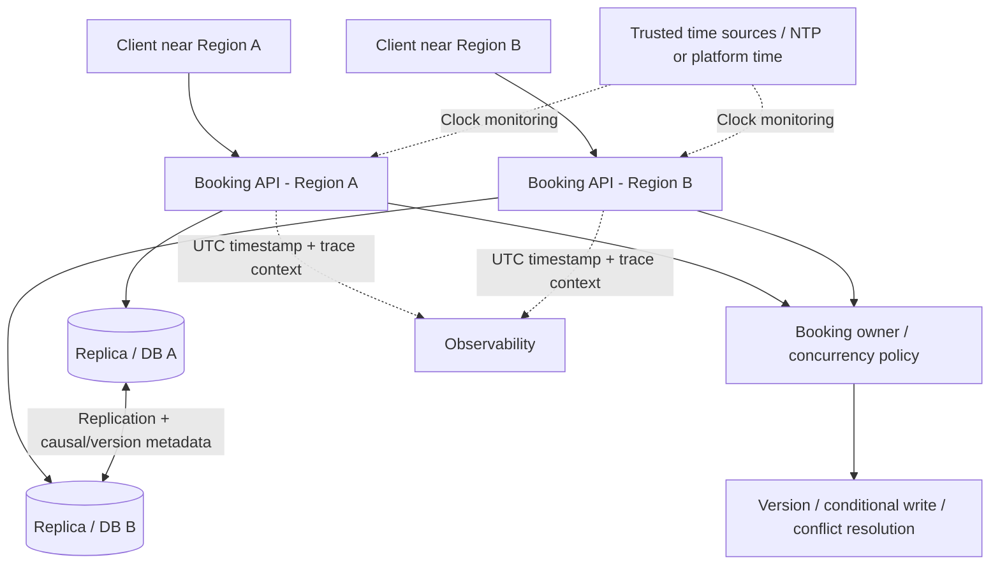

# Clocks, Causal Ordering, and Limits of Time Synchronization

## 1. Why is time a problem in distributed systems?

A simple application can rely on the operating system clock for logging, scheduling, and measuring processing duration. When an application runs across multiple VMs, containers, databases, queues, and regions, each node observes time from its own clock. Clocks can run fast or slow, be adjusted, lose synchronization, or lose access to time sources.

Common consequences:

- Logs in service B carry an earlier timestamp than service A even though B received the request from A afterward.
- Two regions update the same record; the system uses timestamps to pick the "latest" version and accidentally overwrites a valid change.
- A lease expires according to one node while another node still believes it owns the resource.
- Tokens or certificates are rejected due to clock skew.
- Consumers sort events by timestamp and infer the wrong business order.

**Time synchronization** keeps nodes' timestamps close within an error bound. However, well-synchronized clocks do not by themselves prove causal ordering between events. Distinguish physical time, monotonic time, and logical order:

| Concept | Question answered | Used for |
|---|---|---|
| Physical / wall time | What calendar time is it now? | UTC timestamps, audits, scheduled jobs, tokens/certificates |
| Monotonic time | How much time has elapsed? | Timeouts, local deadlines, latency measurement |
| Logical time | Which event precedes another causally? | State synchronization, replicated data, event processing |
| Sequence / version | Which change committed first within a scope? | Optimistic concurrency, aggregate ordering, fencing |

This lesson belongs to the **Consistency** chapter of the **CLOUD_ARCHITECTURE** module. We will examine clock offset/skew/drift, NTP/PTP, timestamps, happens-before, Lamport clocks, vector clocks, and hybrid logical clocks; then apply them to databases, queues, leases, caches, and multi-region architectures. The goal is to understand the limits of time so you can design appropriate consistency, reliability, security, and operations.

After this lesson, you will be able to distinguish clock types, explain why timestamps do not prove causal order, select appropriate ordering mechanisms, and inspect the impact of clock skew on cloud components.

## 2. Wall clocks, monotonic clocks, and time drift

### 2.1. Wall clock

A **wall clock** is the operating system's real-time clock, representing calendar time, typically as a Unix timestamp or UTC. It is useful for logs, audits, schedules, expirations, and exchanging points in time between systems.

Wall clocks can be adjusted by NTP, administrative actions, or OS timekeeping mechanisms. Therefore, subtracting two wall-clock readings can produce anomalous results if the clock steps backward or forward between readings.

### 2.2. Monotonic clock

A **monotonic clock** is designed to measure elapsed duration. It does not represent calendar date/time and generally cannot be compared directly across two machines or across reboots. Using it for timeouts, local deadlines, and latency is safer than using a wall clock.

| Need | Appropriate clock type | Reason |
|---|---|---|
| Record event time for cross-service exchange | Wall clock / UTC | Interpretable on a calendar |
| Measure request processing duration | Monotonic | Unaffected by clock adjustments during measurement |
| 2-second timeout | Monotonic / deadline API | Needs elapsed duration |
| Schedule job at 09:00 UTC | Wall clock | Represents a point on the calendar |
| Lease across multiple nodes | Lease authority, bounded-error wall clock, and fencing | A local timestamp alone cannot prove ownership |

Never send machine A's monotonic timestamp to machine B for comparison. Monotonic clock epochs and rates are not designed to form a global reference.

### 2.3. Offset, skew, drift, and uncertainty

- **Clock offset:** difference between a node's clock and a reference clock at the same instant.
- **Clock skew:** discrepancy between two clocks or between a clock and a reference standard; sometimes used broadly to refer to offset.
- **Clock drift:** the rate at which a clock runs fast or slow relative to reference time, causing error to accumulate.
- **Clock uncertainty:** estimated error interval around a timestamp. When uncertainty is large, the system should not infer order solely from timestamps.

Example: node A is 40 ms fast relative to UTC, and node B is 25 ms slow relative to UTC. The relative skew is 65 ms. If A records an event at `10:00:00.040` and B records an event at `10:00:00.025`, timestamps show B before A without proving actual real-world order.

Illustrative model:

\[
T_{node}(t)=T_{reference}(t)+offset(t)
\]

If drift is roughly constant over a short interval:

\[
offset(t)=offset(t_0)+drift\times(t-t_0)
\]

This is an approximation; actual offset also depends on clock adjustments, oscillators, virtualization, load, network, and synchronization algorithms.

### 2.4. Why don't nodes share one perfect clock?

Hardware oscillators have manufacturing variance and are affected by temperature and age. VMs depend on hypervisor/host timekeeping; containers share the host kernel. Networks introduce latency, asymmetry, packet loss, and congestion. Time sources can become unreachable; clocks can be stepped or slewed; suspend/resume, reboots, and live migration also affect behavior.

Consequently, real-world requirements must define **maximum acceptable error**, how to measure it, and behavior when exceeded, rather than demanding machines have identical clocks.

## 3. NTP and PTP: synchronization mechanisms

### 3.1. Network Time Protocol (NTP)

NTP lets clients exchange packets with time servers to estimate offset and adjust the wall clock. Accuracy depends on reference sources, network path, load, network topology, and configuration. Clients typically collect multiple samples, filter sources, and discipline phase/frequency rather than trusting a single exchange.

Given four timestamps:

- \(t_1\): client sends request.
- \(t_2\): server receives request.
- \(t_3\): server sends response.
- \(t_4\): client receives response.

Estimated offset assuming relatively symmetric round-trip delay:

\[
\theta\approx\frac{(t_2-t_1)+(t_3-t_4)}{2}
\]

Estimated round-trip delay:

\[
\delta\approx(t_4-t_1)-(t_3-t_2)
\]

If forward and return paths are asymmetric, the offset estimate can be biased because the algorithm mistakes part of the network asymmetry for clock offset.

### 3.2. Precision Time Protocol (PTP)

PTP (IEEE 1588) targets tighter synchronization in networks designed to support it, often leveraging hardware timestamping on NICs/switches and components like grandmaster, boundary, or transparent clocks. PTP fits certain telecom, financial, industrial, or tight-synchronization workloads.

PTP is not automatically more accurate in every environment. High precision requires compatible hardware, topology, profiles, and monitoring. Simply installing a PTP daemon inside a VM does not prove the entire system achieves a specific error bound.

| Criterion | NTP | PTP |
|---|---|---|
| Goal | General IT time sync over IP | High-precision sync in supported infrastructure |
| Infrastructure | Widely deployed and simpler | Needs supporting hardware/topology for high accuracy |
| Accuracy | Depends on source and network; sufficient for many IT systems | Can be tighter with hardware timestamping and proper config |
| Operations | Sources, offset, stratum, reachability | Grandmaster, domain, profile, hardware, and topology |

NTP/PTP primarily keep wall clocks close to a standard. Applications still need monotonic clocks for timeouts; logical clocks answer a different question: which events are causally related.

### 3.3. Step and slew

An operating system can adjust a wall clock in two ways:

- **Step:** jumps the clock value by a fixed amount; timestamps can jump forward or backward abruptly.
- **Slew:** adjusts clock speed over a period to gradually converge toward the reference, avoiding sudden jumps.

Never assume the wall clock always advances smoothly. Timeouts and duration measurements should rely on a monotonic clock.

## 4. Timestamps do not imply causal order

### 4.1. Happens-before

Causality in distributed systems is commonly modeled via the **happens-before** relation:

- If A occurs before B in the same process, A → B.
- If A sends a message and B receives that message, send(A) → receive(B).
- The relation is transitive: if A → B and B → C, then A → C.
- If neither A → B nor B → A holds, the two events may be concurrent (no known causal relation).

This relation is based on program order and message passing, without requiring nodes to share identical physical clocks.

### 4.2. Timestamps can invert order

Suppose node A runs ahead of reference time and node B runs behind. B can process an operation after A yet record a smaller timestamp. Network latency can also cause an earlier-emitted event to reach a broker after a later-emitted event. Timestamps collide when clock resolution is coarse or multiple events occur within the same tick.

Therefore, timestamps are useful only for point-in-time analysis or approximate sorting. When the business requires exact ordering, use sequences/versions, partition keys, logical clocks, transactions, or coordination mechanisms.

### 4.3. Last-write-wins (LWW) and conflicts

In some replicated systems, LWW selects the value with the larger timestamp. This is simple for configuration data where an overwrite is acceptable, but it can drop valid updates when clocks skew or two operations are concurrent.

Never use LWW by default for balances, payment transactions, reservations, or inventory requiring invariant preservation. For such data, use transactions, conditional writes, versions, or business-defined conflict resolution rules.

## 5. Lamport logical clocks

### 5.1. Guarantees and limits

A Lamport clock assigns an integer counter to each event and guarantees:

\[
A\rightarrow B\implies L(A)<L(B)
\]

If A happens-before B, then A's logical timestamp is smaller than B's. The converse is false: \(L(A)<L(B)\) does not prove A → B, because two concurrent events can still receive different counter values.

### 5.2. Update rules

Each process maintains a counter L:

1. Before a local event, increment L by 1.
2. When sending a message, attach the current L to the message.
3. Upon receiving a message with timestamp \(L_m\), update \(L:=\max(L,L_m)+1\).

Example:

```text
Process A: event a1 -> L=1
Process A: send m  -> L=2, message carries 2
Process B: local b1 -> L=1
Process B: receive m(2) -> L=max(1,2)+1=3
Process B: event b2 -> L=4
```

`send(m)` precedes `receive(m)`, so receive's logical timestamp is greater than send's. If a total order is needed for display, you can compare `(L, processId)` using `processId` as a tie-breaker. That is a deterministic ordering convention; it does not turn concurrent events into true causal dependencies.

Lamport clocks do not provide calendar time and do not fully detect concurrency.

## 6. Vector clocks

### 6.1. Principle

A vector clock stores a vector of counters indexed by process/node. On a local event, the process increments its own entry; when sending a message, it includes the vector; on receipt, it merges each entry with the element-wise maximum and increments its own entry.

Given two vectors \(V_a\) and \(V_b\), if every element of \(V_a\) is less than or equal to \(V_b\) and at least one element is strictly smaller, \(V_a\) precedes \(V_b\). If neither vector is less than the other, the two events are concurrent given the vector information.

| Event | Vector | Interpretation |
|---|---|---|
| A updates address | `[1,0]` | First event at A |
| B updates preference independently | `[0,1]` | First event at B |
| A receives B's update then updates | `[2,1]` | Has causal knowledge from B |

`[1,0]` and `[0,1]` are incomparable element-wise, so the first two events are concurrent. `[1,0]` is less than `[2,1]`, showing the later event at A has knowledge of the earlier event.

### 6.2. Pros and cons

Vector clocks help detect concurrent updates in certain multi-writer systems or replicated data types. In return:

- Metadata grows with the number of tracked nodes/actors.
- Frequent node creation/deletion makes vectors harder to manage.
- Causal metadata must be propagated and preserved across layers.
- Vectors do not resolve business conflicts automatically; merge rules or user decisions are still required.

Variants such as dotted version vectors or compacted version vectors can reduce overhead in some systems. Use them only when concurrency detection is needed; do not attach large vectors to every message by default.

## 7. Hybrid Logical Clock (HLC)

An HLC combines a physical time component with a logical counter, commonly represented as `(physical, logical)`. The physical component stays close to the wall clock; the logical component increments when physical time has not advanced or when causality must be preserved upon receiving a message.

HLC keeps timestamps closer to calendar time than Lamport clocks while maintaining algorithmic causal-ordering properties. Some distributed databases use HLC variants; exact encoding, bounds, and semantics vary by system.

### 7.1. Update intuition

On a local event, compare the wall clock to current physical: if the wall clock is larger, update physical and reset logical; otherwise increment logical. On receiving a remote timestamp, pick the maximum physical among local wall clock, local HLC, and remote HLC, then increment logical for the corresponding case so the new timestamp exceeds all related timestamps.

Conceptual pseudocode (not a production implementation):

```text
local_event():
    now = wall_clock()
    if now > hlc.physical:
        hlc = (now, 0)
    else:
        hlc.logical += 1

receive(remote):
    now = wall_clock()
    p = max(now, hlc.physical, remote.physical)
    if p == hlc.physical and p == remote.physical:
        l = max(hlc.logical, remote.logical) + 1
    else if p == hlc.physical:
        l = hlc.logical + 1
    else if p == remote.physical:
        l = remote.logical + 1
    else:
        l = 0
    hlc = (p, l)
```

Do not replace a tested HLC library with this pseudocode. Overflow, encoding, uncertainty, restart persistence, and clock jumps must be handled accurately. HLC also cannot fix arbitrarily unbounded wall-clock skew; monitor uncertainty and bound errors.

## 8. Limits of time synchronization in the cloud

**Network asymmetry:** NTP estimates offset from round-trips; unequal request and response transit times bias the estimate.

**Virtualization:** VMs rely on hypervisor/host timekeeping, and containers share the kernel. Multiple workloads on one host can suffer together if host timekeeping fails.

**Time sources:** if an entire fleet relies on a single time server, that server becomes a failure domain and attack target. Critical systems need multiple trusted sources, offset monitoring, and redundancy.

**Geographic distance:** signal propagation delay and network jitter mean timestamps across regions cannot be treated as strictly uniform.

**Physical limits:** NTP/PTP reduce offset within infrastructure bounds but do not create one perfect global clock. When a unique global order is required, use sequences/leaders/consensus or an ordering authority; time servers cannot substitute for that mechanism.

## 9. Impact on cloud applications

### 9.1. Logs and distributed tracing

Timestamps help correlate logs, but skew distorts timelines. Record UTC, trace/span context, request IDs, correlation IDs, and event IDs. Use a monotonic clock to measure durations within a single process. During investigations, cross-check causal traces rather than concluding order from timestamps alone.

### 9.2. Databases and optimistic concurrency

Timestamps can support audits or LWW, yet concurrent updates across regions can collide or invert timestamps. For critical data, use transactions, versions, or conditional writes.

Example:

```sql
UPDATE account
SET balance = balance - 100,
    version = version + 1
WHERE account_id = 'A-100'
  AND version = 12;
```

The version condition detects concurrent updates against the read version; it does not rely on wall clocks. If zero rows update, the application must re-read and resolve the conflict per business rules.

### 9.3. Cache TTL and expiry

Clock skew can cause one node to evict a cache entry earlier than another, or tokens to be evaluated as expired differently. For local timeouts, use monotonic clocks or TTLs managed by the cache/broker. For shared expiry, use storage-managed time where possible and define a clock-skew allowance. Never rely on TTLs to guarantee correctness of financial transactions.

### 9.4. Leases and distributed locks

A lease grants resource ownership for a time interval. If A believes its lease is still valid while B believes it expired, both may write simultaneously. Checking leases solely against local wall clocks is risky.

Measures:

- Use a lease/lock service as the granting authority.
- Issue a monotonically increasing **fencing token** per lease grant; storage rejects operations carrying older tokens.
- Use conditional writes/transactions to check owner/version.
- Renew with validation; fail closed when ownership is uncertain.

Fencing tokens protect against an old node pausing for a long time and waking up after the lease was granted to another node. The old node may still believe it holds the lease, but storage rejects its stale token if storage enforces the check.

### 9.5. TLS certificates and tokens

TLS certificates have `notBefore`/`notAfter` bounds; tokens commonly have `iat`, `nbf`, and `exp`. Clock skew can cause validation to fail prematurely or late. Configure a small tolerance per standards and risk, but never widen tolerances excessively to mask an unsynchronized fleet.

JWT/certificate validation requires a consistent time policy, clock monitoring, and alerts when offset exceeds thresholds. Timestamps inside a payload never replace signature verification or trusted authorities.

## 10. Multi-region example: updating booking information

Suppose customers access a booking system in Region A or B. Both regions run read replicas near users. A user updates their phone number in A while nearly simultaneously updating notification preferences in B.

### 10.1. Using LWW only

Region A records `updated_at=10:00:00.100`; Region B records `updated_at=10:00:00.080`. If A's clock is 60 ms fast, B may actually have executed later while holding a smaller timestamp. LWW replication picks A and can lose a valid update.

LWW is acceptable only if the data is non-critical configuration, the business accepts "last value wins," and losing concurrent updates is acceptable or detectable/recoverable.

### 10.2. Using per-aggregate versions

A service owning the booking increments the version on each successful change:

| Version | Change | Relationship |
|---:|---|---|
| 10 | Create booking | Initial state |
| 11 | Update phone number | After version 10 |
| 12 | Update notification preferences | After version 11 if serialized by the same owner |

The version expresses commit order within the aggregate without relying on clocks across services. If both regions are permitted to write concurrently, coordination, optimistic concurrency, or causal metadata is required; incrementing local versions independently in both regions does not form a global sequence.

### 10.3. Conceptual diagram



This is a conceptual diagram. Real systems must specify single-writer vs. multi-writer databases, synchronous vs. asynchronous replication, which region owns the aggregate, partition handling, and allowable lag. Never let both regions write arbitrarily simply because bidirectional replication exists.

## 11. Observing and operating clocks

### 11.1. Metrics to monitor

| Metric | Meaning | Action on anomaly |
|---|---|---|
| Clock offset | Wall-clock deviation from source | Check NTP source, network, host, and time service |
| Root dispersion / uncertainty | Accumulated uncertainty reported by tooling | Determine which policies can still trust timestamps |
| Sync state / stratum / source | Synchronization state and source | Alert when sources are unreachable or abnormal |
| Clock step / slew events | Clock was recently adjusted | Inspect timeouts, timestamps, and leases |
| NTP delay / loss | Sync path quality | Check congestion, firewalls, routing, and backup sources |
| Certificate / token validation errors | Errors potentially related to time | Check skew, `nbf`/`exp`, cert validity, and tolerance |
| Lease / fencing rejections | Operations attempted with stale ownership | Check pauses, partitions, renewals, and correctness |

### 11.2. Runbook when offset exceeds threshold

1. Identify affected nodes, regions, hosts, and workloads.
2. Check time sources, connectivity, offset, uncertainty, stratum, and step/slew events.
3. List timestamp-dependent systems: tokens/certificates, leases, TTLs, ordering, and audits.
4. Pause sensitive operations if needed or rely on versions/sequences/authorities; never manually jump production clocks arbitrarily.
5. Restore synchronization per platform procedure, verify offset stabilizes, and confirm connectivity.
6. Reconcile transactions, leases, and tokens within the skew window; preserve evidence and update the incident report.

Do not just run a time-sync command and close the incident. Determine the host/time-source root cause and whether data was misordered or wrongly overwritten during the skew window.

## 12. Design trade-offs

| Approach | Benefits | Costs / limits |
|---|---|---|
| Fleet-wide NTP | Keeps wall clocks close for logs/audits/certificates | Bounded error remains; depends on sources and network |
| PTP on supporting infra | Can achieve tighter precision for specialized workloads | Complex hardware, topology, config, and operations |
| Lamport clock | Tracks happens-before without global time | Neither detects full concurrency nor gives calendar time |
| Vector clock | Detects concurrent updates in fitting models | Metadata grows with actors; still needs conflict resolution |
| HLC | Close to wall time while retaining logical order | Needs correct implementation and uncertainty handling |
| Owner-issued sequence/version | Clear ordering within an aggregate | Needs an owner/serialization point; can limit multi-region writes |
| Timestamp-based LWW | Simple for low-criticality data | Can drop valid updates due to skew/concurrency |

Choose based on business invariants. Dashboards may accept LWW; account balances, payments, or reservations should never rely on local timestamps to decide which transaction wins.

## 13. Well-Architected assessment

| Pillar | Questions to evaluate |
|---|---|
| **Operational Excellence** | Do time sources have owners, redundancy, and dashboards? Do offset/uncertainty alert? Are runbooks rehearsed? |
| **Security** | Are time sources protected? Do tokens/certificates have sensible tolerances? Do leases use fencing to block stale actors? |
| **Reliability** | Do timeouts use monotonic clocks? Are inverted timestamps, clock steps, and NTP outages handled? |
| **Performance Efficiency** | Is logical metadata overly large? Is PTP truly needed? Does synchronization add unnecessary overhead? |
| **Cost Optimization** | Does precision match actual need? Are time-service, logging, and monitoring costs proportional to risk? |
| **Sustainability** | Do we avoid redundant telemetry/sync and avoid deploying high-precision infra for services that do not need it? |

## 14. Sample architecture decision record for time

The YAML template below captures requirements and policies; it is illustrative documentation, not a provider configuration:

```yaml
decision_id: ADR-CONSISTENCY-007
title: Time and causal ordering policy
requirements:
  wall_clock:
    use: audit_and_cross_service_event_timestamp
    standard: UTC
    max_offset_ms: 100
  elapsed_time:
    use_monotonic_clock: true
  causal_order:
    booking_aggregate: owner_sequence
    cross_service_trace: correlation_and_causation_id
time_sync:
  source: approved_platform_time_service
  monitor_offset_and_uncertainty: true
  alert_on_unsynchronized_nodes: true
data_policy:
  critical_writes: version_or_conditional_transaction
  last_write_wins: only_for_approved_noncritical_fields
lease_policy:
  authority: centralized_lease_service
  fencing_token: required
validation:
  - clock_offset_and_source_failure_test
  - wall_clock_step_behavior
  - certificate_and_token_skew_test
  - concurrent_update_and_reordering_test
review_triggers:
  - new_region_or_time_source
  - clock_offset_slo_change
  - database_replication_model_change
```

The 100 ms threshold is an illustrative assumption. Each project must define thresholds based on requirements, service characteristics, and discrepancy impact.

## 15. Design and testing process

1. **Classify needs:** audit timestamps, timeouts, TTLs, schedules, certificates, leases, or transaction ordering?
2. **Choose clocks:** wall clocks for calendar instants; monotonic for durations; logical/sequences for causal and business order.
3. **Set error bounds:** define maximum offset/uncertainty, scope, and behavior when breached.
4. **Select sync sources:** NTP, PTP, or platform time; verify redundancy, networking, admin permissions, and region/host scope.
5. **Protect invariants:** use transactions, sequences/versions, fencing, or causal metadata instead of bare timestamps.
6. **Design observability:** record UTC, trace/correlation IDs, measure monotonic durations, and monitor offset and sync sources.
7. **Inject faults:** NTP outages, clock steps, VM pause/resume, cross-region skew, event reordering, token/cert expiry, and lease expiration.
8. **Reconcile:** verify data, business order, ownership, and logs before closing incidents.

### Pre-production checklist

- [ ] Every timestamp is defined as event time, processing time, or ingestion time.
- [ ] UTC is used for exchanged timestamps; monotonic timestamps are never compared across machines.
- [ ] Timeouts and duration measurements use appropriate monotonic clocks/deadlines.
- [ ] Approved, redundant time sources are configured with offset/uncertainty monitoring.
- [ ] Step/slew behavior, VM suspend/resume, and NTP outages are understood.
- [ ] Single timestamps are never used alone to infer causal order or arbitrate competing transactions.
- [ ] Aggregates requiring ordering use sequences/versions or appropriate owners/transactions.
- [ ] Tokens/certificates have reasonable clock tolerances and time-error alerting.
- [ ] Leases/locks have an authority and fencing/conditional writes to block stale owners.
- [ ] Multi-region conflict policies are defined; LWW is restricted to approved data.
- [ ] Trace/correlation metadata and procedures exist to cross-check timestamps against causal order.
- [ ] Clock skew, clock jumps, source outages, concurrent updates, and event reordering have been tested.

**Guiding principle:** time synchronization keeps nodes' calendar timestamps close, but it does not produce a perfect global clock and does not automatically establish causal order. Use wall clocks for points in time, monotonic clocks for elapsed intervals, and logical clocks or versions for required ordering; for critical transactions, rely on transactions, authorities, and business invariants rather than comparing timestamps alone.
