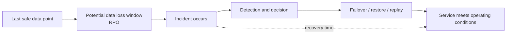
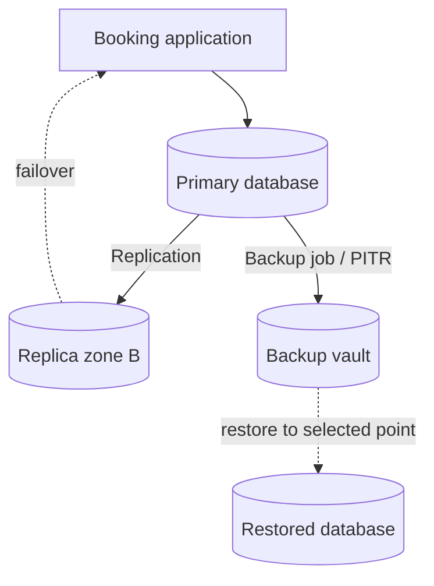
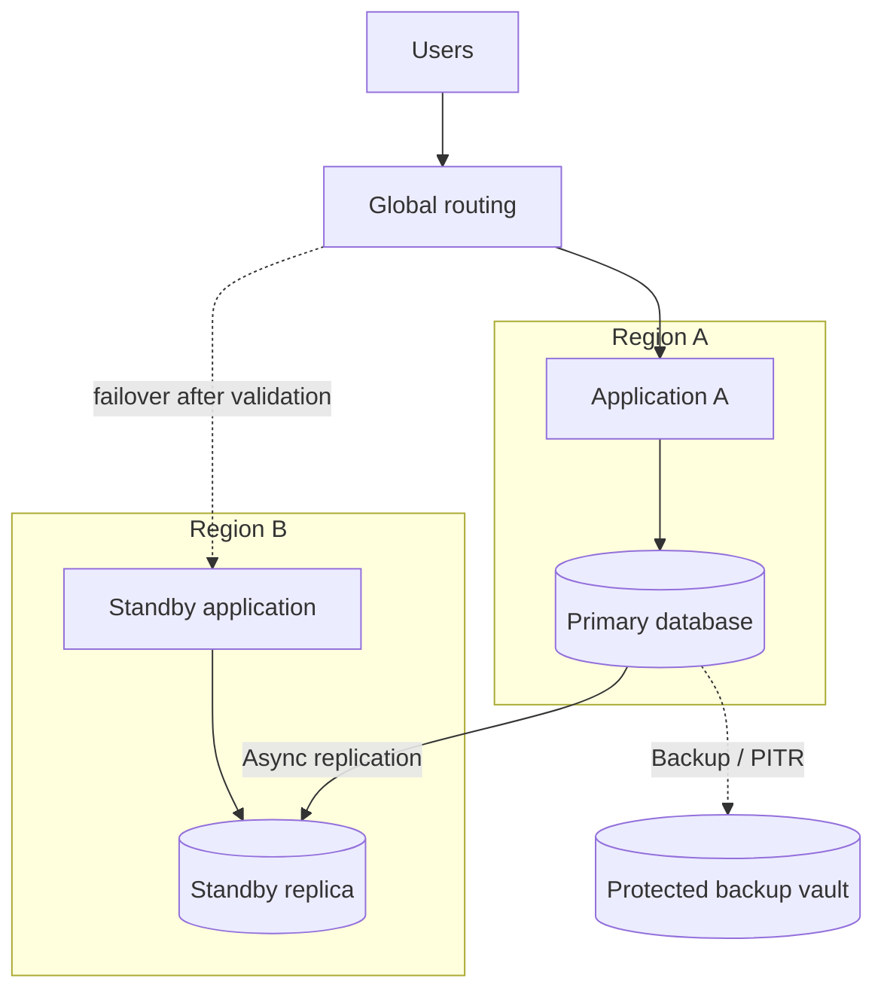
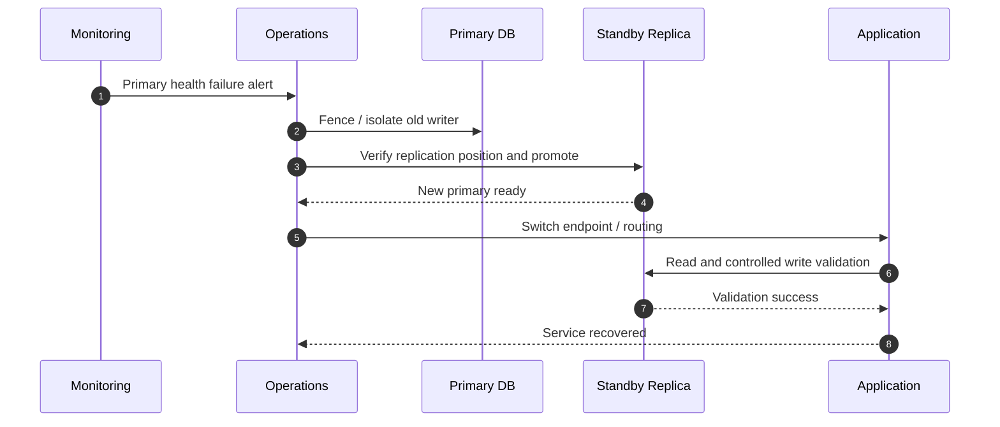

# Data Durability, Availability, and Replication Scope

When a cloud application stores rental orders, customer profiles, or payment transactions, the question is not just which database holds the data. The architecture must answer: **will the data still exist after a failure, can the service continue reading/writing, and what failure scope do the copies share?** These three questions correspond to data durability, availability, and replication scope. They are closely related, yet none can substitute for another.

In the **CLOUD_ARCHITECTURE** module, storage choices must start from business requirements and balance reliability, security, scalability, cost, and operations according to Well-Architected principles. This lesson uses an equipment rental platform as an example: the system stores reservations, payment records, a catalog, and analytics data. The RPO/RTO figures, replica counts, and durations in the examples are assumptions for design practice; real architectures must be determined through business impact analysis, service limits, and recovery testing.

## 1. Three Frequently Confused Attributes

| Attribute | Core question | What it measures | Example |
| --- | --- | --- | --- |
| **Durability** | Once a write is acknowledged, what is the probability of data loss? | Ability to retain data across disk, process, node, zone, or disaster failures within the designed protection model | A committed booking remains intact after a disk or node fails |
| **Availability** | When an incident occurs, can users still read/write and how long is the interruption? | Ability to serve requests over time, typically tied to an SLI/SLO | The database automatically switches to a standby node after a failure |
| **Replication scope** | Where are copies placed and updated, and which failures do they share? | Geographic, physical, and administrative boundaries plus consistency between copies | Replicas within the same zone, across zones, or across regions |

A system can be **durable yet temporarily unavailable**: the database preserves all data, but failover takes several minutes so clients cannot access it in the meantime. Conversely, a service can respond very quickly from a replica yet still risk losing recent writes if an asynchronous replica had not received the latest commit before a disaster.

Replication is also not the same as backup. Replicas typically propagate erroneous changes or deletions too; backups are designed to retain a point-in-time recovery point isolated from current mutations. Both are needed when business requirements demand fast service continuity alongside recovery from data corruption.

## 2. Determine Business Impact Before Choosing Technology

Not all data has the same value or recovery target. Classify data by the consequences of losing it, being unable to access it, or having corrupted data:

| Data group | Impact if lost | Impact if unavailable | Suggested target |
| --- | --- | --- | --- |
| Reservations and hold state | Double bookings, lost customer commitments | Cannot create or confirm orders | High transaction protection and recoverability |
| Payment ledger / transactions | Financial discrepancies, broken reconciliation and obligations | Payments or refunds interrupted | Very strict durability, auditing, and reconciliation |
| Equipment catalog | Can be regenerated from administrative source | Users cannot browse listings | Broader RPO/RTO may be acceptable depending on source |
| Search index | Usually rebuildable from source data | Search is degraded | Can be rebuilt; does not necessarily need primary-DB-grade backups |
| Analytics aggregates | Impacts reporting and decisions | Dashboards may be delayed | Latency/scheduled backfill may be acceptable |
| Logs/audits | May serve as forensic or compliance evidence | Harder incident response | Retention, tamper/delete protection, and separate read access |

For each group, ask:

1. **Where is the source of truth?** Transactional database, event log, external system, or raw files?
2. **Can it be regenerated?** A search index can be rebuilt, whereas a payment ledger must not be derived from summary dashboards.
3. **Who is allowed to restore?** Restoring can discard writes made after the backup or overwrite newer state.
4. **Are there data residency requirements?** Regions/zones and replication links may face legal or contractual constraints.
5. **What happens if wrong data is replicated?** Point-in-time recovery, immutable backups, or pre-restore approval is needed.

This classification prevents spending equally to replicate everything—or, conversely, applying the same weak policy to both a ledger and a cache.

## 3. RPO and RTO: Turning Needs into Measurable Targets

Two foundational metrics in recovery planning:

- **RPO (Recovery Point Objective):** the maximum acceptable data loss to the organization, commonly expressed as the time window of data that may need to be reconstructed.
- **RTO (Recovery Time Objective):** the target duration to restore a service or process to a defined operational state.

For example, a 5-minute RPO means that in the specified scenario, the organization accepts recovering to a data point up to roughly 5 minutes prior to the incident. A 30-minute RTO means the target is restoring functionality within 30 minutes. These numbers alone do not prove the platform can hit them; you must account for detection, failover/restore decisions, resource provisioning, data validation, traffic shifting, and business verification.

### 3.1. RPO and RTO Are Not SLAs

RPO/RTO are recovery objectives for an incident scenario. SLAs/SLOs measure service delivery quality over an observation window. A database with a high availability SLO but a 24-hour backup RPO can still lose significant changes if a full restore is needed. Conversely, near-real-time replication can give a low RPO, while slow DNS, application, or permission failover produces a poor RTO.

### 3.2. Example Targets for the Equipment Rental Platform

| Workload | Assumed RPO | Assumed RTO | Reason |
| --- | ---: | ---: | --- |
| Transactional reservations | 1 minute | 15 minutes | Avoid losing many confirmed bookings |
| Payment records | Near 0 for confirmed transactions by design | 30 minutes | Needed for reconciliation and preserving financial trail |
| Catalog | 1 hour | 4 hours | Data can be recovered from administrative source |
| Search index | 4 hours | 8 hours | Can be rebuilt from the catalog |
| Analytics aggregates | 1 day | 1 day | Can re-run batches or replay events |

These are examples for discussion only. Near-zero RPO does not mean zero data loss can be guaranteed in every scenario. You must precisely define "confirmed transaction," failure scope, replication mode, storage durability, acknowledgment semantics, and zone/region scenarios.

### 3.3. Each Failure Mode Has Its Own RPO/RTO

Do not write just one pair of numbers for the entire system. Separate:

- Container/process crash.
- Node or disk failure.
- Loss of an availability zone.
- Loss of an entire region.
- Logic bug or bad deployment corrupting data.
- Compromised credentials or unauthorized deletion.
- Cloud provider outage or cross-region link unavailability.

Same-region replication can solve a node failure but does not help if the region is lost. Immutable backups protect against malicious deletion, yet restoring from backup can take hours. Every mechanism must map to a concrete failure scenario.

## 4. Replicas and Backups Solve Different Problems

### 4.1. Replicas Serve Continuity

Replicas maintain data copies on another node, device, zone, or region. When the primary fails, an eligible replica can be promoted to primary or serve reads by design. The goal is typically to reduce downtime and/or increase read throughput.

### 4.2. Backups Serve Recovery

A backup is a saved recovery point used to restore data to a specific time or version. Backups may be snapshots, full/incremental backups, continuous backups, or logical exports. They require retention, encryption, access controls, integrity checks, and restore testing.

| Attribute | Replica | Backup |
| --- | --- | --- |
| Goal | Service continuity, distributed reads, or standby | Recovering data after loss/corruption/deletion |
| Freshness | Can be near real-time or synchronous | Scheduled or point-in-time policy |
| Bad changes | Can propagate to the replica | Can pick a point prior to data corruption |
| Accidental deletion | Usually replicated to the copy | Can recover while within backup retention |
| Switchover | Can promote/failover | Requires restore/import, validation, and cutover |
| Cost | Continuous compute/storage/network | Storage/retention and restore/test costs |

A typical data protection design includes:

1. Replicas for node/zone failures and availability requirements.
2. Scheduled backups or point-in-time recovery for logical corruption and accidental deletion.
3. Permission-isolated or immutable/offline backups for ransomware and credential compromise.
4. Rehearsed restore/reconciliation procedures.

### 4.3. Visualizing the Difference

Replicas help keep the application running when the primary fails. Backups let you roll back to a point before an accidental delete or bad edit propagated. The two arrows represent distinct mechanisms; never treat a replica as a backup.

## 5. Synchronous and Asynchronous Replication

### 5.1. Synchronous Replication

In synchronous replication, the primary confirms a commit only after the required replica or quorum write condition is met. Thus, acknowledged data exists across multiple failure domains according to the system's guarantees.

Advantages:

- Shrinks the window of un-replicated acknowledged data.
- Can achieve a very low RPO for the failure scope covered by the quorum.
- Failover has a deterministic basis to pick a replica that received the commit.

Trade-offs:

- Commit latency depends on network round-trip time and replica speed.
- If replicas/quorum become unavailable, writes may block or availability may drop.
- Harder to operate when replicas are geographically distant.

### 5.2. Asynchronous Replication

In asynchronous replication, the primary can acknowledge a commit before the replica receives the data. This generally lowers write latency and keeps writes flowing if a replica slows down, but creates a replication lag window. If the primary is lost abruptly, commits that had not yet reached the replica can be lost during failover.

Advantages:

- Lower write latency when replicas are distant.
- Decouples primary transactions from slow replicas.
- Suitable for cross-region DR over long geographic distances.

Trade-offs:

- Un-replicated writes can be lost.
- Read replicas can be stale.
- Failover must determine which log/LSN/offset was applied and reconcile missing changes.

### 5.3. Comparison

| Criterion | Synchronous | Asynchronous |
| --- | --- | --- |
| Commit acknowledgment | Waits for replica/quorum condition | Can ACK before replica receives it |
| Write latency | Can be higher | Usually lower |
| RPO within design scope | Can be near 0 for ACKed commits | Can exceed 0 depending on replication lag |
| Availability when replica slows | Can be impacted | Primary can keep accepting writes |
| Suitable scope | Nearby nodes/zones, strict commit protection | Cross-region, DR, read replicas |
| Risk | Loss of quorum blocks writes | Failover may miss un-replicated writes |

Not every system offers a simple binary sync/async toggle. Some databases use quorums, semi-synchronous modes, consensus protocols, or per-transaction acknowledgment policies. Read the exact meaning of a "successful commit" in your chosen service.

## 6. Replication Scope: Same Node, Cross-Node, Zone, or Region

Replication scope determines which failures the system can survive and what costs it incurs.

| Scope | Can protect against | Does not necessarily protect against | Trade-off |
| --- | --- | --- | --- |
| Multiple disks on the same host | Single storage device failure | Host, power, rack, or zone failure | Low cost, large shared failure domain |
| Different node, same zone | Node/host failure | Zone, network, or zone-wide physical failure | Low latency, but lacks zone isolation |
| Different availability zone | Single-AZ outage per provider design | Whole-region outage, logic bugs, or shared credentials | Higher network latency/cost and requires failover |
| Different region | Region outage and some wide-area disasters | Replicated logical bugs, global admin mistakes | Higher egress, latency, replication lag, and ops overhead |
| Different account/project and failure boundary | Certain permission/admin errors or scope-wide deletion | Shared global credentials/admins or shared policies can still impact | Higher governance overhead; requires cross-boundary IAM and processes |

### 6.1. Same Zone Does Not Mean Independent

Two replicas on different nodes can still share a zone's network, power, storage fabric, or control plane failures. If single-zone failure tolerance is required, place copies across truly independent availability zones as defined by the provider.

### 6.2. Multi-Region Is Not Automatically Better

Cross-region replication can reduce impact when an entire region goes down, but it:

- Increases latency and data transfer costs.
- Can introduce larger replication lag.
- Requires handling DNS/routing, identities, keys, secrets, and capacity in the standby region.
- Forces a choice between active-passive and active-active.
- Requires conflict resolution if two regions both accept writes.
- Can run into data residency and cross-border transfer restrictions.

Choose multi-region when RTO/RPO, business continuity, or geographic requirements justify it and the organization can operate and test that topology.

## 7. Availability Zones and Regions: Choosing the Right Topology

### Single-Zone

A database or storage workload running in a single zone can have lower cost and latency. However, a zone outage can render the service unavailable until recovered or restored elsewhere. This model can be acceptable for dev environments, regenerable data, or workloads with a relaxed RTO.

### Multi-Zone

Replicas or instances spanning multiple AZs reduce reliance on a single zone. Verify:

- Primary/standby model vs. multiple writable nodes.
- Quorum and failover mechanisms.
- Whether the application keeps a stable endpoint.
- Whether replicas are synchronous and can serve reads.
- What happens if inter-AZ connectivity is lost.
- Whether backups reside in a separate failure domain.

### Multi-Region

Common patterns:

| Pattern | How it works | When to use | Risks |
| --- | --- | --- | --- |
| Active-passive | One region takes primary writes; another stands by | DR, when a clear single-writer topology is needed | Failover/failback and replication lag |
| Active-active | Multiple regions serve traffic; may all accept writes | Global latency/availability and apps built for distributed writes | Conflicts, consistency, routing, and duplicate data |
| Read-local/write-primary | Read near users, route writes to primary | Read-heavy workloads tolerating read lag | Read-after-write inconsistency in remote regions |
| Regional ownership/sharding | Each region owns a distinct subset of data | Data residency or tenant/region partitioning | Tenant moves, ownership failover, and cross-region workflows |

This illustrates active-passive. Failover requires checking replica freshness, isolating the old primary, transferring write authority, updating routing, and verifying the application. Simply flipping DNS without resolving split-brain can let two databases accept writes simultaneously.

## 8. Availability Does Not Live in the Database Alone

For users to keep using a system, many components must work together:

- Compute and application instances.
- Network paths, DNS, load balancers, and firewalls.
- Database endpoints, storage, and replication.
- Identity, KMS, secrets, and certificates.
- Message brokers, caches, and external dependencies.
- Control planes or mechanisms to update configuration during failover.

A multi-AZ database helps little if the application has only one instance in a failing AZ. A standby region cannot serve traffic if certificates, secrets, image registries, or IAM roles fail to work there.

### Dependency Map

For every service, map runtime dependencies and recovery dependencies. For example:

| Component | Runtime dependencies | Recovery dependencies |
| --- | --- | --- |
| Booking API | Database, identity, cache, message broker | Image registry, secrets/KMS, DNS, migration tool |
| Payment Adapter | External PSP, secret manager, audit store | Network egress, certificates, credential rotation |
| Database | Storage, replication network, KMS | Backup vault, snapshot restore, DNS/endpoint, operator |
| Analytics | Event stream, object storage, compute | Schema registry, archive, checkpoint/state store |

A recovery design must be able to bring up all of these dependencies. Store configurations, runbooks, and break-glass credentials outside the failure domain that could be lost alongside the primary.

## 9. Quorum, Consensus, and Split-Brain Risk

When multiple nodes hold copies and participate in write decisions, the system needs a mechanism to determine who can commit or which node is leader.

### 9.1. Quorum

In a group of N voters, a quorum is the minimum number of votes required by the protocol to reach a decision. In many common consensus protocols, a majority quorum is floor(N/2)+1. For instance, 3 voters need 2 votes; if only 1 node remains, the system loses quorum and may halt writes to prevent two sides from making conflicting decisions.

This is a general concept; read/write quorums, replication factors, and voter counts vary by protocol/database. Do not apply a majority formula blindly to every storage system without reading the provider's semantics.

### 9.2. Split-Brain

Split-brain occurs when two sides of a distributed system both believe they are the primary or hold write authority. During a network partition, both sides can accept incompatible changes. Once connectivity returns, the system needs conflict resolution or may not know which version is valid.

To reduce risk:

- Use leader election/consensus/quorum designed for the topology.
- Enforce fencing tokens or epochs to block an old primary from writing after failover.
- Isolate the old node before opening the new writer.
- Never decide write authority using DNS health checks alone.
- Test network partitions and failover/failback.

### 9.3. Trade-Off Between Availability and Consistency

When nodes cannot communicate, a system must decide whether to keep accepting writes on both sides or reject one side to preserve consistency. This is a semantics choice, not something you solve simply by adding another replica.

For a payment ledger or rental slot allocation, letting two primaries write concurrently can cause financial loss or double bookings. You may prioritize consistency/quorum for writes and accept rejecting some requests when quorum is lost. For a catalog or analytics, stale read replicas or eventual consistency may be acceptable.

## 10. Replica Consistency and Read-After-Write

Asynchronous replicas typically lag behind when applying updates. A client that writes successfully to the primary and immediately reads from a replica may not see its own change yet.

Options:

| Read pattern | Meaning | Trade-off |
| --- | --- | --- |
| Read from primary | Read from the primary writer | Preserves read-after-write better, but concentrates load |
| Read from replica | Offloads read traffic | Can be stale up to replication lag |
| Session stickiness | Route subsequent session reads to primary or a caught-up node | Requires tracking session/causal tokens |
| Read-your-writes token | Client sends version/LSN and only reads from a sufficiently fresh replica | Adds complexity and may wait |
| Bounded staleness | Accepts data stale up to a defined threshold | Fits non-instant data; requires measuring lag |

### Example

A customer creates a reservation on the primary. The frontend calls a GET API right afterward, and the read gets load-balanced to a replica lagging by 2 seconds. Seeing "no reservation yet," the user clicks create again.

Solutions can include:

- Reading from the primary on read-after-write paths.
- Returning a resource version/consistency token and routing reads to a sufficiently caught-up node.
- Using explicit client status polling rather than retrying creation.
- Designing idempotency on POST requests.

Never use a cache or read replica as the final decision source for reserving capacity. Initial availability checks are hints; the transaction at the authoritative data source decides whether the slot is held.

## 11. Durability and Commit Mechanics

When a database reports a successful commit, what has actually been protected?

Understand:

- Has the write only entered memory, or been flushed to durable storage?
- Was the transaction log/WAL fsynced or committed under which guarantee?
- Does the commit wait for a synchronous replica/quorum?
- Can an acknowledgment return before remote copying completes?
- What battery-backed or durability guarantees do storage/provider caches have?
- On power loss, kernel crash, or node fencing, does ACKed data survive?

**Durability guarantees are a property of the entire write path**, from the application through drivers, the database, transaction logs, the storage layer, and replication. They cannot be inferred merely from disk or replica counts.

### Write Acknowledgments and Applications

If an API returns 201 as soon as data enters an un-persisted buffer, a sudden crash can lose data the client believed was confirmed. Use commit semantics aligned with data value and only return success after the designed persistence milestone.

For operations spanning multiple systems—such as a Booking DB and a Payment Provider—a database commit does not prove the overall workflow succeeded. You need workflow state, outbox/inbox patterns, idempotency, and reconciliation as a separate distributed design.

## 12. Backups, Point-in-Time Recovery, and Restore Testing

### 12.1. Backup Types

| Type | Description | Notes |
| --- | --- | --- |
| Full backup | Complete copy of data per tool definition | Consumes more storage/time, simpler for standalone restore |
| Incremental backup | Records only changes since a reference point | Requires intact backup chain and completeness checks |
| Differential backup | Records changes since the last full backup | Restore may need full + latest differential |
| Snapshot | Point-in-time image of volume/database per process | Verify consistency/application quiescing and portability |
| Continuous log/PITR | Captures transaction logs/change streams for point-in-time restore | Requires log protection, retention, and continuous apply |
| Logical export | Exports data at table/collection/object level | More portable, but can restore slowly and drop some metadata |

### 12.2. Point-in-Time Recovery

PITR allows restoring to a timestamp within the retention window if the base backup and required logs are intact. For example, if an application accidentally deletes reservations at 14:05, you can restore a secondary database to 14:04:59, extract the affected rows, and reconcile them back into production rather than rolling back all of production to that timestamp.

Not every database lets you restore a single record directly from PITR. A safe workflow often requires:

1. Restoring to an isolated instance/cluster.
2. Verifying data and schema.
3. Extracting the relevant records or data subset.
4. Reconciling against changes made after the backup timestamp.
5. Performing a controlled merge without overwriting newer state.

### 12.3. Immutable and Isolated Backups

If a production admin account is compromised, an attacker can delete the database, replicas, snapshots, and even backups if they share the same permissions. Consider:

- A separate backup vault/account/project with independent IAM.
- Immutable retention or object lock by policy.
- MFA/multi-party approval for early deletion.
- Encryption keys with separate governance and recovery procedures.
- Offline or cross-account/cross-region copies when risk demands it.
- Auditing and alerts for backup deletions or retention changes.

Immutable does not mean kept forever; you must still set retention durations, handle expired data, and support legal holds per policy.

### 12.4. Restore Testing

A job reporting "backup completed" does not prove data is recoverable. Run drills:

- Restore a sample database into an isolated environment.
- Measure elapsed time from request until the application can access it.
- Check row/document counts, checksums, referential integrity, and business invariants.
- Verify encryption keys, credentials, networking, DNS, and application versions.
- Run critical API smoke tests and event reconciliation.
- Record measured RPO/RTO, failures, and remediation actions.

## 13. Failover and Failback: Recovery Is More Than Swapping Endpoints

### 13.1. Failover

Failover shifts operations from the primary to a standby replica/region. A safe sequence typically involves:

1. Detecting primary failure and assessing blast radius.
2. Deciding to fail over per runbook/appropriate approval.
3. Fencing or isolating the old primary to prevent split-brain.
4. Selecting an eligible replica with the appropriate log/sequence position and promoting it.
5. Updating endpoints, DNS/routing, or service discovery.
6. Verifying reads/writes, consistency, permissions, and downstream consumers.
7. Monitoring errors, replication, and business metrics before declaring recovery.

This diagram shows the logical sequence; many managed services automate parts of it. Even when automated, owners must understand promotion criteria, potential data loss, failover duration, and how applications reconnect.

### 13.2. Failback

Failback returns workloads to the original region/primary after recovery. This can be riskier than failover:

- The old primary may be out of date.
- Reverse synchronization or replica rebuilding is required.
- Traffic and new writes must keep going to the correct single writer.
- Stale DNS/client caches and old connections may linger.
- A maintenance window, validation, and rollback plan are mandatory.

Never fail back solely because the old region looks "healthy." Synchronize data, confirm single-writer authority, validate integrity, and follow a controlled cutover plan.

## 14. Active-Active and Conflict Resolution

Active-active can serve users across multiple regions and reduce latency, but data requires a distributed write model.

Strategies:

| Strategy | Idea | Suitable for | Limitations |
| --- | --- | --- | --- |
| Single-writer per record/key | Each record has one owning write region | Reservations/ledgers needing single authoritative decisions | Higher latency when clients are far from the owner |
| Partition ownership | Each region/tenant owns a slice of data | Independently partitioned tenants or datasets | Ownership failover requires fencing and migration |
| Last-write-wins | Picks version by timestamp/metadata | Simple data tolerating overwrites | Clock skew, lost updates, unsuitable for money/bookings |
| Mergeable data / CRDTs | Structures with deterministic merge semantics | Counters, sets, or mergeable states | Does not fit all domains and harder to model |
| Application conflict resolution | Keeps conflicting versions/commands and applies domain rules | Business logic with custom reconciliation rules | Complex and requires auditing/reconciliation |

For instance, two regions simultaneously accepting a rental hold because both saw available inventory can create conflicting reservations. Last-write-wins cannot resolve a business commitment. You can route reservation authority to one owner, use transactions/consensus, or partition inventory by region. The choice must preserve business invariants.

## 15. Encryption, Keys, and Replica Security Scope

Replicas and backups contain copies of source data and must inherit matching classification and protection policies.

- **Encryption at rest:** encrypt volumes, databases, objects, and backups.
- **Encryption in transit:** TLS or secure transport on replication links.
- **Key management:** choose provider-managed vs. customer-managed keys; define rotation, access, and recovery.
- **Separation of duties:** database administrators do not necessarily need permission to delete backups or manage keys.
- **Region and residency:** verify whether data, keys, and metadata may cross geographic borders.
- **Auditing:** log who creates replicas, changes topology, restores, exports, or deletes backups.

If all replicas share one key and that key is disabled or deleted, multiple copies can become unreadable. DR plans must verify KMS/key availability in the standby region and key recovery procedures if the primary control plane fails.

## 16. Cloud Storage Patterns and What to Verify

Different storage services have distinct behaviors:

| Type | Workload example | Common replication options | Things to verify |
| --- | --- | --- | --- |
| Block storage | Database/VM volumes | Snapshots, service-level or database-level replication | Crash consistency, attach/failover, zone scope, IOPS |
| Managed relational database | Reservation/payment transactions | Multi-AZ HA, read replicas, cross-region replicas, PITR | Commit semantics, automatic failover, lag, backup retention |
| NoSQL/key-value | Sessions, catalog metadata, reservation state | Partition/region replication, quorums, or consistency modes | Read/write consistency, conflict policy, hot partitions |
| Object storage | Equipment photos, documents, backups | Versioning, cross-zone/region replication, lifecycle | Object lock, delete markers, replication lag, event notifications |
| File storage | Shared content, legacy apps | Service-managed multi-AZ/region or backups | Locking, metadata consistency, throughput, failover semantics |
| Cache | Sessions/caches/search responses | Replicas/clustering, optional snapshots | Whether cache is source of truth, persistence, and rebuild |

Feature names across AWS, Azure, Google Cloud, or other providers do not imply identical guarantees. A multi-AZ database differs from a cross-region read replica; object replication differs from point-in-time recovery; a volume snapshot may not be application-consistent if the database has not flushed/quiesced. Read the service SLA, durability/availability scope, and concrete limits before designing.

### Durability Is Not a Single Number

Providers may publish durability in nines, scoped per object or over an annual observation window. Those numbers rest on specific assumptions and scopes; they do not directly imply RPO, RTO, application availability, or recovery from user deletion. Inspect the service definition, conditions, exclusions, and customer responsibilities.

## 17. Well-Architected Evaluation

| Pillar | How the design supports it | Trade-offs / risks | Review questions |
| --- | --- | --- | --- |
| **Operational excellence** | Failover/restore runbooks, backup tests, replication lag dashboards | Complex topology, requires on-call and drills | Who is authorized to promote/restore? Have times been measured? |
| **Security** | Encryption, separated IAM, immutable backups, auditing | Extra key governance, cross-account permissions, recovery steps | Could a compromised production admin delete backups? |
| **Reliability** | Replicas across failure domains, quorums, backups/PITR | Replicas can lag; multi-region introduces split-brain/conflicts | Does every scenario have a tested RPO/RTO? |
| **Performance efficiency** | Read replicas, data locality, right-sized storage tiers | Replication lag, consistency, and egress affect queries | How much stale-read lag is tolerable? |
| **Cost optimization** | Replicate only necessary data; match retention/tier to value | Cross-region transfers, duplicate storage, restore compute | How does replication cost compare to downtime cost? |
| **Sustainability** | Sensible retention, lifecycles, controlled cleanup | Long-lived replicas/backups consume storage and energy | Are unnecessary redundant copies being kept? |

The core idea is designing for **failure scenarios and business impact**, not chasing replica counts. More copies can raise costs without protecting against logical corruption, shared credentials, or global misconfigurations.

## 18. Case Study: Storage for the Equipment Rental Platform

### 18.1. Workload Classification

| Workload | Pattern proposed for evaluation | Goal |
| --- | --- | --- |
| Reservation DB | Managed relational database, cross-AZ HA, and backup/PITR | Transactions and constraints preventing double bookings |
| Payment records | Durable ledger/transaction store, auditing, and isolated backups | Transaction preservation and reconciliation |
| Catalog | Database/storage with backups and read replicas if needed | Read-heavy, backed by a regenerable source |
| Images/documents | Object storage with versioning/lifecycle and replication as needed | Object durability, distributed downloads |
| Search index | Rebuildable from Catalog or pipeline | Restoring search capability |
| Analytics | Object storage/warehouse and event archive | Replay and batch processing |

### 18.2. Reservation Write Flow

1. Client sends a request to the Booking API with an idempotency key.
2. Booking API checks authorization and runs a hold transaction in Reservation DB.
3. Database commits according to the chosen durability/replication policy.
4. API returns success only after the commit milestone defined in its contract.
5. An outbox/event is published for asynchronous analytics and notifications.
6. Backups/PITR protect against accidental deletion/corruption; replicas protect service continuity across node/zone failures.

Never return success just because an event entered a broker if the database has not committed. Conversely, a slow notification email does not necessarily mean a committed reservation failed.

### 18.3. Availability Zone Loss Scenario

If the primary database in AZ A fails:

- The HA system evaluates replicas in AZ B/C per quorum/health policy.
- Promotes or shifts the endpoint per service mechanics.
- Booking API reconnects, handles connection errors, and retries idempotent requests.
- Reconciles timed-out requests that may have committed.
- Monitors lag, error rates, and reservation invariants after failover.

### 18.4. Accidental Deletion Scenario

If an operator accidentally deletes a batch of reservations:

- Read replicas may also receive the deletion.
- Failing over to a replica will not restore deleted rows.
- Stop or throttle the faulty job/flow if still running.
- Restore via PITR into an isolated environment at a timestamp before the delete.
- Verify the records and cross-check payments, events, and audits.
- Merge authorized recovered rows into the live system without rolling back newer valid data unnecessarily.
- Record an audit trail, root cause, and review operator permissions.

### 18.5. Region Loss Scenario

With cross-region active-passive:

- Assess whether the primary region can recover quickly or failover is required.
- Measure replication lag and determine actual RPO.
- Fence the old writer if there is any risk of it coming back online.
- Promote the replica and shift traffic.
- Verify encryption keys, secrets, identities, networking, capacity, and event consumers.
- Reconcile transactions potentially lost inside the replication window.
- Once the old region recovers, fail back only after resynchronization and validation.

### 18.6. Required Metrics

| Metric | Purpose |
| --- | --- |
| Replication lag / log apply delay | Estimate data not yet present on replicas |
| Backup age and PITR window | Know whether recovery points remain within retention |
| Restore duration | Measure actual RTO |
| Restore validation failures | Detect unusable backups or invalid restored data |
| Failover duration | Measure elapsed time from detection to service ready |
| Recovery point/version | Identify exact state restored |
| Cross-region egress/storage cost | Control protection spending |
| Backup deletion / policy change audits | Detect risky administrative actions |

## 19. Common Mistakes

**1. "We have read replicas, so we don't need backups."** Deletes and corruption replicate too; PITR and independent backups are still essential.

**2. "We are multi-AZ, so we have DR."** Multi-AZ generally handles single-AZ failures inside a region; losing an entire region requires a different plan.

**3. "Replicas always have the latest data."** Async replication has lag; measure it and define read consistency explicitly.

**4. "RPO is zero just because we enabled synchronous replication."** Guarantees depend on failure scope, commit semantics, quorum, failover, and application/sink handling.

**5. "Failover is just changing DNS."** You must fence the old primary, promote the right replica, verify data, reconnect clients, update dependencies, and prevent split-brain.

**6. "Backup jobs succeeded, so restores will work."** Only restore tests prove the backup chain, keys, network, schema, and permissions all work end-to-end.

**7. "The same admin manages both production and backups."** Compromised credentials can wipe every copy; separate permissions/vaults and enforce auditing.

**8. "Active-active is always better than active-passive."** Active-active can reduce latency, but introduces harder conflicts, ownership, and consistency challenges.

**9. "Latest timestamp wins."** Clock skew and concurrent writes can cause last-write-wins to silently drop business data.

**10. "All data needs the same retention."** Ledgers, logs, catalogs, and caches carry different value, obligations, and rebuildability.

## 20. Durability and Replication Design Process

### Step 1 — Classify Data and Failure Impact

Identify the source of truth, rebuildability, sensitivity, and consequences of data loss, unavailability, or corruption.

### Step 2 — Define RPO/RTO by Scenario

Separate node, zone, region, logical corruption, credential compromise, and human error. Specify data scope and functions to restore.

### Step 3 — Choose Replication Scope

Select node/zone/region/account boundaries based on failure domains, consistency needs, residency, and cost. Decide primary/standby, read replicas, or active-active.

### Step 4 — Define Commit/Acknowledgment Semantics

Know when data counts as durable, which replicas/quorum must ACK, and at what point the application returns success.

### Step 5 — Design Independent Backups

Define full/incremental/PITR schedules, retention, immutable vaults, keys, restore/delete permissions, and storage locations.

### Step 6 — Design Failover/Failback and Split-Brain Protection

Document triggers, authority, fencing, promotion, routing, validation, recovery points, and return-to-primary procedures.

### Step 7 — Rehearse and Update

Test node/AZ/region loss, logical corruption, backup restores, and credential compromise. Record measured RPO/RTO, gaps, and improvements.

## 21. Practice Exercises

### Exercise A — Lagging Read Replica

A customer creates a reservation at 10:00:00. A read API call is balanced to a replica lagging by 8 seconds. Seeing no booking, the customer clicks create again.

**Question:** What adjustments are needed in storage and the API?

**Hint:** Define read-after-write behavior, route reads to primary or use a consistency token/version; add idempotency on POST; measure replication lag and never use a replica as the reservation authority.

### Exercise B — Replicated Accidental Delete

An operator accidentally deletes 500 reservations. Multi-AZ failover works normally, and the read replica has already applied the delete.

**Question:** Which mechanism enables recovery?

**Hint:** Isolated PITR/backups, restoring to an isolated environment, verifying and merging the affected records; review destructive permissions and auditing. Promoting a replica will not help.

### Exercise C — Region Loss and Returning Old Primary

Region A loses connectivity; Region B is promoted. Twenty minutes later, Region A comes back and receives requests from a client holding stale DNS caches.

**Question:** How do you prevent split-brain?

**Hint:** Storage-level fencing/epochs/leases, blocking the old writer, clear endpoints/credentials, routing verification, and never reopening the old primary before resynchronization. Low DNS TTLs do not replace fencing.

### Exercise D — Backups Exist Without the Encryption Key

The backup vault still holds snapshots, but the encryption key was disabled or deleted under another governance policy.

**Question:** Do durability and practical recovery still hold?

**Hint:** Data that physically exists but cannot be decrypted is unrecoverable. Key lifecycle/escrow/recovery, separation of duties, and restore tests must be part of the plan.

### Self-Assessment Table

| Question | Evidence you should have |
| --- | --- |
| Which data is the source of truth and what loss is acceptable? | Data inventory, business impact analysis, RPO |
| How quickly must the service resume? | RTO, SLO, failover runbook |
| Which failure domains do replicas occupy? | Topology and replication configuration |
| Upon ACK, how far is the commit protected? | Durability/consistency contract, transaction settings |
| How are replica lag and read consistency measured? | Monitoring, client policy, tests |
| Are backups independent of production? | Vault/account isolation, IAM, immutable policy |
| Do restores work within target time? | Restore exercises, validation reports |
| How are split-brain and failback handled? | Fencing, ownership, runbooks, and drills |
| Are keys, secrets, and admin access ready in the standby region? | Key recovery, IAM, audits |
| Does protection cost match data value? | Cost model and architectural decision |

Data durability protects **committed writes from loss within the defined failure model**; availability protects **ongoing service continuity**; replication scope defines **which failures copies share or survive independently**. Sound designs combine replicas, backups, consistency, fencing, key management, and restore drills per data group. Only by measuring RPO/RTO in drills and understanding commit/failover semantics can an organization trust its cloud storage strategy.
