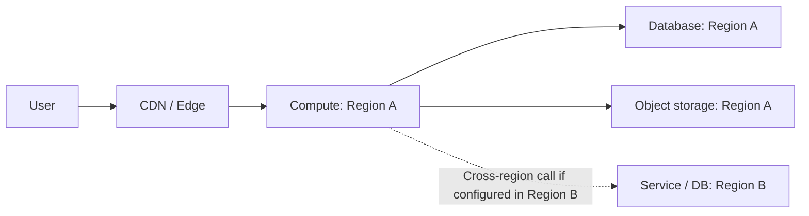
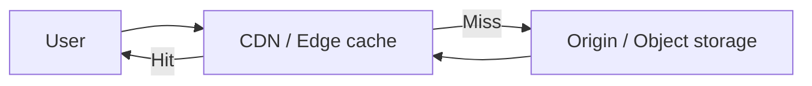

# Impact of Latency, Bandwidth, and Data Transfer Costs

## 1. Why Data Placement Affects Both Performance and Cost

A cloud application may run powerful compute, a managed database, and highly durable object storage, yet still feel slow or become expensive if data sits far from processing, gets transferred repeatedly, or crosses unnecessary network hops. A product page loading dozens of images from remote geographies, an API querying a database across many round trips, or an analytics pipeline continuously shipping data across regions can all generate high latency and large network bills.

Three factors must be examined together:

- **Latency:** the time from sending a request or packet until receiving a response. In applications, distinguish network round-trip time, processing time, and end-to-end latency.
- **Bandwidth:** the maximum data-carrying capacity of a link under given conditions, typically expressed in bits per second.
- **Data transfer cost:** charges incurred when data crosses a billing boundary, such as out to the Internet, across availability zones, across regions, or through a network service.

These three factors are related yet not synonymous. High bandwidth does not guarantee low latency; low latency does not guarantee high throughput; and the same data flow may be free over one path while incurring charges on another depending on the provider, service, region, and configuration.

In the **CLOUD_ARCHITECTURE** module, the **Storage Architecture** chapter helps evaluate data placement, access patterns, and network paths against business requirements, reliability, scalability, security, cost, and operations.

After this lesson, learners can:

1. Distinguish latency, bandwidth, throughput, IOPS, and data transfer volume.
2. Analyze how network round trips, payload size, and data placement affect response times.
3. Estimate data transfer duration and identify bottlenecks.
4. Understand billing boundaries such as Internet egress, inter-zone, inter-region, CDN, and private connectivity.
5. Design appropriate data placement, caching, CDNs, replication, compression, and batching.
6. Calculate network costs per workload and avoid optimizing one metric at the expense of total cost.
7. Plan latency/throughput measurements, load testing, and transfer billing monitoring.

## 2. Distinguishing Key Network Metrics

| Term | Meaning | Common units | Example |
| --- | --- | --- | --- |
| **Latency** | Time for information to travel from one point to another or complete a round trip | ms, µs | API call to database takes 8 ms network RTT |
| **Bandwidth** | Maximum transmission capacity of a link | bit/s, Gbit/s | NIC has a maximum bandwidth per instance type |
| **Throughput** | Actual volume of data transferred per unit of time | byte/s, MB/s, Gbit/s | Object copy achieves 700 MB/s |
| **IOPS** | Number of I/O operations per second | operations/s | Volume sustains 10,000 IOPS |
| **Payload size** | Data size per request/response | byte, KB, MB | 40 KB JSON response |
| **Transfer volume** | Total data crossing a boundary in a period | GB, TB | 12 TB egress/month |
| **Jitter** | Variance in latency | ms | RTT fluctuates between 5 and 45 ms |
| **Packet loss** | Percentage of packets failing to arrive | % | A fraction of packets drop and require retransmission |

Bandwidth is usually a nominal capacity or advertised cap; throughput depends on congestion, protocols, CPU, storage, packet sizes, concurrency, TLS, traffic shaping, and service limits. Never treat maximum bandwidth as guaranteed application throughput.

### 2.1. One-Way Latency and Round-Trip Time

**One-way latency** is the time a packet takes from A to B. **Round-trip time (RTT)** is the time from A to B and back to A. Tools usually measure RTT because synchronizing clocks tightly at both ends to measure one-way time is difficult.

An application operation often requires multiple round trips:

- Establishing the TCP connection.
- TLS handshake.
- DNS resolution.
- Sending the request and receiving the response.
- Querying the database and receiving results.
- Calling additional downstream services in the processing chain.

Connection reuse, keep-alive, TLS session resumption, and multiplexing reduce repeated overhead, but cannot eliminate the latency of required exchanges.

### 2.2. Bandwidth Is Not Real-World Download Speed

If a link has 1 Gbit/s bandwidth, the theoretical limit is roughly 125 MB/s before overhead because 8 bits equal 1 byte. Yet an application may achieve less due to TCP window sizing, packet loss, encryption, remote storage throttling, CPU, or shared links.

Always specify units explicitly:

- **Mb/s or Mbps:** megabits per second.
- **MB/s:** megabytes per second.
- **Gbps:** gigabits per second.
- **GB/TB:** data volume, not transfer rate.

Confusing Mbps with MB/s causes an eightfold error in transfer forecasts.

## 3. Where Can a Request Spend Time?

End-to-end response time is more than compute processing duration:

```text
End-to-end latency =
    DNS / connection setup
  + network round trips
  + request transfer time
  + service processing time
  + storage read/write time
  + downstream calls
  + response transfer time
  + queueing / retries
```

Not every component appears in every request. An already-open connection skips DNS/TCP/TLS setup; a cached API skips the database; an asynchronous pipeline does not force the client to wait through full processing.

### 3.1. Example: API Calling Three Services Sequentially

Suppose an API fetches a profile, retrieves pricing, and checks inventory. Each dependency has 12 ms network RTT and 8 ms processing time.

If the three calls run sequentially:

```text
Total dependency time ≈ 3 × (12 ms + 8 ms)
                      = 60 ms
```

If independent calls run in parallel, elapsed time approaches the slowest call plus orchestration overhead rather than the sum of all calls. However, parallel calls increase concurrent connections and requests; verify downstream dependencies can absorb the fan-out.

### 3.2. Chatter: Many Small Requests Causing Slowdowns

An application issuing 40 database queries per request can become dominated by RTT even with tiny total payloads. Rather than moving large data, it spends most of its time waiting on round trips.

Ways to reduce chatter:

- Batch compatible queries together.
- Use appropriate joins or query projections to cut round trips.
- Fetch multiple records in pages instead of one record at a time.
- Reuse connections and prepared statements.
- Cache slowly changing reference data.
- Emit events instead of polling continuously where the model fits.

Batching can increase payload size and memory usage, so bound batch sizes and avoid oversized queries.

## 4. Relationship Between Payload, RTT, and Throughput

A simple estimate for payload transfer time:

```text
Transfer time (seconds) ≈ payload size (bits) / effective throughput (bits/s)
```

For example, transferring a 100 MB payload over a link with 200 Mbit/s effective throughput:

```text
100 MB × 8 = 800 Mbit
800 Mbit / 200 Mbit/s = 4 seconds
```

Actual time also includes latency, protocol overhead, congestion, encryption, retransmissions, and read/write speeds at both ends. The formula describes only the payload transmission portion on an ideal path.

### 4.1. When Latency Dominates vs. When Bandwidth Dominates

- **Many small requests/round trips:** latency usually dominates.
- **One large file / continuous stream:** bandwidth and throughput usually dominate.
- **High concurrency:** latency, queueing, and downstream capacity all matter.
- **Packet loss or congestion:** RTT spikes and TCP throughput can drop.
- **Large payloads on constrained CPU:** serialization, compression, and TLS can become the bottleneck.

### 4.2. Bandwidth-Delay Product

The Bandwidth-Delay Product (BDP) estimates how much data can be "in flight" on the link at a given moment:

```text
BDP = bandwidth × round-trip time
```

If a link runs at 1 Gbit/s with 40 ms RTT:

```text
BDP = 1 Gbit/s × 0.04 s
    = 40 Mbit
    = 5 MB
```

This shows enough in-flight data / window size is needed to saturate the link. If TCP windows or applications keep only a few KB outstanding, throughput falls below link capacity. Modern TCP stacks autotune windows, yet proxies, socket settings, and application patterns can still expose this limit.

## 5. Data Placement and Network Locality

**Data locality** places compute near data or structures processing flows to avoid unnecessary long-distance data transfers. Keeping a database in Region A while the application runs in Region B adds WAN RTT to every query and incurs cross-region transfer charges.

Questions to answer before deployment:

- Where geographically are most users located?
- Are compute and storage in the same region?
- Are the database and application in the same availability zone?
- Do read/write paths traverse NAT, firewalls, transit hubs, proxies, or the public Internet?
- Is data replicated across multiple regions?
- Do requests require immediate synchronous consistency or can they run asynchronously?
- Which geographies are permitted to store the data?

### 5.1. Placement and Round-Trip Diagram



If an API in Region A queries a DB in Region B on every request, every DB-dependent operation incurs WAN latency. If users in Region B need local reads, consider local read replicas/read models, caches, or async API designs while accepting consistency semantics and replication costs.

### 5.2. Same Region Does Not Mean Same Zone

Keeping compute and databases in the same region avoids some cross-region latency and fees, yet traffic can still incur inter-AZ, gateway, or service transfer charges. Availability zones are independent failure domains by provider design; never cram every component into a single zone just to avoid transfer charges at the expense of resilience.

Placement choices must balance:

- Availability and failover.
- Latency between compute and data.
- Inter-zone/inter-region transfer fees.
- Data residency and compliance.
- User-journey SLOs.
- Replication costs and standby capacity.

## 6. Data Transfer Types and Billing Boundaries

Every provider has its own pricing tables and rules, but architecturally you should identify these flow categories:

| Flow type | Example | Things to verify |
| --- | --- | --- |
| Internet ingress | Users uploading files to the cloud | Whether ingress is free or metered for the specific service |
| Internet egress | Cloud returning images/API responses to users | Egress tiers, regions, destinations, and volume |
| Inter-AZ | App calling a DB or service in another AZ | Directional transfer rates and service rules |
| Inter-region | Replicating objects/databases or calling remote-region APIs | Per-GB fees, replication, and request charges |
| Same-region service transfer | Compute talking to objects/databases in the same region | Product-specific rules, endpoints, and topology |
| CDN delivery | Edge serving objects to users | CDN egress, origin fetch, and cache hit/miss |
| NAT/Firewall processing | Workloads reaching the Internet or inspection layers | Data processing, hourly/capacity, and associated transfers |
| Dedicated connectivity/VPN | Connecting on-premises to the cloud | Port/connection fees, provider charges, data processing, and egress |
| Backup/replication | Copying snapshots or logs to another region | Snapshot storage, copy/transfer fees, and retention |

**Never infer pricing from flow names alone.** Certain ingress paths may be free on specific services; some service-to-service paths have special billing mechanics; rates differ by region, tier, destination, and contract. Always verify with the provider's pricing calculator and billing documentation at design time.

### 6.1. Egress and Ingress

In many cloud models, Internet egress is a major cost driver because data leaves the cloud or billing boundary. Yet no single rule applies universally across all products.

For an image-hosting site:

- Uploading original images to object storage generates inbound traffic.
- Image processing generates output objects.
- Users fetching images via CDN generates delivery traffic.
- Cache misses force CDN origin fetches.
- Cross-region replication adds more transfer.

Measure total traffic across the lifecycle rather than counting stored bucket GB alone.

### 6.2. Two Directions Can Be Billed Differently

A single connection carries both requests and responses, yet billing rules may differ by direction. For example, small inbound requests trigger large outbound responses, concentrating charges on the outbound direction. When estimating, sum volumes per direction and match how the provider meters billable bytes.

## 7. Estimating Data Transfer Costs

A simple forecasting model:

```text
Monthly transfer cost ≈
    Σ (billable volume by route × applicable rate)
  + gateway / processing charges
  + CDN / private connectivity charges
  + related request and storage charges
```

Do not lump all GB into a single flat rate. Break estimates down by route, destination, region, direction, and service.

### 7.1. API Egress Example

Assumptions:

- 2 million requests/day.
- 80 KB average response.
- 30 days/month.
- In this example, temporarily ignore compression, caching, and protocol overhead.

Approximate egress volume:

```text
2,000,000 × 80 KB = 160,000,000 KB/day
≈ 160 GB/day (decimal approximation)
≈ 4,800 GB/month
```

If compression shrinks average payloads to 30 KB:

```text
2,000,000 × 30 KB × 30
≈ 1,800 GB/month
```

The difference is roughly 3 TB of egress per month before factoring related charges. Actual dollar savings depend on multiplying by the route-specific rate and subtracting compression CPU/latency overhead.

### 7.2. Cross-Region Replication Example

Suppose a database generates 50 GB of change logs per day and a replica in another region continuously receives them. Rough 30-day transfer estimate:

```text
50 GB/day × 30 days = 1,500 GB/month
```

This is not the final bill. Account for replication protocols, compression, retransmissions, initial snapshot seeding, bidirectional control traffic, storage, and managed database fees.

### 7.3. Data Transfer Budget

Projects should maintain a transfer budget broken down by component:

| Component | Monthly forecast | Unit rate to verify | Owner |
| --- | ---: | --- | --- |
| Public API egress | GB | By region/destination | API team |
| CDN delivery | GB | By edge geography/tier | Web platform |
| Origin fetch | GB | By origin path | Storage team |
| Cross-AZ traffic | GB | By service/zone route | Platform |
| Cross-region replication | GB | By region pair/service | Data team |
| NAT/firewall processing | GB + hours | By gateway/inspection tier | Network team |
| Backup copies | GB | By copy/retention policy | Data ops |

Track variance between forecasts and actual bills; never wait until month-end surprises with no alerts.

## 8. Compression: Fewer Bytes or Higher CPU?

Compression shrinks bytes on the wire, lowering latency and egress bills, at the expense of CPU cycles and potential processing overhead.

Good fit for:

- Large JSON/text responses.
- Log/event payloads.
- Text-based files.
- Artifacts or objects compressible before storage/transfer.

Poorer fit for:

- Already-compressed JPEG/PNG/WebP images.
- Compressed video/audio codecs.
- Payloads so tiny that headers/compression overhead outweigh savings.
- CPU-bound workloads or ultra-low-latency paths.

### 8.1. Total-Cost Evaluation

Compare:

```text
Net benefit =
    transfer cost saved
  + latency / bandwidth benefit
  - compression CPU cost
  - additional memory / complexity cost
```

For example, compressing a 1 MB JSON response to 150 KB saves ~85% of payload bytes, yet you must benchmark compression CPU, p95 latency, and compute cost. Pick suitable algorithms such as gzip or Brotli per client/proxy support; never compress every file blindly.

### 8.2. Compressing at Storage vs. In Transit

Compressing objects before storing reduces storage and replication volumes, but affects range requests, random access, deduplication, and direct processing. HTTP-layer compression only changes the wire representation while keeping source objects intact. Clarify whether you need network savings, storage savings, or both.

## 9. Caching and CDNs to Reduce Latency and Origin Egress

Caches keep copies closer to consumers to cut origin round trips and avoid redundant transfers. Common layers:

- Browser caches.
- CDN/edge caches.
- API gateway caches.
- Reverse proxies.
- Application in-memory caches.
- Distributed caches.
- Database buffers/caches.



CDN cache hits offload the origin and reduce origin-to-edge transfers, though CDN delivery to end users still incurs CDN pricing. Never assume caching makes all egress free.

### 9.1. Cache Hit Ratio

```text
Cache hit ratio = cache hits / total eligible requests

Origin requests ≈ total requests × (1 - hit ratio)
```

If 10 million cache-eligible requests achieve a 90% hit ratio, the origin handles ~1 million requests instead of 10 million. However, always inspect the byte hit ratio too: a high request hit count does not guarantee most bytes are served from cache.

### 9.2. Cache Correctness and Invalidation

Caching can serve stale data. Define:

- Whether data is public or private.
- TTLs and `stale-while-revalidate` if supported.
- Which query params/headers/cookies belong in cache keys.
- Whether objects can be purged/invalidated on updates.
- Whether sensitive data risks cross-tenant cache leaks.
- Whether serving stale content is allowed during origin outages.
- Maximum acceptable staleness for business data.

Never cache responses containing PII or private data in shared caches without strict `Cache-Control` and key isolation.

### 9.3. Cache Stampede

When a popular key expires, thousands of requests can hit the origin simultaneously. Use request coalescing / single-flight, TTL jitter, `stale-while-revalidate`, or early background refresh to prevent synchronized load spikes.

## 10. Data Placement: Where Should Compute and Data Live?

A placement decision typically weighs three axes:

1. Where data is stored long-term.
2. Where data is read/written frequently.
3. Where compute runs heavy processing.

When compute and storage sit far apart, data crosses the network on every run. For large batches, moving compute close to data can be far cheaper than hauling terabytes to compute. For interactive APIs, local replicas/caches cut read-path latency.

### 10.1. Common Placement Patterns

| Pattern | When suitable | Trade-offs |
| --- | --- | --- |
| Compute and primary data in the same region | OLTP APIs needing predictable RTT | Distant users still see WAN latency |
| Read replicas near users | Read-heavy workloads tolerating lag | Replication cost and stale reads |
| CDN/edge caching | Public, infrequently changing content | Invalidation, cache misses, and edge charges |
| Object storage + event processing near the bucket | Large-file processing pipelines | Event design, regional availability, and egress |
| Central data lake | Consolidated analytics | Moving data from multiple sources/regions |
| Regional data partitioning | Data residency and locality | Complex cross-region queries/workflows |

### 10.2. Bring Compute to Data or Data to Compute?

For 5 TB of analytics data, running jobs in the data's region avoids transferring 5 TB cross-region. Yet if a job needs inputs from several regions, you may need partial transfers or local pre-aggregation.

Decision questions:

- Is the dataset permitted to be processed in its current region?
- Does compute have adequate quotas/capacity there?
- Are outputs much smaller than inputs?
- Can summaries be shipped instead of raw data?
- Are centralized auditing/governance required?
- Do transfer costs exceed local compute costs?

## 11. Replication: Higher Availability, Higher Traffic

Replication creates copies to boost resilience, lower read latency, or serve multiple geographies. However, it also drives continuous network traffic and synchronization overhead.

### 11.1. Synchronous and Asynchronous Replication

- **Synchronous replication:** commits wait for replica/quorum acknowledgment per service guarantees. Increases latency and sensitivity to link health.
- **Asynchronous replication:** primary acknowledges before all replicas receive updates. Lowers write latency at the cost of replication lag and potential loss of un-replicated writes on failover.
- **Semi-synchronous / quorum variants:** wait for a subset of replicas; semantics depend on engine/provider.

Never infer guarantees from labels like multi-AZ or multi-region alone. Verify exact database service behavior during failovers and network partitions.

### 11.2. Read Scaling

Read replicas spread read load and can sit closer to compute or users. Yet replication lag means a read immediately after a write can observe stale data. Mitigations include:

- Routing read-after-write queries to the primary for a short window.
- Using session consistency tokens/versions.
- Selecting replicas caught up to a target replication position.
- Returning timestamps/versions and accepting bounded staleness in UX.
- Revalidating critical state at the authoritative source.

### 11.3. Calculating Replication Volume

If the source mutates at an average rate of 8 MB/s with replicas in two regions:

```text
Raw replication flow ≈ 8 MB/s × 86,400 s/day
                     ≈ 691,200 MB/day
                     ≈ 691 GB/day (decimal)
```

Add initial snapshot seeding, protocol overhead, retries, and extra copies; log compression may reduce transfer volume at higher CPU cost.

## 12. Batching, Streaming, and Transfer Protocols

Transfer patterns reshape both latency and cost.

**Batching:** grouping multiple items into one request reduces per-request overhead and round trips, while increasing request size, memory usage, and retry scope.

**Streaming:** processing bytes incrementally instead of buffering complete payloads lowers peak memory and time-to-first-byte for large files. Requires handling backpressure, client disconnects, and retries.

**Multipart upload:** splits large objects into parts for parallel uploads and resume; adds part management, aborting incomplete uploads, and lifecycle cleanup.

**Compression:** cuts bytes while consuming CPU.

**Protocol multiplexing:** shares one connection or stream across many requests, reducing connection setup while requiring awareness of flow control and protocol head-of-line behavior.

### 12.1. Time to First Byte and Time to Last Byte

For streaming/downloads:

- **TTFB:** time from request until the first byte arrives.
- **Completion time:** time until the complete payload arrives.
- **Throughput:** sustained rate across the transfer.

A system with low TTFB but poor throughput still makes users wait long for large files. Measure all three.

## 13. Multi-Region and Data Residency

Multi-region topologies reduce latency for globally distributed users and strengthen DR, at the cost of greater network complexity.

Define clearly:

- Which region owns writes.
- Which geographies may host read replicas/caches.
- Which data is replicated, encrypted, and retained for how long.
- Whether cross-region replication is synchronous or asynchronous.
- Whether failover risks losing recent writes or creating conflicts.
- Whether DNS/traffic steering routes to regions truly holding up-to-date data.
- Costs for transfers, snapshot copies, backups, and log exports.

Data residency may bar moving raw data to another region; in those cases, aggregate or anonymize locally and transfer only reduced-sensitivity datasets if policy allows. Anonymization does not automatically guarantee non-reidentifiability; follow real data governance policies.

## 14. Private Connectivity, NAT, and Firewalls: In-Path Processing Charges

Traffic to object storage or databases may traverse public endpoints, private endpoints, NAT gateways, proxies, or firewalls depending on design. The chosen path affects latency, security, observability, and cost.

Check:

- Do private endpoints bill per endpoint-hour, per GB processed, or vary by service type?
- Does a NAT Gateway bill both hourly and per GB processed?
- Do firewalls/appliances add capacity, processing, or cross-zone transfer fees?
- Does traffic between endpoints and workloads cross AZs or regions?
- Does DNS resolve to private addresses within the right network scope?
- Do egress allowlists force all requests to hairpin through a central hub?

Private paths are not always cheaper than public paths. Their primary value may be private exposure, policy enforcement, and governance; total cost must sum endpoints, gateways, and transfers.

## 15. Overlooked Traffic: Analytics, Backups, and Logs

Background flows outside user requests can still generate hefty bills:

- Cross-region database snapshot copies.
- Backup exports to object storage.
- Log shipping to central workspaces.
- Metrics/traces shipped to observability platforms.
- Data lake ingestion across many services.
- Search index or cache replication.
- Pulling container images from remote-region registries.
- Downloading packages/artifacts on every deployment.

Maintain a data flow inventory with an owner for every flow. Filter, sample, retain, and aggregate logs/traces appropriately; avoid shipping sensitive payloads or full raw events when summaries suffice.

### 15.1. Backup Locality

Same-region backups recover quickly from logical bugs or data corruption, but fail to protect fully if an entire region goes down. Copying backups to another region boosts resilience while adding transfer/storage charges and requiring verification of encryption keys, retention, restore permissions, and data residency.

### 15.2. Observability Volume

Suppose one service emits 5,000 log events/s averaging 1 KB each:

```text
5,000 × 1 KB × 86,400 s
≈ 432,000,000 KB/day
≈ 432 GB/day (decimal approximation)
```

Just one service can generate massive volume. Structured logs, sampling, aggregation, and retention policies cut transfer/storage volume while preserving diagnostic value.

## 16. Security for Data in Transit

Optimizing latency and cost must never weaken data protection.

- Enforce TLS on traffic needing protection, even inside private networks when the threat model calls for it.
- Authenticate service-to-service calls and verify object/database permissions.
- Encrypt data at rest per policy; manage keys and decrypt permissions.
- Never cache shared responses containing private data without tenant/user isolation.
- Never record sensitive payloads in CDN, proxy, firewall, or flow logs.
- Restrict egress to necessary destinations and monitor anomalies.
- Control pre-signed URLs: expirations, methods, and object scopes.
- Enforce retention and deletion lifecycles on temporary replicas/caches/objects.

Compressing before TLS can introduce side-channel risks in certain contexts if secrets and attacker-controlled inputs are compressed together; follow application security guidance rather than enabling compression indiscriminately.

## 17. Measuring and Diagnosing Data Performance

Useful measurements isolate each layer:

| Layer | Metrics | Question |
| --- | --- | --- |
| Client/edge | TTFB, total latency, cache hits | How long do users actually wait? |
| Network | RTT, packet loss, retransmissions, jitter | Is the network link healthy? |
| Compute | CPU, memory, serialization/compression time | Is the app keeping up? |
| Storage | IOPS, throughput, queue depth, read/write latency | Is disk/database storage bottlenecked? |
| Database | Query latency, connection wait, replication lag | How are queries and replicas behaving? |
| Data transfer | GB by route/direction/region | Which path is generating spend? |
| CDN/cache | Byte hit ratio, origin fetches, stale responses | How much origin traffic is caching offloading? |
| Cost | Cost per GB, per request, per job | Is unit economics improving? |

### 17.1. Know Where Latency Is Measured From

Pinging a public endpoint from a developer laptop does not reflect latency between a cloud function and a database inside a VPC/VNet. Measure from the actual runtime, subnet/region, protocol, and workload pattern.

Use:

- Distributed tracing to see per-dependency durations.
- Application metrics for queries, serialization, and transfers.
- Network telemetry / flow logs per provider capabilities.
- Copy/stream benchmarks using representative payloads.
- Synthetic probes from actual regions/zones.
- Billing exports / cost allocation to identify billable transfers.

### 17.2. Controlled Throughput Testing

Tests must specify payload sizes, connection counts, concurrency, duration, warm-up, compression, encryption, and endpoints at both ends. Ramp load gradually; record both throughput and p95/p99 latency. A short peak burst does not prove sustained throughput if buffers or kernel caches mask storage limits.

## 18. Optimizing Cost Without Degrading SLOs

Actions should follow measured data flows:

1. **Co-locate compute with primary data** for frequent read/write workloads.
2. **Cache/CDN** for public or slowly changing content with proper keys and invalidation.
3. **Compress** large text payloads when CPU headroom exists.
4. **Batch** to cut round trips in suitable workloads.
5. **Stream / multipart** large objects to lower memory and enable resume.
6. **Aggregate/summarize at the source** instead of shipping raw data everywhere.
7. **Trim redundant replication** while preserving RTO/RPO.
8. **Optimize logs/traces** via sampling, filtering, and retention.
9. **Avoid needless NAT/firewall/hub detours** while preserving security policies.
10. **Track byte hit ratio and egress per endpoint/tenant** to target top drivers.

Never optimize by collapsing all workloads into a single AZ to dodge transfer fees if doing so destroys fault tolerance. Quantify outage and data-loss costs alongside network bills.

## 19. End-to-End Example: Media Platform

An image/video platform serves users across many countries:

- Users upload original photos/videos.
- Compute generates thumbnails/transcodes.
- Object storage holds masters and derivatives.
- CDN serves public content.
- Metadata lives in a database.
- Analytics collects view events.

If every media fetch goes straight to a distant bucket, latency and origin egress climb. A better approach:

- Upload into object storage via endpoints appropriate to user regions.
- Trigger asynchronous processing in the same region as the data.
- Store derivatives under explicit keys/versions.
- Cache at the CDN using immutable URLs/content hashes.
- Keep database metadata with a clear primary owner and tailored read strategy.
- Batch/aggregate view events before shipping to the data lake.
- Configure lifecycles to abort incomplete multipart uploads and purge temp objects.
- Track dashboards for CDN byte hit ratio, origin egress, cross-region replication, and cost per playback.

### 19.1. Architectural Questions

1. Which files must be served globally versus kept within one geography?
2. Do uploads/downloads require resumable/multipart support?
3. What is the CDN cache byte hit ratio?
4. Are signed URLs / private content access controls needed?
5. Should transcode compute run in the object's region or a cheaper/higher-capacity region?
6. Can event summaries be shipped instead of raw playback logs?
7. Does replication to a DR region align with RPO and budget?
8. During an origin region outage, how far and for how long can the CDN serve cached objects?

## 20. Sample ADR: Placing Processing Near Data and Using CDN for Delivery

```text
ADR-074: Regional media processing and CDN delivery

Context:
- Media is uploaded from multiple geographies.
- Original files are large; thumbnails/video derivatives are accessed repeatedly.
- Origin egress and user latency must be controlled.
- Metadata and access control require an authoritative source.

Options:
A. One region processes and serves all traffic.
B. Process objects near their storage region; use CDN for cacheable content.
C. Replicate every object to every region.

Decision:
- Choose B as the baseline.
- Processing is triggered by object events in the appropriate region.
- Outputs use versioned/immutable keys for effective caching.
- Metadata/authorization remain verified by the authoritative service.
- Replication applies only to objects/data with DR or locality requirements.

Trade-offs:
- CDN, regional processing, and lifecycles add operational components.
- Cache invalidation and private content require explicit policies.
- Cross-region egress may still occur for replication and failover.

Validation:
- Measure TTFB, total latency, and byte hit ratio by geography.
- Forecast origin, CDN, and cross-region transfer costs.
- Test origin outages, cache misses, and private object access controls.
- Verify RTO/RPO and data residency.

Revisit triggers:
- Traffic geography shifts.
- Egress or CDN costs exceed budget.
- RTO/RPO or residency requirements change.
```

## 21. Common Design Mistakes

1. **Equating bandwidth with throughput:** produces overly optimistic transfer forecasts.
2. **Confusing Mbps with MB/s:** introduces an eightfold calculation error.
3. **Measuring only compute time:** ignores network RTT, queueing, and storage latency.
4. **Placing databases far from compute:** adds WAN latency and transfer fees to every query.
5. **Assuming same-region means zero transfer cost:** overlooks AZ, gateway, and service-specific paths.
6. **Not classifying egress:** hides which routes drive bill growth.
7. **Measuring cache hit ratio by request count without bytes:** high hit count can mask low byte hit ratio.
8. **Caching sensitive responses without tenant isolation:** risks cross-customer data leaks.
9. **Compressing every file:** wastes CPU on already-compressed media or tiny payloads.
10. **Oversized batches:** inflate memory, latency, and retry blast radius.
11. **Replicating everything everywhere:** transfer, storage, and complexity exceed actual needs.
12. **Running central analytics that pull raw data continuously:** moves massive unnecessary volumes.
13. **Ignoring log/trace volume:** observability bills grow silently.
14. **Cutting costs by dropping HA:** small savings create high downtime/data-loss risk.
15. **Relying on outdated pricing or generic rates:** misestimates due to regional, tier, and service differences.
16. **Having no owner for data flows:** nobody investigates when transfer bills spike.

## 22. Pre-Production Checklist

- [ ] Latency, bandwidth, throughput, IOPS, and payload size are clearly distinguished.
- [ ] RTT/TTFB/end-to-end latency are measured from the actual region and runtime.
- [ ] Sequential round trips and chatter are identified and optimized appropriately.
- [ ] Compute and storage placement satisfy locality, availability, and residency.
- [ ] Transfers are inventoried by direction, destination, zone, region, and service.
- [ ] Egress, inter-AZ, inter-region, CDN, NAT/firewall, and backup flows are forecasted.
- [ ] Unit rates are verified against current pricing for exact regions, services, and tiers.
- [ ] Caches define keys, TTLs, invalidation, stale policies, and tenant isolation.
- [ ] Compression, batching, and streaming are benchmarked with real payloads.
- [ ] Replication modes, lag, transfer volumes, and RTO/RPO are defined.
- [ ] Logs, metrics, traces, and backups have sensible retention and sampling.
- [ ] Heavy traffic paths implement backpressure and downstream limits.
- [ ] Dashboards track GB per route, byte hit ratio, p95/p99 latency, and cost per operation.
- [ ] Network congestion, packet loss, slow storage, and origin failures have been tested.
- [ ] Cost optimizations do not weaken fault-domain isolation or security.
- [ ] Owners, budget alerts, and forecast-vs-actual variance reviews are in place.

---

**Key takeaway:** Latency governs wait time, bandwidth caps link capacity, and data transfer cost depends on which boundaries data crosses and under which billing rules. Good cloud storage design places compute near the right data, trims unnecessary round trips and bytes, applies caching and replication purposefully, and measures performance and cost per real data flow.
