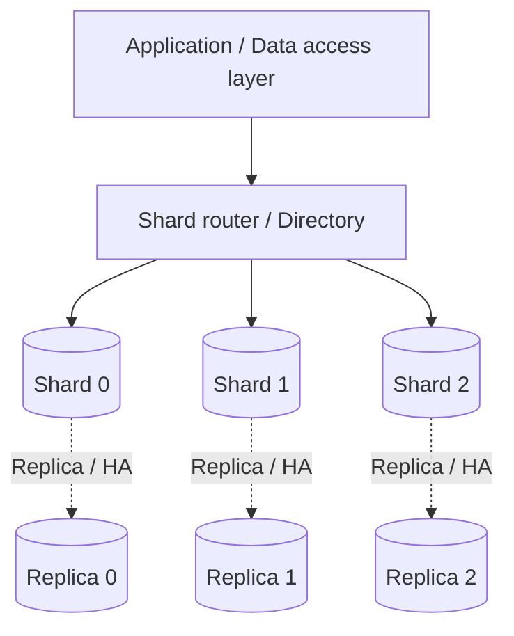
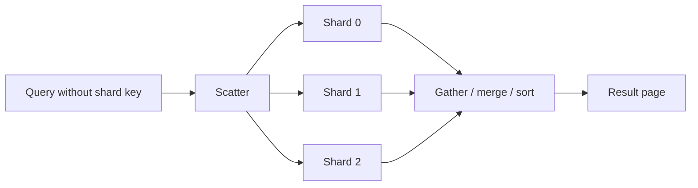
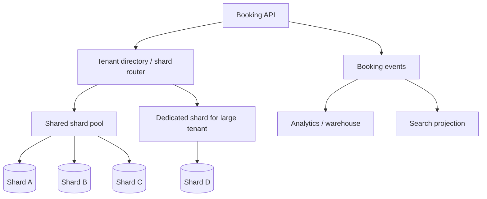

# Partitioning, Sharding, and Handling Hotspots

## 1. When a Single Database No Longer Meets Demand

An application often starts with one database and one large table. As users, transactions, and data grow, the database can hit limits in CPU, memory, storage capacity, IOPS, network throughput, or connection count. Full-table scans slow down concurrent requests; a single large tenant can consume most of the capacity; a few frequently accessed products can create uneven load across nodes.

**Partitioning** splits a dataset into smaller segments according to a rule. Within a database, partitions may still live on the same database instance or be managed as separate storage units.

**Sharding** typically refers to splitting data horizontally across multiple database nodes/instances to increase storage or processing capacity while distributing load. Each shard holds a subset of data, and the system must route requests to the right shard.

**A hotspot** occurs when a partition, shard, node, key, or resource receives disproportionately heavy load compared to the rest. Adding nodes does not automatically fix a hotspot if every request still targets the same key or shard.

This lesson belongs to the **Database Architecture** chapter of the **CLOUD_ARCHITECTURE** module. Its goal is to explain how to split data, choose partition keys, and handle skewed load in cloud architectures—balancing performance, consistency, reliability, security, cost, and operability.

After this lesson, you can:

- Distinguish in-database partitioning from sharding across multiple nodes.
- Choose range, hash, list, and composite partition keys aligned with queries.
- Identify cardinality, skew, hot keys, and hot partitions.
- Design routing, resharding, rebalancing, and cross-shard queries.
- Evaluate how partitioning/sharding affects transactions, indexes, backups, restores, and DR.
- Build a plan to measure load, detect hotspots, and mitigate them without service disruption.

## 2. Distinguishing Partitioning, Sharding, and Replication

These three techniques can be combined, yet they solve different problems.

| Technique | Organization | Common Goal | What It Does Not Solve Alone |
|---|---|---|---|
| **Partitioning** | Splits a table/dataset into partitions by key or range | Reduce scan scope, manage large tables, lifecycle/retention | CPU or connection limits of a single instance if all partitions share that resource |
| **Sharding** | Splits data horizontally across multiple database nodes/instances | Scale storage and throughput horizontally | Hot keys, cross-shard transactions, queries lacking the shard key |
| **Replication** | Copies data across nodes/regions | High availability, local reads near users, DR | Scaling single-writer capacity; can introduce lag or conflicts |

### 2.1. In-Database Partitioning

A database can divide a large table into logical/physical partitions. The application still queries a single logical table; the optimizer can skip irrelevant partitions when predicates match (partition pruning). Partitions can have independent lifecycles—for instance, splitting by month to archive old data.

Example of a transaction history table partitioned by month:

```text
transactions
  partition_2026_01
  partition_2026_02
  partition_2026_03
  ...
```

In many database engines, partitions still belong to a single database instance or managed cluster. Partitioning can improve manageability and query scoping, but it is not equivalent to adding independent database servers.

### 2.2. Sharding Across Multiple Databases

Sharding places slices of data on multiple database nodes:



The application or a proxy/router layer must know which shard owns each record. Each shard may have its own replicas for HA/reads, but replication within a shard is distinct from distributing data across shards.

### 2.3. Vertical Partitioning vs. Horizontal Partitioning

- **Horizontal partitioning:** splits rows by key. For example, customers with IDs 1–1 million on shard A and the rest on shard B; or hashing customer IDs for even distribution.
- **Vertical partitioning:** splits columns or attribute groups. For example, a core customer table holds ID/status, while large profiles or rarely accessed fields live in another table/service.

Vertical partitioning can shrink hot rows and isolate read/write workloads, at the cost of more joins or service calls. Horizontal partitioning scales row counts, yet complicates cross-slice queries and transactions.

## 3. When Should You Partition or Shard?

Not every large database needs sharding. Before splitting data, measure bottlenecks and verify whether query/index tuning, connection pooling, caching, read replicas, vertical scaling, or archiving solves the issue.

### 3.1. Signs Partitioning Fits

- Historical tables grow steadily over time; queries routinely filter by date/month.
- Old data must be archived or dropped by lifecycle policy.
- Queries target bounded slices and benefit from partition pruning.
- Maintenance, vacuum/reindexing, or backups on a massive table become unwieldy.

### 3.2. Signs to Consider Sharding

- A single database instance approaches CPU, IOPS, memory, network, or storage limits even after tuning.
- Write throughput cannot scale via vertical scaling or read replicas.
- Data can be separated into independent domains by tenant, customer, or aggregate.
- Most requests can route to a single shard without cross-shard joins or transactions.
- The team can operate multiple databases, backups/restores, migrations, and DR.

### 3.3. When Not to Shard Yet

| Signal | Why Reconsider |
|---|---|
| No baseline or identified bottleneck yet | The root cause may be queries/indexes or connections; sharding adds complexity without fixing the cause |
| Many transactions require multi-entity atomicity | Distributed transactions/sagas add complexity, latency, and failure modes |
| Queries frequently search across all data | Fan-out to all shards and scatter-gather merging consume heavy resources |
| Highly skewed tenants or keys | A shard stays hot even when total data is split |
| Ops lacks automation/observability | More nodes make backups, patching, failovers, and incidents harder |

Sharding is typically a long-term architectural commitment. Validate gains with benchmarks and cost models; do not shard simply because total database size looks large.

## 4. Partitioning Strategies

### 4.1. Range Partitioning

Splits by key value ranges, such as dates or IDs:

```text
created_at < 2026-04-01       -> partition_early
2026-04-01 <= created_at < 2026-07-01 -> partition_q2
created_at >= 2026-07-01      -> partition_recent
```

**Pros:**

- Time-range or key-range queries may read only a few partitions.
- Easy to archive/drop old partitions.
- Recent partitions can sit on different storage/tiers by data lifecycle.

**Cons:**

- New writes often concentrate on the latest partition (right-edge hotspot).
- Uneven data distribution if certain ranges have heavy volume.
- Wide range queries can still touch many partitions.

Range partitioning fits events/time-series, transaction histories, or time-filtered data, provided you plan for the active current partition running hot.

### 4.2. Hash Partitioning

Computes a hash on the partition key and maps to a partition or shard count:

```text
bucket = hash(customer_id) mod N
```

**Pros:** fairly even distribution if keys have sufficient variety and a good hash function; avoids concentrating all new inserts in one range.

**Cons:** key-range queries are hard to optimize; changing `N` can force many records to move buckets; hashing does not cure a single key with extreme access frequency.

Hash partitioning typically suits ID-lookup workloads where load distribution matters more than range scans.

### 4.3. List Partitioning

Splits by discrete values, such as region, data category, or tenant tier:

```text
region = 'north'  -> partition_north
region = 'south'  -> partition_south
region = 'central'-> partition_central
```

The advantage is intuitive rules that can serve data residency or per-group lifecycles. The downside is skewed group sizes; one large region or tenant can create its own hotspot.

### 4.4. Composite Partitioning

Combines two or more dimensions—for example, range by month, then hash by customer ID within each month. This balances lifecycle management and write distribution, though it multiplies partition counts and metadata, requiring reasonable partition count caps.

### 4.5. Strategy Comparison

| Strategy | Good For | Hotspot Risk | Suitable Queries |
|---|---|---|---|
| Range | Time/range-ordered data | Writes concentrated on newest edge | Range scans, time windows |
| Hash | Key-based access, load spreading | One super-hot key stays hot | Point lookups by key |
| List | Discrete domains, regions/tiers | One group grows too large | Filtering by group |
| Composite | Combining time lifecycle and load spread | Complex; poorly chosen keys still skew | Multi-dimensional queries with matching prefixes |

## 5. Choosing a Partition Key or Shard Key

This is often the most consequential decision. A poor key can put most data or traffic onto one shard; changing the key later may require massive data migration.

### 5.1. Criteria for a Good Key

1. **Sufficiently high cardinality:** enough distinct values to distribute records and load.
2. **Relatively uniform distribution:** avoid a few values accounting for most records or requests.
3. **Query alignment:** primary requests carry the key to route to a single shard.
4. **Stability:** keys rarely change, avoiding frequent data moves.
5. **Ownership alignment:** business data needing local transactions can live on the same shard when appropriate.
6. **No security exposure:** avoid leaking PII or sensitive data in routing metadata/logs; prefer opaque IDs.

### 5.2. Key Selection Examples

| Application | Candidate Key | Strengths | Risks |
|---|---|---|---|
| Multi-tenant SaaS | `tenant_id` | Isolates tenant data and tenant queries | One large tenant can overwhelm a shard |
| E-commerce | `customer_id` or `order_id` | Order lookups by customer or order | Product/inventory queries may require fan-out |
| Venue booking | `venue_id` or `booking_id` | Co-locates venue/booking aggregates | Popular venues create hot keys |
| Time-series | `device_id` combined with time bucket | Queries by device and time window | Chatty devices can run hot |
| Social feed | `user_id` or `account_id` | Fetches personal data per user | Celebrity/follower fan-out causes hotspots |

No single key optimizes every query. Measure query patterns, read/write ratios, cardinality, item sizes, and per-key frequency before committing.

### 5.3. Cardinality Does Not Guarantee Uniform Distribution

A key with millions of values can still be skewed if a small fraction dominates traffic. For instance, 90% of customers have fewer than 100 orders while the top 1% generate 50% of traffic. Hashing `customer_id` spreads customers across shards, yet all traffic for that top customer still lands on one shard.

Evaluate distribution using histograms and percentiles:

- Records per key/shard.
- Requests/sec and write bytes per key.
- p50/p95/p99 of tenant/key size.
- Share of top 1, top 10, and top 1% keys.

### 5.4. Routing via Shard Maps

The application must determine which shard holds a key. Approaches include:

- **Directory-based mapping:** a lookup table mapping tenant/key → shard. Flexible for moving tenants, but requires high availability and cache invalidation.
- **Hash modulo:** `shard = hash(key) mod N`. Simple, though changing `N` remaps many keys.
- **Consistent hashing:** maps keys and nodes onto a hash ring, usually reducing key movement when adding/removing nodes; still requires handling virtual nodes, hot keys, and mapping versions.
- **Range map:** stores key intervals and owning shards; easy for range routing, though requires split/merge handling and map updates.

Shard maps must be versioned, have cache/refresh mechanisms, and define rules for stale routing metadata. Never let individual services hard-code divergent mappings.

## 6. What Is a Hotspot and How Do You Spot It?

A **hotspot** is any point in the architecture receiving load or contention far exceeding the rest. It may be a:

- **Hot partition:** a partition holding/receiving far more records than others.
- **Hot shard:** a database shard with markedly higher CPU, IOPS, or connections.
- **Hot key:** a key with excessive request/write volume, funneling traffic to one partition/shard/row.
- **Hot row/index page:** many transactions updating the same row or index region, causing locks/contention.
- **Hot tenant:** one tenant consuming far more resources than others.
- **Hot range:** new writes continuously landing in the trailing partition/range.

### 6.1. Observable Symptoms

| Symptom | Possible Cause |
|---|---|
| High CPU/I/O on one shard while others sit idle | Key skew, skewed routing, tenant-specific workload, or heavy queries |
| p99 spikes despite low cluster-average CPU | One hot partition or lock contention masked by averages |
| One partition grows much faster than others | Hot tenant, latest range, or skewed producer keys |
| Queue backlog piles up on one partition | Hot key or unbalanced consumer assignment |
| Lock waits/deadlocks rise on one table/row | Competing writes on the same key or long-held transaction locks |
| Adding nodes leaves throughput flat | Hot key, single-writer bottleneck, global index, or shared dependency |

### 6.2. Dashboards Should Break Out by Shard/Partition

Track at minimum:

- CPU, memory, storage capacity, IOPS, throughput, and network per shard.
- Query latency p50/p95/p99 by shard and query type.
- Active connections, connection pool saturation, lock waits, and deadlocks.
- Rows/bytes and growth rate per partition.
- Read/write requests and bytes by anonymized/grouped partition key or tenant.
- Replication lag, failover events, and rebalance/migration progress.
- Top-N hot keys, with cardinality limits and safeguards against leaking sensitive values.

Never look only at cluster-wide averages. One shard at 99% CPU alongside five shards at 10% can still degrade the entire system.

## 7. Strategies for Handling Hot Partitions and Hot Keys

### 7.1. Adding Shards or Splitting Partitions

If a hotspot comes from multiple independent keys co-located on one shard, splitting the shard/range and moving data relieves load. However, if a single key drives nearly all traffic, hash-splitting will not help as long as every request uses the same routing key.

Before splitting:

- Determine whether the hotspot stems from data volume, request rate, heavy queries, or locks.
- Choose new boundaries that actually distribute the load.
- Estimate backfill duration, replication/catch-up time, and temporary storage overhead.
- Plan routing versions, cutover, rollback, and reconciliation.

### 7.2. Salting or Key Bucketing

When a single key is extremely hot and operations can be distributed, append a suffix/bucket:

```text
physical_key = business_key + "#" + hash(request_id) mod B
```

For example, view counts for a viral video can be split across 32 buckets and summed on read. However, reads must aggregate 32 buckets; updating an account balance or booking reservation cannot be arbitrarily salted because atomicity and invariants must be preserved.

Salting fits counters, analytics, or mergeable workloads. Do not use it when operations require locking a single authoritative value without a safe merge mechanism.

### 7.3. Isolating Large Tenants (Tenant Isolation)

Large tenants can move to dedicated shards or pools while smaller tenants share shards:

- Shared pools save resources across the long tail of small tenants.
- Dedicated shards isolate noisy neighbors and allow custom tuning for large tenants.
- A routing directory maps tenants to shards/pools, supporting migrations without changing business APIs.

Manage idle capacity costs and avoid proliferating tiny shards for temporary isolation.

### 7.4. Caching and Read Scaling

If the hotspot is read-heavy:

- Cache results or immutable/slowly changing data.
- Use CDNs or distributed caches depending on data classification and security boundaries.
- Use read replicas when consistency requirements allow.
- Use request coalescing/single-flight so concurrent misses trigger only one origin query.
- Add TTLs with jitter to prevent synchronized expiration and cache stampedes.

Caching eases read pressure but does not cure write hotspots; cache invalidation and staleness bounds must match business requirements.

### 7.5. Queuing and Write Buffering

For bursty writes, a queue absorbs spikes while workers write at a pace the database sustains. Ensure:

- Bounded consumer concurrency and batch sizes.
- Partition keys that preserve required ordering without creating hot partitions.
- Retries with backoff, DLQs, and idempotency.
- Monitoring for oldest message age and backlog; queues do not remove sustained throughput limits.

### 7.6. Bucketed Aggregations or Counters

A global counter updated on every request creates a hot row. You can store bucketed counters and aggregate periodically or on read. Define acceptable consistency lag and event deduplication rules.

Never use distributed counters when business rules demand a strict single-transaction limit (such as never overselling seats). In those cases, use controlled reservation/conditional updates or managed quota allocation.

### 7.7. Load-Aware Routing and Admission Control

Throttle or shed requests for overloaded tenants/keys, prioritize critical transactions, and enforce per-customer quotas. Return actionable retry guidance (such as HTTP 429 with `Retry-After`) so client retries do not amplify bursts.

## 8. Shard Routing and Cross-Shard Queries

### 8.1. Point Queries with a Shard Key

When a request includes the shard key, the router targets the exact shard:

```sql
SELECT order_id, status, created_at
FROM orders
WHERE tenant_id = 'T-100'
  AND order_id = 'O-900';
```

If `tenant_id` is the shard key with a clear mapping, only one shard is touched. This is the ideal query pattern in a sharded architecture.

### 8.2. Scatter-Gather

If a query lacks the shard key, the system may broadcast it to all shards and merge/sort the results:



Latency is governed by the slowest shard plus fan-out/merge overhead. Cost scales with shard count, returned bytes, and pagination depth. Cap scope, per-shard timeouts, page sizes, and concurrency.

### 8.3. Global Secondary Indexes

To look up by a non-shard attribute (such as email or SKU), maintain a global index/search projection mapping attribute → entity/shard. This index can be populated via event streams or a separate store. It avoids scatter-gather, at the cost of eventual consistency, backfills, retries, and index operations.

Do not build a global index for rare queries; consider read models, search services, or dedicated operational endpoints instead.

### 8.4. Pagination

Offset pagination across shards can read and discard many rows and shift when new items arrive. Keyset/continuation tokens are typically more efficient given a stable sort key. Tokens must encode or reference per-shard cursors, sort order, filters, and snapshot/version state if consistency is required.

## 9. Cross-Shard Transactions and Consistency

When related records reside on the same shard, local transactions provide atomicity. When operations span shards, evaluate:

- **Distributed transactions / 2PC:** provides atomic commits where supported, trading off coordinator overhead, lock durations, availability, and operational complexity.
- **Sagas:** breaks a flow into local transactions with compensating actions on failure; suited to long-running workflows, not instant rollback.
- **Outbox / event choreography:** publishes events post-commit for consumers to update other shards; requires idempotency, retries, and reconciliation.
- **Data co-location:** places related aggregate/tenant data on one shard to minimize cross-shard transactions.

Key selection may favor business correctness over perfectly uniform spread. Still, packing too much data for a massive tenant onto one shard risks hotspots; use dedicated shards or split aggregates along domain boundaries.

## 10. Rebalancing and Resharding

### 10.1. When Redistribution Is Required

- Adding/removing shards to scale capacity or lower cost.
- A large tenant outgrowing its current shard limits.
- A partition/range growing too rapidly.
- Changing the shard key or hashing scheme.
- Recovering from an incident and redistributing onto a new topology.

**Rebalancing** redistributes partitions/shards across nodes within the existing topology. **Resharding** changes shard boundaries or shard counts, often requiring data movement and routing updates.

### 10.2. Migration Strategies

| Strategy | Approach | Pros / Cons |
|---|---|---|
| Offline migration | Pause writes, copy data, switch routing, resume | Simpler, but incurs longer downtime |
| Dual-write | Write to both old and new shards during transition | Reduces downtime, but risks divergence if one side fails |
| Change-data capture (CDC) | Copy snapshot, replay log changes to new shard | Short cutover; requires managing lag, ordering, and duplicates |
| Lazy migration | Read old shard, migrate keys on access/write | Gradual shift, but must support two stores over a long tail |

### 10.3. Safe Resharding Workflow

1. **Measure and plan:** storage, write rate, read rate, index sizes, replication lag, and acceptable downtime.
2. **Provision target topology:** adequate capacity, HA/backups/monitoring ready, and new routing versions.
3. **Snapshot/backfill:** copy data by range/key with checkpoints; verify counts/checksums.
4. **Catch up change stream:** apply ongoing updates, preserve ordering, and track replication/copy lag.
5. **Manage dual-write/cutover:** enforce a single write owner or fencing mechanism to prevent uncontrolled concurrent writes.
6. **Reconcile:** verify counts, aggregates, checksums, foreign references, indexes, and transaction state.
7. **Switch routing:** update versioned directory/maps; invalidate caches and support legacy clients/routers during a defined window.
8. **Monitor and roll back:** watch errors, latency, duplicates, missing records, and shard load; keep a clear rollback path.
9. **Finalize:** purge old data only after the rollback window closes, audits pass, and backups are confirmed.

Never cut over simply because the snapshot copy finished. Catch up recent writes, establish a clean write-ownership handover, and prove zero data loss or duplication.

## 11. End-to-End Example: Sharding a Scheduling Platform

Suppose a scheduling platform handles tens of millions of bookings across many tenants/venues with skewed traffic. APIs routinely query bookings by `tenant_id` and `booking_id`; global reports aggregate daily; a few large tenants generate outsized traffic.

### 11.1. Initial Data Model

```text
Booking(
  booking_id,
  tenant_id,
  venue_id,
  customer_id,
  slot_id,
  status,
  created_at,
  version
)
```

Primary queries:

- Look up a booking: `tenant_id + booking_id`.
- List a tenant's bookings: `tenant_id + created_at`.
- Check availability: `venue_id + slot_id`.
- Platform-wide reporting: aggregate by time/region/status.

### 11.2. Key Selection and Trade-Offs

`tenant_id` routes tenant queries cleanly and isolates tenant data, yet huge tenants can become hot shards. `booking_id` offers higher cardinality, yet listing a tenant's bookings requires secondary/global indexes or fan-out. `venue_id` co-locates reservation contention, yet popular venues can run hot.

No single shard key solves every query. Prioritize critical transactions, dominant queries, and how large tenants scale.

### 11.3. Hybrid Approach

- Shared shard pool: smaller tenants are hashed by `tenant_id` for relatively even distribution.
- Dedicated shards: large tenants move to dedicated shards once they cross a threshold.
- Within each tenant, bookings are partitioned by time bucket for lifecycle management while preserving consistent keys/routing for transactions.
- Platform-wide reports run via an event pipeline/warehouse or dedicated read model rather than heavy fan-out queries on OLTP.
- External lookups by `booking_id` use a managed, consistently updated directory/index.

### 11.4. Conceptual Diagram



This diagram illustrates one architectural option; mappings, partition keys, and data placement must be codified in the directory/IaC. Warehouse/search projections may be eventually consistent relative to OLTP and must surface accurate semantics to users.

## 12. Security and Data Isolation

Sharding changes data boundaries and access paths. Ensure:

- Routers validate tenant identity from a trusted source; never accept arbitrary shard IDs from clients.
- Every query applies tenant filters or corresponding access controls; a shard is not the sole authorization boundary.
- Credentials/service identities hold least privilege per required shard; consider separating shared-pool and dedicated-shard permissions.
- Encryption at rest/in transit, key management, backups, and archives comply with data residency.
- Routing/diagnostic logs never leak PII, connection strings, shard credentials, or sensitive payloads.
- Redrives/migrations/resharding are audited and separately privileged.
- Test tenant isolation, cross-tenant query prevention, and directory permissions.

If a tenant moves shards, update routing maps, caches, backup policies, read replicas, CDC consumers, and permissions together. Moving data while forgetting permissions or observability can open cross-tenant vulnerabilities.

## 13. Backups, Restores, and Disaster Recovery

Each shard holds a slice of business data; backing up one shard does not mean you can recover the whole system if shards have cross-dependencies.

Your plan must answer:

- Are snapshot/log backups independent per shard or coordinated cluster-wide?
- How is logical point-in-time consistency maintained across shards when cross-shard workflows exist?
- Does restoring one shard require replaying events/change logs to catch up with other shards?
- How is directory/routing metadata backed up and restored?
- During a regional failover, do shard maps, DNS, credentials, and consumers transition cleanly?
- What are the RTO/RPO per shard and for the system as a whole?

Run periodic restore drills; verify post-restore application reads/writes, integrity, indexes, sequences, mappings, and replication. Never treat a successful snapshot alone as proof of application recoverability.

## 14. Performance, Cost, and Operational Capacity

### 14.1. Estimating Capacity and Throughput

If current total data is $D$, average monthly growth is $G$, design horizon is $M$ months, and headroom buffer is $H$, a rough storage estimate is:

\[
D_{target}\approx(D+G\times M)\times(1+H)
\]

This is a baseline estimate; add indexes, replicas, WAL/logs, backups, temporary space, and engine overhead. Each shard needs enough headroom for failovers, resharding, and maintenance.

Total throughput does not automatically equal shard count multiplied by single-shard throughput. Hot keys, routers, networking, coordinators, global indexes, and shared dependencies can bottleneck the system well before shards hit theoretical limits.

### 14.2. Commonly Overlooked Costs

- Database instances/storage/IOPS for every shard and replica.
- Backups, snapshots, archives, restore drills, and data transfers.
- Routers/directories, mapping caches, connection pools, and proxies.
- CDC/event pipelines, global indexes, search, and warehouses.
- Cross-shard queries, cross-region replication, and egress.
- Reserve capacity for rebalancing/failover; temporary storage during migrations.
- Engineering labor operating multiple databases, patching, schema migrations, and incidents.

### 14.3. Tracking Cost per Workload

Look beyond the aggregate bill. Allocate costs per tenant, shard, query class, or million successful transactions. Watch underutilized shards, tenants exceeding quotas, and scatter-gather expenses. This informs decisions to merge shards, isolate tenants, or adjust policies.

## 15. Well-Architected Review

| Pillar | Review Questions |
|---|---|
| **Operational Excellence** | Are shard maps/IaC versioned? Are split/move/failover runbooks tested? Can resharding be reconciled and rolled back? |
| **Security** | Is tenant routing trustworthy? Are permissions, encryption, backups, data residency, and auditing consistent across every shard? |
| **Reliability** | Do shards/replicas have failure isolation? What is the blast radius of one shard failing? Are recovery and consistency tested? |
| **Performance Efficiency** | How are keys distributed? Are hot partitions detected? Is query pruning/routing effective? |
| **Cost Optimization** | Are shard/replica counts, cross-shard traffic, backups, and ops effort right-sized? |
| **Sustainability** | Can low-load shards be right-sized/merged, and unnecessary fan-out or data movement avoided? |

## 16. Sample ADR for a Partitioning/Sharding Strategy

The template below captures the decision and verification criteria. It is an illustrative document, not a directly deployable database config:

```yaml
decision_id: ADR-DATABASE-004
title: Partition and shard strategy for booking data
workload:
  primary_queries:
    - tenant_id_and_booking_id
    - tenant_id_and_created_at
  peak_write_rate: measured_before_approval
partitioning:
  method: time_range_within_tenant
  lifecycle: archive_old_partitions
sharding:
  method: directory_based_tenant_mapping
  default_pool: shared
  large_tenant_policy: dedicated_shard
hotspot_controls:
  - per_tenant_quota
  - hot_key_monitoring
  - cache_for_read_heavy_paths
  - controlled_write_buffering
consistency:
  transaction_boundary: within_tenant_aggregate
  cross_shard_workflow: saga_or_event_driven
operations:
  rebalance: snapshot_plus_change_capture
  validation: counts_checksums_and_business_invariants
  rollback: old_routing_map_retained_during_cutover
acceptance_tests:
  - skew_and_hot_tenant_load_test
  - cross_shard_query_cost_test
  - shard_failure_and_restore_test
  - online_migration_reconciliation
review_triggers:
  - shard_skew_exceeds_threshold
  - tenant_growth_changes
  - query_pattern_or_slo_changes
```

Placeholders such as peak write rate and thresholds must be replaced with real measurements. A complete ADR also includes owners, approvals, rejected alternatives, cost estimates, and benchmark results.

## 17. Design and Implementation Process

1. **Measure workload:** read/write rates, query patterns, data growth, cardinality, skew, p95/p99 latency, and dependencies.
2. **Optimize before splitting:** indexes, query plans, schemas, caches, connection pooling, read replicas, and vertical scaling.
3. **Define data boundaries:** aggregates/tenants/regions and transactions needing co-location.
4. **Choose partition/shard keys:** verify distribution, hotspots, and routing for critical queries.
5. **Simulate:** benchmark both uniform and skewed datasets; test hot tenants, hot keys, range queries, and fan-out.
6. **Design operations:** shard maps, health checks, backups, DR, metrics, alerts, quotas, migrations, and owners.
7. **Migrate safely:** snapshot/backfill, CDC, catch-up, dual-write if required, reconciliation, cutover, and rollback.
8. **Monitor post-launch:** shard utilization, lag, errors, cross-shard queries, cost, and tenant distribution.
9. **Review periodically:** split/merge/rehash when metrics warrant it; update ADRs and routing documentation.

## 18. Pre-Production Checklist

- [ ] Bottlenecks were measured and simpler optimizations evaluated before sharding.
- [ ] In-database partitioning, cross-node sharding, and replication are clearly distinguished.
- [ ] Keys were selected based on query patterns, cardinality, distribution, ownership, and transaction boundaries.
- [ ] Hot keys, hot tenants, hot ranges, and load percentiles—not just averages—were tested.
- [ ] Routers/directories have versioning, cache strategies, HA, and consistent updates.
- [ ] Queries without a shard key enforce fan-out caps, timeouts, pagination, and global indexes where needed.
- [ ] Cross-shard transactions have explicit 2PC/saga/outbox/co-location choices.
- [ ] Retries/queues/caches do not create duplicates or amplify hotspots.
- [ ] Per-shard/partition/tenant metrics and alerts for p95/p99, lag, and lock waits are active.
- [ ] Resharding covers snapshots/CDC, cutover ownership, reconciliation, rollbacks, and maintenance windows.
- [ ] Backup/restore/DR have been tested together with shard maps and related data.
- [ ] IAM, tenant isolation, encryption, data residency, and auditing are verified post-migration.
- [ ] Costs for instances, replicas, storage, I/O, networking, backups, and labor are estimated.
- [ ] ADRs, owners, runbooks, IaC, and load-based review criteria are in place.

**Guiding principle:** Partitioning helps organize and manage data; sharding distributes data and load across nodes; mitigating hotspots requires understanding which keys concentrate requests or data. Choose a strategy only after measuring workloads, designing routing and transaction boundaries, and proving you can back up, rebalance, recover, and operate safely.
