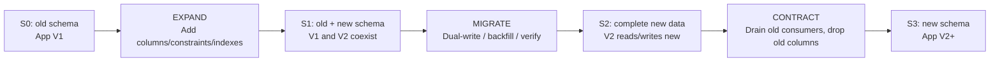
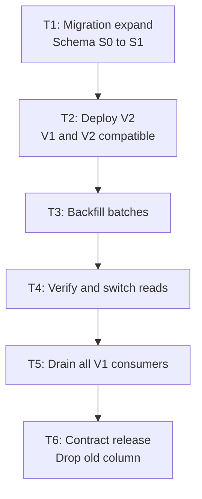
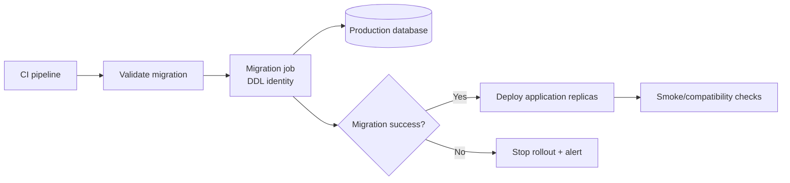

# Schema Upgrades Compatible with Continuous Deployment

In a cloud system with frequent releases, applications and databases are not upgraded at the exact same instant. A rolling deployment can run old and new application versions concurrently; background workers may still process messages under an old contract; older mobile apps may keep calling APIs for weeks. If a migration renames or drops a column the moment the new version deploys, older instances fail, requests break, or data is lost.

**Continuous-deployment-compatible schema upgrades** break schema and data changes into small steps so concurrently running application versions keep working throughout the transition. The goal is continuous delivery while safeguarding data correctness, limiting downtime, and preserving a clear recovery path.

In the **CLOUD_ARCHITECTURE** module, this topic connects database architecture with compute, CI/CD, reliability, security, performance, cost, and operations. This lesson uses an equipment-rental platform with a `Reservation` table. Schemas, SQL, rollout timings, and batch thresholds are illustrative; exact syntax, lock behavior, transactional DDL, and rollback capabilities depend on your specific database engine and version.

## 1. Why Are Schema Changes Risky in Continuous Deployment?

Suppose the `Reservation` table initially has a `customer_name` column. App V1 reads and writes that column. A new requirement splits the name into `customer_first_name` and `customer_last_name`.

If you deploy a migration dropping `customer_name` first, still-running V1 instances throw SQL errors. If you deploy new code writing only the two new columns while V1 still reads the old column, older requests see missing or stale data. If you change a large column's type in a single transaction, locks can block production queries.

| Risk | Cause | Consequence |
| --- | --- | --- |
| Incompatible old application | Migration drops/renames columns before old consumers stop using them | Failed requests during rollout |
| Missing or diverged data | Writing only to new schema or incomplete backfill | Old and new versions observe different values |
| Long-held locks | `ALTER`/`UPDATE` touches millions of rows or large indexes | Rising latency, exhausted connection pools, timeouts |
| Repeated migration runs | Job restart or pipeline retry after uncertain outcome | Failed DDL/DML or duplicated side effects |
| Impossible rollback | Old code cannot read new schema or destructive transform lost info | Cannot simply redeploy the old binary |
| Replica lag | Migration causes a massive write burst | Slow read replicas; failover/backups impacted |
| Forgotten background consumers | Workers, crons, ETL, or BI still query the old schema | Failures surfacing post-release |

**A database schema is a shared contract across processes**, not an internal detail of a single binary. Before modifying it, identify all consumers: API instances, background workers, scheduled jobs, migration scripts, ETL, BI/reporting, admin tools, and external services.

## 2. Compatibility Principles Between Old and New Applications

During a rolling deployment, V1 reading/writing the old schema, V2 reading the expanded schema, V1 workers processing old jobs, and new consumers receiving new event contracts may all coexist. The schema transition must explicitly specify which combinations must work together.

**Backward compatibility** and **forward compatibility** are used slightly differently across databases, APIs, and schema registries. Therefore, never just write "compatible"; answer concrete questions: Can V2 read the old schema? Can V1 keep operating when the schema gains new columns? Can old consumers ignore new fields?

A new column is often compatible with V1 if V1 uses explicit column lists and the new column has no constraint that breaks legacy inserts. However, if V1 uses `INSERT` without column names or the new column is `NOT NULL` without a default, the migration will break V1.

### Compatibility Matrix

| Schema | App V1 | App V2 |
| --- | --- | --- |
| S0: only `customer_name` | Must work | Works only if V2 reads the old schema |
| S1: `customer_name` plus two new columns | Must work | Works; may dual-read/dual-write |
| S2: new data backfilled and verified | V1 must still work if instances remain | V2 reads/writes new columns |
| S3: `customer_name` dropped | No longer compatible | V2 works |

Advance from S2 to S3 only after proving no consumers still rely on the old column. Finishing the V2 API deployment does not mean workers, crons, mobile apps, or queued jobs have disappeared.

## 3. The Expand–Migrate–Contract Pattern

A standard pattern for safe schema changes splits the work into three phases:

1. **Expand:** extend the schema in ways that do not break older versions.
2. **Migrate:** deploy transition-compatible application versions and backfill/migrate data.
3. **Contract:** once no old consumers remain, remove the legacy schema structures and compatibility logic.



### 3.1. Expand

Make strictly additive, compatible changes:

- Add nullable columns or columns with safe defaults.
- Create new tables.
- Add indexes using online/concurrent methods if supported by the engine.
- Add views or constraints in ways that do not break existing requests abruptly.
- Add new columns while keeping the old ones.

Avoid immediately dropping old columns, renaming columns in one step, changing data types in ways that truncate or alter semantics, adding `NOT NULL` columns that older versions do not populate, or building blocking indexes on large tables without evaluating locks.

### 3.2. Migrate

Deploy V2 capable of reading the transitional schema. When needed, V2 can dual-write both old and new columns or write to one source and backfill systematically. Existing rows are migrated in resumable batches. During this phase, measure remaining missing records and discrepancies between the two representations.

### 3.3. Contract

Contract only after all old application instances have stopped; legacy workers, crons, and consumers are upgraded; backfills are complete and verified; queries/reports no longer reference the old column; and the policy rollback window has elapsed. Ship the contract step as a separate release after an observation window, since it is the hardest step to reverse.

## 4. Example: Splitting `customer_name` into First/Last Name

### Initial Schema

```sql
CREATE TABLE reservation (
    id BIGINT PRIMARY KEY,
    customer_name VARCHAR(200) NOT NULL,
    start_at TIMESTAMP NOT NULL,
    end_at TIMESTAMP NOT NULL,
    status VARCHAR(30) NOT NULL
);
```

V1 reads `customer_name`. V2 needs `customer_first_name` and `customer_last_name`. Do not rename or drop the column immediately.

### Step 1 — Expand: Add New Columns

```sql
ALTER TABLE reservation
    ADD COLUMN customer_first_name VARCHAR(100),
    ADD COLUMN customer_last_name VARCHAR(100);
```

Depending on the database engine, `ADD COLUMN` may be instantaneous or trigger a table rewrite/lock. Test on your exact version and column/default types in staging with production-like data. Nullable columns allow V1 to keep inserting without knowing about the new columns.

If adding a column with a default, some engines/versions must physically update existing rows. Never assume every DDL statement is metadata-only.

### Step 2 — Deploy Compatible V2

V2 reads records using a fallback rule: if the new columns are populated, use first/last; if not yet backfilled, read `customer_name` and apply a controlled conversion rule.

On writes, the transition strategy can keep the old column in sync:

```sql
UPDATE reservation
SET customer_name = :full_name,
    customer_first_name = :first_name,
    customer_last_name = :last_name
WHERE id = :id;
```

This is simplified SQL. In practice, define the authoritative source, transactions, validation, multi-part names, single-token names, organization names, and single-component inputs. Never split names with one culture-specific heuristic if your data is international.

### Step 3 — Backfill Existing Data

Rows written before the expand step lack the two new columns. Migrate data in small batches while controlling locks, transaction duration, and replication lag.

```sql
UPDATE reservation
SET customer_first_name = :derived_first_name,
    customer_last_name = :derived_last_name
WHERE id > :last_id
  AND id <= :next_id
  AND customer_first_name IS NULL
  AND customer_last_name IS NULL;
```

This illustrates range batching. Name derivation should run in a migration worker/application using reviewed rules rather than naive string splits that lose data. Persist a checkpoint after each batch to enable resuming.

### Step 4 — Verify

```sql
SELECT COUNT(*) AS missing_new_name
FROM reservation
WHERE customer_first_name IS NULL
   OR customer_last_name IS NULL;
```

Compare old and new representations across convertible records. For names that cannot be split automatically, flag them for manual handling or retain the display/full name column as authoritative longer.

### Step 5 — Contract

Once you prove all consumers have switched to the new columns, stop dual-writing, remove fallback logic, and finally drop the old column in a separate release. If the business still needs a full display name, consider deriving it on read or keeping that field as a primary representation—never delete it merely to make the diagram look "clean."

## 5. Release Order: Migration First or Application First?

With expand–migrate–contract, the typical sequence is:

1. Deploy the expand migration first.
2. Verify the additive schema changes exist.
3. Deploy V2 code compatible with the expanded schema and falling back for unbackfilled rows.
4. Run and verify the backfill.
5. Switch read paths to the new columns; observe.
6. Confirm zero old consumers remain, then contract.

Not every change requires two versions to coexist for a long time. Yet if your deployments use rolling updates, multiple replicas, or background workers, always assume version overlap will occur.



Adding a nullable column may be V1-compatible, whereas adding a `NOT NULL` constraint immediately can break V1 inserts. A sync trigger might be functionally compatible while introducing latency or deadlocks. Evaluate behavior, locks, and performance together.

## 6. Large-Scale Data Backfills: Batching, Checkpointing, and Resumability

On tables with millions or billions of rows, a single table-wide `UPDATE` can hold long locks, flood WAL/redo logs, spike replication lag, trigger I/O bursts, degrade production queries, or exceed deployment timeouts.

### 6.1. Batching

```text
lastKey = loadCheckpoint()
while true:
    rows = select next bounded batch
           where key > lastKey and migration_state = PENDING
    if rows is empty:
        break
    transform and update rows in bounded transaction
    verify affected row count
    commit transaction
    persist checkpoint(lastKey of batch)
    observe latency, lock wait, replication lag
    throttle or pause when thresholds are exceeded
```

Pseudocode must be complemented with strategies for concurrently modified rows, checkpoint atomicity, and retries. Keyset/range pagination is generally far more stable than large `OFFSET`s, provided the key is unique and properly indexed.

### 6.2. Idempotent Batches

A batch may rerun after a crash. Update conditions should ensure reruns do not corrupt data—for instance, updating only rows still in `migration_state = PENDING` or where target fields are still missing. Persist the checkpoint *after* committing the data; writing the checkpoint before the commit can skip a range if the data transaction rolls back.

If data updates and checkpoints live in separate systems, design resume/reconciliation logic to detect batches written without a checkpoint or vice versa.

### 6.3. Throttling and Pausing

Monitor lock waits, transaction durations, CPU, IOPS, connection saturation, WAL/redo generation, disk usage, replica lag, API p95/p99 latency, remaining row counts, and backfill throughput. Shrink batch sizes or pause the backfill whenever production load crosses thresholds. The goal is protecting SLOs, not finishing as fast as possible.

## 7. Dual-Write, Dual-Read, and the Authoritative Source

During transitions, applications sometimes write to both old and new schemas. This is useful, yet risks creating two diverging copies of data.

### 7.1. Dual-Write Within One Database

When both columns sit inside the same database transaction, they can be updated atomically. Ensure both values are derived from the same input and validation; no code path updates only one column; triggers, stored procedures, batches, and admin tools follow the same rule; and a transaction rollback reverts both changes together.

### 7.2. Dual-Write Across Two Systems

Writing to database A and database B—or a database and an event broker—lacks a shared atomic transaction, risking partial success where one commits and the other fails. Use a transactional outbox, CDC, or workflow reconciliation instead of assuming both writes always succeed together.

### 7.3. Dual-Read

V2 can read the new field when present and fall back to the old field when missing. Add a metric counting fallback hits. Once fallback counts stay at 0 over a sufficient observation window, you can plan to remove compatibility code. Avoid silent fallback forever, as it masks incomplete backfills.

### 7.4. Choosing One Source of Truth

At every stage, define whether the old or new column is authoritative; which wins if they differ; whether the backfill could overwrite fresh writes while running; whether late V1 writes make the new column stale; and which consumers may update data once dual-writing ends. Without clear answers, dual-writing merely doubles the places where bugs can hide.

## 8. Online DDL, Indexes, and Lock Behavior

Schema changes include adding columns, changing types, adding constraints, building indexes, and dropping columns. DDL may acquire metadata locks, rewrite tables, or scan entire tables depending on the engine.

### 8.1. Adding Indexes on Large Tables

A standard index build can block writes or impact reads depending on the database. Some engines support concurrent/online index builds at the trade-off of higher resource use, longer duration, and dedicated failure handling.

PostgreSQL example:

```sql
CREATE INDEX CONCURRENTLY idx_reservation_status_created
ON reservation (status, created_at);
```

`CREATE INDEX CONCURRENTLY` carries specific restrictions—for instance, in PostgreSQL it cannot run inside a standard transaction block, and if it fails it can leave behind an invalid index that must be inspected and cleaned up. This syntax and behavior do not apply uniformly across all databases.

### 8.2. Adding Constraints

On large datasets, validating a constraint can scan the whole table and cause heavy load. Some engines allow adding a constraint without validating historical rows immediately, then validating separately; PostgreSQL provides `NOT VALID` for certain constraints followed by `VALIDATE CONSTRAINT`. Check your engine and constraint type.

One strategy is adding the constraint in a state that rejects new invalid data without scanning history if supported; fixing/backfilling legacy rows in batches; validating the constraint in a separate step; and monitoring locks and query latency.

### 8.3. Changing Data Types

Changing types can trigger table rewrites, truncation, or collation/semantic changes. Never assume `ALTER COLUMN TYPE` is online. For large changes, add a new column with the target type, deploy transition code, backfill in batches, use planned dual-write/CDC, verify and switch reads, and finally contract the old column.

### 8.4. DDL Transactions Differ Across Engines

PostgreSQL, MySQL, SQL Server, Oracle, and managed databases differ in transactional DDL, metadata locking, online operations, timeouts, and replication behavior. Some DDL statements auto-commit or cannot roll back like DML. Test on your exact engine/version and document which statements can roll back versus which require roll-forward/repair.

## 9. `NOT NULL`, Defaults, and Constraints in Multi-Version Rollouts

If V1 does not know about a new column, adding a `NOT NULL` column right away can break V1 inserts or trigger table rewrites. A safer sequence:

1. Add the column as nullable or with a well-understood default.
2. Deploy new code that always populates the value.
3. Backfill older rows.
4. Verify zero remaining `NULL`s.
5. Add/validate the `NOT NULL` constraint.
6. Only afterward remove application fallback/defaults if policy dictates.

Database defaults and application defaults can diverge. If V1 and V2 independently assign different values, data becomes inconsistent. Define the authoritative default in one place or ensure all writers agree.

## 10. Renaming and Dropping Columns: Treat as Breaking Changes

Renaming a column in a single step breaks older running code. Emulate a rename using expand–contract:

1. Add the new column.
2. Deploy code writing both and reading the new column with fallback.
3. Backfill and verify.
4. Migrate all consumers to the new column.
5. Confirm usage of the old column drops to zero.
6. Drop the old column in a separate release.

Before dropping a column, audit queries in codebases/repositories; stored procedures, triggers, views, and functions; workers, batch jobs, and crons; BI/reporting/ETL and exports; external database users/queries; replicas, CDC connectors, and archive/replay pipelines; and backup retention and recoverability for removed data.

If audit or historical compliance requires keeping values, never delete data just to drop a column. Retain an archived field or move historical values to an audit table with clear ownership.

## 11. Data Migrations That Change Semantics

Migrations sometimes alter values, not just structure—such as changing status `PENDING_PAYMENT` to `AWAITING_PAYMENT`, merging statuses, or converting duration units from minutes to seconds.

Required steps:

- List the legacy value set and target mapping.
- Identify consumers with hard-coded enums.
- Add support for reading both old and new values before writing new ones.
- Switch producers to write new values.
- Backfill historical records in batches.
- Wait for old consumers to retire or support the new values.
- Verify no legacy values remain before contracting.

When changing units, never modify values in place under the same column. Converting duration from minutes to seconds in place makes older clients miscalculate by 60x even though the integer type did not change.

Adding enum values can break clients generated with exhaustive `switch` statements. Clients need default/unknown-value handling, or deployment ordering must ensure consumers upgrade before producers emit new values. For database enum types, adding/removing/altering values depends heavily on the engine and migration tooling.

## 12. Rollback or Roll-Forward After Schema Changes?

Rolling back an application does not automatically roll back data. If V2 wrote into new columns and you redeploy V1, V1 may ignore new changes and write legacy structures. If a column was already dropped, the older binary may fail to start.

### 12.1. Safe Rollback Pattern

- Expand migrations are additive and can remain in place if application code rolls back.
- During dual-write, V1 can still read the legacy schema.
- If V2 fails, roll application code back to V1 while keeping the new columns; do not hastily drop the new schema.
- Investigate diverged records and choose roll-forward/repair.
- Contract only after the rollback window closes.

### 12.2. Roll-Forward

For destructive migrations or transformed data, rolling forward is usually safer than trying to run a down migration. Once an enum is collapsed and legacy details are gone, a reverse migration cannot reconstruct the original values. Write a new migration to repair or restore a healthy representation.

### 12.3. Down Migrations

Down migrations help for simple, genuinely reversible changes. However, dropping a column cannot restore lost values without a backup; many-to-one mappings cannot invert cleanly; DDL rollbacks can consume time and locks; and new code may have written values the old schema cannot express. Having a `down.sql` file does not prove rollback is safe.

## 13. Migration Tools and Execution Ordering

Tools like Flyway, Liquibase, or application migration frameworks track migration versions, checksums, and run history. Regardless of tooling, decide:

- Do migrations run inside the CI/CD pipeline or as a dedicated deployment job?
- Who holds production DDL privileges?
- Can multiple replicas run the same migration concurrently?
- How is the migration runner locked/serialized?
- How are mid-run timeouts or crashes handled?
- Are checksum edits to already-applied migrations detected?
- Is DDL transactional, and how are partial failures handled?
- Do dev/staging/prod environments share the exact same migration sequence?

**Never let every application instance run full migrations at startup** in multi-replica deployments unless your framework/tool uses a well-understood leader/lock mechanism. Multiple instances racing on DDL can cause deadlocks or uncontrolled schema changes.

### Dedicated Migration Job

A common pattern has the pipeline launch a migration job with DDL permissions, wait for it to finish, and only then roll out application replicas. The job has dedicated logs, identity, and resource bounds, while application runtime holds only needed DML privileges.



Expand migrations can run before new code; contract migrations run only after legacy code is gone and gates pass.

### Migration History

Migration history should record version, checksum, timestamp, status, and runner. Never edit history tables manually to hide errors. If a migration fails partway through, determine exactly which DDL/DML statements applied and execute an audited recovery procedure.

## 14. CI/CD Pipeline for Schema Changes

A safe pipeline typically includes:

1. **Static validation:** migration syntax, naming, dangerous operations, dependencies/versions.
2. **Compatibility checks:** does the schema change break current code or registered consumers?
3. **Testing against a real database engine:** not just mocked repositories; use a production-matched version.
4. **Migration performance testing:** production-scale dataset measuring locks, duration, I/O, and replication.
5. **Deploy expand:** run once in a controlled step.
6. **Deploy app:** rolling/canary rollout with schema compatibility.
7. **Backfill job:** throttled, checkpointed, retried, and monitored.
8. **Verify:** `NULL` counts, mismatch counts, constraints, query plans, and business invariants.
9. **Observe:** app errors, latency, replica lag, storage, and locks.
10. **Contract release:** only after old consumers drain and approvals/guardrails pass.

### Pipeline Gates

Do not rely solely on a migration's exit code. Gates should verify postconditions: target columns/indexes/constraints exist and are valid; backfill meets completion criteria; zero legacy consumers hit old columns/endpoints during the observation window; replica lag and latency remain healthy; a valid backup/recovery point exists before destructive steps; and the owner approves the contract step.

CI should not run destructive contracts automatically right away. A V2 build can bundle the expand migration and compatible code. Contract is a separate release or gated job because readiness depends on live runtime state and consumers, not just branch source code.

## 15. Migration Access Control and Security

Migrations can alter or erase entire datasets. Separate privileges:

| Identity | Recommended Privileges | Purpose |
| --- | --- | --- |
| Application runtime | Required `SELECT`/`INSERT`/`UPDATE`/`DELETE`, no general DDL | Limit blast radius if runtime credentials leak |
| Migration runner | Scoped DDL and migration DML per approval | Apply schema changes |
| Backfill worker | Scoped DML on target tables/columns | Migrate data in batches |
| Backup/restore operator | Vaulted and approved backup/restore permissions | Recover data |
| Read-only analyst | `SELECT` on classified views/datasets | Reporting without modifying data |

Never embed database passwords inside migration files or container images. Use a secret manager, workload identity, and short-lived credentials where supported. Migration logs must never print tokens, PII, or full row payloads.

### Safeguards for Destructive Migrations

- Mandatory review for `DROP`/`TRUNCATE`/`ALTER TYPE` or column narrowing.
- Confirmed usable backup/recovery point beforehand.
- Row counts and scope predicates verified before large `DELETE`/`UPDATE`s.
- Dry-runs or affected-row estimates where applicable.
- Configured timeouts/`lock_timeout` and clean job cancellation paths.
- Audit trail recording who initiated, who approved, which artifact version ran, and when.

## 16. Database Replication, Read Replicas, and Migrations

Migrations can generate heavy write loads that slow down replicas. Backfills produce WAL/redo/binlogs; index builds and table rewrites spike I/O; replicas may observe partially migrated data; rising replica lag degrades read-after-write or threatens failover RPO; and concurrent backups/snapshots can lengthen or add contention.

Before large migrations, set thresholds on replication lag, disk usage, and query latency to throttle or pause. If applications read from replicas, decide when to shift traffic or wait for replicas to catch up on schema and data. DDL replicates, yet locking/execution behavior can differ between primary and replicas.

Avoid running high-impact migrations concurrently with full backups, index rebuilds, and batch ETL without assessing I/O contention. Workload scheduling is part of migration design.

## 17. What Does Zero-Downtime Migration Mean?

"Zero downtime" usually means no user-observable outage during a specific change. It does not guarantee zero request retries, zero latency bumps, zero brief locks, zero replica lag, zero temporary data lag, or no need for a deployment window.

Define measurable criteria—such as error rate staying below threshold, p99 staying within SLO, zero lost committed transactions, and outage duration equal to zero or within allowance—and measure them during the rollout.

Even online DDL may acquire brief locks at start/finish or contend for metadata locks. A long-running open transaction can queue behind or block DDL. A queued DDL statement then blocks subsequent incoming queries; an `ALTER` with millisecond execution time can still cause an outage via lock queueing.

Monitor lock waits, transaction age, deadlocks, and queued connections. Use reasonable lock timeouts so DDL fails fast rather than waiting indefinitely, paired with retries and a runbook when aborted.

## 18. Avoiding Concurrent Migrations and Race Conditions

Two migration runners must never apply uncoordinated changes simultaneously. Migration jobs need locking/serialization at the database or deployment orchestration layer.

Backfills can also race with application writers:

1. Backfill reads an old record.
2. V2 updates the new field with a new value.
3. Backfill overwrites the new field using stale derived data.

Solutions include conditional updates touching only rows lacking new values; `version`/`updated_at` compare-and-set checks; short row-lock batches; explicit source-of-truth and conflict rules; and post-completion checkpoints/reconciliation.

```sql
UPDATE reservation
SET normalized_status = :mapped_status
WHERE id = :id
  AND normalized_status IS NULL
  AND status = :observed_old_status;
```

If the application changed `status` while the backfill ran, the predicate fails and the row is not overwritten. The worker re-reads, re-classifies, and retries with the new state per mapping rules. Compare-and-set updates need appropriate indexes/transactions and explicit handling for 0 affected rows.

## 19. Relationship Changes: Splitting Tables, Merging Tables, and Foreign Keys

### 19.1. Splitting a Table

If `Reservation` stores both customer details and payment data, you can split `Payment` into its own table:

1. Create the new `Payment` table with appropriate FKs and indexes.
2. Deploy code writing new payment records via the same transaction or outbox/workflow.
3. Backfill payment records from the old table.
4. Dual-read/fall back and compare.
5. Switch queries and access permissions.
6. Stop writing old fields and contract later.

If data moves to a separate service/database, a single ACID transaction no longer spans both. You must design consistency, outbox/inbox, and sagas/reconciliation.

### 19.2. Adding Foreign Keys

Adding an FK to a large table can scan/lock rows. Some engines support separate constraint validation. Before adding, check for orphan rows; backfill/repair invalid references; index the referencing column appropriately; assess lock behavior; and deploy code ensuring no new orphans are written during migration.

### 19.3. Merging Tables

Merging tables can alter ownership, cardinality, and query patterns. Plan key mapping, duplicate/collision handling, audit/retention, and running both old/new read paths. Never drop source tables until reconciling row counts, relationships, and dependent consumers.

## 20. Observing Migrations in Production

Treat migrations with the same telemetry rigor as any production workload:

| Category | Metrics to Watch | Why |
| --- | --- | --- |
| Progress | Rows processed/remaining, checkpoints, batch duration | Confirm migration advances |
| Database health | CPU, IOPS, disk, connection saturation | Prevent migration from starving the DB |
| Locks | Lock waits, blocked queries, deadlocks, transaction age | Detect blocked traffic |
| Replication | WAL/redo volume, replica lag, apply rate | Protect read consistency and failover |
| Application | Error rates, p95/p99, timeouts, pool waits | Verify user-facing SLOs |
| Data quality | `NULL`s, mismatches, duplicates, orphans, invariant breaches | Prove migrated data correctness |
| Migration control | Job status, runner identity, artifact version, checksum | Auditability and preventing misruns |
| Recovery | Backup age, restore test status, recovery point | Confirm protection before destructive steps |

Batch logs should record key ranges, processed row counts, duration, checkpoints, and error categories—never dump full row payloads. Alert when progress stalls, replica lag crosses thresholds, lock waits persist, or data mismatches fail to shrink.

## 21. Case Study: Migrating `Reservation` to a New State Model

### Context

The system currently stores `status` as a string with values `HELD`, `PAID`, and `CANCELLED`. New requirements distinguish `HELD`, `PAYMENT_PENDING`, `CONFIRMED`, `CANCEL_PENDING`, `CANCELLED`, and `EXPIRED`. Older versions still run during rolling deployments, and a legacy worker still processes payment events.

### Migration Plan

**Expand**

- Keep the old `status` column.
- Add a `state_code` column or state-transition table per design.
- Add indexes for new queries using online methods where supported.
- Define a deterministic mapping from old states to new states.

**Application Transition**

- V2 understands both old and new states.
- When reading legacy state, convert to the canonical new representation.
- On writes, maintain the old column via compatible mapping during transition.
- Upgrade payment workers before producers start emitting new state values.

**Backfill**

- Scan reservations by ID range.
- Map `PAID` to `CONFIRMED` per approved rules.
- `HELD` may require inspecting `expires_at` to classify active holds vs. `EXPIRED`; never map blindly by string alone.
- Persist checkpoints, throttle batches, and verify counts per category.

**Verify**

- Compare counts by status.
- Validate legal transitions and expired reservations.
- Reconcile `CONFIRMED` states against payment provider/ledger records.
- Measure V2 fallback rates to the old `status` column and legacy worker usage.

**Contract**

- Once all consumers use `state_code` and stop reading legacy `status`, remove dual-writes.
- After the rollback window and approval, drop the old column in a separate release.

| Legacy Value | Expected New Value | Verification Required |
| --- | --- | --- |
| `HELD` | `HELD` or `EXPIRED` | Compare `expires_at` against current time per policy |
| `PAID` | `CONFIRMED` | Reconcile successful payment capture |
| `CANCELLED` | `CANCELLED` | Check whether a refund is pending or completed |

Never auto-map rows when extra context beyond the `status` column is required. Route ambiguous rows into an exception report for business-rule resolution.

## 22. Common Anti-Patterns

1. Deploying new code and dropping columns in the same release. Rolling deploys keep older instances running; expand first, contract later.
2. Adding a `NOT NULL` column before older apps populate it. Add nullable/safe default, deploy writers, backfill, then validate the constraint.
3. Backfilling a whole table in one transaction. Causes huge locks, logs, and replica lag; use batches, checkpoints, and throttling.
4. Dual-writing without a source of truth. Columns drift apart; define conflict rules and monitor mismatches.
5. Relying on down migrations to promise rollback. Deleted or lossy-transformed data cannot always be inverted.
6. Checking only API instances while forgetting workers and reporting. Forgotten consumers break post-rollout.
7. Running migrations from every replica at startup. Concurrent runners fight over DDL; use a controlled job/lock.
8. Treating online DDL as lock-free. Lock phases, resource overhead, and metadata contention still exist.
9. Skipping tests at production-like data scale. A migration that flies on a tiny staging table can cause an outage on production.
10. Contracting immediately after V2 deploys. Wait for legacy consumers, data, reports, and the rollback window to finish.
11. Batching by timestamp or ID range without handling concurrent updates. Backfills can overwrite fresher app writes.
12. Not tracking migration history and artifact checksums. Makes it unclear which schema version an environment actually runs.

## 23. Compatible Schema Migration Design Workflow

1. **Inventory consumers and dependencies:** find apps, workers, crons, ETL, reports, stored procedures, triggers, and external tools; record owners/versions.
2. **Write a compatibility matrix:** list schema versions, app versions, and combinations that must work across rolling deploys, rollback windows, and long-lived jobs.
3. **Classify the change:** additive vs. destructive; rewrite/lock risk; potential data loss; whether online indexes/backfills or multi-release transitions are required.
4. **Design expand:** add columns/tables/indexes/constraints so V1 continues working; check defaults, nullability, transactions, lock timeouts, and replicas.
5. **Deploy transition code:** V2 reads old/new as needed, writes per explicit rules, and emits fallback/mismatch metrics.
6. **Backfill and verify:** small idempotent batches with checkpoints and throttling; check counts, `NULL`s, mismatches, orphans, and invariants.
7. **Drain legacy consumers:** wait for instances, workers, crons, reports, scheduled jobs, and integrations to adopt the new schema.
8. **Controlled contract:** ship destructive cleanup as a separate release with verified backups/recovery points, approvals, lock timeouts, runbooks, and postconditions.
9. **Clean up compatibility code:** remove dual-writes, fallbacks, feature flags, and temporary metrics; update schema docs/ERDs/ownership.

## 24. Practical Exercises

### Exercise A — Adding a `NOT NULL` Column

V1 inserts into `Reservation` without knowing about `booking_source`. New requirements make this column mandatory.

**Question:** How do you enforce the constraint while keeping V1 functional during rollout?

**Hint:** Expand with nullable/safe default; deploy V2 populating the value; backfill V1 rows; verify zero `NULL`s and validate `NOT NULL`; contract only after legacy writers stop. Check engine-specific DDL/lock behavior.

### Exercise B — Changing Data Types

`price` is currently an integer in VND; the new system wants a decimal `amount` and a separate `currency` column.

**Question:** How do you avoid V1 misreading new numbers with the wrong unit?

**Hint:** Add new `amount` and `currency` fields; define mapping and rounding rules; use transition read/write code with a clear source of truth; backfill; reconcile totals; never change units in place on the same field; contract after all consumers upgrade.

### Exercise C — Building an Index on a Large Table

The `reservation` table has hundreds of millions of rows. Building an index synchronously degrades write query latency.

**Question:** What should you test and monitor?

**Hint:** Verify online/concurrent index support and semantics for your engine/version; test on representative data; monitor locks, I/O, WAL, replica lag, and query latency; set timeouts and prepare a runbook for invalid indexes.

### Exercise D — Rollback After Dual-Write

V2 writes the new `status_code` and maps back to legacy `status`. After 30 minutes, a new state appears that cannot be represented in the legacy column.

**Question:** Can you roll back to V1?

**Hint:** If the legacy column cannot express the new state, rolling back the binary risks corrupting semantics. Check whether records with the new state already exist, pause producers/traffic if necessary, and roll forward a mapping or compatibility layer; never assume a down migration fixes it.

### Self-Assessment Criteria

| Criterion | Required Evidence |
| --- | --- |
| Compatibility | Matrix of schema/app versions and consumer inventory |
| Data correctness | Mappings, invariants, count/mismatch checks |
| Operational safety | Batching, checkpoints, throttling, lock/lag metrics |
| Recovery | Rollback/roll-forward plan and backup/PITR |
| Security | Dedicated DDL identity, approvals, and auditing |
| Deployment | Pipeline gates, migration job, and separate contract release |
| Verification | Tests on production-matched engine/version and dataset scale |

## 25. Pre-Production Review Checklist

- Have applications, workers, crons, reports, and external consumers all been inventoried?
- Is there a compatibility matrix covering old/new schemas and old/new app versions?
- Is the expand migration genuinely additive and safe for legacy inserts and queries?
- Are locks, table rewrites, transactional DDL, and exact engine/version behaviors understood?
- Does the backfill support batching, checkpoints, idempotency, throttling, and resuming?
- Are source of truth and dual-write/dual-read conflict rules explicit?
- Are row counts, `NULL`s, mismatches, orphans, and business invariants measured?
- Are p95/p99 latency, lock waits, WAL/redo, disk, and replica lag monitored?
- Are a dedicated migration runner, locking/serialization, and migration history configured?
- Are DDL credentials separated from application runtime?
- Does rollback preserve the new schema and keep data recoverable?
- Is contract shipped as a separate release after legacy consumers drain?
- Are backup/PITR, restore tests, and runbooks ready before destructive steps?
- Are auditing, owners, and approvals enforced for `DROP`/`TRUNCATE`/`ALTER TYPE`?
- Is there a post-migration plan to monitor and remove compatibility code?

Schema upgrades compatible with continuous deployment are the practice of **coordinating the data lifecycle with the application lifecycle**. Expand–migrate–contract, compatibility matrices, batched backfills, verification, and separate contract releases enable old and new versions to coexist during transitions. When migrations are treated as first-class production workloads with explicit privileges, SLOs, telemetry, recovery plans, and ownership, teams can evolve data structures continuously while preserving correctness and resilience in the cloud.
