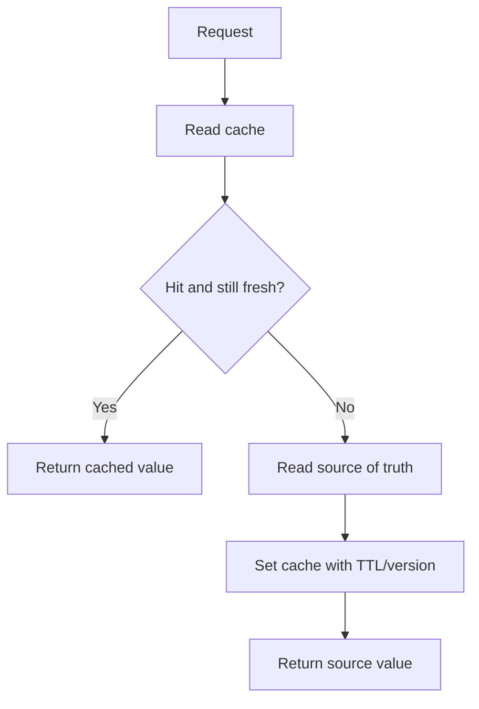
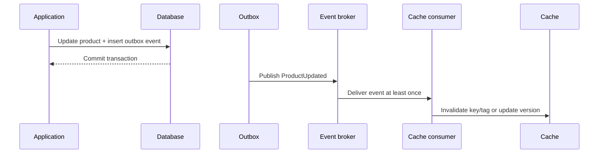
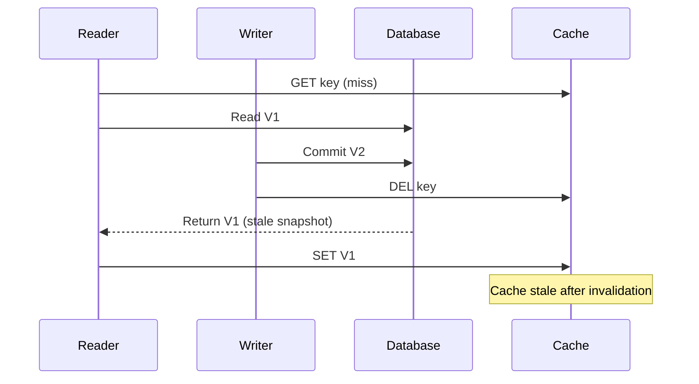
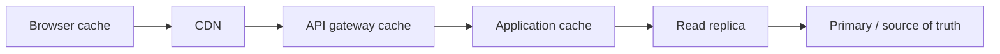

# TTL, Invalidation, and Data Freshness Requirements

## 1. Why Do TTL and Invalidation Matter?

A cache stores a copy of data in a location that is faster to read or closer to users, reducing latency and load on the authoritative source. However, a copy can become stale the moment the underlying data changes. Therefore, a cache architecture must define which data is allowed to be stale, for how long, and how to bring copies back to an appropriate state.

Three concepts must be designed together:

- **TTL (Time To Live):** the duration a cache entry is considered valid according to policy. Once TTL expires, the entry usually becomes stale or eligible for deletion; actual removal timing depends on the cache engine.
- **Invalidation:** the act of making an entry or group of entries no longer usable as valid data, typically after the source changes.
- **Data freshness:** the degree to which cached data reflects the current authoritative state. Freshness can be expressed in terms of data age, version, update timestamp, or business staleness bounds.

TTL sets a time limit on a copy; invalidation reacts to specific changes. Relying solely on TTL can leave newly changed data displayed until expiration. Relying solely on invalidation can miss events, fail when the cache store disconnects, or miss deleting all key variants.

In the **CLOUD_ARCHITECTURE** module, the **Caching** chapter treats freshness as an architectural property that must be balanced against latency, availability, scalability, cost, and business correctness.

After this lesson, learners can distinguish TTL, expiration, eviction, invalidation, and freshness; choose TTLs based on business needs; compare cache patterns; design invalidation by key/tag/version/event; handle races and cache stampedes; and build telemetry and tests for freshness.

## 2. Distinguishing TTL, Expiration, Eviction, and Invalidation

| Term | Meaning | Example |
| --- | --- | --- |
| **TTL** | Duration an entry is considered valid | Cache product for 5 minutes |
| **Expiration** | An entry reaches its expiration condition by TTL or absolute timestamp | expires_at has passed |
| **Eviction** | Cache store removes an entry to free memory or per policy | LRU evicts least-used keys |
| **Invalidation** | Proactively marking/deleting an entry because source data changed | Price update invalidates cache |
| **Refresh** | Fetching fresh data and replacing the current entry | Re-reading from the database |
| **Staleness** | How old cached data is relative to the authoritative source | Cached copy lags by 20 seconds |
| **Freshness** | How well data meets the latest acceptable state requirement | Inventory must be revalidated |

TTL expiration does not necessarily mean an entry is immediately removed from RAM. Many caches only check expiration on read or clean up entries via background tasks. Eviction can also occur before TTL expires if memory fills up.

**TTL is a validity policy; eviction is resource management; invalidation is a reaction to change.**

## 3. Defining Freshness from Business Requirements

There is no single good TTL for an entire system. Ask:

- How frequently does the data change?
- Can users tolerate staleness for a few seconds, a few minutes, or not at all?
- Is the data used for display or for deciding side effects?
- Are change events emitted reliably?
- If an event is lost, does the maximum TTL bound staleness?
- When the cache is unreachable, can the source be read directly?
- Can stale data be served temporarily if the primary source fails?
- Is read-your-writes required after a user performs an update?

| Data | Expected Freshness | Candidate Policy |
| --- | --- | --- |
| Public article content | Can be stale for a few minutes | CDN TTL + purge on publish |
| Product description | Tens of seconds or minutes | Cache-aside + event invalidation |
| Price/discount | Shorter, campaign-dependent | Versioned cache + invalidation |
| Inventory | Very sensitive to overselling | Cache for hints; revalidate at source |
| Booking/payment status | Needs authoritative state | Strong source read or revalidate |
| User profile | Read-your-writes important | Invalidate after commit or bypass |
| Feature/config flags | Depends on blast radius | Short TTL, version/event |
| Analytics aggregates | Can lag by minutes/hours | Batch refresh + watermark |

Data used only for display may be stale without severe harm; that same data used to confirm a transaction can violate invariants. Classify by operation and consequence.

### 3.1. Freshness SLO

Example SLOs:

- 99% of product details reflect published changes within 60 seconds.
- 99.9% of profile updates are visible to the updating user immediately after a successful operation.
- Inventory cache must never be used as the sole proof to confirm a reservation.
- Analytics dashboards may lag up to 15 minutes and display the latest update timestamp.

A 60-second TTL does not automatically prove 60-second freshness if event delivery, refresh, and replica lag add extra delay. SLOs must specify population, measurement window, source of truth, and measurement method.

## 4. Choosing a TTL

Long TTLs generally increase hit ratios and reduce source load, but prolong staleness. Short TTLs bound entry age, yet increase misses, refresh traffic, cost, and stampede risk.

Determining factors:

1. Rate of data change.
2. Consequences if a client reads stale data.
3. Refresh capability and source capacity.
4. Cost of queries or API calls on a miss.
5. Replication lag of the read source.
6. Reliability of invalidation events.
7. Geography and cache placement.
8. Entry size, key cardinality, and memory pressure.

### 4.1. TTL jitter

If millions of keys are created simultaneously with an exact 300-second TTL, they can expire at the same moment. Add jitter to spread out expirations:

```text
effective_ttl = base_ttl × random(0.8, 1.2)

Example:
base_ttl = 300 seconds
effective_ttl falls within 240–360 seconds
```

Jitter reduces synchronized expiration across keys. For strict freshness SLOs, maximum TTL plus refresh time must still stay within budget.

### 4.2. TTL by freshness class

| Class | Examples | Management Approach |
| --- | --- | --- |
| Static | Immutable/versioned assets | Long TTL, version in URL/key |
| Slowly changing | Catalog metadata | Medium TTL, event invalidation |
| Frequently changing | Price/config | Short TTL, versioning or push invalidation |
| Critical mutable | Inventory/payment | Bypass/revalidate authoritative source |
| Aggregated | Analytics/reports | Refresh schedule, watermark |

This is a classification framework, not default TTL values. Durations must be based on traffic, source capacity, and business SLOs.

## 5. Relative TTL, Absolute Expiration, and Sliding Expiration

- **Relative TTL:** starts when the entry is created or updated; fits cache-aside.
- **Absolute expiration:** entry expires at a fixed timestamp; useful for quotes, tokens, or promotions.
- **Sliding expiration:** each access can extend the expiration; hot entries can persist for a long time.
- **Idle timeout:** expires after a period without access.
- **Maximum lifetime:** enforces an absolute age cap even if the entry is read continuously.

Sliding expiration should not be used alone for data requiring an age limit. If a key stays hot, it may never expire and never be refreshed. You can combine an idle timeout with a max lifetime.

## 6. Cache-Aside and Handling Cache Misses

Cache-aside (lazy loading) is a common pattern:

1. The application reads the cache by key.
2. If hit and the entry is still fresh, return the data.
3. If miss/stale, read from the database or authoritative source.
4. Write the result into the cache with TTL/version.
5. Return the data to the client.



Pros: simple, caches only accessed data, application controls policy. Limitations: misses add latency; concurrent misses on the same key cause stampedes; update paths might forget invalidation; cache outages can push load onto the database.

### 6.1. Concurrent cache misses

If 1,000 requests ask for a just-expired key at the same time, all may query the database. Mitigations:

- **Single-flight/request coalescing:** one request refreshes, while other requests wait for the shared result.
- **Distributed lock:** only one worker refreshes the key during a lease period.
- **Stale-while-revalidate:** return stale data within allowed limits and refresh in the background.
- **TTL jitter:** spread out expiration timestamps.
- **Negative caching:** briefly cache non-existent results.

Locks require explicit leases and ownership; a lost or expired lock during a refresh can allow two loaders. Do not use cache locks as a business transaction mechanism.

## 7. Write Patterns and Cache Consistency

### 7.1. Cache-aside on write

The application writes to the database first, then invalidates the cache:

1. Commit changes to the database.
2. Delete the cache key or increment the version.
3. Subsequent requests miss and load the new data.

Pros: the database is the authoritative source and the cache is regenerable. Risk: the DB commit succeeds, then the process crashes before invalidation; stale entries remain served until TTL or the next invalidation.

### 7.2. Write-through

The application writes through the cache layer; the cache layer updates the data store with synchronous semantics before acknowledging.

Pros: reads after writes can hit the updated cache. Limitations: the write path depends on both the cache and storage; errors across the two systems must be handled. Write-through is not automatically a distributed transaction.

### 7.3. Write-behind/write-back

The application writes to the cache first, and the cache layer flushes to the source asynchronously in batches.

Pros: write latency can be low and multiple updates can be coalesced. Risks: cache nodes losing data before flushing, growing backlogs, reordered updates, and clients receiving success before data is durable. Use only when the business tolerates delayed source writes and durability/replay are proven.

### 7.4. Read-through and refresh-ahead

- **Read-through:** the cache provider reads from the source automatically on a miss.
- **Refresh-ahead:** refreshes popular keys before expiration based on access patterns.

Refresh-ahead reduces misses but can refresh data that is no longer needed. It requires benefit forecasting, jitter, and concurrency limits.

| Pattern | Read Path | Write Path | Trade-offs |
| --- | --- | --- | --- |
| Cache-aside | App reads cache; on miss, reads source | App writes DB then invalidates | Simple, must handle invalidation gaps |
| Read-through | Cache auto-loads on miss | Depends on write pattern | Simpler abstraction |
| Write-through | Cache read | Writes cache and source synchronously per implementation | Cache tightly coupled to write path |
| Write-behind | Cache read | Writes cache then flushes async | Fast, but has durability/ordering risks |
| Refresh-ahead | Cache reads refreshed entry | Triggers background refresh | Fewer misses, costs background traffic |

## 8. Invalidation: What Should Be Deleted?

Invalidation can delete a single key, multiple keys, tag-based groups, or leave older versions unreferenced.

### 8.1. By key

After updating product 42, delete the key product:42. This is straightforward, though a single entity may have multiple representations: detail, list, search results, locale, currency, or price list.

### 8.2. By tag/dependency

Entries attach tags such as product:42, category:shoes, tenant:abc. When a product changes, invalidate entries carrying matching tags.

Pros: manages multiple representations. Limitations: tag indexes consume metadata; fan-out invalidation can be large; broad tag deletion can trigger stampedes.

### 8.3. Versioned keys

Embed version/generation in the key:

```text
product:42:v17
product:42:v18
```

When data changes, increment the version from the authoritative source. Readers use the new version, leaving old entries unreferenced to expire later.

Pros: avoids mass key deletions. Limitations: requires consistent version management; reading an old version can still select an old key; old entries need cleanup so they do not occupy memory indefinitely.

### 8.4. Key design

Keys must include dimensions that affect the output:

```text
product:{tenant}:{productId}:{locale}:{currency}:{priceListVersion}
```

Omitting tenant/locale/currency can cause the cache to return wrong data or leak data across tenants. Adding unnecessary dimensions inflates cardinality rapidly. Avoid broad wildcard deletes unless the cache engine guarantees the operation is safe and efficient.

## 9. Event Invalidation and Transactional Outbox

When the source changes, the service emits an event for cache consumers to delete or update entries.



If an application commits to the DB and publishes an event directly, the process can crash in between: the DB changed, yet the event was never sent. A transactional outbox records the business update and event record in the same transaction. A separate publisher reads the outbox and sends to the broker; duplicates can happen, so consumers must be idempotent.

An outbox narrows the gap between commit and event emission, though it does not make invalidation strictly instantaneous. Measure delivery lag, retries, and dead-letters, and keep TTL/reconciliation as a final safety net.

### 9.1. Event ordering and versioning

Event version 18 may arrive before version 17. Consumers must not overwrite the cache with an older version after seeing a newer one. Compare sequence/version numbers and apply only newer updates.

### 9.2. Freshness budget

```text
Observed staleness ≈
    source commit to outbox publish
  + broker delivery lag
  + consumer processing delay
  + cache invalidation/update time
  + subsequent read/cache fill behavior
```

If the freshness SLO is 60 seconds, simply setting a 60-second TTL may not be enough. Allocate budget for event lag, refresh, and replica lag.

## 10. Race Conditions Between Updates and Cache Fills

A subtle bug occurs when a read miss and a write update race:

1. Reader A hits a cache miss, reads the database, and receives old value V1.
2. Writer B commits new value V2.
3. Writer B invalidates the cache.
4. Reader A finishes the slow query and sets V1 into the cache.
5. Subsequent requests read V1 even though invalidation ran after the commit.



Deleting the key after commit is insufficient if an old reader can re-populate stale data.

Mitigations:

- **Version check:** readers write alongside the source version.
- **Generation key:** writers bump the generation; readers set into the namespace of the generation they read.
- **Conditional set:** write to the cache only if the generation still matches, using atomic primitives.
- **Read-after-write bypass:** users who just wrote read from the source or use a session version.
- **Single-flight/locks:** reduce competing loaders, though coordination with the update path is required.

Short TTLs only reduce the duration of staleness, not the race itself. Choose techniques based on atomic primitives of the cache store; non-atomic check-then-set still races.

## 11. Cache Stampede, Thundering Herd, and Hot Keys

- **Cache stampede:** many requests simultaneously refresh a key when it expires or is invalidated.
- **Thundering herd:** many requests/workers simultaneously call a dependency after an event.
- **Hot key:** a single key receives far more traffic than the rest, causing bottlenecks on a node/shard or lock.

| Mitigation | How It Works | Trade-offs |
| --- | --- | --- |
| TTL jitter | Spreads expirations | Does not guarantee a single refresh |
| Single-flight | One loader, other requests wait | Can add wait latency |
| Distributed lock | One owner refreshes | Requires leases and handling dead owners |
| Stale-while-revalidate | Serves stale within limits, refreshes in background | Fits only data classes that tolerate staleness |
| Refresh-ahead | Refreshes before expiry | Consumes background capacity |
| Request rate cap | Caps loader/downstream load | May reject requests |
| Key sharding/replicas | Distributes hot-key reads | More complex writes/updates |

### 11.1. Stale-while-revalidate

An entry can carry two timestamps:

- fresh_until: time when the fresh period ends.
- stale_until: final cutoff time allowed for serving stale data.

Behavior:
1. Before fresh_until: return immediately.
2. Between fresh_until and stale_until: serve stale and trigger one background refresh.
3. After stale_until: wait for the source or return an error/degraded response.

Do not use this for balances, permissions, inventory, or payments if staleness leads to incorrect decisions.

## 12. Negative Caching

Negative caching stores "not found" results briefly to avoid repeated queries for the same non-existent key. For example, random usernames or invalid product IDs can generate heavy database lookups.

Risks:

- A new record is created while the negative entry still exists.
- Attackers generate many random keys, inflating cache cardinality.
- Failing to distinguish true 404s from transient database errors.

Never cache timeouts, 5xx responses, or authorization errors as "not found" if doing so masks errors or creates data leaks. When creating a new record, invalidate the corresponding negative cache entry.

## 13. Multi-Tier Caching and the Freshness Chain

A request may traverse a browser cache, CDN, API gateway, application cache, distributed cache, and database read replica. End-to-end freshness does not simply equal the smallest TTL if one tier refreshes from another tier that is already stale.

Example:
- CDN TTL 60 seconds.
- Gateway cache TTL 30 seconds.
- Application cache TTL 5 minutes.
- Origin reads a replica with 2-minute lag.

A CDN miss after 60 seconds can still receive stale data from the application cache or replica.



You must specify where each tier fetches data, when it revalidates, and whether versions/timestamps propagate across tiers.

### 13.1. HTTP cache semantics

- Cache-Control max-age: duration a response is considered fresh.
- s-maxage: lifetime for shared caches per HTTP semantics.
- no-cache: may be stored, but must revalidate before reuse.
- no-store: do not store the response.
- private: private caches only; shared caches must not store.
- ETag: validator of a representation.
- Last-Modified: update timestamp for conditional requests.
- Vary: request headers that affect the cache key.

no-cache does not mean no-store. Responses may still be stored, provided they are revalidated before use. Design headers according to public/private data rules and specific CDN/proxy behavior.

### 13.2. Conditional requests

Clients/caches send If-None-Match with an ETag. If the representation has not changed, the server returns 304 Not Modified; the cache keeps the old body and updates metadata per HTTP semantics. This reduces payload size, though a revalidation round trip to the origin still occurs.

For private data, ETags and cache keys must be properly scoped; never use shared validators that leak state across users/tenants.

## 14. Read-Your-Writes and Session Consistency

A user who just updated a profile may have their next read routed to another replica or cache. Solutions:

- Invalidate the cache immediately after DB commit.
- Return the version in the write response; subsequent reads send the minimum required version.
- Route reads to the primary for a short window after a write.
- Use a session-local overlay holding recently written changes.
- Bypass the cache for operations requiring immediate confirmation.

Do not rely on sticky sessions as the sole guarantee. Requests can reach different instances or regions.

For example, a write returns resourceVersion 42. Subsequent reads send minVersion 42. The read path only returns replicas/caches with an equal or newer version; if unavailable, route to the primary or wait within a deadline. This is a contract that must be supported across APIs, caches, and data stores.

## 15. CDN Invalidation and Races

CDNs can cache many URLs/variants across many edge locations. When purging:

- Purge events may take time to propagate.
- Different URLs can represent the same object.
- Query strings, headers, cookies, and Vary create distinct cache keys.
- Individual browser caches can still hold responses.
- Edges may fetch from the origin before purges arrive elsewhere.

Patterns:

1. Versioned/immutable URLs using content hashes or versions.
2. Purge by URL/tag on publish.
3. Short TTL + revalidation to bound staleness when purges are slow.
4. Stale-if-error with an age cap for data permitted to be stale.

Versioned static assets can use long TTLs because the same URL never changes content. Private/dynamic content requires explicit cache keys and authorization.

## 16. Cache Failure and Protecting the Data Source

A cache outage can suddenly send all traffic to the origin.

Policies:

- **Fail open to origin:** bypass the cache and read the source; simple, but risks DB overload.
- **Degraded local cache:** use an in-memory cache with a short TTL, accepting divergence between replicas.
- **Serve stale:** return stale data within safe limits.
- **Fail closed:** reject certain requests when freshness/consistency cannot be guaranteed.

Do not apply one policy to every data type. Search/catalog can serve stale; payment authorization or inventory commits must not rely on stale caches.

Protective measures:

- Rate-limit origin reads and cap concurrency.
- Use circuit breakers to avoid continuous retries.
- Apply stale-while-revalidate for eligible data classes.
- Coalesce requests by key.
- Shed load for lower-priority endpoints.
- Plan capacity for cold caches/failovers.
- Monitor cache errors and origin QPS together.

A high cache hit ratio can hide insufficient origin capacity when the cache is flushed. Load test cold caches and cache outages.

## 17. Security and Multi-Tenant Isolation

Caches can leak data across tenants if keys or HTTP cache policies lack proper scoping.

- Include tenant/user/authorization scope in keys when representations depend on permissions.
- Never use shared caches for private responses without key isolation.
- Do not cache secrets/tokens beyond requirements and policy.
- Bound key cardinality and length influenced by clients.
- Use Cache-Control private/no-store for PII responses when appropriate.
- Invalidation must not leak the existence of another tenant's resources.
- Log keys/metadata in ways that avoid PII and credentials.
- TTL expiration does not replace deletion/retention obligations.
- Maintain purge procedures when users/tenants are deleted or permissions change.

A response may be technically cacheable yet prohibited from caching by privacy or data residency policies.

## 18. Observability: Measuring Freshness, Not Just Cache Hits

A high cache hit ratio only shows that many requests are served from cache; it does not prove the data is fresh.

| Metric | Meaning |
| --- | --- |
| Cache hit/miss ratio | Degree to which the cache is utilized |
| Byte hit ratio | Share of bytes served from the cache |
| Entry age at read | Age of entries when returned |
| Stale response count/age | Volume and age of stale responses |
| Invalidation lag | Time from source commit to invalidation |
| Outbox/broker lag | Events waiting to be published/received |
| Refresh duration/failure | Whether refreshes succeed |
| Stampede/single-flight waiters | Requests concurrently waiting on one key |
| Eviction/expired count | Entries removed due to expiry/memory |
| Origin QPS/latency | Impact of cache misses on the source |
| Version mismatch | Cache returning an older version than requested |
| Purge propagation time | How long CDN invalidation takes to reach edges |

Internal trace metadata can include: cache_status (hit/miss/stale/revalidated), cache_age_ms, source_version, source_updated_at, invalidation_event_id, and refresh_reason. Expose only appropriate details in APIs; do not leak internal keys or tenants.

Useful alerts: p99 invalidation lag exceeds budget; entry age exceeds critical threshold; outbox backlog grows; version mismatch after write; refresh failures paired with origin latency; cache outage pushing origin QPS above capacity; purge propagation slower than publish SLO.

## 19. Testing TTL and Invalidation

| Scenario | How to Test | Pass Criteria |
| --- | --- | --- |
| Basic TTL | Set entry, read before/after expiry | Fresh/stale matches contract |
| Early eviction | Increase memory pressure | Cache misses do not lose source data |
| Key-based invalidation | Update entity then read | No stale copy beyond budget |
| Event delay | Delay consumer/broker | Freshness SLO holds or degrades cleanly |
| Duplicate events | Resend the same event | Invalidation is idempotent |
| Out-of-order events | Send version 18 then 17 | Cache does not regress |
| Read/write race | Loader reads V1, writer commits V2 | V1 does not overwrite newer generation |
| Cache stampede | Expire hot keys simultaneously | Loader/downstream load is bounded |
| Cache outage | Shut down cache store | Origin is not flooded |
| Negative cache | Cache 404 then create record | New record appears per policy |
| Multi-layer cache | CDN/gateway/app used together | End-to-end freshness is accurate |
| Tenant isolation | Same resource ID in two tenants | No cross-tenant representation returned |
| Read-your-writes | Update then read another replica/cache | Client sees requested version |
| Clock skew | Adjust clock under control | Expiry behaves without anomalies |

Invariants to verify: entries must not be returned as fresh past fresh_until; newer version invalidations must not be overwritten by old loaders; cache outages must not lose the authoritative source; tenant A never reads tenant B's keys; event replay does not corrupt state; maximum TTL plus event/replica lag does not exceed freshness objectives; strong-consistency operations never decide solely from stale caches.

## 20. Process for Designing TTL and Invalidation

1. **Identify the authoritative source:** which database/service determines true state?
2. **Classify data/operations:** display, decision-making, or side-effecting?
3. **Define freshness SLOs:** max staleness, read-your-writes, and stale behavior.
4. **Choose cache pattern:** cache-aside, read-through, write-through, write-behind, or refresh-ahead.
5. **Set TTLs:** based on update frequency, source capacity, cost, replication lag, and stale budget.
6. **Choose invalidation:** key, tag, version, event, or CDN purge.
7. **Design race handling:** outbox, idempotent consumers, version/generation, and conditional sets.
8. **Prevent stampedes:** jitter, single-flight, locks, SWR, and concurrency limits.
9. **Design fallbacks:** origin, stale, local cache, queues, or fail-closed per data type.
10. **Set security boundaries:** key scope, tenant isolation, HTTP cache policy, and retention.
11. **Measure and test:** entry age, invalidation lag, freshness SLOs, outages, and replay.
12. **Document ADR/runbooks:** policies, owners, purge/refresh, and review triggers.

## 21. Practical Scenario: Caching for a Booking Platform

**Context:** A platform stores catalogs, pricing, availability, bookings, and user profiles. A CDN serves public images/content; the API uses a distributed cache for product details; the database is the authoritative source. Property descriptions change a few times per day, prices change by campaign, and availability changes continuously as guests reserve rooms.

| Data | Suggested Policy | Rationale |
| --- | --- | --- |
| Images/versioned assets | Long TTL, immutable URLs | URL changes when content changes |
| Property descriptions | Few minutes TTL + events | Tolerates brief staleness |
| Prices/discounts | Short TTL + version/events | Affects purchasing decisions |
| Availability/search | Cache for discovery, revalidate before reserve | Prevents overselling |
| Booking status | Authoritative source or read-your-writes | Critical state |
| User profiles | Invalidate after commit, bypass after write | Read-your-writes UX |

### 21.1. Price update flow

1. Host updates price; database commits a new version.
2. Same transaction writes a PriceUpdated outbox event.
3. Publisher sends the event to the broker.
4. Consumer invalidates or increments the generation of relevant keys.
5. Next read loads the new version from the appropriate source.
6. If the event is delayed, TTL fallback bounds staleness; metrics report invalidation lag.
7. If a campaign has fixed start/end times, use absolute expiry so prices are not cached past their validity window.

### 21.2. Availability reservation flow

1. Search returns cached availability with a timestamp.
2. When a user reserves, the API checks the authoritative source via transaction/conditional update.
3. Confirm the hold only after the update succeeds.
4. Emit an invalidation/cache-update event.
5. The cache may display stale data, but must never decide room allocation.
6. Booking responses include clear version/status and read-your-writes guarantees.

### 21.3. Testing

- Two users reserve the last room simultaneously; only one hold succeeds.
- Price update commits while publisher is stopped; outbox resumes sending upon restart.
- Loader reads old price then sets cache after invalidation; generation blocks regression.
- CDN holds old image version; new immutable URL is served after publish.
- Cache store goes down; search degrades gracefully, reservations still check the source.
- PriceUpdated fires twice or out of order; cache retains the latest version.
- User updates profile then requests hit another replica; reads see the new version.
- Hot property expires simultaneously; single-flight caps origin QPS.

## 22. Sample ADR: Bounded TTL and Event Invalidation

```text
ADR-083: Freshness policy for catalog, price, and availability

Context:
- Catalog is read-heavy and updated infrequently.
- Prices change per campaign.
- Availability changes frequently and must not be double-booked.
- CDN and distributed caches can hold stale data across multiple tiers.

Options:
A. Use a single short TTL across all data.
B. Use TTL by freshness class, event invalidation, and revalidation.
C. Do not use caching; every request reads the database.

Decision:
- Choose B.
- Immutable assets use versioned URLs and long TTLs.
- Catalog uses cache-aside, TTL jitter, and event invalidation.
- Prices use version/generation with events; absolute expiry for campaign boundaries.
- Availability cache serves discovery only; reservations always revalidate at the source.
- Transactional outbox emits events after commit.

Trade-offs:
- Increases complexity of events, outbox, generations, and reconciliation.
- May display stale catalog/prices within the freshness budget.
- Cache/store/broker require HA, capacity, and observability.

Verification:
- Measure p99 invalidation lag and entry age.
- Race-test old loaders against new writers.
- Duplicate/out-of-order events do not regress cache versions.
- Cache outages do not overload the origin.
- Reservation invariants hold even when the cache is stale.

Revisit conditions:
- Freshness SLOs or update frequencies change.
- Origin/cache/broker capacities change.
- New sensitive data classes or compliance requirements emerge.
```

## 23. Common Design Mistakes

1. **One TTL for all data:** ignores differing consequences of staleness.
2. **Treating TTL as invalidation:** newly changed data continues appearing until TTL ends.
3. **Assuming TTL expiration deletes immediately:** caches may lazy-expire or clean up in the background.
4. **Relying solely on events:** events can be delayed, duplicated, or lost without outbox/monitoring.
5. **DB commit then cache delete while ignoring loader races:** old readers can re-write stale data.
6. **Expiring all keys simultaneously:** triggers stampedes.
7. **Sliding expiration without max lifetime:** hot entries can persist forever.
8. **Using inventory cache as confirmation source:** risks overselling.
9. **Not versioning representations:** invalidation misses variants or old events overwrite newer ones.
10. **Negative caching 404s for too long:** newly created records remain hidden.
11. **Unbounded fail-open on cache outage:** floods the database.
12. **Failing to check multi-tier caching:** CDN misses still receive stale data from app caches/replicas.
13. **Caching private responses in shared caches:** leaks tenant/user data.
14. **Measuring only hit ratio:** does not tell whether data is fresh.
15. **No freshness SLO:** cannot determine how much staleness is acceptable.
16. **Purging CDN while ignoring browser cache:** clients retain old representations.
17. **Write-behind lacking durability/replay:** cache failures lose acknowledged writes.
18. **Not testing event reordering/duplication:** caches can regress versions or refresh incorrectly.

## 24. Pre-Production Checklist

- [ ] Authoritative source for each data type is identified.
- [ ] Freshness/staleness SLOs are defined by operation and business consequence.
- [ ] TTL, absolute expiry, idle timeout, and max lifetime are distinguished.
- [ ] TTLs follow freshness classes with jitter where appropriate.
- [ ] Read/write cache patterns and miss behavior are documented.
- [ ] Key/tag/version/event invalidation covers full scope.
- [ ] Database commits and event publishing use an outbox or equivalent mechanism.
- [ ] Consumers are idempotent and handle versioning/ordering and replay.
- [ ] Races between old loaders and writers are guarded by version/generation/conditional set.
- [ ] Stampedes/hot keys have appropriate single-flight, locks, or limits.
- [ ] Stale-while-revalidate is applied only to staleness-tolerant data classes.
- [ ] Cache outages have per-operation fallbacks and origin protection.
- [ ] Multi-tier caches have a clear freshness chain and revalidation path.
- [ ] HTTP Cache-Control, ETag, Vary, and private/no-store match privacy boundaries.
- [ ] Cache keys include required tenant/locale/currency/authorization dimensions.
- [ ] Metrics include entry age, stale age, invalidation lag, refresh failures, and origin load.
- [ ] Expiry, eviction, event delay/reorder/duplicate, races, outages, and tenant isolation are tested.
- [ ] Owners, purge/refresh runbooks, reconciliation, and TTL review conditions exist.

---

**Key takeaway:** TTL bounds the age of a copy, invalidation reacts to changes, and freshness SLOs define how stale data may be while remaining acceptable. Reliable cache design combines these mechanisms with versioning, recoverable event delivery, race handling, stampede limits, and consequence-driven fallbacks. Caches accelerate reads; the authoritative source must still decide critical operations.
