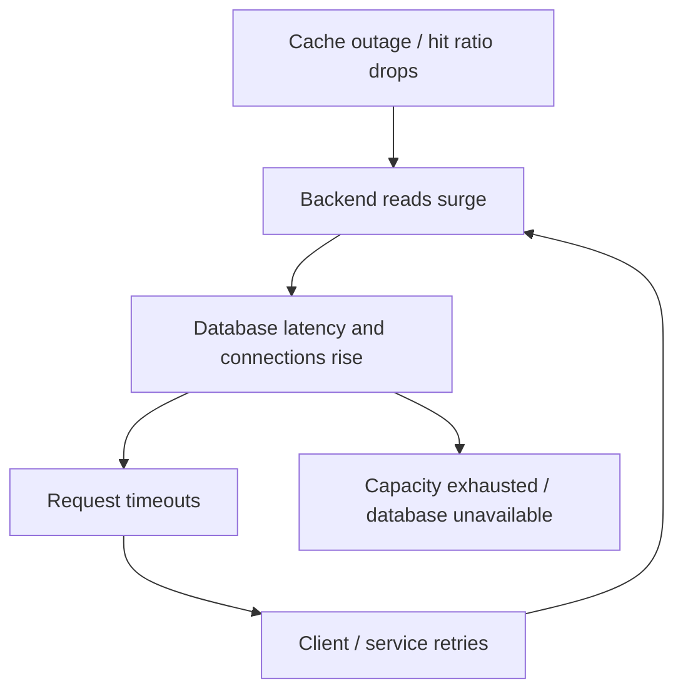
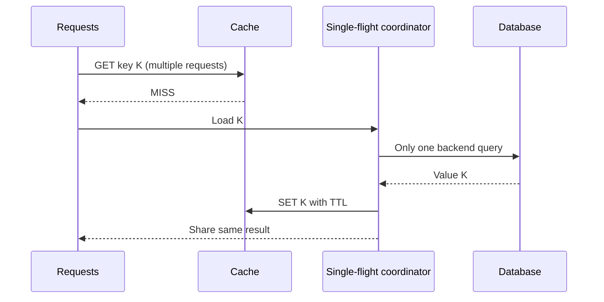
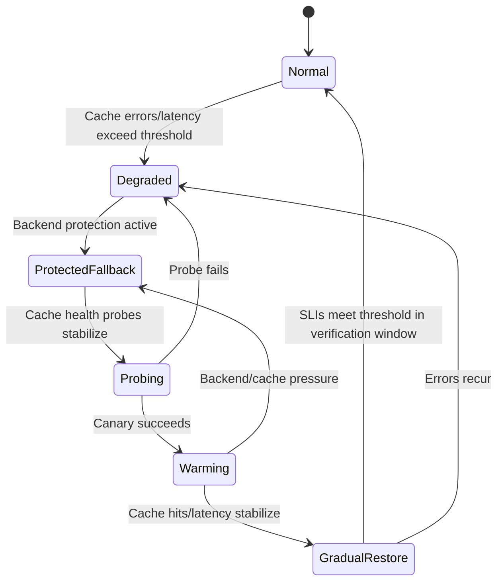
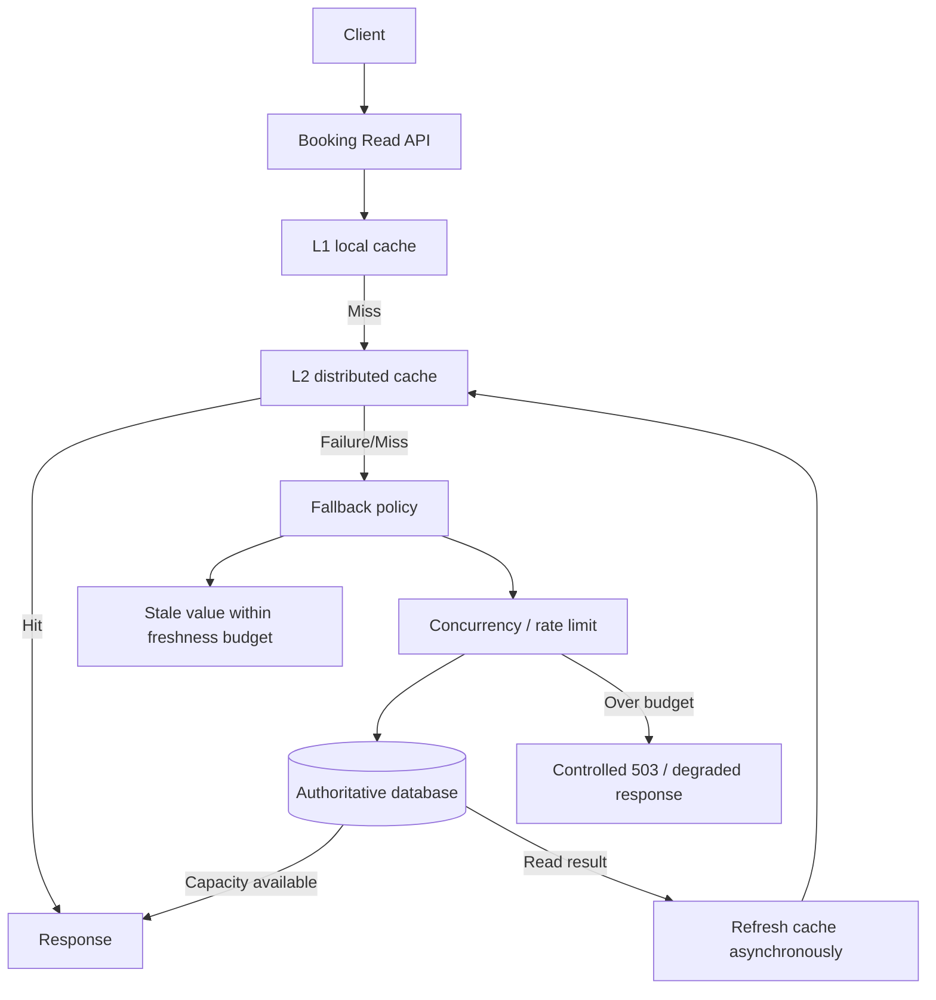

# Handling Cache Failures and Avoiding Inverse Availability Dependencies

## 1. Caches Make Systems Faster, Yet Add Another Dependency

Caches are commonly introduced to lower latency, offload databases, or serve frequently read data. Applications may use in-process caches, distributed caches, CDNs, or platform-managed caches. When the cache operates normally, many requests are answered without touching the primary data source.

However, when the cache slows down, disconnects, runs out of capacity, evicts entries, or restarts, applications can fall back to the database simultaneously. A database sized only for cache-hit traffic can suddenly receive full traffic, causing timeouts, connection exhaustion, and breaking the very read path that previously worked. A cache outage can therefore turn into a **cascading failure**.

This lesson focuses on two objectives:

- **Safe recovery during cache failures:** determine when the cache can be bypassed, when stale data should be returned, and when requests must be rejected or shed.
- **Preventing caches from creating inverse availability dependencies:** avoid letting cache failures or cache recovery overload the primary data source and degrade overall system availability.

In the **CLOUD_ARCHITECTURE** module, **Caching** chapter, this topic connects caching choices to compute, databases, networking, reliability, security, cost, and operations under Well-Architected principles.

After this lesson, you will be able to analyze cache failure modes, choose between fail-open and fail-closed, design stale fallbacks, TTL jitter, request coalescing, circuit breakers, bulkheads, and load shedding, and execute phased recovery.

## 2. Understanding Cache Failure Modes

A cache does not merely exist in "up" or "down" states. Each failure mode impacts requests and downstream data sources differently.

| Failure Mode | Symptoms | Risk to the Application |
|---|---|---|
| Cache node/service unavailable | Connection refused, timeouts, DNS errors | Requests flood the database |
| Elevated latency | Cache still responds, but slower than the data source | Requests hold workers/connections too long, cascading timeouts |
| Partial outage | Only one shard/AZ/replica fails | Subset of keys fails; uneven retries or fallbacks |
| Sudden cache miss spike | Keys evicted, synchronized TTL expirations, cold start | Database suffers sudden load surge |
| Stale cached data | Invalidation failures, replication lag | Application returns outdated data |
| Cache unavailable after restart | Cache empty or warm-up incomplete | Cold cache triggers a read storm |
| Connection/resource exhaustion | Pools, file descriptors, memory, or network exhausted | Client timeouts and continuous retries |
| Abnormal evictions | Working set exceeds memory or mismatched policy | Hit ratio drops and backend load rises |

A distributed cache may still answer some keys even when part of its nodes fail; a local cache can survive a network outage while each instance holds divergent data. Understand topology, replication, consistency, and client library behavior before choosing fallbacks.

### 2.1. Normal cache misses differ from cache failures

A cache miss is a valid outcome: the key does not exist yet, its TTL expired, or it was evicted. A cache failure is an error preventing the expected cache operation. The two situations generally require different metrics and policies:

- Misses can read the data source and populate the cache.
- Failures can bypass the cache, serve stale data, or throttle access to the data source.
- Lumping all failures together as misses can turn one outage into millions of backend reads.

Never write a single "catch all exceptions and query the database" branch without distinguishing timeouts, connection failures, authentication errors, serialization errors, and programming bugs.

## 3. Fail-Open vs. Fail-Closed

Two foundational approaches are selected based on data criticality and business impact.

### 3.1. Fail-open: bypass a failing cache and use the data source

**Fail-open** in a caching context generally means not letting a cache failure block requests; the application bypasses the cache and reads from the primary data source.

Suitable when:

- The cache is strictly a performance optimization layer and authoritative data lives in the database.
- The database retains enough spare headroom to absorb increased read load.
- Reading the data source still satisfies security and consistency requirements.
- Load limits can be enforced so the backend is not overwhelmed.

Risk: if the cache serves 90% of read traffic, losing the cache can force the backend to handle vastly more requests than normal. Failing open without rate limits, concurrency limits, or fallbacks turns a cache outage into a database outage.

### 3.2. Fail-closed: reject or halt requests when the cache fails

**Fail-closed** means refusing to proceed when a required component is unavailable. For caches, this can apply when the cache holds state essential to a decision, or when reading the backend under failure risks violating invariants or limits.

However, standard caches should not be treated as authoritative data stores. If a critical business decision can only be read from the cache, revisit the architecture: essential state likely belongs in a database/transaction store or a system with explicit consistency guarantees.

For example, you might temporarily reject non-essential lookup requests to protect the backend when the cache dies, rather than letting all requests crash the database. This is an intentional degraded mode requiring clear errors and retry guidance.

### 3.3. Choosing by data type and action

| Use Case | Usually Suitable Approach | Rationale |
|---|---|---|
| Public images/avatars | Fail-open to origin/CDN or serve stale | Brief staleness is usually acceptable |
| Product catalog pages | Stale-while-revalidate, bounded fallback | Prioritizes availability; price/inventory need separate rules |
| Personal profiles | Bounded database read; never return another user's cached data | Security and tenant isolation are critical |
| Inventory for display | Stale with warning or read authoritative source | Display may be slightly stale, never used to confirm transactions |
| Reservations/bookings | Decide via database/conditional transaction; never rely on cache to confirm availability | Must preserve invariants |
| Access permissions/revocation | May fail-closed or verify authoritative source depending on risk | Stale caches can retain revoked permissions |
| Non-sensitive feature flags | Bounded stale with safe defaults | Must define behavior when config cannot be fetched |

No universal policy fits every cache key. Each data type must define maximum staleness, authoritative source, security sensitivity, and consequences of returning stale data or rejecting requests.

## 4. How Can a Cache Outage Take Down a Database?

Suppose an API serves 10,000 requests/second. Its normal cache hit ratio is 95%, so the database receives only about 500 cache misses/second on this read path. When the cache goes down and every instance fails open, the database can suddenly receive nearly 10,000 reads/second, excluding retries and background traffic.

If the database can sustain only 2,000 reads/second alongside write traffic, excess requests create queues, lock/connection contention, and rising latency. As requests time out, clients retry, piling on even more load. This forms a negative feedback loop:



This is a **cache-induced cascading failure**. Prevention must span the entire chain: timeouts, concurrency limits, rate limits, circuit breakers, load shedding, and degraded-mode planning.

### 4.1. Estimating backend pressure when the cache is lost

A simple model:

```text
backend_read_rate =
    total_read_rate * (1 - cache_hit_ratio)
```

At 10,000 read requests/second:

| State | Hit Ratio | Estimated Backend Read Rate |
|---|---:|---:|
| Normal | 95% | 500/sec |
| Cache degraded | 80% | 2,000/sec |
| Cache miss storm | 50% | 5,000/sec |
| Cache outage | 0% | 10,000/sec |

This is an illustrative model assuming every request triggers one backend read and ignoring batching, query caches, local caches, retries, or request coalescing. Use real measurements to determine headroom; never rely on system-wide average hit ratios if a critical group of keys is continuously missing.

## 5. Preventing Cache Stampedes and Thundering Herds

A **cache stampede** occurs when many requests simultaneously notice an expired/missing key and query the data source at once to recompute it. A **thundering herd** occurs when many clients or workers wake up or retry a resource at the same instant, creating a sudden load spike.

### 5.1. TTL jitter

If millions of keys are loaded together with an identical 10-minute TTL, they can expire near-simultaneously. Adding jitter to TTLs spreads out expiration times:

```text
effective_ttl = base_ttl + random(-jitter, +jitter)
```

Or pick a random value within an appropriate positive range. TTLs must never exceed business freshness limits. For tokens, permissions, or legally time-bound data, never arbitrarily add jitter that extends validity.

### 5.2. Request coalescing / single-flight

When multiple requests miss the same key concurrently, allow only one request to fetch from the data source while the rest wait for the shared result:



Single-flight can be implemented in-process or via distributed coordination. Local single-flight collapses requests only within one instance; across 100 instances, up to 100 backend queries can still occur. Distributed coordination cuts queries further, though it introduces dependencies, locks/leases, and failure modes.

### 5.3. Stale-while-revalidate

Retain values past their fresh TTL within a bounded stale window. Requests can receive stale data within allowed limits while a worker refreshes the new value:

- Fresh TTL: data is considered fresh.
- Stale window: data may be served temporarily.
- Hard expiry: past this boundary, stale data is no longer allowed; read the source or return an appropriate error.

Never use stale-while-revalidate for data where staleness can cause dangerous actions, such as confirming availability, revoked permissions, or guaranteed checkout prices.

### 5.4. Probabilistic early refresh

For certain workloads, entries can be probabilistically refreshed before TTL expiration based on remaining time and cache recomputation cost. This spreads refreshes out, though it adds complexity and requires tuning refresh rates. Often, TTL jitter and single-flight suffice for most use cases; adopt probabilistic algorithms only when metrics show stampedes remain significant.

## 6. Load Limiting During Cache Failures

Failing open requires a **backend protection layer** so the database never receives unbounded traffic.

### 6.1. Concurrency limits and bulkheads

Cap concurrent database read requests. Once the threshold is reached, new requests can wait in a small deadline-bounded queue, serve stale data, or be shed early.

Bulkheads isolate resources by group: for example, search APIs must never exhaust connection pools used by payment APIs or booking reservations. Isolate thread pools, connection pools, semaphores, and quotas per tenant/route.

### 6.2. Rate limiting and load shedding

Rate limiting caps request rates; load shedding proactively rejects excess traffic beyond capacity to protect core functions.

Priorities:

- Preserve core business write requests if the authoritative source and capacity still support them.
- Degrade or temporarily disable non-essential read endpoints.
- Throttle tenants/routes generating anomalous traffic under fair quotas.
- Return consistent error codes such as 429 or 503 with Retry-After when appropriate.
- Prevent clients from retrying faster than the backend can recover.

### 6.3. Timeouts and deadlines

Cache timeouts must be shorter than overall request deadlines; if the cache is slow, the application must decide to fall back early. However, overly short timeouts can turn minor cache latency spikes into mass misses. Pick timeouts from actual latency distributions, p95/p99, and latency budgets; measure false timeouts as well.

Every tier should propagate an overall deadline: client → API → cache → database. Never let each tier independently retry and exhaust its own timeout, pushing total duration past SLOs.

### 6.4. Circuit breakers

A circuit breaker monitors error/timeout rates to the cache:

- **Closed:** requests are allowed to call the cache.
- **Open:** temporarily stops calling the cache once errors exceed a threshold; the application enters its fallback policy.
- **Half-open:** permits a small number of probe requests to verify cache recovery.

Breakers prevent repeatedly hammering a failing cache and reduce blocked connections/threads. Scope failures by endpoint/shard/operation; one key failing serialization should not trip the circuit for the entire cache cluster.

Never let every instance enter half-open at the exact same moment. Use jitter or probe coordination to avoid synchronized reconnection waves.

## 7. Fallback Strategy: Precedence and Bounds

A solid fallback must be pre-defined, not improvised as a catch-all during an incident.

Example read chain for a public profile:

1. Read L1 local cache if still fresh.
2. Read L2 distributed cache with a short timeout.
3. If L2 fails, serve a stale value within the stale window if available.
4. If no stale value exists, read the database through bulkheads and concurrency limits.
5. If the backend is also overloaded, return a controlled error or approved minimal payload.

For sensitive data, fallbacks must preserve authorization. Never return another tenant's cached data or skip permission checks just because an auth service or cache failed. If policies cannot be verified, fail closed.

### 7.1. Local cache as fallback

A local L1 cache can keep serving partial data when L2 fails. However, L1 is local to each instance:

- Data may diverge across instances.
- Invalidations may miss an instance experiencing a network partition.
- Local caches consume RAM and start cold after deployments or scale-outs.
- User/tenant-specific data requires strict namespacing and authorization.

L1 suits data whose freshness policies permit it and that has TTLs/invalidation. Never treat local caches as authoritative sources.

### 7.2. Stale fallbacks and freshness budgets

Define clearly:

| Threshold | Meaning | Behavior |
|---|---|---|
| Fresh TTL | Window where data is considered fresh | Return directly |
| Soft TTL | Threshold to trigger refresh | May serve stale while refreshing |
| Stale window | Duration stale data may be served | Alert/monitor stale age |
| Hard expiry | Cutoff past which cached values cannot be used | Read source or reject |

Freshness budgets must follow business requirements, not cache capabilities. A rarely changing info page may tolerate minutes of staleness; access permissions or booking states may require the authoritative source at the moment of decision.

## 8. Cache Recovery: Gradual Restoration Without a Cold-Start Storm

When a cache recovers, all instances may reconnect at once, warm every popular key together, or flood writes simultaneously. Recover in controlled phases:

1. Verify cache nodes/clusters are healthy and replication and networking are stable.
2. Probe circuit breakers via canary/probe traffic; do not shift 100% of traffic immediately.
3. Reconnect using exponential backoff with jitter; cap new connections.
4. Warm the cache with critical keys at a rate-limited pace; prioritize data with high hit rates and business value.
5. Keep backend protections active until hit ratios and latency stabilize.
6. Monitor evictions, memory pressure, replication lag, and cache write errors.
7. Shift traffic back to the cache gradually; exit degraded mode only after SLIs stabilize within thresholds.

Never preload the entire database into the cache without clear capacity and justification. Unbounded warm-ups can create a read storm worse than normal traffic.

### 8.1. Illustrative state machine



States and thresholds in the diagram must be concretely defined with metrics, stabilization windows, owners, and rollback criteria. Never rely on a trivial health check (like an open TCP port) to declare the cache ready for production load.

## 9. TTL, Invalidation, and Consistency During Cache Failures

Cache recovery cannot be separated from consistency. A cache can appear operational while serving wrong data due to lost invalidations or replication delays.

### 9.1. TTL is a staleness bound, not a consistency guarantee

TTL defines how long a cache entry may be used per policy. If source data changes after an entry is written, the cache can keep returning the old value until TTL expires. Short TTLs shrink the staleness window at the cost of higher misses/backend load; long TTLs raise hit ratios while allowing staler data.

### 9.2. Invalidation failures

If a database update succeeds while cache invalidation fails:

- Record invalidation events/outbox entries for retry.
- Use versions or generation keys to detect stale entries.
- Consider write-through/write-behind only when semantics and failure handling are explicit.
- Run periodic reconciliation for critical keys.

Never assume invalidation message publishing succeeds simply because the database commit succeeded; use an atomic outbox or equivalent mechanism.

### 9.3. Negative caching

Caching "not found" results curbs repeated queries, provided negative TTLs are short and records invalidate upon creation. If missing users/tenants or access permissions are cached as "not found" too long, newly created records stay hidden or users see wrong statuses.

Never use negative caching to mask backend errors. Distinguish "does not exist" from "unable to query" and "unauthorized."

## 10. Cache Failures and Security

- Never allow a cache outage to bypass authorization or tenant isolation.
- Cache keys must include full security context such as tenant, locale, role/entitlement, or version when output depends on them.
- Never store tokens, secrets, or sensitive data in caches unnecessarily; where needed, enforce encryption, access control, and TTLs.
- Never share stale data across users/tenants when cache namespaces are incomplete.
- Prevent cache poisoning via input validation, cache write permissions, key canonicalization, and source verification.
- Log fallbacks and cache keys with enough detail for investigation without logging PII/secrets.
- When an authentication/authorization cache fails, choose a risk-aligned failure policy; verify with the authoritative service or fail closed.

## 11. Real-World Example: Booking Information Lookup API

Suppose a booking API serves 8,000 read requests/second. Its distributed cache maintains a 92% hit ratio; the database has headroom for at most 1,500 reads/second while continuing to handle writes. If the cache dies completely, the backend cannot handle all 8,000 reads/second.

### 11.1. Normal-state design

- L1 local cache holds rarely changing catalog/metadata with a short TTL.
- L2 distributed cache stores booking summaries partitioned by tenant/booking.
- The database is the source of truth.
- Cache keys include tenant ID and booking ID; authorization is always verified.
- Invalidations are emitted via an outbox after commit.

### 11.2. Degraded mode when L2 fails

- Circuit breaker per L2 cluster opens once measured timeout/error thresholds are breached.
- API serves L1/stale summaries if data remains within the freshness budget.
- For cache misses, permit only the tested database concurrency ceiling; non-essential read endpoints are rate-limited or shed.
- Detailed history endpoints may return 503 when backend budgets run out; booking creation/cancellation flows continue using dedicated database transactions and reserved capacity.
- Client retries use backoff/Retry-After rather than immediate continuous retries.

### 11.3. Recovery

Once L2 is healthy:

1. Probe a subset of instances and sample keys.
2. Cap reconnections using jitter.
3. Warm high-traffic keys at a rate the database tolerates.
4. Re-open cache traffic in stages while monitoring hit ratios, evictions, and database read rates.
5. Keep fallback protections active until the cache stabilizes.

### 11.4. Diagram



This is a reference model. If summary payloads contain sensitive fields or govern transactions, stale responses must be separated from decision paths. APIs may return 503/partial responses only where product contracts explicitly define them.

## 12. Testing Cache Failures and Degraded Modes

Resilience cannot be validated merely by turning off the cache in a low-traffic dev environment. Test real failure states and observe the backend:

| Scenario | How to Test | Pass Criteria |
|---|---|---|
| Cache connection refused | Block connectivity to cache in test environment | Fallback activates; DB stays within concurrency budget |
| High cache latency | Inject delay/packet loss | Timeouts honor deadlines, breaker opens, workers do not stall |
| Partial shard outage | Isolate a subset of nodes/key ranges | Blast radius is contained, routing causes no retry storms |
| Cold cache | Restart/flush test cache | Warm-up and read throughput do not overload DB |
| Synchronized TTL expiry | Load many keys with identical TTLs and wait | Jitter/single-flight suppresses stampede |
| Slow backend during cache outage | Simulate DB latency/connection exhaustion | Bulkheads/load shedding protect core functions |
| Flapping cache recovery | Cycle up/down rapidly | Probes/reconnects use backoff; no flapping |
| Lost invalidation | Break event path after DB commit | Outbox/reconciliation restores cache accuracy |
| Cross-tenant cache keys | Probe cross-tenant data access | Zero wrong-tenant data returned on hits or fallbacks |
| Expired stale data | Create entries past hard expiry | Stale data is not served in violation of policy |

Fault injection must have defined scope, owners, abort thresholds, and rollback plans. Never flush production caches or block live databases without proper planning and approval.

## 13. Observability: Measuring Both Cache and Backend Health

Tracking cache hit ratio alone is insufficient. A system with a 95% hit ratio can still suffer hot keys, a slow shard, or stale data.

| Metric | Meaning |
|---|---|
| Hit/miss ratio by route/key class | Distinguishes normal misses from abnormal degradation |
| Cache latency p50/p95/p99 | Detects cache slowdowns before connection timeouts |
| Error/timeout rate | Detects cache unavailability or partial outages |
| Backend read rate/latency | Measures fallback impact on the database |
| DB active connections/queues/lock waits | Signals when the backend nears capacity exhaustion |
| Fallback rate | Shows how many requests are bypassing the cache |
| Stale response count/age | Tracks consumption of stale data |
| Single-flight waiters/coalescing ratio | Measures stampede-mitigation effectiveness |
| Circuit state/open duration | Indicates when the cache is in degraded mode |
| Cache memory/evictions/replication lag | Exposes capacity or consistency issues |
| Warm-up progress | Tracks cache recovery progress |

Alerts must combine cache and database metrics. For instance, rising miss rates paired with rising backend read rates and DB p99 latency is critical; rising miss rates while DB remains well under budget may be normal traffic variation.

## 14. Costs and Trade-Offs

| Measure | Benefit | Cost/Limitation |
|---|---|---|
| L1 local cache | Cuts network hops and latency | Per-instance RAM, staleness/invalidation, and distributed state |
| Stale fallback | Preserves availability during cache/backend disruptions | Reduced freshness, requires per-data rules |
| Request coalescing | Eliminates duplicate backend reads | Waiter latency, coordination, and shared error handling |
| TTL jitter | Prevents synchronized expirations | Variable cache lifetimes; must respect freshness bounds |
| Circuit breaker | Cuts calls to failing dependencies | Risk of false trips, probe and recovery complexity |
| Bulkhead/concurrency limit | Protects the database | Some requests wait or fail even while slight backend capacity remains |
| Warm-up | Boosts hit ratio after restarts | Consumes backend reads and compute; can cause storms if uncapped |
| Dedicated cache capacity | Isolates workloads and tenants | Cost of idle capacity |

Cache costs go beyond memory/instances; factor in requests, networking, replication, backups if any, observability, engineering effort, and backend reserve headroom. A very cheap cache whose outage causes database downtime can prove far more expensive in total cost.

## 15. Well-Architected Review

| Pillar | Evaluation Questions |
|---|---|
| **Operational Excellence** | Are there runbooks for cache outages, breakers, warm-ups, rollbacks, and clear owners? Do dashboards show cache/backend/fallback together? |
| **Security** | Do fallbacks preserve authorization and tenant isolation? Are cache keys/secrets/PII protected? |
| **Reliability** | Can cache failures overload the backend? Are TTL jitter, single-flight, bulkheads, stale policies, and controlled recovery implemented? |
| **Performance Efficiency** | Are timeouts, concurrency, hit ratios, hot keys, and cache tiers benchmarked at peak load? |
| **Cost Optimization** | Are cache capacity, replication, L1 memory, backend headroom, warm-ups, and telemetry fully accounted for? |
| **Sustainability** | Are wasted refreshes/retries avoided, only valuable keys warmed, and resources scaled to demand rather than over-provisioned? |

## 16. Sample ADR for a Cache Failure Policy

The following YAML illustrates decision documentation, not a direct deployment config:

```yaml
decision_id: ADR-CACHE-008
title: Cache failure and backend protection policy
source_of_truth: booking_database
cache_tiers:
  - local_cache
  - distributed_cache
failure_policy:
  public_summary:
    stale_window_seconds: 120
    fallback: stale_then_limited_database_read
  booking_availability:
    fallback: authoritative_database_transaction
    stale_value_for_decision: false
protection:
  cache_timeout_ms: measured_budget
  circuit_breaker: enabled
  database_read_concurrency: approved_limit
  per_route_rate_limit: enabled
stampede_controls:
  ttl_jitter: enabled
  request_coalescing: enabled
recovery:
  reconnect_backoff: exponential_with_jitter
  warmup: rate_limited
  rollout: canary_then_gradual
observability:
  - fallback_rate
  - backend_read_rate
  - cache_latency_p99
  - stale_response_age
review_triggers:
  - database_capacity_change
  - cache_topology_change
  - freshness_requirement_change
```

Timing and concurrency values must be measured, load-tested, and approved per environment. A formal ADR requires owners, alternatives considered, acceptance criteria, runbooks, and fault-injection evidence.

## 17. Design and Implementation Process

1. **Classify data:** source of truth, freshness budget, security sensitivity, and consequences of stale/missing data.
2. **Measure baseline:** hit ratio, latency, backend read rate, DB capacity, and traffic by key/tenant.
3. **Design failure policies:** fail-open/closed, stale fallbacks, controlled errors, and per-route behavior.
4. **Add backend protections:** timeouts/deadlines, concurrency pools, rate limits, bulkheads, circuit breakers, and load shedding.
5. **Prevent stampedes:** TTL jitter, single-flight, refresh strategies, and policy-compliant negative caching.
6. **Design recovery:** probing, reconnect backoff, rate-limited warm-up, gradual restoration, and rollback.
7. **Verify consistency/security:** invalidation/outbox, versioning, tenant isolation, authorization, and stale hard expiry.
8. **Run fault injection:** cache down/slow/partial, cold starts, slow DB, invalidation failures, and flapping.
9. **Operate:** dashboards, alerts, runbooks, owners, budgets, and regular drills.

## 18. Pre-Production Checklist

- [ ] The cache's role is properly defined; the source of truth is never confused with the cache.
- [ ] Every data group has a freshness budget and fail-open/fail-closed policy.
- [ ] Cache outages cannot dump unbounded read traffic onto the DB.
- [ ] Timeouts and deadlines are budgeted; no unbounded nested retries.
- [ ] The database has appropriate concurrency limits, bulkheads, rate limits, or load shedding.
- [ ] Circuit breakers/probes include jitter and well-defined failure scopes.
- [ ] TTL jitter/request coalescing demonstrably reduce cache stampedes via metrics.
- [ ] Stale fallbacks define stale windows/hard expiries; stale data never decides critical invariants.
- [ ] L1/local caches have clear namespaces, invalidation, and tenant isolation.
- [ ] Cache recovery includes reconnect backoff, warm-up rate limits, and gradual traffic restoration.
- [ ] Invalidation failures recover via outbox/events/reconciliation.
- [ ] Authorization and data protection are never bypassed in degraded mode.
- [ ] Dashboards combine cache, fallback, and backend metrics; alerts link to runbooks.
- [ ] Cache down/slow/partial, cold caches, DB saturation, and recovery flapping have been tested.
- [ ] Costs of cache, backend headroom, replication, warm-up, and operations fit within budget.

**Guiding principle:** a cache should give the primary data source extra headroom, not turn it into a point of collapse when the cache fails. Define fallbacks per data type, cap traffic reaching the backend, prevent stampedes, and recover caches gradually. Availability truly improves only when degraded modes still protect data correctness, access controls, and total system capacity.
