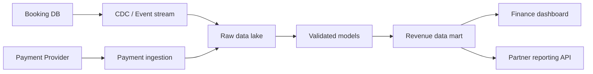
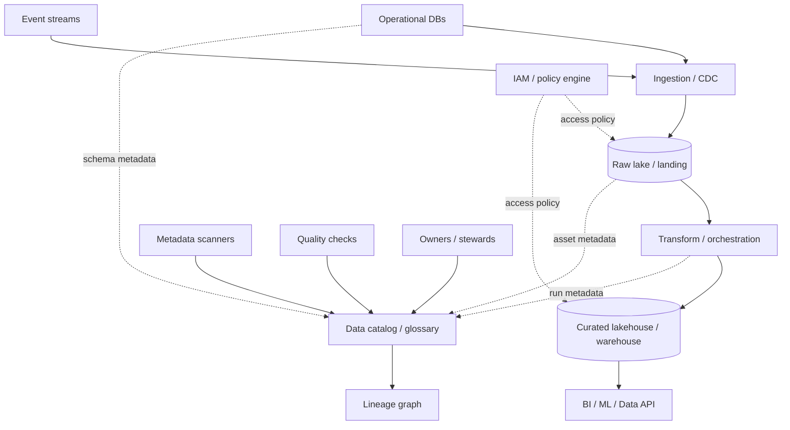
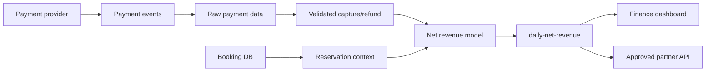

# Data Quality, Catalog, Lineage, and Ownership

A data platform is valuable only when users can find the right data, understand its meaning accurately, trace where it came from, have permission to use it, and trust the results. A table with billions of rows where nobody knows which column represents reconciled revenue, when the data was last updated, or who is accountable when numbers are wrong is not a well-governed data asset.

**Data quality, data catalog, data lineage, and data ownership** form the operational foundation of a data platform. Quality measures how fit data is for its intended purpose; a data catalog enables discovering and understanding data assets; data lineage records origins and transformation steps; ownership establishes accountability for decisions, fixes, access approvals, and maintaining data contracts.

In the **CLOUD_ARCHITECTURE** module, these capabilities connect storage, ingestion, batch/stream processing, warehouses/lakehouses, security, and operations. This lesson uses an equipment rental platform example—from the booking database to revenue dashboards and partner feeds. Quality thresholds in examples are illustrative; each organization must define them based on business impact, regulations, and real SLOs.

## 1. Four Questions Every Data Platform Must Answer

| Capability | Question | Required Outcome |
| --- | --- | --- |
| **Data quality** | Is data accurate, complete, consistent, fresh, and fit for purpose? | Rules, tests, metrics, thresholds, and error handling workflows |
| **Data catalog** | What data exists, where is it located, what does it mean, and how is it used? | Asset inventory, schemas, business descriptions, owners, classification, and access controls |
| **Data lineage** | Where did data originate, which transformations shaped it, and where is it consumed? | Provenance graphs, dependencies, and impact analysis |
| **Data ownership** | Who is accountable for definitions, quality, permissions, and lifecycles? | Explicit owners/stewards, data contracts, SLOs, and escalation paths |

For example, suppose a dashboard reports a 20% drop in equipment rental revenue. The dashboard alone is not enough to investigate. The team needs to know whether "revenue" means captured funds, pending funds, or total reservation value; which model feeds the dashboard; whether the pipeline dropped `PaymentCaptured` events; who owns the payment source and approves metric definitions; and which departments or partners are allowed to view the data.

When these four capabilities work together, the organization can answer those questions with evidence and accountable owners.

## 2. Data Quality Means Fitness for Purpose

There is no single data quality number that captures every need. An email field might be irrelevant for an inventory report, yet require strict validation when used for customer notifications. An operations dashboard might tolerate a 5-minute delay, while payment reconciliation requires faster discrepancy detection.

Therefore, define quality **by dataset, field, use case, and failure consequence**. Avoid evaluating a table solely by its non-NULL row count.

## 3. Data Quality Dimensions

| Dimension | Meaning | Equipment Rental Platform Example | How to Measure |
| --- | --- | --- | --- |
| **Accuracy** | Values faithfully reflect reality or confirmed truth | Reservation status matches actual business state | Compare against authoritative source, audit sampling |
| **Completeness** | Required fields and records are present | Payment records contain `paymentId` and `amount` | Percentage of fields/records meeting required rules |
| **Validity** | Values conform to schema, domain, and format | `startAt` is earlier than `endAt` | Percentage of records passing validation |
| **Consistency** | Sources/fields representing the same fact do not conflict | Total captured/refunded payments match ledger | Cross-field/cross-table reconciliation |
| **Timeliness** | Data is available within the required timeframe | Booking dashboard updates within 5 minutes | Freshness lag, age of latest data |
| **Uniqueness** | No duplicates violating defined rules | Each `eventId` is applied once in the projection | Duplicate rate, unique constraint violations |
| **Integrity** | Relationships, keys, and invariants hold | Reservations reference existing equipment | FK/orphan checks, invariant checks |
| **Conformity** | Values adhere to agreed formats and vocabularies | Standardized country and currency codes | Adherence rate, count of out-of-vocabulary values |
| **Accessibility** | Authorized users can discover and consume data | Analysts have read access to curated views | Access success rate, request fulfillment |

Accuracy and validity are not identical. A validly formatted date can still be wrong relative to the true transaction date. Completeness also does not equal quality: a completely populated table filled with wrong numbers is still useless.

### Choosing Dimensions by Impact

- Payment ledgers require high integrity, accuracy, completeness, and auditability.
- Catalogs need validity, completeness, and freshness to power search and display.
- Search indexes can tolerate brief lag because they are rebuildable.
- Behavioral analytics datasets may tolerate missing some telemetry events, yet still need coverage and bias tracking.

## 4. From Business Requirements to Quality Rules

A well-defined quality rule specifies the target dataset/field, exact condition, severity, owner, run frequency, alert/failure thresholds, and remediation action.

| Rule ID | Dataset/Field | Rule | Severity | Action |
| --- | --- | --- | --- | --- |
| DQ-RES-001 | `reservation.id` | Non-NULL and unique | Critical | Block curated dataset publish, alert owner |
| DQ-RES-002 | `reservation.start_at/end_at` | `start_at` earlier than `end_at` | High | Route invalid record to quarantine |
| DQ-PAY-001 | `payment.amount` | Non-negative, valid currency | Critical | Block reconciliation output and investigate |
| DQ-PAY-002 | `payment.event_id` | No duplicates within idempotency scope | Critical | Deduplicate or quarantine |
| DQ-CAT-001 | `equipment.category` | Within controlled vocabulary | Medium | Normalize mapping or send for review |
| DQ-AN-001 | `revenue_daily` | Freshness within 15 minutes | High | Mark dashboard stale and alert |

Thresholds and severities above are illustrative examples, not universal defaults.

### Hard Rules vs. Soft Rules

- **Hard rule:** violation renders data unfit for critical downstream steps, such as payments missing currency.
- **Soft rule:** violation is logged/alerted, yet processing can proceed with a quality tag, such as equipment photos missing alt text in an internal report.

Not every rule should fail the entire pipeline. When bad rows can be isolated, quarantining invalid records and continuing with valid ones shrinks the blast radius. For financial or identity datasets, fail-closed behavior may be required by the business.

### Where Should Rules Run?

Quality checks can run at the producer/source, ingestion, transformation, curated/publish, and consumption layers. Each layer should own the risks it is best positioned to detect; avoid duplicating identical checks unnecessarily.

## 5. Measuring Quality: Metrics, Scores, and SLOs

A quality metric requires a numerator, denominator, time window, and policy for handling unknown data.

- `valid_rate = valid_records / evaluated_records × 100%`
- `completeness = non_null_records / eligible_records × 100%`
- `freshness_lag = now - max(source_event_time)`

For pipelines with multiple sources or late events, freshness must also measure ingestion time and processing time; taking `max(event_time)` alone can mask a stalled partition.

| Metric | Hypothetical Value | Target | Status |
| --- | ---: | ---: | --- |
| Reservation ID unique rate | 100% | 100% | Pass |
| Payment required-field completeness | 99.98% | ≥ 99.99% | Warning |
| Catalog category validity | 99.5% | ≥ 99% | Pass |
| Revenue dataset freshness | 22 min | ≤ 15 min | Breach |
| Orphan reservation rate | 0.03% | 0% | Breach |

Never collapse all dimensions into a single aggregate score that masks critical failures. If an overall score is reported, surface sub-metrics, weights, dataset coverage, and critical rules separately.

### Data Quality SLOs

Example SLO: each day, at least 99.99% of ingested payment records have a valid `eventId`, contract-compliant `amount`/`currency`, and reconcile cleanly; all failed records are quarantined and assigned to an owner for resolution.

SLOs must define the population: only records reaching the pipeline, or all source transactions? If upstream fails to emit events, downstream checks alone might not notice missing records. Source-to-sink reconciliation or heartbeats are needed to detect missing data.

## 6. Data Contracts: Agreements Between Producers and Consumers

A data contract specifies how producers publish data and what guarantees consumers can rely on. It typically includes:

- Dataset/topic/table name and owner.
- Schema, types, required/optional flags, enums, units, and timezones.
- Business semantics and primary/business keys.
- Quality rules and freshness expectations.
- Versioning/compatibility rules and deprecation policies.
- Security classification, access policies, and retention.
- Delivery/update semantics and late/duplicate handling.

Example contract for a `PaymentCaptured` event:

```yaml
name: payment-captured
owner: payment-domain
schema_version: 2
key: payment_id
fields:
  payment_id:
    type: string
    required: true
  reservation_id:
    type: string
    required: true
  amount_minor:
    type: integer
    required: true
    description: Amount in the currency's minor unit
  currency:
    type: string
    required: true
    examples: [VND, USD]
  event_time:
    type: timestamp_utc
    required: true
quality:
  unique_key: [payment_id, event_id]
  rule_amount: amount_minor >= 0
  freshness_target: 2m
security:
  classification: confidential
  pii: false
compatibility:
  mode: backward_compatible
```

This YAML is conceptual. Production contracts require concrete schema/registry syntax and unambiguous uniqueness semantics. `amount_minor` fits only if the system handles currency minor-unit conventions accurately; currencies such as VND or others require explicit mapping and precision rules.

A schema can verify `amount` is an integer, but cannot confirm whether it represents captured funds, pending funds, or reservation value. Business semantics need explicit documentation and an accountable owner.

## 7. Data Catalog: Discovering, Understanding, and Evaluating Data Assets

A data catalog centralizes metadata about assets such as databases, tables, views, topics, files, dashboards, models, and API datasets. A good catalog enables controlled data discovery.

| Metadata Group | Examples |
| --- | --- |
| Technical metadata | Catalog/schema/table/column, data types, partitions, formats, locations |
| Business metadata | Definitions of revenue, active customer, completed reservation |
| Ownership | Domain owner, technical owner, steward, support channel |
| Quality | DQ rules, recent test results, freshness, known issues |
| Lineage | Sources, transformations, upstream/downstream links |
| Security | Classification, PII tags, allowed purposes, retention |
| Lifecycle | Created, updated, deprecated, archived, deletion dates |
| Usage | Popularity, query counts, consumer list, last accessed |

### Technical Catalog vs. Business Glossary

The technical catalog inventories physical tables and fields. The business glossary standardizes business terminology. Both must be linked together.

For example, "Collected Revenue" might map to a metric computed from captured payments minus confirmed refunds. Another dashboard showing gross reservation value must carry a distinct name and definition.

### Search and Discovery

Users should be able to search datasets by business keywords, glossary aliases, domain, owner, data type, classification, freshness, quality status, and certification. A catalog does not necessarily store payloads; it primarily holds metadata and links to storage locations. Data access enforcement still happens at the storage/query engine level.

### Certified and Trusted Datasets

Assets can carry maturity labels:

- **Raw:** near-source data with minimal transformation.
- **Validated:** passed baseline schema and quality checks.
- **Curated:** standardized with semantics verified by the domain owner.
- **Certified:** formally approved by governance for specific use cases.

This is an internal taxonomy, not a universal standard. Define explicit criteria, owners, and review cycles so certification does not turn into a decorative badge.

## 8. Metadata Lifecycle and Catalog Automation

A catalog remains trustworthy only when metadata updates alongside system changes. A workflow can include:

1. Scanners/connectors detect new schemas, tables, or topics.
2. Harvest technical metadata from databases, warehouses, object storage, BI tools, and orchestrators.
3. Propose sensitivity tags and detect PII via rules or classifiers.
4. Owners/stewards confirm business definitions, classification, and intended uses.
5. Collect quality test results, freshness, usage metrics, and lineage.
6. Track schema changes and flag deprecated or ownerless assets.
7. Purge metadata upon asset retirement per retention/audit policies.

Never automatically publish sensitive datasets into a widely visible catalog merely because a scanner discovered them. Catalog metadata itself can leak customer names, internal systems, or business metrics; enforce catalog-level access controls.

The platform team can operate scanners and the catalog service. Domain owners verify business meanings and data contracts. Security/privacy stewards approve classifications and permitted uses.

## 9. Data Lineage: Provenance and Transformation Paths

**Data lineage** records where data originates and how it is transformed. It can be captured at several levels:

- **System-level:** source database → event stream → lake/warehouse → BI.
- **Dataset-level:** which source tables/views/models build each target dataset.
- **Column-level:** how `net_revenue` derives from `captured_amount` and `refund_amount`.
- **Run-level:** which batch/partition/commit a pipeline run used, and whether it succeeded or failed.



Practical lineage should capture job names, transformation versions, time ranges, source offsets/partitions, and run IDs whenever possible.

### What Is Lineage Used For?

- **Impact analysis:** if a source column is renamed, which models, dashboards, and APIs break?
- **Root cause:** did a metric error originate in the producer, ingestion, transformation, or semantic layer?
- **Auditing:** which sources and logic produced a reported financial figure?
- **Compliance:** which datasets contain personal data, and where is it shared?
- **Change management:** identify consumers before dropping fields or retiring tables.
- **Reproducibility:** recreate historical results using the matching inputs and code version.

### Static Lineage vs. Runtime Lineage

Static lineage parses code/SQL/orchestration files to infer dependencies; it can miss dynamic SQL, stored procedures, application code, or manual interventions.

Runtime lineage captures what actually executed via query history, job events, OpenLineage-compatible emitters, or engine hooks. It reflects real execution, though coverage drops if systems do not emit metadata.

Combining both gives a stronger picture. The catalog should surface confidence/coverage levels rather than presenting inferred guesses as complete proof.

### Column-Level Lineage

Example: `net_revenue = SUM(payment.captured_amount) - SUM(refund.confirmed_amount)`. Lineage should document the source of each column, included payment/refund statuses, join keys, duplicate handling, partial refunds, currency conversion, and rounding rules.

## 10. Personal Data Lineage and Deletion Impact

Email addresses or phone numbers in a Customer dimension may be copied into the raw zone, enriched models, analytics marts, and partner exports. Upon a deletion or usage-restriction request:

1. Identify the subject key and authoritative source.
2. Locate all downstream datasets, caches, exports, and archives via lineage.
3. Apply policies based on retention/legal basis; preserve mandatory audit records if legally required.
4. Delete, tokenize, mask, or restrict access per purpose and policy.
5. Rebuild/reprocess downstream aggregates if sensitive data was materialized into them.
6. Store completion evidence and verify no unmanaged copies remain.

Aggregated datasets can still expose indirect PII; dropping an `email` column from one table does not guarantee re-identification risk is gone. Lineage metadata itself must also avoid logging raw PII values in graphs or logs.

## 11. Ownership, Stewardship, and Accountability

Data ownership defines who is accountable for a data asset and its related decisions. It does not mean the owner personally operates every database or fixes every corrupt row.

| Role | Typical Responsibilities |
| --- | --- |
| **Data owner** | Business accountability, definitions, acceptable quality bar, usage rights, and fix prioritization |
| **Data steward** | Maintains glossary, metadata, quality rules, classification, and stewardship workflows |
| **Technical/data platform owner** | Operates storage, ingestion, catalog, lineage, access control, and reliability |
| **Producer owner** | Produces contract-compliant data, announces schema changes, and fixes upstream bugs |
| **Consumer owner** | Consumes data within approved purposes, reports issues, and protects downstream dependencies |
| **Security/privacy owner** | Defines policies, reviews access, retention, sensitivity, and compliance |
| **Data engineer/analytics engineer** | Builds pipelines/models, tests transforms, instruments lineage and quality |

One person may wear multiple hats in smaller organizations, provided responsibilities remain explicit. Assigning a generic "Data Team" as owner for every dataset usually results in nobody having authority over business semantics.

### Domain-Oriented Ownership

Under data mesh or domain-oriented models, domain teams own data products while a platform team provides self-service capabilities and federated governance guardrails. Domain ownership does not eliminate shared standards for schemas, privacy, quality, discoverability, and interoperability.

### Illustrative RACI

RACI clarifies who is Responsible, Accountable, Consulted, and Informed.

| Activity | Data Owner | Steward | Platform | Producer/Consumer |
| --- | --- | --- | --- | --- |
| Define business metric | A | R | C | C |
| Configure catalog connector | I | C | A/R | I |
| Business quality rules | A | R | C | R/C |
| Producer schema change | A | C | C | R |
| Classify PII | A | R | C | C |
| Source data incident | A | C | C | R |
| Platform pipeline incident | I | C | A/R | C |

This is an illustrative assignment. Actual RACIs must mirror organizational structure, approval authorities, and on-call rotations.

## 12. Data Products and Operational Contracts

A data product is more than a table. It is an asset with a defined purpose, interface, owner, quality bar, and target consumers.

Minimum metadata includes name/domain, owner/steward/support channel, business purpose, schema/contract/keys, quality rules/SLOs/freshness, security classification/access workflow, lineage, versioning/deprecation, operational status, and cost attribution.

For instance, a `reservation-analytics` data product might expose daily reservation counts by region and equipment type while excluding customer emails and addresses. Its contract must state whether counts follow created date or confirmed date, how cancellations and late events are treated, reporting timezone, freshness, and grain.

## 13. Data Governance: Guardrails and Usage Decisions

Data governance establishes policies and processes to keep data secure, consistent, and responsibly managed.

| Area | Guardrails |
| --- | --- |
| Metadata | Naming conventions, descriptions, owners, glossary, lifecycle |
| Quality | Mandatory rules, criticality, SLOs, incident workflows |
| Security | Identity, least privilege, classification, encryption, auditing |
| Privacy | Purpose limitation, minimization, retention, deletion workflows |
| Interoperability | Schemas, controlled vocabularies, timezones, currencies, keys |
| Change management | Compatibility rules, deprecation, consumer notifications |
| Usage | Approved purposes, sharing boundaries, export controls |
| Cost | Storage lifecycles, query budgets, owner/cost attribution |

### Centralized vs. Federated Governance

- **Centralized:** one central team sets standards and approvals; easy to keep consistent, but can become a bottleneck.
- **Federated:** domain owners make decisions within their domains under shared guardrails; agile, but requires strong taxonomies, policies, and interoperability.
- **Hybrid:** platform/security defines mandatory guardrails; domain owners own business semantics and quality; automated workflows handle routine checks.

No single model fits every organization. Calibrate centralization to organizational scale, risk profile, and domain team maturity.

## 14. Data Classification and Access Control

| Tier | Examples | Typical Controls Needed |
| --- | --- | --- |
| Public | Published equipment catalog | Broad read access, integrity checks |
| Internal | Internal operational metrics | SSO/IAM, auditing, sharing limits |
| Confidential | Transaction/partner details | Least privilege, encryption, purpose restriction |
| Restricted/PII | Email, phone, address, sensitive identifiers | Field/row-level policies, masking, strict retention and auditing |

Classification names and obligations must follow organizational policy rather than relying on generic labels for legal compliance.

### Dataset-, Row-, and Column-Level Access

- **Dataset-level:** who can query a table or view.
- **Column-level:** who can see sensitive fields.
- **Row-level:** restricting rows to authorized tenants, regions, or departments.
- **Purpose-based:** restricting usage strictly to approved purposes.

An analyst calculating cancellation rates does not need customer emails. Providing curated views with PII stripped is safer and easier to govern than granting access to raw customer tables and expecting every query to remember masking.

### A Catalog Is Not an Authorization Engine

A catalog can display owners, classifications, and access request steps. Actual query enforcement must happen in the warehouse, lakehouse, object storage, or API via IAM, policy tags, row/column security, or equivalent engines. Marking a table "confidential" in the catalog while leaving the underlying bucket public is ineffective.

## 15. Metadata, Catalog, and Lineage Architecture in a Data Platform



Catalog, lineage, and DQ can be separate modules or integrated within one platform. What matters is stable asset identifiers linking datasets, runs, owners, and versions.

A metadata store should hold asset identities (environment, platform, catalog/schema/table/topic), schema snapshots/change history, ownership/glossary/classification, quality results, lineage edges, run/job metadata, and usage/lifecycle state. You do not have to cram everything into one physical database; you can federate across catalog services, schema registries, orchestrators, and warehouse query histories—while ensuring a single system of record for each metadata domain to avoid conflicts.

## 16. Lineage Standards and Integration Tools

Common ecosystem tools:

- **OpenLineage:** an open event/metadata specification for jobs to emit run, job, and dataset metadata.
- **Marquez:** a reference backend for collecting and exploring OpenLineage metadata.
- **DataHub, OpenMetadata, Apache Atlas:** metadata/catalog platforms with varying integration scopes.
- **dbt artifacts/manifests:** model metadata and dependency graphs within dbt workflows.
- **Warehouse query history:** a source of runtime lineage and usage depending on engine support.

This list illustrates the ecosystem. Before adopting any tool, evaluate connectors, column-level lineage depth, access controls, deployment models, scalability, APIs, retention, and operational cost. Never assume a tool automatically discovers all logic hidden inside application code or dynamic SQL.

### Required Instrumentation

A pipeline job should emit job/run IDs and job versions, input/output datasets and partitions, start/end times/statuses/error categories, source offsets/watermarks or batch ranges, transformation code/versions, row counts, and quality check outcomes.

Lineage is trustworthy only when emission coverage is high, asset identifiers are consistent, and run statuses reflect reality. If a job is killed before emitting completion, the catalog must reflect incomplete/unknown rather than marking success.

## 17. Data Quality Incidents and Response Workflow

Treat data quality issues as operational incidents with owners and severities, not just red numbers on a dashboard.

1. Detect via DQ checks, freshness alerts, consumer feedback, or reconciliations.
2. Assign severity based on impact: money, business decisions, privacy, regulatory reporting, or downstream datasets.
3. Determine blast radius using lineage.
4. Notify owners/stewards and impacted consumers.
5. Isolate/quarantine bad data or flag the dataset as degraded.
6. Fix the source or transformation; replay/backfill if required.
7. Re-run quality checks and reconciliations.
8. Communicate recovery status and post-incident action items.

For example, a revenue dashboard drops suddenly because Payment ingestion skipped events from one partition. Overall freshness still looks green due to traffic on other partitions, so naive checks miss it. Investigation requires partition-level watermark/offset completeness, expected vs. actual event counts, lineage from Payment events to the Revenue mart, deduplication/DLQ logs, and coordination between ingestion and metric owners.

| Severity | Impact | Response |
| --- | --- | --- |
| SEV-1 | Payment inaccuracies, PII leaks, or data causing widespread financial errors | Halt publication, notify owners/security, emergency fix |
| SEV-2 | Critical dataset stale/incorrect affecting core workflows | Flag degraded, assign incident owner, publish ETA |
| SEV-3 | Isolated bad records safely quarantined without broad impact | Ticket per SLA and monitor |
| SEV-4 | Missing metadata or minor quality issue with limited impact | Add to improvement backlog |

Severities must follow your organization's real incident policy rather than copying an example table verbatim.

## 18. Data Platform Observability

| Category | Metrics / Signals | Question |
| --- | --- | --- |
| Pipeline health | Job success/failure, duration, retries, backlog | Are pipelines running on schedule? |
| Data freshness | Record/partition age, source lag, watermarks | How current is the data? |
| Data completeness | Expected vs. actual counts, missing partitions | Was any data dropped? |
| Data validity | Rule pass/fail, invalid records, quarantine volume | Do payloads match schemas and logic? |
| Data consistency | Reconciliation deltas, orphans, duplicates | Do sources agree? |
| Lineage coverage | Percentage of jobs/datasets with lineage, unknown edges | Do we see true dependencies? |
| Catalog health | Asset scan age, ownerless assets, stale metadata | Is the catalog up to date? |
| Access governance | Access requests, denials, policy drift, audit logs | Are permissions appropriate? |
| Cost | Storage, scan, query, and transform spend per owner | Where is spend accruing? |

Infrastructure observability (CPU, memory, job status) can look completely healthy while data is wrong due to a mapping bug. Data observability adds signals for distribution, volume, schemas, freshness, and lineage. Still, it cannot replace explicit business quality rules: an anomaly detector cannot know whether a payment in the wrong currency is valid for a business contract.

## 19. Data Quality in Batch, Streaming, and ML

**Batch:** offers clear run boundaries, input partitions, row counts, outputs, quality checks, and retries. Critical validation failures can block publishing while keeping the last certified output live until the new batch passes.

**Streaming:** must handle late events, duplicates, out-of-order arrivals, schema evolution, and per-partition/window quality. A continuously running job does not guarantee complete data; watermarks and source heartbeats help assess progress.

**Machine learning:** datasets require clear feature definitions, point-in-time correctness, training/serving parity, missingness tracking, distribution drift, label freshness/quality, PII/legal basis verification, and dataset/model lineage. The catalog should indicate which datasets are approved for model training.

## 20. Lakehouse Architecture: Raw, Validated, and Curated

| Zone | Purpose | Expected Governance |
| --- | --- | --- |
| Raw/landing | Retain near-source data for policy-compliant replay/auditing | Schema capture, tight access, explicit retention |
| Validated/clean | Standardize formats, quarantine invalid records, enforce schemas | DQ results, data contracts, lineage |
| Curated/business | Modeled by domain/use case with defined metrics | Owners, glossary, certified status, SLOs |
| Serving/product | Datasets/APIs/dashboards serving specific consumers | Access policies, freshness, usage, and support |

Not every system needs four separate physical storage zones. This is a logical separation implementable via databases, schemas, tables, or catalog namespaces. Raw never means "keep forever"; raw data often contains PII, so retention, masking, and access controls must apply from day one.

## 21. Ownership in a Data Mesh Model

Data mesh treats domains as responsible for producing and serving data products, supported by a shared self-service platform and federated governance.

- Domain teams own data product semantics and quality.
- The platform team provides ingestion, catalogs, lineage, access control, orchestration, and observability.
- Federated governance sets shared standards for interoperability, security, quality, and discoverability.
- Consumers provide contract feedback and receive breaking-change notices.

Risks include duplicate data products or conflicting metrics, domains lacking operational skills, ownerless catalog assets, fragmented vocabularies, and rising platform costs. Data mesh is not merely splitting teams by domain or spinning up multiple lakes; without a strong self-service platform, clear ownership, and shared standards, it increases fragmentation.

## 22. Case Study: Data Governance for an Equipment Rental Platform

### Context

The platform collects data from a Booking database (reservations, equipment, customer references), a Payment provider/events (captures, refunds, disputes), an Inventory service, and web/mobile events. Consumers include a Finance dashboard, an Operations dashboard, Customer analytics, and a Partner reporting API.

### Data Product: `daily-net-revenue`

| Attribute | Definition |
| --- | --- |
| Business meaning | Captured funds minus confirmed refunds per business date |
| Grain | One row per date, currency, and business region |
| Owner | Finance data owner |
| Technical owner | Data platform / analytics engineering |
| Source | Payment capture/refund ledger |
| Quality | Unique grain, valid currency, reconciled against ledger |
| Freshness | Updated every 15 minutes (assumed) |
| Classification | Confidential, no direct PII |
| Consumers | Finance, executive dashboard, and approved APIs |

This definition prevents users from treating total reservation value as net revenue before payment capture occurs.

### Quality Checks

- Every payment event has a unique `eventId` within consumer scope.
- Amounts are non-negative per transaction rules; refunds link back to original payments.
- Currencies belong to the supported vocabulary.
- Capture/refund counts and totals reconcile against the source ledger.
- Daily partitions include heartbeat/completeness checks.
- Pipelines block certified publication if critical checks fail.

### Lineage



When a payment provider alters its refund schema, lineage reveals that the validated model and revenue mart are affected, enabling the Finance owner to assess metric impact before deployment.

### Ownership and Access

- Payment domain owns capture/refund semantics and event contracts.
- Finance owner owns the `net_revenue` definition.
- Data steward maintains the glossary and certifications.
- Platform team operates ingestion, catalog, lineage, and access integration.
- Security/privacy approves permitted purposes and partner entitlements.

The Partner API exposes only approved dimensions; it never grants read access to raw payment or customer tables. All access is audited.

## 23. Phased Rollout for Catalog and Governance

### Phase 1 — Prioritize Critical Data

- Inventory payment, reservation, customer, and catalog datasets.
- Assign owners and classifications.
- Write glossary definitions for financial and operational metrics.
- Implement quality checks for primary keys, completeness, reconciliation, and freshness.

### Phase 2 — Automate Metadata

- Integrate databases, object storage, warehouses, orchestrators, and BI tools.
- Harvest schemas, job runs, and query usage.
- Surface quality statuses and lineage.
- Establish owner verification/approval workflows for metadata.

### Phase 3 — Embed Governance in Delivery

- Enforce data contracts and schema compatibility checks in CI.
- Gate curated dataset publication on quality checks.
- Run lineage impact checks on schema changes.
- Bind IAM/policy tags to data classifications.
- Connect incident workflows and owner escalations.

### Phase 4 — Optimize and Federate

- Enable self-service onboarding for domain teams.
- Track metadata coverage and ownerless assets.
- Measure cost per data product.
- Deprecate duplicate or stale datasets.
- Include data quality SLOs in operational reviews.

## 24. Common Mistakes

1. **Having a catalog without owners.** Technical metadata may be complete, yet nobody is accountable for definitions or quality.
2. **Measuring only NULL rates.** Accuracy, validity, consistency, uniqueness, and freshness can still be broken.
3. **Collapsing all dimensions into one score.** Critical defects get masked by easy-to-pass rules.
4. **Equating valid schema with accurate data.** Correctly typed values can still violate business truth.
5. **Table-level lineage only.** Sensitive metric/field impact analysis requires column-level or transformation detail where feasible.
6. **Assuming automated lineage is 100% complete.** Dynamic SQL, notebooks, and application code often go uncaptured.
7. **Exposing catalog metadata indiscriminately.** Asset names, fields, and descriptions can leak internal secrets.
8. **Tagging PII without storage enforcement.** Classifications must bind to policy engines and query access controls.
9. **Running quality checks only at the end of pipelines.** Upstream bugs spread across consumers before detection.
10. **Lacking late-data or replay policies.** Streams and batches silently miss records with no remediation path.
11. **Dumping all ownership on the platform team.** Infrastructure cannot unilaterally decide domain semantics and quality bars.
12. **Never retiring old datasets.** Catalogs bloat and users query unsupported tables by mistake.

## 25. Well-Architected Trade-Offs

| Pillar | Benefits | Trade-Offs / Risks | Verification Questions |
| --- | --- | --- | --- |
| **Operational excellence** | Catalog, lineage, and quality incident workflows speed up root-cause analysis | Adds scanners, metadata stores, emitters, and stewardship effort | Is coverage sufficient? Do owners act on alerts? |
| **Security** | Classification, ownership, and lineage reinforce least privilege and privacy | Catalogs/lineage themselves hold sensitive metadata; policies can drift from storage | Are policies enforced directly at query/storage layers? |
| **Reliability** | Quality gates, reconciliation, and lineage catch errors early | Overly strict hard gates can block non-critical data | Are severities and quarantines tuned per dataset? |
| **Performance efficiency** | Metadata/usage metrics guide query and pipeline tuning | Profiling and lineage collection add runtime overhead | Are scan/profiling frequencies appropriately scoped? |
| **Cost optimization** | Exposes duplicate assets, expensive queries, and stale data | Metadata retention, quality scans, and lineage storage add cost | Is spend attributed to data products/owners? |
| **Sustainability** | Lifecycles, deduplication, and asset retirement cut wasted storage/compute | Long-term history/lineage retention increases storage | Are retention and scan schedules justified by real demand? |

Good governance reduces search time, rework, and access friction; overly bureaucratic governance pushes teams to bypass processes or build shadow datasets. Automate guardrails wherever possible and reserve human review for decisions affecting semantics, permissions, or sensitive data.

## 26. Design Process and Review Checklist

### Process

1. **Select critical data products:** identify consumers, failure impact, and sources of truth.
2. **Define quality:** select dimensions, rules, thresholds, freshness, and severities.
3. **Write data contracts:** schemas, semantics, owners, versions, security, and lifecycles.
4. **Register in catalog:** technical metadata, glossary, classification, and access procedures.
5. **Instrument lineage:** sources, transformations, runs, column dependencies, and consumers.
6. **Assign ownership:** owners, stewards, producers, consumers, platform, and security.
7. **Enforce governance:** IAM, purpose limits, retention, quality gates, and change reviews.
8. **Operate:** dashboards, alerts, incidents, reconciliations, and deprecation.
9. **Evaluate:** coverage, quality SLOs, time-to-discover, incident recovery, and cost.

### Review Checklist

- Does the dataset have a clear business purpose, grain, source of truth, and consumer list?
- Are the data owner, steward, and technical owner explicitly assigned?
- Are schemas, vocabularies, units, timezones, and data contracts published?
- Are quality dimensions and critical rules measurable?
- Are freshness, completeness, and reconciliation checks active?
- Do failed rules trigger quarantine, repair, and escalation?
- Does the catalog contain technical/business metadata, owners, and classifications?
- Are glossary terms linked to models and metrics?
- Does lineage capture upstream/downstream links and coverage levels?
- Is column-level lineage available for critical metrics and sensitive fields?
- Do schema changes undergo impact analysis and compatibility testing?
- Are PII classifications enforced via IAM, storage, and query engines?
- Are retention, deletion, archiving, and auditing clearly defined?
- Are consumers notified when datasets are degraded/deprecated with migration guides?
- Do catalog, lineage, and quality services have SLOs, backups, access controls, and cost owners?

## 27. Practice Exercises

### Exercise A — Fresh Dashboard with Missing Data

The revenue dashboard refreshed 2 minutes ago, yet total revenue is 12% lower than the ledger. Freshness checks still pass.

**Question:** what else should be investigated?

**Hint:** check partition-level completeness, expected vs. actual event counts, late events/DLQs, reconciliations, and lineage from source events to the mart. Freshness proves recent data arrived, not that all data arrived.

### Exercise B — Two Datasets Both Named Revenue

Finance and Operations use two dashboards both labeled "Revenue," but one sums reservation values while the other sums captured payments minus refunds.

**Question:** what should change in the catalog and glossary?

**Hint:** define distinct business terms, link each term to its underlying model/metric, document owners, grain, time basis, and use-case certification. Never force two semantically different metrics under one shared name.

### Exercise C — Personal Data Deletion Request

A customer requests deletion of their personal data. Their email was copied into the raw lake, curated customer model, and partner exports.

**Question:** how do lineage and ownership help?

**Hint:** locate all downstream copies, identify accountable owners/consumers, apply retention/legal basis rules, mask/delete/rebuild per policy, inspect archives/exports, and record audit evidence. The catalog locates assets; execution must be enforced in storage and pipelines.

### Exercise D — Payment Schema Change

A producer switches `amount` from an integer in minor units to a decimal in major units. Several consumers have not upgraded yet.

**Question:** what controls are needed in the data contract and catalog?

**Hint:** versioned contracts, compatibility matrices, explicit unit semantics, owners, and consumer inventories; add the new field additively, support validated dual-read/conversion, enforce quality checks and lineage impact analysis, and deprecate the old field only after all consumers migrate.

### Self-Assessment Matrix

| Capability | Evidence of Readiness |
| --- | --- |
| Quality | Rules, SLIs/SLOs, dashboards, incident workflows, and reconciliation |
| Catalog | Asset metadata, glossary, owners, classifications, and lifecycles |
| Lineage | Upstream/downstream links, transformation/run tracking, and coverage |
| Ownership | RACIs, escalations, contract approvals, and consumer communications |
| Governance | IAM enforcement, privacy, retention, audits, and change management |
| Operations | Platform SLOs, cost attribution, runbooks, and recovery drills |

Data quality tells you whether data is reliable enough for its purpose; the catalog helps humans and systems discover, understand, and evaluate assets; lineage reveals how data was produced and transformed; ownership anchors accountability in the right domains and operating teams. When all four connect through data contracts, metadata automation, quality gates, IAM, and incident workflows, a data platform becomes discoverable, verifiable, and accountable rather than merely a collection of tables and files.
