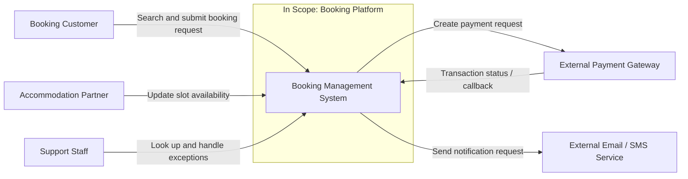
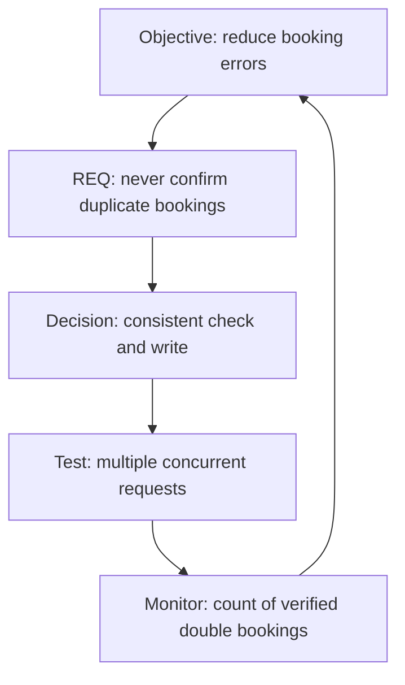

# Defining Business Objectives, Stakeholders, and System Scope

## 1. Why Clarify Requirements Before Designing for the Cloud?

A good cloud architecture does not start by choosing Kubernetes, serverless, a database, or a service provider. It starts with a question: **what outcome does the system need to deliver for the organization, who does it serve, and where do its responsibilities end?** Without those answers, a solution may be technologically modern yet still fail because it solves the wrong problem, exceeds what the organization can afford, or fails to meet security and operational requirements.

In the cloud application architecture design process, defining business objectives, stakeholders, and system scope provides the inputs for every subsequent decision on networking, compute, data, deployment, and operations. It is also the foundation for evaluating trade-offs among **reliability, security, scalability, performance, cost, and operational excellence** under a Well-Architected mindset.

After this lesson, you will be able to:

- Distinguish between business objectives, success metrics, functional requirements, quality requirements, and technical solutions.
- Identify users, decision-makers, operators, and dependent systems or partners; determine who has approval authority for each requirement.
- Articulate what is in and out of system scope, trust boundaries, data flows, and integration responsibilities.
- Turn vague expectations into requirements with measurable criteria, priorities, owners, and verification methods.
- Draft an architecture requirements brief clear enough for the engineering team to begin comparing cloud options.

## 2. Four Commonly Confused Concepts

| Concept | Question to Answer | Example for a Booking Application |
| --- | --- | --- |
| **Business objective** | Which outcome does the organization want to improve, and why? | Reduce the rate at which customers abandon the booking process. |
| **Requirement** | What must the system do, or what condition must it satisfy? | Customers can hold a slot for a limited time; a single slot must never be confirmed for two customers at the same time. |
| **System scope** | Which features, data, and integrations is the build team responsible for delivering? | Manage slot availability and booking state; use an external payment gateway to collect payments. |
| **Architecture decision** | Which technical design meets the requirements with acceptable trade-offs? | Use transactions with consistency constraints when confirming a booking, and a queue for notifications. |

A useful order of reasoning is: **business problem → desired outcome → verifiable requirement → architectural option → post-deployment measurement**. You should not write "must use microservices" as a business objective. That is a design choice that must be justified by concrete requirements, such as independent deployability, data ownership boundaries, or engineering organization scale.

A goal like "the system must be fast" is not enough for an architect to choose technologies. You need to know **which action must be fast**, how fast, under what load conditions, measured where, during which phase, and approved by whom. If those parameters lack evidence yet, record them as assumptions to be validated rather than turning them into commitments.

## 3. Step 1 — Understand Context and Business Outcomes

### 3.1. Start from the Real Problem

Interview the product owner and the people who directly use the current (*as-is*) process. Gather bottlenecks, costs, risks, and the consequences of not changing:

1. **Context:** Who performs the work? How does the current process run? Which systems currently support it?
2. **Problem:** Where is the organization losing revenue, spending excessive staff effort, facing risk, or failing to meet customer expectations?
3. **Evidence:** What metrics, incident logs, customer feedback, or operational data prove the problem exists?
4. **Desired outcome:** What change would be valuable to the organization if the project succeeds?
5. **Constraints:** Which choices are restricted by deadlines, budget, compliance obligations, existing data, and legacy systems?

For example, saying "we need to move the system to the cloud to scale" is a **solution-oriented proposal**. After asking follow-up questions, the team might identify the real problem as "promotional campaigns drive spikes in bookings and the current system frequently fails to keep up." That second piece of information is far more valuable for choosing how to scale, control inventory, and plan costs.

### 3.2. Write Measurable Objectives Along with Guardrails

Objectives need to be specific, measurable, time-bound, and tied to business outcomes. You can use this structure:

> By **[target date]**, improve **[business metric]** from **[baseline value]** to **[target value]** for **[user group/process]**, based on **[data source]**, under **[constraints]**.

The numbers in the table below are **hypothetical examples for practice only**, not benchmarks applicable to every system:

| Component | Verifiable Formulation |
| --- | --- |
| Business objective | Within 6 months after launch, increase the completion rate of valid bookings from 68% to 78%. |
| Metric definition | Rate = number of completed valid booking sessions / total number of valid booking sessions started in the same period. |
| Data and owner | Customer journey analytics events; the Product Owner is responsible for validating the calculation method. |
| Quality guardrails | No increase in double-booking rate, no violation of personal data protection requirements, and no breach of the approved operating budget. |
| Evaluation cadence | Measure the baseline before making changes, monitor weekly after release, and evaluate after 6 months. |

Do not conflate a **business KPI** with a **technical SLO**. Booking completion rate is influenced by pricing, user experience, cancellation policies, and many factors outside architecture. By contrast, p95 response time, error rate, and availability are metrics that the engineering team can influence more directly. You must connect them with a testable hypothesis, such as "reducing latency in the payment step will reduce abandoned sessions," and then measure whether the hypothesis holds true.

### 3.3. Classify Objectives, Constraints, and Assumptions

- **Objective:** What you want to optimize, such as reducing booking confirmation time.
- **Mandatory constraint:** What must not be violated, such as data-processing restrictions under legal policies confirmed by the responsible department.
- **Assumption:** What is temporarily believed to be true but not yet verified, such as "the payment service always returns a callback within 30 seconds."
- **Dependency:** What the project does not fully control, such as the payment provider's contract and API limits.

Each assumption should have a verifier, required evidence to collect, and a confirmation deadline. Designing around unverified assumptions can force the entire deployment model to change later.

## 4. Step 2 — Identify Stakeholders and Decision Authority

A **stakeholder** is an individual, group, or organization that influences the project or is impacted by its outcomes. An **actor** is a person or system that interacts directly with the system in a business flow. A stakeholder might not be an actor—for example, the finance department approves the budget without ever using the booking functionality.

### 4.1. Stakeholder Map

| Group | What They Care About | Questions to Confirm |
| --- | --- | --- |
| Sponsor | Benefits, cost, schedule, risk | Which criteria determine project success, and who approves major trade-offs? |
| Product Owner / Business | Workflows, release scope, user experience | Which workflow needs support first? Which edge cases are critical? |
| End users | Ease of use, speed, correctness | Which step currently causes failures or delays? |
| Business operations | Exception handling, reconciliation, customer support | When payment succeeds but confirmation fails, how should it be handled? |
| Architect / Engineering team | Feasibility, integration, data, evolvability | Which systems and API contracts already exist? |
| Platform / SRE / Cloud operations | Monitoring, deployment, recovery, incident response | Who is responsible for on-call, backups, recovery, and environment costs? |
| Information Security / Legal | Access, data protection, compliance | Which data types are sensitive? What are the retention, deletion, and audit requirements? |
| Finance / Procurement | Budget and contracts | What are the cost thresholds, cost allocation model, and commitment limits? |
| External vendors | APIs, limits, contractual SLAs | What do they guarantee, what do they depend on, and is there a fallback when they go down? |

Do not interview only the person who submitted the initial request. Operators often know failure scenarios and constraints that planners have not yet seen; security or finance teams can uncover requirements that compel architectural changes early on.

### 4.2. Assign Responsibility Using RACI

RACI helps prevent requirements from lacking an approver:

- **R — Responsible:** Performs the work.
- **A — Accountable:** Ultimately accountable with approval authority; typically only one A per decision.
- **C — Consulted:** Consulted before the decision is made.
- **I — Informed:** Informed of the outcome.

Example responsibility assignment for a cloud project (actual roles may vary):

| Decision / Deliverable | Sponsor | Product Owner | Architect | SRE | Security |
| --- | :---: | :---: | :---: | :---: | :---: |
| Finalize business objectives and KPIs | A | R | C | I | I |
| Finalize features for the initial release | I | A | R | C | C |
| Select the architectural option that meets requirements | I | C | A/R | C | C |
| Approve operational on-call and recovery plan | I | C | R | A | C |
| Approve information security control requirements | I | C | R | C | A |

The matrix is a starting point for discussion, not a rigid org chart. If two parties have conflicting requirements—for example, the business team wants an early release while the security team requires full access controls first—document the conflict, its consequences, the decision-maker, and the resolution plan; never silently drop a mandatory requirement.

## 5. Step 3 — Understand Business Workflows and Interacting Actors

Before drawing technical components, describe the **end-to-end business flow** in language that the process owner can verify. A flow should include the initiating actor, starting conditions, main steps, success state, exception cases, and data produced.

Example flow for "customer books an accommodation slot":

1. The customer selects dates and views availability information.
2. The system checks availability, applies pricing rules, and creates a temporary hold request.
3. The customer completes payment through an external provider.
4. The system receives and verifies the payment result; if valid, it confirms the booking and updates inventory.
5. The system sends a notification; support staff can view the status to resolve anomalies.

Mandatory verification questions include: What if two people hold the same slot? What if payment has already been charged but the callback arrives late? What if the user clicks the button twice? If the notification service goes down, should the booking be considered failed? If the customer cancels, who defines the refund and inventory-release rules?

These exception branches are precisely what drive requirements for **data consistency, idempotency, retries, timeouts, reconciliation, and system observability**. They should be articulated before choosing a database, message queue, or deployment pattern.

## 6. Step 4 — Draw Boundaries and Define System Scope

### 6.1. Pick the Right "System Under Design"

The **system of interest** is the system or subsystem the team is responsible for designing. A C4-style System Context diagram helps answer: Who uses it? Which systems does it communicate with? Which data crosses which boundaries? Who owns the rest?

The context diagram below illustrates the booking system at a conceptual level:



The boundary in the diagram represents **system responsibility**, which does not automatically map one-to-one to VPCs, cloud accounts, deployment regions, or compliance boundaries. Those technical and security boundaries must be clarified separately during the design phase. Even though the payment gateway is outside the build scope, the API contract, integration errors, exchanged data, and exception-handling workflow still remain part of the booking system's **integration** responsibility.

### 6.2. Distinguish In-Scope, Out-of-Scope, and Dependencies

| Item | Phase 1 | Explanation / Responsibility Boundary |
| --- | --- | --- |
| Search availability, request hold, confirm/cancel booking | **In scope** | The project team is responsible for managing state and business rules. |
| Slot availability management API for partners | **In scope** | Includes authentication, authorization, rate limiting, and input validation contracts. |
| Integration with payment provider | **In integration scope** | The system invokes APIs, handles callbacks, reconciles transactions, and handles errors. |
| Core payment processing and card data storage | **Out of scope** | Handled by the external provider under contract; confirm the scope of data passing through the system. |
| Machine-learning recommendation engine | **Out of scope for Phase 1** | Can be added to the roadmap if approved later. |
| Provider API availability and service-level agreement | **External dependency** | Requires plans for timeouts, retries, alerts, reconciliation, and escalation contacts. |

A complete scope definition should also answer these questions:

- **Functionality:** Which user journeys and behaviors are supported in this release?
- **Data:** Which data types does the system create, read, update, retain, or delete? Who is the authoritative data source (*system of record*)?
- **Integrations:** Are there synchronous or asynchronous dependencies on other systems? Who is responsible when another system fails?
- **Users and regions:** Which customer segments, partners, geographic regions, and operating time windows are supported?
- **Operations:** Who monitors the system, administers access permissions, handles incidents, and manages backups and recovery?
- **Phasing:** Which parts are mandatory in Phase 1, and which can be deferred? What criteria trigger subsequent phases?

### 6.3. Data Boundaries and Trust Boundaries

For every flow crossing a system boundary, specify **the data exchanged, controlling party, authentication mechanism, encryption requirements, access permissions, retention period, traceability, and error handling**. For example:

| Flow | Key Data | Risks / Architecture Questions to Confirm |
| --- | --- | --- |
| Customer → application | Identity, booking dates, contact details | How to authenticate, prevent abuse, protect personal data, and prevent request forgery. |
| Partner → application | Slot count, price, availability schedule | Who is authorized to update? How to handle delayed or conflicting updates? |
| Application ↔ payment gateway | Transaction ID, amount, status | Callback/signature verification, idempotency, timeouts, transaction reconciliation; minimizing sensitive data exposure. |
| Application → notification service | Recipient address, notification template | Protecting personal information, retries, and processing deadlines when the provider fails. |

Never assume that "using a managed cloud service" means the provider bears all security responsibilities. You must define the application team's responsibilities versus the provider's responsibilities for configuration, identity, data, networking, logging, and resilience.

## 7. Step 5 — Turn Expectations into Verifiable Architecture Requirements

### 7.1. Functional Requirements and Quality Requirements

**Functional requirements** describe what the system does: searching availability, creating bookings, paying, canceling, reporting. **Quality / non-functional requirements** describe how well and under what conditions the system must perform those behaviors. They drive most of the trade-offs in cloud design.

| Attribute | Questions to Clarify | Impact on Cloud Design |
| --- | --- | --- |
| Reliability and availability | Which flows are most critical? How much downtime is acceptable? | Redundancy, fault-tolerant architecture, multi-AZ deployment, recovery plan. |
| Correctness / consistency | Which data must never be written incorrectly or lost? | Transactions, data models, locking/reservation mechanisms, deduplication. |
| Performance | What are the p95/p99 targets for which operations, at what load and user region? | Caching, compute sizing, query design, traffic routing, networking. |
| Scalability | What are the average load, peak load, growth rate, and burst patterns? | Horizontal/vertical scaling, backpressure control, asynchronous processing. |
| Security and privacy | Who may access which data types? What auditing is required? | IAM, network segmentation, encryption, secrets management, logging, and data controls. |
| Operability | Who is on-call? How are issues detected, diagnosed, and deployed? | Logs, metrics, traces, alerts, runbooks, CI/CD, rollback. |
| Disaster recovery | What is the maximum acceptable data loss and downtime? | RPO/RTO targets, backups, restore testing, secondary-region strategy. |
| Cost | What are the budget and key unit-cost metrics? | Resource sizing, service selection, data lifecycle, spending limits. |

**RTO** (*Recovery Time Objective*) is the target duration to restore operations after a disruption. **RPO** (*Recovery Point Objective*) is the maximum acceptable data loss measured in time at the recovery point. Both metrics are agreed upon by the business based on outage impact and must be validated through drills; they do not automatically equal backup intervals or a cloud provider's SLA commitments.

### 7.2. Write Requirements as Quality Attribute Scenarios

A good scenario specifies **the stimulus source, actor/stimulus, environment, affected system component, expected response, and measurement**. A helpful format is:

> When **[event]** occurs under **[conditions]**, **[system/subsystem]** must **[response]**, measured by **[metric, threshold, measurement window, and test method]**.

Illustrative examples (thresholds are hypothetical and require Product Owner, SRE, and security sign-off):

| ID | Requirement Scenario | Verification Method |
| --- | --- | --- |
| QA-01 | During a peak campaign at 500 search requests/second, 95% of valid search requests complete in under 800 ms as measured at the API endpoint. | Load test using representative datasets, configurations, and access regions; report p95 and error rate. |
| QA-02 | If the notification provider does not respond within 30 seconds, confirmed bookings retain their valid status and notification requests are retried according to policy. | Simulate timeouts, verify booking state integrity and bounded retry behavior. |
| QA-03 | If two customers simultaneously confirm the same slot unit, at most one request is accepted; no duplicate bookings appear in active records. | Concurrency contention tests, data constraint checks, and reconciliation. |
| QA-04 | When an Availability Zone experiences an outage, critical search and booking flows meet the approved recovery time. | Game day / failover drill against the agreed RTO and measure data loss against RPO. |

In QA-01, you must distinguish **requests/second** from **concurrent users** and specify whether the measurement point is the browser, gateway, or API; those quantities are not interchangeable. In QA-04, do not put arbitrary RTO/RPO numbers into requirement sign-offs unless the business has confirmed the impact and cost.

### 7.3. Requirement Recording Template for Traceability

A requirement should capture at least: ID, business goal, description, priority, owner, source, acceptance criteria, measurement method, constraints, and confirmation status.

```yaml
id: QA-03
business_goal: Reduce double-booking errors
description: No two confirmed bookings exist for the same unit and time range
priority: Must
owner: Product Owner
consulted: [Engineering, Operations]
acceptance: Concurrent transaction tests and data reconciliation find no duplicate bookings
verification: Concurrent integration test + reconciliation report
status: Needs business confirmation
```

This is a **requirements specification template**, not a deployment configuration. In a real project, you can write complete natural-language descriptions and split acceptance conditions into individual fields that can be automatically tested. For quantitative metrics, add baseline value, target value, timeline, measurement scope, and data-collection system.

## 8. Step 6 — Prioritize Requirements and Manage Trade-offs

Resources are finite, so not every wish can share the same priority. You can use MoSCoW:

| Level | Meaning | Example |
| --- | --- | --- |
| **Must have** | Mandatory for core workflows or legal obligations to function properly. | Never confirm duplicate bookings; only authorized personnel can view customer data. |
| **Should have** | Important, but has a temporary workaround or can move to a later release. | Admin portal with advanced filters for exception handling. |
| **Could have** | Adds extra value if resources remain. | Personalized location recommendations. |
| **Won't have (this phase)** | Explicitly excluded from the current scope. | Building an internal payment gateway. |

Mandatory legal and security requirements cannot be downgraded simply because of budget constraints. When two equally important objectives conflict, present options along with their consequences and request a decision from the authorized decision-maker.

For example, the business wants every search result to reflect real-time availability, while operations needs to handle high read traffic at a reasonable cost. One option is to allow **search listings to lag within an agreed tolerance**, while **the confirmation step re-checks availability and guarantees no double bookings**. That is a consistency-level decision per behavior, rather than applying a single policy across the entire system.

When preparing to compare architectures, you can draft a short decision table:

| Option | Benefits | Costs / Risks | Selection Conditions |
| --- | --- | --- | --- |
| Monolithic system deployed on managed services | Simple initial development, transactions, and operations. | Parts may become harder to scale independently as complexity grows. | Small team, single business domain, and release speed is critical. |
| Split into domain-aligned services | Independent scaling, deployment, and authorization per domain. | Increases integration, observability, distributed transaction, and operational overhead. | Clear domain boundaries, proven need for independence, team has operational maturity. |

This table **does not decide the architecture upfront**: it only highlights what evidence is needed. The final decision should be recorded as an ADR (*Architecture Decision Record*) capturing context, considered alternatives, decision, trade-offs, and review triggers.

## 9. End-to-End Example: Booking Platform Project Phase 1

Suppose a hypothetical company wants to build a web-based booking service that scales during peak seasons. After workshops, the team records the following information. This is **illustrative data**, not statistics from any real company.

### 9.1. Summary of Objectives and Boundaries

| Item | Recorded Content |
| --- | --- |
| Problem | Customers abandon at the confirmation step; peak periods risk overload and double bookings. |
| Expected value | Improve booking completion rate and reduce support tickets related to payment/booking state. |
| KPIs | Valid session completion rate and number of verified double-booking incidents; measure baseline before setting final targets. |
| Primary actors | Customers, accommodation partners, support staff. |
| Dependent systems | Payment gateway, notification service, existing reporting system (if integration is required). |
| In scope for Phase 1 | Search, temporary hold, partner payment, confirmation, basic cancellation, status lookup, and operational observability. |
| Out of scope for Phase 1 | Direct card payment processing, ML-based recommendations, expansion to all countries. |
| Constraints to confirm | Budget, data residency location, data retention period, RTO/RPO targets, API limits, and on-call capacity. |

### 9.2. From Business Questions to Technical Requirements

| Question or Risk | Requirement to Confirm | Architectural Impact Direction |
| --- | --- | --- |
| Multiple customers book the same slot | No two overlapping confirmed bookings exist for the same unit. | Inventory model, consistent transactions, concurrency testing, idempotency. |
| Payment callback arrives late or is duplicated | A single transaction must never be confirmed or booked twice; reconciliation is supported. | Finite state machine, idempotency keys, event logging, retry handling. |
| Unexpected traffic spikes | Maintain agreed response-time and error thresholds under peak load patterns. | Load testing, autoscaling, appropriate caching, rate limiting, and backpressure. |
| Notification provider fails | Booking transactions do not depend on immediate email/SMS delivery success. | Decoupled notification processing, queues, retries, and dead-letter handling if needed. |
| Difficult to trace root cause when customers report errors | Ability to trace from a user request to the associated booking and transaction. | Correlation IDs, logs/metrics/traces, dashboards, and incident response procedures. |
| Unpredictable cloud cost growth | Track costs by environment and per completed booking. | Tagging, budget alerts, unit cost reporting, resource right-sizing. |

Not every mitigation in the rightmost column will be implemented immediately. They are **candidate solutions** to evaluate once goals, priorities, limits, and acceptance criteria are confirmed. For instance, you cannot choose a multi-region setup without knowing outage costs, data residency rules, RTO/RPO, and the team's operational readiness.

### 9.3. Traceability from Requirement to Test



This traceability flow helps evaluate impact when designs change: does a new solution still meet the requirement, which tests must be re-run, and which KPIs must continue to be monitored? It also helps eliminate technical components that provide no clear benefit toward the agreed objectives.

## 10. Running Workshops and Preparing the Handoff Package

A concise process can be executed across multiple focused sessions rather than trying to solve everything in one meeting:

1. **Discovery intake:** Gather current workflows, baseline metrics, dependent systems, and the list of accountable owners.
2. **Business workshop:** Finalize the problem statement, user segments, critical journeys, expected outcomes, KPIs, and scope boundaries.
3. **Quality and risk workshop:** Invite SRE, security, data, finance, and relevant partners to clarify failure modes, load, security, recovery, and cost.
4. **Requirement normalization:** Assign IDs, priorities, owners, assumptions, acceptance criteria, and links to KPIs.
5. **Sign-off:** Product Owner locks scope; accountable owners confirm security/operations/cost conditions; Sponsor resolves major conflicts.
6. **Handoff to design:** Deliver the requirements list and context diagram so architects can compare options, run technical spikes for remaining risks, and write ADRs.

A minimal **Architecture Requirements Brief** should include:

| Section | Deliverable Content |
| --- | --- |
| 1. Context | Problem statement, current workflow, reason for change, supporting evidence. |
| 2. Objectives | KPIs, baseline, target values, timeline, owners, guardrails. |
| 3. Stakeholders | Stakeholder list, roles, approvers, unresolved conflicts. |
| 4. Business flows | Actors, happy path, exceptions, key states, data. |
| 5. Context and scope | System context, in/out of scope, integrations, and data/responsibility boundaries. |
| 6. Architecture requirements | Functional/NFRs, priorities, measurable criteria, and verification methods. |
| 7. Implementation conditions | Constraints, assumptions, dependencies, budget, schedule, operational readiness. |
| 8. Open decisions | Unclear items, who must answer, deadlines, risk if confirmation is delayed. |

**Definition of Ready for Design:**

- At least one business objective exists with a clear measurement method, owner, and review milestone.
- Actors, dependent systems, responsibility boundaries, and Phase 1 scope are confirmed by stakeholders.
- Core flows and critical error branches are documented, including inconsistent-data scenarios.
- Key quality requirements have measurable conditions or are explicitly documented as undecided; no hidden commitments exist.
- Legal, security, data, budget, and operational constraints have assigned accountable owners for sign-off.
- Requirements have priorities and acceptance criteria; unresolved conflicts and assumptions have assigned owners.

If real metrics are missing, you can run a **spike/proof of concept** or measure baselines before locking in the final design. The essence is to surface uncertainty, state how it will be verified, and never disguise assumptions as facts.

## 11. Common Mistakes

| Mistake | Consequence | How to Fix |
| --- | --- | --- |
| Choosing cloud services before defining goals | Complex architecture and high cost with business value hard to prove. | Write the problem statement and KPIs before comparing services. |
| Interviewing only feature requesters | Operations, reconciliation, security, and incident handling are missed. | Build a stakeholder map and RACI; bring affected parties into workshops. |
| Writing "fast, secure, always available" | Cannot design, test, or evaluate pass/fail. | Convert into quality scenarios with measurable conditions, data sources, and owners. |
| Treating out-of-scope integrations as out-of-responsibility | API failures cause lost states or mischarged customers with no recovery path. | Define interface contracts, retries, idempotency, monitoring, and reconciliation ownership. |
| Failing to document out-of-scope items | Scope continuously creeps, making budget and schedule hard to control. | Maintain a phased in-scope/out-of-scope table and manage changes formally. |
| Conflating business risks with technical bugs | Heavy investment in low-impact risks; revenue-losing flows go unaddressed. | Prioritize by business impact, likelihood, and mitigation cost. |
| Treating business KPIs as purely technical SLAs | The architecture team is held accountable for variables outside its control. | Separate business KPIs from technical SLIs/SLOs and document linking hypotheses. |

## 12. Applied Exercise

Suppose a business wants to move its phone-based medical appointment booking workflow to the cloud. The manager says: "The app must operate 24/7, book appointments super fast, be 100% secure, and serve millions of customers." Draft a requirements brief covering: **(1)** the problem statement and two business KPIs with measurement methods; **(2)** at least five stakeholders and their approvers; **(3)** a context diagram with patients, receptionists, and the hospital system; **(4)** in-scope and out-of-scope items for the initial release; **(5)** three quality scenarios with measurable conditions; **(6)** three assumptions that need verification.

When completing the exercise, clarify whether "millions of customers" means total accounts, daily active users, or peak-hour requests; whether "24/7" means operating hours or an availability SLO with an error budget; and turn "100% secure" into concrete control, risk-management, and verification requirements. If the problem involves health data, bring in security and legal leads to confirm applicable obligations before defining storage architecture or deployment regions.

**Key takeaway:** Clear objectives, stakeholders, and scope answer *why* the architecture exists, *who* is affected, and *where* the system's responsibilities lie. Only when every requirement has evidence, priority, and a verification method does the team have a solid basis to select networking, compute, data, and deployment models aligned with Well-Architected trade-offs.
