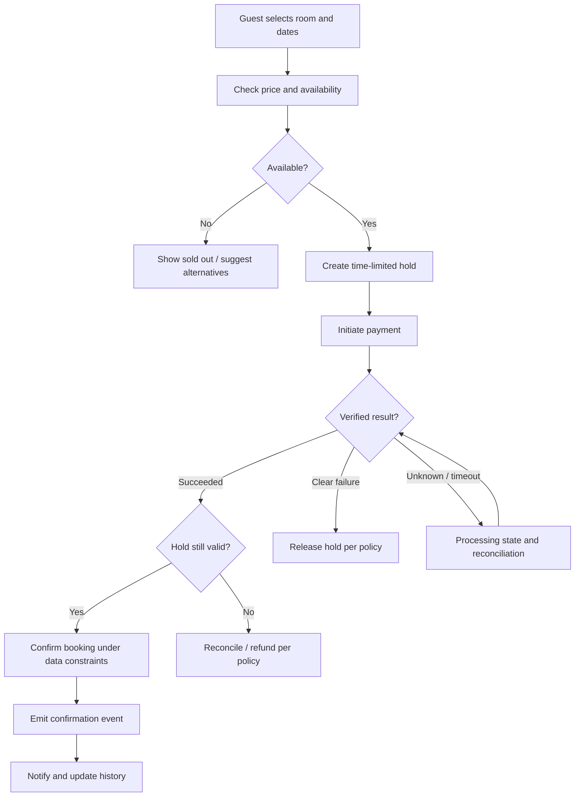
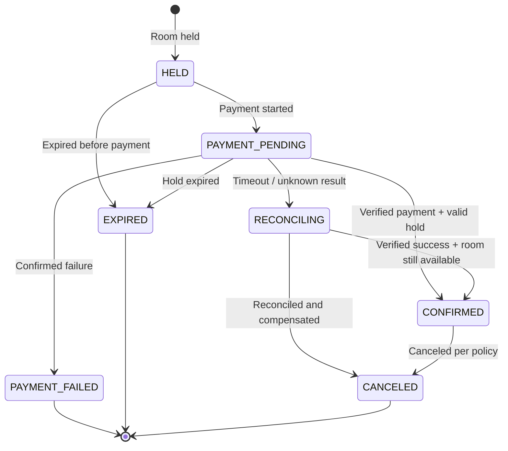
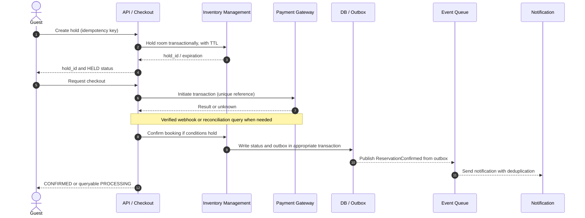

# Analyzing User Journeys and Critical Business Flows

## 1. Why Must Cloud Architecture Start from the User Journey?

An architecture can have load balancers, containers, queues, and managed databases yet still fail if users cannot complete critical tasks. For instance, an accommodation search page responds fast, yet two guests manage to pay successfully for the same room on the same dates; or a booking succeeds, yet the user only sees an error screen and tries paying again. These incidents stem from not understanding **business flows, data states, and success conditions**, rather than simply lacking server capacity.

In cloud application architecture design, journey analysis translates business objectives into concrete requirements for networking, compute, data, integration, deployment models, and operations. It also clarifies trade-offs under a **Well-Architected** mindset: reliability, security, performance efficiency, cost optimization, and operational excellence. Technology choices should only be made after the team understands which flows require immediate responses, which data must stay consistent, which actions can run asynchronously, and which failures can cause severe damage.

After this lesson, learners will be able to:

1. Distinguish between a user journey, a business flow, and a system state model.
2. Identify, prioritize, and decompose critical business flows from business objectives.
3. Convert each step of a journey into measurable and verifiable architectural requirements.
4. Analyze error branches, duplicate actions, external dependencies, and data consistency boundaries.
5. Use analysis outputs as inputs for architectural decisions and Well-Architected reviews.

## 2. Three Perspectives That Must Connect

| Perspective | Key Question | Example for an Accommodation Booking App | Output |
| --- | --- | --- | --- |
| **User journey** | What goal does the user want to achieve, through which touchpoints, and where do they hit friction? | Search places → view availability → book → pay → receive confirmation | Touchpoint map, expectations, and experience impact |
| **Business flow** | Which actors, rules, data, and events must coordinate to fulfill the goal? | Create temporary hold, verify pricing rules, validate payment, confirm booking, send notification | Activity diagram, pre/postconditions, exception branches, and *business invariants* |
| **System interaction** | Which technical components execute each step, how do they exchange data, and how do failures propagate? | API → inventory service → database; checkout → payment gateway; event → notification service | Interaction diagram, transaction boundaries, API/event contracts, and non-functional requirements |

These three perspectives are related but not interchangeable. A single UI step like "Confirm Booking" may involve multiple technical operations; conversely, a background operation like payment reconciliation may have no dedicated screen yet still determines the correctness of the journey.

Several concepts to align on:

- **Actor:** a user, operations staff member, partner system, or automated job participating in a flow.
- **Touchpoint:** where an actor interacts with the product, such as a web app, mobile phone, email, or partner API.
- **Use case:** the goal and collaborative steps between an actor and the system, including the happy path and exceptions.
- **Domain event:** a fact that has occurred, such as `ReservationConfirmed`, as opposed to a command requesting an action like `ConfirmReservation`.
- **Business invariant:** a condition that must always hold regardless of request volume or infrastructure failures; for example, a single room unit must never have two confirmed bookings overlapping in time.
- **Critical flow:** a flow whose failure, incorrect processing, or severe slowdown significantly impacts customers, revenue, compliance, or operations.

## 3. Gathering Information Before Drawing Diagrams

### 3.1. Start from Business Outcomes and Actors

Begin with a structured statement: **"[Actor] needs to [achieve outcome] in [context], and success is measured by [metric]."** For example: "A guest needs to book an available place on a mobile phone while on the move; success is receiving a valid booking code without being double-charged."

Capture at least the following actor groups when relevant:

- **Primary users:** booking guests, property hosts; may be first-time or returning users.
- **Internal users:** customer support, accounting, content moderators, incident response teams.
- **External systems:** payment providers, identity providers, notification tools, inventory distribution channels.
- **Automated processes:** hold-expiration jobs, fraud detection, reconciliation, reporting.

For each actor, identify permissions, accessible data, usage frequency, typical devices/connectivity, and the consequences if a task fails to complete. Pay attention to rare but high-impact cases, such as refunds when the payment gateway is experiencing an outage.

### 3.2. Rely on Evidence, Not Just UI Assumptions

Input sources may include interviews with users, business teams, and support; *funnel* metrics; logs and traces; transaction histories; incident tickets; legal regulations; and partner integration docs. Combine qualitative insights ("guests feel anxious waiting for payment") with quantitative metrics ("checkout abandonment rate", "timeout count", "confirmation latency"). When data is unavailable, mark it explicitly as an **assumption to verify**, rather than turning assumptions into approved requirements.

During working sessions, ask:

1. What is the starting point and the sign of successful completion for the journey? Who confirms success?
2. Can users drop off, lose connectivity, click a button twice, or open multiple devices?
3. Which steps mutate data or money? Which steps only read data?
4. When a partner responds slowly, can the system display "processing"? Who is responsible for follow-up handling?
5. At which steps do personal data, payment details, or access permissions appear?
6. Are there hourly/daily traffic peaks, campaigns, events, or seasonal spikes?

### 3.3. Build a Sample Journey Map

The running example is an online accommodation booking system, though the same method applies to e-commerce, digital banking, e-learning, and SaaS.

| Step | Guest Goal / Expectation | Business Action | Related Data | Risks or Pain Points |
| --- | --- | --- | --- | --- |
| Search | Fast and relevant results | Filter by dates, location, price | Listings, search index, reference prices | Slow results or stale prices/availability |
| View details | Understand price, policies, and availability | Recalculate price by dates and terms | Rates, taxes/fees, inventory, policies | Details page differs from checkout |
| Hold slot | Know they can proceed to pay | Temporarily reserve resource with a deadline | Available inventory, `hold_id`, expiration time | Two guests competing for one room |
| Payment | Know whether transaction is processing or succeeded | Create payment request, verify outcome | Transaction ID, amount, status | Timeouts, duplicate callbacks, double charges |
| Confirmation | Receive a reliable booking code | Convert hold into a confirmed booking | `reservation_id`, payment status | Payment collected without securing a room |
| Post-transaction | Review, cancel, or get support | Send notifications, look up status, apply cancellation/refunds | Event history, policies, support case records | Failed emails or slow lookups |

The map above is a **starting point**, not a specification sufficient for implementation. Each step must be expanded into happy paths, error paths, retry behavior, data states, and accountable owners.

## 4. Determining Which Business Flows Are Truly Critical

Not every page or API needs the same availability level or data protection strategy. Prioritization should evaluate multiple dimensions rather than counting request volume alone:

| Criterion | Evaluation Question |
| --- | --- |
| Business impact | Does a failure lose transactions, cause financial loss, damage reputation, or breach contracts? |
| Blast radius | How many users, orders, or departments are affected when the flow is down? |
| Correctness and security | Does it handle money, sensitive data, access permissions, or compliance obligations? |
| Time sensitivity | Does a delay of seconds, minutes, or hours render the outcome useless? |
| Dependencies and recoverability | Does the flow span multiple systems or partners, and can it be retried or recovered manually? |

Each criterion can be scored from 1 to 5 using weights approved by the business team. **Scores are a discussion tool, not a substitute for consequence analysis:** a low-frequency refund flow can still be critical because it involves money and customer disputes.

Example grouping for design purposes:

- **Correctness-critical:** holds, bookings, payments, refunds; require invariant enforcement, retry handling, and reconcilability.
- **Experience/load-critical:** search and detail views; require latency targets, caching, and graceful degradation when secondary components fail.
- **Business-completion support:** email/SMS notifications; can typically be processed asynchronously and retried without failing the primary transaction.

Do not equate "critical" with "must be synchronous." A critical flow may need asynchronous steps to stay accurate and recoverable; what matters is clearly defining the displayed status and completion window acceptable to users.

## 5. Decomposing Flows into Conditions, Processing Steps, and States

### 5.1. Define the Business Contract Before the API Contract

For the "Book Room" operation, specify:

| Component | Example Specification |
| --- | --- |
| Starting point | Guest is signed in or has a valid identifier, and has selected a room and date range |
| Preconditions | Room is bookable; displayed price and policies are confirmed at checkout |
| Success | `reservation_id` exists in `CONFIRMED` state, room entitlement is recorded; payment result satisfies policy |
| Invariants | No two confirmed bookings overlap for the same room unit and time range; retries sharing an idempotency key produce only one logical outcome |
| Other terminal states | `EXPIRED`, `CANCELED`, `PAYMENT_FAILED`, or `RECONCILING`; each state has a clear handling path |
| Dependencies | Inventory data, pricing engine, payment provider, storage infrastructure, and notification system |
| Accountable owners | Product Owner sets policy; backend team enforces invariants; operations monitors and handles reconciliation |

**Note:** "Payment request submitted" does not equal "Payment succeeded." Outcomes returned from the client app must never be used as proof of transaction; verify results against a trusted source such as verified webhooks or the provider's transaction query API.

### 5.2. Branching Happy Paths and Exception Paths



The diagram intentionally includes an **"unknown"** branch because losing connectivity after sending a request does not mean the payment failed. Hold handling and late-arriving results require explicit policy; if a hold has already expired, the system must not blindly confirm a booking when inventory is no longer valid.

### 5.3. Modeling States and State-Transition Authority

A minimal model for discussion:



This is an **illustrative model**, not a universal default for every payment provider. In real implementations, payment status, hold status, and reservation status may be three separate state machines. The team must document which operations may trigger each transition, which events initiate them, and which transitions require an audit trail.

Invariants must be enforced at the **authoritative write boundary**, not merely in the UI:

- Concurrent booking requests must be handled using database transactions and appropriate overlap-prevention constraints (e.g., locking/serializing by room unit and date range, or range exclusion constraints if supported by the database engine). Simply checking "is available" and then writing in two separate operations creates a *race condition*.
- Idempotency keys must be bound to the customer/actor and request payload; resending the same request returns the original logical outcome. If a key is reused with different data, the system must reject it or handle it per a published contract.
- Payments, booking confirmations, and refunds must carry reference IDs for tracing, reconciliation, and deduplication. Across two independent systems, never assume a single ACID transaction spans both the application database and the payment gateway.

### 5.4. Distinguish Synchronous and Asynchronous Operations

**On the main response path (*critical path*):** request validation, final price calculation, authorization checks, safe hold creation, and returning current status. These steps need tight latency and timeout bounds. Payment confirmation can continue asynchronously if the provider has not yet returned a final result.

**Post-transaction processing:** sending emails, updating reports, refreshing search indexes, syncing partner systems. These can use an event bus or queue as long as system state does not depend on notifications succeeding immediately.



The diagram shows logical relationships; it does not mean the API may confirm a booking while the payment gateway outcome is still unknown. The confirmation step executes only once business conditions are verified. When event emission is mandatory after a write, a **transactional outbox** stores the intended event in the same transaction as the state change, and a separate worker publishes it; this reduces the risk of updating data successfully while losing the event due to a network error. Consumers must still handle duplicates because publishing/delivery can repeat.

## 6. Analyze Failure Paths as Core Requirements, Not Afterthoughts

For each step of the flow, evaluate at least four failure categories: invalid input/authorization, data contention, transient infrastructure/partner failures, and indeterminate outcomes.

| Scenario | Expected Behavior | Architectural Implication |
| --- | --- | --- |
| Guest clicks "Pay" multiple times | One payment intent never triggers duplicate charges | Idempotency at the API and gateway calls; store transaction references |
| Two guests book the same room simultaneously | Only one request can claim the resource for overlapping dates | Contention control at the authoritative datastore; concurrency testing |
| Payment gateway times out | Display "processing"; reconcile outcome before retrying charge | Bounded timeouts, intermediate states, verified webhooks, and reconciliation jobs |
| Payment callback arrives twice or out of order | Never double-confirm, double-refund, or regress state | Signature verification, event IDs, version/valid-state checks, and safe idempotency |
| Database write succeeds but event bus misses notification | Event is re-published after recovery | Outbox, backoff retries, backlog monitoring, and dead-letter queue |
| Email service fails | Booking remains valid; notification is retried | Asynchronous queue, notification templates with deduplication keys |
| Hold expires while payment verifies late | Never create conflicting booking; compensate/refund per policy | *Compensation* flow, reconciliation, exception-handling support |
| User loses network after submitting command | Can query status by transaction reference without creating a new order | Status lookup API, correlation ID, UI displaying final state |

To avoid cascading failures, explicitly define a **retry policy** per operation. Retries are generally safe for reads or writes guarded by deduplication; never blindly retry every payment command. Use bounded timeouts, *exponential backoff*, *jitter*, and circuit breakers on overload-prone dependencies. Distinguish transient errors from permanent business errors; otherwise, an invalid request will loop endlessly and fill up queues.

For asynchronous processing, monitor pending message counts, oldest message age, retry attempts, messages routed to dead-letter queues, and controlled replay mechanisms. Design compensating actions around real business rules: issuing a refund, releasing inventory, and writing audit records are separate actions that can succeed or fail independently.

## 7. Turn Journeys into Measurable Non-Functional Requirements

Requirements like "fast, secure, and scalable" are insufficient for selecting an architecture. Write them as scenarios specifying **actor, load condition, metric, threshold, measurement window, and owner**. The numbers below are illustrative examples showing how to write them; real thresholds must be validated against data and business goals.

| Flow | Example Verifiable Requirement | How to Measure | Design Directions to Consider |
| --- | --- | --- | --- |
| Search | 95% of valid search requests return results within 2 seconds at target load | Client-side p95 latency segmented by region and device | Cache/CDN, search index, query tuning, autoscaling |
| Hold | No two overlapping `CONFIRMED` bookings exist for a single room | Invariant checks in concurrency tests and production data | Transactions, isolation/data constraints, idempotency |
| Check status | Users can look up saved status after a connection drop | Query API success rate and state-update latency | Authoritative datastore, lookup codes, no dependency on email |
| Payment | Transactions with indeterminate outcomes are identified, tracked, and reconciled within the business-agreed window | Age of `RECONCILING` transactions, backlog, reconciliation discrepancies | Webhooks, reconciliation jobs, audit trails, alerts |
| Notification | Email failures never break confirmed bookings | Transaction failure rate when email service is down | Queue, outbox, dependency isolation |
| Recovery | The booking system achieves RTO/RPO aligned with acceptable loss | Recovery drills and data reconciliation | Backups, restore automation, multi-AZ, DR as needed |

### 7.1. Distinguish Easily Confused Metrics

- **SLI** is the actual measurement, such as the ratio of checkouts ending in a deterministic state or p95 response time. **SLO** is the target set for an SLI over a measurement window, such as search request success rate over 30 days. **SLA** is a negotiated/contractual commitment with users or partners.
- **Availability** must be tied to useful behavior: an API returning HTTP 200 while confirming incorrect inventory is not a business success.
- **Latency** must specify the measurement point: browser, API gateway, service, or external provider; p95 differs from the mean.
- **RTO** is the maximum acceptable time to restore functionality after an outage; **RPO** is the acceptable data loss measured in time. Payment and booking flows typically require tighter recovery and reconciliation than static content views.
- **Data freshness** is the maximum acceptable staleness of information. Search results can tolerate bounded replication lag, whereas inventory confirmation must rely on the authoritative store and strict contention rules.

### 7.2. Estimate Load from Behavior, Not Guesswork

System load should be broken down by flow rather than picking a vague "concurrent users" number. Initial estimation formulas:

```text
Daily requests for flow = daily active users × actions per user per day
Peak-hour average RPS = peak-hour requests / 3,600
Design RPS = peak-hour RPS × observed or assumed burst factor
```

Hypothetical example: 20,000 daily active users, each generating 10 search requests per day; 20% of requests occur during the peak hour, with short bursts at 3x that hour's average. That yields `200,000 requests/day`, roughly `11.1 RPS` in the peak hour, and a burst level near `33.3 RPS`. This is only a **load-testing assumption**: you must verify the real distribution, growth rate, cache hit ratio, backend queries per request, long-lived connections, and write-path load.

Do not apply the same multiplier to every flow: search volume may be orders of magnitude higher than order creation, while payment webhooks follow different load and retry patterns. Each flow needs its own forecast table for throughput, service time, payload size, data growth, and cost per successful transaction.

## 8. From Business Flows to Cloud Architecture Decisions

Only after knowing which steps require immediate results, where the authoritative data lives, and what failures are acceptable should you compare technical options.

| Insight from Flow | Potentially Suitable Architectural Decision | Trade-offs to Record |
| --- | --- | --- |
| Search is read-heavy, needs low latency, and tolerates brief staleness | Search index and cache decoupled from the transactional store | Increases synchronization complexity and stale-cache handling |
| Room confirmation must never conflict | Transactional datastore with constraints/transactions for inventory and reservations | May limit write throughput on "hot" resources; requires thoughtful locking and partitioning |
| Payment depends on an external provider | Checkout persists durable state, handles webhooks, and reconciles | More complex than a single HTTP round trip; needs a `PROCESSING` UI state |
| Notifications can lag without breaking the transaction | Queue and background workers with an outbox | Must monitor backlogs, retries, and deduplication |
| Query traffic spikes seasonally | Stateless application services, autoscaling, and query optimization | Variable costs; autoscaling alone does not solve database bottlenecks |
| Personal data and payment systems require protection | Network segmentation, least privilege, encryption, secrets management, audit logging | Increases permission governance and key management overhead |
| An Availability Zone outage must not disrupt critical flows beyond tolerance | Distribute services across multiple AZs, verified backup/restore | Increases infrastructure cost and operational complexity |

Do not jump straight to microservices or multi-region. If multiple steps share a single consistent transaction boundary, a well-modularized monolith with a managed relational database is often simpler, cheaper, and more reliable. Split services only when business boundaries, load, and deployment/operational needs yield clear benefits; when splitting, accept distributed transactions, event versioning, and compensation workflows.

### 8.1. Connect to Networking, Compute, Data, and Deployment

**Networking:** trace the path from client device through CDN/WAF and load balancer/API gateway to services; identify public components, private-subnet workloads, and egress traffic to payment providers. Attach timeout, DNS, TLS, rate-limiting, access control, webhook source validation, and network restriction requirements to limit blast radius during a breach.

**Compute:** identify which steps are CPU-intensive, I/O-intensive, or background jobs; configure autoscaling, concurrency limits, and reserve capacity per flow. Notification workers must never exhaust database connections needed by checkout.

**Data:** separate authoritative data (reservations, inventory, payment references) from replicas used for search/reporting; define backup policies, retention periods, access permissions, encryption, and recovery needs for each dataset.

**Deployment model:** evaluate single-region/multi-AZ or multi-region when driven by latency, recovery, or data residency requirements; decide zero-downtime deployment strategies, schema rollbacks, and event schema versioning. Every choice must trace back to a flow objective, not a cloud provider's service catalog.

### 8.2. Apply Five Common Well-Architected Perspectives

| Perspective | Verification Question for a Critical Flow |
| --- | --- |
| **Operational Excellence** | Are there owners, dashboards, runbooks, alerts, and a way to trace every failed transaction? |
| **Security** | Who is allowed to invoke each operation? Is sensitive data minimized, encrypted, and audited? |
| **Reliability** | When components fail, does business state remain accurate? Are there retries, reconciliation, backups, and recovery drills? |
| **Performance Efficiency** | Are p95/p99 targets under peak load verified? Are read and write paths separated where needed? |
| **Cost Optimization** | What is the unit cost per successful search/booking? How do queue, cache, database, and redundancy costs scale with load? |

Some Well-Architected frameworks also include **Sustainability** as a dedicated pillar. When applying it, evaluate idle resource ratios, cache efficiency, data lifecycle policies, and compute consumed per useful transaction.

## 9. Security, Privacy, and Observability Across the Journey

### 9.1. Threat Modeling Directly on Touchpoints

From the journey diagram, mark every place where data or privileges cross a trust boundary: login, hold creation, price updates, payment, webhooks, history lookup, and admin pages. For each location, answer: Is the actor authenticated? Are they **authorized** for this specific resource? Which fields could be tampered with, and how does the system validate inputs?

Typical controls include authentication, booking ownership checks (preventing IDOR), server-side input validation, rate limiting to prevent hold abuse, webhook replay protection, payment source signature verification, encryption in transit/at rest, and centralized secrets management. Never put card details, tokens, or unnecessary personal data into logs, queues, URLs, or dashboards; use sanitized reference IDs to correlate events.

### 9.2. Design Telemetry to Reconstruct a Transaction

Every flow needs observability capable of answering: "Where is customer X's request right now, where is it stuck, and who is handling it?" Sample observability payload:

```json
{
  "event": "reservation.checkout.state_changed",
  "trace_id": "trace-7e2f",
  "correlation_id": "checkout-84d1",
  "reservation_id": "res-4921",
  "from_state": "PAYMENT_PENDING",
  "to_state": "RECONCILING",
  "reason_code": "PAYMENT_PROVIDER_TIMEOUT",
  "duration_ms": 1480
}
```

This is **illustrative** data; identifiers must not contain raw personal information. Useful metrics include funnel step completion rates, time from hold to confirmation, p95/p99 per endpoint, error rates by category, age of `RECONCILING` transactions, reconciliation failure rate, queue backlog depth, and invariant rejections due to contention.

Distinguish infrastructure alerts (CPU, DB errors, queue lag) from **business alerts** (spike in unreconciled payments, charges lacking an associated booking, drop in checkout success rate). System-wide dashboards are insufficient if they fail to monitor the actual customer journey. Runbooks should explain how to look up a transaction by `correlation_id`, inspect authoritative state, run reconciliation actions, and escalate to audited manual support.

## 10. Validate the Architecture with Concrete Scenarios

A neat diagram does not prove a flow works correctly. Convert journey branches into tests with observable expected outcomes:

| Validation Scenario | How to Test | Pass Criteria |
| --- | --- | --- |
| Two guests compete for the last room | Send concurrent booking commands for the same room/dates | No two overlapping confirmed bookings exist; the remaining response has a consistent state |
| Network drops after submitting checkout | Disconnect or simulate client timeout, then resend with the same key | No duplicate logical transaction created; guest can look up status |
| Payment webhook arrives twice and out of order | Replay valid events in different orders | State never regresses erroneously; no double confirmation or double refund |
| Notification service is unavailable | Shut down workers or simulate email provider failure | Booking remains valid; backlog is monitored and replayable |
| Database or an AZ fails | Run a drill in a safe test environment and measure service loss | RTO/RPO meet targets without violating data invariants |
| Peak load on search flow | Run load tests based on forecasted workload, including cache misses | Meets latency/error targets without starving checkout |
| Hold expires while payment is indeterminate | Control test clock/state and deliver late payment confirmation | Never confirms a room already allocated to someone else; enters compensation/reconciliation state |

Testing requires reference datasets, success criteria, measured metrics, and sign-off owners. For money-related flows, use partner sandboxes or controlled mocks; fault-injection drills must be confined to appropriate environments.

## 11. Practical Workflow from Requirements to Design Document

You can run analysis sessions with product, engineering, data, security, and operations across seven steps:

1. **Lock business outcomes:** state goals, actors, scope boundaries, KPIs, and unverified assumptions.
2. **Map the end-to-end journey:** record each touchpoint, motivation, input/output data, latency expectations, and potential drop-off points.
3. **List and prioritize flows:** evaluate impact, load, time sensitivity, money/sensitive data, and recoverability.
4. **Decompose critical flows:** document pre/postconditions, calculation rules, invariants, processing steps, state machines, and error branches.
5. **Mark system boundaries:** identify authoritative datastores, APIs, events, partners, sync/async boundaries, and access controls.
6. **Turn risks into requirements:** set SLIs/SLOs, RTO/RPO, load targets, correctness, data security, reconciliation, and cost targets; record assumptions and owners.
7. **Compare architectures and verify:** write ADRs (*Architecture Decision Records*) for major choices, run prototypes/spikes, and create corresponding acceptance tests.

### Single-Flow Analysis Worksheet Template

Copy the template below for each real flow:

```text
Flow name:
Business objective / KPI:
Actors and permissions:
Starting point → success signal:
Preconditions / postconditions:
Steps and data read/written:
Business invariants:
States / valid state transitions:
Exception branches, timeouts, retries, compensation:
Internal dependencies / external partners:
Authoritative datastore:
Transaction and async boundaries:
Latency, throughput, availability requirements:
Security / privacy / audit requirements:
RTO / RPO / data freshness:
SLIs / SLOs / logs, traces, and alerts:
Risks / unverified assumptions:
Architectural options / trade-offs / ADR:
Acceptance tests / accountable owner:
```

### Common Mistakes

- **Drawing only the happy path:** leaves teams unprepared for timeouts, late callbacks, or user retries.
- **Treating a UI step as a single transaction:** obscures data boundaries and external system dependencies.
- **Using a cache as the source of truth for transactions:** search results can be stale, but resource allocation decisions must verify against the authoritative store.
- **Retrying without idempotency:** can create duplicate orders, charges, or notifications.
- **Applying the same SLO to every component:** inflates cost on low-criticality steps while still missing invariants on decisive steps.
- **Monitoring only HTTP 200 and CPU:** fails to detect stuck transactions, balance mismatches, or corrupted room inventory.
- **Choosing microservices/multi-region before knowing business boundaries:** introduces distributed complexity without measurable benefits.

## 12. Applied Exercise

**Scenario:** An online class-booking platform sells 100 seats per session. Users select a class, hold a seat for 5 minutes, and pay via an external provider. Occasionally users lose connectivity, webhooks arrive twice, and hundreds of users compete for the final seats.

Complete the following deliverables:

1. Map the journey from viewing a class to receiving access; include drop-off and refund request paths.
2. Define at least three invariants and a state model covering holds, payments, and enrollment.
3. Mark steps requiring strong consistency, steps that can run asynchronously, and the authoritative datastore.
4. Write two measurable non-functional requirements: one for user experience and one for correctness.
5. Design three test cases: last-seat contention, duplicate webhooks, and payment succeeding after hold expiration.
6. Propose a design so email delivery failures never lose confirmed enrollments; analyze the added operational cost.

**Self-assessment criteria:** A strong submission explains *why* each step is synchronous or asynchronous, *where* invariants are enforced, *who* owns state when failures occur, and *by what measurements* the system proves it meets the requirements.

---

**Key takeaway:** User journeys show the value to deliver; business flows define the rules that must always hold; system flows and non-functional requirements determine how to deploy, measure, and recover in the cloud. A good architecture is one where every decision about networking, compute, data, and operations traces directly back to a concrete objective or risk of critical flows.
