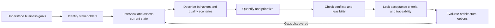
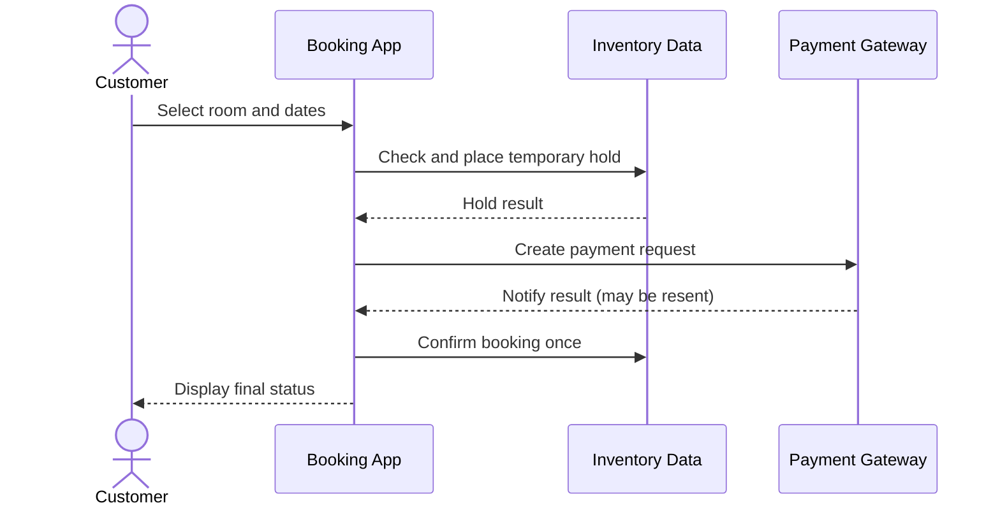

# Gathering Functional and Quality Requirements

## 1. Why Must Cloud Architecture Start from Requirements?

Cloud architecture design does not begin by asking "should we use Kubernetes, serverless, or virtual machines?"—it begins by asking **what must the system do, under what conditions, and how is success measured?** The exact same booking domain can be deployed on a single server, a managed application platform, or a multi-region system. The right choice depends on scale, outage risk, data sensitivity, operational capability, and realistic budget.

Within **CLOUD_ARCHITECTURE**, the goal of this step is to turn business requirements into reliable inputs for choosing **networking, compute, data, and deployment models**, while evaluating trade-offs among **reliability, security, scalability, cost, and operations** under a Well-Architected mindset.

Running example throughout this lesson: a company preparing to move an **accommodation booking platform** to the cloud. Customers need to search rooms, hold slots, pay, and receive confirmation; operations staff need to manage room inventory and handle incidents. The targets and figures below are **hypothetical assumptions for practicing requirements gathering**, not default recommendations for every system.

## 2. Distinguish Four Types of Input Information

| Type | Question to Answer | Example | Role in Design |
| --- | --- | --- | --- |
| **Functional requirement** | What behavior must the system perform? | A customer holds a room for a defined window; upon successful payment, a booking is created | Defines workflows, APIs, data, and integrations |
| **Quality attribute requirement** | How well and under what conditions must the system perform that behavior? | 95% of searches return results within 800 ms at the defined load | Guides performance, reliability, security, operations, and verification |
| **Constraint** | What limits must be obeyed without exception? | Only use providers approved by legal and security teams | Narrows the set of valid architectural options |
| **Assumption** | What is unconfirmed yet temporarily used for design? | Peak traffic equals 4x normal daily traffic | Needs an assigned owner to verify; may alter design decisions |

A **business objective** such as "reduce booking abandonment rate" is the reason to gather requirements, but it is not enough to pick infrastructure sizing. Likewise, "use three Availability Zones" is a **proposed design decision**; it does not replace the underlying fault-tolerance requirement. Always record the source and confidence level of each piece of information to avoid turning assumptions into commitments.

### Quality Checklist for a Requirement Statement

A useful requirement must be:

- **Specific and unambiguous:** readers interpret the behavior, subject, conditions, and exceptions the same way.
- **Verifiable:** includes acceptance criteria, measurements, or test methods.
- **Attributed and owned:** specifies who proposed it, who approves it, and when it should be reviewed.
- **Prioritized and scoped:** distinguishes launch-day needs from future expansion goals.
- **Feasible and consistent:** conflicts among budget, timeline, and recovery levels are addressed openly.

For example, "the system must be fast" cannot be verified. A clearer formulation is: "In a production-like environment with a database of at least 1 million accommodation listings and a total load of 200 requests/second, the **server-side p95 processing time** of the search API does not exceed 800 ms during a 30-minute test." You must explicitly agree on whether network transit and third-party services are included.

## 3. Process for Gathering and Clarifying Requirements



### Step 1 — Understand Business Outcomes and System Scope

Clarify who uses the product, critical journeys, target markets, launch timing, and outage impact. Requirements for an internal prototype differ from those for a customer-facing payment system running continuously. Define the boundary between system-owned capabilities and capabilities handled by external providers, such as payment gateways, email/SMS delivery, or identity services.

Minimum outputs: measurable goals, actor diagrams and critical business flows, initial release scope, and a list of external dependencies.

### Step 2 — Find the Right People and Choose Elicitation Methods

| Stakeholder | What to Learn | Appropriate Method |
| --- | --- | --- |
| Product Owner, Business | Product value, critical journeys, priorities, seasonality | Interviews, prioritization workshops |
| End users and customer support | Interaction steps, frequent errors, expectations when offline | Task observation, interviews, ticket analysis |
| Application and data engineering | Business rules, APIs, data, dependencies, transaction consistency | Scenario walkthroughs, API contract and dataflow reviews |
| SRE, operations, support | Fault tolerance limits, maintenance windows, alerting, backups, on-call | Past incident analysis, failure-scenario drills |
| Security, legal, compliance | Authorization, sensitive data, retention and audit rules | Risk and data assessment workshops |
| Finance, cloud lead | Budget, cost-growth ceilings, operating expenses | Cost forecasting and load-scenario analysis |

Do not merely ask "what do you want the system to look like?" Ask about **concrete events**: what happens during peak hours, how payment callbacks are handled, how much data can be lost at most, and who is allowed to view customer records. Interviews should be cross-checked against current system metrics, incident logs, telemetry, real behavior, and contractual obligations where applicable.

### Step 3 — Model Journeys and Exceptions

For each journey, define **actor → trigger → preconditions → main flow → error branches → data read/written → outcome**. Pay close attention to system boundaries and asynchronous situations: two guests holding the same room simultaneously; a guest clicking pay twice; a payment gateway delivering the same webhook multiple times; notifications arriving late or failing.

A simple journey diagram:



This diagram expresses business intent only; it does not dictate synchronous or asynchronous architecture, database vendor, or reservation mechanics. Those choices will be evaluated after understanding consistency, latency, and failure-recovery requirements.

## 4. Specifying Functional Requirements: What Must the System Do?

You can start from *user stories* ("As a ..., I want ..., so that ..."), then add business rules and acceptance criteria. Short user stories help kick off discussions, but they are usually **insufficient** to design data models, APIs, integrations, or failure behavior.

Example requirement set for the booking platform:

| ID | Functional Requirement | Representative Acceptance Criteria |
| --- | --- | --- |
| FR-01 | Customers search rooms by location, dates, and guest count | Filters apply accurately; empty results display clearly; unsuitable rooms are never returned |
| FR-02 | Customers place a temporary hold on a room when starting checkout | Hold expiration time is displayed; two active holds cannot conflict under the same inventory rules |
| FR-03 | Customers pay and receive a booking code | Confirmed only when transaction reaches a valid success state; duplicate payment events never create two bookings |
| FR-04 | Customers view and cancel bookings per policy | Refund amount and cancellation deadline reflect the policy active at booking time |
| FR-05 | Staff update room inventory and pricing | Unauthorized users are rejected; changes are logged and reflected in relevant queries |
| FR-06 | System sends booking status notifications | Sends accurate status content; when notification channels fail, booking status remains queryable |

Example elaboration of **FR-03**:

> **When** a customer submits a payment request for a valid hold, **if** the payment gateway confirms success with verifiable proof, **then** the system transitions exactly once to the confirmed booking state, returns a booking code, and retains transaction history. If callbacks are duplicated, delayed, disconnected, or indeterminate, the system must follow agreed rules and never double-charge or double-book due to client retries.

Questions to answer before choosing a solution:

1. What defines a "valid hold"? Is there an expiration time and priority order?
2. Which system is the *source of truth* for payment state and booking state?
3. When payment status is indeterminate, what does the customer see? Who or what process reconciles it?
4. Which operations require **atomicity or idempotency**, and which may use *eventual consistency*?
5. What rate limits, response-time bounds, retry mechanisms, and service commitments apply to integrations?

Thus, functional outputs are not merely a list of screens. They include **data rules, state lifecycles, integration contracts, and exception workflows**—information that directly shapes compute and storage design.

## 5. Specifying Quality Requirements: How Good Must the System Be?

Quality requirements typically drive most of a cloud architecture's cost and complexity. To avoid statements like "must be stable", "must be secure", or "auto-scale", write a **quality attribute scenario** with this structure:

**Stimulus source → stimulus event → affected artifact → environment → expected response → verification metric.**

Example: "During a promotional campaign, when search traffic rises from 50 to 200 requests/second over 10 minutes, the search service maintains server-side p95 ≤ 800 ms and server error rate ≤ 0.5% on realistic simulated data." This scenario leads directly to load testing, capacity forecasting, and scalability assessment across both application and database layers.

### Common Quality Categories in Cloud Architecture

| Category | Elicitation Questions | How to Quantify or Verify |
| --- | --- | --- |
| **Performance** | Which operations are latency-sensitive? What is peak load? | Per-journey p95/p99 latency, throughput, concurrent requests, timeout rate, test datasets |
| **Availability** | Which journeys must stay up continuously? What outage windows are allowed? | Per-journey SLIs/SLOs, measurement window, classification of valid vs. failed requests |
| **Recoverability** | How long can service be down? How much data can be lost? | RTO, RPO per failure scenario; live recovery drill testing |
| **Scalability** | Does traffic grow daily, seasonally, or per campaign? Is there a ceiling? | Growth rate, sustained/burst load, scaling time, bottlenecks, and resource limits |
| **Security & privacy** | Which data is sensitive; who can access it; where must it reside? | Authorization tests, encryption checks, audit logs, secrets management, compliance checks |
| **Operability** | Who detects and resolves issues? How deep must tracing go? | Time to detect, time to alert, log/metric/trace coverage, on-call and recovery runbooks |
| **Cost** | What is the monthly budget and acceptable load-driven cost growth? | Cost forecasts by scenario, cost per transaction, budget alerts and caps |
| **Modifiability** | Which features change frequently, and what is the desired deployment time? | Deploy/rollback duration, blast radius of changes, data and API compatibility rules |

You must define **what is measured, under what conditions, and how it is collected**. "500 concurrent users" is not "500 requests/second"; "API service is alive" is not "customers can actually book a room." Inferring full-journey availability solely from CPU metrics or `/health` checks leads to false conclusions.

### Illustrative Verifiable Quality Requirements Set

| ID | Illustrative Target | Verification Method |
| --- | --- | --- |
| QR-PERF-01 | Search API achieves server-side p95 ≤ 800 ms at 200 requests/second, ≥ 1 million items, sustained for 30 minutes | Load test on production-like environment; capture latency distribution, errors, and configuration |
| QR-AVAIL-01 | Search and room-view journeys achieve a 99.95% monthly availability SLO | Measure eligible requests per agreed SLI definition; track both errors and timeouts |
| QR-REC-01 | Upon loss of primary deployment region, target RTO ≤ 2 hours and RPO ≤ 15 minutes for booking data | Region-loss and recovery drill; measure restore duration and latest recovered data point |
| QR-SEC-01 | Only properly authorized staff can access customer data; sensitive data is encrypted in transit and at rest | Negative authorization tests, IAM reviews, TLS config, encryption, and key management checks |
| QR-SCALE-01 | Search load grows 4x within 10 minutes while still meeting QR-PERF-01 at the approved peak load | Ramp-up test; monitor provisioning speed, DB load, queues, and service quotas |
| QR-OPS-01 | Critical errors affecting bookings are detected and alerted to on-call within ≤ 5 minutes | Controlled fault-injection drill; measure time from fault to alert and trace completeness |
| QR-COST-01 | Projected steady-state monthly run cost ≤ 5,000 USD at the agreed baseline traffic | Forecast covering compute, data, bandwidth, logs, backups, and redundancy; update with actuals |

These targets must be validated by their owners and reviewed together for feasibility. For example, **QR-SCALE-01** does not mean maintaining p95 latency at infinite load; it applies only up to a **specific peak load** and bounded resource budget. Likewise, **QR-COST-01** does not prove cost efficiency if egress traffic, log retention, backups, and redundancy are omitted.

### SLI, SLO, SLA, and Error Budget

- **SLI** (*Service Level Indicator*) is the actual measurement, such as the proportion of valid search requests returning timely results.
- **SLO** (*Service Level Objective*) is the target for an SLI over a defined period, such as 99.95% monthly.
- **SLA** (*Service Level Agreement*) is a service contract that may carry contractual penalties; do not conflate it with internal SLOs.
- **Error budget** is the acceptable shortfall within the measurement window. For a 99.95% SLO, the error budget is 0.05% under the exact SLI definition—it does not automatically mean 0.05% total system downtime.

If an SLI is truly defined by **service uptime**, 99.95% over a 30-day month equals roughly **21.6 minutes of unavailability**. If the SLI is **successful request ratio**, it must be computed over eligible requests rather than converted directly into outage minutes. Explicitly specify how maintenance windows, partner integration outages, client-input errors, and rate-limited requests are accounted for.

### Distinguish RTO from RPO

- **RTO** (*Recovery Time Objective*): maximum target time to restore the defined service level after an incident.
- **RPO** (*Recovery Point Objective*): maximum target time span of data loss acceptable upon recovery.

An RTO of 2 hours and RPO of 15 minutes **does not mean** daily backups suffice. For a full-region outage, you must verify environment failover mechanisms, cross-region replica/backup placement, and the ability to restore sufficiently fresh data. Targets are requirements that must be engineered and tested; they are **not guarantees** achieved merely by toggling a cloud provider feature.

## 6. Turning Vague Answers into Acceptance Criteria

| Initial Statement | Clarifying Questions | Verifiable Statement |
| --- | --- | --- |
| "The app must be very fast" | Which journey? What load? Measured end-to-end or server-side? | Search p95 ≤ 800 ms on defined dataset and traffic |
| "Never lose data" | Which failure types? Are a few seconds of loss ever acceptable? | Confirmed transactions require defined consistency; per-scenario RPO approved by business owner |
| "Strong security" | Which data types and roles? Which compliance obligations? | Admin roles require MFA; customer data access is tested and audited; secrets are never in source code |
| "Auto-scale seamlessly" | Scale how high, how fast, and at what cost ceiling? | Latency target holds up to peak load X; scales within Y minutes; total cost stays within approved budget scenario |
| "Always online" | Which journeys? Over what window? | Per-journey availability SLO with explicit SLI definition and measurement window |

A good practice is recording each quality requirement as a structured entry:

```text
ID: QR-PERF-01
Source: Product Owner + current load telemetry
Target artifact: Search API
Context: Dataset >= 1 million items, load 200 requests/second for 30 minutes
Stimulus: User submits a valid search request
Expected outcome: Server-side p95 processing time <= 800 ms
Measurement: Load test, latency metrics, error rate report
Priority: Must-have for launch
Owner: Product Owner; technical sign-off: Tech Lead/SRE
Evidence status: Unverified; load test required
```

When writing requirements, separate **desired target**, **existing evidence**, **open assumptions**, and **required tests**. This provides the basis for risk assessment before procuring cloud services or committing to SLAs.

## 7. Handling Priorities, Dependencies, and Conflicts

You cannot treat every requirement as top priority by default. A straightforward method is assigning **Must / Should / Could / Won't for now** to each requirement along with rationale, owner, and target release. Every *Must* should link to a confirmed business value, obligation, or risk. High-cost requirements must document trade-offs.

Common conflicts include:

- **High availability ↔ cost:** multiple Availability Zones, replicas, or standby environments increase spend and operational complexity.
- **Very low RPO ↔ data complexity:** synchronous replication can add latency or limit region placement; asynchronous replication introduces an unconfirmed data-loss window requiring approval.
- **Low latency ↔ security controls:** validation steps, logging, and hops across security boundaries add latency; optimize per journey and risk level.
- **Fast scaling ↔ data bottlenecks:** adding application instances does not automatically resolve DB bottlenecks, write locks, external dependencies, or quotas.
- **Fast launch ↔ long-term operations:** the quickest initial setup may lack observability, recovery testing, and cost controls.

For example, for QR-REC-01, the team might evaluate two options: **cross-region backups with scripted restore** or **a standby environment in a second region**. The first generally lowers recurring spend but must prove it can recover within RTO/RPO; the second can shorten RTO yet raises cost, complexity, and data synchronization governance. Never pick based solely on service names: test restores and measure actual timings.

Every unresolved conflict needs a **decision-maker, deadline, and impact if left unchanged**. Never silently weaken quality targets to fit an already chosen architecture.

## 8. From Requirements to Architecture Choices and Well-Architected

Requirements trace to **decisions to evaluate**, and from there to **verification evidence**. The table below lists areas to investigate without locking into any specific cloud product.

| Requirement | Architectural Impact to Investigate | Evidence Required |
| --- | --- | --- |
| FR-02, FR-03 — prevent double holds/bookings | Transactional data types, locks/conditional updates, idempotency, outbox or appropriate event sync | Concurrency contention tests, retries, disconnects, and duplicate callbacks |
| QR-PERF-01 — search latency | Caching, indexing/queries, networking, user-proximity region, compute, and load shedding | Load tests with latency distributions, query stats, hit ratios, and bottlenecks |
| QR-AVAIL-01 — availability | Eliminating single points of failure, multi-AZ deployment, business-meaningful health checks, dependency fallback | Instance/zone failure tests, user journey monitoring, and SLIs |
| QR-REC-01 — recovery | Backups and point-in-time recovery, off-region replicas, failover and restore runbooks | RTO/RPO drill reports, data integrity reconciliation |
| QR-SEC-01 — security | Least-privilege IAM, network segmentation, encryption, secrets management, audit logs, data controls | Threat modeling, permission tests, config and dataflow audits |
| QR-SCALE-01 — peak load | Auto scaling, queues, rate limits, connection pools, DB and partner service quotas | Ramp-up tests, saturation monitoring, and threshold behavior |
| QR-OPS-01, QR-COST-01 | Observability, on-call, runbooks, resource tagging, cost alerts, and telemetry retention policies | Incident drills, cost forecasts/actuals, and alert tests |

A **Well-Architected** review should ask across its pillars: do operations have runbooks and continuous improvement loops; does security enforce access control and data protection; does reliability avoid single points of failure with tested recovery; is performance measured under realistic load; does cost have models and accountable owners; and are resources used efficiently with minimal waste? You can use the chosen provider's Well-Architected Framework for deeper inspection, but conclusions must remain anchored to your system's specific requirements and metrics.

## 9. Deliverable Artifacts and Maintaining Requirements

After the initial elicitation cycle, the team should produce an **architecture requirements package sufficient for decision-making**:

1. **Context and scope:** business goals, user personas, dependent systems, current and future scope.
2. **FR catalog:** requirement IDs, actors, main flows, error branches, data rules, acceptance criteria.
3. **QR catalog:** stimulus scenarios, environment, measurable targets, priority, source, owner, and verification methods.
4. **Constraints and assumptions:** confirmed legal rules, data types and processing locations, budget, team skills, open questions.
5. **Traceability matrix:** linking business objectives → requirements → architectural options → tests/evidence → decisions.
6. **Decision records:** chosen option, alternatives considered, trade-offs, residual risks, and review triggers.

Whenever traffic targets, served regions, data policies, or availability levels change, evaluate the impact on linked architectural decisions. Do not let the requirements document be signed once and forgotten as operational data arrives. Post-launch metrics, incidents, cloud bills, and customer behavior provide the evidence to adjust assumptions and deliberately raise or lower SLOs.

## 10. Practice Exercise: Build a Requirements Set for a New Product

**Hypothetical context:** a booking system currently runs on a single server and risks overloading during peak season. The team plans to migrate to the cloud without having chosen a deployment model yet. Proceed in order:

1. Role-play interviews with the Product Owner, SRE, Security Lead, and Finance. Collect at least **five functional requirements** and **six quality requirements** from distinct perspectives.
2. For each FR, describe **one happy path and one failure case**. Include the scenario where two customers book the same room simultaneously.
3. Write QRs for **latency, availability, RTO, RPO, security, and cost**. Every QR must specify environment, measurable threshold, measurement window (if applicable), owner, and verification method.
4. Identify at least **two unverified assumptions**; specify the data or tests needed to validate them.
5. Compare at least **two deployment options** at a principles level: a minimal option suited for launch and a higher-resilience option. Tabulate requirements met, gaps, cost, and operational risk.
6. Hold a review to resolve priority conflicts; record the decision in a brief ADR (*Architecture Decision Record*) and specify conditions that would require revisiting it.

**Completion criteria:** someone else should be able to read your package and accurately answer **what the system must do; what quality levels it must achieve; on what evidence; who approves; which tests verify it; and why the chosen architecture satisfies top priorities**. If they cannot answer, the requirements are not yet clear enough for design input.

## 11. Self-Check Before Finalizing Requirements

- Have business objectives, functional requirements, quality attributes, constraints, and assumptions been clearly distinguished?
- Do critical journeys cover failure branches, data states, and external dependencies?
- Are numbers for traffic, p95, SLO, RTO/RPO, and budget backed by sources or labeled as assumptions?
- Do availability targets measure user-facing behavior or merely single-server health?
- Are there realistic tests for write contention, load ramps, zone loss, and recovery?
- Have conflicts among reliability, security, scalability, cost, and operability been explicitly resolved?
- Does every high-priority requirement have an accountable approver and traceability to architectural decisions?

Quality requirements gathering enables teams to **choose architectures based on goals and evidence**, rather than habit. This forms the foundation for subsequent decisions across networking, compute, storage, data, deployment models, and Well-Architected reviews.
