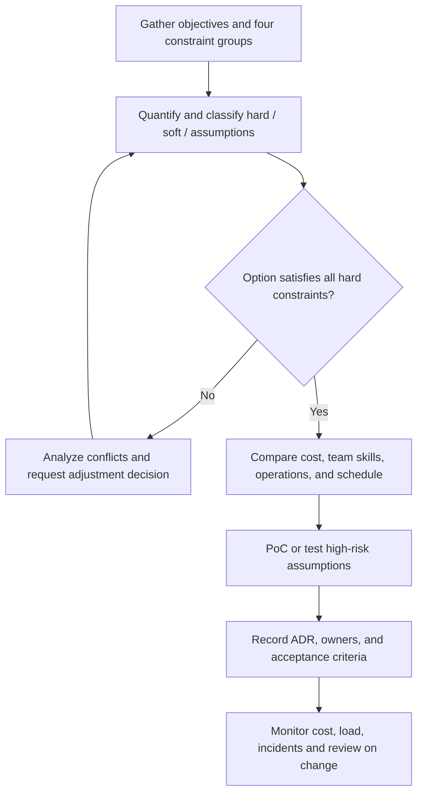

# Identifying Budget, Staffing, Technology, and Timeline Constraints

## 1. Why Must Constraints Be Clarified Before Designing?

In cloud application architecture design, **requirements** describe what the system must achieve; **constraints** define the boundaries and conditions that any solution must obey. For example, "the system must serve 200 requests/second at peak" is a capacity requirement; "infrastructure spend must not exceed 25 million VND/month" is a budget constraint. Both must be evaluated together to select appropriate networking, compute, databases, and deployment models.

A solution may meet every technical target yet still fail to launch if it exceeds budget, lacks operators, cannot integrate with existing systems, or misses the launch window. Therefore, architects must **quantify, verify, document, and regularly review** four constraint groups: **budget, staffing, technology, and timeline**.

After this lesson, learners will be able to:

- Distinguish between mandatory constraints, preferences, and unverified assumptions.
- Turn vague statements like "cheap", "small team", "use existing tech", and "launch soon" into verifiable criteria.
- Forecast total cost of ownership, assess team capabilities, check technical compatibility, and build realistic delivery milestones.
- Explain how each constraint affects reliability, security, scalability, and operations; record decisions in architecture documentation.

### 1.1. Hard Constraints, Soft Constraints, and Assumptions

| Type | Meaning | Example | How to Handle |
|---|---|---|---|
| **Hard constraint** | Must not be violated without authorized approval to change | Data must reside in a geographic region approved by legal | Eliminate non-compliant options; if conflicts arise, escalate for re-decision |
| **Soft constraint** | Preference or desire that can be traded off with sound rationale and approval | Prefer managed services to reduce operational effort | Compare benefits, costs, and risks across options |
| **Assumption** | Temporary premise used due to lack of evidence | Traffic grows 20% in the first year | Record a verifier, validation method, and deadline |

Never write a constraint simply as "must optimize cost." An actionable constraint requires at least: **value/limit, scope of applicability, time window, mandatory status, confirmation source, accountable owner, and verification method**.

## 2. Budget Constraints: How Much Can Be Spent and On What?

Budget drives resource sizing, redundancy levels, service selection, and scaling strategies. Before estimating, ask:

1. Does the cap cover **cloud infrastructure**, total **technology spend**, or **total cost of ownership (TCO)** including staffing?
2. Is the limit monthly, annual, for a pilot phase, or for the entire project? Which currency applies; does it include taxes, support fees, licenses, and exchange-rate fluctuations?
3. Is there a one-time budget for data migration, setup, testing, training, and incident handling?
4. What are average load, peak load, and growth rate? Are pay-as-you-go services permitted, or must spend be pre-committed?
5. Who receives cost alerts, and who has authority to decide when forecasts exceed thresholds?

### 2.1. Modeling Cost by Workload

For a cloud application, cost items typically include:

| Item | Quantities to Estimate | Common Omissions |
|---|---|---|
| Compute | Instance counts, vCPU/RAM, running hours, peak load, autoscaling | Counting only peak hours or only production |
| Data | Storage capacity, IOPS/throughput, replicas, backups, long-term archival | Forgetting backups, replication, and data growth |
| Networking & delivery | Internet egress, cross-region transfer, NAT, load balancers, CDN | Assuming all data transfer is free |
| Security & operations | Logs, metrics, traces, key/secrets management, monitoring, support | Omitting observability from estimates to make costs look lower |
| Build & migration | CI/CD, dev/test/staging environments, migration, load testing | Counting only post-launch steady-state costs |
| Staffing & licensing | Implementation/operations staff, training, commercial software | Confusing infrastructure budget with TCO |

A planning formula can be used:

\[
C_{\text{monthly}}=C_{\text{fixed}}+\sum_i \bigl(q_i\times p_i\bigr)+C_{\text{contingency}}
\]

Where \(q_i\) is expected resource consumption and \(p_i\) is its unit price. **Period TCO** also includes implementation effort, operations staffing, licenses, migration, and exit/provider-switching costs if applicable. Always verify pricing with actual region rate cards, contract terms, and provider pricing calculators; the formula is only an estimation framework.

Never calculate only one scenario. Build at least three levels: **baseline**, **growth**, and **peak/unexpected spike**. Test sensitivity to variables such as request volume, data storage, egress transfer, and log retention. Size contingency budgets around identified risks rather than treating contingency as guaranteed leftover funds.

### 2.2. Turning Cost Limits into Architectural Decisions

- If traffic fluctuates sharply, evaluate autoscaling or serverless **after** estimating costs at realistic load and concurrency limits; never assume serverless is always cheaper.
- If operations staff are scarce, managed database services reduce patching, backup, and monitoring effort, though they still incur service fees, configuration work, access governance, and recovery responsibilities.
- If high availability is required, include the cost of multiple instances/zones, load balancing, data replicas, monitoring, and restore testing. Never strip redundancy just to hit a target budget without adjusting reliability objectives.
- If data volumes or cross-region transfers are high, choices around storage location, data partitioning, retention policies, and caching can affect cost far more than resizing servers.

**Control mechanisms:** tag resources by project/environment/cost center; set budget alerts and overspend forecasts; track cost per transaction or per customer; review variance between projected and actual spend regularly. This turns constraints into an ongoing **FinOps** practice.

## 3. Staffing Constraints: How Much Can the Team Build and Operate?

Evaluating staffing goes beyond counting developers. Assess **skills, available hours, operational ownership, incident response capability, and single-person dependency risks**.

### 3.1. Mapping Capabilities and Responsibilities

| Required Capability | Verification Question | Consequence When Missing |
|---|---|---|
| Cloud architecture, networking, IAM | Who designs VPC/VNet, access control, and connectivity? | Insecure or hard-to-govern network/permission designs |
| Development & integration | Who understands business logic, APIs, error handling, and data consistency? | Unrealistic integration estimates |
| Data & recovery | Who manages migrations, backups, RPO/RTO, and restore tests? | Backups exist on paper but fail to restore within targets |
| Automation & deployment | Who manages IaC, CI/CD, secrets, and rollbacks? | Manual changes, hard-to-reproduce environments |
| Observability & response | Who handles after-hours alerts, who is backup on-call, are runbooks ready? | Recovery time objectives exist only on paper |
| Security / compliance | Who performs threat modeling, data protection, and config audits? | Delayed approvals or unaddressed vulnerabilities |

Specify commitment clearly in **FTE** (full-time equivalent): an engineer dedicating 50% of their time to the project is **0.5 FTE**, not equivalent to a dedicated full-time responder. Shared-team resources need explicit schedules and accountable owners.

Answer three additional operational questions: **Who builds it? Who is on-call/remediates? Who covers when the primary owner is away?** For systems requiring continuous availability, match after-hours support demands against actual on-call rosters; small teams struggle to maintain many self-managed components with complex upgrade and recovery procedures.

### 3.2. Impact on Architectural Choices

- **Limited operational staff:** favor fewer moving parts, appropriate managed services, automated deployments, and simple monitoring/recovery procedures. Avoid adopting Kubernetes or many microservices solely because they are popular if the team lacks operational readiness.
- **Team strong in a specific ecosystem:** prefer components matching existing skills to shorten ramp-up; adopt new tech only when benefits outweigh learning cost and risk.
- **Single-expert dependency:** establish documentation, runbooks, role-based access, peer reviews, and incident drills; changing tech stacks does not fix a "human single point of failure."
- **Gaps in security or database skills:** schedule specialist support/training or narrow launch scope. Managed services do not replace decisions about authorization, data governance, and compliance.

Staffing is often a **dual constraint**: labor costs count toward TCO, while available hours and skills cap design complexity. A cheap infrastructure option that consumes heavy hours for on-call, patching, backups, and incident investigation can yield a higher TCO than a managed service option.

## 4. Technology Constraints: What Must the System Be Compatible With?

Technology constraints cover legacy systems, internal standards, integrations, legal rules, and platform characteristics. Distinguish **mandatory obligations** from **habits or personal tech preferences**.

| Area to Verify | Example Constraint | How to Verify |
|---|---|---|
| Existing platforms | Must remain compatible with PostgreSQL and existing schemas | Test schema migrations, drivers, extensions, and key queries |
| Integrations | External payment system only sends webhooks and requires signature checks | Test webhooks, retries, idempotency, and timeouts |
| Networking & identity | Private network link to internal systems; SSO via existing standard | Network flow diagrams, connectivity tests, IAM policy checks |
| Data & compliance | Data must reside in approved regions; specific retention limits | Confirm with legal/security; inspect region, backup, and log settings |
| Organizational policy | Must use approved registries, IaC tools, or CI/CD workflows | Cross-check engineering standards; run end-to-end pipeline test |
| Service limits | Runtimes, quotas, HA options, request sizes, or outbound connections | Read service docs, check quotas, and run targeted tests |

When verifying, inspect **regional service availability**, private/public connectivity, shared security responsibility models, data export paths, and quota limits. A service may fit performance needs perfectly yet not exist in the required data region, lack a database extension, or demand networking the existing environment cannot provide.

**Avoid confusing requirements with solutions:** "Must scale when traffic doubles" is a requirement; "must use Kubernetes" is a constraint only if backed by organizational/technical rationale and confirmed by authorized decision-makers. Without that rationale, record it as a **proposed option** to compare against managed containers, VMs, or serverless.

### 4.1. Evaluating Vendor Lock-in

Using cloud-specific managed services can speed up delivery and lower operational overhead, but increases switching costs. Assess dependency across APIs, data formats, deployment pipelines, IAM, and data export. For systems needing future provider portability, define explicitly **what level of portability, in what timeframe, and at what acceptable cost**. Do not assume every component must be provider-agnostic; portability itself carries cost and time trade-offs.

## 5. Timeline Constraints: What Is the Real Deadline?

"Finish in 12 weeks" is not enough for architecture design. You must know **when the 12 weeks start, what scope counts as done, approval gates, and external dependencies**.

Milestones to clarify include: requirements freeze, PoC completion, cloud access and data-region approval, environment readiness, integration completion, migration, load/security/recovery testing, pilot run, and production launch. Schedules must include **buffer for bug fixes, security remediation, rollbacks, and approvals**, not just coding time.

### 5.1. Find the Critical Path and Design the Rollout

Example dependency chain: **confirm data region → provision cloud/network access → set up database and connectivity → migrate data → test recovery → go-live**. If data-region approval slips, downstream tasks get blocked even if developers finish APIs on time. This is a **critical path** dependency requiring early tracking.

Depending on urgency, you can:

- Launch an **MVP** with core functionality, deferring secondary conveniences while preserving mandatory safety, data protection, and recoverability guarantees.
- Use managed services and **Infrastructure as Code (IaC)** to cut environment setup time and repeatable errors.
- Use **canary/blue-green** deployments if budget and architecture permit, or controlled rollouts with tested rollback plans.
- Time-box validation of high-risk assumptions before full buildout—for instance, legacy integration latency or database restore speed.

If deadline and quality cannot both be met with current resources, present clear choices: **add resources/budget, reduce feature scope, adjust milestones, or request formal target changes**. Never silently drop recovery testing or security requirements to "hit the date."

## 6. Combining Four Constraints into Architecture Decisions

The four constraint groups interact. Paying more for managed services can save time and operational effort; self-managing reduces direct service fees but demands experienced engineers; expanding across regions improves regional resilience yet increases cost, data complexity, and delivery time.



### 6.1. Comparing Options in Context

| Compute / Deployment Option | Where It May Fit | What to Evaluate Before Deciding |
|---|---|---|
| Self-managed VMs | Custom OS/runtime control needed; team has sysadmin expertise | Patching, scaling, HA, backups, security, on-call, and setup time |
| Managed containers / PaaS | Standardized packaging wanted with less infrastructure upkeep | Runtime/network limits, minimum baseline cost, monitoring, platform ops skills |
| Serverless | Event-driven or spiky workloads; minimal server management desired | Per-invocation/duration cost, cold starts, quotas, timeouts, DB connections |

These are traits to prompt evaluation, **not a fixed ranking**. Score options only after filtering out any that violate hard constraints. Criteria may include TCO, delivery speed, operability by the current team, reliability, and provider dependency; stakeholders agree on weights.

### 6.2. Connecting to Well-Architected

A **Well-Architected** review should examine trade-offs across pillars, not just total cost:

| Perspective | Constraint Cross-Check Question |
|---|---|
| Operational Excellence | With current staffing, who deploys, staffs on-call, detects faults, recovers, and improves? |
| Security | Are budget and deadlines sufficient to enforce mandatory access controls, encryption, logging, and security testing? |
| Reliability | Can target availability, RPO, and RTO be met with the planned regions/zones, backups, and response team? |
| Performance Efficiency | Do baseline and peak load projections fit sizing and technology limits? |
| Cost Optimization | Do TCO and growth forecasts stay within committed thresholds? |
| Sustainability | Are sizing choices, auto-shutdown of idle environments, and resource efficiency sound? |

Budget constraints **do not** authorize skipping mandatory security or reliability requirements. If every compliant option exceeds budget, that is a **requirements conflict requiring a formal decision**, not a reason to hide costs or risks.

## 7. End-to-End Example: Cloud Booking System Architecture

Suppose a company must move an existing booking application to the cloud. The figures below are **hypothetical assumptions for this lesson**, not published prices from any provider.

**Business and technical objectives:** operate an application handling up to roughly 200 requests/second at peak using existing PostgreSQL data; target 99.9% monthly availability, 30-minute RPO, and 2-hour RTO. Actual load must be verified via logs and testing; reliability targets require system-owner sign-off.

**Input constraints:**

| ID | Constraint and Type | Owner / Verification |
|---|---|---|
| B-01 | **Hard:** projected cloud operating cost max **25 million VND/month**, covering compute, database, network, backups, observability, support; **excludes labor and taxes** | Finance approves scope and regional pricing quote |
| N-01 | **Hard:** project phase has **2 backend developers and 0.5 FTE cloud engineer**; no full-time DBA | Engineering manager confirms work, on-call, and specialist support schedules |
| C-01 | **Hard:** must stay compatible with existing PostgreSQL schema and payment webhook integration | Test migrations, idempotency, and retry handling |
| C-02 | **Hard, data pending:** data and backup storage region must be approved by authorized leads | Legal/security confirm before locking architecture and procuring services |
| T-01 | **Hard:** pilot at end of Week 8, production at end of Week 12 | Product Owner locks acceptance scope and integration milestones |
| T-02 | **Hard:** cutover requires a rollback plan and agreed disruption window | System owner approves drill plan and test report |

### 7.1. Initial Budget Estimate

A sample budget table might look like this (unit: **million VND/month**, all figures hypothetical for practice):

| Component | Baseline Budget |
|---|---:|
| Compute and load balancing | 8.0 |
| Database | 6.0 |
| Networking and data transfer | 2.0 |
| Backups and storage | 1.5 |
| Logs, metrics, tracing | 2.0 |
| Support and miscellaneous services | 1.0 |
| **Baseline subtotal** | **20.5** |
| 20% contingency on baseline subtotal | 4.1 |
| **Total planned budget** | **24.6** |

Under this illustrative model, **0.4 million VND/month** remains under the 25 million cap—a very thin buffer. If actual quotes for a multi-zone database, traffic growth, or data transfer push projections above 25 million, the architect must escalate to **trim optimizable consumption, raise the budget cap, or request changes to targets/scope**. Never silently drop committed backups, observability, or recovery mechanisms.

Before approval, verify regional pricing quotes, taxes, support tiers, non-production environments, log retention durations, data growth rates, and load scenarios. The **0.5 FTE** above belongs to staffing/TCO; do not mistake 24.6 million for total project cost.

### 7.2. Conditional Proposed Option

- **Compute:** favor managed containers or PaaS with autoscaling, given the small team and tight schedule; verify performance around 200 requests/second, connection limits, and peak cost before committing.
- **Database:** evaluate managed PostgreSQL to cut patching/backup toil. Check schema/extension compatibility, PITR support, HA options, actual restore speed, and pricing; do not assume a single-zone setup meets 99.9%.
- **Networking/Security:** confirm data region, separate networks and permissions per environment, enforce least privilege, manage secrets, encrypt data, and secure webhook flows. Do not finalize region or data flows while C-02 remains unapproved.
- **Deployment:** build infrastructure with IaC, automated pipelines, dashboards and alerts for budget/latency/errors, operational runbooks, and rollback procedures.
- **Operations:** name primary monitoring owners and backups. If on-call and 2-hour RTO recovery cannot be staffed, request additional support or adjust approved targets.

Reference timeline: **Weeks 1–2** validate constraints/data region, PostgreSQL PoC, and cost estimates; **Weeks 3–5** IaC, networking, CI/CD, and core services; **Weeks 6–8** integration and observable pilot; **Weeks 9–10** load, security, and restore/failover testing; **Weeks 11–12** cutover/rollback rehearsal and production launch. Milestones depend on approvals and test outcomes; if early gates slip, update the critical path rather than pretending launch dates face no risk.

### 7.3. Sample Architecture Decision Record (ADR)

> **ADR-001 — Prefer Managed Application Services and Managed PostgreSQL.**
>
> **Context:** team has only 0.5 FTE cloud capacity, Week 12 production deadline, 99.9% availability target, and a 25 million VND/month cloud budget ceiling.
>
> **Conditional decision:** evaluate managed compute and managed PostgreSQL to reduce server/database administration load; implement IaC, monitoring, and recovery workflows starting from pilot.
>
> **Rationale:** prioritizes delivery speed and team operability while keeping load and cost measurable.
>
> **Acceptance conditions:** data region approved; schema/webhook PoC passes; load tests, restore drills, and HA quotes prove targets fit within budget, or constraint adjustments are approved.
>
> **Remaining trade-offs:** managed service fees and dependency on provider APIs/platforms; monitor TCO, quotas, and data export paths.

ADRs help future team members understand **why** an option was chosen, what assumptions remain active, and when to revisit the decision—rather than staring at a bare infrastructure diagram.

## 8. Practical Workflow and Constraint Register Template

Apply this sequence directly during architecture discovery sessions with Product Owner, Finance, Security, and Engineering:

1. **Gather:** elicit business objectives, load profiles, SLO/RPO/RTO, and all four constraint groups; record sources and decision-makers.
2. **Normalize:** replace vague wording with thresholds, units, applicability windows, and hard/soft tags; flag unconfirmed items as assumptions.
3. **Cross-check:** surface conflicting constraints (e.g., multi-zone HA vs. tight cost), evaluate TCO and operational capacity instead of raw resource fees alone.
4. **Validate:** run pricing calculators/quotes, integration PoCs, load tests, recovery drills, and timeline/critical-path checks.
5. **Decide:** eliminate options breaching hard constraints; compare survivors; document ADRs, risks, approvers, and acceptance criteria.
6. **Monitor:** during build and production, track spend, delivery velocity, traffic, service quality, and team capacity; reopen decisions when assumptions or thresholds shift.

An entry in a **constraint register** can be recorded in structured form (this is a documentation example, not a cloud service configuration):

```yaml
id: ARCH-COST-01
group: budget
statement: "Cloud cost at baseline load does not exceed 25 million VND/month"
scope: "production; compute, database, network, backup, monitoring, support"
classification: hard
source: "Budget confirmed by Finance department"
owner: "Product Owner and Finance"
assumptions:
  - "Baseline load matches agreed traffic figures"
validation:
  - "Pricing quote for target deployment region"
  - "Cost estimates for baseline, growth, and peak loads"
review_trigger: "Cost forecast exceeds threshold or actual load changes"
```

For each constraint, also fill in **verification status, review date, impacted options, and acceptance evidence**. When a constraint lacks an owner, numbers, or a verification method, treat it as an open action item—never assume it is satisfied.

### Pre-Architecture-Sign-Off Checklist

- [ ] Budget scope and TCO are clear; estimates include baseline, growth, peak load, and contingency.
- [ ] Accountable owners and backups exist for deployment, security, data, monitoring, and incident on-call.
- [ ] Mandatory technology lists have rationale; compatibility, quotas, data regions, and connectivity are verified.
- [ ] Schedule includes approvals, migration, load/security/recovery testing, and rollback plans.
- [ ] Reliability, security, and performance requirements are cross-checked against all four constraint groups under Well-Architected.
- [ ] Conflicts have been resolved by authorized owners; assumptions, risks, and decision triggers are captured in the constraint register/ADR.

**Operating principle:** a viable architecture is one that **satisfies business objectives and mandatory constraints**, while maintaining measured and approved costs, operational capacity, and delivery timeline. Whenever the numbers change, re-evaluate the corresponding architectural decisions.
