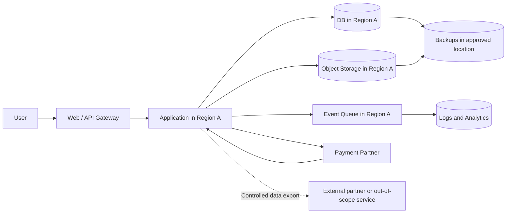

# Data Classification, Storage Location, and Compliance Requirements

In **Cloud Architecture** design, choosing databases, deployment regions, backup services, or service providers does not depend solely on performance and cost. Architects must know **what data is being processed, where that data is permitted to exist, and which obligations must be satisfied**. If these are determined too late, relocating data regions, reworking integration flows, or adding data-deletion capabilities can impact the entire system.

This lesson belongs to the **Architecture Requirements** chapter and focuses on turning business needs into implementable and verifiable constraints. These decisions relate directly to the five pillars commonly used when evaluating architectures under a **Well-Architected** mindset: reliability, security, performance efficiency, cost optimization, and operational excellence. A multi-region backup strategy may improve recoverability while creating cross-border data transfers; comprehensive logging may aid operations while increasing the risk of exposing personal data. A good architecture must articulate those trade-offs.

After this lesson, you will be able to:

- Inventory and classify data by sensitivity, criticality, and governance obligations.
- Identify data locations across primaries, replicas, backups, caches, logs, processing pipelines, and third-party services.
- Distinguish between data residency, data localization, data sovereignty, and cross-border data transfer requirements.
- Translate legal, contractual, and standards-based obligations into technical controls and verification evidence.
- Evaluate architectural options across trade-offs in security, reliability, scalability, cost, and operations.

## 1. Start from the Data and Its Intended Purpose

A requirement like "the system must protect customer data" is not specific enough for architecture design. Before selecting cloud services, answer at least six questions:

1. **What data?** Identity details, transaction records, uploaded documents, secret keys, operational metrics, or aggregated data?
2. **For what purpose?** Account creation, contract fulfillment, fraud prevention, customer support, or product analytics?
3. **Who is involved?** Data subjects, business units, operators, cloud providers, and data-processing partners?
4. **Where does it flow?** Browsers, APIs, queues, databases, object stores, analytics services, backups, and partner systems?
5. **How long is it retained?** Retention basis, expiration timing, exceptions for disputes or legal holds, and deletion mechanisms?
6. **What happens if it is exposed, corrupted, or unavailable?** Impact on customers, operations, finances, reputation, and notification duties?

The first deliverable should be a **data inventory**, not a server diagram. Each item in the inventory needs an accountable owner, intended purpose, data origin, receiving systems, retention period, and required controls.

### Data Takes Multiple Forms

- **Structured:** account tables, orders, invoices, transaction histories.
- **Semi-structured:** JSON events, queue messages, API payloads.
- **Unstructured:** document photos, attachments, audio recordings, contract files.
- **Derived data:** logs, access trails, database snapshots, analytics outputs, models, or training datasets.

Derived data is not automatically safer than source data. A log line containing an email, IP address, access token, or transaction ID can still be sensitive. Hashed or pseudonymized data can still constitute personal data if it can be linked back to an individual. Treat data as **anonymized** only after thoroughly evaluating re-identification risks in the actual usage context.

## 2. Classify Data Across Multiple Dimensions

**Data classification** is the practice of labeling data to govern access, storage, encryption, transmission, backup, logging, and deletion. A single "sensitive" label is rarely sufficient: personal data may demand high confidentiality, whereas a routing configuration table may hold no personal data yet require very high integrity and availability.

### 2.1. Sensitivity Levels

A common internal model uses four tiers; exact names and policies must be agreed upon by the organization:

| Level | Examples | Typical Control Requirements |
| --- | --- | --- |
| **Public** | Published product catalog, public user guides | Integrity controls; publish only approved content |
| **Internal** | Process documentation, non-public operational reports | Authentication, group-based authorization, restricted external sharing |
| **Confidential** | Customer contact details, contracts, personal transaction data | Least privilege, encryption, export controls, access audit trails |
| **Restricted** | Private keys, auth secrets, ID document scans, specially sensitive data | Strong isolation, tightly restricted access identities, strict key management, monitoring, and exception approval |

This is a **reference framework**, not a classification scale imposed by an international standard. The enterprise must define criteria for upgrading or downgrading labels, approval authority, and handling of unclassified data. Until classification is complete, never assume data is public.

### 2.2. Additional Classification Dimensions

| Evaluation Dimension | Design Question | Architectural Consequence |
| --- | --- | --- |
| **Confidentiality** | Who is allowed to view it? What is the impact if exposed? | IAM, encryption, network segmentation, sharing controls |
| **Integrity** | What if it is altered incorrectly or tampered with? | Input validation, signatures, versioning, audit logs, change control |
| **Availability** | How long can the system tolerate missing this data? | Multi-AZ, backups, RTO/RPO, recovery, and testing |
| **Governance obligations** | Does it involve personal data, payment data, regulated sector records, or trade secrets? | Specialized controls, audit scope, partner agreements |
| **Location and lifecycle** | Where is it processed, how long is it kept, may it be exported? | Region restrictions, dataflow controls, retention and deletion schedules |

For example, a public pricing dataset may require low confidentiality yet high integrity because tampered prices cause erroneous transactions. Conversely, copies of identity documents require high confidentiality even if rarely accessed. **Do not infer availability requirements from confidentiality level**: both attributes must be evaluated independently.

### 2.3. Labeling Data Assets

Hypothetical example for an equipment rental booking platform:

| Data Asset | Proposed Sensitivity Label | Business or Obligation Label | Notes |
| --- | --- | --- | --- |
| Published equipment catalog | Public | Public content | Control editors and versioning |
| Name, email, phone profile | Confidential | Personal data | Define usage purpose and retention period |
| Scanned identity verification docs | Restricted | Sensitive personal data per applicable assessment | Limit viewers; avoid unnecessary copies |
| Rental order ID, payment status | Confidential | Transaction record | Ensure integrity and reconciliation |
| Raw payment card number (if any) | Restricted | Potentially in PCI DSS scope | Prefer payment-provider handling; verify exact system scope |
| API keys, private keys, access tokens | Restricted | System secrets | Use secret manager, scoped permissions, and key rotation |
| Request logs containing IP or user ID | Confidential, depending on content | Potentially personal data | Scrub sensitive fields, restrict access, set retention |
| Aggregated reports | Depends on re-identification risk | Analytics | Assess small cohort sizes or cross-source linkage risks |

A single record can carry **multiple labels simultaneously**, such as `Confidential`, `personal_data`, `business_critical`, and `retention_24_months`. Labels should propagate when data flows into analytics tables, replicas, or exports, unless a valid transformation and re-evaluation process applies.

## 3. Data Location: More Than Where the Primary Database Lives

In cloud architecture, **data location** must be described across physical location, logical location, and every place data can be accessed or processed.

- **Country or territory:** boundaries potentially tied to legal or contractual obligations.
- **Region:** geographic area defined by a provider. Verify physical locations and per-region service scope.
- **Availability Zone (AZ):** fault domain within a region; multi-AZ reduces single-AZ outage risk but does not substitute for a full-region outage strategy.
- **Account, project, network, and namespace:** logical boundaries separating administrative permissions, environments, and tenant data.
- **External systems:** SaaS tools, observability platforms, payment providers, email/SMS services, or remote support teams accessing from elsewhere.

Questions for the provider do not stop at "is the database inside the chosen region?" You must also check **snapshots, replicas, backups, replication traffic, logs, technical support data, control planes, encryption keys, and globally scoped services**. Exact storage and processing boundaries vary by service and provider terms; never infer them merely from a region name.

### 3.1. Draw a Data Flow Diagram

Example data processing flow for a rental application; `Region A` is an organization-approved region name, not representing any real provider's region:



This diagram is an **inventory starting point**, not proof of compliance. Every arrow must be clarified: which fields cross it, purpose, protocol, destination, encryption mechanism, processor identity, retention period, and legal/contractual basis for transfer. If a CDN or WAF might cache content containing personal data, include them in the diagram and location policy too.

### 3.2. Data Location and Flow Matrix

| Component | Data That May Appear | Locations to Verify | Mandatory Questions |
| --- | --- | --- | --- |
| Primary DB and read replicas | Business records, personal data | Primary/replica region, AZ | Are replicas automatically created in another region? |
| Object Storage and CDN | Profile photos, contracts, cached content | Bucket region, cache/edge locations | Does the cache hold private content? Are expiry/purge policies configured? |
| Backups, snapshots, recovery environments | Near-full copies of source data | Backup region and restore target region | Is data replicated to a prohibited standby region? |
| Queues, caches, and search | Event payloads, sessions, indexes | Service region, persistence mechanisms | How are expired data and copies purged? |
| Logs, tracing, APM, analytics | IPs, user IDs, paths, error payloads | Collection and storage regions | Do third-party tools receive sensitive fields? |
| CI/CD, support, and admin tools | Secrets, dumps, debug data | Artifact storage and operator access locations | Who can download data, from which countries, under what scenarios? |

**Processing location** matters just as much as storage location. A support engineer accessing records from another country, an AI service receiving request content, or analytics events sent to SaaS can all trigger cross-border transfer or cross-border access issues even when the primary database never leaves the region.

### 3.3. Distinguish Commonly Confused Terms

| Term | Core Meaning | Sample Question |
| --- | --- | --- |
| **Data residency** | Where data is physically stored or processed | "In which country do records and backups reside?" |
| **Data localization** | Obligation to store/process certain data in a mandated location, per applicable rules | "Must this data category remain inside the country?" |
| **Data sovereignty** | Which legal systems and authorities govern and hold control over the data | "Who has authority to compel access? Who controls keys and admin operations?" |
| **Cross-border data transfer** | Transmitting or making data accessible from another country/territory, per applicable legal definitions | "Do partners, support staff, or DR systems abroad receive or access this data?" |

Choosing a domestic region **does not automatically prove** that all sovereignty or transfer obligations are satisfied. Conversely, not every cross-border data transfer is prohibited. Architects must record the applicable legal scope, permissible transfer conditions, and required documentation/approvals before opening a flow.

## 4. Turning Compliance Requirements into Architectural Decisions

**Compliance** stems from multiple sources: laws of relevant jurisdictions, industry regulations, customer contracts, internal policies, and audit commitments. They differ in enforceability, data scope, and proof requirements.

Several examples for scoping awareness, **not legal conclusions for every system**:

- Personal data protection regulations—such as **GDPR** where applicable and relevant national personal data protection laws—may impose requirements on purpose, legal basis, data-subject rights, security, retention, and transfers.
- **PCI DSS** applies to environments that process, store, or transmit payment account data within the standard's scope. Using tokenization or hosted payment services can reduce application audit scope, but responsibility boundaries must be verified.
- **ISO/IEC 27001** covers information security management systems; **SOC 2** is an attestation reporting framework for service organization controls. A provider's certifications or reports serve as partial evidence—they never replace the customer's responsibility for configuration and usage.
- Contracts may mandate customer data stay in approved regions, encryption with customer-managed keys, incident notification deadlines, or audit rights, even where statutes do not specify identical terms.

Because regulations and standard versions evolve, the architecture team must partner with legal, security, and data owners to verify **current texts, applicability scope, exceptions, deadlines, and documentation requirements**. Avoid turning a broad statement like "personal data must stay in-country" into a blanket constraint on every system without verifying the exact subjects and processing activities.

### 4.1. Traceability Chain from Obligation to Evidence

An auditable design must connect five links:

> **Requirement source → affected data assets → architectural decision → implemented control → verification evidence.**

Example traceability matrix:

| Confirmed Requirement | Architectural Decision | Implementation Control | Required Evidence |
| --- | --- | --- | --- |
| Customer profiles may only reside in approved regions | Select compliant regions for DB, object, cache, and backups | Policies blocking resource creation outside allowlisted regions; inspect replica settings | Asset inventory, region config, policy scan results |
| Only authorized support staff may view profiles | Separate user and service roles | Least-privilege IAM, MFA, just-in-time access, audit logging | Permission lists, approval logs, audit trail |
| Sensitive data must be protected at rest and in transit | Apply encryption at relevant layers | TLS, storage encryption, KMS/HSM key management, key rotation process | Encryption configs, key policies, connection test results |
| Data must be deleted or expire per policy | Design retention across derived data too | TTLs, lifecycle rules, deletion workflows, backup handling | Retention policies, deletion logs, test results |
| System must be recoverable after incidents | Choose redundancy aligned with RTO/RPO | Multi-AZ, backups, restore capability in compliant regions | Restore drill reports, measured RTO/RPO figures |

Never simply write "GDPR compliant" or "ISO 27001 certified" on an architecture diagram; specify **the exact clause, target assets, accountable owner, and concrete control mechanism**. A technical control alone does not prove full legal compliance if supporting processes, contracts, or operational evidence are missing.

### 4.2. Core Control Groups

**Data minimization and purpose limitation.** Collect only required fields; do not copy entire customer profiles into analytics systems when aggregated metrics suffice. Enforce approval workflows for new processing purposes and restrict real data use in test environments.

**Authorization and isolation.** Grant permissions via roles/service identities, restrict standing admin access, separate production/test environments, and segregate key-management duties. For multi-tenant systems, design and test tenant data isolation across APIs, DBs, and report exports.

**Encryption and key management.** Use protected transport channels, encrypt data at rest and replicas, and manage key lifecycles. Define KMS/HSM placement, decryption permissions, operator access, and key recovery; an encrypted bucket does not stop anyone with bucket read permissions from reading the data.

**Monitoring and incident response.** Log critical actions such as privilege changes, exceptional sensitive-data reads, snapshot/copy creation, data exports, and deletions. Logs must support traceability while filtering out passwords, tokens, and sensitive payloads. Define alert recipients, incident playbooks, and notification timelines aligned with actual obligations.

**Lifecycle management.** Define when data is created, used, shared, archived, moved to cold storage, deleted, and verified deleted. Policies cover DBs, objects, queues, caches, search indexes, exports, logs, and backups. If backups must be retained for recovery cycles, specify expiration behavior and access restrictions during retention.

**Third-party governance.** Determine controller/processor roles under applicable rules, review contracts, subprocessor lists, storage regions, security measures, support access, and post-termination data deletion procedures.

### 4.3. Shared Responsibility with the Cloud Provider

Cloud providers typically secure the underlying infrastructure they operate; customers remain responsible for **data, access control, configuration, service selection, keys (depending on model), and usage obligations**. Exact boundaries shift across IaaS, PaaS, and SaaS. For instance, using a managed database reduces OS patching, yet the customer must still configure permissions, networking, backups, retention, and verify where data is replicated. Always consult the shared responsibility model for the **exact service** in use.

## 5. Design Example: Equipment Rental Booking Platform

Suppose an organization runs an application with customer accounts, verification profiles, rental orders, partner payments, and operational reporting. This is an **illustrative scenario**; the regions, timelines, and targets below are design assumptions, not legal declarations.

**Initial business requirements:** customers log in and book rentals online; orders must not be lost when a server fails; support staff view only data needed to handle tickets; the organization needs revenue analytics without sending identity records to the analytics system.

**Assumed approved constraints:**

- Customer records and their copies may only be stored in `Region A`; any cross-region flow requires separate approval.
- Identity verification documents are `Restricted`; standard support staff lack permission to download originals.
- The application never stores raw card numbers or CVV codes; users are routed to an appropriate payment partner flow and only necessary reference IDs are kept.
- For transactional data, initial targets are **15-minute RPO** and **4-hour RTO**. These targets must be tested before claiming compliance.
- Analytics events use surrogate IDs and aggregated metrics; access controls and re-identification risks still require assessment.

### 5.1. Architectural Option

1. Deploy the application and managed database in `Region A`, preferring multi-AZ if supported by service and budget. Use private networking between application and DB, minimizing public entry points.
2. Store verification documents in dedicated object storage with default-deny permissions, granting short-lived access only via authorization-checked business flows; separate keys and access logs appropriately.
3. Enable automated backups, encryption, and retention controls. Confirm **all backups and snapshots** stay in permitted locations, even when auto-replication features exist.
4. Integrate the payment partner via a reviewed flow and persist payment references instead of card data. Verify which fields are actually sent to the partner and where they process data.
5. Emit technical logs with sensitive-field scrubbing; separate audit logs for profile access/export actions. Bound log retention and observability service placement.
6. Feed analytics from a controlled transformation pipeline that strips unnecessary identifiers; evaluate individual re-identification risk before sharing.

### 5.2. Decision Template for a Dataset

This is **illustrative metadata**, not a configuration directly applicable to any single provider:

```yaml
dataset: customer_identity_documents
owner: identity_verification_team
purpose: verify_customer_identity
classification: restricted
regulatory_tags:
  - personal_data
integrity_requirement: high
availability_requirement: medium
approved_primary_location: region-a
approved_backup_locations:
  - region-a
external_sharing: requires_explicit_approval
encryption_at_rest: required
encryption_in_transit: required
access_policy: verified_service_roles_only
retention_policy: per_approved_schedule
deletion_scope:
  - primary
  - replicas
  - derived_exports
  - backups_at_expiry
```

The template must link to the data catalog, approvers, and policy version. Values like `region-a` or `per_approved_schedule` are placeholders; in operations, replace them with verified regions, retention schedules, and exception procedures.

### 5.3. Turning Constraints into Automated Checks

Example **policy-as-code pseudocode** illustrating a design principle:

```text
for each data_store in deployment:
    dataset = catalog.lookup(data_store.dataset_id)

    assert data_store.region in dataset.approved_storage_regions
    assert data_store.replica_regions subset_of dataset.approved_storage_regions
    assert data_store.backup_regions subset_of dataset.approved_storage_regions

    if dataset.classification in ["confidential", "restricted"]:
        assert data_store.encryption_at_rest == true
        assert data_store.public_access == false

    assert data_store.owner is not null
```

A deployment pipeline can reject resources violating region policies, public access rules, or encryption checks. However, policy-as-code must be paired with **runtime service checks**, because data can also be exported via APIs, applications, logs, or operator tools that infrastructure configs cannot inspect.

## 6. Trade-offs That Must Be Explicit in the Design

| Decision | Benefit | Cost or Risk to Evaluate |
| --- | --- | --- |
| Keep data in one approved region | Simplifies location governance; intra-region latency may be low | Hard to recover from a full-region outage if a second region is disallowed |
| Back up or DR to another region | Stronger resilience against region-level outages | Risk of breaching location bounds, replication/storage costs, transfer controls |
| Use multiple AZs within one region | Limits impact when a single AZ fails | Higher cost; full-region outage risk remains |
| Choose managed services | Reduces operational and OS-patching burden | Must verify configurability of location, keys, backups, logs, and support access |
| Extend log retention | Aids investigation, reconciliation, and audits | Increases cost, leak surface, and tension with data-minimization principles |
| Encrypt with customer-managed keys | Stronger control over decryption and key revocation | Increases governance complexity, cost, and risk of unrecoverable loss if keys are lost |
| Anonymize/aggregate before analytics | Reduces shared identifiable data | Processing overhead; may lower granularity and still needs re-identification checks |

**Key trade-off example:** if policy allows storing data only in `Region A`, RTO/RPO targets may become unachievable during a **full-region outage**. The architecture team must state the committed failure scope, measure RTO/RPO via drills, and secure one of four approved decisions: accept the risk, revise recovery targets, qualify a permitted secondary region, or narrow the dataset requiring failover. A multi-AZ design cannot implicitly promise full-region recovery.

**Lifecycle conflict example:** immutable backups protect against malicious deletion and ransomware, yet can make immediate deletion of a specific profile from every copy difficult. Policy must define how active records are deleted, how backups are isolated and expire, whether legal retention obligations override deletion, and who approves exceptions. Never promise "immediate deletion across all copies" when backup mechanics do not support it.

## 7. Workflow for Applying to a Real Project

Follow a clear sequence to avoid overlooking secondary systems:

1. **Discover:** partner with product owners, data teams, and operations; build the dataset catalog, purposes, inbound/outbound flows, owners, and impact levels.
2. **Classify:** assign sensitivity tiers, confidentiality/integrity/availability targets, obligation tags, and lifecycle rules. Flag unclear items for approval.
3. **Scope compliance:** review countries, customers, industries, partners, contracts, and active regulatory versions with legal/security; record assumptions and decisions.
4. **Map locations:** inspect data plane, control plane, region policies, replicas, backups, caches, CDNs, observability, remote access, and third-party vendors.
5. **Design and control:** decide regions, AZs, DR strategy, authorization, encryption, key management, sharing, retention, and deletion; codify what is enforceable via configs and policy-as-code.
6. **Verify:** inspect live environment configs, run recovery drills, test access permissions, audit data exports, test deletion flows, and reconcile against the requirements matrix.
7. **Maintain:** update inventories and diagrams whenever services or partners are added, detect drift, review permissions and retention schedules, and re-evaluate when legal or business requirements change.

### Pre-Deployment Acceptance Checklist

- [ ] Every critical dataset has an owner, purpose, classification label, and retention policy.
- [ ] Every storage/processing location and data transfer flow has a clear location, recipient, and authorization basis.
- [ ] Regions of primary data, replicas, backups, logs, objects, caches, and analytics tools are verified against the approved list.
- [ ] IAM, encryption, key management, network connectivity, monitoring, and support access are configured and tested.
- [ ] Partner data flows have appropriate contracts, data scopes, and technical controls.
- [ ] Export, correction, retention, and deletion workflows operate across primary data and related copies.
- [ ] RTO/RPO are verified via drills under the declared failure scope.
- [ ] Configuration evidence, test reports, exception owners, and review schedules are documented.

## 8. Common Design Mistakes

| Mistake | Why It Is Dangerous | How to Prevent |
| --- | --- | --- |
| Classifying data only in the primary DB | Exports, logs, replicas, and images may hold identical info | Classify by **dataset** and track every place data appears |
| Assuming choosing a region completes location rules | Auxiliary services or support operations may span different regions | Verify per-service terms and behaviors; build a dataflow diagram |
| Treating encryption as sufficient protection | Identities with decryption rights can still exfiltrate data | Pair encryption with IAM, separation of duties, audits, and export controls |
| Using real production data in test environments | Test copies are often less protected and poorly tracked | Use synthetic data or proper sanitization/anonymization; manage exceptions |
| Logging full requests/responses | Tokens, documents, and personal details leak into logs | Design log field allowlists, mask/scrub data, and test error paths |
| Setting retention without testing deletion | Data lingers in indexes, queues, exports, and backups | Map the full lifecycle and periodically test deletion and restoration |
| Replicating DR to an unapproved region | Improves reliability while creating location and contract violations | Vet DR locations before enabling replication; document trade-offs |
| Believing provider certifications secure the whole system | Customer configuration and operational controls can still fail | Apply the shared responsibility model and prove your own system controls |

## 9. Connecting to Well-Architected Reviews

During an architecture review, never ask vaguely "is the data safe?" Use questions answerable with diagrams, configs, tests, and evidence:

| Review Pillar | Questions to Ask |
| --- | --- |
| **Security** | Which data is classified Restricted? Who can decrypt, copy, and export it? Is anomalous access monitored? |
| **Reliability** | If an AZ or full region fails, which data recovers? What are measured RTO/RPO, and is DR in a compliant location? |
| **Performance Efficiency** | How do location constraints affect latency for users and partners? Can caching work without storing private data in prohibited regions? |
| **Cost Optimization** | What are the costs of encryption, log storage, long-term retention, replication, and egress? Can redundant copies be trimmed? |
| **Operational Excellence** | Who maintains the data inventory, executes deletion requests, checks drift, and proves compliance when changes occur? |

A design is well-grounded when **every major decision traces back to a requirement, impact, and verification evidence**. Data classification sets the required protection level; location diagrams reveal where data boundaries truly lie; compliance matrices specify controls and accountable owners. Keep all three updated together throughout the system's lifecycle.
