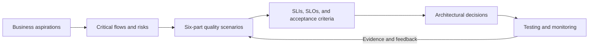

# Turning Requirements into Quality Scenarios with Measurable Criteria

## Learning Objectives

In **Cloud Architecture** design, business requirements are often expressed in phrases like "the system must be fast", "never lose data", "must be secure", or "reasonable cost." Those statements express valid wishes yet fall short for selecting architectures, designing tests, or evaluating outcomes. This lesson shows how to translate them into **quality attribute scenarios** with concrete contexts, expected behaviors, and measurable criteria.

After this lesson, you will be able to:

- Distinguish between functional requirements, quality requirements, constraints, and design assumptions.
- Write a quality scenario using six parts: stimulus source, stimulus, environment, artifact, response, and response measure.
- Formulate verifiable criteria for reliability, security, performance, scalability, recoverability, operability, and cost.
- Connect quality scenarios to networking, compute, data, and deployment decisions as well as **Well-Architected** pillars.
- Define measurement methods, verification tests, and priorities for evidence-based architectural decisions.

## 1. Why Convert Requirements into Scenarios?

Suppose a product team is building a cloud booking application. The business side asks:

> During peak hours, customers must still book quickly without double bookings, and the system must run stably.

This request leaves unanswered: how many seconds counts as "quickly", for how many users, what happens if an *Availability Zone (AZ)* fails, or at which step "no duplicates" is enforced. If stakeholders interpret these differently, the team may over-invest in infrastructure or launch something that misses expectations.

A quality scenario turns wishes into testable questions:

> When booking request traffic increases from 100 to 800 requests/second over 5 minutes, the system under normal operating conditions must keep booking API `p95` latency at or below 500 ms, error rate below 0.5% over a 30-minute load test, and produce zero duplicate bookings from retries.

The numbers here are **illustrative targets only**. In a real project, they must be agreed upon with the business and calibrated against current traffic metrics, risks, and budget. A scenario's value lies not in picking "nice" numbers, but in giving all stakeholders a shared standard for design and verification.

| Information Type | Question to Answer | Example in a Booking App |
| --- | --- | --- |
| Functional requirement | What does the system **do**? | Customers can search rooms, create bookings, and cancel bookings. |
| Quality requirement (*non-functional / quality requirement*) | **How well** does the system perform under defined conditions? | Room search API has `p95` ≤ 300 ms at 500 requests/second. |
| Constraint | What limits are **mandatory to obey**? | Personal data must be stored in an approved legal jurisdiction. |
| Assumption | What is **temporarily treated as true** yet needs validation? | Next quarter's peak traffic is projected at max 800 requests/second. |

Constraints and assumptions heavily influence design, yet must never be confused with success criteria. For example, "use Kubernetes" is a technology choice or constraint; "restore traffic within 5 minutes when a node dies" is an evaluable quality requirement. Likewise, a **user story** describes a user goal; a quality scenario clarifies system behavior under specific stress or failure.

## 2. Six-Part Structure of a Quality Scenario

A systematic format is the following six-part model:

| Component | Meaning | Guiding Questions |
| --- | --- | --- |
| **Source of stimulus** | Who or what triggers the event? | Users, external systems, attackers, infrastructure failures? |
| **Stimulus** | What event occurs? | Traffic spike, AZ outage, unauthorized access, accidental data deletion? |
| **Environment** | What state is the system in? | Peak hours, normal operations, mid-deployment, partially degraded? |
| **Artifact** | Which part of the system must respond? | API, queue, compute cluster, database, network path, operational process? |
| **Response** | What is the system expected to do? | Auto-scale, deny access, reroute traffic, restore from backup? |
| **Response measure** | How do we verify pass/fail? | `p95`, success rate, `RTO`, `RPO`, blocked events, cost/transaction? |

A useful template when interviewing stakeholders:

> **When** `[source]` triggers `[stimulus]` **under** `[environment]`, `[artifact]` must `[response]`, **verified by** `[metric and measurement method]`.

**Example — availability:** When an AZ loses connectivity during peak hours, the booking service handling 600 requests/second must route traffic to healthy instances, never confirm the same transaction twice, and achieve at least 99.9% valid request success over a 15-minute window following fault injection. To verify this, the team must define valid requests, the measurement point, and test start/end times.

<details>
<summary>Why not just write "99.9% availability"?</summary>

That number fails to specify which service, how errors are defined, the measurement window, eligible request sets, and user impact. Homepage availability differs from payment or booking API availability. An overall target can guide direction, but it must be broken down into scenarios testing critical business flows.

</details>

## 3. From Business Language to Measurable Targets

### 3.1. Identify Business Flows and Criticality

Do not start by picking servers or databases. First, establish:

1. **Who cares?** Customers, operations, security, finance, legal, and engineering have different success criteria.
2. **Which flows matter?** Search, booking, payment, reconciliation, login, and administration do not necessarily share the same priority.
3. **What can go wrong?** Traffic spikes, single-resource failures, full-region outages, bad deployments, inconsistent data, anomalous access behavior.
4. **What are the consequences?** Lost revenue, double-charged customers, data leaks, slow processing, extra operational cost.
5. **What real limits exist?** Budget, compliance, on-call staffing, delivery timeline, and risk appetite.

You can use the workflow below to keep needs connected to technical decisions:



### 3.2. Choose the Right Metrics and Measurement Methods

A solid target includes not only a numerical threshold, but also **unit, scope, load condition, time window, data source, and calculation formula**.

| Dimension | Reference Metrics | What Must Be Defined Before Committing |
| --- | --- | --- |
| Availability | Ratio of successful valid requests over 30 days | Which APIs; which error codes count; client-side measurement point; are maintenance windows excluded? |
| Performance | `p95`/`p99` latency, requests/second | Measured at client or server; read/write mix; test dataset; accompanying error rate. |
| Scalability | Sustainable throughput, scale-out duration | Ramp-up slope; downstream limits on DB, network, quotas; stabilization time. |
| Recoverability | **RTO**, **RPO** | Failure type; clock start time; recovery point; how data correctness is verified. |
| Security | Unauthorized access rejection rate; detection time | Test suite, permission model, data scope, handling process, and audit logging. |
| Operations | **MTTD**, **MTTR**, actionable alert rate | How incidents are detected; when the clock starts; who owns resolution. |
| Cost | Cost per successful order, monthly environment cost | Included components; resource tagging; fixed-cost allocation; load assumptions. |

- **SLI** (*Service Level Indicator*) is an observable measurement, such as successful booking request ratio or `p95` latency.
- **SLO** (*Service Level Objective*) is the internal target for an SLI, such as 99.95% of valid booking requests succeeding over a 30-day window.
- **SLA** (*Service Level Agreement*) is a negotiated/contractual service commitment that may carry penalties when missed. Never automatically equate SLO with SLA.
- **Error budget** is the acceptable shortfall under an SLO. If the success SLO is 99.95%, the error budget is 0.05% of measured eligible requests. It helps balance release velocity against reliability risk.
- `p95 = 500 ms` means **95% of measured latency samples do not exceed 500 ms** within the defined observation set. It does not mean every request finishes within 500 ms; nor does it reveal failure rates if only successful requests are measured.
- **RTO** (*Recovery Time Objective*) is the maximum acceptable recovery duration; **RPO** (*Recovery Point Objective*) is the maximum acceptable data loss measured in time. RTO and RPO must be proven via drills—they cannot be assumed merely by enabling backups or multi-AZ.

Example of a well-written measurement criterion:

> At 500 search requests/second, 80% basic reads and 20% advanced filters, on a dataset equivalent to 1 million records, during a 30-minute load test in a production-like environment: search API `p95` latency measured at the gateway does not exceed 300 ms, `p99` does not exceed 900 ms, and the `5xx` response rate stays below 0.5%.

The team may replace the gateway with a client-side measurement point if measuring end-to-end experience. What matters is naming the measurement point and keeping it consistent across goal-setting, testing, and monitoring.

### 3.3. Distinguish Target Criteria from Design Solutions

"Must deploy across at least two AZs" can be a mechanism toward availability, yet by itself it does not prove the service recovers when an AZ fails. A scenario must describe the **required outcome**; mechanisms like load balancers, auto scaling, caches, replicas, queues, or backups belong in the architectural design and are verified afterward.

The same applies to security: "enable encryption" is a mechanism; targets for access permissions, key management, incident detection times, and auditing state what the system must achieve. Do not mash unrelated goals into a single number and treat it as comprehensive proof.

## 4. Illustrative Scenario Set for a Cloud Booking Application

Assume the application has a search API, booking API, external payment service, transactional database, and asynchronous notification system. The table below is a **starting point for discussion**, not a universal SLO template for every app.

| ID | Attribute and Condition | Expected Response | Illustrative Verification Criteria |
| --- | --- | --- | --- |
| `QA-PERF-01` | Booking traffic rises 100 → 800 req/s over 5 minutes | Scale compute and control database load | Over 30 minutes: `p95 ≤ 500 ms`, `p99 ≤ 1,200 ms`, `5xx` errors `< 0.5%`. |
| `QA-REL-01` | One AZ goes down while handling 600 req/s | Isolate unhealthy instances and shift traffic to healthy AZs | During 15-minute fault test: valid request success `≥ 99.9%`; zero duplicate bookings in retry test set. |
| `QA-REC-01` | Transactional data requires restore after severe corruption | Restore service and data via rehearsed procedure | For defined incident scope: `RTO ≤ 60 minutes`, `RPO ≤ 5 minutes`; post-restore record reconciliation passes. |
| `QA-SEC-01` | Tenant A account requests booking belonging to Tenant B | Deny access and emit audit event | 100% of cross-tenant attempts in test suite denied; zero Tenant B data leaked; event appears in audit log within 1 minute. |
| `QA-OPS-01` | Booking API error rate exceeds 2% continuously for 5 minutes | Fire contextual alert linking runbook and traces | Alert reaches on-call channel within 2 minutes of trigger condition; timing confirmed via drill. |
| `QA-COST-01` | Traffic rises 3x above measurement-period baseline | Adjust compute and control queries/storage growth | Average cost per successful booking stays within Finance-approved budget ceiling; report breaks down allocated costs. |

For critical data, you can also add scenarios for **data durability** (never lose confirmed records), **consistency** (never sell the same slot twice), **modifiability** (deploy backward-compatible releases), or **compliance** (delete data upon retention expiry). These attributes may require qualitative pass/fail checks over explicit test suites alongside quantitative thresholds.

### 4.1. Decomposing a Performance Scenario into Six Parts

**`QA-PERF-01 — Scaling During a Booking Spike`**

| Component | Agreed Content for Testing |
| --- | --- |
| Source of stimulus | End users and partners sending requests via public API. |
| Stimulus | Traffic ramps from 100 to 800 requests/second within 5 minutes. |
| Environment | Normal system operation, production-equivalent test data, sustained load for 30 minutes. |
| Artifact | Load balancer, booking service, database connections, and synchronous dependencies. |
| Response | Scale processing capacity; bound connection pools; return accurate results; avoid unbounded retries. |
| Response measure | `p95 ≤ 500 ms`, `p99 ≤ 1,200 ms`, `5xx < 0.5%`; zero duplicate bookings in retry test set. |

**Architectural implications:** The request-handling service may need auto-scaling compute, a load balancer, and database connection-pool controls. If notification delivery slows the main transaction, evaluate offloading notifications to a queue for asynchronous processing. Design an **idempotency key** for booking commands so client retries never create a second transaction. Adding a queue does not automatically ensure correctness: transaction state persistence and deduplication rules must still be specified.

**Verification method:** Run a load generator with the agreed request mix; capture latency histograms, throughput, and errors at gateway, compute, and database; inspect database transaction locks; record configs and test datasets. If performance targets are met only by bypassing authorization checks, the test does not pass.

### 4.2. Decomposing a Data Recovery Scenario

**`QA-REC-01 — Recovering from Corrupted Transactional Data`**

| Component | Agreed Content for Rehearsal |
| --- | --- |
| Source of stimulus | Operational error or storage component failure. |
| Stimulus | A critical transactional dataset becomes corrupted or unusable. |
| Environment | System holds confirmed transactions prior to the incident timestamp. |
| Artifact | Transactional database, backups, recovery logs, and booking service. |
| Response | Detect incident; halt further damaging writes; restore appropriate recovery point; reconcile before reopening writes. |
| Response measure | `RPO ≤ 5 minutes`, `RTO ≤ 60 minutes` for the **defined incident scope**, and all mandatory reconciliation checks pass. |

**Architectural implications:** Specify backup cadence, *point-in-time recovery*, replicas in appropriate fault domains, backup access permissions, and drill procedures. **Multi-AZ provides availability against infrastructure faults; it does not replace backups against accidental deletion, logic bugs, or bad writes.** Synchronous replication can even propagate an erroneous delete instantly.

**Verification method:** Record the timestamp of the last confirmed transaction before the fault; simulate the failure in an isolated environment; execute the runbook; measure restore time; verify time-bounded data loss and run integrity reconciliation. If the database starts up yet the API still cannot process bookings, the **business service** RTO has not been met.

### 4.3. Decomposing a Security Scenario

**`QA-SEC-01 — Preventing Cross-Tenant Access`**

- **Source:** Authenticated user belonging to Tenant A.
- **Stimulus:** Sends requests to read or modify a booking owned by Tenant B, including manipulating IDs in URLs or request bodies.
- **Environment:** Production-like API; user holds a valid token without authorization for the target record.
- **Artifact:** API gateway, authorization layer, and data access queries.
- **Response:** Enforce server-side per-resource authorization; return an appropriate error without leaking Tenant B data; write sanitized audit logs.
- **Response measure:** 100% of cases in the **defined authorization test suite** are rejected, zero Tenant B fields appear in responses, and audit events arrive within 1 minute.

The architecture can combine an identity provider, resource-level authorization checks, and data-layer access scoping. However, "authentication is enabled" does not guarantee **authorization**; tests must cover direct resource access paths as well as auxiliary APIs. Never claim "100% secure" just because one test suite passed.

## 5. Connecting Scenarios to Cloud Architecture Choices

Quality requirements directly shape **network, compute, data, and deployment** decisions. One scenario can admit several solutions; the team must weigh both effectiveness and trade-off costs.

| Design Focus | Decisions to Evaluate | Scenario Links and Trade-offs |
| --- | --- | --- |
| **Network** | Network segmentation, load balancers, private paths, CDN/WAF, access restrictions | Isolates faults and shrinks attack surface; adds management layers, hops, and cost. |
| **Compute** | VMs, containers, serverless, auto scaling, concurrency limits | Handles variable load; requires checking cold starts, quotas, scale-out lag, and operability. |
| **Data** | SQL/NoSQL, indexing, caching, replication, backups, queues | Balances consistency, latency, recoverability, and cost; caching requires expiry/invalidation strategies. |
| **Deployment** | Multi-AZ/multi-region, rolling, blue-green, canary, IaC | Limits blast radius of failures and releases; adds complexity, cost, and observability demands. |
| **Operations** | Logs, metrics, traces, alerts, runbooks, drills | Shortens detection and resolution times; requires access controls, retention, and telemetry governance. |

For instance, an `RTO ≤ 60 minutes` requirement for single-AZ failure can be met with multi-AZ deployment and rehearsed failover. Yet if recovery must survive a full-region outage, architecture, data replica placement, and region-failover runbooks must be evaluated separately. Never use the term "high availability" to lump every failure mode into a single promise.

These scenarios also support reviews under the **AWS Well-Architected Framework** pillars (translatable to equivalent principles on other cloud platforms):

| Pillar | Scenario Evaluation Question |
| --- | --- |
| Operational Excellence | How can the team detect, deploy, recover, and learn from incidents? |
| Security | Who can access which resources/data; are intrusions logged and responded to? |
| Reliability | When components fail or load surges, do critical flows keep working accurately? |
| Performance Efficiency | Are latency and throughput met using right-sized resources? |
| Cost Optimization | Do unit business costs and load-scaled spend remain within budget? |
| Sustainability | How are idle capacity, resource utilization, and data lifecycles managed? |

A Well-Architected review is an ongoing examination of risks and decisions. It complements—rather than replaces—the specific acceptance criteria defined for each system.

## 6. Resolving Conflicts and Prioritizing Scenarios

Quality attributes frequently conflict: multi-region redundancy boosts reliability yet raises cost and complexity; extra security checks can add latency; strict data synchronization can constrain throughput. Turn these trade-offs into transparent decisions.

A practical workflow:

1. **Collect** scenarios from user journeys, past incidents, constraints, and growth goals.
2. **Score impact and likelihood/risk** for each scenario, recording the decision owner. High-severity risks even if rare (e.g., data breaches) must not be deprioritized solely for low frequency.
3. **Separate mandatory rules from negotiable targets:** legal regulations and transaction correctness are usually hard constraints; some latency targets may flex with budget.
4. **Propose at least two viable options** for major decisions, predicting impacts across scenarios.
5. **Test or prototype** high-risk assumptions, then refine thresholds and designs.
6. **Write an Architecture Decision Record (ADR):** context, options, rationale, consequences, evidence, and revisit triggers.

Example data strategy conflict:

| Option | Expected Benefits | Risks / Costs to Verify |
| --- | --- | --- |
| Single primary database, scheduled backups | Fewer components, lower operating cost | Slow restore; exposed to AZ outages or data corruption. |
| Multi-AZ failover database with point-in-time backups | Stronger AZ fault tolerance, supports data recovery | Higher cost; failover and restore must be tested separately. |
| Multi-region deployment with appropriate replication | Designed for full-region outages | Complexity in data consistency, conflict resolution, networking, and operations. |

If the goal is solely surviving an instance failure, multi-region may not justify its cost. If confirmed transactions must never be lost during a full-region outage, examine transaction commit models, replication mechanics, and latency trade-offs; a "multi-region" toggle alone will not solve it.

## 7. Turning Scenarios into Tests and Evidence

Scenarios are only truly useful when verification is designed **before or alongside** infrastructure selection.

| Scenario Group | Appropriate Verification Tests | Evidence to Retain |
| --- | --- | --- |
| Performance/Scalability | Load test, stress test, soak test, ramp test matching defined traffic curves | Latency/throughput/error charts, load parameters, app version, infra config. |
| Reliability | Instance/AZ fault injection, failover tests, dependency disconnects | Fault timestamps, event timelines, success rates, retry behavior. |
| Recoverability | Backup/restore drills and data integrity checks | Measured RTO/RPO, recovery points, reconciliation results, drill reports. |
| Security | Resource permission tests, config reviews, approved penetration tests | Test cases, blocked attempts, audit logs, finding remediations. |
| Operations | Simulated error-rate spikes, alert and runbook drills | Time to detect, time to alert, context completeness, responder actions. |
| Cost | Tagging checks, per-workload budgets, load-scenario cost comparisons | Bills/cost allocation, cost per transaction, assumptions, measurement window. |

In production, build dashboards reflecting **user-facing SLIs**: booking completion ability, error rates, latency from meaningful observation points, and queue processing health. Average CPU alone cannot prove booking journeys are healthy. Likewise, avoid confusing "we have logs" with "timely incident detection"; test alerts end-to-end.

### 7.1. Traceability from Goals to Evidence

A simple traceability matrix keeps scenarios from being forgotten after design:

| Requirement ID | Business Objective | Scenario | Architecture Decision Evaluated | Verification |
| --- | --- | --- | --- | --- |
| `BR-01` | Customers can book during peak hours | `QA-PERF-01` | Auto scaling, connection pools, async processing | `TEST-LOAD-01` |
| `BR-02` | No lost orders when an AZ fails | `QA-REL-01` | Multi-AZ, health checks, idempotency | `TEST-FAIL-01` |
| `BR-03` | Recover data after operational mistake | `QA-REC-01` | Point-in-time restore, backups, runbook | `TEST-RESTORE-01` |
| `BR-04` | Customers view only their own data | `QA-SEC-01` | Authorization at API and data layers | `TEST-AUTHZ-01` |

A row is complete only when the owner can point to **actual measured results** or test evidence—not merely a design doc claiming "supported." When a target is missed, adjust the solution, adjust budget, or renegotiate targets with stakeholders and document the impact.

## 8. Project-Ready Scenario Template

The template below helps store scenarios in a backlog, ADR, or architecture package; field names do not have to match any specific management tool.

```yaml
id: QA-PERF-01
quality_attribute: performance_and_scalability
business_requirement: BR-01
owner: Product Owner + Tech Lead
priority: high
source: Customers and partners
stimulus: Booking traffic surges from 100 to 800 req/s in 5 minutes
environment: Peak hours, production-like data
artifact: Booking API, compute, database
response: Scale resources and process transactions accurately
response_measures:
  latency_p95_ms_max: 500
  latency_p99_ms_max: 1200
  http_5xx_rate_percent_max_exclusive: 0.5
  observation_minutes: 30
measurement_point: API gateway
verification: TEST-LOAD-01
status: proposed
```

When applying this, add the definition of "valid request", test dataset, environment config, exclusion conditions, and target version. For strict error thresholds, agree on whether comparisons are **strictly less than** or **less than or equal**, avoiding boundary ambiguity. The `status` field in this example tracks the **sample scenario**, unrelated to lesson publication status.

### Common Phrasing Pitfalls

| Inadequate Phrasing | Problem | How to Fix |
| --- | --- | --- |
| "System responds fast." | No numbers or load conditions. | Specify API, `p95`, load, measurement window, and error rate. |
| "100% uptime." | Lacks scope and measurement basis; rarely realistic to commit. | Set SLIs/SLOs per critical journey and failure scope to tolerate. |
| "Support 1 million users." | Unclear whether concurrent or total accounts. | Specify concurrent users / requests per second, access patterns, and dataset size. |
| "We have backups so RPO is 0." | Backups do not prevent data loss between snapshots. | Specify backup/recovery frequency and measure RPO in drills. |
| "Multi-AZ is enabled so zero downtime." | Failover and other dependencies can still cause errors. | Inject faults and measure transaction-flow success. |
| "We have a firewall so it's secure." | Ignores app authorization, data protection, and operations. | Write attack or privilege-abuse scenarios with verifiable outcomes. |
| "Minimize cost as much as possible." | Lacks budget, unit metric, and quality guardrails. | Set target cost per successful order and SLO floors to maintain. |

## 9. Practice Exercise

A company plans to deploy an omnichannel order-processing system in the cloud. The business team provides three requests:

1. "Orders must never be lost when the system fails."
2. "Promotional campaigns must handle huge traffic surges."
3. "Users must never see another user's orders."

Complete these steps:

1. For each request, write at least three questions to elicit **environment, load/risk level, and measurement metric**.
2. Write at least one complete six-part scenario per request; pick illustrative numerical thresholds and mark them clearly as assumptions requiring confirmation.
3. Identify one architectural decision across networking, compute, data, or deployment driven by each scenario.
4. Design one verification test with clear evidence for each scenario.
5. Describe one trade-off: if budget is capped, which target must be clarified or negotiated with stakeholders, and why?

**Self-review hint:** A scenario is satisfactory when someone else can read it in isolation and determine the stimulus to simulate, system state, expected behavior, metrics to collect, and **pass/fail** criteria. If they still have to ask "how fast?" or "from when is data loss measured?", refine the scenario further.

## 10. Checklist Before Using Scenarios in a Well-Architected Review

- [ ] Scenario originates from an identified business need or risk.
- [ ] Includes complete source, stimulus, environment, artifact, response, and response measure.
- [ ] Every metric specifies unit, measurement point, load condition, window, and formula.
- [ ] Constraints, assumptions, and unconfirmed thresholds are recorded separately.
- [ ] Has an owner, priority level, and link to critical business flows.
- [ ] Trade-offs among reliability, security, performance, cost, and operations are evaluated.
- [ ] Has a test/drill method and storage location for pass/fail evidence.
- [ ] Targets are revisited when traffic, features, risks, or budgets change.

The expected output of requirements analysis is not a list of adjectives like "fast, secure, stable," but a **set of measurable and verifiable quality scenarios**. This scenario set becomes the shared foundation for comparing cloud architectures, discussing business trade-offs, defining tests, and evaluating the system against Well-Architected principles throughout its operational life.
