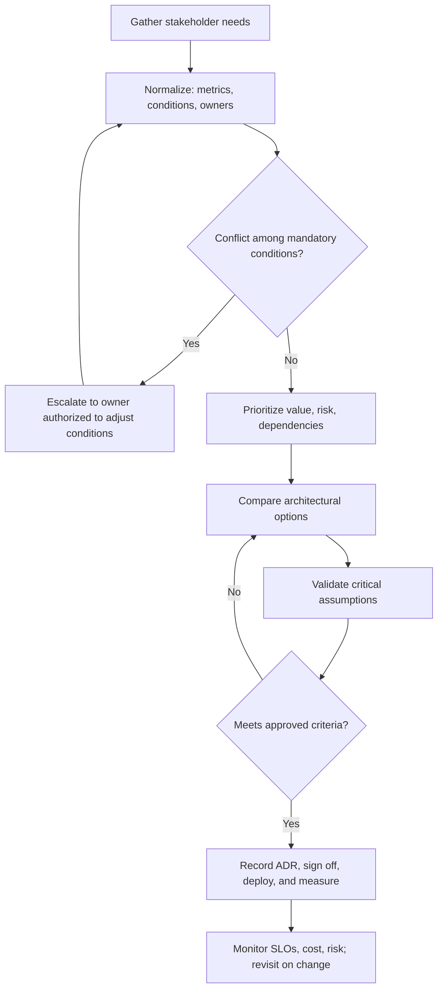
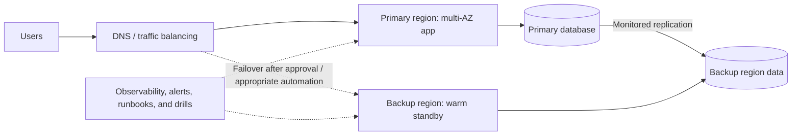

# Prioritizing Requirements and Resolving Stakeholder Conflicts

> **Chapter:** Architecture Requirements  
> **Scope:** Cloud application architecture design, from business needs to networking, compute, data, and deployment model choices.

## Learning Objectives

After this lesson, you will be able to:

1. Distinguish between mandatory requirements, negotiable requirements, and assumptions needing verification before designing an architecture.
2. Turn stakeholder wishes into requirements with measurable criteria, clear accountable owners, and deadlines.
3. Apply prioritization based on business value, urgency, risk, dependencies, and implementation cost.
4. Identify, analyze, and resolve conflicts among reliability, security, scalability, performance, cost, schedule, and operability.
5. Document architectural decisions, trade-offs, and verification methods under a Well-Architected mindset.

## 1. Why Does Requirement Prioritization Determine Architecture Quality?

A cloud application typically involves multiple stakeholders with valid goals that do not fully overlap:

| Stakeholder | Common Concerns | Resulting Architectural Questions |
| --- | --- | --- |
| Product Owner | On-time launch, user experience, ability to add features | Should we prioritize deployment speed over splitting into many services? |
| Business | Revenue, response time, availability during promotions | What is the expected peak traffic? |
| Security / Legal | Privacy, identity, authorization, data residency, auditing | Which data may cross borders or reside in standby copies? |
| Finance | Total cost of ownership, monthly budget, spend forecasts | Can recovery targets be met without exceeding budget? |
| Operations / SRE | SLOs, alerts, automation, recoverability, incident on-call | Who is on-call and rehearses failover? |
| Engineering team | Complexity, delivery speed, testability, evolvability | Does the team have capacity to operate the chosen model? |
| Customers / Partners | Speed, stability, integrations, contractual commitments | Which metrics must be proven with telemetry or testing? |

Listening only to the loudest voice in the room can push a team toward an overly expensive yet unnecessary design, or short-term savings that fail recoverability needs. **Requirement prioritization** turns competing goals into transparent decisions: what must be satisfied, what can be deferred, and which trade-offs are accepted by authorized decision-makers.

A key principle: **never use priority scores to bypass legal obligations, mandatory security policies, or unacceptable safety risks**. Those are input constraints that must be confirmed before optimizing remaining options.

## 2. Normalize Requirements Before Ranking

### 2.1. Classify the True Nature of Each Requirement

- **Business requirement:** business objective, such as launching in a new market before a specific date.
- **Functional requirement:** what the system must do, such as supporting bookings, confirming payments, and sending notifications.
- **Quality (non-functional) requirement:** how well the system must operate, such as latency, reliability, security, scalability, observability, and recoverability.
- **Constraint:** limits that must not be violated, such as approved budget, data residency regions, or contractually mandated technology.
- **Assumptions and dependencies:** unverified premises or external system dependencies, such as traffic forecasts or payment gateway capacity.

A statement like "the system needs to be fast, secure, and cheap" is **not sufficient for design or acceptance**. Ask: how fast, secure against which risks, and cheap under what load conditions?

### 2.2. Write Verifiable Requirements

Use the structure:

> **When** [condition/load], **the system must** [behavior or quality level], **measured by** [metric and measurement method], **before** [milestone]; **owner** [role].

Examples for a cloud-hosted service booking app:

| ID | Normalized Requirement | Source / Owner | Verification Method |
| --- | --- | --- | --- |
| R-01 | Search flow achieves **p95 latency ≤ 300 ms** at **300 requests/second**, per agreed load scenario | Product + Engineering | Load test in production-like environment |
| R-02 | Booking service meets **99.95% monthly availability SLO** per published success/failure definitions | Business + SRE | SLI monitoring and SLO reporting |
| R-03 | After loss of the entire primary deployment region, **RTO ≤ 60 minutes** and **RPO ≤ 15 minutes** for booking data | Business + SRE | Recovery drills measuring duration and data loss |
| R-04 | Personal data is encrypted in transit and at rest, access-controlled, and stored strictly within approved regions | Security + Legal | Config reviews, permission and dataflow audits |
| R-05 | Cloud infrastructure and operating cost **≤ 4,000 USD/month** under the locked forecast load scenario | Finance | TCO estimation and actual spend tracking |
| R-06 | New releases can deploy and roll back cleanly with post-deploy error observability | Engineering + Operations | Pipeline tests, rollback drills, and system observability |

**Notes on reading these targets:**

- **p95** means 95% of observed requests respond within the threshold; specify measurement location, window, and load scenario.
- **SLI** is the measurement (e.g., successful request ratio), **SLO** is the target on that measurement; **SLA** is typically an external commitment with contractual terms.
- **RTO** is the maximum acceptable time to restore service; **RPO** is the maximum acceptable data loss measured in time. RTO/RPO are not automatically guaranteed simply by enabling backups.
- **TCO** includes compute, data, networking, data transfer, monitoring, licenses, operational labor, and recovery costs. Single-server prices do not represent total cost.

The thresholds in the table are **illustrative figures**, not default recommendations for every system. Teams must negotiate and approve them based on real business impact.

### 2.3. Maintain a Requirement Register

For each requirement, capture at least: ID, measurable statement, source, decision owner, requirement type, impact if missed, deadline, priority, dependencies, evidence status, and acceptance criteria.

Distinguish clearly:

- **Confirmed:** backed by contract, policy, operational target, or formal approval.
- **Assumption:** lacks sufficient data; requires testing or further discovery.
- **Disputed:** stakeholders have not yet agreed on thresholds or trade-off costs.

Never treat an assumption as an "official requirement" merely because it appeared on a slide.

## 3. Multi-Layered Requirement Prioritization

### 3.1. Layer 1 — Identify Mandatory Conditions

Before scoring, screen for disqualifying conditions: laws and contracts, data classification, information security policies, immovable business deadlines, hard approved budget caps, and real technical dependencies.

If two mandatory conditions cannot both be met simultaneously, **do not silently ignore either one**. Record the conflict, identify who holds authority to modify each condition, and escalate for a decision at the proper level.

For example, "data must be stored in a specific legal jurisdiction" is a validity gate for data-replication options, not a requirement that merely competes on points against a cost target.

### 3.2. Layer 2 — Define Delivery Priority Tiers

MoSCoW works well for scoping a release:

| Tier | Interpretation | Example |
| --- | --- | --- |
| **Must have** | Missing this blocks acceptance or launch within the locked scope | Mandatory access controls, compliant storage placement, accurate payment handling |
| **Should have** | Very important, with an approved temporary workaround | Partial automation of recovery procedures |
| **Could have** | Valuable, yet lower impact in the current phase | Detailed analytics UI for the operations team |
| **Won't have (this time)** | Deliberate decision not to build in this release | Supporting an additional market region with no demand yet |

"Must" should never become a wish list of everything. If everything is a Must, the method loses decision power. Always write "Won't have **in this release**" to avoid confusion with permanent rejection.

### 3.3. Layer 3 — Relative Scoring for Negotiable Requirements

A simple approach scores each factor on a 1–5 scale and computes:

\[
P = 0.4 \times V + 0.3 \times U + 0.3 \times R
\]

Where:

- \(V\): business value / user impact if delivered.
- \(U\): time urgency of delivering now.
- \(R\): risk reduction achieved (higher score = greater risk reduced).
- \(P\): **relative** priority score; weights must be agreed upon by the team.

| Example Negotiable Requirement | V | U | R | Score P |
| --- | ---: | ---: | ---: | ---: |
| Improve monitoring and alerting for early fault detection | 5 | 4 | 4 | 4.4 |
| Automate cloud budget tracking and forecasting | 4 | 4 | 3 | 3.7 |
| Add advanced operations dashboard page | 3 | 2 | 3 | 2.7 |

The formula and scores are an **illustrative method**, not a universal standard. High scores do not prove feasibility. After ranking, still examine **implementation effort**, dependencies, team capacity, ongoing maintenance cost, and mandatory conditions.

When cost of delay and job size can be estimated reasonably well, teams can reference **WSJF = cost of delay / job size**. Apply it consistently only across sufficiently comparable items; avoid creating false precision from guessed numbers.

### 3.4. Layer 4 — Sequence by Dependencies and Risk

Implementation does not have to run strictly from highest score to lowest. One requirement may need to go first because it unlocks several others.

For example, before committing to a 60-minute RTO, you first need critical-data definitions, backup/replication strategy, restore permissions, and runbooks—and only then run drills and publish the RTO target. Even a high-scoring dashboard feature cannot bypass those dependencies.

A practical sequence is often: **ensure compliance and feasibility → clarify major risks → build foundations/observability → deliver high-impact value → optimize further**. This is a reasoning order, not a rigid template for every project.

## 4. Resolving Conflicts: From Opinions to Evidence-Based Decisions

Common conflicts in cloud design:

| Conflict | Questions to Clarify | Trade-off Directions to Consider |
| --- | --- | --- |
| **Reliability ↔ Cost** | How much does a deployment-region outage cost? What RTO/RPO are truly required? | Multi-AZ, warm standby, active-active; match to recovery targets and budget |
| **Performance ↔ Cost** | Is p95 at peak or normal load? Where can caching apply? | Query tuning, caching, autoscaling, storage tiering |
| **Fast launch ↔ Security** | Which controls are mandatory? Which test evidence is missing? | Narrow launch scope, use managed services, automate security checks |
| **Scalability ↔ Operational complexity** | When is service splitting truly needed? Can the team operate it? | Modular monolith first; split into services when boundaries and metrics justify it |
| **Latency ↔ Data residency** | Which data is restricted; is out-of-region caching/anonymization allowed? | Classify data, keep source data in-region, optimize networking/caching within policy |
| **Consistency ↔ Availability** | In which operations is stale data acceptable? | Separate strongly consistent transactional flows from eventually consistent analytics flows |

### Six-Step Resolution Process

**Step 1 — Separate positions from underlying needs.** "We must have active-active" is a *proposed solution*; "restore sales within 15 minutes if one region fails" is the *need to satisfy*. Interview the requester about the consequences if the need goes unmet.

**Step 2 — Align everyone on shared metrics.** Agree on critical business flows, user counts, load scenarios, SLIs/SLOs, RTO/RPO, data classification, cost forecasts, deadlines, and operational capacity. Every metric requires explicit measurement conditions.

**Step 3 — Establish decision authority.** Product owns product scope; security/legal confirm compliance gates; finance confirms budget limits; engineering proposes and owns feasibility; the project sponsor arbitrates when approved goals conflict. A named **decision owner** role/person must be recorded.

**Step 4 — Propose at least two viable options.** Include a simpler option, a higher-resilience option, and where needed a scope/threshold adjustment option. For each option, record upfront and recurring cost, benefits, residual risk, dependencies, reversibility, and operational impact.

**Step 5 — Validate high-impact assumptions.** Run load tests, prototypes, threat modeling reviews, data-backed cost estimates, or recovery drills. Never commit to SLO/RTO/RPO targets based solely on an architecture diagram.

**Step 6 — Decide and document.** The authorized owner selects an option, signs off on residual risks, and publishes revisit triggers. If no option satisfies all constraints, **escalate**: request changes to budget, scope, timeline, or quality targets, and record who approved the adjustment.



## 5. End-to-End Example: Choosing Recovery Architecture for a Booking App

### 5.1. Context and Conflicting Requirements

A booking application is running in the cloud. During a design review:

- Product wants minimal transaction disruption and an early launch in a new market.
- SRE proposes two deployment regions to limit the impact of a full primary-region outage.
- Finance caps cloud spend at **4,000 USD/month** for the forecasted load.
- Security requires customer data to be stored/replicated only within approved regions.
- Engineering worries an active-active model raises transaction and consistency-testing complexity.

Stakeholders align on normalized requirements: **RTO ≤ 60 minutes** and **RPO ≤ 15 minutes** for booking operations; backed by live drills; cost within budget under the locked load scenario; all data-storage regions approved by security.

### 5.2. Comparing Options

The table uses **hypothetical figures to illustrate decision-making**, not pricing or guarantees from any cloud provider.

| Option | Primary Architecture | Monthly Estimate (Hypothetical) | Hypothetical Post-Test Recovery Result | Assessment |
| --- | --- | ---: | --- | --- |
| A | Single region, multi-AZ, scheduled backups | 2,400 USD | 4-hour RTO; 30-min RPO on full region loss | Under budget but **fails** RTO/RPO |
| B | Multi-AZ primary region + **warm standby** in approved backup region, replicated and failover-drilled | 3,600 USD | 45-min RTO; 10-min RPO | **Meets hypothetical thresholds**; requires runbooks and replication monitoring |
| C | Dual-region **active-active**, cross-region routing and sync | 6,500 USD | 10-min RTO; < 1-min RPO in test scenario | Fastest recovery potential yet **over budget** and highest complexity |

Based on **verified assumptions in this illustrative scenario**, the team selects **B** because it meets approved thresholds while staying under budget. There is no need to buy higher availability than targeted when incremental benefit is unproven. However, if policy forbids the backup region or outage cost per minute vastly exceeds estimates, revisit the conclusion.

Logical model of Option B:



**What the diagram alone does not guarantee:** replication lag, consistency during failover/failback, access secrets, third-party dependency links, DNS/cache behavior, standby load capacity, and recoverability at the exact moment of failure. All of these must enter detailed design and testing. Replication also **does not replace point-in-time recoverable backups** in every scenario, such as an accidental delete replicated to the standby region.

### 5.3. Decision Acceptance Conditions

1. Measure RTO/RPO in a primary-region loss scenario, including app, database, network config, secrets, and critical integrations.
2. Test recovery under reasonably representative failure conditions; record evidence, operators, manual steps, and encountered errors.
3. Confirm primary and backup regions, replication paths, and backup locations comply with data policy.
4. Estimate costs at normal load, peak load, active DR operation, and cross-region transfer; configure budgets and alerts.
5. Assign owners for replication-lag alerts, infrastructure changes, runbooks, drill schedules, and failback procedures.

Until these tests pass, Option B remains a **design hypothesis**—not yet eligible to claim recovery targets are met.

## 6. Recording Decisions with an Architecture Decision Record (ADR)

An ADR helps future engineers understand **why** the team picked an option, rather than merely what was picked. A concise ADR looks like:

```markdown
# ADR-014: Booking Application Recovery After Region Outage

Status: Conditionally Approved
Date: YYYY-MM-DD
Decision owner: Designated Technical Sponsor

Context:
- RTO <= 60 minutes, RPO <= 15 minutes.
- Budget <= 4,000 USD/month at locked load scenario.
- Data stored exclusively in approved regions.

Options:
A. Single-region multi-AZ + backups.
B. Multi-AZ + warm standby in backup region.
C. Dual-region active-active.

Decision:
- Select B after measuring 45-min RTO and 10-min RPO in the
  agreed DR scenario, with an estimated cost of 3,600 USD/month.
- Go live only after verifying data flows and critical dependencies.

Remaining trade-offs/risks:
- Must maintain replication, runbooks, drills, and cost controls.
- Unproven if both regions fail simultaneously.

Revisit triggers:
- Significant load or service-price increase; SLO/RTO/RPO change;
  data scope or regulatory change; failed DR drill.
```

An ADR should link to original requirements, test evidence, cost analysis, the risk register, and approvers. Retain rejected options and rejection reasons as well to avoid rehashing settled debates when team membership changes.

## 7. From Priorities to Architecture and Verification Plans

Decisions must connect to each architectural layer; otherwise, priority tables stay purely on paper.

| Priority Requirement | Architectural Decision / Deliverable | Evidence to Collect |
| --- | --- | --- |
| p95 latency and peak load | Compute sizing, autoscaling, caching, load balancing, queries, and networking | Load tests, p95, error rates, saturation, cost at peak |
| Availability and recovery | Multi-AZ design, backups, replication, failover, DNS, runbooks | SLIs/SLOs, component-loss tests, RTO/RPO drills |
| Security and data residency | Network segmentation, least-privilege IAM, encryption, secrets, dataflow controls | Threat models, config and permission checks, compliance reviews |
| Budget | Resource sizing, billing models, capacity plans, cost allocation | TCO forecasts, budget alerts, actual cost reconciliation |
| Operability | CI/CD, logging, metrics, tracing, alerting, rollback, runbooks | Deploy/rollback tests, time to detect and resolve incidents |
| Delivery velocity | Choose deployment model matching team skills; clarify module/service boundaries | Deployment duration, post-release defects, operational overhead |

Use **Well-Architected** thinking as a decision review lens: is it operationally effective, secure, reliable, performance-efficient, cost-optimized, and proportionate in resource footprint? It is a periodic evaluation lens, not an automatic formula for picking an architecture.

### Linking Requirements → Decisions → Verification

```text
Business Need
   └── Requirement with ID and Measurable Criteria
         ├── Priority Level + Mandatory Conditions
         ├── Chosen Option / ADR and Accepted Risks
         ├── Architecture Components + Implementation Owner
         └── Tests / SLIs / Acceptance Reports
               └── Live Monitoring and Periodic Re-evaluation
```

Every critical requirement needs **bidirectional traceability**: from a requirement, find its decisions and tests; from an expensive component, find the business justification for its existence.

## 8. Governing Disagreements During Implementation

Priority decisions are not frozen forever. Whenever incidents, legal changes, cost spikes, new user cohorts, or provider service changes occur, reopen the affected assumptions.

Helpful governance practices:

1. **A single approved source of truth** for the requirement register, ADRs, risk register, and verification evidence.
2. **Clear accountable owners** for each requirement and decision, with an escalation path if consensus misses deadlines.
3. **Scheduled reviews or material-change reviews**, rather than re-litigating the entire architecture on every ad-hoc comment.
4. **Change control mechanism:** new requests must describe business value, urgency, impact on SLOs/cost/security, dependencies, and what gets deferred.
5. **Re-evaluation triggers:** SLO breaches, failed DR drills, cost forecasts crossing thresholds, traffic exceeding projections, newly discovered data risks, or contract updates.

When conflicts remain unresolved, document them in writing: disputed points, impact of delay, viable options, missing data, decision deadline, and decision authority. Avoid false "general agreement" where nobody owns the trade-off.

## 9. Common Mistakes

| Mistake | Consequence | How to Fix |
| --- | --- | --- |
| Ranking everything by majority vote | Popular wishes override mandatory constraints | Separate compliance/security gates from priority scoring |
| Accepting a solution as a requirement ("must use microservices") | Locks in tech before understanding the problem | Ask for goals, metrics, consequences, and compare options |
| Failing to define load and measurement methods | Teams disagree on what "fast" or "stable" means | Record SLIs, scenarios, windows, thresholds, and owners |
| Comparing only compute costs | Omits data transfer, backups, monitoring, and labor | Compare TCO across realistic operating scenarios |
| Treating backups as a proven DR strategy | Fails to restore in time or loses data beyond target | Run drills, measure RTO/RPO, and verify live restores |
| Letting the highest-ranking title decide without evidence | Lacks proof; hard to explain or audit | Record decision authority, ADRs, and verification results |
| Omitting revisit triggers | Outdated designs persist after assumptions break | Tie ADRs to thresholds for load, risk, cost, and incidents |

## 10. Practice Exercise

A booking platform expects traffic to surge from **100 to 1,000 requests/second during peak events**. Product demands launch in six weeks; SRE proposes auto-scaling and a standby region; Finance wants costs below current levels; Security requires strict customer-data access controls.

Complete these tasks:

1. Write at least **five measurable requirements** (covering load/latency, reliability, security, cost, and schedule) and highlight which targets **still lack stakeholder confirmation**.
2. Separate **mandatory conditions** from **prioritizable items**; apply MoSCoW or a weighted scoring scale with explained weights.
3. Propose **two or three deployment options** (e.g., single-region multi-AZ scaling, adding a warm-standby region, or narrowing launch scope), detailing benefits, cost, complexity, and risks.
4. Choose **one conditional decision**, specifying who approves it and what must be measured before production rollout.
5. Draft a brief ADR and state the exact triggers that would force the team to revisit the decision.

**Self-review hint:** A strong answer need not pick the most expensive architecture or newest technology. It clearly separates approved thresholds from assumptions, backs decisions with measurements, and never uses schedule or budget targets to skip mandatory security gates.

## Key Takeaways

Architecture requirement prioritization is a continuous cycle connecting **business objectives → measurable criteria → design options → approved trade-offs → live verification**. When stakeholders disagree, align on success criteria and decision authority first; then use data, testing, and ADRs to choose a cloud architecture suited to the organization's reliability, security, scalability, cost, and operational needs.
