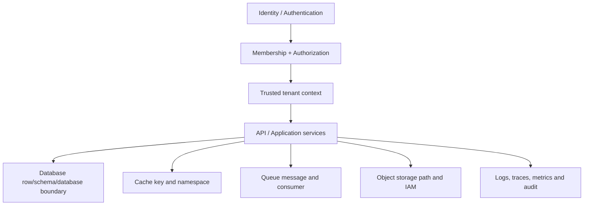
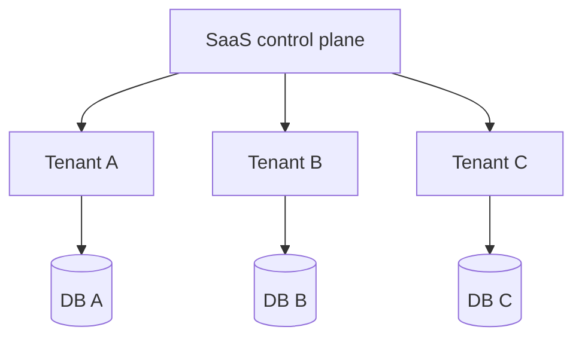
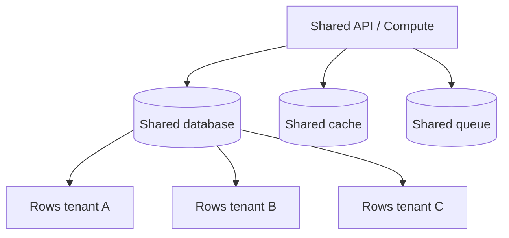
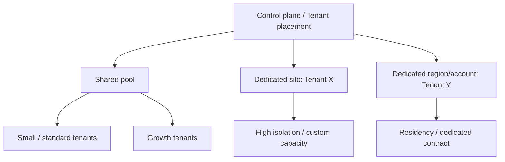
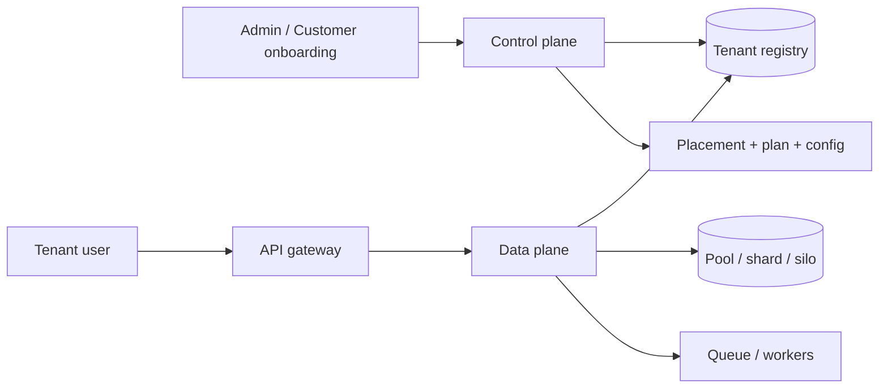
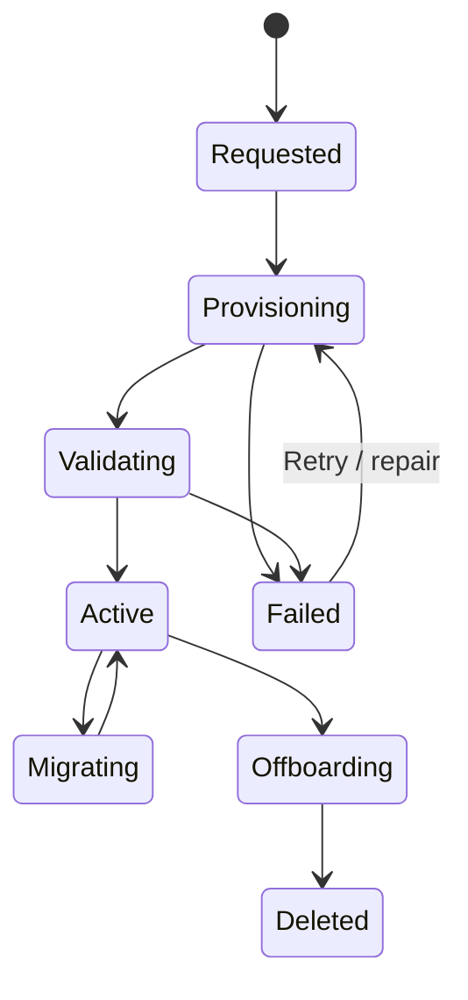
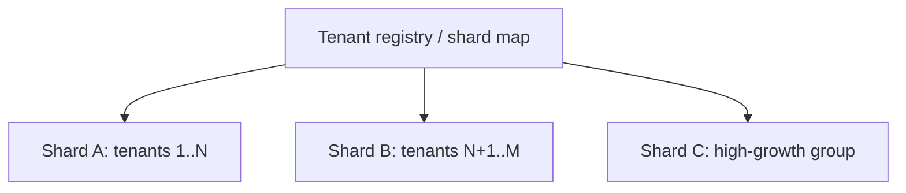
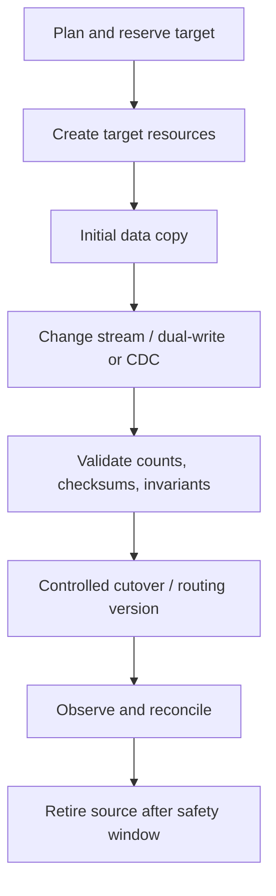

# Choosing Silo, Pool, and Hybrid Models for Multiple Tenants

## 1. Why Is the Multi-Tenant Model a Core Architecture Decision?

A SaaS platform typically serves many customers (tenants) on the same product. Each tenant has its own users, data, configuration, workload, and service agreement. The architecture must allow infrastructure sharing to achieve cost efficiency while ensuring a tenant cannot read, modify, or degrade another tenant's service.

**Multi-tenancy** is the way an application and shared infrastructure are organized to serve multiple tenants with clearly defined data, security, governance, and usage boundaries. A tenant may be an enterprise, organization, workspace, partner account, or business unit; it does not necessarily correspond to a single user or customer record.

Three common data and resource deployment models:

- **Silo:** each tenant has a dedicated set of resources, such as a separate database, schema, cluster, or compute.
- **Pool:** multiple tenants share resources and the same runtime/data store; data is logically separated using tenant identity and policy.
- **Hybrid:** combines silo and pool by tenant group, workload type, geographic region, sensitivity level, or service tier.

No single model is best for every product. Silo increases isolation but typically increases cost and operational burden. Pool utilizes resources efficiently but requires tenant isolation across every layer. Hybrid balances these according to need, in exchange for more complex placement, routing, and policy management.

In the **CLOUD_ARCHITECTURE** module, the **Multi-Tenant Architecture** chapter places multi-tenant decisions in the context of reliability, security, scalability, cost, and operations under Well-Architected.

After this lesson, learners can:

1. Identify tenants, tenant boundaries, and the types of resources that require isolation.
2. Compare silo, pool, and hybrid across security, reliability, performance, cost, and operability.
3. Design tenant context across APIs, services, databases, caches, queues, object storage, and logs.
4. Prevent data leakage and noisy neighbors using access controls, quotas, capacity, and fairness.
5. Choose a model based on tier, compliance, geography, workload, and customization needs.
6. Design tenant-aware onboarding, provisioning, backup/restore, migration, and offboarding.
7. Build tests, telemetry, and ADRs to prove the model satisfies service agreements.

## 2. What Is a Tenant and Where Is the Boundary?

A tenant is the unit of ownership for data and configuration in a multi-tenant system. It is important to distinguish:

- **User:** an authenticating human identity or service account.
- **Organization/account:** a customer entity or legal entity.
- **Tenant:** the scope of resource isolation and governance within the product.
- **Workspace/project:** a sub-unit inside a tenant, which may have its own permissions and configuration.
- **Subscription/plan:** a commercial agreement determining features, quotas, and support levels.
- **Environment:** dev/staging/prod environments; a tenant may have multiple environments.

One organization may own multiple tenants; one tenant may contain multiple workspaces; a user may be a member of multiple tenants with different roles. Never infer a tenant solely from an email domain or a client-supplied ID.

### 2.1. Tenant Context Is Part of the Security Context

Every request must identify the authenticated principal, the tenant being accessed, and the principal's permissions within that tenant.

Example authentication flow:

1. The client sends credentials/token.
2. The identity layer authenticates the principal.
3. The application checks whether the principal has membership/role in the selected tenant.
4. Tenant context is attached to an immutable request context.
5. Services use the context to query and check permissions on each resource.
6. Audit events record the principal, tenant, action, and outcome according to policy.

A tenant ID in the URL or body is only **input requesting which tenant to select**, not proof of access rights. The server must verify the relationship between user, tenant, and resource.

### 2.2. Tenant Boundaries Across Layers



The tenant boundary must follow the data across both synchronous and asynchronous paths. An API with a proper tenant filter can still access the wrong data if a worker receives a message missing a tenant ID.

### 2.3. Tenant Identity and Tenant Lifecycle

A tenant needs a stable identifier that is never arbitrarily reused. Common states include:

- Provisioning: creating the tenant, database/schema, storage namespace, and configuration.
- Active: permitted to use the product according to the plan.
- Suspended: temporarily halting certain operations due to policy/contract.
- Migrating: moving placement or upgrading.
- Offboarding: locking access, exporting data, and handling retention.
- Deleted: resources have been deleted according to process with required evidence.

Tenant state should be managed in an authoritative control plane. The application data plane must check the appropriate state, avoiding different interpretations across individual services.

## 3. Silo, Pool, and Hybrid: Conceptual Models

### 3.1. Silo Model

Each tenant has one or more dedicated resources: a dedicated database, dedicated schema, dedicated cluster, dedicated storage account, or dedicated compute.



Depending on implementation, a silo can isolate at the database, cluster, account, project, VPC/VNet, or even cloud account level. A silo at one layer does not automatically isolate all other layers: three separate databases may still share an API runtime, credentials, network, and control plane.

### 3.2. Pool Model

Multiple tenants share compute and data stores; each record carries a tenant identifier and every query is scoped by tenant.



Pool saves resources when tenants are small and workloads are distributed. However, a bug in a filter, cache key, query policy, or message context can cause cross-tenant leakage. A high-load tenant can also consume connections, CPU, IOPS, or queue capacity for everyone.

### 3.3. Hybrid Model

Hybrid uses pool for tenants with standard requirements and silo for tenants needing isolation, dedicated capacity, or special compliance.



The control plane needs to know which pool/shard/silo a tenant belongs to, its schema version, region, limits, and migration status. The data plane uses cached mappings but must handle mapping changes safely.

## 4. Comparing Silo, Pool, and Hybrid

| Criterion | Silo | Pool | Hybrid |
| --- | --- | --- | --- |
| Data isolation | Stronger physical/logical boundary depending on placement | Relies heavily on tenant key, policy, and query correctness | Per tier or group |
| Blast radius | Usually narrower if dependencies are separated | Shared resource failures can affect many tenants | Can isolate priority tenants |
| Baseline cost | Higher due to dedicated resources | Usually lower due to sharing | Medium, depending on tiering |
| Resource utilization | Prone to idle capacity | Can aggregate load effectively | Requires good placement and autoscaling |
| Customization | Easier to customize per tenant | Difficult if creating many variants | Some tenants have dedicated paths |
| Operations | Many units to patch/backup/monitor | Less infrastructure, but isolation logic is complex | Must orchestrate both forms |
| Noisy neighbor | Limited when resources are truly dedicated | Higher risk | Can move noisy tenants to a silo |
| Compliance | Easier to prove certain boundaries | Must prove logical controls | Chosen according to data requirements |
| Scaling | Scales per tenant/dedicated resource | Scales pool/shard by total and load distribution | Requires rebalancing and routing |
| Migration | Costly with many silos | Hard to split large pools or extract hot tenants | Needs a unified placement process |

**Note:** "Silo" and "pool" are points on an isolation spectrum. A dedicated database that still shares a cluster/credential is not equivalent to a dedicated account/network. A pool with row-level security and strong testing can be safer than a misconfigured silo. Evaluate by the actual boundary, not just the model name.

## 5. Choosing a Model Based on Business Requirements

Start with these questions:

1. Do tenants have contractual or compliance requirements regarding how data is separated?
2. Do workloads vary widely across tenants in CPU, IOPS, storage, and traffic?
3. Do any tenants require their own encryption keys, backup schedules, or retention?
4. Does data have geography/data residency restrictions?
5. Do tenants need schema extensions, custom integrations, or separate maintenance windows?
6. Can the cost of dedicated resources be recovered from the plan/customer value?
7. Does the operations team have sufficient automation to manage the expected number of silos?
8. To what extent do tenants need independent restore, export, or deletion?

### 5.1. Illustrative Selection Matrix

| Condition | Initial Direction | Needs Verification |
| --- | --- | --- |
| Many small tenants, similar workloads | Pool | RLS/tenant scoping, quotas, and shard capacity |
| Large tenant with dominant workload | Silo or dedicated tier | TCO, autoscaling, and actual isolation |
| Regional data residency requirements | Regional pool or regional silo | Mapping, replication, and residency controls |
| Contract requires customer-managed key | Silo or hybrid key model | Key isolation, rotation, and service support |
| Customer has dedicated maintenance window | Silo or dedicated deployment cell | Patch/upgrade automation |
| Some sensitive tenants, remainder standard | Hybrid | Placement policy and migration runbook |
| POC/new product, unknown workload | Pool with limits and tenant extraction path | Migration readiness, telemetry, and capacity |

Do not choose silo just because a customer says they "need high security." Translate requirements into concrete controls: who has access, where keys live, network boundaries, backup/restore, audits, and compliance evidence.

## 6. Data Plane and Control Plane

A mature multi-tenant architecture typically separates two capability groups:

- **Control plane:** creates/manages tenants, plans, placement, quotas, identity integration, provisioning, billing metadata, migration, and lifecycle.
- **Data plane:** processes business requests, reads/writes data, runs jobs, serves APIs, and enforces tenant policies.



The data plane should not create resources on its own or move a tenant to a silo ad hoc during individual requests. It reads the placement policy managed by the control plane and applies it consistently.

### 6.1. Tenant Registry

The registry can store:

- tenant ID and lifecycle status.
- plan/tier and entitlement version.
- home region and data residency policy.
- placement type: pool, shard, silo.
- database/schema/storage references.
- encryption key reference.
- quota/capacity profile.
- migration state and current placement version.
- provisioning metadata and audit timestamps.

Never store plaintext secrets in the registry. Store references to a secret manager/KMS and apply least-privilege read access.

### 6.2. Idempotent Provisioning

Onboarding can fail partway through. Provisioning should have an operation ID, step states, retries, and reconciliation. Running a provisioning operation again must not create two databases or two storage namespaces for the same tenant.

Example states:



Each step needs a timeout, owner, audit, and cleanup mechanism for partial resources. Do not mark Active before identity, placement, data boundaries, and backup policies are ready.

## 7. Silo at Different Layers

"Silo" must specify the dedicated scope. Common levels:

| Boundary | Example | Isolation Level and Cost |
| --- | --- | --- |
| Row/partition | Shared DB with tenant key or separate partition | Lower cost; still shares engine/cluster |
| Schema | One schema per tenant | Separate namespace; connections/DDL/backups may still be shared |
| Database | Separate database on the same server/cluster | Logical DB separation, but shares compute/host/failure domain |
| Cluster | Dedicated database cluster | Better capacity/failure domain isolation, more expensive to operate |
| Account/project/subscription | Dedicated infrastructure and IAM boundary | Better permission/billing/network separation, complex automation |
| Dedicated deployment cell | Dedicated compute, data, and network cell | Smaller blast radius if dependencies are also separated |
| Dedicated region/on-prem | Geographic/specialized placement | Fits special requirements, high cost |

The boundary level must map to the threat model and contract. A separate database within the same cluster does not necessarily satisfy a "no shared hardware" requirement. A dedicated account is also insufficient if logs, support access, or backup exports are still aggregated without policy.

## 8. Pool: Designing Tenant Isolation in the Database

Pool optimizes infrastructure sharing but requires every query and transaction to have the correct tenant scope.

### 8.1. Shared Table with `tenant_id`

Each row carries a tenant ID. Primary keys, unique constraints, and indexes typically must include the tenant dimension:

```sql
CREATE TABLE booking (
    tenant_id UUID NOT NULL,
    booking_id UUID NOT NULL,
    status VARCHAR(32) NOT NULL,
    created_at TIMESTAMP NOT NULL,
    PRIMARY KEY (tenant_id, booking_id)
);

CREATE INDEX idx_booking_tenant_status_created
ON booking (tenant_id, status, created_at);
```

This example illustrates the structure; actual SQL dialects and indexing strategies depend on the database.

Queries must scope by tenant:

```sql
SELECT booking_id, status, created_at
FROM booking
WHERE tenant_id = :trusted_tenant_id
  AND booking_id = :booking_id;
```

Never take a tenant ID from the request body and bind it into a query without verifying membership and authorization. The data access layer can require a mandatory tenant context to reduce the risk of missing filters.

### 8.2. Composite Keys and Unique Constraints

If a booking ID is only unique within a tenant, the unique constraint must include the tenant ID. The same applies to slugs, internal emails, external references, or resource keys if uniqueness is scoped within the tenant.

If the product requires a globally unique email across the entire system, the constraint will differ. Uniqueness scope must be defined by domain, avoiding the automatic assumption that every ID needs global uniqueness.

### 8.3. Row-Level Security

Some databases support row-level security (RLS), allowing DB-level policies to restrict which rows a session/role can access.

RLS can provide an additional layer of protection if:
- Tenant context is set from a trusted identity.
- Connection pools properly reset session context between requests.
- Application roles cannot unintentionally bypass the policy.
- Background jobs and migrations have clear policies/roles.
- Admin/audit queries have separate, controlled permissions.

RLS does not replace business authorization and cannot fix an incorrect trusted tenant context. Transaction pooling, session reuse, and connection reset must be tested.

### 8.4. Sharding by Tenant

When a pool grows large, split tenants into shards:



The shard key can be the tenant ID or a hash/range as needed. Sharding increases capacity and limits blast radius, but requires tenant-to-shard mapping, rebalancing, cross-shard queries, migration, backup, and failover.

Never let the client choose the shard. Routing must rely on a trusted registry.

## 9. Tenant Isolation Beyond the Database

Even when database filtering is correct, leaks can still happen at other layers.

### 9.1. Cache

Cache keys must include tenant scope when data differs by tenant:

```text
cache_key = tenant_id + ":" + resource_type + ":" + resource_id
```

If the tenant ID is omitted, two tenants using the same resource ID may receive the same cached representation. For responses depending on role/locale/entitlement, the key needs the corresponding dimensions or caching must occur after authorization.

### 9.2. Object Storage

- Place objects under an appropriate tenant namespace or bucket/container.
- IAM/storage access policies must restrict prefixes/resources.
- Do not trust client-supplied tenant IDs or object paths.
- Presigned URLs must have limited expiration, methods, and object scope.
- Lifecycle, versioning, encryption, and deletion policies follow the contract.
- Do not rely on non-sequential/unguessable URLs in place of authorization.

Silos can use separate buckets/accounts; pools can use prefixes and policy conditions. Verify the provider's actual policy capabilities so prefix naming is not mistaken for a security boundary.

### 9.3. Queues and Events

Messages need to carry the tenant ID, event ID, schema version, and necessary resource references. Consumers must verify the event source/identity and tenant scope before processing.

Do not use a single global worker with unlimited admin permissions when permissions can be scoped by workload. Queue partitioning by tenant or tenant group can help fairness, though hot tenant partitions must be avoided.

### 9.4. Search Indexes and Analytics

Documents in a search index require mandatory server-side tenant filtering. Never allow clients to pass arbitrary filters that could strip the tenant constraint. In analytics lakes/warehouses, row/column policies, dataset partitions, access roles, and export paths must preserve tenant boundaries.

### 9.5. Logs, Traces, and Support Tooling

- Include an opaque tenant ID for troubleshooting, but do not log unnecessary PII/secrets.
- Dashboards and query tools must enforce cross-tenant viewing permissions.
- Support impersonation requires approval/policy, time limits, and auditing.
- Trace sampling must not drop mandatory audit/security events.
- Diagnostic exports require redaction and tenant scoping.

## 10. Security: Tenant Isolation as Defense in Depth

The goal is to prevent one tenant from reading or impacting another tenant's resources, even if a bug exists in one layer.

Control layers:

1. Authentication: verify user/service principal.
2. Membership: verify the principal belongs to the tenant.
3. Authorization: check the action on the specific resource.
4. Tenant context: propagate an immutable context across requests/jobs.
5. Data access: query scoping, RLS, or physical boundaries.
6. Storage/network: policies, encryption, private connectivity.
7. Audit: record sensitive accesses and operations.
8. Operational access: least-privilege support/admin access.

### 10.1. Confused Deputy

A service with permission to read all tenants' data can become a confused deputy if a client asks it to read an arbitrary resource ID and the service fails to verify permissions on behalf of the tenant. A service must never use its own elevated privileges to bypass the caller's authorization.

The solution is to propagate verified principal/tenant context, check permissions in the service owning the resource, and restrict service identities. Do not assume that because the API gateway authenticated the request, downstream services can skip authorization.

### 10.2. Encryption and Key Isolation

Options include:
- A shared key for the pool per policy.
- Envelope encryption with per-tenant data keys.
- Customer-managed keys (CMK) for tenants that require them.
- Dedicated key vaults/accounts for silos.

Dedicated keys improve isolation and revocation capabilities but add cost, rotation, and management overhead. Key isolation does not replace data access control; an attacker with decryption privileges via an application role can still access data if application authorization is flawed.

### 10.3. Residency and Retention

The control plane must record allowed data regions, replication targets, backup locations, and relevant subprocessors. Offboarding must handle primary copies, caches, replicas, search indexes, logs, and backups according to retention/legal hold policies. "Deleting a tenant" does not mean all backups vanish immediately; the lifecycle and evidence must match contractual terms.

## 11. Noisy Neighbor and Resource Fairness

**Noisy neighbor** refers to a tenant or workload consuming excessive shared resources, degrading latency, error rates, or throughput for other tenants.

Sources of noisy neighbors:

- Unindexed queries or large scans.
- A tenant sending API bursts or generating many async jobs.
- Exports/reports holding connections and workers for a long time.
- Uploads/downloads consuming heavy bandwidth.
- Cache hot keys or cache churn.
- A fast-growing tenant causing shard imbalance.
- Background retry storms or message redelivery.
- A partner integration sending webhook floods.

### 11.1. Protection Layers

| Resource | Control Mechanism |
| --- | --- |
| API request | Per-tenant rate limit, cost units, burst cap |
| In-flight request | Concurrency limit, deadline, and admission control |
| Database | Connection budget, query timeout, workload group/resource governor |
| Queue/worker | Per-tenant job cap, fair scheduler, priority class |
| Storage | Quotas, lifecycle, per-tenant throughput/size limits if supported |
| Network | Egress budget, bandwidth shaping, or separate paths |
| Cache | Namespaces, memory quotas, hot-key controls |
| Batch/export | Windows, size caps, async queues, cancellation |
| Retries | Backoff/jitter, retry budgets, DLQs, and circuit breakers |

### 11.2. Fairness Is More Than Request Count

A search request might take 5 ms; an export might take 10 minutes and gigabytes of I/O. Counting all requests equally does not reflect cost.

Weighted cost units can be used:

```text
tenant_usage =
    read_units × read_weight
  + write_units × write_weight
  + export_units × export_weight
  + network_bytes × transfer_weight
```

Policies can limit token rate, total periodic quota, and simultaneous concurrency. For queues, weighted fair scheduling or deficit round robin prevents a tenant with a large backlog from monopolizing all workers.

### 11.3. Bulkheads and Isolation Cells

Separating worker pools, connection pools, or deployment cells by tenant group helps limit blast radius. Not every tenant needs a silo; cells can host groups of tenants, and tenants generating abnormal load can be moved to another cell.

## 12. Reliability and Failure Domains

The multi-tenant model shapes failure scope:

- A pool database outage can affect many tenants simultaneously.
- A silo database outage may affect only one tenant, provided compute/network/identity are sufficiently independent.
- A control plane outage can block onboarding or migration even while the data plane continues running.
- Shared identity, KMS, DNS, cache, or gateways may still be common dependencies.
- A shared schema migration can cause a widespread outage.

### 12.1. Cell-Based Architecture

A cell is a deployment unit with bounded tenant scope and resources. For example, each cell has its own API workers, database shard, queue, cache, and telemetry pipeline; the control plane stores the tenant-to-cell mapping.

Advantages:

- Limits blast radius.
- Scales by cell.
- Supports canary deployments by tenant group.
- Provides a path to move tenants between cells.

Trade-offs:
- Many cells require automated provisioning, patching, backups, and monitoring.
- Global features or cross-tenant operations are more complex.
- Cell imbalance can overload one cell while another sits idle.

Cell-based architecture can act as a hybrid between pool and silo at the deployment boundary level.

### 12.2. Per-Tenant Backup and Restore

Pool DBs need a strategy to restore a single tenant without restoring the entire database and overwriting other tenants' data. Options include:
- Per-tenant logical exports.
- Point-in-time recovery to a temporary environment followed by tenant-scoped extraction.
- Snapshot/shard-level restore if tenant mapping permits.
- Event replay to rebuild projections.
- Dedicated silo backups for dedicated tenants.

Per-tenant restore must be tested and timed. Having backups does not prove a single tenant can be restored independently.

## 13. Performance and Scaling

### 13.1. Pool Scaling

A pool increases capacity as aggregate tenant demand grows. Stateless compute can scale with requests/queues, while databases can scale via vertical scaling, read replicas, partitioning, or sharding.

Challenge: overall utilization may look healthy while a single hot tenant or hot shard is overloaded. Dashboards need percentiles and top-tenant views, not just pool-wide averages.

### 13.2. Silo Scaling

Silos can scale independently per tenant. However, if each tenant has dedicated compute/databases, many small silos cause:
- Idle resources.
- Repeated patching/upgrades.
- Many connections, configs, and secrets.
- High backup/monitoring costs.
- Difficulty maintaining a single baseline version.

Automation and standardized deployment templates are prerequisites, not optional optimizations.

### 13.3. Hybrid Placement and Promotion

A tenant may start in a shared pool and later move to a dedicated silo when:
- Workload exceeds predefined thresholds.
- Compliance/residency requirements arise.
- Dedicated keys or maintenance windows are needed.
- Contracts require capacity isolation.
- Noisy-neighbor issues cannot be resolved via quotas.

Promotion requires a transparent policy, not ad hoc manual actions. It requires measuring usage, sizing capacity, communicating downtime/consistency impact, and having a rollback plan.

## 14. Cost Model: Comparing Pool and Silo

Pool generally achieves better multiplexing. Silo adds baseline cost per tenant but can be sold as a dedicated tier and reduces certain blast-radius risks.

A simple model:

```text
Pool monthly cost =
    shared compute
  + shared database/cache/queue
  + shared operations
  + capacity headroom
  + isolation controls

Silo monthly cost =
    Σ per-tenant compute/database/storage
  + per-tenant backup/monitoring/network
  + provisioning and upgrade overhead
  + shared control plane
```

Do not compare cloud bills alone. Factor in engineering hours, on-call, support, restores, migrations, compliance evidence, and incident costs.

### 14.1. Per-Tenant Unit Economics

Key metrics:

- Cost per active tenant.
- Cost per transaction or workload unit.
- Storage GB per tenant.
- Peak/average CPU, memory, and database connections.
- Support/operations hours per tenant.
- Backup/restore cost.
- Per-tenant network transfer.
- Capacity headroom and idle resources.

Pool achieves economies of scale when tenants are small and workloads do not peak simultaneously. If all tenants burst at the same time, capacity must be sized for the aggregate peak rather than relying on low averages.

### 14.2. Tiering

Example:
- Starter: shared pool with standard quotas.
- Growth: pool/shard with higher resource budgets.
- Enterprise: dedicated cell/database or region, with dedicated key/backup policies.

Service tiers must accurately state guarantees. A "dedicated database" does not mean dedicated compute/network if those remain shared. Never promise physical isolation when only logical isolation exists.

## 15. Tenant Onboarding

The onboarding workflow must be safe and idempotent:

1. Verify the customer/account and requester.
2. Generate a stable tenant ID.
3. Assign plan, region, data policy, and placement.
4. Provision silo/schema/bucket/namespace according to placement.
5. Create encryption/key references and workload permissions.
6. Initialize baseline configuration and default roles.
7. Verify isolation, backups, quotas, and telemetry.
8. Register the tenant in routing/registry.
9. Transition state to Active and emit onboarding events.
10. Record audits and notify through product channels.

If any step fails, the workflow must resume/retry or perform controlled cleanup. Never mark a tenant Active while data boundaries or authorization are incomplete.

## 16. Migration Between Pool, Shard, and Silo

Migrations can be driven by growth, compliance, noisy neighbors, or region changes.

### 16.1. General Migration Process



Required steps:
- Consistent snapshot/initial copy.
- Catch-up for changes occurring during the copy.
- Validation of counts, checksums, versions, and foreign references.
- Blocking or coordinating writes during cutover.
- Tenant placement version so routing does not split between source and target.
- Rollback/compensation if validation or cutover fails.
- Source cleanup only after the safety window expires and retention requirements allow.

### 16.2. Dual-Write Risks

Writing synchronously to both source and target can result in one succeeding while the other fails. If dual-write is unavoidable, outbox/CDC, idempotency, retries, and reconciliation are needed. A generally safer pattern is initial snapshot + change data capture, followed by cutover with fencing/routing versions.

### 16.3. Avoiding Split-Brain Placement

If one request writes to the source while the next writes to the target, the two locations can diverge. The tenant registry needs a placement version/epoch. Routers and services must accept only valid versions; after cutover, the old source must be fenced or made read-only as planned.

Do not delete the source immediately after updating the mapping. Verify all traffic has shifted, backlogs have drained, and the rollback window has closed.

## 17. Backup, Restore, Export, and Offboarding

Tenants need appropriate rights and processes across the data lifecycle:

- **Backup:** frequency, retention, encryption, region, and access.
- **Restore:** full system, shard, or single tenant; post-restore verification process.
- **Export:** scope, format, authorization, encryption, and link expiry.
- **Offboarding:** lock principals, revoke tokens/integrations, stop jobs, export if contractually required, and delete or retain data per policy.
- **Deletion:** handle caches, objects, search, replicas, logs, backups, and legal holds.
- **Audit:** record timestamp, actor, scope, outcome, and evidence.

Pools require extra care during per-tenant export/deletion: a query missing a filter can wipe out other customers' data. Dry-runs, count reconciliation, and approvals for destructive operations are essential safeguards.

## 18. Observability and Tenant-Aware Operations

Telemetry must show whether the overall system is healthy and which tenants are impacted.

### 18.1. Metrics

| Group | Metric |
| --- | --- |
| API | Request rate, p95/p99 latency, errors/429s by tenant and route |
| Database | Query latency, connection wait, CPU/IOPS, top tenant workloads |
| Cache | Hit/miss, memory, hot keys, evictions, and tenant namespaces |
| Queue | Backlog age/depth, retries, DLQs, processing duration by tenant |
| Storage | Bytes/object count, throughput, quota utilization |
| Isolation | Authorization denials, cross-tenant access tests, RLS errors |
| Placement | Tenant count per pool/cell, shard utilization, silo health |
| Migration | Copy lag, CDC lag, validation mismatches, cutover status |
| Cost | Cost per tenant, network transfer, idle silo capacity |
| Lifecycle | Provisioning duration/failures, restore/delete completion |

### 18.2. Cardinality and Privacy

Attaching tenant IDs to every metric label can create massive cardinality. Options include:
- Aggregated metrics by pool/cell/plan.
- Top-N tenant dashboards via controlled queries.
- Structured logs with opaque tenant IDs and retention.
- Purposeful trace sampling.
- Separate auditing for mandatory security operations.

Do not log raw tenant payloads, tokens, secrets, or PII just for debugging convenience.

### 18.3. Per-Tenant SLOs

A pool-wide SLO may pass while a large tenant continuously experiences errors. Consider SLOs by tier/region/cell and the ability to query by tenant during incidents. Not all internal metrics need to be published to customers; however, contracts must clearly state service levels and notification procedures.

## 19. Well-Architected Trade-Offs

Evaluate silo/pool/hybrid through these lenses:

- **Operational excellence:** how automated are provisioning, patching, migration, backup, and restore?
- **Security:** are tenant boundaries, identity, least privilege, encryption, auditing, and support access verified?
- **Reliability:** what are the blast radius, failure domains, isolation cells, RTO/RPO, and per-tenant recovery?
- **Performance efficiency:** how are noisy neighbors, hot shards, caching, database connections, and scaling handled?
- **Cost optimization:** shared utilization versus idle silos, engineering cost, and incident cost?
- **Sustainability:** are utilization, overprovisioning, data transfer, and retention reasonable?

The model with the lowest infrastructure bill is not necessarily optimal if support and incident handling cost more. A higher-priced silo can make sense for tenants with strict SLAs/compliance who pay accordingly.

## 20. Testing Multi-Tenant Isolation and Failure Behavior

| Scenario | Test Method | Pass Criteria |
| --- | --- | --- |
| Tenant spoofing | Modify tenant ID in URL/body/header | No access to other tenants |
| ID collision | Two tenants share the same resource ID | Returns data belonging to the tenant context |
| Missing tenant context | Invoke service/worker without context | Fails safe, does not run global queries |
| RLS bypass | Use different roles/connections | Policies remain enforced per intended privilege |
| Cache collision | Same entity key across two tenants | No cross-tenant cache hits |
| Queue replay | Replay tenant A's event while consumer handles tenant B | Event scope is verified |
| Object access | Alter prefix/object ID or reuse URL | Policy blocks out-of-scope access |
| Noisy neighbor | Tenant A floods API/exports | Tenant B maintains fairness/SLO |
| Pool outage | Shut down shard/shared DB | Blast radius and degradation follow plan |
| Silo outage | Shut down tenant X's database | Other tenants continue operating if boundaries are independent |
| Migration lag | Increase writes during CDC copy | Cutover loses or duplicates no updates |
| Stale placement | Request uses old route version after cutover | Old source is fenced or read-only |
| Tenant restore | Restore a single tenant from backup | Correct scope, does not overwrite other tenants |
| Offboarding | Delete tenant with cache/objects/indexes | Data handled per retention/deletion contract |

### 20.1. Anti-Leakage Tests Must Be Automated

Create fixtures with at least two tenants sharing identical resource IDs; run the same suite of API/service/database/cache/object/queue tests while varying the tenant context. Test both allow and deny cases. Tests must verify not only responses but also side effects: row updates, event publishes, object accesses, and audit records.

## 21. Process for Selecting a Multi-Tenant Model

1. **Define the tenant:** owner, membership, workspace hierarchy, and lifecycle.
2. **Build a data inventory:** classify sensitive data, residency, retention, and shared reference data.
3. **Document isolation requirements:** logical, schema, database, cluster, account, region, or cell.
4. **Build workload profiles:** tenant count, requests/second, storage growth, concurrency, bursts, and variance.
5. **Select silo/pool/hybrid:** based on compliance, blast radius, cost, customization, and operations.
6. **Design the control plane:** tenant registry, placement, plans, provisioning, and migration states.
7. **Design the data plane:** trusted tenant context, authorization, DB/RLS, caches, queues, objects, and logs.
8. **Set resource budgets:** rates/concurrency/quotas, query costs, storage, and network.
9. **Design lifecycle:** onboarding, upgrades, backup/restore, exports, migration, and offboarding.
10. **Set up telemetry:** tenant-aware SLOs, noisy-neighbor signals, placement health, and cost.
11. **Test:** spoofing, ID collisions, noisy neighbors, outages, migrations, restores, and deletions.
12. **Write an ADR:** actual boundaries, trade-offs, guarantees, and triggers for changing placement.

## 22. Practical Scenario: Booking Management SaaS Platform

**Context:** The platform has 2,000 tenants. Most are small businesses, each with only a few users and a few thousand bookings. A few large customers have hundreds of branches, heavy data imports/exports, and require dedicated keys and data residency. The product needs fast time-to-market, an initial shared database, and support for tier upgrades.

### 22.1. Architectural Choices

- Pool for most standard tenants, using a shared API, mandatory tenant ID, RLS/query scoping, tenant-aware caches, and queues.
- Split the pool into multiple database shards/cells by capacity and region; the control plane maps tenants to shards.
- Dedicated silos/cells for enterprise tenants requiring dedicated capacity, backups, keys, or regions.
- Use the same API contract and schema baseline to avoid code forks between pool and silo.
- Set quotas for APIs, concurrent imports, export jobs, and storage by plan.
- Noisy tenants can be moved to another cell or silo per policy/contract.

### 22.2. Data Boundaries

- Booking, guest, and payment references always carry tenant scope.
- Catalog/reference data is shared only when truly global and free of tenant customization.
- Search documents and cache keys include tenant identity when required.
- Object files use separate namespaces/policies; signed URLs are scoped and time-limited.
- Queue events carry tenant ID, event ID, and schema version.
- Logs use opaque tenant identifiers with role-based dashboard/support access.

### 22.3. Promotion from Pool to Silo

1. Select the tenant based on usage/compliance/contract.
2. Provision the dedicated target and key/storage policies.
3. Snapshot the tenant's data and CDC subsequent changes.
4. Validate counts, checksums, foreign keys, and business invariants.
5. Freeze or serialize writes during cutover.
6. Increment placement epoch and route the tenant to the silo.
7. Test reads/writes and monitor errors/latency.
8. Keep the old source read-only during the rollback window, then clean up per retention.

### 22.4. Test Cases

- Two tenants using the same booking ID: no cross-tenant reads possible.
- Small tenant floods imports: other tenants still receive their worker share.
- Tenant X's dedicated silo fails: remaining pool tenants are unaffected.
- RLS connections are reused: session context does not leak to subsequent requests.
- Migration cutover: no bookings are lost or duplicated.
- Support impersonation: all access is authorized, time-bound, and audited.
- Tenant offboarding: objects, caches, indexes, and backups comply with policy.

## 23. Sample ADR: Hybrid Pool and Dedicated Cells

```text
ADR-091: Hybrid tenancy for the booking SaaS platform

Context:
- Many small tenants with similar workloads.
- Several enterprise tenants require dedicated capacity, keys, and residency.
- The product needs to maintain a single shared codebase/schema baseline.

Options:
A. Silo for all tenants.
B. Single pool for all tenants.
C. Pool/shards for standard tenants and dedicated cells/silos for special tenants.

Decision:
- Choose C.
- The control plane manages the tenant registry, plans, and placement epochs.
- The data plane accepts verified tenant context.
- Pools use tenant scoping/RLS; enterprise placements use dedicated databases/cells per contract.
- Quotas/fairness protect shared resources.
- Migrations use snapshots + CDC + validation + controlled cutover.

Trade-offs:
- Control plane and routing are more complex.
- Automated provisioning, patching, backup, restore, and migration are required.
- Must operate two placement types while maintaining a shared baseline.

Verification:
- Cross-tenant access tests find no leaks.
- Noisy-neighbor tests preserve other tenants' SLOs.
- Silo outages stay within the expected blast-radius boundary.
- Tenant promotions neither lose nor duplicate business data.
- Cost per tenant and operations hours align with tiers.

Review Triggers:
- Tenant count/traffic changes pool capacity needs.
- Compliance/data residency requirements change.
- Dedicated tiers no longer cover TCO.
- Isolation tests or SLOs fail to pass.
```

## 24. Common Design Mistakes

1. **Treating a client-supplied tenant ID as proof of permission:** creates IDOR/cross-tenant access.
2. **Filtering tenants only at the API controller:** services, workers, or export paths may forget scoping.
3. **Separate databases sharing broad credentials:** the actual boundary is weaker than assumed.
4. **Cache keys missing the tenant dimension:** returns data across tenants.
5. **Messages missing tenant context:** consumers cannot determine the data owner.
6. **Using RLS without connection pool context reset:** a previous tenant can affect subsequent requests.
7. **Per-tenant limits without a global budget:** aggregate demand still overwhelms infrastructure.
8. **Measuring only average pool utilization:** hides hot tenants/shards.
9. **Assuming silos eliminate noisy neighbors:** compute, network, identity, or control planes may still be shared.
10. **Assuming pools are always cheap:** engineering, support, and incident costs can be high.
11. **Creating silos manually:** leads to drift in schemas, patches, and backups.
12. **Lacking a tenant registry/placement version:** misroutes requests during migration or failover.
13. **Dual-write without reconciliation:** source and target diverge.
14. **Non-tenant-scoped pool restores:** can overwrite other customers' data.
15. **Offboarding that only deletes database rows:** objects, caches, search indexes, logs, and backups remain.
16. **Customer-specific code forks:** upgrades and security patches become increasingly difficult.
17. **Promising dedicated isolation inaccurately:** misaligns contracts and compliance evidence.
18. **Failing to test support tooling:** operational tools can bypass tenant boundaries.

## 25. Pre-Production Checklist

- [ ] Tenant, owner, membership, workspace, and lifecycle are defined.
- [ ] Tenant context originates from verified identity and is immutable across requests/jobs.
- [ ] All services, queries, caches, objects, search, queues, and logs preserve tenant scope.
- [ ] Authorization controls exist beyond tenant filtering.
- [ ] Silo boundaries are accurately documented by row/schema/database/cluster/account/cell.
- [ ] Pools have tenant keys, composite constraints, RLS/query guards, and connection reuse tests.
- [ ] Hybrid setups have a registry, placement policy/version, and unified routing.
- [ ] Rate limits, concurrency limits, quotas, and fairness protect against noisy neighbors.
- [ ] Global resource budgets exist alongside per-tenant limits.
- [ ] Encryption/keys, residency, retention, and auditing match contracts.
- [ ] Provisioning is idempotent, supports retry/reconciliation, and never activates prematurely.
- [ ] Backup/restore supports per-tenant recovery and has been rehearsed.
- [ ] Migrations include snapshots/CDC, validation, cutover fencing, and rollback windows.
- [ ] Offboarding handles objects, caches, indexes, logs, backups, and legal holds.
- [ ] Observability by tenant/tier/cell avoids leaking PII or creating unbounded cardinality.
- [ ] Tested against tenant spoofing, ID collisions, RLS, caches, queues, objects, and support access.
- [ ] Noisy-neighbor tests confirm other tenants maintain fairness/SLOs.
- [ ] Owners, runbooks, cost models, and pool/silo transition triggers are established.

---

**Key takeaway:** Silos dedicate resources and reduce sharing, pools optimize sharing while depending on end-to-end tenant isolation, and hybrids tier deployments according to real needs. Sound decisions start with tenant boundaries, data invariants, threat models, and workloads; only then should you pick the appropriate silo/pool level, automate placement/lifecycle, and verify via security, noisy-neighbor, restore, and migration tests.
