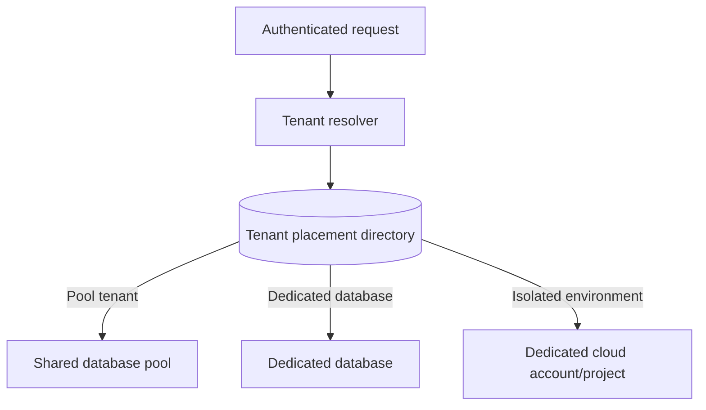
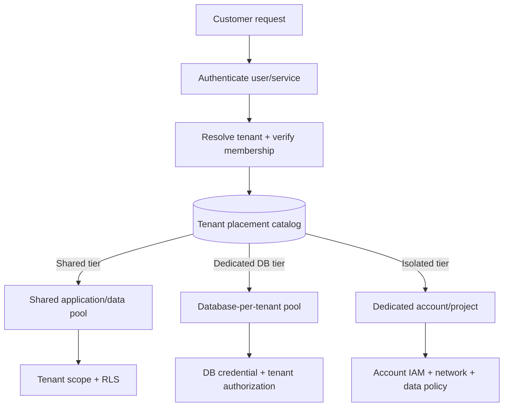

# Data Isolation by Row, Schema, Database, or Account

## 1. Data Isolation Is a Core SaaS Architectural Decision

In a multi-tenant system, a single platform serves multiple organizations or customers on the same product. Tenants may share APIs, compute, queues, and databases to optimize cost, yet one tenant's data must be protected from every other tenant. A routing bug, a query missing a tenant condition, or a misconfigured permission can leak data across customers.

**Data isolation** defines where a tenant's data is stored, who can access it, how requests are routed, and the blast radius when a failure occurs. Four common models are:

1. **Row-level isolation (row-level / shared tables):** multiple tenants share tables; each record is tagged with a tenant ID.
2. **Schema-level isolation (schema-per-tenant):** each tenant has its own schema inside the same database.
3. **Database-level isolation (database-per-tenant):** each tenant has its own database; they may share a cluster or run on independent infrastructure.
4. **Account/project/subscription-level isolation:** tenants are placed inside separate cloud accounts, projects, or subscriptions, potentially including dedicated networks, compute, databases, and encryption keys.

No single model is best for every product. The choice must be based on required isolation and compliance levels, tenant count, data volume, load distribution, cost, customization needs, backup/restore, and recovery objectives.

This lesson belongs to the **Multi-Tenant Architecture** chapter of the **CLOUD_ARCHITECTURE** module. It helps translate business security and operational requirements into data plane/control plane, schema, database, and cloud account choices while evaluating them under Well-Architected principles.

After this lesson, you will be able to compare the four models, design tenant context and authorization, evaluate backup/restore and migration, identify noisy neighbors, choose shared/silo/hybrid models, and build tenant isolation tests.

## 2. Tenant Identity and Trust Boundaries

Before deciding whether data lives in shared rows or separate databases, you must determine how the system knows which tenant is making a request.

### 2.1. Tenant Context Must Come from a Trusted Source

A request may contain a tenant ID in a URL, subdomain, header, or token. These values are not automatically trustworthy. If an application accepts a tenant ID header from a client and uses it directly in SQL, a user can swap the ID to access another tenant's data.

A secure flow typically includes:

1. Authenticate the user or service identity.
2. Determine the tenant from a signed claim, verified membership, or controlled domain routing.
3. Verify the user has appropriate membership and roles in that tenant.
4. Create an immutable tenant context for the request/transaction.
5. Propagate context across service-to-service calls using identities and tokens with matching audience/scopes.
6. Enforce tenant scope at the data access layer; check permissions on every business action.

A tenant ID in the URL can be used to select which organization the user wants to access, but the backend must still verify membership. Never grant access merely because a subdomain or header looks valid.

### 2.2. Separating Authentication, Tenant Resolution, and Authorization

| Step | Question | Example |
|---|---|---|
| Authentication | Who is calling? | User is logged in |
| Tenant resolution | Which tenant does the request belong to? | URL requests ACME |
| Membership | Does the user belong to that tenant? | User has ACME membership |
| Authorization | What can the user do on which resource? | Allowed to view booking B-10 in ACME |
| Data isolation | Is the query restricted to that tenant? | RLS/DB routing accesses only ACME |

A user may belong to multiple tenants with different roles. Never store a default tenant in a session and reuse it for all requests if the user can switch organizations. Tenant context must be resolved and checked for each request/operation.

### 2.3. Context Across Layers

Tenant context must be preserved across API gateways, service middleware, background jobs, queue/event consumers, database transactions, cache keys, object storage paths, audit logs, and traces. For background jobs, messages must carry a producer-verified tenant reference; consumers must still verify the source and execution permissions.

## 3. Four Data Isolation Models

### 3.1. Shared Database, Shared Schema, Shared Rows

All tenants share a database and tables. Every business table has a tenant ID; every query must be scoped by tenant.

```sql
CREATE TABLE bookings (
    tenant_id  UUID NOT NULL,
    booking_id UUID NOT NULL,
    status     VARCHAR(30) NOT NULL,
    created_at TIMESTAMP NOT NULL,
    PRIMARY KEY (tenant_id, booking_id)
);

CREATE INDEX idx_bookings_tenant_created
    ON bookings (tenant_id, created_at);
```

**Advantages:** high infrastructure density; fast tenant creation; centralized schema migrations; convenient aggregate reporting when proper dedicated permissions are granted.

**Trade-offs:** a query missing a tenant condition can leak data; indexes/query plans must account for tenant distribution; large tenants cause noisy-neighbor issues; per-tenant restore is difficult; dedicated compliance and key ownership are hard to satisfy.

This model fits many small tenants, relatively uniform workloads, and systems with strong tenant context, RLS, and isolation testing.

### 3.2. Schema-per-Tenant

A single database instance holds multiple schemas; each tenant has its own namespace and tables. The application routes transactions to the schema based on tenant context.

```text
database: saas_main
  schema_tenant_acme:
    bookings
    customers
  schema_tenant_zen:
    bookings
    customers
```

**Advantages:** namespace separation; ability to export/backup a single schema in certain engines; still shares an instance to save cost; supports per-tenant migrations or customization.

**Trade-offs:** schemas/tables/indexes grow rapidly with tenant count; migrations must run repeatedly; cross-schema queries/reports are complex; connection pools and search paths can easily retain stale context; CPU, memory, IOPS, and failure domains remain shared on the instance.

A separate schema is not equivalent to a separate database. If the instance or database owner credentials are compromised, multiple tenants can still be impacted.

### 3.3. Database-per-Tenant

Each tenant has its own database; databases can live on the same cluster/instance or on separate clusters.

**Advantages:** clearer data and permission boundaries than shared rows; per-tenant backup/restore, export, retention, and migration are easier; tiers can be tuned as needed; supports certain compliance requirements.

**Trade-offs:** storage, connection, backup, and monitoring costs increase; provisioning/patching/migrations must be automated; the application needs a tenant catalog mapping endpoints; platform-wide reporting requires ETL/a data warehouse; many databases create idle resources.

This fits larger tenants requiring independent restores, separate retention, or higher isolation while still sharing the application plane.

### 3.4. Account/Project/Subscription-per-Tenant

Each tenant is deployed in its own cloud account, project, or subscription; scope can include network, compute, database, storage, logging, and encryption keys.

**Advantages:** stronger administrative/quota boundaries when configured properly; easier to enforce per-tenant policies, billing, logging, residency, and key ownership; reduces blast radius; supports private network connectivity.

**Trade-offs:** provisioning and governance are complex; requires landing zones, identity federation, network connectivity, policy-as-code, and automation; duplicates baseline resources; cross-account monitoring and incident response require custom design.

A separate account does not automatically guarantee isolation if cross-account roles, shared networks, or central services have overly broad permissions. Some control plane components may still be shared but must follow least privilege.

## 4. Overall Comparison

| Criterion | Shared Rows | Schema-per-Tenant | Database-per-Tenant | Account/Project-per-Tenant |
|---|---|---|---|---|
| Boundary | Row + app/DB policy | Namespace/schema | Database; optional cluster | Cloud account/project and resources |
| Baseline cost | Low | Low-medium | Medium-high | High |
| Tenant provisioning | Very fast | Create schema | Create database/secrets | Create landing zone/stack |
| Schema migration | Once, affects everyone | Repeated per schema | Repeated per database | Repeated per deployment/data stack |
| Per-tenant restore | Hard | Can export/import schema | Clearer | Per stack/account |
| Noisy neighbor | High without quotas | Still shares instance | Can isolate more depending on cluster | Can isolate across multiple layers |
| Customization | Limited | Partial | Better | Most flexible |
| Platform-wide reporting | Easier, needs dedicated role | Union/ETL | ETL/fan-in | Multi-account pipeline |
| DB blast radius | Potentially all tenants | Shared instance affects many tenants | Narrower with dedicated cluster | Potentially narrower per stack/account |

Do not read these columns as an absolute security scale. Schema-per-tenant on one instance with shared admin credentials still has a large blast radius; separate databases on the same cluster still share a host/failure domain. You must explicitly state which components are truly separated: namespace, database, cluster, network, account, keys, or operator access.

## 5. Hybrid Model: Pool, Bridge, and Silo

Tenants often differ in scale, compliance, and customization needs. A hybrid model can divide them into:

- **Pool/shared:** small tenants share a database or schema.
- **Bridge:** tenants use dedicated schemas/databases while sharing compute or clusters.
- **Silo:** large/regulated tenants get independent clusters, accounts, or networks.

### 5.1. Tenant Placement Directory

The control plane can track which pool or deployment a tenant belongs to:



The directory needs HA, versioned mappings, cache TTLs, audits, and restricted update permissions. Tenant placement must never come from arbitrary client input. When migrating a tenant, routing versions and a cutover mechanism are needed so requests do not write to the wrong place or both places uncontrollably.

### 5.2. Tier Selection Criteria

- Record count, data volume, and growth rate.
- Peak request/transaction rates, latency, and noisy-neighbor behavior.
- Independent restore needs, RPO/RTO.
- Data residency, encryption key ownership, network/private connectivity.
- Contracts, compliance, and willingness-to-pay for dedicated resources.

Do not move tenants to a silo based solely on revenue; legal mandates or data sensitivity may require high isolation even for small tenants.

## 6. Shared Rows: `tenant_id`, RLS, and Data Constraints

In shared rows, the tenant ID must be present in every table containing tenant-owned data. Keys/indexes and foreign keys should guard tenant boundaries.

### 6.1. Tenant-Scoped Queries

```sql
SELECT booking_id, status, created_at
FROM bookings
WHERE tenant_id = :authenticated_tenant_id
  AND booking_id = :booking_id;
```

The tenant ID must come from verified server context, never blindly from the request body. ORM/global query filters reduce repetitive errors but do not replace authorization or testing actual queries.

### 6.2. Row-Level Security (RLS)

Some databases support RLS so the database enforces policies by session/role. Conceptual PostgreSQL example:

```sql
ALTER TABLE bookings ENABLE ROW LEVEL SECURITY;
ALTER TABLE bookings FORCE ROW LEVEL SECURITY;

CREATE POLICY tenant_isolation_policy
ON bookings
USING (
  tenant_id = current_setting('app.tenant_id')::uuid
)
WITH CHECK (
  tenant_id = current_setting('app.tenant_id')::uuid
);
```

The application sets the context inside the transaction after authentication:

```sql
BEGIN;
SET LOCAL app.tenant_id = '...trusted-tenant-uuid...';
SELECT booking_id, status FROM bookings
WHERE booking_id = '...';
COMMIT;
```

This is an illustrative example; check engine versions, session variables, connection pooling, and roles. RLS is unsafe if the app role can arbitrarily set any tenant ID without a trusted verification step. `SET LOCAL` scopes the value to the transaction; pools must reset/verify context so tenants do not leak from previous requests.

### 6.3. RLS Does Not Replace Every Protection Layer

- The app role must not be a superuser or a role that bypasses RLS.
- Migration/admin jobs use separate roles with auditing and limited scope.
- Background workers, exports, reporting, stored procedures, and ad-hoc queries must also be tested.
- Check both `USING` (rows read/targeted) and `WITH CHECK` (rows inserted/updated).
- RLS does not replace user authentication or business permissions.

### 6.4. Composite Keys and Foreign Keys

If a booking ID is unique per tenant, constraints should include the tenant:

```sql
CREATE TABLE bookings (
    tenant_id UUID NOT NULL,
    booking_id UUID NOT NULL,
    customer_id UUID NOT NULL,
    PRIMARY KEY (tenant_id, booking_id),
    FOREIGN KEY (tenant_id, customer_id)
      REFERENCES customers (tenant_id, customer_id)
);
```

Composite foreign keys prevent a tenant A booking from referencing a tenant B customer if the engine enforces constraints properly. This provides defense-in-depth alongside authorization and RLS.

## 7. Schema-per-Tenant: Routing and Migrations

The application must select the schema safely based on tenant context. Never concatenate schema names directly from client input into SQL; map from a verified catalog and quote identifiers properly for the engine.

### 7.1. Search Path and Connection Pools

- Pooled connections may retain the previous tenant's `search_path`.
- Unqualified queries can accidentally read from a default table.
- Stored procedures/extensions may execute with higher privileges than expected.
- A migration missing one schema leaves tenants running different structural versions.

Set the schema inside the transaction/session and reset it explicitly; test on a real connection pool.

### 7.2. Migrating Thousands of Schemas

1. Record the current schema version in the tenant catalog.
2. Run backward-compatible migrations in batches.
3. Track successes/failures, locks, and execution duration.
4. Pause on errors or when latency exceeds thresholds.
5. Contract-test both upgraded tenants and tenants on the older version.
6. Drop old columns/formats only after all tenants reach the target version and compatibility periods end.

Never run one giant transaction upgrading all schemas if it holds long locks. Use per-tenant retries and checkpoints to resume.

## 8. Database-per-Tenant: Catalog, Connections, and Governance

The application needs a tenant database catalog mapping `tenant -> endpoint`, credential reference, region, schema version, and tier. The catalog is sensitive control-plane data; it needs HA, backups, audits, and tight access controls.

### 8.1. Connection Routing

1. Authenticate the user and tenant membership.
2. Look up the placement catalog using the verified tenant ID.
3. Fetch credentials from the secret manager using workload identity.
4. Use a pool bound to the database/credential version.
5. Rotate/close pools when placement or secrets change.

Do not create unbounded connection pools for every tenant. Many thousands of tenants can exhaust memory/sockets if dedicated pools stay open too long. Consider proxies/pooling, clustered pools, idle limits, and on-demand opening; ensure session state is never mixed.

### 8.2. Provisioning and Deprovisioning

Provisioning can create databases, users, secrets, keys, backup policies, monitors, and tags. Workflows must be automated, stateful, and idempotent. When deleting a tenant:

- Verify the request, retention, and legal holds.
- Block new requests/writes according to tenant state.
- Export or retain data per policy.
- Revoke identities, credentials, key access, and subscriptions.
- Delete resources following an approved procedure.
- Retain audit evidence and prevent the catalog from pointing to reused endpoints.

## 9. Account/Project-Level Isolation

Separate accounts/projects/subscriptions create stronger administrative and quota boundaries, but require a consistent landing zone.

### 9.1. Components to Standardize

- Organization/folder/account hierarchy, naming, and tagging.
- Identity federation, cross-account roles, break-glass access, and least privilege.
- Network connectivity, private endpoints, DNS, firewalls, and egress.
- Central logging/security monitoring and audit permissions.
- Encryption key ownership, rotation, backup, and recovery.
- IaC modules, policy-as-code, image/runtime baselines, and patching.
- Quotas, capacity, cost allocation, budgets, and alerts.

### 9.2. Shared Control Plane, Isolated Data Plane

A central control plane can manage the tenant catalog, provisioning, billing, and policies; tenant data planes are deployed separately per account/project. The control plane should not have permission to read all business data if it only needs metadata/health. Support access requires JIT, approvals, session logging, and short durations.

Shared analytics buckets, central buses, support tooling, or cross-account roles can still open access paths if policies are overly broad. Threat models must include shared services and account connectivity paths.

## 10. Isolating Cache, Object Storage, Queues, and Search

Data isolation does not stop at the database. Tenants can be exposed via cache keys, file paths, queue messages, or logs.

| Component | Risk | Mechanism |
|---|---|---|
| Cache | Two tenants generate the same key or receive cross-tenant values | Tenant namespaces, authorization, TTLs, and purging |
| Object storage | Guessable buckets/paths, overly broad policies | Buckets/containers/prefixes, IAM, encryption, short-lived signed URLs |
| Queue/event bus | Consumer processes the wrong tenant or unauthorized subscriber reads | Queue/topic scoping, producer identity, tenant metadata, consumer authorization |
| Search index | Queries missing tenant filters | Dedicated index or tenant field + mandatory filter |
| Logs/traces | PII/payloads leak into shared observability systems | Data minimization, masking, access controls, and retention |
| Exports/temp files | Temp files use overly broad namespaces/permissions | Per-tenant paths, encryption, lifecycle, and cleanup |
| Analytics/warehouse | Pipelines union the wrong tenants | Row/column policies, catalogs/lineage, access groups, and audits |

Example cache key:

```text
tenant:{tenant_id}:booking:{booking_id}:summary:v3
```

Prefixes only partition keys; they are not authorization. Applications and cache services must still verify identity/permissions.

## 11. Noisy Neighbors and Resource Allocation

In a shared model, one tenant can consume CPU, IOPS, connections, queue throughput, or cache memory far beyond others. This is a **noisy neighbor**.

Mitigations:

- Per-tenant and per-API-group quotas/rate limits.
- Fair scheduling or weighted queues for background jobs.
- Concurrency limits, DB connection caps, query cost limits, and export size limits.
- Moving large tenants to dedicated pools/shards.
- Monitoring usage, growth, and anomalous alerts.
- Returning clear errors such as `429`/`Retry-After` when quotas are exceeded.

Quotas must use verified tenant context; clients must not be able to swap tenant IDs to burn another tenant's budget. Background jobs also require tenant accounting.

## 12. Per-Tenant Backup, Restore, and Disaster Recovery

Successful backups do not mean you can restore a single tenant independently. Complexity depends on the model:

| Model | Tenant Recovery | Issues to Address |
|---|---|---|
| Shared rows | PITR to a staging environment, extract/merge tenant rows | Cross-references, shared data, events, and recent changes |
| Schema-per-tenant | Export/restore schema and re-import | Cross-schema foreign keys, extensions, roles, and versions |
| Database-per-tenant | Restore tenant database to new endpoint and update catalog | Endpoints, secrets, replicas, queues, and object storage |
| Dedicated account/project | Restore data stack and policies in DR account/region | Identity/network bootstrap, quotas, key recovery, mappings |

RPO/RTO may vary by tier/tenant. Restore tests must verify routing, authorization, encryption keys, search indexes, caches, and consumers after recovery.

### 12.1. Restoring a Shared-Row Tenant Must Never Overwrite Others

1. Restore snapshot/PITR into a temporary database.
2. Extract rows belonging to the tenant needing recovery.
3. Check foreign keys, shared reference data, and changes made after the snapshot.
4. Merge according to versions/business rules rather than blindly replacing.
5. Reconcile queue events, object files, and caches; run reconciliation.
6. Approve cutover and audit.

If the tenant touches ledgers or shared tables, dedicated recovery rules are needed. Dry runs and approvers should be required.

## 13. Migrating Between Isolation Models

A tenant may start in shared rows and move to a dedicated database as it grows or gains compliance requirements. Migrations must ensure requests do not write to two places uncontrollably.

### 13.1. Phases

1. Provision target: database/schema/account, users, secrets, keys, network, and backups.
2. Snapshot/backfill: copy data using checkpoints, preserving order and referential relationships.
3. Catch up on changes: CDC/outbox/change logs or controlled dual-write.
4. Reconcile: row counts, checksums, business aggregates, uniqueness, and referential integrity.
5. Cutover: update the versioned tenant directory/router; use writer authority/fencing to prevent writing in two places.
6. Monitor latency, errors, missing/duplicate data, connections, and background jobs.
7. Maintain a rollback window; never delete the old source immediately after cutover.
8. Revoke old credentials, delete copies per retention, and update catalogs/ADRs.

### 13.2. Dual-Write Risks

A request may commit to the old database but fail on the new database, causing divergence. If dual-write is used, outbox/change logs, idempotency, retries, reconciliation, and an authoritative source are required. Two independent `INSERT` statements do not form a safe distributed transaction.

## 14. Booking SaaS Example: Hybrid Model

Suppose a platform has 5,000 tenants: 4,800 small tenants, 180 medium tenants needing individual restores, and 20 large/regulated tenants needing dedicated networks, keys, and environments.

| Segment | Model | Rationale |
|---|---|---|
| Small tenants | Shared database, shared rows + RLS | Low cost, fast provisioning |
| Medium tenants | Database-per-tenant in pool/cluster | More independent restores, quotas, and tuning |
| Large/regulated tenants | Dedicated account/project and data stack | Isolation, residency, key/network policies |

### 14.1. Routing Flow



Tenant placement only determines where data resides; membership and authorization must still be checked. A dedicated database also does not mean every user in the tenant can access every record.

### 14.2. Maintenance Rules

- Every request carries a verified tenant context; missing scope fails closed.
- Shared tier uses RLS, composite constraints, and query tests.
- Dedicated DB tier has a catalog, secret rotation, and pool lifecycles.
- Isolated tier uses landing-zone automation and JIT support roles.
- Queues, caches, search, object storage, and analytics all carry tenant ownership.
- Migrations have placement versions, routing authority, audits, and rollbacks.

## 15. Testing Tenant Isolation

Testing must prove tenant A cannot read, modify, delete, or infer tenant B's data across any interface.

| Test | Action | Expected Outcome |
|---|---|---|
| Tenant ID tampering | Alter tenant ID in URL/header/body | Rejected if user lacks membership |
| Cross-tenant object ID | Use B's booking while authenticated as tenant A | Returns none of B's data |
| Missing context | Call data access without tenant context | Fails closed, never queries full table |
| Connection pool reuse | Request A then B on the same connection | A's context does not leak to B |
| RLS bypass | Test via app/migration/background roles | App role cannot bypass; admin is audited |
| Foreign key crossing | Tenant A references customer B | Constraint/policy rejects it |
| Cache collision | Identical keys across two tenants | Never returns cross-tenant data |
| Queue spoofing | Send message with forged tenant ID | Consumer verifies producer/context |
| Exports/reports | Export by tenant | Contains only in-scope data |
| Support access | Support staff accesses tenant | JIT approval, scope, expiry, and full audit |
| Migration | Move tenant under traffic | No lost/double writes; reconciliation passes |
| Restore | Recover a single tenant | Never overwrites or exposes other tenants |

Beyond functional tests, run security reviews, threat-model-based penetration tests, query-filter fuzzing, and static/architecture checks on data access paths.

## 16. Observability and Multi-Tenant Operations

Monitoring by tenant helps detect noisy neighbors and localized incidents, but cardinality and sensitive data must be controlled.

Useful metrics:

- Request rate, p95/p99 latency, and error rates by tier/pool.
- Database CPU/IOPS/connections/lock waits by pool/database.
- Storage usage, backup status, replication lag, and restore tests.
- Quota usage, throttling, queue backlogs, and cache fallbacks.
- Provisioning/migration states, schema versions, and placement versions.
- Cross-tenant authorization denials and RLS/policy violations.

It is unnecessary to create separate metric time series for every tenant ID if counts are huge. Use tenant tiers, pools, regions, and top-N usage; keep tenant-specific diagnostics inside controlled logs. Avoid PII/full payloads in labels.

## 17. Cost and Scalability

**Shared models** utilize resources well with small tenants and even workloads, but require RLS, query reviews, tenant-aware caches, quotas, audits, and custom restores. One application bug can impact many tenants, demanding rigorous testing.

**Silo models** shrink blast radius and allow custom sizing, yet increase idle resources, provisioning, patching, logging, and staffing overhead. IaC is needed to prevent drift between tenants.

**Hybrid models** provide tier-based isolation but add a tenant placement control plane, routing, and multiple operational paths. Limit the number of tiers, version modules, SLAs, and migration processes.

TCO evaluations include database/account compute, storage, replicas, backups, networking, tenant catalogs, secret managers, monitoring, provisioning, migrations, restores, on-call, compliance, and headroom capacity.

## 18. Security and Data Governance

- Classify data and define per-tenant data residency.
- Encrypt at rest/in transit; decide on shared vs. per-tenant keys.
- Separate permissions for application, admin, migration, support, and analytics.
- Use workload identity/secret managers; never store plaintext credentials in the tenant catalog.
- Audit cross-tenant accesses, exports, impersonation, and support actions.
- Enforce retention, legal holds, deletion, and deletion evidence.
- Protect backups/snapshots/archives/staging like production data.
- Govern cross-account/shared services; separate accounts do not replace app-level authorization.

Customer-support impersonation requires justification, approval when needed, short durations, clear banners/sessions, full audits, and restrictions on financial/sensitive actions.

## 19. Well-Architected Evaluation

| Pillar | Review Questions |
|---|---|
| **Operational Excellence** | Are placement, provisioning, migrations, backups, and policies automated? Are runbooks/owners defined per tier? |
| **Security** | Is tenant identity trustworthy? Is defense-in-depth present: app authorization, RLS, IAM, key isolation, audits, and cross-tenant tests? |
| **Reliability** | How far does a DB/account failure affect other tenants? Are per-tenant restores and DR rehearsed? |
| **Performance Efficiency** | Are noisy neighbors, quotas, pools, partitions, and scaling measured per tenant/tier? |
| **Cost Optimization** | Does shared vs. silo match real needs? Are idle resources, backups, logging, and operations included in TCO? |
| **Sustainability** | Does pooling/right-sizing reduce idle resources while maintaining isolation? Are deleted tenant resources cleaned up per policy? |

## 20. Sample ADR for Data Isolation Choices

The following YAML template records the decision; it is not a direct deployment configuration:

```yaml
decision_id: ADR-MULTITENANT-003
title: Tenant data isolation strategy
tenant_tiers:
  shared:
    placement: shared_database_shared_rows
    safeguards:
      - trusted_tenant_context
      - row_level_security
      - composite_tenant_constraints
      - per_tenant_quota
  dedicated:
    placement: database_per_tenant
    safeguards:
      - tenant_database_catalog
      - scoped_credentials
      - independent_backup_restore
  regulated:
    placement: cloud_account_or_project_per_tenant
    safeguards:
      - landing_zone_policy
      - isolated_network_and_keys
      - audited_support_access
control_plane:
  tenant_directory: highly_available
  placement_version: required
  migration_workflow: snapshot_cdc_cutover
operations:
  isolation_tests: required
  restore_test: scheduled
  audit_cross_tenant_access: enabled
review_triggers:
  - tenant_growth_or_hotspot
  - compliance_or_residency_change
  - restore_slo_change
  - isolation_incident
```

A formal ADR should document owners, alternatives considered, compliance requirements, benchmark/restore evidence, per-tier costs, approvers, and review schedules.

## 21. Selection and Implementation Process

1. Define tenants, memberships, access paths, and shared services in the threat model.
2. Classify data: PII, financial data, residency, retention, key ownership, and deletion requirements.
3. Measure workloads: tenant count, sizes, read/write ratios, peaks, skew, query patterns, and growth.
4. Set isolation targets: row, schema, database, cluster, network, or account; explicitly state separated components.
5. Compare pool/bridge/silo by TCO, backup/restore, migration, and compliance.
6. Design identity/routing: tenant resolution, membership, catalog, context propagation, and authorization.
7. Implement defense-in-depth: RLS/constraints, IAM, keys, cache/object/queue isolation, and audits.
8. Automate provisioning, upgrades, migrations, backups, restores, and deprovisioning.
9. Test cross-tenant access, noisy neighbors, failovers, restores, migrations, and incident response.
10. Periodically review placement against metrics; update ADRs and runbooks.

## 22. Pre-Production Checklist

- [ ] Tenants, memberships, and trusted tenant context sources are defined.
- [ ] Authentication, tenant resolution, authorization, and data isolation are separated.
- [ ] Row/schema/database/account choices align with threat models and workloads.
- [ ] Shared rows have tenant IDs, composite constraints/indexes, and checks across all query paths.
- [ ] RLS cannot be bypassed by app roles; session/connection pool context resets safely.
- [ ] Schema/database routing pulls from a trusted catalog, never concatenating names from client input.
- [ ] Database-per-tenant includes a catalog, secret rotation, pool limits, and automation.
- [ ] Account tiers have landing zones, IAM, networking, keys, logging, and quota policies.
- [ ] Caches, object storage, queues, search, analytics, exports, and logs enforce tenant scope.
- [ ] Quotas/fairness limit noisy neighbors and load abuse.
- [ ] Per-tenant backup/restore is tested; RPO/RTO are defined per tier.
- [ ] Migrations include snapshots/CDC, checkpoints, writer authority, reconciliation, cutover, and rollback.
- [ ] Support/impersonation has JIT approvals, expirations, and audits.
- [ ] Tested for tenant tampering, cross-tenant object IDs, RLS bypass, pool reuse, queue spoofing, and restores.
- [ ] Dashboards/alerts/owners exist for placement, isolation violations, usage, and restores.
- [ ] TCO covering databases/accounts, backups, networking, control plane, monitoring, and staffing is approved.

**Guiding principle:** choose isolation boundaries based on risk and real requirements. Shared rows optimize density but require strict tenant context and policies; separate schemas/databases increase isolation and manageability at higher operational cost; separate accounts/projects extend boundaries to cloud governance at higher expense. Hybrid models balance these requirements when routing, permissions, migrations, and backups are automated and tested end-to-end.
