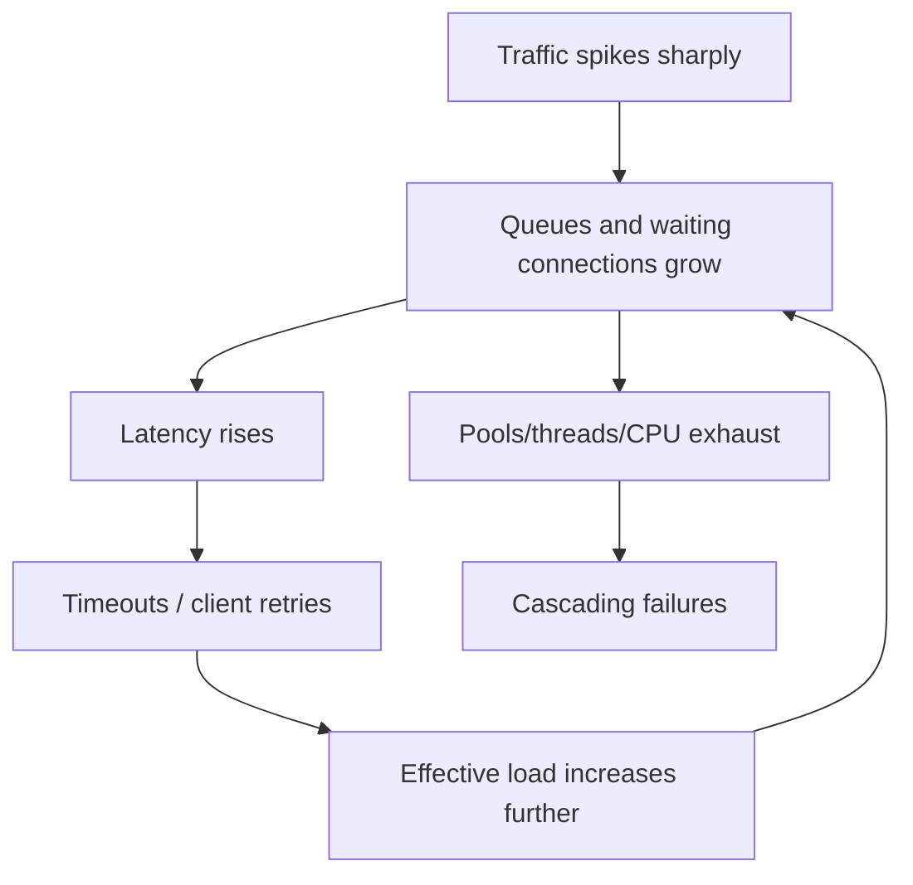
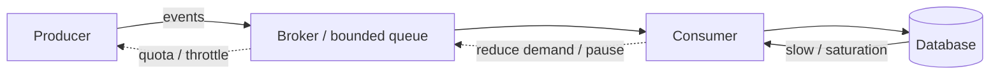
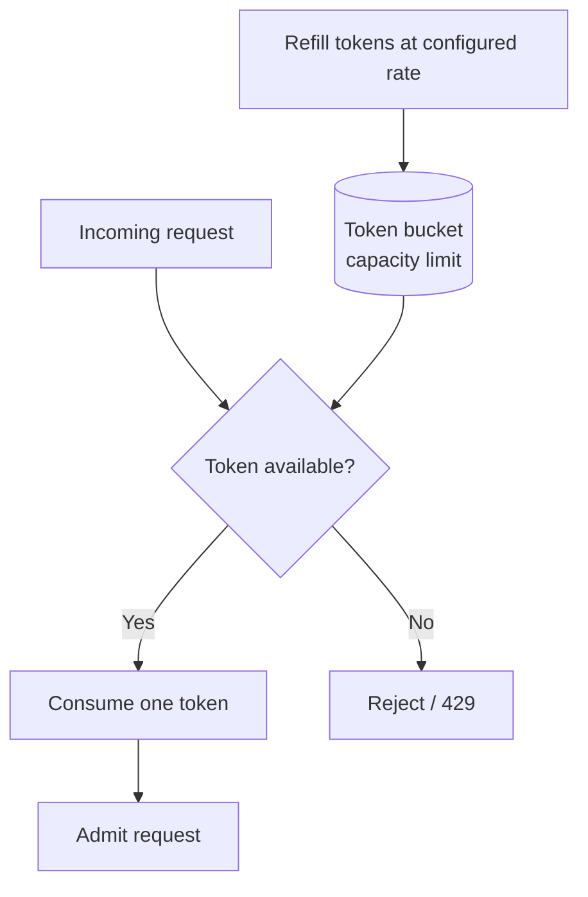
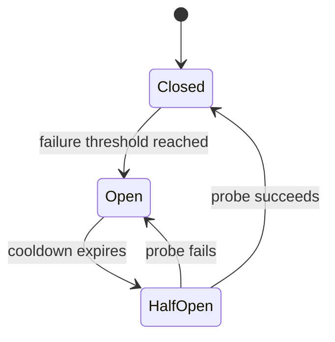
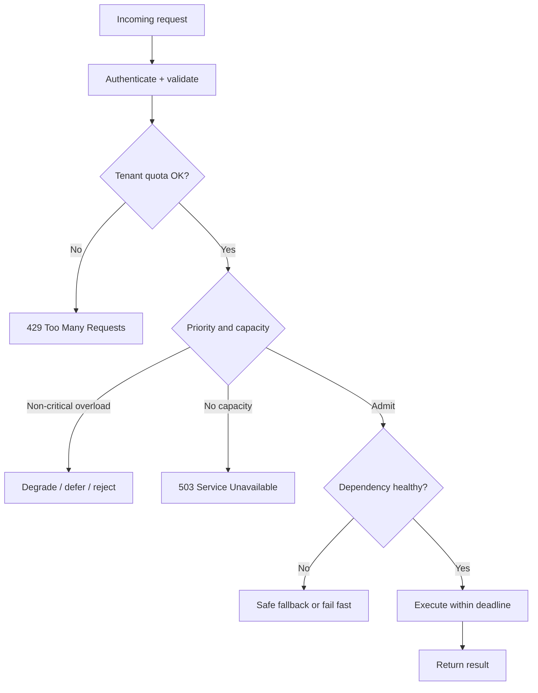

# Admission Control, Load Shedding, and Graceful Degradation

A cloud system designed to scale can still collapse when incoming requests exceed serving capacity. Spiking CPU, exhausted connection pools, growing queues, slow dependencies, and synchronized client retries can spiral into a feedback loop: the slower the system gets, the more requests pile up, time out, and retry; those retries consume even more resources, slowing the system down further.

**Admission control, load shedding, and graceful degradation** keep a system inside its safe operating envelope when demand exceeds capacity. Instead of letting every request penetrate deep into the system only to fail together, the system decides early which requests are admitted, which wait, which are rejected, and which features can be temporarily scaled back.

In the **CLOUD_ARCHITECTURE** module, these techniques tie together compute, networking, databases, queues, autoscaling, SLOs, and incident operations. The running example is an equipment rental platform supporting search, availability checks, reservation creation, payments, and notifications. Load thresholds and timings in this lesson are hypothetical for illustration; real architectures must measure workloads, benchmark on target infrastructure, and prioritize by business impact.

## 1. How Does Overload Form?

Every component has finite processing capacity. For instance, the Booking API stably processes 1,000 requests/second within its latency SLO. When traffic rises to 1,500 requests/second, the excess load does not vanish: it queues up in queues, connection pools, thread pools, kernel backlogs, or downstream dependencies.

If requests keep arriving faster than they complete, the backlog grows. As queues lengthen, requests wait longer, miss deadlines, and fail. Clients then retry, multiplying total work even further.



### Overload Symptoms

| Signal | What May Be Happening | Risk |
| --- | --- | --- |
| Sustained high CPU | Compute is saturated or workload is expensive | New requests miss processing deadlines |
| Memory/GC pressure | Many requests, payloads, or buffers stay resident | GC pauses, OOM kills, restarts |
| Connection pool saturation | Requests hold connections too long or pool is too small | Threads block and time out |
| Rising queue depth/oldest age | Consumers are slower than producers | Backlog diverges instead of draining |
| Rising p95/p99 latency | Tail requests are queueing or dependencies are slow | Client timeouts and retries |
| Rising 429/503 responses | System is shedding or under-provisioned | Consumers may retry improperly |
| Rising database lock waits | Transaction contention or long queries | Contention backs up into the API |
| Growing network/socket backlogs | Connection establishment or downstream congestion | Dropped/refused connections |
| Rising dependency error rates | A downstream service is unresponsive | Upstream call chains fail |

Never diagnose overload solely from CPU. An API sitting at 30% CPU can still fail to accept new requests because its database connection pool is exhausted or downstream is timing out.

## 2. Distinguishing Capacity, Concurrency, Throughput, and Latency

These concepts clarify which admission signals to pick.

| Concept | Meaning | Example |
| --- | --- | --- |
| **Capacity** | Amount of resources or work a system can serve under defined conditions | 800 requests/s at latency SLO |
| **Throughput** | Units of work completed per unit of time | 750 successful requests/s |
| **Concurrency** | Number of jobs actively processing or waiting simultaneously | 300 requests in flight |
| **Latency** | Time from receipt to completion | p99 of 450 ms |
| **Queue wait** | Time spent waiting before execution starts | Request waits 200 ms in admission queue |
| **Saturation** | Degree to which a primary resource is utilized | Worker pool 100% busy |

By Little's Law in steady state, average items in the system (L) equal average arrival rate (λ) times average time in the system (W): L = λ × W. When processing time climbs, in-flight requests rise even if arrival rate holds flat. This explains why a slow dependency rapidly spikes connection/thread counts despite steady incoming traffic.

For example, 500 requests/s averaging 0.2 seconds in the system yields roughly 100 concurrent requests. If latency rises to 2 seconds while arrival rate stays constant, concurrent requests jump to around 1,000. If each request holds a database connection, a small pool saturates almost instantly.

Capacity is not an isolated constant. It depends on payload size, query plans, cache hit ratios, transaction size, fan-out, network latency, concurrency, and required SLOs.

## 3. Admission Control: Deciding Before Accepting Work

Admission control decides whether an incoming request or job enters resource-intensive processing. It caps concurrency and shields the system from accepting more work than it can finish.

An admission controller typically evaluates:

- Number of currently active requests.
- Queue depth and oldest wait time.
- CPU, memory, connection pool, or worker utilization.
- Remaining request deadline.
- Dependency health.
- Tenant/client quotas.
- Priority and business value.
- Estimated resources required for the request type.

### 3.1. Concurrency Limits

For example, the Booking API allows at most 400 in-flight reservation-creation requests. Once 400 slots are busy:

- Reject immediately with 503/429 depending on cause and semantics.
- Place a small number into a bounded queue awaiting a slot.
- Reject requests whose remaining deadline is too short to complete.

Never create unbounded queues. Queues only convert instant overload into waiting; if arrival rate exceeds throughput for long, an unbounded queue grows indefinitely and eventually exhausts memory, disk, or connections.

### 3.2. Bounded Queues

A bounded queue must define:

- Maximum capacity by message count, bytes, or estimated work.
- Maximum wait time.
- Overflow policy: reject new work, drop low-priority items, or overwrite older jobs where semantics allow.
- Behavior during service shutdown/restart.
- Durability guarantees if committed work must not be lost.
- Metrics for queue depth, oldest age, and rejections.

Bounded queues stop the system from piling up work beyond recovery capacity. However, for reservations or payments, never arbitrarily drop an already-acknowledged command. Either reject before accepting, or persist the job durably with a pending state and clear client contract.

### 3.3. Deadline-Aware Admission

If a client sends a request with a 500 ms total deadline while expected queue wait is already 700 ms, admitting it wastes resources on work almost certain to fail. The admission controller should reject it early.

Deadlines must be an end-to-end budget: queue wait + internal processing + dependency calls + response serialization. Never let inner layers set timeouts longer than the caller's deadline.

## 4. Load Shedding: Dropping Load When You Cannot Serve All

Load shedding proactively rejects or drops part of the load to protect the rest. The goal is not cutting traffic indiscriminately, but keeping critical capabilities operating smoothly.

### 4.1. Rejecting Early Beats Failing Halfway

A request rejected at the edge consumes negligible resources. A request admitted, queued for 3 seconds, fanning out to 5 dependencies, and then timing out burns far more CPU, connections, and capacity while producing zero useful output.

Early rejection:

- Preserves threads/connections for requests likely to succeed.
- Prevents queue wait times from exceeding deadlines.
- Stops downstream services from doing doomed work.
- Signals clients clearly to back off.

### 4.2. Reject, Drop, Defer, and Degrade

| Action | Meaning | Use Case |
| --- | --- | --- |
| Reject | Refuse request with an explicit error response | Synchronous APIs where clients can retry per policy |
| Drop | Discard an already-received message/request | Non-critical telemetry, already-processed duplicate events |
| Defer | Accept work for later execution | Report exports, emails, batch jobs |
| Degrade | Return a simpler result or omit secondary features | Search without personalization, product details without recommendations |
| Shed selectively | Retain only high-priority request classes | Reservation confirmations prioritized over analytics refreshes |

Dropping an important command after acknowledging it can violate API contracts. For durable data, use reject-before-accept, durable queues, or queryable job statuses.

## 5. Prioritizing Load by Business Value

When capacity is scarce, not all requests carry equal value.

For the equipment rental platform:

| Priority | Request | Rationale |
| --- | --- | --- |
| P0 | Confirm/cancel in-progress transactions, critical payment callbacks | Preserves correctness and completes committed obligations |
| P1 | Create reservations, check availability for checkout | Revenue-generating flows and core business state |
| P2 | Customer reservation lookups, catalog browsing | Needed for UX, but safely rate-limitable |
| P3 | Recommendations, personalization, real-time dashboards | Can be disabled or served from caches |
| P4 | Analytics backfills, non-urgent report exports | Can be deferred |

This tiering is illustrative only; a payment callback must never skip signature verification or idempotency just because it is P0. Priority governs capacity allocation—never correctness or security.

### 5.1. Reserved Capacity and Per-Class Quotas

You can reserve a portion of worker/connection budgets for critical operations. Example:

- 50% of worker pool reserved for checkout/reservations.
- 25% for read APIs.
- 15% for critical background workflows.
- 10% for telemetry/maintenance.

These ratios should not be rigidly walled off. Hard-partitioned pools leave one group idle while another starves. Prefer minimum reserved capacity plus shared overflow, weighted fair queues, or adaptive concurrency.

### 5.2. Tenant Fairness

One heavy-traffic tenant should not starve everyone else. Apply:

- Per-tenant/API-key quotas.
- Per-tenant weighted fair queueing.
- Per-tenant concurrent request caps.
- Bounded burst allowances.
- Per-tenant cost accounting.

Quotas must distinguish abuse from legitimate high usage. Key enterprise tenants may hold higher contractual tiers, which must be audited so priority settings never turn into security bypasses.

## 6. Graceful Degradation: Intentional Quality Reduction

Graceful degradation keeps core functionality alive by temporarily disabling or simplifying secondary features when resources or dependencies degrade.

Examples:

- Catalog continues showing products while disabling recommendations.
- Availability returns recent cached data with a timestamp when the inventory read model lags, while checkout still validates against the authoritative source.
- Homepage reduces item counts, drops high-res imagery, or omits personalized blocks.
- Dashboards display the latest snapshot rather than running heavy real-time queries.
- Notifications shift to async queues; bookings never block waiting for email delivery.

Crucially, **never corrupt business semantics**. Presenting stale cached availability as a guaranteed reservation slot leads to overbooking. Display "updating" or use cached values strictly for browsing while checkout transactions re-verify authoritatively.

### 6.1. Functional Criticality

Classify features:

| Class | Under Resource Shortage | Behavior |
| --- | --- | --- |
| Core transactions | Preserve invariants and data integrity | Protect capacity; reject cleanly if unable to commit |
| Essential reads | Needed for users to proceed | Use caches/replicas with freshness contracts; bound queries |
| Optional enhancements | Non-blocking for transactions | Disable or fall back |
| Background work | Latency-tolerant | Queue and defer within bounds |
| Analytics/telemetry | Sampleable or partially droppable | Lower sampling rates or pause non-critical exports |

### 6.2. Fallbacks Must Have Explicit Semantics

A fallback response should surface:

- Whether data came from cache or which source.
- Current age/freshness.
- Which actions the user can safely perform.
- How incomplete or stale the fallback may be.
- When the system returns to full mode.

Never return HTTP 200 with broken data or placeholders indistinguishable from real records. Doing so tricks both clients and monitoring into thinking requests succeeded.

## 7. Backpressure: Signaling Overload Back to Producers

Backpressure is how downstream signals upstream to slow down when processing cannot keep pace. It appears across streaming, reactive systems, message consumers, and pipelines.

Mechanisms:

- Consumers lower pull rates or messages per batch.
- Producers receive smaller credits/windows.
- Stream operators throttle upstream demand.
- Queue brokers enforce bounded backlogs and throttle/reject producers.
- HTTP APIs return `429`/`503` with `Retry-After`.
- Internal RPCs use bounded queues and deadline propagation.



Backpressure only works if the signal reaches a point capable of reducing work. If consumers stop reading while producers keep stuffing an unbounded queue, the failure merely shifts to storage/backlog bloat.

### How Backpressure Differs From Load Shedding

- Backpressure slows upstream down so the system stabilizes.
- Load shedding drops or rejects excess load when slowing down is insufficient or upstream cannot be controlled.
- Admission control decides whether new work may enter at all.

All three mechanisms typically operate together.

## 8. Rate Limiting and Quotas

Rate limiting caps request rates by client, tenant, IP, token, operation, or resource.

### 8.1. Common Algorithms

| Algorithm | How It Works | Advantages | Limitations |
| --- | --- | --- | --- |
| Fixed window | Counts requests per fixed interval | Simple to implement | Double-rate bursts at window boundaries |
| Sliding window log | Stores timestamps of requests inside window | Time-accurate | High memory/IO under heavy traffic |
| Sliding window counter | Weighted estimate across two adjacent windows | More efficient than full logs | Approximate |
| Token bucket | Tokens refill at steady rate; requests consume tokens | Supports bounded bursts | Requires tuning bucket size and refill rate |
| Leaky bucket | Queues and drains requests at fixed pace | Smooths bursts cleanly | Can increase latency and queue wait |

### 8.2. Token Bucket

Suppose a tenant has a 100 tokens/second refill rate and a 200-token bucket capacity. The tenant can burst up to 200 requests when the bucket is full, after which sustained throughput is capped near 100 requests/second.



Rate limits do not replace concurrency limits. A client sending 100 requests/s where each takes 10 seconds still holds 1,000 concurrent in-flight requests. Pair rate and concurrency controls whenever latency fluctuates.

### 8.3. Distributed Rate Limiting

With multiple API replicas, per-instance counters allow total traffic far above the intended quota. Options:

- Shared atomic store/counter.
- Gateway enforcing distributed quotas.
- Per-node token leases to reduce contention.
- Strict local limits paired with approximate global quotas.

Shared counters improve precision at the cost of a network dependency and hot keys. Per-node token leases cut contention, though global usage can overshoot slightly within granted lease bounds. Choose consistency vs cost according to how strict the quota is.

### 8.4. HTTP Semantics

On quota breach, return `429 Too Many Requests` and guide client retries via `Retry-After` or rate-limit headers. When the server is globally overloaded, `503 Service Unavailable` fits most API contracts better. Separating per-client rate limits from service-wide capacity exhaustion helps clients react properly.

## 9. Timeouts, Retries, and Retry Storms

Timeouts bound how long a request can hold resources. Retries overcome transient faults, yet careless retries amplify overload.

### 9.1. Deadline Propagation

Suppose the API gateway enforces a 1-second deadline. It calls the Booking API, which calls Inventory and Pricing. Every hop must consume only the remaining time budget—never hardcode a 2-second inner timeout. Otherwise, the caller times out while downstream keeps burning resources pointlessly.

### 9.2. Retry Only Eligible Errors

Retry transient errors like connection resets or `503` only if the operation is idempotent and deadline remains. Never automatically retry validation errors, unauthorized responses, permanent business conflicts, or arbitrary `4xx` errors.

### 9.3. Exponential Backoff and Jitter

Retry delays scale upward: 100 ms, 200 ms, 400 ms, 800 ms, plus random jitter so clients do not retry in lockstep. Cap both retry attempts and total retry budgets.

```text
delay = min(max_delay, base_delay * 2^attempt)
wait = random(0, delay)
if remaining_deadline <= wait:
    stop retrying
else:
    retry only if error_is_retryable and operation_is_safe
```

Never retry infinitely. If every layer in a three-tier call chain retries 3 times, total downstream calls multiply dramatically compared to retrying at a single layer. Designate one layer responsible for retries or propagate explicit retry budgets down the chain.

### 9.4. Retry Storms

When a dependency goes down, thousands of clients retrying every 100 ms slam the system precisely at its weakest moment. Backoff, jitter, circuit breakers, rate limits, and load shedding prevent this spiral.

For reservation/payment writes, require idempotency keys or status queries after timeouts; a timeout never proves an operation failed to commit.

## 10. Circuit Breakers: Stopping Calls to Failing Dependencies

A circuit breaker tracks errors/timeouts to a dependency and temporarily blocks new calls once failure rates cross a threshold.

Standard states:

- **Closed:** lets requests flow and monitors errors.
- **Open:** blocks calls during cooldown, failing fast or returning a fallback.
- **Half-open:** permits a small number of probe requests; closes if healthy, re-opens if still failing.



A circuit breaker does not fix the dependency. It protects the caller from hanging and gives the dependency breathing room to recover. Key points:

- Define failures by timeouts, network errors, or server status codes; exclude business `4xx` errors.
- Use a large enough window/volume threshold so single stray errors do not trip the breaker.
- Keep half-open probe concurrency low so recovering dependencies are not flooded.
- Ensure fallbacks preserve proper semantics.
- Apply circuit breakers only where failure isolation is genuinely needed; haphazardly tuned breakers everywhere create operational headaches.

## 11. Queues and Asynchronous Processing

Offloading non-immediate work to queues keeps API responses fast and decouples producer/consumer speeds. Still, queues do not conjure infinite capacity.

### When Appropriate

- Sending email/SMS notifications.
- Generating report exports.
- Syncing search indexes.
- Generating thumbnails or processing files.
- Analytics ingestion.
- Workflows needing retries and tracked job states.

### Operational Requirements

- Bounded queue capacity and retention.
- Consumer concurrency/throughput caps.
- Idempotency keys on messages.
- Appropriate visibility timeouts/leases.
- Bounded retries and dead-letter policies (DLQs).
- Alerts on oldest message age and backlog size.
- Priority separation or dedicated queues per business class.

Never dump every workload into one shared queue if an analytics backlog can block payment callbacks or transactional notifications. Isolate queues/topics by priority and failure domain with separate resource limits.

### Queue Age Often Matters More Than Queue Depth

A 10,000-message queue is harmless if consumers drain 50,000/s. A 500-message queue is critical if the oldest message has waited 20 minutes against a 1-minute SLA. Track depth, arrival rate, completion rate, and oldest message age together.

## 12. Autoscaling Does Not Replace Admission Control

Autoscaling adds instances as load climbs, but always incurs lag:

- Metrics take time to reflect overload.
- Schedulers take time to allocate compute.
- Images/containers take time to boot and warm up.
- Caches, connection pools, and JIT compilers take time to stabilize.
- Databases/dependencies may not scale at the same pace.

If traffic spikes 10x in 2 seconds, autoscaling arrives too late. Admission control protects the system while capacity spins up; autoscaling raises capacity for sustained demand.

### Scale the Actual Bottleneck

Adding API instances achieves nothing if the database is maxed on connections or storage IOPS is saturated. Scale or relieve the real bottleneck:

- Cache read-heavy queries.
- Cut fan-out and N+1 queries.
- Separate worker pools.
- Cap connections/concurrency.
- Partition workloads.
- Scale the database or shift work async.
- Shed non-critical requests early.

## 13. Adaptive Concurrency and Signal-Driven Load Control

Static concurrency limits are simple to understand, but struggle when latency or payloads fluctuate. Adaptive concurrency controllers tune limits dynamically using signals like queueing delay, latency gradients, timeout rates, and saturation.

Example behavior:

- When p95 is low and dependencies are healthy, raise concurrency gradually.
- When queue waits or tail latency climb rapidly, cut concurrency.
- When probes fail, drop sharply and hold a cooldown.
- During recovery, ramp up gradually to avoid secondary spikes.

Controllers need min/max bounds, smoothing, cooldowns, and fail-safes. Bad metrics or overly twitchy controllers cause wild capacity oscillations.

One common pattern is gradient-based concurrency limiting: observe latency shifts as the system nears saturation and lower concurrency when latency drifts above baseline. Exact algorithms depend on the runtime/library; never treat one fixed latency threshold as universal.

## 14. Load Shedding Across Architecture Layers

Implement load controls across multiple tiers so doomed requests get stopped before going deep.

| Layer | Mechanism | Effect |
| --- | --- | --- |
| CDN/WAF/edge | Bot filtering, IP/client rate limits, payload size limits | Blocks invalid traffic before hitting compute |
| API gateway | Global/tenant quotas, concurrency caps, auth, 429/503 | Coarse admission for public APIs |
| Application | Priority queues, deadlines, feature degradation | Business-semantic load decisions |
| Service-to-service | Bulkheads, bounded pools, circuit breakers | Isolates slow dependencies |
| Queue/stream | Backpressure, consumer scaling, retention, DLQs | Regulates asynchronous load |
| Database | Connection caps, statement timeouts, query governance | Protects data tier resources |
| Background jobs | Priorities, schedules, concurrency caps, pausing | Yields resources to live traffic |

Do not push every policy into the gateway. The gateway lacks visibility into which reservation is about to expire or which operation is mid-commit. Application/domain layers must own business-semantic decisions.

## 15. Bulkheads: Isolating Resources Between Workloads

Bulkheads borrow from ship compartments: flooding or overload in one section will not sink the entire vessel.

In applications:

- Separate connection pools for critical DB transactions vs reporting queries.
- Dedicated thread/worker pools for notifications.
- Separate queues for analytics vs payment workflows.
- Bounded connection pools per dependency.
- Distinct CPU/memory requests-limits or deployments by priority tier.

For instance, a 30-second report export query must never monopolize the connection pool the Booking API needs for checkout. Separate pools allow reports to slow down while checkout keeps serving.

Trade-off: one pool may sit idle while another saturates. Combine reserved minimums with bounded shared overflow where appropriate.

## 16. Caching and Fallback Data

Caching reduces origin load, yet cache failures or expirations can trigger thundering herds:

1. A cache key expires.
2. Many concurrent requests miss.
3. All hit the database simultaneously.
4. The database overloads.

Mitigations:

- Request coalescing/single-flight per cache key.
- Jittered TTLs to prevent synchronized expirations.
- Stale-while-revalidate where semantics permit.
- Time-bounded negative result caching.
- Pre-warming hot data.
- Capping concurrent cache refreshes.

Cached fallbacks must carry freshness labels or contracts. Never commit reservations based on stale inventory data.

## 17. Designing Degradation Feature by Feature

A degradation matrix aligns the team before an incident hits.

| Feature | Normal Mode | During Overload / Dependency Failure | Non-Negotiable Invariant |
| --- | --- | --- | --- |
| Search catalog | Personalized results, full ranking | Disable recommendations, trim filters, use cache | Never show items unavailable for rent/sale |
| Availability browse | Near-real-time inventory read model | Return timestamped snapshot or warn of delay | Never treat snapshots as guaranteed holds |
| Create reservation | Verify and commit transaction | Bounded admission; fail fast if unable to commit | Zero duplicate bookings or false successes |
| Payment callback | Verify and record status | Prioritize durable queue, idempotent retries | Never drop received callbacks or double-charge |
| Notification | Send immediately | Defer to queue, trim secondary channels | Never roll back committed bookings |
| Analytics dashboard | Near-real-time calculation | Serve latest snapshot marked stale | Never label stale data as real-time |
| Export/report | Async processing | Queue temporarily or throttle new jobs | Never lose confirmed jobs |

A degradation matrix needs owners, triggers, toggle mechanisms, metrics, and recovery criteria. Feature flags driving degradation must default safely if the config service goes down.

## 18. Example Admission Strategy for the Booking API

Suppose benchmarks in a representative environment show:

- Sustainable capacity: 800 requests/s.
- Latency SLO: p95 under 250 ms.
- Database connection pool: 120 connections.
- Each reservation creation holds a connection for 80 ms on average.
- Bounded queue allows admitted requests to wait at most 100 ms.

These numbers are hypothetical. A sample policy:

1. Gateway enforces per-tenant burst limits.
2. Booking API caps concurrent transactions at 300.
3. Reserve concurrency slots for P0/P1 traffic.
4. Reject early if predicted queue wait exceeds remaining deadline.
5. If inventory reads lag, trip the circuit breaker; checkout never auto-confirms from stale caches.
6. Disable recommendations and defer notifications under pressure.
7. Autoscale API on CPU/throughput while keeping total DB connections capped.
8. When DB saturation breaches thresholds, cut concurrency instead of adding more API replicas.

### Decision Flow



### Why Not Accept Every Request?

If the API admits 1,500 requests/s while the DB path sustains only 800 requests/s, unbounded queueing drives up wait times until everyone misses deadlines. Rejecting 700 requests early gives the 800 admitted requests a high probability of completing cleanly. Clients receiving `429`/`503` can throttle or retry later per retry policy.

## 19. Testing Overload and Capacity

Testing only under normal load proves nothing about overload behavior. Run:

- Load tests to validate capacity and SLOs.
- Stress tests to pinpoint saturation thresholds.
- Spike tests to observe sudden surges.
- Soak tests to uncover leaks and slow queue buildup.
- Dependency failure and latency injection.
- Retry storm simulations.
- Queue backlog and drain recovery tests.
- Failovers under heavy load.

### Questions Tests Must Answer

1. At 2× traffic, which requests get rejected first?
2. Do P0/P1 flows keep succeeding while P3/P4 traffic is shed?
3. Do queues stay bounded and oldest message ages stay within SLA?
4. Do clients respect `Retry-After` hints with backoff and jitter?
5. Are database pools shielded when downstream slows down?
6. Does autoscaling accidentally spike database pressure?
7. As traffic drops, does the backlog drain without causing secondary spikes?
8. Does feature degradation recover cleanly and emit audit trails?

### Recovery Ramp

After an overload incident, never open admission limits wide all at once. Ramp allowed load back up gradually while watching latency, error rates, queue age, and dependency saturation. If every consumer flushes its backlog simultaneously the instant a service recovers, it will knock the service right back down.

## 20. Observability and Alerting for Load Control

| Metric | What It Shows | Decisions It Supports |
| --- | --- | --- |
| Accepted/rejected requests by reason | Admission rate and rejection causes | Tune policies and quotas |
| In-flight concurrency | Active requests/jobs holding resources | Adjust concurrency caps |
| Admission queue depth/age | Queued work and wait durations | Pause, reject, or scale |
| p50/p95/p99 latency | User experience and tail latency | Early saturation detection |
| Retry attempts per original request | Amplification from retries | Tighten retry budgets/backoff |
| Circuit breaker state/transitions | How long a dependency is isolated | Trigger investigation and recovery |
| Bulkhead pool utilization | Which pools are starving or saturated | Adjust isolation or capacity |
| Queue oldest age | Age of oldest unprocessed work | Catch SLA deadline risks |
| Degradation flag/state | Which features are degraded/off | Ensure visibility and recovery |
| Dependency timeout/error rate | Origin of bottlenecks | Trip breakers or cut concurrency |
| Capacity headroom | Remaining spare capacity | Forecasting and autoscaling |

Track rejected requests by tenant, operation, and priority while avoiding unbounded metric cardinality. Use structured logging/tracing for specific IDs, and never place sensitive data into metric labels.

### SLOs and Error Budgets

Admission control increases `429`/`503` counts under heavy load; factor that explicitly into API SLOs. Looking solely at latency of admitted requests makes a system appear healthy while turning away most customers. SLOs must track both valid request acceptance rate and successful request latency, separating contractual client rate limits from system capacity failures.

## 21. Operational and Security Risks

### Misconfigured Policies Can Cause Outages

- Concurrency limits set too low waste capacity and drop valid requests.
- Limits set too high fail to protect bottlenecks.
- Global rate limits keyed improperly let one tenant throttle everyone.
- Over-sensitive circuit breaker thresholds flap open constantly.
- Fallbacks returning stale data without freshness indicators mislead users.
- Unenforced reserved capacity gets consumed by low-priority work.

### Security

- Rate limit on verified identities—never rely purely on IP behind NATs/proxies.
- Authenticate before assigning user/tenant quotas.
- Protect health, admin, and metrics endpoints from abuse.
- Never allow client-supplied priority headers to bypass quotas.
- Audit changes to admission policies and feature degradation flags.
- Cap payload sizes and parsing complexity.
- Protect shared rate-limit stores and config planes.

### Control Plane vs. Data Plane

Admission policies are typically authored via the control plane and enforced in the data plane. If the config service disconnects, instances need safe cached/default policies, config versioning, and staged rollouts. Never let a quota-config dependency become a single point of failure that stops APIs from making admission decisions.

## 22. Applying Well-Architected Principles

| Pillar | Supporting Design | Trade-Offs to Manage | Verification Question |
| --- | --- | --- | --- |
| **Operational excellence** | Load policies, degradation runbooks, dashboards, game days | Multiple policies need owners, reviews, and tuning | Who toggles degraded mode, and is the reason visible? |
| **Security** | Rate limits, identity-aware quotas, payload caps | Policy bypass or priority spoofing | Can clients elevate priority or evade quotas? |
| **Reliability** | Bounded queues, bulkheads, breakers, admission, graceful degradation | Intentional rejections and fallbacks impact UX | Do core transactions survive when secondary dependencies fail? |
| **Performance efficiency** | Keep concurrency near peak throughput zone; curb retry storms | Overly low caps waste capacity | Was capacity measured against representative workloads? |
| **Cost optimization** | Deferring jobs beats infinite scaling; curb wasted overload compute | Queue retention, monitoring, and reserved capacity cost money | Are we paying to process doomed requests? |
| **Sustainability** | Eliminate duplicate work, useless retries, and auxiliary load | Excess headroom leaves resources idle | Can we trim low-value work while keeping resilience? |

Never optimize a single metric in isolation. Holding CPU at 100% by admitting every request wrecks latency and errors; holding error rates low by rejecting 90% of users fails the business purpose of serving them.

## 23. Common Anti-Patterns

1. **Unbounded queues.** Overload turns into runaway backlogs ending in OOM or disk exhaustion.
2. **Autoscaling without admission control.** Scaling lags or bottlenecks live in non-scalable dependencies.
3. **Immediate retries.** Triggers retry storms the instant a dependency blips.
4. **Treating all requests with equal priority.** Analytics hog connections needed by checkout.
5. **Fallbacks treating stale data as authoritative.** Causes invalid reservations or outdated pricing.
6. **Rate limiting without concurrency limits.** Slow requests still pile up excessive in-flight work.
7. **Circuit breakers counting all 4xx as failures.** Business validation errors trip breakers needlessly.
8. **Scaling APIs while forgetting the database.** Extra instances flood DB connections and worsen outages.
9. **One shared queue for everything.** Secondary backlogs block critical flows.
10. **Ignoring rejection metrics.** Latency looks great only because rejected requests are ignored.
11. **Degradation without recovery criteria.** Features remain disabled indefinitely or flap on/off.
12. **Trusting client-declared priorities.** Easily abused to bypass quotas.

## 24. Load Control Design Process

1. **Measure workloads:** arrival rates, payloads, request mixes, concurrency, latency, and dependency fan-out.
2. **Locate bottlenecks:** CPU, memory, databases, networking, connections, queues, or external dependencies.
3. **Classify business paths:** operation criticality, tenant fairness, deadlines, and deferrable/droppable work.
4. **Define capacity envelopes:** target throughput/concurrency, headroom, and per-workload SLOs.
5. **Design admission:** quotas, concurrency caps, bounded queues, deadlines, and rejection semantics.
6. **Design shedding/degradation:** priorities, reserved capacity, fallbacks, and feature flags.
7. **Shield dependencies:** timeouts, retry budgets, backoff+jitter, circuit breakers, and bulkheads.
8. **Connect backpressure/autoscaling:** curb upstream demand, scale real bottlenecks, and avoid unbounded queues.
9. **Instrument:** accepted/rejected counts, queue age, latency, retries, breakers, pools, and degraded states.
10. **Run drills:** spikes, dependency outages, retry storms, backlog drain recovery, and policy rollouts.

## 25. Hands-On Exercises

### Exercise A — Traffic Spike

The Booking API runs stably at 800 requests/s. A promotional campaign spikes load to 2,000 requests/s for 30 seconds. The database cannot scale in time.

**Question:** How would you configure admission control, reserved capacity, and load shedding?

**Hint:** Cap concurrency to match DB capacity, reserve capacity for core booking/payments, disable recommendations and defer analytics/notifications, and fail fast with `429`/`503` for excess traffic. Track latency/rejections and never confirm bookings using stale availability.

### Exercise B — Slow Dependency

Inventory Service latency jumps from 50 ms to 3 seconds. The Booking API has 500 in-flight requests and its thread pool is exhausting.

**Question:** Which mechanisms must work together?

**Hint:** Deadline propagation, timeouts shorter than caller deadlines, bounded concurrency/bulkheads, circuit breakers, and timestamped fallbacks for browsing. Checkout must verify availability against the authoritative source—failing fast if unreachable.

### Exercise C — Retry Storm

A payment provider returns `503`. 10,000 clients retry every 100 ms.

**Question:** How do you curb amplification without losing callbacks or payment states?

**Hint:** Idempotent requests, exponential backoff+jitter, retry budgets, durable queues for accepted webhooks, circuit breakers, concurrency caps, and reconciliation. Never ACK a webhook before durable persistence if the contract requires guaranteed ingestion.

### Exercise D — Unbounded Queue Growth

Notification workers process 500 messages/s while producers emit 900 messages/s for hours.

**Question:** Does the queue solve the problem?

**Hint:** No—not when sustained arrival rate exceeds processing rate. Scale workers if downstream bottlenecks allow, throttle producers, expire or drop obsolete notifications, and protect queue storage. Track oldest message age and define overflow rules.

### Exercise E — Degraded Mode

The Recommendation Service fails while the catalog and Booking DB remain healthy.

**Question:** What user experience can be preserved?

**Hint:** Disable recommendations, return default/cached catalog results, and keep checkout unaffected; label fallback data accurately, monitor breaker metrics, and recover automatically after probes pass.

### Self-Assessment Criteria

| Capability | Required Evidence |
| --- | --- |
| Capacity | Benchmarks, workload mix, throughput/concurrency, and headroom |
| Admission | Concurrency caps, bounded queues, deadlines, and rejection reasons |
| Shedding | Priorities, tenant fairness, and explicit policies |
| Degradation | Feature matrix, fallback semantics, and recovery triggers |
| Resilience | Timeouts, retry budgets, breakers, bulkheads, and backpressure |
| Operations | Metrics, alerts, runbooks, and overload drills |

## 26. Pre-Production Review Checklist

- Measured capacity across realistic workload mixes and SLOs?
- Identified whether bottlenecks sit in compute, databases, networking, or dependencies?
- Configured concurrency limits and bounded queues at each tier?
- Defined queue overflow, max age, and durability semantics?
- Does admission evaluate remaining deadlines and priorities?
- Does load shedding distinguish critical vs optional workloads?
- Do tenant quotas/fairness prevent one client from starving others?
- Do fallbacks expose freshness and preserve business invariants?
- Does backpressure propagate back to producers?
- Do rate limits distinguish per-client quotas from service-wide overload?
- Is timeout/deadline propagation consistent end-to-end?
- Are retries bounded with backoff, jitter, and idempotency?
- Do circuit breakers define clear thresholds, half-open probes, and fallbacks?
- Do bulkheads isolate pools/queues per workload?
- Does autoscaling avoid driving pressure past database capacity?
- Do metrics cover accepted/rejected requests, queue age, retries, concurrency, and SLOs?
- Tested spikes, stress, dependency failures, and recovery ramps?
- Do policy updates enforce auditing, ownership, and safe defaults when the control plane fails?

Admission control decides which work enters the system; load shedding drops or rejects excess load the system cannot safely handle; graceful degradation sustains core business value by temporarily dialing back secondary features. By combining bounded queues, backpressure, priorities, rate limits, deadlines, retry budgets, circuit breakers, bulkheads, and bottleneck-targeted autoscaling, a system fails gracefully instead of cascading into total collapse. Above all, measure capacity, protect business invariants, and tell clients clearly what was accepted, rejected, or served in degraded mode.
