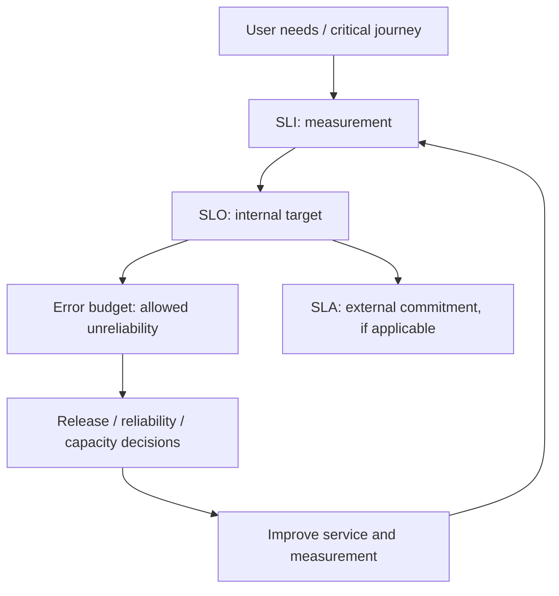

# Defining SLI, SLO, SLA, and Error Budgets

## 1. Reliability Must Be Measured by User Outcomes

A service can have low CPU, zero pod restarts, and all green dashboards while users still cannot book appointments, payments fail, or responses take too long. Conversely, a few instances can restart without users noticing because the system self-recovers quickly. Therefore, evaluating reliability solely by infrastructure status is insufficient.

To manage verifiable reliability, teams need to align on four concepts:

- **SLI (Service Level Indicator):** a metric measuring an aspect of service quality that users care about.
- **SLO (Service Level Objective):** a quantitative target for an SLI over a time window.
- **SLA (Service Level Agreement):** a service commitment to customers or stakeholders, typically accompanied by conditions, measurement methods, exclusions, and remedies when unmet.
- **Error budget:** the permissible deviation from the SLO within the measurement window; used to balance release velocity and reliability.

These concepts form a governance loop: identify what matters to users, measure it, set targets, agree on commitments, and then use the remaining budget to make operational and release decisions.

This lesson belongs to the **Reliability** chapter of the **CLOUD_ARCHITECTURE** module. The module teaches how to design cloud architecture from business requirements to networking, compute, data, and deployment models, balancing reliability, security, scalability, cost, and operations according to Well-Architected principles. This lesson establishes the quantitative foundation so that those architectural decisions have clear goals and evidence.

After this lesson, you will be able to:

- Translate user experience into measurable SLIs.
- Choose appropriate SLOs, measurement windows, and aggregation methods.
- Distinguish internal objectives from binding SLAs.
- Calculate error budgets and burn rates.
- Build alerts based on budget consumption rates.
- Use SLOs to prioritize reliability work, releases, and infrastructure investment.

## 2. Start from User Journeys and Critical User Journeys

Do not start with the question "what metrics are already available in Prometheus?". Start with: **what do users need to accomplish, and what makes them consider the service to be working well?**

For example, a booking platform has these journeys:

1. Log in and access their schedule.
2. Search for available time slots.
3. Create a booking and receive confirmation.
4. Cancel or modify a booking.
5. Receive notifications about changes.

Not all journeys carry the same importance. Loading an avatar a few seconds slowly can be annoying; recording an incorrect payment can cause major damage even if the API still returns HTTP 200. SLIs must reflect correctness and business outcomes at the appropriate level.

### 2.1. Define Service Boundaries

An SLO needs to state clearly which service is responsible. For example:

| Service boundary | What is measured | Parts that may be out of scope |
|---|---|---|
| Public Booking API | Ability to receive and process booking requests | ISP network or customer's personal device |
| Booking workflow | Booking confirmed in the correct state within the deadline | Third-party email channel if under a separate SLA |
| Notification service | Notification request accepted by the provider within the time limit | Email landing in inbox or recipient opening the message |
| Data export service | Export completes and is downloadable within the time limit | Destination storage system self-managed by the customer |

Scope must not be chosen to hide failures. If an external dependency is an integral part of the journey, end-to-end experience must be measured separately, even if you do not directly control that dependency.

### 2.2. Classify Requests

Before calculating an SLI, determine which requests belong in the denominator:

- Valid requests from users or supported clients.
- Health checks, synthetic probes, internal retries, and background operations.
- Requests rejected due to authentication/authorization or invalid input data.
- Requests throttled due to quotas or abuse.
- Bot traffic, test traffic, and internal traffic.

Do not arbitrarily exclude failed requests from the denominator after observing the results. Inclusion/exclusion definitions must be stable, justified, and reviewed. For example, a 401 request due to wrong credentials may not reflect booking service availability; however, if the platform's own authentication service fails and prevents valid users from logging in, that is still a failure in the user journey.

## 3. SLI: Choosing the Right Indicators

An SLI is a quantitative measurement of a service aspect. A good SLI has a reliable data source, a clear denominator definition, reflects user experience, and is actionable when it degrades.

### 3.1. Common SLI Categories

| Category | Question | Common measurement |
|---|---|---|
| Availability | Did valid requests receive a successful outcome? | Good requests / eligible requests |
| Latency | How fast do requests complete? | Percentage of requests below a time threshold or percentile |
| Correctness | Is the outcome business-valid? | Percentage of valid outcomes / evaluated transactions |
| Durability | Is acknowledged data retained? | Percentage of acknowledged records surviving verification |
| Freshness | Is the data fresh enough? | Data age or replication lag |
| Throughput/capacity | Can the service handle required demand? | Requests/events completed within specified time and load |
| Delivery | Are messages or notifications delivered on time? | Percentage of events processed by consumer/provider within deadline |

There is no need to create SLOs for every metric. Choose a few indicators representing critical journeys; the remaining infrastructure metrics are used for root-cause diagnostics.

### 3.2. Availability SLI

For a request-response service, a common formula is:

\[
Availability\ SLI=\frac{Good\ requests}{Eligible\ requests}\times100\%
\]

Where good requests are requests meeting the success definition; eligible requests are total requests within the measurement scope.

For example, in a month, there are 2,000,000 valid requests; 1,998,000 requests return satisfactory results:

\[
SLI=\frac{1,998,000}{2,000,000}=99.9\%
\]

"Good" must be defined precisely. If only HTTP 2xx is treated as success, a 200 response containing a business error may be miscounted. For booking, a good request may require the system to return a durably persisted state, not just a success response prior to commit.

### 3.3. Latency SLI

Latency can be measured using:

- Percentiles p50/p90/p95/p99 to understand time distribution.
- Percentage of requests completing under a threshold, e.g., 99% of requests under 300 ms.
- Deadlines for asynchronous workflows, e.g., booking confirmed within 10 seconds.

A threshold-based latency SLO:

\[
Latency\ SLI=\frac{Requests\ completed\ within\ T}{Eligible\ requests}
\]

Do not rely solely on p99 without specifying sample size, window, and handling of low traffic. For user-facing SLOs, the proportion of requests below a threshold is usually easier to interpret and budget. p95/p99 remain useful for diagnosing tail latency.

### 3.4. Correctness and Durability

High availability does not guarantee correct data. A booking creation API might return 201 yet create two bookings for the same idempotency key; the request succeeded at the HTTP layer but failed on correctness.

A correctness SLI can measure:

\[
Correctness\ SLI=\frac{Valid\ outcomes}{Evaluated\ outcomes}
\]

Example definitions:

- Bookings do not exceed slot capacity.
- A payment intent is not charged twice.
- Booking state does not regress from Cancelled to Confirmed.
- Durably ACKed data is not lost after failover.

Correctness often requires reconciliation or checking business invariants, not just reading response codes.

### 3.5. Freshness and Asynchronous SLIs

For event pipelines, users may accept asynchronous updates but need to know waiting bounds. Event age can be measured as:

\[
Event\ freshness=ProcessingTime-EventOccurredTime
\]

Or the percentage of events processed within deadline T. Distinguish event time, ingestion time, and processing time; clock skew can distort event age measurements. If two timestamps come from different machines, clock synchronization and causal metadata must be considered.

### 3.6. Golden Signals and Diagnostic Metrics

Latency, traffic, errors, and saturation are a useful set of indicators:

- Latency: how slow requests are.
- Traffic: how many requests/operations occur.
- Errors: rate and types of errors.
- Saturation: how close resources or queues are to their limits.

These are operational signals; not all of them are user-facing SLIs. 95% CPU may warn of saturation without necessarily impacting users. Conversely, an API with good latency that writes incorrect data is still unreliable.

## 4. Qualities of a Good SLI

A useful SLI needs to be:

1. **User-centered:** measures what users perceive or the business outcome required.
2. **Unambiguous:** has a clear numerator, denominator, unit, scope, and filters.
3. **Reliable:** telemetry remains trustworthy even while the service is failing.
4. **Actionable:** when the SLI degrades, the team knows where to investigate or what decision to make.
5. **Tamper-resistant:** not easily skewed by accidentally dropping errors, changing labels, or losing the denominator.
6. **Affordable:** appropriate collection granularity and cost; no need to trace every request if metrics suffice.

### 4.1. Measuring from User-Side vs. Server-Side

Server-side metrics are useful for diagnostics but can miss errors occurring before requests reach the service: DNS, TLS handshake, load balancer, CDN, or gateway.

Client-side/synthetic measurements observe closer to user experience but are affected by the probe's device, network, and region. You can combine:

- Server-side SLIs for the service boundary owned by the team.
- Synthetic probes from multiple regions for critical access paths.
- Real-user monitoring (RUM) when actual experience distribution is needed.
- Business reconciliation for correctness/durability.

Do not combine measurements with different denominators into a single number without defining their relationship and weights.

## 5. SLO: Setting Quantitative Objectives

An **SLO** is a target level for an SLI over a time window. For example: 99.9% of valid Booking API requests return the correct result within 500 ms, measured over a 30-day window.

An SLO needs an SLI, target and unit, measurement window, scope/traffic eligibility, handling of retries/partial success/dependencies, an owner, and actions when unmet.

### 5.1. An SLO Is Not a 100% Target

A 100% availability target is usually expensive and impractical because hardware, networks, software, dependencies, and human operations can all fail. Pushing a target from 99.9% to 99.99% may require much costlier multi-region architecture, replication, automation, testing, and on-call support.

An SLO should be good enough for the user journey and business value, not the highest number that looks good on a slide. A target that is too low exposes users to failures; a target that is too high causes the team to over-invest beyond the product value gained.

### 5.2. Example Targets and Equivalent Error Time

For an availability SLO measured over continuous time, the approximate time-based error budget is:

\[
Allowed\ downtime=(1-SLO)\times Window
\]

| SLO | Budget in 30 days (720 hours) | Budget in 365 days |
|---:|---:|---:|
| 99% | 7 hours 12 minutes | 3 days 15 hours 36 minutes |
| 99.5% | 3 hours 36 minutes | 1 day 19 hours 48 minutes |
| 99.9% | 43 minutes 12 seconds | 8 hours 45 minutes 36 seconds |
| 99.95% | 21 minutes 36 seconds | 4 hours 22 minutes 48 seconds |
| 99.99% | 4 minutes 19.2 seconds | 52 minutes 33.6 seconds |

This is only a conversion for illustration. If an SLI is request-based, the budget is calculated by the number of failed requests, not necessarily total downtime. Services with low traffic at night or partial feature failures must be measured using the right user denominator.

### 5.3. Request-Based SLO vs. Time-Based SLO

| Type | Denominator | Best suited for |
|---|---|---|
| Request-based | Total eligible requests in the window | API, RPC, event processing |
| Time-based | Total time the service is eligible to operate | Certain continuous services, endpoint/instance availability |

A request-based SLO reflects the success rate of requests; a 5-minute outage during peak hours can consume far more budget than an outage of the same length during low traffic. A time-based SLO may treat every minute equally even with no requests. Choose the model based on actual user experience.

### 5.4. Rolling and Calendar Windows

- **Rolling window:** e.g., the trailing 30 days at any point in time; responds continuously to recent quality.
- **Calendar window:** e.g., calendar month; easy to reconcile with reports/SLAs, but errors at the start of a month drop out of the window when the new month begins.

You can use a rolling window for SRE operations and a calendar window for SLA reporting. If using both windows, state this clearly.

## 6. SLA: Service Commitment to Customers

An **SLA** is an agreement between provider and customer regarding service levels, scope, measurement methods, responsibilities, and remedies when unmet. SLAs are typically contractual/commercial; SLOs are technical/operational targets for managing the service.

An SLA may specify:

- Covered services and features.
- Availability/latency targets.
- Measurement window, timezone, and formulas.
- Maintenance conditions and contractual exclusions.
- How to submit incident review requests and evidence.
- Service credits or remedies.
- Customer responsibilities, quotas, configurations, and third-party dependencies.

SLA terms must be reviewed by legal/contracts teams. Do not infer that an internal SLO grants a right to service credits or that an uptime percentage means every single request succeeded.

### 6.1. Relationship Between SLI, SLO, and SLA



Typically, internal SLOs should be equal to or stricter than external SLAs to create a buffer. Specific targets depend on contracts and operational capability; there is no fixed margin ratio.

### 6.2. Distinction Examples

| Concept | Example |
|---|---|
| SLI | Percentage of booking requests recorded accurately and returned within 500 ms |
| SLO | 99.9% of requests meet the SLI over a 30-day rolling window |
| SLA | Contractual availability commitment per agreed measurement and terms |
| Error budget | Portion of requests permitted to miss the SLO within that window |

## 7. Calculating the Error Budget

For a request-based SLO:

\[
Error\ budget=Eligible\ events\times(1-SLO)
\]

Suppose this month has 2,000,000 valid requests and an SLO of 99.9%:

\[
Budget=2,000,000\times0.001=2,000\ requests
\]

If 1,200 requests have already failed:

\[
Budget_{remaining}=2,000-1,200=800
\]

Percentage of budget consumed:

\[
Budget\ consumed=\frac{1,200}{2,000}\times100\%=60\%
\]

An error budget is not a target to intentionally cause failures. It represents the accepted risk level enabling teams to release and improve with discipline.

### 7.1. Latency SLO Example

An SLO requires 99% of requests to complete within 300 ms. A month has 500,000 valid requests:

- Good: 495,000 requests complete ≤ 300 ms.
- Bad: 5,000 requests take longer than 300 ms or fail to complete per definition.
- Budget: 5,000 requests.

If 2,500 requests exceed the threshold, 50% of the budget is consumed. An HTTP 200 response taking 2 seconds is still a bad event for the latency SLI.

### 7.2. Do Not Arbitrarily Sum Budgets with Different Denominators

Availability, latency, and correctness may have different denominators. Do not add 500 availability errors to 700 latency errors and call it 1,200 errors if the two sets can overlap. You can maintain separate budgets per SLO or build a well-defined end-to-end user journey SLI.

## 8. Error Budget Policy: Using the Budget to Make Decisions

An error budget has value when stakeholders agree upfront on actions when the budget is exhausted or burning rapidly.

### 8.1. When the Budget Is Healthy

- Release according to normal processes.
- Run controlled experiments, canaries, and progressive delivery.
- Invest in features and reliability per priorities.
- Monitor burn rate to detect negative trends.

### 8.2. When the Budget Is Burning Fast

- Increase release reviews and slow down rollout expansion.
- Investigate the error class/region/tenant/version driving burn up.
- Pause high-risk changes if related to the root cause.
- Prioritize bug fixes, capacity, dependencies, rollback safety, and observability.

### 8.3. When the Budget Is Exhausted

A common policy is to freeze risky feature releases until the SLO recovers or an approved exception is granted. Emergency security patches, data-loss fixes, or reliability-improving changes may still be needed; the policy must distinguish change types and approval paths.

Do not use the budget to blame a team or indefinitely ban all deployments. The goal is to address root causes of errors before adding further risky changes.

### 8.4. Illustrative Policy

| Budget status | Recommended action | Decision maker |
|---|---|---|
| Healthy, normal burn | Release per current guardrails | Service owner |
| Elevated burn, nearing threshold | Increase canary checks, review releases, and investigate | Service owner + SRE |
| Below low threshold | Restrict risky changes, prioritize reliability | Engineering lead/SRE |
| Budget exhausted | Pause non-essential releases; recovery plan | Designated owner |
| Emergency change | Assess benefit and record exception | Incident commander/owner |

Specific thresholds should tie to burn rate, severity, and measurement window, not just percentage of remaining budget.

## 9. Burn Rate: Error Budget Consumption Speed

**Burn rate** indicates how many times faster than the allowed rate a service is consuming its error budget.

\[
Burn\ rate=\frac{Observed\ error\ rate}{Allowed\ error\ rate}
\]

Allowed error rate = (1-SLO). With a 99.9% SLO, the allowed error rate is 0.1%. If the observed error rate in a window is 1%:

\[
Burn\ rate=\frac{1\%}{0.1\%}=10
\]

A burn rate of 10 means the budget is being consumed 10 times faster than the average allowed rate if this condition persists.

### 9.1. Estimating Time to Budget Exhaustion

If the burn rate stays constant and the budget is full:

\[
Time\ to\ exhaust\approx\frac{Window}{Burn\ rate}
\]

For example, a 30-day rolling SLO with a burn rate of 6:

\[
30\ days/6=5\ days
\]

This is an approximation. When part of the budget has already been spent, the actual remaining time is shorter and must be calculated from the current remaining balance.

### 9.2. Burn Rate vs. Error Count

High-traffic services can have many absolute failed requests yet a low error rate; low-traffic services have fewer errors yet a high rate. Burn rate normalizes against the budget, but it must be combined with volume, user impact, and severity to avoid false alerts at low traffic.

## 10. Multi-Window Alerting

Alerts using only long windows may detect issues too late; using only very short windows may trigger on minor spikes. Multi-window alerting combines a short window to detect active failures and a long window to confirm sustained impact.

Example for a 99.9% SLO:

| Alert goal | Long window | Short window | Example burn rate |
|---|---:|---:|---:|
| Critical, rapid budget exhaustion | 1 hour | 5 minutes | 14.4x |
| High, significant burn | 6 hours | 30 minutes | 6x |
| Medium, requires investigation | 3 days | 6 hours | 1x or internal threshold |

These are design examples, not mandatory thresholds. Tune them to the SLO window, traffic, alert fatigue, and response time. Requiring both windows to breach simultaneously helps filter brief spikes.

### 10.1. Pages and Tickets

- **Page/on-call:** major user impact or very fast budget burn; requires immediate response.
- **Ticket/notification:** longer-term trend, declining budget, does not yet warrant waking on-call.
- **Dashboard only:** diagnostic metrics not tied to user impact or lacking clear action.

Every alert needs an owner, runbook, severity, clear condition, and expected action.

## 11. End-to-End Example: SLOs for Booking API

Suppose a booking service has three user journeys: viewing available slots, creating a booking, and canceling a booking. The team agrees on:

| SLI | Definition | Sample SLO |
|---|---|---:|
| Booking API availability | Valid requests processed with the correct outcome, excluding explicitly excluded client errors | 99.9% / 30 days |
| Booking API latency | Valid requests completed within ≤ 500 ms | 99% / 30 days |
| Booking confirmation freshness | Valid bookings transition to confirmed within ≤ 10 seconds | 99.5% / 30 days |
| Booking correctness | No duplicate bookings created; no slot invariant violations | Set threshold per business risk and reconciliation |

These are illustrative SLOs; correctness may require near-absolute thresholds based on invariants rather than being lumped arbitrarily into availability.

### 11.1. Calculating Availability Budget

A month has 4,000,000 valid requests, target 99.9%:

\[
Budget=4,000,000\times0.001=4,000\ requests
\]

3,000 failed requests have already occurred:

- Budget consumed = 75%.
- Budget remaining = 1,000 requests.

If a new deployment causes an extra 700 errors in one hour, that release consumes most of the remaining budget and requires rollback/investigation per policy.

### 11.2. Measuring at the Right Boundary

- API gateway measures edge requests and latency to response.
- Booking service measures transaction commits/outcomes.
- Database measures locks, connections, commit latency, and failover.
- Event pipeline measures event age and consumer processing time.
- Reconciliation checks duplicate bookings, invalid states, and slot invariants.

User-facing SLIs are the primary result; component metrics help pinpoint root causes.

### 11.3. SLO Dashboard

Dashboards should show current SLI, target SLO, remaining error budget, multi-window burn rates, errors/latency by route/region/tenant tier/version, deployments/incidents coinciding with SLI drops, and dependency health. Grouping must avoid excessive cardinality and exclude PII from labels.

## 12. SLOs for Dependencies and End-to-End Services

A user journey may depend on gateway, authentication, booking service, database, event bus, and notification provider. Each component has its own SLO, but you cannot simply add the numbers together to derive an end-to-end SLO.

If dependencies are in series and roughly independent, end-to-end availability can be approximated as the product of each component's availability. For example, 99.9% × 99.95% × 99.9% is lower than any individual value. In practice, correlated failures, retries, caches, fallbacks, and degraded modes exist, so multiplication is only a rough model.

### 12.1. Explicitly Define End-to-End SLOs

- Set end-to-end SLIs for critical journeys.
- Set component SLIs for owning teams to monitor and diagnose.
- Define dependency budgets and timeout allocations.
- Do not exclude dependency failures from the user-facing denominator without justification.
- Implement fallbacks or graceful degradation where the business allows.

Application SLOs encompass how the application uses cloud services, multi-AZ/region configuration, quotas, and retries. A provider SLA does not automatically guarantee your product's end-to-end SLO.

## 13. Common Pitfalls When Building SLIs/SLOs

| Mistake | Consequence | Fix |
|---|---|---|
| Using only CPU/memory as SLIs | Fails to reflect user outcomes | Measure requests, workflows, and correctness |
| Treating only HTTP 2xx as success | Hides business errors or slow requests | Define good events by outcome and latency |
| Denominator shifts across releases | Artificially improves SLI | Manage eligibility and version definitions |
| Setting 100% for every service | No error budget, high cost | Set targets based on need and trade-offs |
| SLOs with no owner/action | Dashboards do not change decisions | Attach policy, alerts, runbooks, and reviews |
| Alerting on raw error count | Noisy at high traffic, misses high error rates | Use error rate/burn rate and impact |
| Mixing up SLA and SLO | Confuses contractual commitments with internal targets | Separate documents, owners, and measurements |
| Arbitrarily excluding failed requests | Unrepresentative metrics | Publish inclusion/exclusion rules upfront |
| Ignoring data errors | Good availability but wrong results | Add correctness/durability SLIs |
| One SLO for all tenants/regions | Masks specific user group experiences | Tier appropriately when business-justified |

## 14. Tiered and Criticality-Based SLOs

Not every endpoint or tenant needs the same target. They can be categorized as:

- Tier 0: read/write flows affecting money, bookings, or security.
- Tier 1: core journeys used daily by users.
- Tier 2: reporting, search, or non-essential features that can tolerate delay.

Tiered SLOs must be transparent and must not degrade a tenant's quality without contractual basis. If a tenant has a dedicated deployment or premium tier, state the scope, SLO, and measurement clearly.

| Journey | Primary SLI | Degraded behavior |
|---|---|---|
| Create/cancel booking | Correctness + availability + latency | Protect transactions; fail fast if slot cannot be verified |
| View history | Availability + latency + freshness | Can use read replicas/cache within freshness budget |
| Long-term reports | Completion time + freshness | Process asynchronously and show progress |
| Send reminder emails | Delivery acceptance/latency | Queue/retry; never fail committed bookings |

## 15. Error Budgets and Release Engineering

SLOs should shape how software is released:

1. Every release has an owner, risk classification, canary, and rollback criteria.
2. Monitor SLIs/burn during rollouts; roll back when guardrails are breached.
3. Major releases or database/network changes use gradually expanding canaries.
4. When the budget is low, reduce batch size, frequency, or rollout scope per policy.
5. Emergency fixes have an exception path and post-change review.

Progressive delivery limits blast radius but does not replace testing and capacity planning. Canaries need enough traffic and duration for SLIs to be meaningful; if traffic is too low, combine with synthetic tests or targeted verification.

### 15.1. Prioritizing Reliability Work

When burn comes from database failovers, retry storms, or slow dependencies, teams can prioritize:

- Increasing fault tolerance or reducing coupling.
- Optimizing queries/indexes and connection pooling.
- Improving timeouts, retries, idempotency, and backpressure.
- Adding capacity/replicas or adjusting region strategy.
- Improving observability and rollback capability.

Adding infrastructure is not always necessary. Changing logic or eliminating nested retries can improve SLOs at a lower cost.

## 16. Measurement Pipelines and SLI Integrity

SLIs depend on telemetry. If metrics are lost during an outage, the system can falsely report healthy status. Check:

- Where metrics are recorded (client/gateway/server/database) and how labels stay aligned.
- Whether the telemetry pipeline has its own queue/buffer, retention, and monitoring.
- Whether sampling drops failed requests or only traces a subset.
- Whether missing data is treated as unknown or bad; never default missing = good.
- Whether counter resets, duplicate scrapes, and deployment labels skew the denominator.
- Whether synthetic probes run from representative regions/networks or only from the same cluster.

For critical SLOs, use multiple independent signals and business reconciliation. Do not let a service self-report all requests as successful using a metric that failing code paths might skip recording.

### 16.1. Prometheus-Style Ratio Example

Example aggregation metric:

```promql
sum(rate(api_requests_total{service="booking",result="good"}[5m]))
/
sum(rate(api_requests_total{service="booking"}[5m]))
```

This is an illustrative query only. Ensure the `result` label is attached per the SLI definition, the denominator does not filter out server errors, and labels do not have high cardinality. Real implementations may use recording rules, histogram buckets, log-based metrics, or other telemetry backends.

## 17. SLA: Cautious Interpretation

Before publishing an SLA, agree on:

- Covered services/features.
- How eligible requests/time are determined.
- Measurement points and timezone/window.
- Planned maintenance and contractual exclusions.
- Evidence customers must provide when submitting claims.
- How service credits/remedies are calculated and claim deadlines.
- Customer dependencies, quotas, configurations, and usage behaviors affecting scope.

Do not draft legal terms inside technical ADRs without review. SRE provides the measurement method and evidence; legal/commercial owners decide commitments, exclusions, and remedies.

## 18. Well-Architected Review

| Pillar | Questions to evaluate |
|---|---|
| **Operational Excellence** | Does the SLI have an owner? Do SLOs/error budgets have dashboards, alerts, runbooks, and reviews? Are there post-incident actions? |
| **Security** | Do SLIs account for auth/authorization failures properly? Does telemetry avoid PII? Do SLAs avoid incentivizing bypassing security controls? |
| **Reliability** | Do SLOs reflect user journeys? Are there budget policies, burn-rate alerts, dependency objectives, and recovery tests? |
| **Performance Efficiency** | Are latency targets aligned with experience/capacity? Are p95/p99, saturation, and peak load measured? |
| **Cost Optimization** | Are targets proportional to value? Is the cost of achieving 99.99% compared against the benefit? |
| **Sustainability** | Avoid overprovisioning to chase unnecessary targets; use budgets to prioritize effective investments? |

## 19. Sample SLI/SLO Specification

The following YAML template records technical definitions and is not a configuration for a specific monitoring vendor:

```yaml
service: booking-api
owner: booking-platform
user_journey: create_booking
sli:
  name: successful_booking_requests
  type: request_based_availability
  numerator: eligible_requests_with_committed_valid_booking_result
  denominator: eligible_create_booking_requests
  exclusions:
    - documented_invalid_client_input
    - synthetic_test_traffic
  measurement_point: public_api_to_durable_commit_result
slo:
  target: 0.999
  window: rolling_30_days
  alerting:
    multi_window_burn_rate: enabled
error_budget:
  policy_owner: service_owner_and_sre
  low_budget_action: restrict_risky_rollouts
  exhausted_action: prioritize_reliability_work
sla:
  applicable: contract_dependent
  legal_review_required: true
review:
  cadence: monthly
  triggers:
    - user_journey_change
    - traffic_profile_change
    - dependency_architecture_change
```

Numerator/denominator must be translated into concrete queries or measurements and verified with sample data. Descriptive YAML does not replace telemetry testing.

## 20. Process for Building SLIs, SLOs, SLAs, and Error Budgets

1. **Select journeys:** identify critical tasks and the consequences of failure.
2. **Choose service boundaries:** define what the team owns and out-of-scope dependencies.
3. **Define SLIs:** specify numerator, denominator, unit, timestamp, eligibility, and telemetry source.
4. **Validate data:** cross-check metrics against logs, synthetic probes, and business reconciliation.
5. **Set SLOs:** choose targets/windows based on needs, risk appetite, baselines, and cost.
6. **Calculate budget:** determine request/time budgets and burn rates.
7. **Write policy:** agree on actions when the budget is healthy, burning fast, low, or exhausted; specify emergency exceptions.
8. **Define SLA separately:** commercial/legal owners review scope, measurement, exclusions, and remedies.
9. **Operate:** dashboards, alerts, on-call, canaries, rollbacks, and post-incident reviews.
10. **Review:** adjust when journeys, traffic, dependencies, compliance, or business criticality change.

## 21. Pre-Production Checklist

- [ ] SLIs derive from critical user journeys and outcomes, not only infrastructure metrics.
- [ ] Good/bad definitions, numerator, denominator, eligibility, unit, and measurement point are documented.
- [ ] Availability, latency, correctness, durability, or freshness are selected according to need.
- [ ] SLOs include target, rolling/calendar window, scope, owner, and cost rationale.
- [ ] Error budgets are calculated using the right denominator; different SLOs are not arbitrarily summed.
- [ ] Multi-window burn-rate alerts exist with severity, owner, and runbook.
- [ ] Error budget policy specifies release behavior and emergency exceptions.
- [ ] Dependencies and end-to-end journeys are measured; dependency errors are not dropped from the denominator without basis.
- [ ] Telemetry pipeline is monitored; missing data is never assumed to be good.
- [ ] SLIs are cross-checked against synthetic probes, logs, and business reconciliation as needed.
- [ ] SLAs are separated from technical SLOs and reviewed by legal/commercial teams.
- [ ] Dashboards break down by route/region/version/tier while controlling cardinality and PII.
- [ ] Review cadence and triggers exist for architecture or user requirement changes.
- [ ] Cost of meeting targets is weighed against business value and risk appetite.

**Guiding Principle:** SLIs tell you what quality users are actually receiving; SLOs set the quality level the team commits to achieve; SLAs are agreements with customers; error budgets quantify acceptable deviation so teams can make decisions. Defining the right denominator, measuring the right journey, and tying metrics to action turn reliability into a governable property of cloud architecture.
