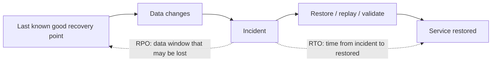
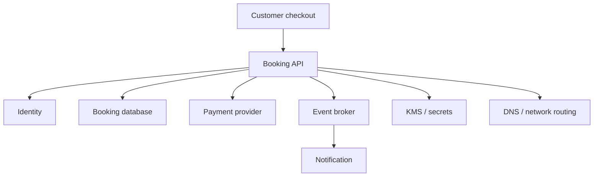
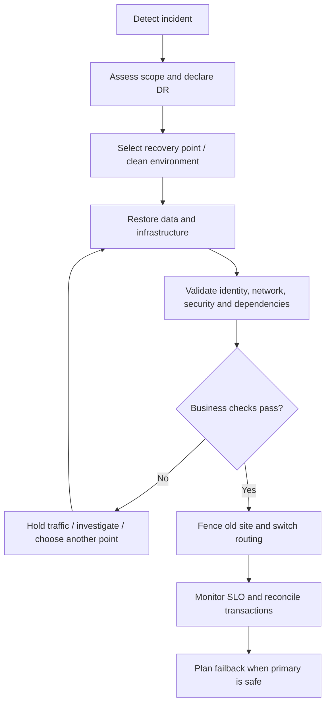

# Distinguishing Backup, High Availability, and Disaster Recovery

## 1. Three Distinct Capabilities in a Service Protection Strategy

A cloud system may run across multiple instances, multiple availability zones, and have a database replica in another region. These components help reduce disruption when failures occur, yet they do not automatically guarantee that data can be recovered after accidental deletion, ransomware encryption, or logical corruption. Conversely, a system with good backups can still remain offline for hours without compute, networking, identity, and procedures to rebuild the application.

Three capabilities must be distinguished:

- **Backup:** creating and retaining a copy of data or system state at a point in time so it can be restored when source data is lost, corrupted, or unintentionally altered.
- **High Availability (HA):** designing a system to continue delivering service with minimal disruption when an anticipated component or failure domain fails.
- **Disaster Recovery (DR):** the capability to restore workloads and data after a severe incident that destroys or renders the primary environment unusable, such as a region outage, widespread misconfiguration, data destruction, or a security incident.

These three mechanisms complement one another. HA prevents or shortens downtime; backups provide recovery points; DR combines data, infrastructure, access permissions, procedures, and people to return the service to an operational state in another failure domain or after the primary environment is repaired.

In the **CLOUD_ARCHITECTURE** module, the **Disaster Recovery** chapter situates these three capabilities within the design of reliability, security, scalability, cost, and operations. The goal is to select solutions based on business consequences, not merely the number of copies or availability zones.

After this lesson, learners will be able to distinguish the goals and limits of backup, HA, and DR; identify failure domains and business impact; interpret RPO/RTO; choose backup, replication, standby, and failover models; protect backups from accidental deletion/ransomware; build DR runbooks for applications, databases, networking, and identity; and validate restore/failover through drills.

## 2. Which Questions Do Backup, HA, and DR Answer?

| Capability | Core Question | Example |
| --- | --- | --- |
| Backup | Can we return to the data state prior to an incident? | Restore the database to before an accidental delete |
| HA | When a component or zone fails, does the service stay up? | Load balancer routes requests to instances in surviving AZs |
| DR | When the primary environment is unusable, how do we get the service running again in a recovery site? | Activate the workload in the DR region and shift traffic |

### 2.1. An Example Showing the Three Capabilities Do Not Replace One Another

Suppose a booking system has a primary database and a synchronous read replica across two AZs:

- When an application VM crashes, autoscaling launches a new instance; this is HA at the compute tier.
- When the primary database fails, the replica is promoted; this is HA/failover at the data tier if the procedure meets targets.
- When an operator accidentally runs a command deleting all bookings, replication may copy the deletion to the replica. Only a backup or point-in-time recovery can retrieve data prior to that moment.
- When an entire region suffers an outage, you need a DR site/region, backups or replicas outside the failure domain, rebuildable infrastructure, and traffic-cutover procedures.

A replica is not always an independent backup. Replicas usually replicate both valid changes and destructive operations. HA does not fully protect against logical corruption; backups alone do not guarantee the application recovers within the required timeframe.

## 3. Failure Domains and Incident Types to Protect Against

Good design starts with the question: what can fail at the same time?

| Failure Domain | Scenario | Commonly Related Capabilities |
| --- | --- | --- |
| Process/container | Crash, memory leak, runtime failure | Restart, health checks, HA |
| Host/node | VM or physical machine lost | Replicas, scheduler, HA |
| Rack/power/network segment | Power or switch outage | Multi-fault-domain placement |
| Availability zone | Zone failure or connectivity loss | Multi-AZ HA, cross-zone backup/replica |
| Region | Region or control plane outage | Multi-region DR, out-of-region backups |
| Data/logical | Accidental deletion, schema bug, corruption | Backup, PITR, validation |
| Security | Ransomware, credential compromise | Immutable/offline backups, clean-room recovery |
| Human/process | Misconfiguration, accidental resource deletion | Versioning, approvals, auditing |
| Provider/service | Managed dependency stops working | Alternative paths, exports/backups |
| Organization | Authorized personnel unavailable or missing procedures | Runbooks, break-glass, training |

A strategy that protects only against host failures while ignoring credential compromise or region loss has major gaps. Conversely, not every workload needs multi-region active-active; protection levels must match business impact.

### 3.1. Component Failure vs. Disaster

**Component failure** typically has a localized scope and can be handled automatically by a scheduler, load balancer, or database failover.

**Disaster** is an event that destroys or renders untrusted a large portion of the environment: region outage, widespread destructive change, ransomware, cascading data corruption, or loss of administrative control.

The boundary is not always fixed. A minor incident can escalate into a disaster if automation repeats errors, backups sharing administrative privileges are deleted, or nobody is available to execute recovery.

## 4. RPO and RTO: Two Quantifiable Targets

### 4.1. Recovery Point Objective (RPO)

**RPO** is the maximum acceptable data loss upon recovery, typically expressed as a time interval of data.

For example, an RPO of 15 minutes means that in the defined recovery scenario, the organization accepts potentially losing up to roughly 15 minutes of the latest data. This does not automatically mean backups run strictly every 15 minutes; you must evaluate replication lag, log shipping, transaction commits, and usable recovery points.

RPO should be defined by data type and business function. Confirmed bookings, audit logs, caches, and analytics may have different requirements.

### 4.2. Recovery Time Objective (RTO)

**RTO** is the target time to restore a service after an incident, according to the defined measurement method and scope.

For example, a 2-hour RTO requires clarifying when the clock starts and stops:
- From when the incident began or when it was detected?
- Until infrastructure boots or until critical user journeys work?
- Does it include validating data, restoring access, and shifting traffic?
- Does it require full capacity or allow degraded mode?

Compute boot RTO is not whole-system RTO. End-to-end recovery encompasses detection, decision-making, infrastructure provisioning, data restoration, validation, dependency wiring, and traffic restoration.

### 4.3. RPO and RTO on a Timeline



RPO measures the span of data that may be lost; RTO measures the recovery outage duration. The two targets are independent: RPO can be low while RTO is long if restoring many terabytes; RTO can be short while RPO is large if the DR site runs from an asynchronous copy with lag.

### 4.4. Related Metrics

- **Recovery time actual:** the actual duration observed in a drill/incident.
- **Recovery point actual:** the latest data point that can be recovered and verified.
- **RLO (Recovery Level Objective):** the required service/capacity level to restore; usage may vary across organizations.
- **WRT (Work Recovery Time):** the time required to reconcile, re-enter, or complete work after technical systems are operational.
- **MTPD/MAO:** the maximum tolerable outage duration the business can endure according to the BIA methodology.

Document internal definitions to avoid comparing metrics measured under different scopes.

## 5. Business Impact Analysis and Workload Tiering

**Business Impact Analysis (BIA)** identifies which services are critical, the impact when disrupted, and when the impact becomes unacceptable.

| Tier | Examples | Illustrative Target RPO | Illustrative Target RTO |
| --- | --- | ---: | ---: |
| Tier 0 – Critical | Identity, ledger, booking commit | Near 0 or very low per guarantee | A few minutes |
| Tier 1 – Important | Core API, customer portal | A few minutes | Under 1 hour |
| Tier 2 – Supporting | Search index, reporting | A few hours | A few hours |
| Tier 3 – Best effort | Batch analytics, historical exports | One day or per batch | One day or more |

These figures are illustrative only, not universal standards. RPO/RTO must be approved by stakeholders based on revenue, safety, compliance, customer expectations, and cost.

### 5.1. Dependency Mapping

A single user journey can depend on multiple systems:



Restoring the Booking API while Identity or KMS is down still does not produce a usable checkout. A DR plan needs a dependency map, owners, endpoints, and recovery procedures for every component.

## 6. Backup Strategy: Backup Types and How to Use Them

### 6.1. Full Backup

Copies all selected data/scope at the time of the backup.

Pros: straightforward restore path and a solid baseline. Cons: time, storage, and transfer costs can grow large as the dataset expands.

### 6.2. Incremental Backup

Stores changes since the previous backup, depending on the implementation either since the last full or last incremental backup.

Pros: reduces the data copied per run. Cons: restoration may require chaining multiple backup sets; losing one link in the chain can cause recovery to fail.

### 6.3. Differential Backup

Stores changes since the most recent full backup.

Pros: restoration typically requires only the latest full and latest differential backup. Cons: differential backups grow progressively until the next full backup.

How incremental/differential works depends on the database, backup product, and semantics; do not assume all snapshots behave like traditional file backups.

### 6.4. Snapshots and Point-in-Time Recovery

- **Snapshot:** a capture of storage/database state at a point in time; consistency depends on how the service creates snapshots and application quiescing.
- **PITR (Point-in-Time Recovery):** restoring to a specific timestamp using a base backup/snapshot combined with transaction logs/WAL/binlog or an equivalent mechanism.
- **Continuous data protection:** captures changes continuously/granularly to provide many recovery points, depending on the product.

Snapshots may be copy-on-write or incremental under the hood; do not infer cost or duration solely from the name "snapshot." Check the service's restore semantics.

### 6.5. Application-Consistent vs. Crash-Consistent

**Crash-consistent** generally corresponds to the state after an abrupt machine halt; filesystem/database recovery may need to run at startup.

**Application-consistent** coordinates with the application/database so related data is flushed/quiesced or checkpointed as required. For multi-volume databases/services, snapshotting individual volumes at different instants does not automatically produce a unified business state.

## 7. Backup Is Not Replication

| Aspect | Backup | Replication |
| --- | --- | --- |
| Primary goal | Restore pre-incident state | Maintain copies for availability/read scaling/DR |
| Destructive changes | Can roll back to before the change | May replicate errors/accidental deletes to the replica |
| RPO | Based on schedule/logs and retention | Based on replication mode/lag |
| RTO | Depends on restore and standing up services | Can be fast when replica is ready |
| Cost | Storage, transfer, restore, and retention | Continuous compute/storage/networking |
| Testing | Restore and validate | Failover/rejoin and consistency checks |

Replication can be part of DR, but it should not be the sole line of defense. A DR region with an online replica still requires independent backups to handle corruption, malicious deletion, or credential compromise.

### 7.1. Risks of Replicas

- Accidental deletions are replicated.
- Ransomware encrypts synchronized files.
- Faulty schema migrations corrupt data in both locations.
- Compromised credentials can access both primary and replica.
- Abnormal lag makes actual RPO worse than committed targets.

Protecting backups requires retention/versioning, immutability or isolation, and delete permissions separated from day-to-day operational privileges.

## 8. Backup Isolation, Immutability, and Ransomware Resilience

A backup is only useful when neither an attacker nor an administrative mistake can delete both the source and the recovery copies at once.

- **Separate account/project:** place backups in a separate account or security boundary.
- **Immutable/WORM retention:** lock objects/backups for the policy duration so they cannot be easily modified or deleted.
- **Object versioning:** preserve prior versions, paired with appropriate lifecycle and protection rules.
- **Offline/air-gapped copy:** restrict administrative/write connectivity during retention.
- **Separate credentials:** dedicated backup/restore accounts with least privilege and MFA.
- **Deletion protection:** multi-party approval or retention locks for destructive operations.
- **Encryption:** encrypt backups and protect keys/recovery roles.
- **Tamper monitoring:** alert whenever retention, backup policies, or vault protections are altered.

Immutability must match the required duration and scope. A versioned bucket where an attacker can still delete versions or alter lifecycle rules is not truly immutable backup. An encrypted backup whose KMS key is lost may be unrecoverable; key recovery is also part of DR.

## 9. Retention, Lifecycle, and Backup Coverage

Retention policies dictate how long backups are kept and which recovery points remain available. You can combine frequent backups for short RPOs, daily/weekly/monthly recovery points for late-detected errors, long-term archives for regulatory requirements, retention locks, and cross-account/cross-region copies.

### 9.1. Retention and Detection Window

If corruption is only discovered after 45 days while backups are kept for just 30 days, every pre-incident recovery point may already be purged. Retention must account for corruption detection and security investigation windows, not just RPO.

### 9.2. Coverage Inventory

| Component | What Needs Protection |
| --- | --- |
| Database | Data, transaction logs, matching schemas/config |
| Object storage | Objects, versions, metadata, access policies |
| File/block volumes | Data and mapping/attachment metadata |
| Secrets/KMS | Key recovery, secret references, and usage permissions |
| Infrastructure as Code | Source, state, and versions |
| Application artifacts | Redeployable images/packages/versions |
| Identity/configuration | Tenants, roles, federation, and break-glass config |
| Queue/event data | Message retention, replay sources, and offsets if needed |
| DNS/network | Zones/records, routes, firewall policies, IP plans |
| Observability | Dashboards/alerts/runbooks needed for recovery |

Not all data should be backed up the same way. Caches can be rebuilt; artifacts can be rebuilt from signed sources; secrets/keys need dedicated backup procedures; event logs can serve as a replay source.

## 10. High Availability: Reducing Downtime When Components Fail

HA uses redundancy and failover to minimize disruption: multiple application instances across nodes/AZs, load balancer health checks, primary/standby or consensus database replicas, replicated caches/message brokers, multi-zone storage/networking, autoscaling, and self-healing.

### 10.1. Active-Active vs. Active-Passive

| Model | Normal Operation | On Failure | Trade-Offs |
| --- | --- | --- | --- |
| Active-active | Multiple domains serve traffic together | Surviving domains absorb load | Requires headroom, routing, and consistency |
| Active-passive | One domain serves, the other waits | Promote/activate standby | Lower cost, carries RTO/failover risk |
| N+1 multi-zone | Zones operate with spare capacity | Remaining zones carry design load | Costs headroom |
| Warm standby | DR environment runs at reduced capacity | Scale up when needed | RTO depends on scale-up |
| Pilot light | Minimal core data/network ready | Provision compute/app | Longer RTO than warm standby |
| Backup and restore | Backups/artifacts primarily | Provision environment and restore | Longer RTO, lower cost |

Active-active does not automatically survive every failure. Identity, DNS, KMS, control plane, or an out-of-region single-writer database can still become shared dependencies.

### 10.2. HA Does Not Replace Backup

HA can replicate bad state. If an operator deletes data by mistake, a multi-AZ database can propagate the deletion. Backups/PITR provide a rollback point; HA keeps the service alive under supported failure modes.

## 11. Disaster Recovery: Recovering an Entire System

DR requires more than a database copy. The plan must specify:

1. DR trigger conditions and who holds authority to declare a disaster.
2. Which failure domain/site is deemed lost or untrusted.
3. How the recovery environment and capacity are prepared.
4. Which backup/replica/recovery point is selected.
5. How DNS, routing, certificates, identity, and secrets are transitioned.
6. How external dependencies are reconnected and verified.
7. Which smoke tests and business validations must pass.
8. When to open traffic, gradually or all at once.
9. How to reconcile data and pending transactions.
10. Failback conditions and how to prevent split-brain when the old site returns.

### 11.1. DR Tiers

| Strategy | Normal State | Relative RTO | Relative Cost |
| --- | --- | --- | --- |
| Backup and restore | Backups available; compute not fully running | Longer | Lower |
| Pilot light | Minimal core data/network ready | Medium to long | Low–medium |
| Warm standby | Small environment running, ready to scale | Medium to short | Medium–high |
| Multi-site active-active | Multiple sites actively receiving traffic | Can be short | High |

This is a relative ordering, not a universal time guarantee. Actual RTO depends on dataset size, automation, quotas, testing, DNS TTLs, capacity, consistency, and business validation.

## 12. Choosing a DR Model by RPO/RTO

### 12.1. Backup and Restore

Suitable when the business can tolerate longer recovery times and continuous standby costs are unjustified.

Requires backups outside the primary failure domain, IaC/artifacts to build the environment, tested restore procedures, quotas/capacity and networking plans in the recovery region, and runbooks for secrets/KMS/identity/DNS.

Risk: discovering only during a disaster that backups are corrupted, keys are inaccessible, images are missing, or the DR region lacks quota.

### 12.2. Pilot Light

Keeps foundational pieces running such as database replicas, storage, networking, or identity integration; compute/application tiers scale up when needed.

Suitable when reducing cost compared to warm standby while shortening rebuild time. Verify that core services stay updated and the scale-up path does not depend entirely on the failing control plane.

### 12.3. Warm Standby

A smaller version of the workload runs in the DR region/site with data continuously replicated or restored. When needed, scale up capacity and shift traffic.

Verify version/config parity, maintain capacity for health checks and replication, account for scale-up/quotas, drill failover/failback, and ensure security policies do not drift.

### 12.4. Multi-Site Active-Active

Multiple sites process traffic simultaneously. Can reduce RTO, yet requires spare capacity when a site is lost, a data consistency/conflict model, global routing/health policies, identity/KMS/DNS/control plane resilience, and cross-site reconciliation.

Active-active is typically the most expensive and complex option. Use it only when business objectives justify the cost and the organization can operate it.

## 13. Database Recovery and Data Consistency

### 13.1. Database Restore Procedure

1. Select a backup/recovery point matching the incident timeline.
2. Provision the target instance/database in an isolated environment.
3. Restore the base backup/snapshot.
4. Apply transaction logs up to the chosen recovery point.
5. Run integrity checks, schema validations, and application checks.
6. Configure users/roles/parameters/extensions.
7. Verify foreign references and sequence/identity counters.
8. Cut the application over to the recovered database per the cutover plan.

Never overwrite a running production database before understanding the incident scope. For corruption/ransomware, recover into a clean environment first to avoid reinfection.

### 13.2. Replication Lag and RPO

If replication is asynchronous, the DR copy may lag behind primary. Monitor replication lag by time and log position, last replicated commit, log retention, network/apply throughput, and behavior when the primary dies before sending the final logs.

Actual RPO must be verified from recoverable transaction positions, not merely from a "replication connected" metric.

### 13.3. Cross-Service Consistency

A single booking may write to a database, emit an event, call a payment provider, and send a notification. Restoring each database to an arbitrary timestamp does not automatically restore cross-system transactions to a consistent business state.

You need event IDs/idempotency keys, outbox/inbox or durable event logs, reconciliation workflows, business invariants, compensating actions, provider reconciliation, and rules for handling requests that were in-flight at the time of the disaster.

## 14. Recovering Applications, Networking, Identity, and Secrets

The recovery environment must have all components required to operate safely.

### 14.1. Application and Infrastructure

- Tested IaC sources and versions.
- Container images/packages and dependency artifacts accessible in the DR region.
- Configuration, feature flags, and schema versions.
- DNS records, routing, firewalls/security groups, and load balancers.
- Certificates, WAF, rate limits, and ingress/egress policies.
- Autoscaling limits, instance quotas, and subnet/IP capacity.

### 14.2. Identity and Secrets

- Protected and drilled break-glass accounts.
- Workload identity/federation working in the DR region.
- KMS keys and permissions for decryption/restoration.
- Secrets recovered through a secure secret manager.
- MFA, least privilege, and auditing maintained in emergency mode.

If KMS or identity exists only in the lost region, encrypted backups may be unusable. DR plans must test key access and restore permissions.

### 14.3. DNS and Traffic Cutover

DNS failover must account for TTLs, resolver caches, connection reuse, certificates, and health policies. Never treat a DNS change as proof that the old site has stopped writing. Datastore fencing/ownership and split-brain prevention must be in place before enabling writes at the new site.

## 15. Security and Clean-Room Recovery

DR often occurs when the old environment may have been compromised or contains corrupted data. Restoring backups into the same compromised identity/network can recreate the problem.

- Build recovery inside a clean account/project/subscription or network boundary.
- Verify the backup point does not already contain malware/corruption prior to restore.
- Rotate credentials, tokens, certificates, and key access if signs of compromise exist.
- Rebuild from signed artifacts and sources with verified provenance.
- Preserve audit logs and chain of custody for investigation if needed.
- Scan data/files before reintroducing them to production.
- Separate backup deletion, restore, and production administration permissions.
- Open only minimal network paths during recovery.

Do not assume the latest backup is the safest point. You may need to select a recovery point prior to indicators of compromise and then reconcile subsequent data.

## 16. DR Runbook and Action Sequence



| Phase | Activities | Completion Evidence |
| --- | --- | --- |
| Detect | Alerting, determine blast radius and incident commander | Incident record |
| Decide | Declare DR, choose strategy/recovery point | Approval/decision log |
| Prepare | Open clean environment, quotas, identity, and keys | Access/security checks |
| Recover | Restore data, deploy apps, config/networking | Restore logs/checksums |
| Validate | Smoke tests, business invariants, SLOs | Test report |
| Cutover | Fence source, switch DNS/routing/traffic | Routing/ownership evidence |
| Stabilize | Monitor, reconcile, notify stakeholders | SLO/queue/transaction report |
| Failback | Reverse sync, test, controlled cutback | Failback checklist |

Each step needs an accountable owner, execution permissions, dependencies, timeouts, and stop conditions. A runbook must not depend on a single individual knowing a password or secret procedure.

## 17. Backup/DR Automation and Infrastructure as Code

Automation reduces time and manual mistakes, yet can also amplify errors at scale. Version-control and govern backup policies/vaults, IaC/network/security policies, identity roles, database restore parameters, DNS/cutover, application artifacts, runbooks/scripts, validation tests, and reconciliation.

Do not store all recovery secrets in the same production account or repository that an attacker could access. DR pipelines require least privilege, approvals for destructive operations, and auditing.

## 18. Backup Verification: You Must Prove Restore Works

Verification levels:

- **Backup job success:** the job finishes and creates a recovery point.
- **Integrity verification:** verify checksums/catalog/metadata per product capabilities.
- **Restore test:** restore into a separate environment and verify data opens.
- **Application validation:** the application reads/writes and core business flows work.
- **Recovery exercise:** drill the entire process, timings, and access permissions.
- **Periodic restore at scale:** measure restore duration on production-sized datasets.

| Test | Objective |
| --- | --- |
| Small database restore | Verify procedures and credentials |
| PITR before a change | Prove logs and recovery points work |
| Object/version restore | Verify metadata, permissions, and encryption |
| Tenant restore in a pool | Confirm no damage to other tenants' data |
| Cross-region restore | Verify transfer, keys, and quotas |
| Rebuild from IaC | Prove infrastructure sources are complete |
| Clean-room recovery | Verify isolation and credential rotation |
| Full application recovery | Verify end-to-end user journeys |
| Failback rehearsal | Verify returning without split-brain |

Backup job success does not prove restore success. Only after validating data and applications post-restore does the organization hold real evidence of recoverability.

## 19. Observability and DR Readiness Evidence

| Group | Metrics |
| --- | --- |
| Backup | Last successful recovery point, job failures, coverage, age |
| Retention | Expiration, immutability locks, vault policy drift |
| Replication | Lag, last commit position, link health |
| Restore | Restore duration, validation failures, throughput |
| DR environment | Version/config drift, quotas, capacity, health |
| Identity/KMS | Break-glass availability, key access, decrypt tests |
| Network | DNS, routes, firewalls, certificates, connectivity |
| Business | User journey success, pending transactions, reconciliation backlog |
| Objectives | Actual RPO/RTO vs. targets |
| Cost | Backup storage, cross-region copy, warm standby, and test costs |

Useful alerts: critical backup exceeds policy age; coverage missing new databases/objects/schemas; immutable retention modified; restore test failed or exceeded RTO; replication lag exceeded RPO; DR environment drift; KMS key/permission failed decryption; insufficient DR quotas/capacity; outdated runbook or owner.

## 20. Cost and Strategy Selection

Backup, HA, and DR have distinct cost profiles:

- Backup: storage, requests, retention, copy/egress, restore compute, and testing.
- HA: spare compute, replicas, load balancing, cross-AZ traffic, and headroom.
- DR: second environment, replication, standby capacity, DNS/network/identity, automation, drills, and operations.

| Strategy | Ongoing Cost | Incident-Time Cost |
| --- | --- | --- |
| Backup/restore | Low–medium | Restore compute, transfer, and downtime |
| Pilot light | Medium | Scale-up and catch-up |
| Warm standby | Medium–high | Scale-up/cutover |
| Active-active | High | Coordination/failover and reconciliation |
| Immutable backup copy | Storage/management premium | Investigation, clean restore, and validation |

A risk evaluation model:

```text
Expected annual loss ≈ probability of scenario × business impact

Total protection cost =
    backup + HA + DR + testing + operations

Choose a strategy that brings residual risk
within the business-approved tolerance.
```

Do not use a single subjective probability to create false precision. Use multiple scenarios, sensitivity analysis, and stakeholder approval. The lowest upfront cost is not always the lowest total cost: outages can cause lost revenue, SLA credits, support load, and reputational damage.

## 21. Practice Scenario: Booking Platform

**Context:** A booking platform serves customers across regions. The transactional database runs multi-AZ; daily backups and transaction logs are kept for PITR; a second region holds an asynchronous replica. Object storage holds property photos and documents; an event broker emits booking/payment events.

### 21.1. Protection Classification

| Component | HA | Backup | DR |
| --- | --- | --- | --- |
| Booking database | Multi-AZ failover | Snapshot + logs/PITR | Replica/restore in DR region |
| Object media | Storage durability/versioning | Versioned/offsite copy | Access from recovery region |
| Application | Multi-instance/autoscale | Artifact/IaC/config versions | Deploy into DR region |
| Identity/secrets | Redundant service/path | Key/secret recovery procedure | Break-glass + KMS access |
| Event broker | Multi-node/replicated | Retention/replay/export if needed | Recreate/restore consumer state |
| DNS/network | Redundant endpoints | IaC/zone config backup | Cutover routes and certificates |

### 21.2. Illustrative RPO/RTO

- Booking/ledger: RPO 5 minutes, RTO 30 minutes.
- Search index: rebuildable, RPO 1 hour, RTO 4 hours.
- Media objects: RPO per confirmed durability/version/copy policy; RTO 2 hours.
- Analytics: RPO 24 hours, RTO 1 day.

These are hypothetical targets for the exercise; service capabilities, replication lag, backup schedules, and restore throughput must be verified.

### 21.3. Region Loss Scenario

1. Incident commander verifies the primary region cannot serve and declares DR.
2. Determine replication position and select a recovery point meeting RPO.
3. Fence writes at the old site or verify writing is no longer possible.
4. Verify the DR region has KMS/identity permissions, networking, quotas, and artifacts.
5. Promote the replica or restore the database according to strategy.
6. Deploy the application and configure new endpoints.
7. Run smoke tests for booking, payment status, read/write, and authorization.
8. Shift traffic gradually via DNS/global routing.
9. Reconcile pending transactions and event backlog.
10. Monitor SLOs, notify customers, and plan failback.

### 21.4. Failure Modes to Test

- The latest backup contains an accidental delete; PITR must select a point before the operation.
- DR replica lags by 8 minutes while the RPO target is 5 minutes; alerts and business decisions must be clear.
- Primary-region KMS is lost; key recovery must work.
- DNS cutover completes yet clients retain old connections; fencing must prevent dual-writes.
- Payment provider processed a request but the response was lost; reconciliation must not create duplicate charges.
- Object version restored with incorrect permissions/metadata; application validation must catch it.

## 22. Sample ADR: Independent Backups and Warm Standby

```text
ADR-112: Combining immutable backups with warm standby for the booking platform

Context:
- Booking/payment state requires low RPO/RTO.
- Multi-AZ protects against certain component/zone failures.
- Region-wide outages and logical corruption remain risks.
- Asynchronous replicas can propagate destructive operations.

Options:
A. Multi-AZ HA only.
B. Daily backups, full rebuild during a disaster.
C. Multi-AZ HA + immutable/offsite backups + warm standby/replica in another region.

Decision:
- Select C for critical workloads.
- Store backups/recovery logs in a separate security boundary.
- Warm standby maintains data replication and an application baseline.
- Region cutover includes fencing, validation, and reconciliation.
- Search/analytics can rebuild under a lower RTO tier.

Trade-offs:
- Higher costs for replicas, backup copies, standby, networking, and testing.
- Must operate key recovery, replication lag monitoring, clean-room restore, and failback.
- Do not treat replicas as independent backups.

Verification:
- PITR restore to prior to logical corruption.
- Immutable copies cannot be deleted by production admin roles.
- Region loss game day meets approved RPO/RTO.
- KMS/identity/networking function in DR.
- Payment/booking reconciliation creates no duplicates.

Review Triggers:
- Changes to BIA/RPO/RTO or contracts.
- Replication lag/restore times fail targets.
- Changes to threat model or data residency.
- Standby costs exceed risk tolerance.
```

## 23. Common Design Mistakes

1. **Treating a replica as a backup:** accidental deletions or corruption get replicated.
2. **Treating multi-AZ as DR:** fails to fully protect against region loss or credential compromise.
3. **Having backups without restore tests:** unknown whether data/keys/catalogs are usable.
4. **Keeping backups under the same account/admin privileges:** attackers delete both sources and backups.
5. **Not backing up KMS/identity recovery paths:** data exists yet cannot be decrypted or accessed.
6. **Setting RPO from backup schedules without measuring lag:** actual recovery points may be older.
7. **Calculating RTO from server boot time alone:** omits restore, validation, DNS, security, and business checks.
8. **Restoring only the database:** applications, objects, events, secrets, and networking remain unready.
9. **Ignoring the logical corruption detection window:** retention expires before corruption is noticed.
10. **Failing over without fencing the old primary:** risk of split-brain/dual-writes.
11. **Choosing the latest backup in a ransomware incident:** may restore an already-compromised copy.
12. **Not drilling break-glass access:** nobody can access the environment during a disaster.
13. **Ignoring provider quotas/capacity in the DR region:** unable to provision enough compute.
14. **Not checking external dependencies:** payments, identity, or email still point to the old site configuration.
15. **Lacking reconciliation:** pending payments/bookings/events are left behind.
16. **Not designing failback:** returning to the old site risks losing new data or creating divergence.

## 24. Pre-Production Checklist

- [ ] BIA identifies workloads, business impact, and priority order.
- [ ] Failure scenarios cover components, AZs, regions, logical corruption, and security incidents.
- [ ] RPO/RTO are approved with defined measurement methods.
- [ ] Design clearly distinguishes backup, HA, replication, and DR.
- [ ] Backup coverage includes databases, objects, config, identity/keys, and required artifacts.
- [ ] PITR/log retention matches RPO and the detection window.
- [ ] Backups reside outside the relevant failure/security domains.
- [ ] Immutability, deletion protection, and separate credentials are verified.
- [ ] Encryption keys and decrypt/restore permissions have recovery procedures.
- [ ] Retention/lifecycle aligns with compliance, contracts, and corruption detection windows.
- [ ] HA capacity, quorum, and failover behavior are tested.
- [ ] DR strategy includes environment, quotas, networking, DNS, identity, and dependency mapping.
- [ ] Runbooks include triggers, owners, approvals, actions, and stop conditions.
- [ ] Restore tests measure data integrity and business validation.
- [ ] Region failover includes fencing, traffic cutover, and reconciliation.
- [ ] Failback has a plan, data sync, and safety conditions.
- [ ] Metrics track backup age, replication lag, restore time, and actual RPO/RTO.
- [ ] Clean-room recovery exercise and break-glass verification completed.
- [ ] Costs for backups, HA, standby, transfers, and testing are budgeted.
- [ ] Drill schedule, evidence, owners, and remediation tracking are in place.

---

**Takeaway:** Backup provides a rollback point, HA keeps services running through anticipated failure modes, and DR restores entire workloads after incidents exceeding HA's scope. A reliable strategy combines all three based on business impact, RPO/RTO, and failure domains; most importantly, regularly prove that data, access, and user journeys can be recovered within committed targets.
