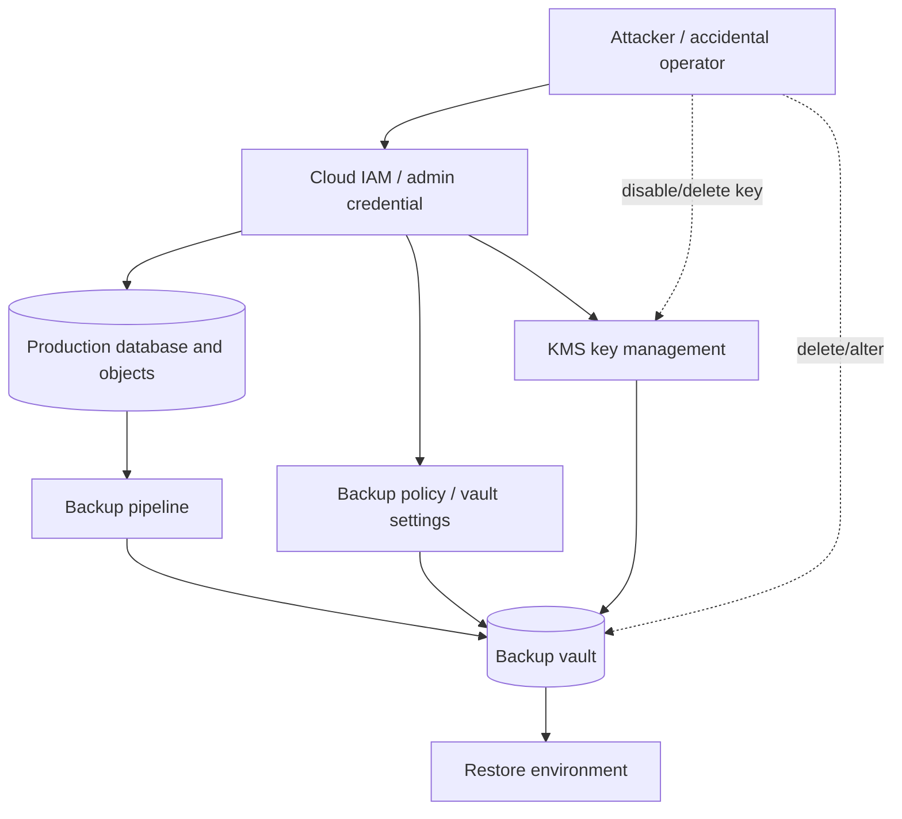
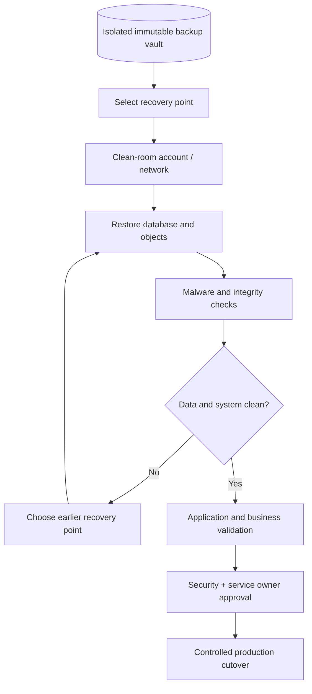
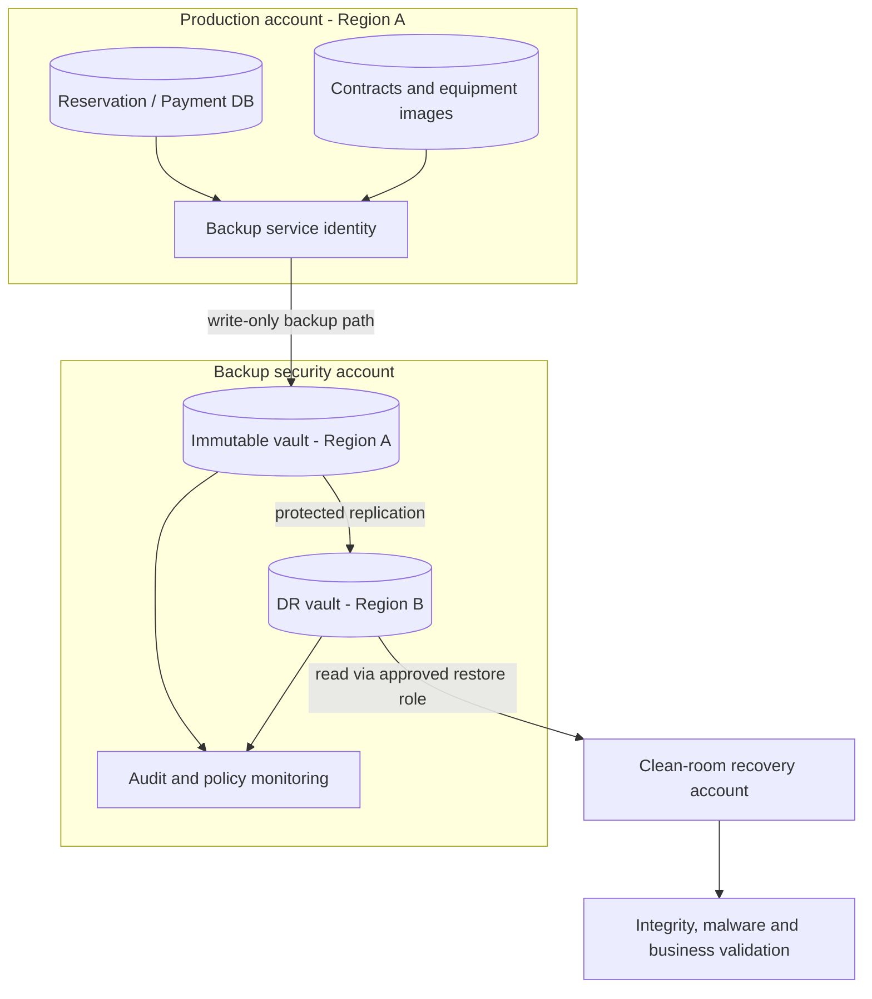

# Protecting Backups Against Accidental Deletion and Malware

A backup only has value when the organization can still access, decrypt, and restore data at the moment it is needed. A system with many snapshots can still lose all recoverability if a production administrative account is compromised and the attacker deletes the snapshots, backup vault, encryption keys, or retention settings. Ransomware can also encrypt source data and subsequently corrupt synchronized copies.

**Protecting backups against accidental deletion and malware** requires multi-layered design: separating failure domains and administrative privileges, maintaining immutable or tamper-resistant copies, restricting deletion permissions, protecting encryption keys, detecting anomalous activity, and rehearsing recovery in a clean environment. The goal is not simply keeping a backup file around, but being able to reliably restore data and return the service to operation.

In the **CLOUD_ARCHITECTURE** module, this topic connects storage architecture with IAM, networking, encryption, monitoring, operational procedures, and disaster recovery. The lesson uses an equipment-rental platform example, including reservations, a payment ledger, contract files, and equipment photos. The retention periods, copy counts, and recovery times in the examples are hypothetical; adjust them based on data classification, RPO/RTO, regulations, and the capabilities of the chosen cloud services.

## 1. Backups Must Defend Against Both Data Failures and Admin Failures

Backups are commonly generated automatically from databases, volumes, or object storage and stored in a bucket/vault. If the source and backup share the same account, credentials, administrative roles, and policies, a production incident can propagate to the backup copies too.

| Incident | What Happens? | Why Ordinary Backups May Fall Short? |
| --- | --- | --- |
| Accidental database/table deletion | Operator runs the wrong command or script | The latest snapshot may be deleted alongside the resource or lack the needed recovery point |
| Accidental backup deletion | Operator mistakenly cleans up a vault/object/version | Production accounts may simultaneously hold permission to delete copies |
| Ransomware encrypts files | Mounted or synced files get encrypted | Change synchronization may copy encrypted files into the backup |
| Cloud admin compromise | Attacker uses control-plane rights to delete snapshots, disable versioning, or alter retention | Backups in the same security boundary can be destroyed |
| Encryption key compromise/loss | Attacker deletes/disables keys or misuses them | Backups physically survive yet cannot be decrypted |
| Silent data corruption | Application bug writes bad data or logically deletes at scale | Replicas and recent backups may hold bad data if retention is too short |
| Backup pipeline compromise | Attacker modifies job, destination, or schedule | Jobs still report success while data is no longer safe |
| Region outage | Region holding both source and vault becomes unavailable | Copies in a different bucket within the same region do not satisfy DR |
| Credential misuse | Script or staff deletes data unintentionally | No approvals, auditing, or undo recovery mechanism |

The threat model must cover both the **data plane** (data, objects, volumes, databases) and the **control plane** (IAM, backup policies, KMS, vaults, retention, replication settings). Protecting only at the file-storage layer misses attack paths capable of altering storage policies.

## 2. Distinguishing Backups, Replicas, Snapshots, and Archives

| Mechanism | Objective | Risk If Used Instead of Backup |
| --- | --- | --- |
| Replica | Improve availability, cut downtime, scale reads | Accidental deletes or ransomware can be replicated |
| Snapshot | Capture volume/database state at a point in time | May share the same account/region/key; application consistency must be verified |
| Backup | Restore data to a saved point | Requires protecting delete rights, retention, keys, and testing restores |
| Archive | Long-term retention, audit, or compliance | Retrieval can be slow and costly; not optimized for fast failover |
| Versioning | Retain multiple object versions | Delete markers, lifecycle rules, or version-delete rights can still lose old copies |
| Immutable backup | Prevent edits/deletes during protection window | Cannot fix bad data captured prior to backup or lost keys |

Replicas protect against certain infrastructure failures; backups also protect against certain logic and operational errors. Archives serve long-term retention; snapshots are a way to create a saved point, yet do not automatically guarantee independence or restorability.

## 3. Building a Threat Model for Backups

Before selecting services, identify:

1. **Assets to protect:** databases, objects, volumes, file shares, config, schemas, secrets, encryption keys, and metadata.
2. **Threat actors:** human mistakes, privileged insiders, leaked credentials, ransomware, supply-chain compromise, or compromised admin accounts.
3. **Attack paths:** console/API, CLI, service principals, automation runners, CI/CD, KMS, backup agents, and replication configs.
4. **Impacts:** data loss, loss of decryption ability, persistent corrupted data, PII leaks, missed RPO/RTO, or inability to prove audit compliance.
5. **Failure boundaries:** are accounts/projects/subscriptions, regions, networks, identity providers, and admin keys shared?
6. **Recoverability:** can you restore into an isolated environment, scan for malware and verify data before reconnecting production?

The diagram emphasizes that backups have many dependencies. Separating a vault while leaving the same admin credentials may not create genuine isolation.

## 4. The 3-2-1-1-0 Principle

A popular mnemonic for designing backup resilience:

- **3 copies:** have at least three copies of data including primary data according to policy counting rules.
- **2 media/types:** use at least two different storage media or storage failure boundaries.
- **1 offsite:** keep at least one copy in a different location or failure domain.
- **1 offline or immutable:** keep one copy that cannot be arbitrarily modified/deleted during the protection period.
- **0 errors:** verify backups and restores so no undetected errors remain in the defined workflow.

This is a heuristic, not an absolute security guarantee or automatic legal standard. How copies, media, and offsite are counted must be explicitly defined by the organization. Three objects in the same bucket/account/region are not necessarily three independent copies.

| Copy | Location/Characteristics | Purpose |
| --- | --- | --- |
| Primary | Production database in Region A | Serve transactions |
| Near backup | Backup vault in another account in Region A | Recover database logic/operational mistakes |
| DR backup | Vault in Region B with replication policy | Recover when Region A is lost |
| Immutable copy | Object/vault locked per retention policy | Prevent deletion/tampering during protection window |
| Restore test copy | Isolated environment created from recovery point | Verify usability and cleanliness |

Five separate physical copies are not strictly required. A single backup can be both cross-region and immutable if the design truly satisfies both; what must be verified are independent failure modes.

## 5. Immutable Backups and WORM

An **immutable backup** is a copy protected against modification or deletion for a period via storage/vault mechanisms. WORM (Write Once, Read Many) describes writing once and reading many times without permitting edits/deletes during the applied lock duration.

Mechanisms may include object lock/retention modes, vault locks, governance/compliance retention, legal holds, or immutable/offline media. Names and semantics vary across providers. Verify who can alter retention, whether admin overrides exist, which versions policies apply to, and behavior when objects are replicated.

### Governance Lock vs. Compliance Lock

Some services offer a mode allowing designated administrators to bypass retention, or a stricter mode disallowing shortening locked retention periods. Exact semantics depend on the provider and configuration.

- Governance-style locks suit situations requiring controlled operational override procedures.
- Compliance-style locks suit strict immutability requirements, though misconfiguring retention can cause prolonged costs and storage obligations.

Do not pick a mode based solely on its name. Read service documentation, verify region/feature availability and override rights, and test in a separate account.

### Retention and Deletion

Retention must be long enough to cover corruption detection, investigation, and recovery. Yet retaining data longer than necessary can raise costs and conflict with personal data deletion requests.

Policies should define durations per classification/use case, full/incremental/PITR schedules, immutable locks, legal holds, lifecycle transitions, expiration/deletion conditions, and who approves retention changes.

Retention is not "longer is always better." Balance recoverability, retention obligations, privacy, cost, and data minimization.

## 6. Separating Backups from Production via Independent Accounts and Privileges

A vital control is **separation of duties**. People authorized to manage production databases do not by default hold permission to delete backups or alter vault retention.

| Principal/Role | Production | Backup Account/Vault | KMS |
| --- | --- | --- | --- |
| Application runtime | Scoped DML only | No access | Use keys per runtime policy only |
| Database operator | Manage database per runbook | Request restores; cannot delete immutable copies | Do not administer backup keys |
| Backup service identity | Read source/take snapshots per policy | Write recovery points; cannot alter retention | Encrypt with minimal permissions |
| Backup security admin | No need to edit production data | Manage vault/policies under audit | Manage policies with dual control |
| Restore operator | No backup delete permissions | Read recovery points; restore to isolated environment | Decrypt upon approval |
| Break-glass admin | Time-bound emergency permissions | Does not bypass locks by default | Controlled and audited workflow |

### Cross-Account/Cross-Project Backups

Placing copies in a separate account/project reduces the risk of a single production credential deleting everything. Ensure:

- Backup identity can write only to designated destinations.
- Production principals lack permissions to delete, change retention, or disable versioning in the vault.
- Backup account does not blindly trust all production principals.
- Trust policies restrict source account, role, resource, and conditions.
- Policy changes require independent approval and auditing.
- Restore operators can read without destructive privileges.

Cross-account does not automatically establish isolation if a shared global administrator or credential can administer both accounts. Assess the blast radius of root/organization-level roles.

### Dual Control

High-risk actions such as shortening retention, deleting a vault, disabling immutable policies, or deleting keys can require two separate individuals/approvals. An audited emergency path is needed so real recoveries are not blocked.

## 7. Least Privilege and Protecting the Delete Path

Backup write permissions and backup delete permissions must be separated. Pipelines usually only need to create recovery points or write objects; they do not need permission to delete all versions or edit retention policies.

- Use dedicated roles/service identities for backup jobs.
- Never use personal admin keys in cron/CI.
- Scope resource ARNs/paths, actions, and accounts.
- Deny disabling versioning, locks, logging, and backup policies for ordinary principals.
- Require MFA/approvals for destructive actions.
- Separate permissions to create restore jobs from deleting sources.
- Review access periodically; revoke old credentials.
- Audit all policy changes and delete operations.

Delete protection can combine denying deletes while objects are under retention locks, MFA/approvals, resource deletion protection, policies blocking bulk deletes, soft delete/recovery windows, and alerts when retention/versioning changes.

These measures have specific limits. Resource deletion protection may only protect deleting the resource itself rather than objects inside it; soft delete has a time window and principal overrides; versioning does not protect if every version is deleted.

## 8. Versioning, Soft Delete, and Lifecycle

### Versioning

Versioning keeps multiple object versions when objects are overwritten. If ransomware encrypts a file and uploads a new copy, old versions may remain. However:

- Delete markers can hide the object from default listings.
- Lifecycle rules can purge old versions.
- Attackers with permission to delete all versions can still destroy data.
- Storage costs grow with version count.
- Recovery must pick and verify the right version.

### Soft Delete

Soft delete delays permanent deletion for a recovery window. It helps against accidental deletion yet is insufficient if an attacker can disable it or wait out the window. Combine with immutable retention and independent privileges.

### Lifecycle

Lifecycle rules automatically transition data to cheaper tiers or delete on expiration. Lifecycle configuration is a sensitive control-plane asset: a misconfigured rule can purge recovery points. Version-control policies, test on isolated prefixes/tags, review changes, and monitor expired object counts.

Never share the same prefix/tag between critical backups and temporary data if lifecycle rules do not clearly distinguish them.

## 9. Protecting Encryption Keys and Decryption Capability

Encrypted backups are essential, yet decryption capability must survive if the production account or region fails.

- Are keys provider-managed or customer-managed?
- Which account/region hosts the keys?
- Does the backup vault depend on keys in the same failure domain?
- Who can disable, schedule deletion, or modify key policies?
- Does key rotation preserve the ability to decrypt old backups?
- Can key access be restored when identity/control plane fails?

Old backups may remain encrypted under old keys. Deleting keys after rotation can render backups undecryptable for years. Before retiring a key, verify no retained recovery point still depends on it or re-encrypt via a tested procedure.

### Key Recovery

1. Inventory keys and dependent recovery points.
2. Separate key admins from production workload admins.
3. Protect policies, rotation, and deletion windows.
4. Test decryption in the recovery account/region.
5. Document break-glass and approval procedures.
6. Rehearse restores using real keys.

Never store plaintext keys inside backups, source control, or runbooks. Escrowing/backing up key material must follow security standards and provider policies.

## 10. Ransomware and Backup Poisoning

Ransomware does not merely encrypt production files. Attackers may attempt to delete backups, break backup jobs, corrupt catalogs/metadata, or linger in the system long enough for clean recovery points to expire.

**Backup poisoning** occurs when recovery points are captured from already corrupted, encrypted, or maliciously altered data. A successful backup job proves the copy finished, not that its contents are clean or accurate.

Layers of defense:

- Immutable retention so attackers cannot easily delete recovery points.
- Isolated accounts/networks so production credentials lack arbitrary access.
- Detection for mass encryption, file extension/entropy shifts, and deletion spikes.
- Malware scanning and content validation upon restore.
- Retaining enough generations to outlast compromise dwell time.
- Auditing/alerting when backup policies, lifecycles, KMS, or logging change.
- Clean-room recovery to rebuild from verified copies.
- Incident response coordinating security, infrastructure, application, and business owners.

### Do Not Automatically Restore the Latest Copy

The newest backup may already contain encrypted or maliciously altered data. When ransomware is suspected:

1. Isolate affected systems and preserve forensic evidence.
2. Determine the time of compromise and impacted accounts/data scope.
3. Select a recovery point predating the compromise based on evidence.
4. Restore inside an isolated network.
5. Scan for malware and verify integrity/consistency.
6. Rotate credentials/keys/tokens and close the entry vector.
7. Return clean workloads only after security owner approval.

## 11. Clean-Room Recovery

A clean room is an isolated recovery environment built to restore and inspect data/workloads before connecting to production or user networks.

Characteristics:

- Separate account/project or subscription.
- Network segment with default-deny ingress/egress, opening only necessary flows.
- Dedicated identities, fresh credentials, MFA, and restricted permissions.
- Golden images/IaC with verified integrity.
- Read-only backup mounts if supported by the service.
- Malware scanning and endpoint detection.
- Separate logging/auditing preserving evidence.
- No reuse of potentially compromised credentials.

A clean room does not guarantee cleanliness automatically. Golden images, deployment artifacts, schema migrations, package dependencies, IaC, and pipelines also need verification. If attackers tampered with an image or pipeline, restoring data onto the same compromised artifact recreates the incident.

## 12. Selecting Recovery Points and Verifying Integrity

A recovery point must be evaluated by timestamp/job ID, source database/volume/object range, application/schema version, replication/transaction log position, checksum/integrity metadata, backup job status, retention/immutability state, malware scan result, and owner/incident context.

Checksums detect corruption during transfer/storage, yet do not prove business validity or absence of malware. Combine:

- Per-object/block checksums.
- Object/record count manifests.
- Database consistency checks.
- Foreign-key/orphan checks.
- Business reconciliation: payment totals, reservation counts, ledger balances.
- Malware scans and file-type validation.

If the mistake was an accidental delete at 10:05, PITR to 10:04:59 may work. If ransomware was present three days ago and detonated today, last night's backup may already be poisoned. Rely on forensic signals, logs, IOCs, and inspecting multiple generations.

## 13. RPO, RTO, and Retention Against Malware

RPO/RTO must be defined separately per failure scenario:

| Scenario | RPO Considerations | RTO Considerations | Mechanisms |
| --- | --- | --- | --- |
| Accidental record deletion | PITR/log retention | Extraction and reconciliation time | PITR, isolated restore, merge |
| Accidental vault/object deletion | Independent recovery copy | Time to access alternate copy | Cross-account, immutable, versioning |
| Node/AZ loss | Replication/HA lag | Failover duration | Multi-AZ/replicas |
| Region loss | Cross-region replication/backup age | Provision + restore + cutover | DR vault/region |
| Ransomware | Clean pre-compromise recovery point | Forensics + clean restore + validation | Immutable generations, clean room |
| Key disabled/deleted | Recovery key availability | Restoring decryption access | Key separation/recovery procedure |

If the organization typically detects compromises only after several weeks, keeping immutable backups for 7 days is insufficient. Estimate dwell time, investigation duration, legal holds, and required recovery speed. Retain varied daily/weekly/monthly generations across storage tiers to control cost.

## 14. Backup Architecture for an Equipment-Rental Platform

### Reservation Database

- Backups/PITR to recover from faulty operations or corruption.
- Replicas/HA to keep serving when a node/zone fails.
- Immutable copies and a separate account to protect against backup deletion.
- Restore tests verifying reservation invariants and preventing duplicates.

### Payment Ledger

- Retention and auditing per financial/legal obligations.
- Backups with dedicated encryption/key management and narrow access.
- Restores must reconcile transactions, captures, refunds, and idempotency.
- Never replay payment side effects while rebuilding projections.

### Contracts/Documents/Images

- Object versioning and immutable retention where required.
- Malware scanning on upload and on restore.
- Verify actual MIME/file type, checksums, and access policies.
- Separate backup copies from buckets actively written by the application.

### Infrastructure/Configuration

- Store IaC, policies, schemas, deployment manifests, and necessary configuration.
- Protect repositories/artifact signing and CI/CD identities.
- Never back up plaintext secrets carelessly.
- Document dependencies required to spin up a clean room: DNS, networking, KMS, identity, registries, and certificates.

## 15. Object Storage: Versioning, Object Lock, and Replication

| Feature | Value | Questions to Verify |
| --- | --- | --- |
| Versioning | Recover overwritten/logically deleted objects | Who can delete old versions? Does lifecycle purge them? |
| Object lock | Keep versions undeletable during retention | Which mode? Who can alter retention? Are legal holds supported? |
| Cross-account replication | Isolate copies from production permissions | Is destination trust policy overly broad? Do delete markers replicate? |
| Cross-region replication | Protect against region loss | Replication lag, failure behavior, destination encryption key? |
| Lifecycle tiering | Reduce storage cost | Do retrieval delay/cost fit RTO? |
| Access logs/auditing | Investigate access and deletions | Are logs stored independently and tamper-protected? |

Object replication is not automatically an immutable copy. If configured to replicate delete markers or if lifecycle rules purge versions on both sides, mistakes can propagate. Test each operation in a lab account and read the chosen service's semantics.

## 16. Database Backups and Consistency

Database backups must stay consistent with transactions and logs:

- Physical backups may require WAL/redo/archive logs for PITR.
- Logical exports may require snapshot consistency/transaction isolation.
- Volume snapshots may be only crash-consistent without application quiescing.
- Distributed databases need snapshot/backup coordination across shards/replicas.
- Schemas, extensions, roles/permissions, and encryption settings may require separate backup.

Backup completion does not guarantee every transaction was captured. Verify recovery points, database engine/version, log chains, schema dependencies, and recovery procedures.

For multi-component systems, restore order may run: identity/networking/KMS/secrets; database/metadata store and schemas; object/document storage; event offsets/checkpoints and queue config; application services/workers; rebuildable caches/search indexes; dashboards and integrations. Actual order depends on the dependency graph. Never start consumers before databases, schemas, and event checkpoints are ready if they could trigger side effects or misconsume messages.

## 17. The Backup Pipeline Is a Workload Requiring Protection

Backup jobs can be tampered with to skip data, send copies to an attacker-controlled destination, or quietly delete old backups. Govern the pipeline:

- Version-controlled job definitions/IaC.
- Review changes to destinations, schedules, retention, and exclusions.
- Signed and version-pinned build artifacts/images.
- Least-privilege service identities with short-lived credentials.
- Job status sent to independent monitoring.
- Manifests verifying dataset/object coverage.
- Alerts when backup counts/sizes drop anomalously.
- Deny production workloads from editing backup scripts/vault policies.

Exit code 0 does not prove a complete backup. Measure expected source inventory versus backed-up inventory, object/record counts and byte counts, recovery point age, backup duration/errors, replication completion, retention lock state, and restore validation outcomes.

## 18. Monitoring and Alerting on Destructive Behavior

| Signal | Meaning |
| --- | --- |
| Backup deletion or mass delete requests | Operational error or attacker |
| Shortened retention period | Reduced recoverability |
| Object lock/vault lock modified | Weakened immutability protection |
| Versioning/lifecycle/replication disabled | Older copies may no longer be retained |
| KMS key disabled/scheduled for deletion | Risk of losing decryption capability |
| Backup job destination changed | Data exfiltration or backup sabotage |
| Sudden drop in backup size/count | Job skipping data or source encrypted/deleted |
| Role/policy privilege escalation | Attacker may gain destructive rights |
| Anomalous restore requests | Exfiltration or tampering attempt |
| Audit log gaps | Loss of detection and investigation visibility |

Audit logs must reside where permissions and retention are independent. If an attacker can delete logs alongside backups, investigation becomes much harder. Alerts should specify owners, severity, runbooks, and clear escalation paths.

## 19. Restore Drills: Proving Backups Actually Work

Restore drills test the entire recovery path, not just job status:

1. Pick a scenario recovery point and verify retention/keys remain valid.
2. Create a clean-room account/network or isolated environment.
3. Grant minimal read/restore permissions and log audits.
4. Restore databases/objects and apply transaction logs if needed.
5. Verify checksums, schemas, row counts, and file inventories.
6. Run malware scans and verify artifacts/config.
7. Execute business tests: payment reconciliation, reservation invariants, object access.
8. Measure actual duration and recovery point.
9. Rehearse simulated cutover/failback if DR is in scope.
10. Tear down/retain the drill environment per policy and log action items.

| Level | Scope | Evidence |
| --- | --- | --- |
| Backup validation | Check jobs, manifests, checksums, retention | Backup report |
| File/database restore test | Restore a subset or test copy | Restore success and integrity |
| Application recovery test | Run application against restored data | Functional/business tests |
| Clean-room exercise | Stand up isolated env; verify malware and credentials | Security approval |
| Full DR exercise | Shift workload and verify RPO/RTO | Timeline, sign-off record, and gaps |

You do not need a full DR exercise on every backup run. Match cadence to criticality, architectural changes, and compliance obligations; however, smaller tests must run frequently enough to catch silent failures.

## 20. Responding to Suspected Accidental Deletion or Ransomware

### Accidental Deletion

1. Halt or constrain automation still deleting/overwriting data.
2. Record actor, command, scope, timestamp, and audit evidence.
3. Identify the authoritative source and needed recovery point.
4. Restore into an isolated environment.
5. Extract/merge the data to recover; avoid rolling back the entire system if only a subset of records was affected.
6. Reconcile transactions created after the recovery point.
7. Review permissions, scripts, and guardrails to prevent recurrence.

### Ransomware/Compromise

1. Activate incident response and security lead.
2. Isolate affected hosts/accounts/networks; preserve forensic evidence.
3. Block exposed credentials/tokens and check for identity/key compromise.
4. Block attacker access to backup vaults; verify immutable retention holds.
5. Determine dwell time, blast radius, and clean recovery point.
6. Stand up a clean room using verified artifacts/IaC.
7. Restore, scan, and verify data and applications.
8. Rotate secrets/certificates and re-establish trust boundaries.
9. Cut over after approval; monitor for re-entry and consistency.
10. Document root cause, refine policies, and re-drill.

Do not hastily wipe hosts or logs containing forensic evidence needed for investigation. Isolation, evidence preservation, and notification decisions must follow the organization's incident response plan.

## 21. Dependencies and Governance in Recovery

| Dependency | Risk | Mitigation |
| --- | --- | --- |
| Identity provider | Cannot sign in to recovery account | Controlled emergency access, MFA, and runbook |
| KMS | Cannot decrypt backups | Independent key recovery and policies |
| Network/DNS | Clean room cannot reach needed dependencies | Protected IaC, IP plans, DNS/route configs |
| Image/artifact registry | No clean image to deploy | Signed artifacts, immutable registries/versions |
| Secret manager | Missing necessary credentials | Secret recovery/rotation; never reuse compromised secrets |
| Certificates | TLS/service-to-service failures | Certificate issuance/renewal plan |
| Logging/monitoring | Blind during recovery | Independent logging stack or bootstrap monitoring |

Immutable backups introduce a trade-off: data requested for deletion may persist inside backups until retention expires. Organizations must define handling per legal obligations and privacy policies:

- Are backups retained under applicable legal basis/policy?
- Can cryptographic erasure or appropriate tokenization help?
- Upon restore, how are deletion/suppression requests received after the recovery point re-applied?
- Do legal holds block lifecycle expiration?
- Who approves retention exceptions?
- Once retention expires, is data purged from all copies/versions/archives?

An important workflow is maintaining a separate deletion ledger/suppression list with appropriate permissions and durability. After restoring to an earlier point, replay accepted deletion/restriction requests recorded after that recovery point before exposing data to users. Design it carefully so the suppression list does not become an unprotected PII copy.

Never claim immutable backups bypass all data deletion requirements. Coordinate with legal/privacy/security owners and regulations governing the specific dataset.

## 22. Cost and Performance of Backup Resilience

Controls carry costs:

- Multiple generations and long retention increase storage.
- Cross-region replication increases egress and storage.
- Immutable modes can prevent deleting data for the selected duration.
- Archive tiers cut storage cost yet raise retrieval time/cost.
- Malware scanning and integrity checks consume compute.
- Restore drills require environments and engineering time.
- Auditing/monitoring and account separation add operational overhead.

Optimize by tiering according to criticality/classification; using incremental/PITR where supported and restore chains are verified; tiering to archives after fast-recovery windows; deduplication/compression where suitable; backing up only valuable data; measuring restore cost/time rather than just storage price; and sizing immutable windows to threat dwell time and policy.

Never optimize storage cost to the point where RTO becomes unreachable. A cheap archive taking days to retrieve cannot meet a multi-hour recovery target.

## 23. Common Mistakes

1. **Backups in the same account with production admin privileges.** One credential can delete both source and copies.
2. **Treating replication as backup.** Accidental deletes and ransomware replicate.
3. **Enabling versioning without locking old versions.** Attackers delete all versions or lifecycle rules purge them too early.
4. **Immutability with too short a retention window.** Compromises may be discovered after clean copies expire.
5. **Failing to protect KMS.** Snapshots survive yet cannot be decrypted.
6. **Backup jobs succeeding without completeness checks.** Critical prefixes or partitions may be omitted.
7. **Testing backups without testing restores.** Missing keys, permissions, schemas, or dependencies go unnoticed.
8. **Restoring straight to production without scanning.** Reintroduces malware or poisoned data.
9. **Reusing the same credentials post-incident.** Attackers retain access to the new environment.
10. **Forgetting CI/CD and image registries.** Clean data is restored onto compromised artifacts.
11. **Failing to reapply deletion requests after PITR.** Legitimately deleted data reappears.
12. **Unreviewed lifecycle policies.** Critical backups expire or transition to tiers incompatible with RTO.

## 24. Case Study: Protecting Backups for an Equipment-Rental Platform

The system includes a Reservation database, Payment ledger, object storage for contracts/invoices/equipment photos, rebuildable search indexes and analytics lake, and an automated backup pipeline.

### Protection Design

**Reservations and Payments**

- HA/replicas for node/AZ failures.
- PITR and scheduled backups for logic errors.
- Write recovery points into a vault in a dedicated security account.
- Lock retention on copies based on criticality.
- Cross-region copies for region-loss scenarios.
- Restore tests verifying transactions and ledger reconciliation.

**Object Documents**

- Versioning and retention locks for document categories requiring retention.
- Replication to an independent account/region.
- Malware scanning on upload and restore.
- Separate lifecycle rules per document type and retention obligation.

**Search/Analytics**

- Rebuildable from authoritative sources.
- Retain checkpoints/schemas/metadata needed for regeneration.
- Do not require the same backup retention as the payment ledger if business impact differs.

### Scenario 1: Operator Accidentally Deletes Backups

An operator with production privileges attempts to delete the backup vault. IAM deny rules and retention locks block the action; alerts fire to the backup security owner. If a non-immutable copy is deleted, recovery copies in the separate account/region survive. Audits record actor, resource, request, and timestamp.

### Scenario 2: Ransomware Compromises Production Admin

Attackers encrypt the Reservation DB and object share, and attempt to disable backup policies. Production credentials lack rights to delete the vault or alter retention in the backup account. Immutable generations remain intact. Security isolates the account, identifies the compromise timestamp, spins up a clean room, restores a pre-compromise recovery point, scans images/files, and reconciles payments. Cutover proceeds only after rotating credentials, verifying app artifacts, and obtaining approvals.

### Scenario 3: Key Is Disabled

Backups remain in the vault, yet restores fail because the key was disabled. A key operation alert fires; a separate key admin restores key state via dual-control procedures. Afterward, a restore test verifies decryption. Lesson learned: drill key recovery alongside backup recovery.

### Illustrative RACI

| Activity | Platform/DBA | Security | Data Owner | Incident Commander |
| --- | --- | --- | --- | --- |
| Backup schedule/monitoring | R | C | A/C | I |
| Vault IAM/immutability | R | A | C | I |
| Retention/data classification | C | C | A/R | I |
| Ransomware incident | R | R | C | A |
| Clean-room approval | R | A/R | C | C |
| Data/business validation | R | C | A/R | I |
| Production cutover | R | C | C | A |

Actual role assignment depends on the organization; designate 24/7 decision-makers and executors.

## 25. Backup Protection Design Process

1. **Inventory data:** identify databases, files, objects, config, secrets, and dependencies needing protection.
2. **Classify and run BIA:** value, sensitivity, reproducibility, RPO/RTO, and retention.
3. **Threat model:** accidental deletion, ransomware, admin compromise, key compromise, region failure, and backup pipeline compromise.
4. **Choose topology:** accounts/regions/networks/failure domains; define how 3-2-1-1-0 applies concretely.
5. **Choose immutability:** retention locks, modes, legal holds, lifecycles, and who can modify them.
6. **Design IAM/KMS:** separate service identities, delete roles, backup admins, restore operators, and key admins.
7. **Instrument backup pipeline:** manifests, checksums, age, inventory coverage, replication status, and auditing.
8. **Prepare clean room:** networking, identity, images, IaC, registries, KMS, and dependencies.
9. **Drill:** restores, malware/integrity validation, business reconciliation, RPO/RTO, and cutover.
10. **Review periodically:** retention, access, key lifecycle, cost, policy drift, and threat model.

## 26. Practice Exercises

### Exercise A — Ransomware Deletes Backups

Attackers compromise production cloud admin, delete database snapshots, and disable backup schedules. The backup vault sits in the same account.

**Question:** Which controls were missing?

**Hint:** Independent account/security boundary, IAM denies, immutable retention, dual control, independent auditing, policy-change alerts, and cross-region DR copies.

### Exercise B — Latest Backup Is Already Poisoned

Ransomware sat inside the system for two weeks before detonating. The newest backup has yesterday's timestamp.

**Question:** Which recovery point should be chosen?

**Hint:** Do not pick purely by recency. Use the forensic timeline, IOCs, and inspect multiple generations; recover in a clean room, scan, and validate before cutover. Retention must be long enough to preserve pre-compromise copies.

### Exercise C — Undecryptable Backup

Database snapshots are intact, yet the customer-managed key was scheduled for deletion.

**Question:** What architecture and procedures are needed?

**Hint:** Key lifecycle guards, deny/approval for scheduled deletions, alerts, separation of duties, recovery windows, key restore procedures, and live decrypt drills.

### Exercise D — Restore Resurfaces Deleted Data

The database is restored to one day prior to a valid personal data deletion request.

**Question:** What must be handled before opening the service?

**Hint:** Use an independently protected deletion/suppression ledger, reapply deletes/masks/restrictions per policy, check downstream copies/archives/exports, and audit completion.

### Exercise E — Overly Long Immutable Retention

The organization locks all backups for 10 years, yet some datasets contain PII with no long-term retention obligation.

**Question:** How should the policy be fixed?

**Hint:** Classify by dataset, establish legal basis/retention, separate immutability windows from archives, define legal-hold workflows, and purge upon expiration. Never apply one global retention to all data.

### Self-Assessment Criteria

| Capability | Required Evidence |
| --- | --- |
| Isolation | Independent accounts/regions/networks and trust policies |
| Immutability | Retention locks, version policies, and delete protection |
| Identity | Least privilege, dual control, break-glass, and auditing |
| Encryption | Key lifecycle, recovery, and decrypt drills |
| Detection | Alerts for policy/key/backup-job deletes/edits and audit gaps |
| Recovery | Clean room, malware scans, integrity/business validation |
| Governance | Classification, retention, legal holds, and deletion workflows |
| Operations | Measured RPO/RTO, runbooks, and restore drills |

## 27. Pre-Production Review Checklist

- Inventoried all data and dependencies needing recovery?
- Threat model covers accidental deletion, ransomware, and credential/key compromise?
- Backups separated by account/project, region, and admin privileges from production?
- Production principals blocked from deleting/altering vault retention?
- Immutable/offline copies kept with retention matching dwell time?
- Versioning, lifecycle, and replication checked for delete semantics?
- KMS/key policies have separation, deletion guards, and recovery procedures?
- Backup jobs have manifests, checksums, inventory coverage, and monitoring?
- Audit logs stored independently with policy-drift alerts?
- Recovery point selection uses forensic timelines when malware is suspected?
- Clean room has verified networking/identity/images/IaC and registries?
- Restores include malware scans, integrity checks, and business reconciliation?
- Deletion/suppression requests reapplied after PITR?
- RPO/RTO measured via drills including key/network/identity dependencies?
- Retention and archives have classification, legal holds, and cost owners?
- Runbooks, owners, escalations, and approvals exist for cutover?

A secure backup must be independent of incidents that can destroy source data, impossible to delete easily using the same credentials, still decryptable, and proven restorable. Combining immutable/offline copies, account isolation, least privilege, key protection, auditing, clean-room recovery, and restore drills enables organizations to defend against both accidental deletion and malware. Only by verifying integrity, cleanliness, dependencies, and RPO/RTO in practice does backup become a trustworthy recovery capability.
