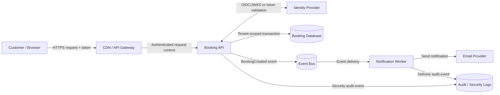
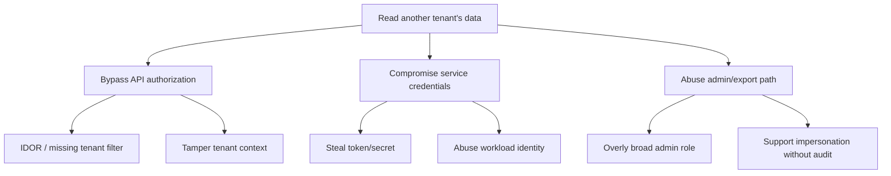
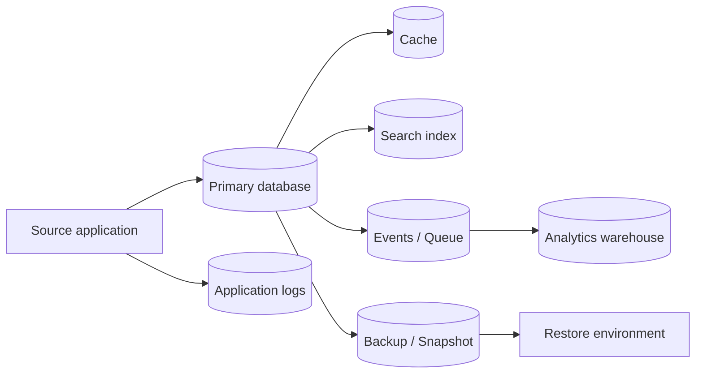
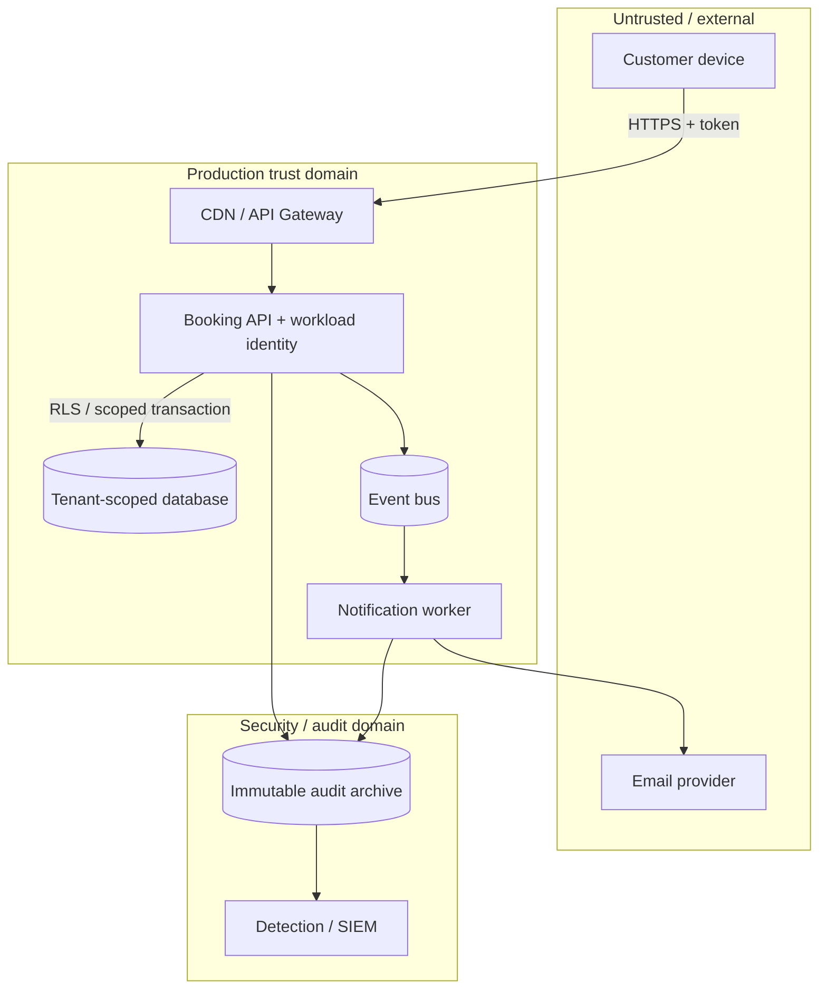

# Threat Modeling by Assets, Data Flows, and Trust Boundaries

## 1. Why Do We Need Threat Modeling?

A cloud architecture may use firewalls, encryption, IAM, and managed security services and still have attack paths the design team has not noticed. An API gateway may authenticate users properly while a message-processing worker fails to check the tenant; a database may be encrypted at rest while logs contain access tokens; a private workload may have no public IP while its role has permission to read every bucket. Vulnerabilities often appear at the intersection of components, data flows, and trust assumptions.

**Threat modeling** is a structured process for understanding what the system needs to protect, who might attack it, where data travels, where trust boundaries lie, and what scenarios could cause harm. The output is a list of threats, risk levels, mitigations, and verification methods.

This lesson belongs to the **Security Architecture** chapter of the **CLOUD_ARCHITECTURE** module. The module teaches how to design cloud application architectures from business requirements through networking, compute, data, and deployment models, balancing reliability, security, scalability, cost, and operations according to Well-Architected principles. Threat modeling connects technical decisions to the assets and business impacts that must be protected.

After this lesson, you can identify assets and threat actors, draw data flows, determine trust boundaries, apply STRIDE/abuse cases, prioritize risks, and tie controls to testing.

## 2. Start from the Real System

Threat modeling is not a fixed checklist applied to every system. Start with the architecture, business processes, and what is currently running or planned for deployment.

### 2.1. Define Scope and Objectives

Explicitly document:

- The system or user journey being evaluated.
- In-scope components: clients, APIs, identity providers, services, databases, queues, storage, cloud control plane, and third parties.
- Out-of-scope components that still have connections or impact.
- Environments, regions, accounts/projects, and tenant tiers.
- Level of detail: the entire architecture, a single service, a data flow, or a specific change.
- Participants: architects, developers, SREs, security, data owners, product owners, and cloud operations.

A scope that is too broad easily produces a generic list; a scope that is too narrow misses boundaries where data moves from a service to a queue, account, or vendor.

### 2.2. Describe the Architecture and Version

Gather diagrams, deployment manifests/IaC, API contracts, data schemas, IAM roles, network routes, and operational flows. Explicitly record:

- **As-is:** what is actually running.
- **To-be:** the planned architecture after the change.
- **Assumption:** assumptions not yet verified.
- **Unknown:** areas lacking evidence.

Do not turn assumptions into facts. "The database has no Internet access" must be verified via routes, private endpoints, firewalls, and egress; simply seeing the words "private subnet" on a diagram is not enough.

## 3. Assets: What Does the System Need to Protect?

An asset is anything of value to the organization or users that could be lost, exposed, altered, or made unavailable. Data is not the only asset.

### 3.1. Asset Categories

| Category | Examples | Consequences When Compromised |
|---|---|---|
| Business data | Bookings, orders, profiles, balances | Data exposure/modification/loss, fraud |
| Identity and secrets | Password hashes, tokens, API keys, signing keys, KMS keys | Privilege takeover, spoofing, data decryption |
| Workload/compute | VMs, containers, functions, Kubernetes nodes | Unauthorized code execution, lateral movement, cryptomining |
| Control plane | IAM policies, cloud accounts, pipelines, DNS | Administrative takeover, system-wide changes |
| Communications | APIs, webhooks, event buses, queues | Spoofing, replay, eavesdropping, message tampering |
| Availability/capacity | Databases, quotas, queue throughput | DoS, resource exhaustion, service outage |
| Intellectual property | Source code, models, algorithms | Loss of trade secrets, supply-chain compromise |
| Operational evidence | Audit logs, traces, backups, incident records | Inability to investigate, inability to prove compliance |

### 3.2. Data Classification

For each asset, record the owner, purpose, sensitivity, tenant/data subject, jurisdiction/residency, retention, deletion/legal hold, and requirements for confidentiality, integrity, availability, and authenticity. Track data at rest, in use/processing, in replicas, backups, caches, logs, and in transit.

Do not just label something "PII" and stop there. Email addresses, phone numbers, booking history, location, payment references, and metadata can have different sensitivity levels; risk depends on linkability and intended use.

### 3.3. Sample Asset Inventory

| ID | Asset | Owner | Where It Appears | Primary Requirements |
|---|---|---|---|---|
| A-01 | Customer profile | Customer domain | API, DB, cache, export | Confidentiality, tenant isolation |
| A-02 | Booking state | Booking domain | API, DB, events, search index | Integrity, availability |
| A-03 | Payment reference | Payment domain | Backend, secret store, provider | Confidentiality, integrity |
| A-04 | Workload identity | Platform security | Runtime, cloud IAM | Authenticity, least privilege |
| A-05 | Audit trail | Security operations | Log archive/SIEM | Integrity, retention |
| A-06 | Signing/encryption key | Key owner | KMS/HSM, workloads | Confidentiality, controlled use |

An asset inventory helps identify crown jewels (critical assets) to prioritize analysis. Not every log line or cache entry carries the same risk level.

## 4. Threat Actors and Capabilities

A **threat actor** is an individual or organization capable of creating a threat. An actor is not necessarily an external hacker.

| Actor | Capability/Motivation | Access Path |
|---|---|---|
| Internet attacker | API exploitation, credential stuffing, DDoS | Public endpoints, DNS, login |
| Malicious legitimate user | Bypassing tenant scope, business logic abuse | APIs, exports, search, support |
| Insider | Privilege abuse, unauthorized access | Admin console, DB, logs, CI/CD |
| Compromised workload | Using the compromised service's identity | Metadata endpoint, internal APIs |
| Supply-chain actor | Introducing malicious dependencies/images/actions | Package registries, build runners |
| Cloud account attacker | Compromising IAM roles or credentials | Control plane, federation |
| Compromised vendor | Abusing integrations or shared data | Webhooks, SaaS connectors |
| Configuration/operational error | Overly broad permissions, public buckets, misrouted traffic | IaC, console, pipelines |

Analyze actors based on realistic capabilities and access paths. A tenant A user who has legitimate permissions but attempts to read tenant B data remains an important actor in SaaS.

### 4.1. Motivation and Impact

Motivations may include financial gain, data theft, sabotage, disruption, espionage, extortion, or resource abuse. A single scenario can simultaneously cause loss of confidentiality, allow data tampering, and incur costs.

There is no need to predict a specific attacker's identity. Focus on determining plausible capability levels, targeted assets, and feasible paths.

## 5. Data Flows

A data-flow diagram (DFD) describes how data moves between actors, processes, data stores, and connections. A DFD helps identify where data is created, read, transformed, transmitted, stored, copied, and deleted.

### 5.1. DFD Components

- **External entity:** users, partners, providers, or out-of-scope systems.
- **Process:** APIs, workers, functions, services, or pipelines that transform data.
- **Data store:** databases, object storage, caches, queues, log archives, or backups.
- **Data flow:** requests, responses, events, files, replication, telemetry, or administrative operations.
- **Trust boundary:** a line separating domains with different trust levels, controls, or security assumptions.

### 5.2. Sample DFD for Booking



This diagram illustrates the logical flow only. A production DFD needs to add actual subnets, accounts, IAM roles, private endpoints, DNS, keys, backups, admin paths, and third parties.

### 5.3. Properties of Each Flow

| Property | Questions |
|---|---|
| Source/destination | Who sends, who receives, which process/store? |
| Classification | Is the data public, confidential, or restricted? |
| Protocol | HTTPS, gRPC, SQL, queue, file transfer, or replication? |
| Identity | Who authenticates the producer and consumer? |
| Authorization | Who is allowed to send/read/modify? What is the tenant/resource scope? |
| Protection | Encryption in transit/at rest, signing, integrity checks? |
| Trust boundary | Does it cross a network/account/vendor/tenant boundary? |
| Failure behavior | Do timeouts, retries, replays, or duplicates create risks? |
| Logging | Is metadata/payload logged? Who can read it and how long is it retained? |
| Lifecycle | How is data stored, archived, replayed, and deleted? |

Commonly overlooked flows include backup restores, debug exports, dead-letter queues, support impersonation, CI/CD deployments, metrics labels, crash dumps, and break-glass access.

## 6. Trust Boundaries and Trust Zones

A **trust boundary** is a boundary where assumptions about identity, privileges, protection, or ownership change. Boundaries do not necessarily align with firewalls or subnets.

Examples:

- Internet → edge/API gateway.
- Browser/mobile app → backend.
- Public subnet → private application subnet.
- Workload → database.
- Workload identity → cloud control plane.
- Tenant A → tenant B.
- Production account → analytics account.
- Organization → SaaS provider/webhook partner.
- CI/CD runner → production deployment role.
- Normal operator session → privileged/break-glass session.

### 6.1. Assumptions That Must Be Verified

- A private subnet does not mean workloads are trustworthy or cannot be compromised.
- Service-to-service communication inside a VPC still requires authentication and authorization.
- Being in the same cloud account does not mean all workloads should share permissions.
- Managed services reduce operational burden but do not automatically configure secure policies.
- Internal traffic can be spoofed once a workload is compromised.
- TLS encrypts the transport channel but does not guarantee the peer is authorized to access the resource.

### 6.2. Zero Trust

Zero Trust encourages not granting trust based solely on network location. Each request should verify identity, policy, workload context, and appropriate resource scope. Systems may use workload identity, short-lived tokens, mTLS, and policy engines; these do not replace authorization at the resource itself.

Evaluate the boundaries:

- **Identity:** who is considered a valid actor?
- **Network:** which routes is traffic permitted to traverse?
- **Data:** what data is accessed, and for which tenant/record?
- **Administrative:** who has permission to change policies or infrastructure?
- **Execution:** what code is permitted to run and where do artifacts come from?

## 7. STRIDE: Threat Categorization

STRIDE categorizes threats into six groups. It helps ask systematic questions, though it does not replace understanding the business logic and architecture.

| Category | Meaning | Guiding Questions | Cloud Example |
|---|---|---|---|
| **S — Spoofing** | Impersonating an identity | Can a user/service/webhook be spoofed? | Using a stolen token |
| **T — Tampering** | Unauthorized modification of data/code | Can requests, messages, or artifacts be altered? | Modifying events or pipeline artifacts |
| **R — Repudiation** | Denying an action | Is there an audit trail proving who did what? | Admin changes IAM policy with missing audit logs |
| **I — Information Disclosure** | Exposing information | Can an unauthorized actor read data? | Public bucket, missing tenant filter |
| **D — Denial of Service** | Degrading service availability | Can CPU, connections, or quotas be exhausted? | API flood, hot key |
| **E — Elevation of Privilege** | Escalating privileges | Is there a path to bypass roles/trust boundaries? | SSRF retrieving workload credentials |

### 7.1. Applying STRIDE to Each Element

- S: Are producers/consumers authenticated? Do tokens have the right issuer, audience, and expiry?
- T: Does data have integrity protection, validation, transactions, and versioning?
- R: Do audit logs record actor, action, target, timestamp, and outcome? Can high-privilege actors modify or delete them?
- I: Are encryption, authorization, tenant isolation, output filtering, and log redaction properly implemented?
- D: Are quotas, rate limits, timeouts, backpressure, and autoscaling guardrails in place?
- E: Do roles follow least privilege? Is there a path from regular workloads to admin/control plane?

Not every category applies to every element. Static objects may focus on disclosure, tampering, and availability; IAM services require attention to spoofing, elevation, and repudiation.

STRIDE helps categorize what could happen, without automatically indicating probability or severity. Afterward, evaluate asset value, exposure, attacker capability, exploit paths, and existing controls.

## 8. Abuse Cases and Attack Trees

An **abuse case** describes how an actor uses the system in a harmful way, contrary to the intended use case.

| Legitimate Use Case | Abuse Case |
|---|---|
| Tenant views their own bookings | Changing booking ID to read another tenant's data |
| Admin exports tenant data | Abusing export to exfiltrate data in bulk |
| Service receives events | Sending forged events or replaying old events |
| CI/CD deploys an approved image | Substituting a malicious image/tag or dependency |
| User uploads a file | Uploading a malicious file causing code execution or storage exhaustion |

An attack tree represents an attacker's goal and the branches of conditions required to achieve it. Example goal: "read another tenant's booking data":



Attack trees help uncover alternative paths. Do not protect only a single endpoint; evaluate credentials, roles, background jobs, and export pathways.

## 9. From Threat to Risk

A threat is the potential to cause harm; **risk** considers both likelihood and consequence in a specific context.

### 9.1. Evaluation Factors

- **Likelihood:** exposure, exploitability, attacker capability, frequency, and controls.
- **Impact:** confidentiality, integrity, availability, privacy, legal, financial, reputational, and operational effects.
- **Blast radius:** number of tenants, regions, accounts, services, or records affected.
- **Detectability:** ability to detect before damage spreads.
- **Recoverability:** ability to restore, reconcile, and revoke privileges.
- **Control effectiveness:** how thoroughly existing controls have been verified.

### 9.2. Sample Qualitative Matrix

| Likelihood / Impact | Low | Medium | High | Critical |
|---|---|---|---|---|
| Low | Low | Low | Medium | High |
| Medium | Low | Medium | High | Very High |
| High | Medium | High | Very High | Very High |
| Very High | High | Very High | Very High | Very High |

Organizations must define concrete criteria for each level. Do not use numerical scores that create a false sense of precision. A threat with critical consequences but low likelihood may still require controls if the impact is unacceptable.

### 9.3. Sample Risk Register

| ID | Threat Scenario | Asset/Impact | Likelihood | Impact | Initial Risk | Treatment |
|---|---|---|---|---|---|---|
| T-01 | Modify tenant ID to read another tenant's bookings | Data breach | Medium | Critical | Very High | RLS, trusted context, negative tests |
| T-02 | SSRF retrieves runtime credentials | Cloud role/data store | Medium | High | High | Metadata hardening, egress control, least privilege |
| T-03 | Consumer processes duplicate payment event | Payment integrity | Medium | Critical | Very High | Idempotency, source validation, dedup |
| T-04 | API flood exhausts DB connections | Availability | High | High | Very High | WAF, quota, bulkhead, load shedding |
| T-05 | Admin modifies/deletes audit logs | Investigation/evidence | Low | High | Medium | Immutable archive, separation of duties |

A risk register needs an owner, due date, status, evidence, and residual risk. Risk acceptance must have an authorized approver, justification, and review expiration date.

## 10. Selecting Risk Treatments

Four treatment approaches:

1. **Mitigate:** reduce likelihood or impact with controls.
2. **Avoid:** change the architecture or flow to eliminate the attack path or risky capability.
3. **Transfer/share:** share responsibility or transfer part of the risk via contracts/insurance; legal and operational accountability do not automatically disappear.
4. **Accept:** intentionally accept residual risk with an owner and review deadline.

For example, if an integration does not need database read access: avoiding the risk may mean removing that permission rather than merely adding an alert.

### 10.1. Controls Mapped to Threats

| Threat | Prevention | Detection | Recovery |
|---|---|---|---|
| Forged/stolen token | OIDC validation, short-lived tokens, audience, mTLS | Identity anomaly | Revoke/rotate, invalidate sessions |
| Tenant data leakage | Server-derived context, RLS, least privilege | Cross-tenant alert, audit | Contain, investigate, notify per obligations |
| Message tampering/replay | Authenticated producer, integrity, idempotency | Duplicate/out-of-sequence alert | Quarantine, controlled replay, reconcile |
| Secret exposure | Secret manager, workload identity, no hardcoded keys | Secret scanning, access audit | Rotate/revoke, redeploy |
| DoS/resource exhaustion | WAF, quota, bulkhead, capacity limits | Saturation, traffic anomaly | Shed load, recover gradually |
| Privilege escalation | IAM least privilege, separation of duties | Privileged-action audit | Revoke roles, rotate credentials, rebuild |

Prevention, detection, and recovery complement one another. No single control stops every attack; the architecture must assume some layers will fail.

## 11. Trust Boundaries in Cloud Architecture

### 11.1. Internet and Edge

Threats include API abuse, credential stuffing, bots/DDoS, injection, malformed/oversized payloads, TLS misconfiguration, and host/header spoofing.

Controls:

- Appropriate TLS, certificate lifecycle management, and HSTS where needed.
- WAF/API gateway, schema validation, body/size limits, and rate limiting.
- Authentication/authorization in the backend; do not treat the WAF as an authorization boundary.
- Request IDs, auditing, abuse monitoring, and quotas.

### 11.2. Workloads and Service-to-Service

Threats include a compromised service moving laterally, overly broad roles, SSRF accessing metadata/control planes, and secrets exposed in environment variables/images/logs.

Controls:

- Workload identity, short-lived credentials, least privilege.
- Egress allowlists, segmentation, private endpoints.
- Platform-appropriate metadata service hardening; avoid static credentials.
- Image signing/scanning, runtime hardening, patching, and admission policies.
- mTLS where appropriate; still enforce authorization at the resource.

### 11.3. Data Stores

Threats include public exposure, credential theft, injection, missing tenant filters, misconfigured backup snapshot permissions, and key abuse.

Controls:

- Private connectivity, firewalls/security groups, and minimal DB roles.
- Parameterized queries, RLS/tenant constraints, and access tests.
- Encryption at rest/in transit, key rotation, and separation of duties.
- Separate backup access, immutable copies where appropriate, restore testing, and auditing.

### 11.4. Cloud Control Plane and CI/CD

Threats include compromising cloud admin roles/federation tokens, pipeline tampering, IaC drift, and compromised artifacts/dependencies.

Controls:

- Strong authentication, short-lived federation, and privileged access management.
- Separation of duties, approvals, signed artifacts, provenance, and protected branches.
- Policy-as-code, IaC scanning, drift detection, and change auditing.
- Isolated build runners, dependency pinning, SBOMs, and artifact verification.

## 12. Shared Responsibility and Managed Cloud Services

Cloud providers and customers share security responsibilities. The exact boundary depends on whether the service is IaaS, PaaS, a container platform, a managed database, or SaaS:

- The provider secures the physical infrastructure, platform, or managed service components per the agreement.
- The customer remains responsible for data, identities, permissions, configurations, network rules, and applications.
- For managed databases, the provider may partially manage hosts and patching; the customer still designs schemas, access controls, encryption configuration, backup policies, and query authorization.
- For SaaS, the customer still manages users, federation, sharing, retention, and tenant configuration.

Do not assume "managed" means secure by default. The threat model must document which controls the provider operates, which the organization configures, and the verification evidence.

## 13. Data Lifecycle and Commonly Overlooked Flows

Data can exist outside the primary database:



Each copy introduces its own threats:

- Caches may retain revoked data or data from another tenant.
- Search indexes may lack filters or update with delay.
- Queues/DLQs retain sensitive payloads longer than intended.
- Warehouses have broad analyst access and export tooling.
- Backups live in different accounts/regions and may have broad permissions.
- Restore environments have weaker controls than production yet contain production data.
- Logs/traces/crash dumps may contain tokens, PII, or SQL parameters.

Track the lifecycle from creation → use → replication → archive → retention → deletion. Deleting a source record does not automatically delete caches, indexes, exports, or backups at the same time.

## 14. Threat Modeling Example: Multi-Tenant Booking Platform

Suppose customers use web/mobile clients to create bookings. The API gateway forwards requests to the Booking API; the service verifies the token, reads/writes the database, and publishes a `BookingCreated` event; a worker sends notifications via a provider. Tenants share the application plane and database rows keyed by tenant ID.

### 14.1. Assets and Boundaries

Critical assets: customer profiles, bookings, memberships, workload identities, payment references, integration secrets, event logs, audit trails, and backups.

Trust boundaries:

1. User device → Internet/edge.
2. Edge → backend workload.
3. Booking API → identity provider.
4. Booking API → database.
5. Booking API → event bus → notification worker.
6. Worker → email provider.
7. Production account → logging/security account.
8. Tenant A → tenant B in the shared database.

### 14.2. Threat Scenarios and Controls

| Scenario | STRIDE | Consequence | Controls |
|---|---|---|---|
| Client alters tenant ID | Spoofing/Disclosure | Read another tenant's bookings | Signed context, membership check, RLS |
| API omits tenant condition | Disclosure/Tampering | Return/modify cross-tenant records | Tenant-aware repository, composite FK, tests |
| JWT with wrong audience accepted | Spoofing | Call API with token meant for another service | Verify issuer/audience/signature/expiry |
| SSRF steals workload credentials | Elevation | Call cloud APIs/storage | Metadata protection, egress, least privilege |
| Forged event triggers email | Spoofing/Tampering | Spam or data exposure | Producer identity, schema validation, authorization |
| Replay `BookingCreated` | Tampering/DoS | Duplicate notifications | Event ID, idempotency, deduplication |
| Export endpoint abused | Disclosure/DoS | Bulk data exfiltration | Object auth, quota, approval, audit, expiry |
| Flood database connections | DoS | Booking API unavailable | Rate limit, pool cap, bulkhead, backpressure |
| Admin modifies logs | Repudiation | Unable to investigate | Separate logging account, immutable retention |

### 14.3. Threat Boundary Diagram



Verify the diagram against actual configurations: signing keys, event publisher policies, DB roles, log read/write roles, network egress, and admin paths.

## 15. Threat Register and Remediation

A threat model must produce actionable work items, not just diagrams. A threat register can contain:

| Field | Content |
|---|---|
| Threat ID | Stable ID for reference |
| Asset/flow | Affected asset and flow |
| Scenario | Actor, conditions, and behavior |
| STRIDE/category | Classification category |
| Existing controls | Current controls and evidence |
| Likelihood/impact | Rating levels and rationale |
| Residual risk | Remaining risk |
| Treatment | Mitigate, avoid, transfer/share, or accept |
| Owner/due date | Accountable owner and deadline |
| Validation | Test, scan, review, log, or exercise |
| Status | Open, in progress, mitigated, accepted, closed |

When a threat is marked mitigated, evidence is required such as passing tests, IAM reviews, network reachability checks, restore evidence, or verified findings. Do not close a threat merely because a ticket was created or an untested policy was added.

## 16. Testing and Verifying Controls

| Control | Verification Method |
|---|---|
| Authentication/tokens | Test issuer, audience, signature, expiry, key rotation, and revoked identities |
| Tenant isolation/RLS | Cross-tenant negative tests, missing context, pooled connections, and workers |
| Network segmentation | Check routes/firewalls from specific sources to specific destinations |
| IAM least privilege | Policy analysis, access simulation, and review of effective permissions |
| Encryption/keys | Verify key policies, rotation, deny paths, and backup access |
| Event authenticity | Producer identity, unauthorized publish, tampering, replay/duplicates |
| Audit integrity | Attempt modification/deletion with regular roles; check immutable archive and alerts |
| DoS resilience | Bounded load/fault tests, observe quotas, queues, and recovery |
| Supply chain | Dependency scanning, image signing, provenance, and artifact verification |

Do not perform penetration testing against production or third-party assets without proper scope and authorization. Attack paths can be reproduced in staging/lab environments using synthetic data.

## 17. When Should the Threat Model Be Updated?

Review when:

- Adding a public endpoint, service, event topic, integration, or data store.
- Changing an identity provider, IAM role, trust relationship, or secret management.
- Changing the tenant model, schema, encryption keys, or data residency.
- Moving workloads to a new region/account/platform.
- Adding cross-account access, private endpoints, webhooks, or partner connectivity.
- Changing pipelines, base images, dependencies, or runtime permissions.
- An incident, vulnerability, or threat intelligence changes assumptions.
- SLO/availability design changes increase exposure or alter failure boundaries.

Threat reviews can be embedded into ADRs, pull requests, and change management. Small changes that do not touch boundaries can receive a focused review; major changes require updating the full DFD and risk register.

## 18. Well-Architected Evaluation

| Pillar | Evaluation Questions |
|---|---|
| **Operational Excellence** | Does the threat model have an owner/version? Are there registers, remediations, evidence, runbooks, and review triggers? |
| **Security** | Have assets, actors, flows, trust boundaries, IAM, encryption, tenant isolation, and auditing been analyzed? |
| **Reliability** | Have DoS, dependency failures, credential compromise, and recovery been considered? Are graceful degradation and backup protection in place? |
| **Performance Efficiency** | Are security controls placed at the right layers, with bounded overhead and measured impact? |
| **Cost Optimization** | Is control cost proportional to risk? Are there overlapping tools with gaps in coverage? |
| **Sustainability** | Are policies/evidence automated and operated at the right scale? |

## 19. Threat Model Template

The following YAML template records scope, assets, boundaries, and threats; it is not an enforceable policy that can be applied directly:

```yaml
threat_model:
  id: TM-BOOKING-001
  system: multi_tenant_booking
  version: 1
  scope:
    in_scope:
      - public_booking_api
      - booking_database
      - event_bus
      - notification_worker
    out_of_scope:
      - customer_personal_device_security
  assets:
    - id: A-01
      name: tenant_booking_data
      classification: confidential
      owner: booking_domain
    - id: A-02
      name: workload_identity
      classification: restricted
      owner: platform_security
  trust_boundaries:
    - internet_to_edge
    - edge_to_workload
    - workload_to_database
    - tenant_to_tenant
    - production_to_external_provider
  threats:
    - id: T-01
      category: information_disclosure
      scenario: cross_tenant_booking_read
      likelihood: medium
      impact: critical
      treatment: mitigate
      controls:
        - trusted_tenant_context
        - row_level_security
        - cross_tenant_negative_tests
      owner: booking_platform
      status: in_progress
  review_triggers:
    - new_data_store
    - new_external_integration
    - identity_or_iam_change
    - security_incident
```

The template should be supplemented with data flows, existing-control evidence, residual risk, due dates, and approvals aligned with organizational processes.

## 20. Threat Modeling Process

1. **Select scope:** user journeys, services, environments, and architectural changes.
2. **Build asset inventory:** owners, classifications, business impact, lifecycle, and dependencies.
3. **Identify actors:** capabilities, motivations, locations, and access paths.
4. **Draw DFD:** external entities, processes, data stores, protocols, directions, and classifications.
5. **Mark trust boundaries:** identity, network, tenant, account, admin, vendor, and execution.
6. **Generate threats:** STRIDE, abuse cases, and attack trees for critical components/flows.
7. **Prioritize risks:** likelihood, impact, blast radius, detectability, and existing controls.
8. **Choose treatments:** mitigate, avoid, transfer/share, or accept with proper authority.
9. **Assign owners and tests:** remediations, due dates, evidence, validation, and residual risk.
10. **Integrate into lifecycle:** review when APIs, data flows, IAM, accounts, or dependencies change, or after incidents.

## 21. Pre-Production Checklist

- [ ] Scope, version, assumptions, and out-of-scope items are clearly documented.
- [ ] Asset inventory includes owners, classifications, business impact, and data lifecycle.
- [ ] Threat actors include external attackers, tenant users, insiders, compromised workloads, vendors, and supply chain as appropriate.
- [ ] DFD includes external entities, processes, data stores, flows, and data directions.
- [ ] Flows specify protocols, identity, authorization, encryption, logging, and failure behavior.
- [ ] Trust boundaries include internet, workloads, databases, tenants, accounts, CI/CD, and vendors.
- [ ] STRIDE and abuse cases/attack trees have been applied to critical paths.
- [ ] Risks are evaluated by likelihood, impact, blast radius, and control evidence.
- [ ] Every threat has a treatment, owner, due date, and residual risk/acceptance authority.
- [ ] Controls have tests/evidence; findings are not closed based on unverified configurations alone.
- [ ] Backups, queues, DLQs, caches, logs, exports, support access, and CI/CD have been reviewed.
- [ ] Shared responsibility is delineated between the provider and the organization.
- [ ] Review triggers exist when adding services, integrations, data stores, or changing identity.
- [ ] Threat model, DFD, and register are versioned and updated after incidents.

**Application Principle:** assets tell you what needs protection; data flows tell you where information goes and through whom; trust boundaries tell you where security assumptions change. Combining these three perspectives with STRIDE, risk assessment, and testing turns threat modeling from descriptive diagrams into verifiable architectural decisions and controls.
