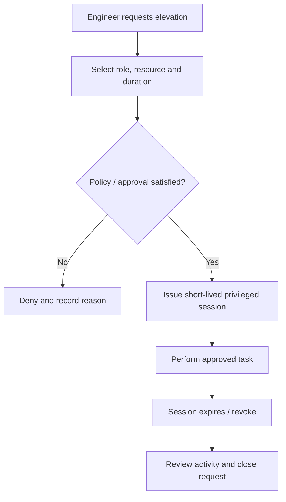
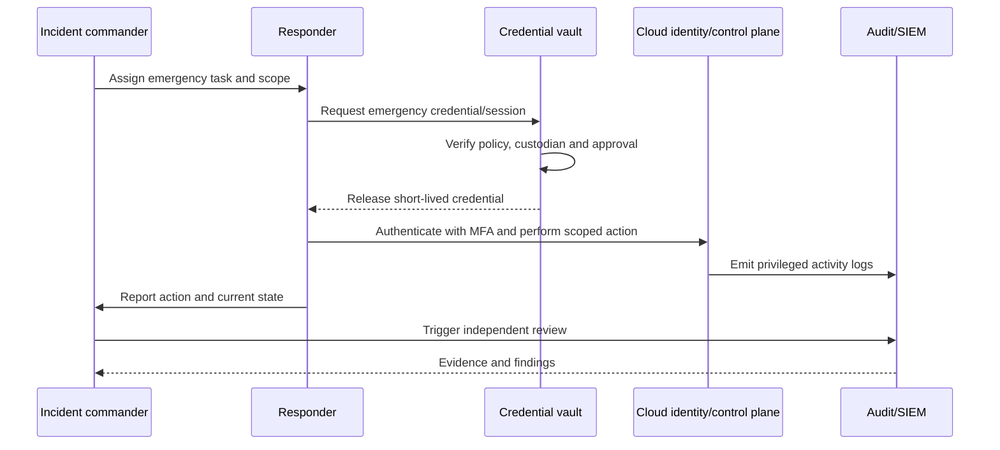

# Emergency Access and Restricting Administrative Privileges

## 1. Why Design Emergency Access?

Cloud applications require administrative privileges to deploy, configure networks, manage databases, rotate secrets, and recover services. If every engineer holds standing administrator rights, a single compromised credential or accidental mistake can impact the entire environment. Yet if all elevated access depends on a single identity provider, approval workflow, or control plane, operations teams may get locked out of the very system they need during an outage.

**Emergency access** is a special access mechanism used when standard authentication or administrative workflows cannot meet urgent operational needs. **Break-glass access** is a form of emergency access that allows authorized personnel to bypass certain routine steps under a controlled, time-bound, audited policy that is reviewed after every use.

The goal is not granting unlimited access during an incident. The goal is ensuring accountable responders can execute the exact required actions for a limited time while reducing abuse, compromise, and irreversible changes.

Key principles:

- **Least privilege:** grant only the minimum permissions needed for the task.
- **Just-in-Time (JIT):** elevated rights are granted only when needed and for a short window.
- **Separation of duties:** separate requester, approver, and executor where risk warrants.
- **Strong authentication:** use MFA and authentication assurance matched to risk.
- **Time-bound access:** privileges carry expirations and automatically terminate.
- **Accountability:** every privileged action ties to an individual identity and is audited.
- **Recoverability:** procedures still work when primary identity or control-plane components fail.
- **Review and revoke:** privileges and credentials are revoked and audited after the incident.

In the **CLOUD_ARCHITECTURE** module, the **Security Architecture** chapter treats administrative privileges and emergency access as part of security, reliability, and operational design. Elevated access must be sufficient to resolve incidents while retaining boundaries, evidence, and control.

After this lesson, learners can:

1. Distinguish routine administrative access, privileged access, and break-glass access.
2. Design JIT/PAM, roles, scopes, and durations for privileged access.
3. Build access paths when the primary identity provider/control plane is unavailable.
4. Protect emergency credentials, MFA, recovery keys, and backup accounts.
5. Apply approvals, separation of duties, session recording, and auditing.
6. Restrict dangerous operations with policies, guardrails, and environment isolation.
7. Write runbooks, run drills, and conduct reviews after every emergency access use.

## 2. Classifying Access Privileges

Do not lump every elevated privilege into a single role called Administrator and hand it out broadly. Separate privileges by duty, scope, and timing.

| Access Type | Purpose | How Granted |
| --- | --- | --- |
| Standard user | Use the application and business data | By membership and role |
| Developer/operator | Deploy, observe, handle routine operations | Per-environment and per-service roles |
| Privileged access | Change IAM, networks, databases, production configs | JIT/PAM, approvals, and time limits |
| Emergency/break-glass | Recover when normal procedures fail | Dedicated accounts/credentials, strict controls |
| Workload identity | Permissions for applications, jobs, or services | Federated identity/short-lived tokens |
| Audit/security reviewer | Inspect evidence, investigate, and verify | Read-only scope, never used for operations |

### 2.1. Human Identities vs. Workload Identities

Engineers access systems using individual human identities; services access resources using workload identities. Never share an admin account between humans and automation because doing so destroys attribution of the true actor.

Workload identities should use federation, managed identities, or short-lived credentials. If a pipeline needs permissions to create resources, grant a role scoped to the trusted repository/environment/artifact rather than embedding a long-lived access key in CI variables.

### 2.2. Per-Environment Privileges

Separate roles and boundaries across development, staging, and production. Permissions in dev must never automatically permit modifying production. Production privileged roles should require additional conditions such as approvals, device posture, MFA, change tickets, or JIT elevation.

Never allow routine privileges to grant themselves higher privileges without independent policy controls.

## 3. Least Privilege and Role Design

Least privilege must be enforced across four dimensions:

1. **Action:** allow only required actions—for example, restart a service without deleting a database.
2. **Resource:** restrict to specific resources, projects, accounts, subscriptions, clusters, or namespaces.
3. **Condition:** constrain by environment, tags, networks, devices, time, or change state.
4. **Duration:** privileges exist only for the needed window.

### 3.1. Task-Oriented Roles

Example operational roles:

| Role | Permitted | Not Permitted by Default |
| --- | --- | --- |
| Incident responder | View telemetry, restart workloads, scale services within quota | Modify IAM policies or delete data |
| Database operator | Run failover per runbook, inspect replication lag, run backups | Export all PII or modify account-wide IAM |
| Network operator | Update routes/firewalls within approved scope | Create principals with admin rights |
| Security responder | Disable credentials, isolate hosts, view audits | Modify/delete investigative logs |
| IAM administrator | Manage roles/bindings within scope | Delete audits, self-approve own elevation |
| Break-glass custodian | Initiate and control emergency sessions | Use credentials for routine work |

Role matrices must map to actual cloud provider APIs/actions. A role name never proves its scope; inspect effective permission sets and inherited permissions.

### 3.2. Inherited Permissions and Privilege Escalation

Risks often hide in indirect permissions:
- Modifying policies attached to a stronger role.
- Attaching a broad managed policy.
- Creating a service account and granting it an elevated role.
- Impersonating a workload identity.
- Modifying a pipeline to deploy arbitrary artifacts.
- Altering logging/alerting to hide activity.
- Reading secrets used by a higher-privileged principal.

Permission reviews must trace privilege escalation paths, not just direct action lists.

## 4. JIT and Privileged Access Management

**Privileged Access Management (PAM)** governs the lifecycle of privileged access: requests, approvals, credential/session issuance, monitoring, revocation, and auditing.

**Just-in-Time access** grants roles only when needed; access binds to the requester, task, resource, and duration.



JIT reduces how long elevated privileges remain active, yet does not guarantee safety on its own. If requesters can self-approve any role, roles are overly broad, or sessions go unlogged, risk remains high.

### 4.1. What Should a JIT Request Contain?

- Principal and authenticated identity.
- Requested role/actions.
- Resource/account/project/environment scope.
- Incident or change/ticket reference.
- Justification and business impact.
- Start time, duration, and expiration.
- Approvers or applicable auto-approval policy.
- Device, MFA, and network conditions if needed.
- Session monitoring method.
- Closure and review procedure.

Never accept vague requests like "need admin for a bit." Requests must specify which actions, where, and for how long.

### 4.2. Risk-Based Approvals

Certain read-only actions may be auto-approved via JIT after MFA. Operations modifying production, IAM, encryption keys, or deleting data may require two-person approval or formal change approval.

Approvals must not become a bottleneck during incidents. Pre-define backup approvers, escalation paths, and unreachable-approver contingencies. If policy permits emergency overrides, require documented rationale, post-event review notifications, and narrow scope.

### 4.3. Session-Bound Privileges

Prefer temporary sessions or short-lived tokens over issuing long-lived credentials. When a session expires:
- Tokens cannot refresh outside policy.
- Role assignments are automatically removed.
- SSH/RDP sessions or proxy channels terminate appropriately.
- Temporary credentials are revoked/rotated.
- Session logs and command audits are retained per policy.

Token TTLs must fit the task and revocation propagation latency. Removing a role binding does not always invalidate already-issued tokens immediately; understand your identity platform's semantics.

## 5. Break-Glass Accounts: When to Use Them?

Break-glass is reserved for situations where normal access paths fail or waiting on standard procedures would cause severe harm.

Examples:
- Primary identity provider outage preventing operators from logging in.
- Federation/SSO misconfiguration locking out all admins.
- Widespread MFA provider failure.
- Control plane or PAM service unavailability.
- Compromised primary admin credentials requiring isolation and replacement.
- Production emergencies requiring urgent action beyond normal roles.

Never use break-glass to:
- Bypass approval workflows out of convenience.
- Deploy features or routine changes.
- Access data unrelated to an incident.
- Share passwords via a communal account.
- Perform work without a ticket, logs, or an accountable owner.

### 5.1. Designing Emergency Accounts

One approach maintains a small set of emergency principals governed independently of routine SSO. Each account must have an owner/custodian, defined scope, protected credentials, alerts on use, and periodic testing.

Not every organization needs the same number of accounts. Maintain enough redundancy so one locked credential or absent custodian does not block recovery, yet keep the count small enough to inventory and audit reliably.

### 5.2. Break-Glass Accounts Are Not Shared Accounts

If a platform supports only one emergency principal, credential checkout must be controlled and each session bound to the actual individual operator. Record:
- Who checked out the credential.
- Who approved or which policy authorized it.
- Start and end timestamps.
- Incident/ticket ID.
- Actions taken and resources accessed.
- How the credential was rotated after use.

Never store passwords in chat, uncontrolled wikis, or script files. Use a vault with access policies, approvals, and auditing.

## 6. Independence from the Primary Identity Provider and Control Plane

Emergency access only works if it stays functional when primary components fail. This is a circular dependency problem: needing identity to fix identity, or needing the control plane to fix control-plane configs.

### 6.1. Break-Glass Dependency Map

List all components:
- Identity provider/SSO/federation.
- MFA services and recovery factors.
- PAM/vault/approval workflows.
- DNS and network routes.
- KMS/secret manager.
- Cloud account root/organization admin.
- Audit/log pipelines.
- Device management and endpoint security.
- Out-of-band communications.

Identify components sharing a failure domain. If both the vault and identity sit inside a cloud tenant that becomes unreachable when an account is suspended, an emergency account inside that same tenant cannot solve the problem.

### 6.2. Out-of-Band Paths

Critical components may require an independent recovery path:
- Emergency identity/native accounts as supported by the provider.
- Credentials stored in an independent vault or secure physical custody separate from primary SSO.
- Hardened administrative devices accessible via backup networks.
- Verified recovery contacts and provider support escalation paths.
- Offline runbooks or readable copies available if documentation systems fail.

Out-of-band does not mean skipping MFA or using unprotected personal laptops. It must be engineered as a backup control plane with its own controls and permissions.

### 6.3. Cloud Provider Root Accounts

For top-level cloud accounts, follow provider guidance for protecting root/break-glass identities. General principles:
- Never use root for day-to-day operations.
- Enable strong MFA and controlled recovery methods.
- Restrict how many people know the access procedure.
- Configure alerts for every login and privileged change.
- Do not create long-lived root access keys if the provider advises against them.
- Keep contact, billing, and recovery details accurate.
- Test accessibility when federation/organization policies break.

Exact details must follow the documentation and semantics of your cloud provider.

## 7. MFA and Strong Authentication

MFA raises the barrier when credentials are stolen. For elevated privileges, prefer phishing-resistant authentication such as hardware security keys or passkeys/FIDO2 where supported.

| Factor | Examples | Notes |
| --- | --- | --- |
| Something you know | Password/passphrase | Defend against brute force and password reuse |
| Something you have | Hardware security key, authenticator device | Maintain lost-device recovery procedures |
| Something you are | On-device biometric unlock | Platform-dependent; usually unlocks another factor |
| Phishing-resistant | FIDO2/WebAuthn/suitable passkeys | Origin binding protects against phishing |

SMS OTP can be convenient, but should not be the sole factor for sensitive administrative access when stronger methods exist.

### 7.1. MFA Recovery

Recovery factors are also an entry path into accounts. Ensure:
- No single admin can reset MFA for themselves unilaterally.
- Identity is verified across multiple independent channels.
- Recovery codes are properly protected.
- Alerts trigger on factor resets/re-enrollments.
- Audits and approvals are preserved.
- Contingencies exist if an MFA provider fails.
- Device recovery is tested, not just normal logins.

An MFA-protected account with weak reset procedures can still be hijacked through its recovery path.

## 8. Credential Vaulting and Secret Management

Emergency credentials are high-value assets requiring high-risk controls.

### 8.1. Vault Controls

- Encrypt secrets at rest and in transit.
- Separate roles for reading, checkout, rotation, and auditing.
- Require approval or dual control for ultra-sensitive secrets.
- Enforce time-bound access leases/checkouts.
- Audit every read: who, when, from where, and why.
- Emit immediate alerts when emergency secrets are accessed.
- Rotate after each use or suspected exposure.
- Maintain backup/recovery vaults in independent failure domains.
- Test decryption when primary KMS/identity systems fail.

### 8.2. Secrets Must Never Live in Source Code

Never hardcode passwords, API keys, private keys, or tokens in:
- Repositories.
- Container images.
- CI/CD logs/artifacts.
- Tickets/comments/chats.
- Local shell history or unencrypted files.
- Public or broadly shared runbooks.

Runbooks may document vault paths and retrieval steps, never the secret values themselves.

### 8.3. Post-Incident Credential Rotation

After break-glass is used:
1. Terminate sessions that are no longer needed.
2. Revoke tokens and temporary grants.
3. Rotate passwords/keys if credentials could have been exposed or policy requires it.
4. Inspect session logs and cloud audits.
5. Confirm no temporary principals/roles remain.
6. Update custodian/vault records and close the incident.

Rotation must avoid breaking future recovery capability; store new credentials in the vault and re-test under an approved change.

## 9. Separation of Duties and Dual Control

Separation of duties reduces the risk that one person can request, self-approve, execute, and erase evidence of a privileged change.

Examples:
- A JIT requester cannot approve their own request.
- Someone modifying IAM policies cannot delete related audit logs.
- A backup administrator cannot unilaterally delete immutable recovery copies.
- Someone declaring DR does not necessarily execute every destructive action alone.
- Trust policy or root credential changes require risk-based dual control.

### 9.1. When Incidents Lack Enough Responders

During severe incidents, only one responder may be reachable. Policies should provide an emergency single-operator path for necessary actions while requiring:
- Recording why a second approver was unavailable.
- Narrowly bounding actions, resources, and duration.
- Automatic alerts to security/incident commanders.
- Full session/command auditing.
- Independent post-incident review once stabilized.

Never design a two-person rule without a realistic fallback when someone is unreachable; conversely, never let "incident" become an unbounded excuse.

## 10. Restricting Administrative Privileges with Guardrails

An emergency role should not have carte blanche to destroy every resource if its job is recovering a single service.

Guardrails may include:

- Organization/account policies blocking disabling logging or deleting backup vaults.
- Deny policies for destructive actions outside change windows.
- Resource-level scoping, tag/label conditions, and region boundaries.
- MFA conditions on sensitive actions.
- Policies prohibiting self-assignment of stronger roles.
- Approvals for deleting databases, keys, networks, or production accounts.
- Quotas/limits preventing abnormal resource creation.
- Protected resource locks and retention policies.
- Alerts whenever policies, trust relationships, or audit destinations are modified.

Guardrails also need time-bound, audited emergency exceptions. An absolute deny can accidentally block the exact recovery action needed; exceptions must be narrow and include a workflow to restore the original policy.

### 10.1. Preventive, Detective, and Corrective Controls

| Control Type | Examples | Objective |
| --- | --- | --- |
| Preventive | JIT, MFA, least privilege, deny policies | Stop improper actions |
| Detective | Cloud audits, SIEM alerts, session recording | Detect anomalous actions |
| Corrective | Revoke sessions, rotate keys, restore policies, incident reviews | Limit damage and restore baseline state |

No single control is sufficient. Combine all three to reduce probability, dwell time, and impact of privilege abuse.

## 11. Session Monitoring and Audit Trails

Every privileged activity requires evidence that operators cannot easily alter or delete.

Audit events should capture:
- Actor/principal ID.
- Tenant/account/project/environment.
- Role and permission scope.
- Approval/request/ticket ID.
- Start time, end time, and expiration.
- Source IP/device/session ID per privacy policy.
- Action/API call, resource, and outcome.
- Before/after state diffs where appropriate.
- Break-glass rationale and incident commander.
- Revocation/rotation/review outcome.

### 11.1. Separating Audit Storage

If an admin can delete audits inside the same account, logs lose trustworthiness whenever that account is compromised. Ship audits to a separate security account/project, enable immutable retention, and restrict read/delete permissions.

Audit logs must be protected against tampering while honoring retention, privacy, and data residency rules. Session recordings may capture sensitive data; collect only what is needed, restrict viewers, and bound retention.

### 11.2. Alerts for Sensitive Actions

Events warranting alerts include:
- Logins with emergency principals.
- Reading secret/root credentials.
- Creating or modifying admin roles/policies.
- Disabling MFA, auditing, guardrails, or backup protections.
- Trust/federation changes.
- Deleting resources/backups/keys.
- Access from unusual devices, locations, or hours.
- Privileged sessions lasting longer than requested.
- Actions performed without a ticket or approval.

Alerts must have owners and escalation paths. Alerts routed solely through a system suffering an outage are useless; consider independent notification channels.

## 12. End-to-End Break-Glass Workflow

Sample workflow:



Steps:

1. Incident commander confirms the incident, impact, and assigned responder.
2. Responder states required action, resource, scope, and duration.
3. Policy verifies identity, MFA, approval, or emergency exception.
4. Vault/PAM issues a temporary session/credential.
5. Responder executes in-scope actions and records outcomes.
6. Independent audit/alert systems capture events.
7. Upon completion, revoke sessions and roles.
8. Rotate credentials if needed.
9. Independent reviewer inspects actions and evidence.
10. Update runbooks, root cause, and remediation items.

### 12.1. Stop Conditions

Stop using break-glass when:
- Normal access paths have recovered.
- The action achieved its goal or is no longer needed.
- The scope is no longer appropriate.
- Signs of credential/session compromise appear.
- Auditing or safety controls fail without an approved exception.
- The incident commander transfers or closes authority.

Emergency access must never remain open after the incident concludes.

## 13. Emergency Access in Specific Cloud Failure Scenarios

### 13.1. Identity Provider Outage

If SSO stops working:
- Confirm the outage through an independent channel.
- Use pre-configured emergency principals/native logins if supported by the provider.
- Maintain MFA/recovery controls.
- Avoid creating ad-hoc new admin accounts.
- Once SSO recovers, reconcile principals/roles and rotate used credentials.

### 13.2. Loss of IAM Administrative Access

If a policy change locks out all admins, you need a recovery path independent of the broken policy. Protect emergency accounts from the same policy mutation path and periodically test login capability. Recovery actions should fix only the necessary policy rather than opening permanent global permissions.

### 13.3. KMS or Secret Manager Outage

If data cannot be decrypted:
- Check key status, region, permissions, and provider service health.
- Follow protected key recovery procedures.
- Never work around it by exporting plaintext secrets into files/chats.
- Restore key access within the minimal required scope.
- Verify application decryption and auditing post-recovery.

### 13.4. Network Lockout

If firewall/route changes block administrative paths:
- Use the prepared out-of-band management path.
- Verify resource owners and change history.
- Adjust only the specific rule, adding an expiration if it is an exception.
- Keep the audit path independent.
- Verify normal access paths and remove exceptions after the incident.

### 13.5. Account Compromise

If admin credential compromise is suspected:
- Do not continue using that credential for recovery.
- Isolate suspected principals/sessions and revoke tokens.
- Use an independent emergency identity from a clean device.
- Rotate credentials and audit trust policies and workload identities.
- Preserve logs, snapshots, and investigative evidence.
- Assess whether backups, KMS, and audit destinations were affected.

## 14. Multi-Account and Organizational Boundaries

Cloud organizations commonly use multiple accounts/projects/subscriptions. Centralized admin access is convenient yet creates a large blast radius if an identity or organization admin is compromised.

Principles:
- Separate production, security/log archives, backups, and sandboxes by purpose.
- Restrict organization-level administrators.
- Use delegated administration scoped by service and domain.
- Never run routine workloads inside the security account.
- Backup vaults must not share delete privileges with workload administrators.
- Break-glass principals should not hold universal high privileges if only one account needs recovery.
- Maintain contact/owner mappings and emergency access plans per critical account.
- Verify service control policies/organization policies permit required recovery actions.

Account separation is insufficient if every account trusts the exact same identity or secret. Audit cross-account trust relationships and federation paths.

## 15. Governing Vendor and Third-Party Access

Vendor/support engineers may need access to investigate or maintain systems. Govern it like privileged access:

- Individual/federated identities; never shared accounts.
- Internal sponsor and ticket reference.
- Explicit resource and permission scopes.
- Short-lived JIT access.
- Appropriate MFA and device/network conditions.
- Session monitoring or command auditing.
- Withhold tenant/customer data read rights unless required.
- Automatic revocation after the support window.
- Log reviews and closure verification.

Emergency provider support access requires contracts, approvals, auditing, and notifications. Never leave standing privileges open just because a vendor might need access someday.

## 16. Emergency Access for Data and Tenants

In multi-tenant SaaS, administrative privileges can cross tenant boundaries if scope is uncontrolled.

- Confirm tenant/customer scope before accessing.
- Use separate break-glass roles for platform recovery vs. customer data access whenever feasible.
- Infrastructure incidents must not automatically permit reading business data contents.
- Support impersonation must record justification, expiration, and audits.
- Export data only when necessary and properly approved.
- Log tenant access using opaque IDs, avoiding PII.
- Post-incident, review per-tenant access logs and notify per contractual/legal obligations.

Infrastructure modification rights and customer data read rights carry distinct risks; do not combine them unnecessarily.

## 17. Recovery When Audit or Approval Services Fail

A tough scenario occurs when approvals, PAM, and SIEM are the very services experiencing an outage.

Prepare in advance:
- Explicit fallback policy if the approval service is unavailable.
- Emergency contact trees and alternates.
- Independent audit sinks or tamper-resistant local buffers capable of delayed forwarding.
- Minimum manual records capturing actor, time, resource, justification, and actions.
- Out-of-band notifications.
- Mandatory post-event reviews once services recover.

Never normalize "no logs because SIEM was down." Use a controlled backup logging mechanism, then reconcile and verify completeness afterward.

## 18. Emergency Role Lifecycle and Reviews

Manage emergency access as a lifecycle asset:

1. **Design:** define role, resource scope, actions, and threat model.
2. **Provision:** create principals/credentials in the proper boundary.
3. **Protect:** vault secrets, enable MFA, separate management rights.
4. **Test:** verify login, scope, alerts, and recovery paths.
5. **Use:** request, approve, issue session, monitor.
6. **Expire/revoke:** auto-expire and revoke.
7. **Rotate:** change credentials after use or per schedule.
8. **Review:** inspect sessions, actions, exceptions, and role drift.
9. **Re-certify:** owners periodically confirm accounts/roles remain necessary.
10. **Retire:** delete unneeded accounts/credentials once replacements exist.

### 18.1. Periodic Reviews

Reviews should check:
- Do emergency accounts still have owners/custodians?
- Do MFA and recovery factors work?
- Are credentials still accurate in the vault?
- Have roles drifted beyond design?
- Do alerts/logs reach the right security destination?
- Are approvers and contacts still valid?
- Have provider policies or org structures changed?
- Do DR/identity outage tests pass?
- Has any emergency path gone unused so long no one remembers how to operate it?

Do not check password age alone; verify end-to-end task execution capability.

## 19. Metrics and Audit Evidence

| Metric/Evidence | Objective |
| --- | --- |
| Emergency account inventory/owners | Know which accounts exist and who is accountable |
| Privileged standing access count | Minimize permanent elevated privileges |
| JIT request/approval latency | Catch workflows slowing incident response |
| Session duration and scope | Confirm privileges stay bounded |
| Break-glass activation count | Spot trends or broken routine workflows |
| Credential rotation completion | Ensure post-use secrets are handled |
| MFA/recovery test success | Verify authentication readiness |
| Audit delivery/retention | Protect evidence |
| Unapproved privilege changes | Detect privilege escalation |
| Dormant admin principals | Retire unused accounts |
| Post-use review completion | Ensure post-event accountability |
| Recovery exercise results | Prove emergency paths work |

Do not optimize solely for zero break-glass activations; operators might be afraid to use it or unaware of the process. Focus on reducing standing privileges, eliminating unmonitored actions, and proving recovery through tests.

## 20. Testing and Drills

Testing must prove authentication, authorization, execution, auditing, and revocation.

| Scenario | How to Test | Pass Criteria |
| --- | --- | --- |
| SSO outage | Make primary IdP unavailable in a test environment | Emergency path logs in per policy |
| MFA device loss | Simulate lost operator factor | Recovery requires verification/approval and is audited |
| PAM/vault outage | Shut down service in test | Safe fallback remains usable |
| Approval unavailable | Disable approver workflow | Emergency exception stays scoped and post-reviewed |
| IAM lockout | Apply test policy locking out standard admins | Emergency principal restores exact scope |
| Expired session | Let session time out | Token/role stops granting access |
| Credential leak simulation | Simulate exposed secret | Revocation/rotation and alerts trigger |
| Audit sink failure | Disconnect SIEM/log destination | Buffer/fallback and reconciliation produce evidence |
| Cross-account role | Attempt out-of-scope role assumption | Policy denies |
| Tenant boundary | Emergency infra role accesses customer data | Cannot exceed defined scope |
| Vendor access | Grant JIT then let window expire | Access auto-revokes |
| Break-glass exercise | Execute runbook end-to-end | Task completes, logs complete, reviewer confirms |

### 20.1. Criteria for a Successful Drill

- Operator authenticates via the backup method.
- Only in-scope actions/resources are allowed.
- No credentials are shared over insecure channels.
- Logs/alerts land in an independent destination.
- Sessions and grants expire/revoke.
- Credentials rotate if required by policy.
- Post-event review has an owner and remediation items.
- Execution time meets incident response targets.

## 21. Emergency Access Design Process

1. **Enumerate failure scenarios:** SSO, MFA, PAM, network, IAM lockout, and account compromise.
2. **Identify critical actions:** actions needed to restore services in each scenario.
3. **Create minimal emergency roles:** scoped by account/resource/action.
4. **Decouple identity paths:** inspect dependencies and design out-of-band paths.
5. **Protect credentials:** vaulting, MFA, separate custodians, rotation, and backups.
6. **Set approval policies:** JIT, dual control, and emergency exceptions.
7. **Design guardrails:** denies, protected resources, audits, and alerts.
8. **Design audit/fallbacks:** independent logging, buffers, and manual records if needed.
9. **Write runbooks:** triggers, owners, actions, stop conditions, and revocation.
10. **Test end-to-end:** SSO/vault/audit outages, expiration, cross-account, and tenant scope.
11. **Post-use review:** rotation, log inspection, policy restoration, and lessons learned.
12. **Recertify:** periodically check accounts, roles, contacts, and dependencies.

## 22. Applied Scenario: Recovering Production Admin Access

**Context:** A booking platform runs production in the cloud. Admins sign in via SSO linked to an enterprise IdP; PAM manages JIT roles; SIEM collects audits. A faulty federation change prevents all engineers from obtaining privileged sessions. The booking API keeps running, yet a database failover requires intervention by a database operator. The incident commander confirms major impact.

### 22.1. Pre-Incident Design

- An emergency principal is protected independently of routine federation.
- Credentials and recovery factors live in a vault with separate approvals/custodians.
- The role permits only database failover inside the target account/cluster.
- Phishing-resistant MFA is supported; recovery factors are tested.
- Audits ship to an independent security boundary.
- An out-of-band device/network path and offline runbook exist.
- The emergency principal cannot delete audits or backup protections.

### 22.2. Handling Flow

1. Incident commander opens an incident and designates the database operator.
2. Operator requests the emergency role, specifying cluster/resource, action, and duration.
3. Custodian verifies identity and approvals per emergency policy.
4. Vault issues temporary credentials/session.
5. Operator authenticates with MFA, inspects cluster state, and executes failover per runbook.
6. Cloud audits log actions to the security account; incident channel receives alerts.
7. Operator verifies database health, replication state, and application error rates.
8. Session expires; emergency grant is revoked.
9. Security reviewer inspects actions, changes, and logs.
10. IAM team fixes federation, verifies normal SSO, and closes the exception.

### 22.3. Risks to Verify

- Does the emergency identity depend on the broken federation?
- Does the vault live inside the locked-out account?
- Is the KMS used to unlock vault secrets still available?
- Are the emergency device and network reachable?
- Are audits shipped outside the production account?
- Does the role permit failover on the right cluster without allowing org-wide IAM edits?
- Do credentials auto-expire or require rotation?
- If the sole approver is absent, is a fallback defined?

## 23. Sample ADR: JIT Privileged Access and Independent Break-Glass

```text
ADR-126: Privileged Access Governance via JIT and Emergency Identities

Context:
- Production is managed via SSO and PAM.
- SSO/PAM can fail or be misconfigured.
- Standing admin privileges widen the blast radius.
- Incidents require recoverability while preserving accountability.

Options:
A. Grant standing admin privileges to operations teams.
B. Rely solely on SSO/PAM with no emergency path.
C. JIT/PAM for routine work plus dedicated emergency principals with guardrails/auditing.

Decision:
- Choose C.
- Scope roles by task, resource, and duration.
- JIT requires MFA, tickets, and risk-based approvals.
- Emergency credentials stay separate from SSO paths, vaulted with custodians.
- Audits/alerts reside in an independent security boundary.
- After use, revoke, rotate as needed, and run an independent review.

Trade-offs:
- Requires operating vaults, custodians, recovery factors, and drills.
- Approvals can add access latency; emergency exceptions must be clear.
- Multiple control layers require drift and dependency checks.

Verification:
- SSO/PAM outage exercises still allow critical recovery actions.
- Roles stay within resource/action scope.
- MFA and vault recovery function properly.
- Independent audits capture complete events.
- Session expiration and credential rotation complete cleanly.

Review Triggers:
- Identity/control-plane architecture changes.
- Provider changes emergency account semantics.
- Threat model or compliance requirements change.
- Drills miss time targets or scope controls.
```

## 24. Common Design Mistakes

1. **Granting standing admin rights to the whole team:** widens blast radius and credential-theft impact.
2. **Using one shared admin login:** prevents attributing actions to individuals.
3. **Break-glass depending on the failing SSO:** emergency path fails when needed most.
4. **Storing credentials in wikis/chats/scripts:** leaks easily and lacks checkout auditing.
5. **Skipping MFA or weak recovery:** emergency accounts become an attack vector.
6. **Omitting expirations:** temporary privileges live forever.
7. **JIT with overly broad roles:** short duration does not compensate for excessive scope.
8. **Letting requesters self-approve:** separation of duties exists only on paper.
9. **Having only one custodian/approver:** their absence blocks recovery.
10. **Keeping audits in the managed account:** attackers can erase evidence.
11. **Letting break-glass disable audits/backup protections:** the recovery path destroys controls.
12. **Ignoring privilege escalation paths:** role-editing rights can lead to full admin.
13. **Assuming out-of-band DNS/network is enough:** identity, KMS, or vaults may still share dependencies.
14. **Not revoking/rotating after incidents:** credentials remain exposed targets.
15. **Never testing MFA recovery:** lost devices lock operators out.
16. **Not separating infra admin from customer data access:** emergency rights can cross tenant boundaries.
17. **Lacking fallback logs when SIEM fails:** emergency actions go unrecorded.
18. **Never running end-to-end drills:** runbooks, secrets, or contacts silently go stale.

## 25. Pre-Production Checklist

- [ ] Inventory of emergency principals/roles includes owners and custodians.
- [ ] Standard, privileged, workload, and break-glass identities are separated.
- [ ] Roles follow action/resource/condition/duration and least privilege.
- [ ] Routine elevated privileges use JIT/PAM instead of standing grants where unnecessary.
- [ ] JIT requests specify principal, scope, justification, duration, and ticket reference.
- [ ] Approvals/separation of duties include fallbacks for short-staffed incidents.
- [ ] Phishing-resistant MFA and recovery factors are tested.
- [ ] Emergency identities do not depend entirely on primary SSO/PAM.
- [ ] Vaults/credentials enforce encryption, dual control, auditing, expiration, and rotation.
- [ ] Secrets are never stored in repositories, tickets, chats, or runbooks.
- [ ] Guardrails protect audits, backups, KMS, and IAM policies.
- [ ] Audit/session logs ship to an independent security boundary.
- [ ] Alerts fire on emergency logins, secret checkouts, role mutations, and destructive actions.
- [ ] Break-glass defines triggers, owners, scope, stop conditions, and revocation.
- [ ] Infrastructure recovery roles cannot read all tenant data by default.
- [ ] Vendor/support access uses individual identities, JIT, and auto-revocation.
- [ ] Audit fallbacks exist when SIEM/approval services are unavailable.
- [ ] SSO outages, MFA loss, vault outages, IAM lockouts, and audit failures have been rehearsed.
- [ ] Post-use reviews, credential rotation, and policy restoration have owners.
- [ ] Contacts, recovery methods, provider procedures, and runbooks are periodically recertified.

---

**Key Takeaway:** standing administrative privileges widen the blast radius; JIT/PAM bounds privileges by task and time; break-glass guarantees a recovery path when primary identity/control planes fail. A secure design requires least privilege, MFA, credential vaulting, risk-appropriate approvals, independent auditing, automatic revocation, and end-to-end drills proving emergency access is both usable and controlled.
