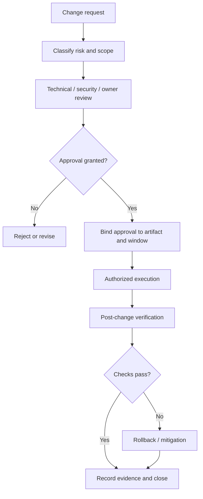
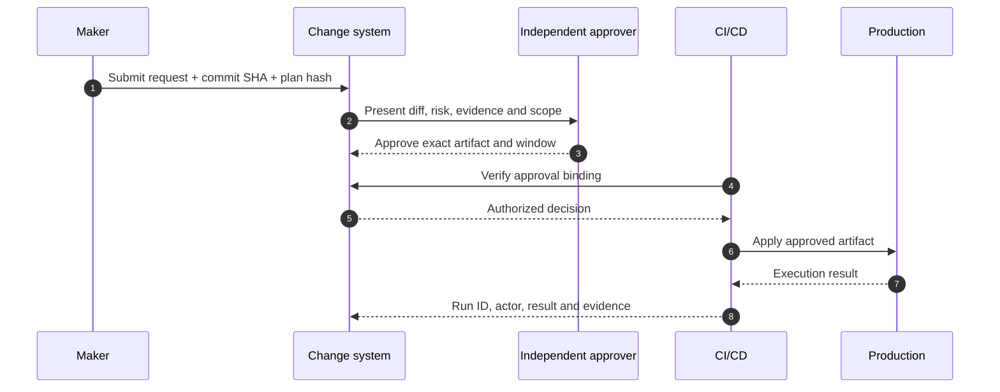

# Segregation of Duties and Sensitive Change Approvals

In cloud systems, a single action can impact the entire service: modifying an IAM policy, opening access to customer data, editing a firewall, disabling encryption, deleting backups, or deploying a new version. If one person can propose, self-approve, execute, and erase traces of a change, the organization struggles to prevent accidental errors, privilege abuse, or intentional misconduct.

**Segregation of Duties (SoD)** is the principle of dividing critical steps or permissions across independent roles so that no single individual can unilaterally execute an entire high-risk action. **Sensitive change approval** is the process of confirming a change has a valid purpose, appropriate scope, assessed risk, right-sized executor permissions, and verifiable results.

In the **CLOUD_ARCHITECTURE** module, SoD directly touches IAM, account/subscription/project structures, CI/CD, networking, databases, KMS, backups, auditing, and production operations. This lesson uses an equipment-rental platform example, where actions such as granting read access to payment data, altering firewalls, or deleting backups carry financial and security impact. Roles and approval thresholds here are illustrative; organizations must adapt them to their threat model, scale, legal obligations, and operational capacity.

## 1. Why Is Segregation of Duties Necessary?

A sound control system does not just ask “does this person have permission?”—it also asks “should this person be able to carry out the entire process alone?” Individual permissions may be legitimate, yet combining multiple permissions can create conflicts of interest or high-impact failure modes.

For instance, an engineer needs permission to create firewall changes to resolve tickets. If that same person can approve the request, apply the rule to production, and delete audit logs, there is no independent checkpoint left. A CIDR typo can expose a database to the internet; an intentional act can open an unauthorized path and cover its tracks.

| Risk | Example | Consequence |
| --- | --- | --- |
| Operational error | Operator accidentally drops production database | Data loss, downtime |
| Privilege abuse | Admin grants self access then reads payment data | Data leakage or tampering |
| Rubber-stamp approval | Approver does not understand the scope | Control provides no real value |
| Conflict of interest | Transaction creator approves own refund | Fraud becomes hard to detect |
| Out-of-process change | Editing firewall directly in console | No review or rollback path |
| Covering tracks | Executor has permission to delete logs | Hard to investigate and establish accountability |
| Credential compromise | Attacker compromises shared admin account | Bypasses multiple control layers |

SoD reduces the chance of a single individual creating and concealing misconduct, while creating opportunities for others to catch mistakes before changes take effect. SoD does not eliminate collusion, account compromise, or system bugs; it must be combined with IAM, auditing, monitoring, and testing.

## 2. Distinguishing SoD, Least Privilege, and Maker-Checker

| Concept | Question | Mechanism |
| --- | --- | --- |
| **Least privilege** | What minimum permissions does an identity need? | Restrict actions, resources, scope, and duration |
| **Segregation of Duties** | Which permissions/steps must not sit with the same actor? | Separate roles, accounts, approvals, and execution |
| **Maker-checker / four-eyes** | Who creates the request and who reviews/authorizes it? | Requester differs from approver |
| **Separation of environments** | Can dev/test permissions affect production? | Separate accounts/projects, credentials, and deployment authority |
| **Privileged access management** | How is elevated access granted with control? | JIT access, session recording, approval, and revocation |

Least privilege is still needed even with SoD. An approver group may be separate from an operator group, yet if both hold organization-wide Owner rights, permission scope remains excessive. Conversely, minimal privileges for one person do not automatically stop them from both creating and approving a change.

## 3. SoD Design Principles

1. **Independent roles:** requester, approver, and executor are separated for high-risk activities.
2. **Minimal scope:** permissions apply only to the needed resources, actions, environments, and timeframe.
3. **No self-approval:** a maker cannot approve a request they created.
4. **Content-bound approvals:** approvers see the actual artifact, diff, target, and impact.
5. **Protected evidence:** requests, approvals, execution, and outcomes reside in an independent audit trail.
6. **Time-bound privileges:** elevated permissions auto-expire or are revoked post-task.
7. **Emergency capability:** break-glass exists with defined criteria, monitoring, and post-incident review.
8. **Periodic checks:** review permissions, conflict matrices, exceptions, and owners.

Do not segregate duties by job title alone. Analyze action chains, actual technical permissions, and combinations of rights that could bypass controls.

## 4. Identifying Sensitive Duties

| Domain | Sensitive Change | Why Control Is Needed |
| --- | --- | --- |
| Identity/IAM | Creating admins, changing trust policies, cross-account grants | Expands system-wide control |
| Network | Opening ingress, modifying routes/security groups/private endpoints | Exposes services or causes outages |
| Database | Dropping tables, schema changes, data exports, write grants | Data loss or integrity impact |
| KMS/encryption | Disabling/deleting keys, changing key policies | Loss of decryption capability |
| Backup/DR | Deleting vaults, shortening retention, disabling immutable locks | Loss of recoverability |
| CI/CD | Altering production pipelines, runner identities, artifact sources | Unvetted code/configs reach production |
| Logging/security | Disabling audits, altering alert routes, tuning detection rules | Weakens detection and investigation |
| Billing/cost | Large quota increases, purchasing commitments, changing budget controls | Financial impact |
| Data sharing | Granting PII exports or partner access | Privacy and data leakage risk |
| Production operations | Failovers, credential rotation, deleting resources | Downtime or data loss |

Classify based on blast radius, reversibility, data sensitivity, financial impact, availability, and detectability. Not every production change needs the same number of approvers.

## 5. Building a Conflict-of-Permissions Matrix

A conflict matrix documents duties or permissions that must not be combined:

| Duty A | Duty B | Conflict? | Control |
| --- | --- | --- | --- |
| Creating payment/refund requests | Approving one's own refund | Yes | Maker-checker |
| Authoring IAM policy change | Self-approving and deploying that policy | Yes | Independent reviewer + pipeline gate |
| Running backup jobs | Deleting immutable backup vaults | Yes | Separate identities/accounts |
| Developing code | Approving production release of one's own code | Depends on risk tier | Independent reviewer |
| Managing KMS keys | Self-approving key deletion | Yes | Dual control |
| Viewing audit logs | Deleting or modifying audit logs | Yes | Separate log administrator rights |
| Requesting emergency access | Self-approving and granting emergency access | Yes | Independent approval/alert |

The matrix must specify whether conflicts occur at the person, group, role, workflow, or technical permission level. One person might hold two different titles while using the same credentials; in that case, SoD exists only on paper.

### Preventive and Detective Controls

- **Preventive controls:** stop the action upfront, e.g., policy blocking makers from approving their own requests.
- **Detective controls:** detect during or after the action, e.g., alerting when an identity elevates its own permissions.
- **Corrective controls:** limit impact and recover, e.g., revoking permissions, rolling back policies, and rotating credentials.

High-risk changes should rely primarily on preventive controls, with detective/corrective controls as supplementary layers. Relying solely on post-hoc audits after an admin deletes data is insufficient to protect data.

## 6. Roles in the Change Process

| Role | Responsibilities |
| --- | --- |
| **Requester/Maker** | States need, scope, rationale, impact, and plan |
| **Technical reviewer** | Checks design, diff, dependencies, tests, and rollback |
| **Security reviewer** | Checks IAM, network, data classification, and threats |
| **Business/data owner** | Confirms business purpose and acceptable impact |
| **Approver** | Decides based on risk tier and authority |
| **Implementer/Operator** | Executes exact approved artifact, scope, and window |
| **Observer/Auditor** | Verifies evidence, logs, results, and exceptions |

In small teams, one person may wear multiple hats for low-risk changes. For critical operations, the requester must never self-approve; the operator must never alter the artifact post-approval without submitting a new request. Separating identities matters more than having different role labels on a form.

### Illustrative RACI

RACI stands for Responsible (executes), Accountable (holds final accountability), Consulted (provides input), and Informed (kept updated).

| Activity | Maker | Tech reviewer | Security | Owner/Approver | Operator |
| --- | --- | --- | --- | --- | --- |
| Create change request | R | C | C | A | I |
| Technical review | C | R | C | A | C |
| Security review | C | C | R | A | I |
| Approval decision | I | C | C | A/R | I |
| Execution | I | C | I | A | R |
| Post-change verification | C | R | C | A | R |
| Close change/audit | I | C | C | A | R |

One approval may require multiple authorities by scope, e.g., data owner and security. Avoid assigning multiple Accountable parties without specifying who holds the final decision.

## 7. Tiering Risk Levels and Approval Steps

Do not force heavy processes onto every change. Create risk tiers based on blast radius and irreversibility.

| Tier | Example | Suggested Controls |
| --- | --- | --- |
| Low | Updating a dashboard with no sensitive data | Peer review, automated tests, change record |
| Medium | Changing service config or adding read access to an internal dataset | Technical approval, owner notification, rollback |
| High | Opening network paths, granting confidential access, schema migrations | Tech + security/owner review, staged rollout |
| Critical | Deleting KMS keys, disabling auditing, lowering backup retention, org-wide admin | Dual control, independent approvers, time-bound access, post-review |

Relative scoring can be used: `impact × likelihood × exposure × irreversibility`. This multiplication aids ranking only; it does not replace qualitative assessment or mandatory approval obligations.

## 8. End-to-End Change Approval Process

1. **Request:** rationale, goal, scope, resources, environment, owner, and timing.
2. **Risk classification:** tier, data sensitivity, blast radius, reversibility, and dependencies.
3. **Review:** diff/artifact, tests, security, privacy, capacity, and operational readiness.
4. **Approval:** proper roles, proper count, and no self-approval.
5. **Scheduling:** change window, freeze calendar, dependencies, and notifications.
6. **Execution:** authorized pipeline/identity applies the exact artifact.
7. **Verification:** health checks, postconditions, monitoring, and business validation.
8. **Close:** evidence, outcomes, exceptions, and revoking temporary access.



An approval must not be merely an “Approved” status. It must bind to the exact reviewed content, approver, timestamp, conditions, and validity window.

## 9. Required Content in a Change Request

| Field | Content |
| --- | --- |
| Change ID | Unique identifier |
| Requester | Creator identity and team |
| Business reason | Justification and desired outcome |
| Scope | Account/project, region, resource, tenant, environment |
| Change type | IAM, network, database, KMS, backup, application... |
| Risk tier | Low/Medium/High/Critical and rationale |
| Artifact/diff | Commit SHA, artifact digest, IaC plan hash, SQL checksum |
| Dependencies | Services, data products, consumers, teams, and vendors |
| Test evidence | Unit/integration/security/performance/restore tests |
| Execution plan | Executor, pipeline/command, change window |
| Rollback/mitigation | Rollback criteria, limits, and recovery steps |
| Monitoring | Metrics, alerts, postconditions, and owner |
| Approval | Approvers, decisions, timestamps, and conditions |

Never place passwords, secrets, tokens, or unnecessary PII inside tickets. Link to evidence stored with appropriate access controls and retention.

## 10. Maker-Checker and the Four-Eyes Principle

**Maker-checker** requires the creator of a transaction/change to differ from the checker or approver. The **four-eyes principle** requires at least two independent people to review a critical action before it takes effect.

For example, a developer authors an IaC change opening a private endpoint; a technical reviewer checks routes/security groups/DNS; a security approver confirms policy and scope; the pipeline applies only the approved commit.

Critical changes may require two independent approvals: technical authority and security/owner authority. Multiple clicks on "approve" do not establish independence if all approvers belong to the same permission group or one person controls everyone's credentials.

Conditions for independence:

- Distinct identities, no shared accounts.
- Reviewer is not the maker.
- Approver possesses domain knowledge and proper authority.
- No ability to self-modify approval records.
- Workflow checks conflicts across users, groups, and roles.
- Audit clearly logs who reviewed and decided.

### Quorum-Based Approvals

Some changes may require 2 of 3 approvers from independent groups. Rules must clarify which groups count, whether a security approver is mandatory, whether the maker is excluded from the approver pool, how delegates are handled, and how approvals expire when artifacts/scopes change.

## 11. Binding Approvals to Artifacts and Execution

A dangerous flaw is approving one diff while the pipeline executes a different artifact. A reviewer inspects commit A, then the branch updates and the pipeline deploys commit B while reusing A's approval.

To prevent this:

- Bind approvals to commit SHA, artifact digest, IaC plan hash, or migration checksum.
- Lock scope: account, region, resource, and environment.
- Give approvals an expiry/time window.
- Invalidate approvals if the artifact, policy, or scope changes.
- Have the pipeline verify the approval token right before applying.
- Deploy only signed/verified artifacts.
- Log execution run ID and actor identity.



Approval binding turns approval into an enforceable technical condition rather than a casual chat message.

## 12. Just-in-Time Privileged Access

Standing admin permissions expand the blast radius when credentials are leaked or misused. **Just-in-time (JIT) access** grants elevated permissions only after a valid need arises, for a short duration and specific scope.

A JIT workflow:

1. Operator submits a request with incident/change ID, resource, and justification.
2. Policy checks role, risk tier, eligibility, and SoD.
3. Independent approver confirms if required.
4. Identity provider/PAM grants a temporary role with a TTL.
5. Session enforces MFA and captures auditing/recording per policy.
6. Permissions expire automatically or are revoked after the task.
7. Reconcile actual activity against the request.

Never allow a user to grant Owner to themselves. Separate JIT approval, role issuance, and execution permissions. If a system auto-grants privileges by policy, both the policy and service identity must be independently protected.

Restrict temporary privileges by role/action/resource, account/region, and task duration; block creation of long-lived credentials without separate approval; log sessions/commands/API calls per policy.

## 13. Break-Glass Access: Emergency Yet Still Controlled

When the identity provider, approval system, or control plane suffers an outage, normal workflows may fail. Break-glass is an emergency access path to restore services or prevent damage.

Break-glass must:

- Be used only for predefined emergency scenarios.
- Use strongly protected accounts/credentials never used day-to-day.
- Require MFA or suitable multi-factor verification.
- Store credentials in a controlled vault.
- Trigger immediate alerts upon use.
- Enforce bounded duration and scope where platform capabilities allow.
- Ship audit/logs outside the failure domain.
- Mandate post-incident review and credential rotation after use.

Do not force operators to wait on a broken approval workflow while an outage causes severe damage. Emergency actions can proceed under clear criteria, provided rationale is logged, owners are notified, and post-event reviews occur. If emergency accounts are used frequently, review everyday permissions or the JIT workflow.

## 14. Separating Accounts, Projects, and Environments

| Environment/Account | Purpose | Controls |
| --- | --- | --- |
| Development | Development and experimentation | Broader developer permissions on synthetic data |
| Test/staging | Integration and release verification | Masked/synthetic data, restricted permissions |
| Production workload | Serving customers | Narrow runtime identities, pipeline-only changes |
| Security/logging | Auditing, detection, and security tooling | Production admins cannot delete logs |
| Backup/recovery | Protecting recovery points | Separate permissions, immutable retention, restore roles |
| Shared platform | Networking, registries, CI/CD, identity | Cross-account permissions managed separately |

Environment separation reduces the risk of developer credentials touching production. However, organization-level admins, central identity, and CI/CD runners can still create cross-boundary paths. Review trust relationships and top-level administrative privileges carefully.

## 15. Policy-as-Code and Automating SoD Enforcement

Policy-as-code puts control rules into machine-checkable, version-controlled, testable form. Examples:

- Prevent a request creator from approving that same request.
- Block deploying artifacts if commit SHA differs from the approval.
- Require production deploys to have a reviewer from an independent group.
- Disallow IAM policies granting wildcard admin to runtime identities.
- Block disabling audits or shortening backup retention without critical-tier approval.
- Block deployment when critical security scans fail.
- Enforce TTLs and auto-revocation on temporary permissions.

Pseudocode:

```text
allow_deploy(request, approval, actor):
    require request.status == "APPROVED"
    require actor.id != request.maker_id
    require approval.approver_id != request.maker_id
    require approval.artifact_digest == request.artifact_digest
    require approval.environment == "production"
    require approval.scope == request.scope
    require now < approval.expires_at
    require approval.risk_tier >= required_approval_tier(request)
    return true
```

This is pseudocode, not syntax for a specific policy engine. Real implementations must handle multi-approvers, revocation, delegation, group memberships, and race conditions.

Test both allow and deny cases: maker self-approving, independent approver with matching scope/artifact/window, changed commit, expired approval, approver losing membership, out-of-environment deploy, and emergency path.

## 16. Approving IAM and Access Permission Changes

IAM changes can expand privileges across many services. Reviewers must verify principals/roles, actions, resource scopes, trust policies, network/MFA/session conditions, duration, ability to alter KMS/audit/backups, and indirect privilege escalation paths.

Example of an analyst requesting read access to the payment ledger:

1. Data owner confirms business purpose and dataset.
2. Security checks classification and privacy.
3. Create a read-only role scoped strictly to a masked/curated view.
4. Restrict tenant/region if needed.
5. Grant access via identity workflow with an expiry/review date.
6. Audit queries and conduct periodic access reviews.

Never grant database admin if the analyst only needs to read a curated view.

### Access Reviews

Periodically inspect departed/transferred users, unused service identities, unrevoked temporary access, abnormal admin group growth, trust policies pointing to old principals, and roles with wildcards/overly broad scopes. Access reviews require owners to certify or revoke; an unacted report is not an effective control.

## 17. Approving Network and Security Boundary Changes

Network changes like opening inbound traffic, peering, routes, private links, or DNS forwarding alter service reachability. Reviewers should inspect:

- Source/destination CIDRs and ports.
- Direction and protocol.
- Affected resources/zones/regions.
- Public/private exposure.
- Application-layer authentication/authorization.
- Data classification traversing the new path.
- Logging, threat detection, and expiration.
- Rollback plan and external connectivity tests.

“Temporary” rules must have enforceable expiration—never just an end date typed into a ticket. Manage network policies via IaC and drift detection to avoid out-of-band console edits.

## 18. Approving Database, Backup, and KMS Changes

**Database:** destructive DDL requires data owner/DBA review and recovery points; large migrations need lock/replication/performance testing; data exports require purpose, scope, destination, and retention; schema changes need compatibility and rollback/roll-forward plans.

**Backup/DR:** deleting vaults, shortening retention, disabling immutability, or changing destinations are critical. Requesters cannot self-approve; independent approvers from security/backup authorities are required; verify secondary recovery copies and restore tests; audit/alert outside the production account.

**KMS:** disabling/deleting/scheduling key deletion requires dedicated approval. Check dependent workloads, backups, and regions; verify rotation/decryptability; maintain key recovery/break-glass procedures; never allow production admins to unilaterally delete keys protecting backups.

## 19. Audit Trails and Approval Evidence

The audit trail must reconstruct who requested, who approved, what exact content, who executed, when, and what happened.

| Field | Meaning |
| --- | --- |
| change_id | Links all steps |
| requester_id | Creator |
| reviewer/approver_id | Reviewer/approver and role at that time |
| decision | Approve/reject/expire/revoke |
| artifact_digest | Exact approved content |
| scope | Environment/resource/region |
| risk_tier | Risk classification |
| timestamps | Created/reviewed/approved/executed/closed |
| execution_identity | Principal that actually executed |
| run_id/result | Pipeline/command outcome |
| evidence_refs | Tests, diffs, logs, monitoring, rollback evidence |
| exception | Bypass/break-glass justification and reviewer |

Logs must be protected from modification/deletion by audited actors. Use a separate logging account/boundary, retention policies, and alerts if log ingestion stops. Avoid logging secrets or unnecessary PII.

If a ticket shows only “Approved” and “Done,” investigators cannot tell which artifact reviewers saw or whether the pipeline deployed the same content. Storing diffs/digests, approval versions, and run IDs links decisions directly to actions.

## 20. Exceptions and Emergency Changes

Incidents may demand emergency changes to prevent data loss or restore services. Emergency changes require:

- Clear trigger: incident/severity or urgent business condition.
- Minimal scope and duration.
- Emergency approval authority or dual-confirmation rules.
- Logging/recording enabled wherever possible.
- Notification to owner/security/incident commander.
- Post-implementation review within a defined SLA.
- Confirmation that temporary permissions and configs are revoked/standardized.

Exceptions must have an expiration and an owner. If extended, create formal risk acceptance, compensating controls, and a review date. Never let temporary admin access persist indefinitely.

## 21. SoD in CI/CD and the Software Supply Chain

CI/CD can become the most powerful production execution path. Separating roles in an approval UI while letting developers freely edit deployment workflows defeats the control.

- Protected branches and mandatory reviews.
- CODEOWNERS/approvals for sensitive paths.
- Separate permissions to edit pipelines from permissions to run deployments.
- Production runners use dedicated workload identities with narrow scope.
- Immutable artifacts, signed and digest-verified.
- Approvals bound to artifacts.
- Environment protection rules/manual approvals per tier.
- Secrets never exposed to untrusted jobs.
- Audit workflow files, runner configs, and permission changes.

IAM files, Terraform networking, KMS, backup policies, production workflows, and database migrations may require specialized code owners/reviewers.

## 22. Governing Service Identities and Automation

Service identities also need SoD; an overly permissive CI runner could deploy code, alter IAM, and delete resources.

- One service identity per task/workload.
- Never share keys across pipelines and environments.
- Prefer short-lived tokens/workload identities when available.
- Restrict resources/actions and trust conditions.
- Separate backup writers from backup deletion admins.
- Separate deploy identities from IAM policy administrators.
- Rotate/revoke credentials upon suspected compromise.
- Review ownership and last-used timestamps.

Automation must have an owner, source code/config version, and auditable identity.

## 23. Trade-Offs Among Speed, Safety, and Organizational Scale

| Control Approach | Pros | Trade-offs |
| --- | --- | --- |
| Two approvers for every change | Reduces unilateral actions | Slow, causes approval fatigue |
| Risk-tiered approvals | Focuses rigor on high-risk changes | Requires accurate classification |
| JIT access | Eliminates standing privileges | Adds elevation steps and identity/PAM dependency |
| Policy-as-code | Consistent enforcement, testable | Complex policy logic, maintenance needed |
| Central approval board | Consistent and clear auditing | Can create bottlenecks |
| Delegated domain approvals | Fast, close to business context | Needs guardrails and access reviews |
| Break-glass | Recovers when normal flows fail | Risk of misuse |

Small teams can use on-call independent reviewers, automated approvals from cross-team owners, and immutable logs. Large enterprises may need role catalogs, policy engines, PAM, ticket integrations, and periodic access certifications. Controls must align with risk and prove effectiveness.

## 24. Common Anti-Patterns

1. **Creator self-approves.** Maker-checker exists only on paper.
2. **Shared admin accounts.** Cannot attribute actors or segregate accountability.
3. **Approval on a branch, deploying another commit.** Missing artifact binding.
4. **Approvers lacking context.** Signing off without inspecting diffs, risks, or tests.
5. **Standing admin privileges.** Leaked credentials carry massive blast radius.
6. **Unreviewed break-glass.** Emergency paths become everyday shortcuts.
7. **Temporary exceptions without expiry.** Temporary permissions become permanent.
8. **Audit logs managed by the same admins.** Actors can conceal actions.
9. **Every change requires multiple approvals.** Approval fatigue turns controls into rubber stamps.
10. **Policy-as-code without negative tests.** Unknown whether policies block bad behavior.
11. **Separating titles without separating credentials.** One person still performs both roles.
12. **Pipelines holding account-wide Owner.** One CI edit bypasses every other SoD control.

## 25. Case Study: Payment Ledger Access Change

An analyst needs access to the payment dataset to analyze refund rates. The data includes transaction references and some customer-identifying fields. The analyst does not need to update transactions or read full PII.

Workflow:

1. Analyst submits a request detailing purpose, dataset, duration, query use case, and team.
2. Data owner confirms business purpose and the appropriate view.
3. Privacy/security reviewer checks classification, masking, and data minimization.
4. Platform creates a read-only role restricted to a curated view, scoped by region/tenant if needed.
5. Approval binds to principal, policy version, dataset, and expiration.
6. IAM workflow grants temporary membership; never database admin.
7. Query audits are monitored; access is reviewed upon expiration.
8. Access auto-revokes or is removed; ticket archives decisions and evidence.

If the analyst needs an export, require a separate request stating file format, destination, fields, recipient, retention, and purpose. Approval to read a dataset does not implicitly authorize bulk downloads.

During a production incident, break-glass is used only if needed to prevent damage/restore service, with minimal scope, immediate alerts, session logging, and post-event review.

## 26. Case Study: Production Firewall Change

The Booking API needs to connect to a Payment Provider over a new endpoint. The change requires adding an egress destination and updating routes/DNS.

| Step | Person/Role | Evidence |
| --- | --- | --- |
| Create change | Network engineer | CIDR, port, destination, rationale |
| Technical review | Platform reviewer | Routes, DNS, dependencies, rollback |
| Security review | Security engineer | Egress policy, threats, logging |
| Business approval | Service owner | Impact and window |
| Execute | CI/CD network identity | Approved IaC commit digest |
| Verify | Operator/monitoring | Connectivity tests, denied traffic, health |
| Close | Change owner | Audit, diff, outcome |

The pipeline applies only the approved digest. If CIDRs or routes change after review, the approval is invalidated and re-review is required. If an emergency change is applied manually, record the actual diff, rationale, and actor, then reconcile back into standard IaC once the service stabilizes.

## 27. Measuring SoD Effectiveness

Do not judge SoD solely by approval counts or closed tickets. Measure coverage, quality, and operational cost.

| Metric | How to Measure | Signal to Watch |
| --- | --- | --- |
| Sensitive change coverage | % of sensitive changes passing through workflow | Direct changes bypassing pipelines |
| Maker-checker compliance | % of requests with independent reviewers | Self-approvals or overlapping identities |
| Artifact binding success | % of deploys matching approved digests | Drift between approval and execution |
| JIT privilege duration | Duration of elevated access | Unusually long sessions |
| Orphaned privileges | Roles/accounts lacking owners or recent use | Excess permissions |
| Break-glass frequency | Count, reasons, and actions | Frequent use or missing reviews |
| Approval lead time | Time from request to decision | Bottlenecks/approval fatigue |
| Exception age | Age of open exceptions | Temporary controls lingering long-term |
| Audit completeness | % of changes with requester, approver, actor, artifact, and result | Missing evidence |
| Unauthorized change detection | Count of out-of-pipeline/out-of-policy changes | Insufficient guardrails |

Analyze metrics by risk tier/domain. Longer lead time on critical changes may be justified; long lead time on minor changes signals overly heavy workflows.

## 28. Alignment with Well-Architected

| Pillar | Supporting Design | Trade-offs/Risks | Verification Question |
| --- | --- | --- | --- |
| **Operational excellence** | Change workflows, RACI, auditing, JIT, and runbooks | Adds process, tooling, and maintenance overhead | Can on-call engineers make safe changes on time? |
| **Security** | Least privilege, SoD, MFA, approvals, environment separation | Complex policies and exceptions can be abused | Can one identity grant itself access, execute, and erase traces? |
| **Reliability** | Reviews, staged rollouts, rollbacks, and break-glass | Slow approvals can delay recovery | Is there an emergency path when the approval system fails? |
| **Performance efficiency** | Controlled privileges and changes reduce misconfigurations | Heavy gates slow releases | Does approval lead time fit the risk tier? |
| **Cost optimization** | Prevents unexpected resource creation/fraud | PAM, auditing, workflows, and reviewers carry cost | Which controls reduce the largest risks? |
| **Sustainability** | Standardized roles/policies and automation reduce manual churn | Tooling metadata/audits consume storage | Are reviews and privilege cleanup automated? |

SoD is part of architecture, not merely HR procedure. IAM permissions, cross-account trust, pipelines, logging, and recovery capabilities must reflect responsibility boundaries.

## 29. SoD Design Process and Checklist

### Process

1. **Inventory sensitive actions:** list operations that are high-impact, irreversible, or handle sensitive data.
2. **Map identities and privileges:** humans, groups, service identities, pipelines, admins, and break-glass.
3. **Build a conflict matrix:** identify permission/step combinations no single actor may hold.
4. **Tier risks:** assign tiers and appropriate approval counts.
5. **Design workflows:** maker, reviewer, approver, operator, evidence, and expiration.
6. **Enforce via policy:** IAM, branch protection, deployment gates, JIT, resource locks, and auditing.
7. **Test:** self-approval, artifact mismatch, expired approvals, privilege escalation, and break-glass.
8. **Monitor:** access reviews, exception age, unauthorized changes, and audit completeness.
9. **Improve:** reduce approval fatigue, prune excess privileges, and drill emergency flows.

### Review Checklist

- Are sensitive actions and blast radii inventoried?
- Are makers blocked from self-approving?
- Are reviewers/approvers independent in identity, permissions, and accountability?
- Are approvals bound to artifact digests, scope, environment, and time windows?
- Do operators only hold permissions to execute the exact approved change?
- Are standing admin rights replaced with JIT where appropriate?
- Do service identities and CI/CD runners follow least privilege?
- Do accounts, production, security logging, and backups have proper trust boundaries?
- Does break-glass have clear criteria, alerts, TTL/revocation, and post-reviews?
- Do audit logs capture actor, decision, artifact, execution, and outcome?
- Do policy-as-code rules have negative tests and reviews?
- Do exceptions have owners, expiration, and risk acceptance?
- Are access certifications and orphaned-privilege cleanups active?
- Do critical changes have rollback/mitigation and recovery points?
- Do metrics track coverage, approval quality, exception age, and unauthorized changes?

## 30. Practice Exercises

### Exercise A — Creator Grants Self Permissions

An engineer creates an IAM request, approves it via a secondary group, and deploys a policy granting themselves Administrator access.

**Question:** at which layers are controls needed?

**Hint:** identity-level conflict checks, deny self-approval, independent approvers, protected policy repos, separate deployment identities, artifact binding, and privilege escalation alerts. Never compare role names alone.

### Exercise B — Old Approval, New Artifact

Commit A is reviewed and approved. Before deployment, a pipeline variable alters the destination and builds artifact B while still reusing A's approval.

**Question:** how do you detect and prevent this?

**Hint:** bind approvals to digests/plan hashes and scope; have the pipeline verify at apply time; differing artifacts require re-review.

### Exercise C — Break-Glass During an Incident

The identity provider fails while the production database requires urgent failover.

**Question:** how do you act quickly while preserving accountability?

**Hint:** independently protected emergency identity, MFA, minimal scope, out-of-band alerts, session/audit recording, and post-incident review; afterward rotate credentials and reconcile permissions.

### Exercise D — Temporary Access Never Expires

A contractor is granted two-day read access to payment data, yet group membership persists for six months.

**Question:** what design prevents recurrence?

**Hint:** JIT/TTL, automatic revocation, owner and end date, periodic access reviews, orphaned-privilege alerts, and query audits.

### Exercise E — Changing Backup Retention

An admin wants to shorten immutable retention because storage costs increased.

**Question:** what factors must approval evaluate?

**Hint:** classification, legal holds, threat dwell time, RPO/RTO, secondary recovery copies, cost analysis, restore drills, security/data owner approval, and change windows; policy updated via pipeline.

### Self-Assessment Criteria

| Competency | Required Evidence |
| --- | --- |
| SoD design | Sensitive action inventory and conflict matrix |
| Approvals | Risk tiers, maker-checker, approver authority, and artifact binding |
| Privileged access | JIT, MFA, TTL, revocation, and break-glass |
| Automation | Policy-as-code, CI/CD gates, and negative tests |
| Evidence | Audit trail linking requests, approvals, actors, artifacts, and outcomes |
| Governance | RACI, exception register, access reviews, and owners |
| Operations | Change runbooks, rollbacks, monitoring, and incident drills |

Segregation of duties prevents a single actor from unilaterally creating, approving, executing, and concealing high-risk changes. Combining least privilege, maker-checker, artifact-bound approvals, JIT privileged access, audited break-glass, and policy-as-code allows organizations to modify cloud infrastructure with clear accountability while maintaining deployment velocity. Control value is proven by effective permissions, execution evidence, and detection/recovery capabilities—not merely the number of steps in a workflow.
