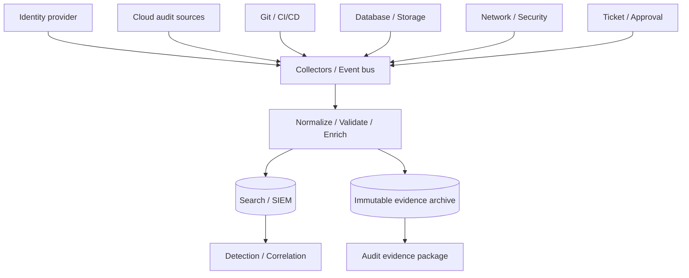
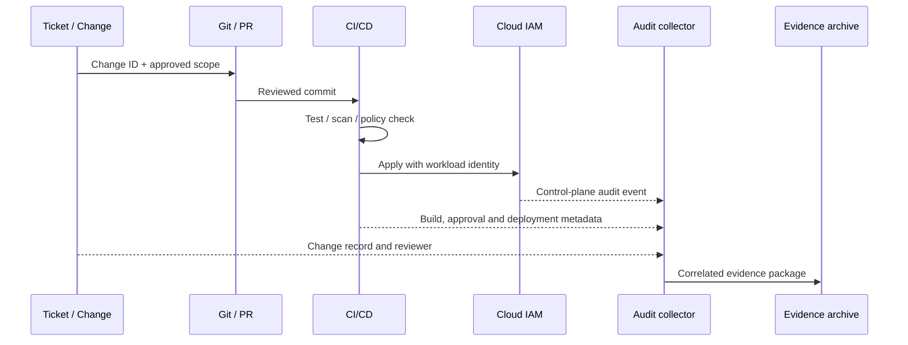

# Audit Evidence Collection and Change Traceability

## 1. Why Does Cloud Architecture Need Evidence and Traceability?

An organization may have approval workflows, security policies, and operational dashboards yet still struggle to answer basic questions during an audit or incident investigation: Who changed access permissions? Where was the change requested and approved? Which artifact was deployed? What was the production configuration at that moment? Is there proof that controls operated and who accessed the data?

**Audit evidence** is verifiable information supporting proof that an activity, decision, or control occurred according to a defined process. **Change traceability** links a change from its business rationale through approvals, source code, pipelines, artifacts, deployments, and runtime state.

In cloud architecture, changes can originate from pull requests, IaC, consoles, APIs, autoscaling, policy engines, managed services, operators, or automation. Storing only application logs risks missing control-plane changes. Keeping only screenshots makes it hard to prove content, timing, and provenance with integrity.

This lesson belongs to the **Governance and Compliance** chapter of the **CLOUD_ARCHITECTURE** module. The module teaches how to design cloud applications from business requirements to networking, compute, data, and deployment models—balancing reliability, security, scalability, cost, and operations under Well-Architected principles. Audit evidence collection and change traceability make architectural decisions, configurations, and operational actions explainable, inspectable, and reconstructible.

After this lesson, you will be able to:

- Define audit events, evidence sources, owners, and retention requirements.
- Design end-to-end traceability chains from requirements to runtime changes.
- Collect evidence from identity, cloud control planes, CI/CD, IaC, data, and operations.
- Protect evidence integrity, provenance, timestamps, and accessibility.
- Design retention, privacy, access control, exports, and evidence packages.
- Automate collection, verify completeness, and prepare for audits/incidents.

## 2. Distinguishing Logs, Audit Events, Evidence, and Records

These concepts are related but cannot be used interchangeably.

| Concept | Purpose | Example |
|---|---|---|
| Operational log | Diagnose application/system behavior | Request timeout, worker retry |
| Audit event | Record security/governance-significant actions | User changes role, admin creates access key |
| Evidence | Document or data proving an assertion/control | Audit event, policy snapshot, approval, test result |
| Record of decision | Capture decisions, accountable parties, and rationale | ADR, exception approval |
| Change record | Link a change to its request and deployment | Ticket, PR, build, release, deployment |

A log line can become evidence if it has proper provenance, context, reliability, protection, and retention. Conversely, a dashboard screenshot is not automatically sufficient evidence without timestamp, scope, filters, exporter, and tamper protection.

### 2.1. Assertions and Evidence

Start from the statement you want to prove:

- “All production changes are approved.”
- “Production access follows least privilege.”
- “Database backups run and restores work.”
- “Sensitive data is accessed only by authorized principals.”
- “Releases trace back to tested commits and artifacts.”

Then identify the needed evidence types, such as approval records, CI policy results, cloud audit events, IAM policy snapshots, backup job results, and restore tests. Do not hoard massive volumes of logs without knowing which assertion they substantiate.

## 3. Defining Audit Scope and Evidence Requirements

### 3.1. Defining Targets and Controls

Specify:

- Systems, cloud accounts/projects/subscriptions, regions, and environments.
- Data, workloads, identities, and resources in scope.
- Controls or requirements to prove.
- Time period and inspection frequency.
- Control owner, evidence collector, and evidence reviewer.
- Authoritative data sources, storage systems, and access permissions.

Scope must match real architecture. An “MFA for admins” control must cover identity providers, break-glass accounts, service principals, and federation paths; checking one user group's settings is insufficient.

### 3.2. Building an Evidence Matrix

| Control/Assertion | Evidence Source | Evidence | Owner/Cadence |
|---|---|---|---|
| Production changes approved | Ticket/PR/release system | Request, reviewer, approval timestamp | Release owner / per change |
| IAM least privilege | Cloud IAM, policy-as-code | Policy snapshots, review results, access simulations | Security / periodic and on change |
| Data access audited | Database/cloud audit logs | Principal, action, resource, outcome | Data owner / continuous |
| Backups recoverable | Backup service, restore exercises | Job results, restore records, integrity checks | DBA/SRE / scheduled |
| Artifact provenance | CI/CD, registry, signing service | Commit, build ID, digest, signature, provenance | Platform / per release |
| Network boundaries governed | IaC, firewall/security group logs | Desired state, deployed state, change approvals | Network owner / per change |

The evidence matrix should include assertion, control ID, authoritative source, query/export method, format, owner, frequency, retention, access policy, and acceptance criteria.

## 4. Unified Audit Event Model

To correlate data across systems, event schemas must be reasonably consistent. An audit event typically includes:

- **Event identity:** unique event ID, event type, and schema version.
- **Time:** timestamp, timezone/UTC, clock source, and ingestion metadata if needed.
- **Actor:** user/service principal, session, or workload identity.
- **Action:** action performed, e.g., create/update/delete/assume-role/deploy.
- **Target:** resource ID, account/project, region, and tenant scope.
- **Outcome:** success/failure, error code, or policy decision.
- **Context:** request/correlation ID, change/ticket/PR/release ID.
- **Origin:** source system, API, console, pipeline, or automation.
- **Integrity/provenance:** signature, checksum, collector identity, or source-proof metadata.

Not every system populates every field. When critical fields are missing, document the limitation instead of guessing.

### 4.1. Audit Event Example

```json
{
  "event_id": "evt-01JABC...",
  "schema_version": "1.0",
  "event_type": "iam.policy.updated",
  "event_time": "2026-11-18T04:20:31Z",
  "ingested_at": "2026-11-18T04:20:32Z",
  "actor": {
    "type": "federated_user",
    "principal_id": "principal-42",
    "session_id": "session-abc"
  },
  "action": "UpdatePolicy",
  "target": {
    "resource_id": "role/booking-deployer",
    "account": "prod-account",
    "region": "ap-southeast-1"
  },
  "outcome": "success",
  "change_ref": "CHG-1842",
  "source": "cloud-control-plane",
  "request_id": "req-98f..."
}
```

This is an illustrative schema, not a specific provider's standard format. Never put access tokens, passwords, private keys, or full sensitive payloads in audit events. Principal and resource IDs may also require masking or restricted viewer permissions.

### 4.2. Event Time and Ingestion Time

Event time is when the source recorded the action; ingestion time is when the collector received the event. Differences between the two help detect log delivery delays or source outages. System clocks can skew, so use UTC, synchronize clocks, preserve source timestamps, and avoid inferring causal order solely from timestamps.

### 4.3. Do Not Write Audits Through Paths the Actor Can Delete

If a workload can modify data and delete its own logs, evidence can be tampered with alongside the action. Ship audit events to an independent collector/stream, separate write/read/admin permissions, and use controlled storage. Privileged actions need control-plane/provider audits or independent sources where available.

## 5. End-to-End Change Traceability

A production change should link across steps:

1. Business need or security finding.
2. Change request/ticket and risk assessment.
3. Architecture decision or exception if needed.
4. Pull request/commit and review.
5. CI workflows, tests, scans, and policy evaluation.
6. Build artifact, version, digest, and provenance.
7. Approval/release record.
8. Deployment target, actor/workload identity, and timestamp.
9. Runtime state, health/SLO, and post-deployment outcome.
10. Rollback/incident record if the change fails.

### 5.1. Change Traceability Chain


This chain must use stable IDs to link data. A ticket ID typed into a commit message helps but is insufficient if entered arbitrarily; systems must verify that commit, PR, build, and deployment genuinely belong to the same release.

### 5.2. IaC Traceability

For Infrastructure as Code:

- Commits define desired state.
- Pipelines record plans/previews and policy checks.
- Approvals bind to the exact commit/plan artifact.
- Apply records log actor, workspace/environment, state version, and outcome.
- Cloud audit events capture which resources actually changed.
- Drift detection compares deployed state against desired state.

Never treat an IaC file in Git as proof that production is running that exact configuration. Link commits to applies and verify actual live state.

### 5.3. Tracing Out-of-Pipeline Changes

Consoles, CLIs, SDKs, emergency sessions, autoscaling, and managed services can mutate resources outside normal release workflows. You should:

- Capture cloud control-plane audit events.
- Enforce policies blocking or alerting out-of-pipeline changes by risk tier.
- Record exception/emergency tickets and approvers.
- Run drift detection to spot mismatched states.
- Auto-generate change records/incident follow-ups for unlinked changes.

Not every runtime change is manual; autoscaling and control loops may be expected behavior. Classify actors and automation sources accurately.

## 6. Evidence Sources in Cloud Architecture

| Source | Typical Evidence | Things to Verify |
|---|---|---|
| Cloud control plane audit | API actions, principals, resources, regions, outcomes | Account/region/service coverage, delivery, and retention |
| Identity provider | Logins, MFA, federation, group/role changes | Principal mappings, service accounts, break-glass |
| CI/CD | Commits, workflows, tests, approvals, deploys | Artifact digests, runner identities, log integrity |
| Git/code hosting | Reviews, branch protection, commit history | Force pushes/admin bypasses and retention |
| IaC/policy engines | Plans, applies, policy results, drift | Desired vs. deployed state |
| Databases | Logins, DDL/DML audits, grants/revokes, backups | Query coverage, sensitive data redaction, privileges |
| Network/security services | Firewall/WAF/DNS/VPC flow events | Sampling, flow direction, retention, clocks |
| Object storage | Accesses, policy edits, object lifecycles | Data access logs, versioning, retention locks |
| KMS/HSM/secret managers | Key usage, rotation, secret access | Principals, key versions, denied events |
| Observability/SIEM | Correlations, alerts, incidents | Data lineage and who can edit/delete |
| ITSM/change management | Requests, approvals, exceptions, closures | Reviewer identities, timestamps, linkage |

A single source may not suffice for an assertion. For instance, CI reports deployment success, while cloud audit events confirm which role actually modified resources and runtime config snapshots confirm post-deploy state.

## 7. Centralized Evidence Collection

An evidence pipeline architecture can include:



The pipeline should have:

- Dedicated collector identities with least-privilege read access at each source.
- Durable buffers/queues to survive source or collector outages.
- Schema validation, source tagging, and dead-letter handling.
- Idempotent ingestion to handle duplicates.
- Timestamp/source metadata and clock monitoring.
- Monitoring for ingestion lag, drop counts, parse failures, and coverage.
- Archives isolated from administrative permissions of monitored workloads.

### 7.1. Completeness and Coverage

Data existing in a log archive does not mean collection is complete. Reconcile:

- Number of accounts/regions/services with auditing enabled.
- Any sources that stopped sending, dropped events, or failed parsing.
- Time windows with missing data.
- Collectors hitting permission loss, quotas, or network outages.
- Whether all required event types are enabled.
- Whether retention/immutability applies uniformly.

Absence of events must never be interpreted as absence of activity. Reports must distinguish “no events generated” from “no data to prove.”

## 8. Protecting Evidence Integrity and Provenance

Evidence is useful only when you can trust it came from an identified source and was not tampered with out of control.

### 8.1. Integrity Controls

- Separate permissions to create, read, delete, and administer evidence.
- Use storage versioning and retention locks/immutable policies where required.
- Hash or sign manifests/exports to detect tampering.
- Store manifests outside the protected objects themselves, with access auditing.
- Verify signatures/provenance on artifacts and log exports when supported by sources.
- Monitor actions disabling audits, altering retention, deleting logs, or modifying collectors.
- Back up archives and test restores/verification.

A hash proves content has not changed relative to the stored hash; it does not by itself prove initial content was truthful or the source trustworthy. Bind hashes to source identities, timestamps, collection methods, and chain of custody.

### 8.2. Chain of Custody

When exporting evidence for audits or investigations:

1. Record who collected it, when, source, query/filter, and scope.
2. Record tool/version, export format, and timezone.
3. Generate checksums or signatures for files/manifests.
4. Keep read-only originals in a controlled repository.
5. Log every copy, transfer, transformation, and recipient.
6. If normalizing/redacting, maintain links to originals and document transformations.
7. Verify integrity before submission or investigative use.

Never edit original evidence files to tidy them up; create derived copies and document sources clearly.

### 8.3. Preventing Modification/Deletion via Separation of Duties

A production operations team should not be able to modify workloads, delete audit archives, and alter collector IAM on their own. Separate:

- Workload/platform operators.
- Audit collector identities.
- Evidence archive administrators.
- Evidence readers/auditors.
- Security monitoring administrators.

For privileged actions, apply approvals/JIT access, session recording, or immutable auditing based on risk. Break-glass access requires independent auditing and post-use review.

## 9. Evidence for Identity and Access Permissions

Common questions to answer:

- Who logged in and using which authentication method?
- Were MFA/federation/session policies enforced?
- Who assumed a role or granted permissions?
- Under which ticket were permissions granted, and for how long?
- Which service principals accessed resources?
- Are denied access attempts logged?
- Who created, rotated, revoked, and used credentials/keys?

Identity evidence must map stable principal IDs, not just mutable display names. Distinguish users, groups, service accounts, workload identities, federated principals, and role sessions.

### 9.1. Access Reviews

An access review may include:

1. Export principal/role/resource lists from authoritative sources.
2. Cross-reference owners, business purposes, and provisioning tickets.
3. Identify unused permissions, overly broad grants, wildcards, and ownerless roles.
4. Confirm privileged, emergency, and cross-account access.
5. Revoke or adjust per approvals.
6. Archive before/after snapshots, reviewer, timestamp, and outcomes.

A screenshot of a user list does not prove effective access when policy inheritance, group nesting, permission boundaries, or resource policies exist. Use effective-permission analysis tools where supported by the platform.

## 10. Evidence for Data and Operational Controls

### 10.1. Databases and Data Access

Evidence may include login/access audits, role/grant changes, DDL, query audits on sensitive tables, backup status, encryption configurations, and restore tests. Control log volume and avoid capturing parameters with unnecessary PII/secrets.

### 10.2. Backups and Restores

Backup job success only proves the backup task reported completion. A complete control also needs:

- Backup coverage across databases, regions, and tenant tiers.
- Retention, encryption, and archive access permissions.
- Backup failure alerts and retries.
- Restore exercises with measured RTO/RPO.
- Post-restore integrity/consistency validation.
- Proof the application can read/write after recovery.

### 10.3. Network and Security Controls

Evidence includes desired/deployed firewall rules, route tables, WAF policies, private endpoints, DNS changes, security group changes, and flow logs. Flow logs may be sampled or lack payloads; document limitations rather than treating them as full proof of every request.

### 10.4. Incidents and Exceptions

Incident records should link alerts, timelines, actors/actions, affected resources, mitigations, approvals, forensic evidence, customer impact, and corrective actions. Exceptions must have rationale, scope, owner, expiration, compensating controls, and review dates; exceptions without expiration easily turn into implicit policy.

## 11. Retention, Privacy, and Data Minimization

Audit evidence can contain user IDs, IP addresses, resource names, query metadata, and sensitive operational details. Keeping data longer is not always better.

Retention design must consider:

- Applicable legal/contractual obligations and internal policies.
- Security investigations, forensics, and change reconstruction needs.
- Data classification, privacy, and jurisdictions.
- Storage costs, indexing costs, and retrieval speed.
- Legal holds, deletion requests, and expiration workflows.
- Archive backups/replicas and policy-compliant deletion.

Do not set one arbitrary retention period across all data. Legal/compliance owners and data owners must confirm applicable requirements. When a legal hold exists, enforce deletion blocks and log who placed/released the hold.

### 11.1. Minimizing Sensitive Data

- Never log passwords, private keys, bearer tokens, or full secrets.
- Mask/redact payloads and identifiers when raw content is unnecessary.
- Use pseudonymous IDs for analytics if sufficient for purpose.
- Separate permissions to read audit metadata from permissions to read business payloads.
- Restrict exports and audit searches/downloads of evidence.
- Govern data in staging and forensic copies under policies matching the source.

Redaction must stay consistent so correlation is not broken. When raw evidence is needed, grant access via a dedicated process rather than opening the entire archive to every auditor.

## 12. Preparing an Audit Evidence Package

An evidence package should help reviewers understand assertions, scope, sources, outcomes, and limitations without hunting across the entire system.

### 12.1. Suggested Structure

```text
evidence-package/
  manifest.yaml
  scope-and-assertions.md
  control-matrix.csv
  source/
    cloud-audit/
    identity/
    cicd/
    database/
    backup-restore/
  derived/
    change-traceability-report.csv
    access-review-summary.pdf
  integrity/
    checksums.txt
    signatures/
  limitations.md
```

This is a sample layout; not every audit requires these exact files.

### 12.2. Manifest

A manifest can record:

- Package ID, purpose, audit period, and scope.
- Supported controls/assertions.
- Evidence file ID, source system, query/filter, `collected_at`, and collector identity.
- Format, record count, byte size, checksum/signature.
- Redactions/transformations.
- Retention/classification and access restrictions.
- Missing sources, time gaps, or known limitations.

### 12.3. Evidence Quality Review

Before issuing:

1. Does evidence match the assertion and audit period?
2. Are sources authoritative and scope complete?
3. Are actor, timestamp, resource, action, and outcome present?
4. Does it trace back to tickets/PRs/releases or control owners?
5. Are integrity/checksums/signatures verified?
6. Were exports truncated, filtered, or sampled?
7. Have redaction and privacy been reviewed?
8. Are limitations and gaps documented?
9. Has an independent reviewer signed off?

An evidence package must never conceal gaps. Explicitly state unavailable data, unenabled sources, or technical limits, and propose separate remediation.

## 13. Example: Tracing a Production IAM Change

Suppose the Booking team needs to grant a service role read access to an object prefix holding invoices. The workflow might look like:

1. Ticket states business purpose, resource scope, owner, duration, and risk.
2. Security reviewer confirms least privilege and access conditions.
3. Pull request modifies the IaC policy; reviewers and status checks are recorded.
4. CI runs unit/policy tests, IaC scans, and builds an artifact/plan with a digest.
5. Release approval references the exact commit and artifact.
6. Pipeline uses a federated workload identity to apply.
7. Cloud audit logs capture principal, action, resource, outcome, and request ID.
8. Policy snapshot/runtime checks confirm effective permissions.
9. Access reviews confirm the role retains proper scope and expiration.
10. Evidence collector links ticket, PR, build, approval, apply event, and policy snapshot via change ID.

### 13.1. Traceability Diagram



If an emergency console deployment occurs, the standard chain may break. The system needs an emergency change ticket, cloud audit evidence, and post-change review to restore traceability.

## 14. Automation and Continuous Controls

Manual collection once a year easily misses gaps, consumes heavy effort, and fails to reflect current state. You can automate:

- Enabling audit logging and detecting unconfigured new accounts/regions.
- Continuously collecting cloud audits, identity, CI/CD, and policy evaluations.
- Normalizing event schemas and attaching change IDs.
- Flagging deployments lacking commit/build/approval links.
- Detecting IAM, network, or storage drift.
- Monitoring log ingestion delays, missing sources, and retention policy drift.
- Generating periodic evidence packages for defined controls.
- Alerting when auditing is disabled, archives are edited/deleted, or reader roles change unusually.

Automation must version queries, collectors, parsers, and policies. When changing parsers, record schema versions and avoid reinterpreting raw logs in a new format while losing originals.

## 15. Common Risks and Anti-Patterns

| Anti-Pattern | Consequence | Improvement |
|---|---|---|
| Storing only app logs | Misses IAM/control-plane changes | Collect provider audits and CI/CD evidence |
| Console changes without tickets | Unclear rationale/approval | Change policies, emergency workflows, drift detection |
| Evidence inside production account | Compromised actor can wipe workloads and logs | Independent archive, separate rights, retention lock |
| Dashboard screenshots only | Lacks query, scope, source, and integrity | Export raw records + manifest |
| Logs without correlation IDs | Cannot link events to changes | Propagate stable request/change/release IDs |
| Retention too short | Fails audits/investigations | Align retention to controls, laws, and risk |
| Keeping all payloads indefinitely | Increases privacy risk and cost | Data minimization, redaction, lifecycle |
| Relying on single timestamps | Skewed by clock drift or ingestion lag | UTC, source time, ingestion time, and source ID |
| Collecting success events only | Misses denied/failed actions | Log successes, failures, and policy denials |
| Auditors using admin credentials | Expands blast radius, blurs accountability | Read-only scoped roles, JIT, and auditing |
| Ownerless evidence | Gaps go unfixed | Control owner, cadence, due dates |

## 16. Well-Architected Assessment

| Pillar | Assessment Questions |
|---|---|
| **Operational Excellence** | Do audit sources have owners? Is collection automated with completeness dashboards, runbooks, change linkage, and review cadences? |
| **Security** | Does evidence have integrity, source provenance, least-privilege access, immutable retention, and privacy controls? |
| **Reliability** | Do collectors/queues survive outages? Are there buffers, retries, gap detection, archive backups, and restore tests? |
| **Performance Efficiency** | Do ingestion/indexing have appropriate partitions, retention tiers, and query paths? Does auditing avoid overloading workloads? |
| **Cost Optimization** | Do raw logs, indexes, and immutable archives have lifecycles/tiering; is retention grounded in real requirements? |
| **Sustainability** | Is collection automated, duplicate exports minimized, and redundant data purged per retention? |

## 17. Sample Evidence/Control Matrix

The YAML below illustrates a control and evidence description, not a specific cloud provider's configuration:

```yaml
evidence_control:
  control_id: GOV-CHANGE-007
  assertion: production_changes_are_approved_and_traceable
  scope:
    environments:
      - production
    accounts:
      - booking-prod
  sources:
    - system: change_management
      records:
        - request
        - approval
    - system: git_ci_cd
      records:
        - pull_request
        - commit
        - test_result
        - artifact_digest
        - deployment
    - system: cloud_audit
      records:
        - principal
        - action
        - resource
        - outcome
  correlation:
    key: change_id
    required_links:
      - ticket_to_pull_request
      - commit_to_build
      - build_to_deployment
      - deployment_to_runtime_change
  integrity:
    checksum_manifest: required
    immutable_archive: required
  governance:
    owner: platform_governance
    reviewer: security_audit
    collection: continuous
    retention: policy_defined
    access: scoped_read_only
  exceptions:
    require_owner: true
    require_expiry: true
    require_compensating_control: true
```

Scope, retention, and owner values must be filled in by the organization based on reality. Do not infer any retention period or compliance framework from this example.

## 18. Process for Implementing Auditability and Traceability

1. **Define assertions/controls:** state the questions to prove and scope.
2. **Build an evidence matrix:** authoritative sources, required fields, owners, cadence, retention, and quality criteria.
3. **Design event schemas:** actor, action, target, outcome, time, source, and correlation IDs.
4. **Enable audit sources:** identity, cloud control plane, CI/CD, IaC, databases, networks, storage, and providers.
5. **Design collectors/archives:** buffering, normalization, validation, immutable storage, and separation of duties.
6. **Connect the change chain:** ticket → approval → PR/commit → build → artifact → deploy → runtime state.
7. **Establish completeness/integrity checks:** event gaps, source coverage, checksums, signatures, and retention drift.
8. **Define privacy/access:** redaction, roles, JIT access, legal holds, and deletion.
9. **Assemble evidence packages:** manifest, raw evidence, derived reports, limitations, and review records.
10. **Drill:** trace a change, audit an access event, recover an archive, and handle a log gap.

## 19. Pre-Production Checklist

- [ ] Every assertion/control has a scope, owner, and evidence matrix.
- [ ] Audit sources cover required accounts, regions, identity, CI/CD, data, and networking.
- [ ] Events include actor, action, target, outcome, source, timestamp, and correlation/change IDs.
- [ ] Successes, failures, denied actions, and configuration changes are recorded.
- [ ] Event time and ingestion time are distinguished; clocks/sources are monitored.
- [ ] Tickets, approvals, PRs/commits, builds, artifact digests, deployments, and runtime states link cleanly.
- [ ] Console/emergency changes have exception records, audits, and post-change reviews.
- [ ] Collectors have durable buffers, retries, idempotency, schema validation, and gap detection.
- [ ] Archives have separated permissions, integrity checks, immutable retention where required, and backup/restore tests.
- [ ] Evidence exports include manifests, queries/filters, collector identities, checksums, and chain of custody.
- [ ] Retention, privacy, redaction, legal holds, and deletion are confirmed by owners.
- [ ] Auditors hold scoped read-only access; privileged/JIT access is audited.
- [ ] Completeness dashboards distinguish zero events from missing data.
- [ ] Evidence packages document limitations, missing sources, and residual risks.
- [ ] Automation/queries/parsers are versioned and owned.

**Guiding principle:** audit evidence must prove a specific assertion with provenance, scope, timeframe, and integrity. Change traceability must connect rationale and approvals to commits, artifacts, deployments, and actual runtime state. When audit pipelines are independent, complete, and protected, cloud architecture can explain what happened, who did it, why a change was approved, and which controls operated.
