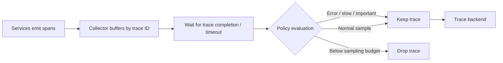
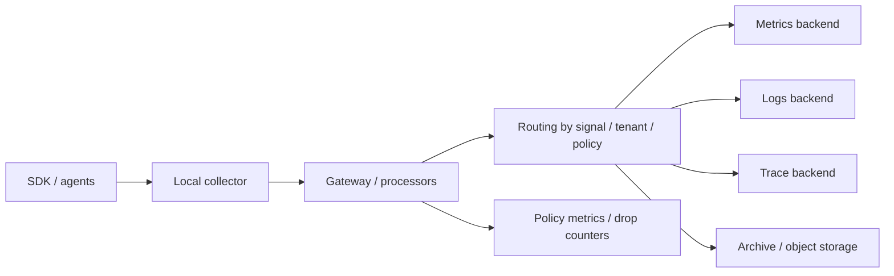

# Sampling Policies, Cardinality, and Observability Data Cost

## 1. Why Does Observability Need a Data Policy?

A cloud platform generates metrics, logs, traces, events, and profiling data to understand system state. As the number of services, instances, tenants, and requests grows, telemetry volume grows with it. Collecting every event at maximum detail increases ingestion, indexing, storage, query, and data transfer costs; meanwhile, high cardinality can make metrics backends slow or unstable.

An **Observability data policy** defines which signals are collected, at what detail level, how they are sampled, which labels are permitted, how long and where data is retained, and who can access it. A good policy keeps enough data to detect issues, measure SLOs, investigate incidents, and demonstrate operations, while bounding redundant, sensitive, and overly expensive data.

Three concepts must work together:

- **Sampling:** retaining only a subset of events, spans, or log records according to rules.
- **Cardinality:** the number of distinct values or label/attribute combinations that produce different series/index keys.
- **Observability cost:** the cost of collecting, transmitting, processing, indexing, storing, querying, exporting, and operating telemetry.

Sampling reduces volume but can miss rare signals. Reducing cardinality stabilizes the backend but can make distinguishing error cohorts harder. Shortening retention lowers storage costs but narrows the investigation window. Therefore, design must align with operational goals and the criticality of each signal type.

In the **CLOUD_ARCHITECTURE** module, the **Observability** chapter frames telemetry policies within cloud architecture that balances reliability, security, scalability, cost, and operations.

After this lesson, learners will be able to distinguish sampling, filtering, aggregation, downsampling, and retention; choose head-based, tail-based, probabilistic, rate-limited, and adaptive sampling; estimate cardinality; design bounded labels and attributes; set telemetry budgets; optimize ingestion, storage, indexing, and query costs; and ensure sampling does not break SLOs, audits, or security requirements.

## 2. Observability Data Types Have Different Characteristics

| Signal | Data Unit | Used to Answer | Common Cost Drivers |
| --- | --- | --- | --- |
| Metrics | Time series/sample | What state is the system in? | Active series, scrape frequency, samples, retention |
| Logs | Log event/record | What happened? | Event volume, byte size, indexing, retention |
| Traces | Trace/span | Which components did a request traverse and where was it slow? | Trace rate, spans per trace, attribute size, sampling |
| Events | State change/business event | What changed? | Event rate, payload, replay, and retention |
| Profiles | Stack sample/time profile | Where are CPU/memory consumed? | Profile frequency, sample detail, retention |
| Dumps/artifacts | Heap/core dump, diagnostic bundle | Deep state at failure time? | Large size, sensitivity, storage, and access |

Do not apply the same sampling ratio or retention to all signals. Aggregated metrics typically need continuous collection for trends and SLOs. Traces can be sampled per request. Debug logs can be heavily reduced during normal operations. Audit/security events may require independent retention policies and must not fall under generic sampling.

## 3. Sampling, Filtering, Aggregation, and Downsampling

| Technique | Action | Example |
| --- | --- | --- |
| Sampling | Keep a subset of records by probability or policy | Keep 10% of request traces |
| Filtering | Drop records matching a condition | Drop health-check access logs |
| Aggregation | Roll up multiple records into statistics | Count requests by route/status |
| Downsampling | Reduce resolution over time | Aggregate 1-second samples to 1-minute |
| Deduplication | Remove duplicate records | Deduplicate events by event ID |
| Redaction | Remove/mask sensitive fields | Strip authorization headers |
| Retention | Keep data for a defined period | Hot 7 days, archive 90 days |
| Tiering | Move data across storage tiers | Hot index to cold object storage |

A pipeline can combine several steps. For example, access logs: redact before leaving the process, filter noisy health checks, aggregate request counts into metrics, sample a portion of debug logs, and apply retention by data class.

Processing order matters:
- Redaction happens before sensitive data reaches downstream systems not authorized to receive it.
- Sampling should sit where enough context exists to select valuable data, while weighing transmission costs upstream of the sampler.
- Aggregation must preserve dimensions needed for SLOs and analysis; aggregating too early destroys differentiability.
- Retention follows data class and retention obligations; never use short retention to evade audit/legal requirements.

## 4. Head-Based Sampling

Head-based sampling decides whether to keep a trace right at the start, typically at the SDK or instrumentation layer. Decisions can rely on probability, a parent sampling flag, or rules available when the request begins.

Example keeping 10% probabilistically:

```text
sampled = deterministic_hash(trace_id) % 100 < 10
```

Using a stable hash keeps decisions consistent across services if trace context is propagated properly.

Advantages:
- Reduces traffic right at the source.
- Simple to deploy and predictable in ratio.
- Reduces exporter, network, and backend costs.
- Downstream services can inherit the sampling decision.

Limitations:
- Unknown yet whether the request will ultimately fail or be slow.
- Traces dropped at the head usually cannot be recovered at a tail collector.
- Rare errors may be missed if probability is low.
- A uniform probability does not guarantee proportional coverage per service/tenant when traffic mix shifts.

Best suited for relatively uniform high-volume traffic where predictable volume reduction is needed and randomly dropping a portion of normal traces is acceptable.

## 5. Probabilistic and Deterministic Sampling

**Probabilistic sampling** keeps each record with probability p. Given N relatively uniform records:

```text
Expected retained records = N × p
Expected dropped records = N × (1 - p)
```

For example, 5 million spans/day with p = 0.02 retains roughly 100,000 spans/day on average. This is an expectation; actual numbers fluctuate.

**Deterministic sampling** hashes the trace ID, request ID, or a stable key so the same logical request is always consistently kept or dropped. Choose the right key: hashing user ID can bias by tenant; hashing timestamps can cluster when traffic follows repeating time patterns.

### 5.1. Weighted Sampling

| Traffic Class | Illustrative Sampling Policy | Rationale |
| --- | --- | --- |
| Health checks | Drop or very low ratio | Repetitive signal, already covered by metrics |
| Normal reads | 1–5% | High volume |
| Booking/payment | Higher rate or conditional tracing | High business impact |
| Error responses | Keep 100% within budget | High diagnostic value |
| Slow requests | Keep if exceeding latency threshold | High diagnostic value |
| Internal batch | By job type and schedule | Easy to aggregate per job |

Sampling ratios must be evaluated alongside trace volume and budget. Keeping 100% of all errors can cause spikes during widespread outages; enforce payload limits, quotas, and fallback storage paths without discarding critical evidence.

## 6. Tail-Based Sampling

Tail-based sampling defers the decision until the collector receives enough of a trace or a wait window expires to evaluate spans. Policies can prioritize traces with error status, latency exceeding thresholds, retries/exceptions, critical tenants/operations, or spans touching key dependencies.



Advantages: retains anomalous traces that head sampling might miss. Limitations:
- Collectors must buffer state keyed by trace ID.
- Traces must route to the same decision point or a coordinated collector tier.
- Long traces or late-arriving spans cause timeouts and partial traces.
- Buffer, memory, CPU, and network demands increase.
- During system-wide failures, the number of traces matching keep rules spikes sharply.

Tail sampling fits when error/slow traces are far more valuable than normal traces and the organization can operate a collector tier with sufficient capacity.

### 6.1. Trace Decision Window

The collector must wait for a window to receive spans. Too short a window evaluates traces prematurely; too long a window inflates memory occupancy and decision latency.

Monitor trace completion delay, late span ratio, buffer occupancy/evictions, decision wait duration, trace size distribution, and export backlog. The root span ending does not necessarily mean all async child spans have arrived at the collector.

## 7. Adaptive and Rate-Limited Sampling

Adaptive sampling adjusts rates dynamically based on traffic, error rate, service criticality, or budget. Rate-limited sampling caps the number of traces/events retained per time interval.

Example:

```text
keep up to 200 normal traces / second
prioritize eligible error and slow traces
use remaining budget for probabilistic baseline traces
```

Rate limits protect backends from traffic spikes but risk dropping substantial data during incidents. Priorities can be ordered as:
1. Critical operations per business policy.
2. Errors and latencies exceeding thresholds.
3. Representative traces per service/version/region.
4. Baseline normal traffic.
5. Non-essential debug details.

Adaptive controllers must avoid oscillation: rising error rates cause policies to keep more traces; rising volume overloads collectors; collectors dropping traces then misleads the controller. Use smoothing, min/max ratios, hysteresis, and hard budgets.

## 8. Sampling Metrics: Proceed with Caution

Metrics are typically stored as time series and used for alerting/SLOs. Randomly sampling individual metric points can distort rates, percentiles, and detection.

Randomly dropping counter samples introduces errors, especially across counter resets or traffic bursts. For histograms, dropping observations before aggregation invalidates quantiles.

Instead:
- Reduce cardinality through label design.
- Choose sensible histogram buckets.
- Aggregate at the source or via recording rules.
- Match scrape intervals to metric dynamics.
- Downsample after retaining high-resolution data long enough.
- Retain raw SLI measurements sufficient to compute SLOs over their window.

### 8.1. Histograms and Percentiles

When backends support histogram aggregation, bucket counts can be summed across instances before estimating quantiles. Client-computed summary quantiles generally cannot be accurately merged across instances. Never average per-instance p95 values to estimate system-wide p95.

When reducing buckets or changing histogram schemas, ensure services use compatible schemas and recording rules are updated.

### 8.2. SLOs and Error Budgets

Do not let sampling policies distort SLI numerators/denominators:
- Derive request counts/error counts from proper counters, not by counting sampled traces.
- Base availability SLIs on eligible requests.
- Latency SLIs require histograms or measurements with sufficient coverage.
- Use trace samples to explain causes, not to replace systemic SLI metrics.

## 9. What Is Cardinality?

Cardinality is the number of unique values of a dimension or the number of combinations of dimensions that create distinct series/index entries.

For time-series metrics, each combination of metric name and label set is typically a distinct series. Example:

```text
http_requests_total{
  service="booking",
  method="POST",
  status="500",
  region="region-a"
}
```

If a service has 8 methods, 6 status codes, 4 regions, 20 versions, and 500,000 user IDs, the theoretical upper bound of combinations is:

```text
8 × 6 × 4 × 20 × 500,000
= 1,920,000,000 combinations
```

Not every combination occurs, yet a single high-cardinality dimension can cause series counts to explode rapidly.

### 9.1. Low vs. High Cardinality

| Dimension | Expected Cardinality | Notes |
| --- | --- | --- |
| environment | Low | dev/staging/prod |
| region | Low-moderate | Fixed regions |
| service | Low-moderate | Bounded service catalog |
| HTTP method | Very low | GET/POST/PUT/DELETE |
| status class | Very low | 2xx/4xx/5xx |
| route template | Low-moderate | /bookings/{id}, not raw path |
| pod/instance ID | Can be high | Scaling and rollouts create churn |
| tenant ID | Can be very high | Many customers |
| user ID/email | Very high | Should not be a default metric label |
| request/trace ID | Nearly unique | Never use as a metric label |
| raw URL/query | Very high | May contain PII or tokens |

No universal cardinality threshold applies to every backend. Impact depends on ingestion rate, retention, index implementation, shard topology, and query workloads.

## 10. Estimating Series Cardinality

Suppose a metric has 5 independent dimensions with cardinalities 4, 6, 10, 8, and 20:

```text
Series upper bound = 4 × 6 × 10 × 8 × 20 = 38,400
```

Adding tenant ID with 10,000 values:

```text
New upper bound = 38,400 × 10,000
                = 384,000,000
```

This is a theoretical upper bound. Actual cardinality should be measured from active series rather than only multiplying dimension lists.

### 10.1. Active Series vs. Total Unique Values

A label with 10,000 values may only see a subset active in any given interval. However, during rollouts or tenant churn, series are created and later go inactive; backends still incur ingestion/index and retention metadata costs depending on implementation.

Track active series, new series/hour, series churn rate, series per metric name, cardinality per label, and top contributors by service/team/tenant.

## 11. Designing Low-Cardinality Labels

Metric labels should represent stable, bounded, operationally meaningful analytical dimensions.

Good choices: service, environment, region, HTTP method, status class, route template, operation type, job type, result enum, and normalized dependency name.

Avoid: user/customer email, session ID, request ID, trace ID, raw URL/query string, full exception message, SQL text, object key, timestamp, UUID, or random values.

### 11.1. Route Templates Instead of Raw Paths

Do not create labels from /bookings/12345 because every booking ID creates a separate series. Use a route template /bookings/{bookingId} so requests to the same endpoint aggregate together.

If you need to inspect a specific booking, use trace/log fields with appropriate retention and access controls—never put that ID into a metric label.

### 11.2. Normalization and Bucketing

- Collapse status codes into classes when individual code granularity is unnecessary.
- Bucket payload sizes/latencies instead of raw numeric values.
- Normalize exception classes rather than exception messages.
- Constrain enums for feature flags or result codes.
- Map tenants to tiers/plans/regions for aggregate metrics; analyze individual tenants via access-controlled queries/logs.

Bucketing lowers cardinality at the expense of granularity. Choose buckets based on operational questions.

## 12. Cardinality in Logs and Traces

Metrics are not the only place affected by cardinality.

### 12.1. Logs

High-cardinality fields like request ID, user ID, and resource ID help during incident searches, but indexing every field drives up index storage and query costs.

Policies can keep frequently filtered fields indexed; store rarely used payloads/fields in object storage or non-indexed fields; enforce structured logs and stable schemas; redact PII/secrets before ingestion; bound field lengths/value cardinality; and apply distinct TTLs for debug, application, and audit logs.

### 12.2. Traces

Trace/span attributes may hold user ID, tenant ID, URLs, SQL statements, or error messages. Trace backends typically index selected attributes; indexing high-cardinality attributes can be resource-intensive.

Keeping request ID in traces aids correlation, but decide whether it is an indexed attribute or merely searchable payload. Never promote raw values into metric dimensions just because they appear on a span.

### 12.3. Correlation Without Cardinality Explosion

Put trace IDs in logs or link from log records to the trace backend. There is no need to turn trace ID into a metric label. Metrics alert on rising errors; traces/logs locate specific requests after an alert fires.

## 13. Ingestion Volume and Cost Models

```text
Telemetry monthly cost =
    ingest / processing
  + active-series or indexing charges
  + hot storage
  + warm/cold archive
  + query / scan
  + export / network
  + collector and pipeline compute
  + retention / compliance overhead
```

Vendors bill differently: by GB ingested, event count, host, active series, indexed spans, query scans, retention tiers, or committed capacity. Never assume a single universal rate; read the backend's pricing model and actual invoices.

### 13.1. Estimating Log Volume

If a service emits 2,000 log events/s averaging 1.2 KB over 24 hours:

```text
Daily raw volume =
  2,000 events/s × 1.2 KB × 86,400 s
  = 207,360,000 KB
  ≈ 207.36 GB/day (decimal)

Monthly raw volume (30 days)
  ≈ 6,220.8 GB
  ≈ 6.22 TB/month
```

This is raw volume before compression, filtering, sampling, replication, and vendor-specific overhead. Small changes in event size or log rate can add terabytes per month.

### 13.2. Estimating Traces

Assuming 8,000 requests/s, averaging 12 spans/trace, and 5% sampling:

```text
Spans per second retained =
  8,000 × 12 × 0.05
  = 4,800 spans/s

Daily retained spans =
  4,800 × 86,400
  = 414,720,000 spans/day
```

Also multiply by average encoded span size and account for attributes, resource metadata, batching, compression, and indexing.

### 13.3. Estimating Metric Samples

```text
Samples per day =
  active time series
  × samples per second per series
  × 86,400
```

For example, 100,000 series scraped every 15 seconds:

```text
100,000 × (1 / 15) × 86,400
= 576,000,000 samples/day
```

Halving the scrape interval roughly doubles the sample rate if active series stay constant. Active series and churn often matter more than merely counting metric names.

## 14. Logs: Sampling and Retention

Do not drop logs with a single random ratio. Group by severity, source, and purpose:

| Log Class | Suggested Policy |
| --- | --- |
| Security/audit | Mandatory policy, integrity, and access control; no arbitrary sampling |
| Error/fatal | Retain fully within budget, cap payloads, deduplicate noise |
| Warning | Retain by source/condition; aggregate repeated warnings |
| Info business events | Select necessary events; sample/aggregate if acceptable |
| Debug/trace logs | Disabled or low sampling normally; enabled with time limits |
| Health/access noise | Filter or aggregate if individual records are not needed |

### 14.1. Log Storms

When an error logs on every retry, systems can generate terabytes of logs in a short time. Apply per-source/service rate limits, deduplicate repeated messages keeping first/last occurrence and counts, bound stack trace/payload sizes, use exporter backoff, and enforce bounded buffers. Distinguish dropping telemetry from dropping business events.

Never let a failing log pipeline block critical requests or fill up the filesystem.

### 14.2. Purpose-Driven Retention

Hot searchable logs can have short retention; archives can retain data longer at lower cost. Audit/security logs carry separate retention, immutability, and residency requirements. Distinguish application debugging from legally or security-relevant records.

## 15. Metrics: Reducing Cardinality and Preserving SLI Quality

Metrics used for trend detection and SLO measurement require more stable policies than debug telemetry.

- Choose bounded metrics with clear owners.
- Use sensible histogram buckets.
- Use recording rules for common aggregations.
- Separate business SLIs from debug metrics.
- Drop labels that serve no operational question.
- Constrain label values and validate schemas in CI.
- Maintain baseline resolution over the SLO measurement window.
- Downsample older data past the detailed analysis period.

Do not aggregate away critical failure dimensions. Keeping only total request count without status class or region hides regional failures. Conversely, keeping raw user IDs creates massive cardinality. Choose useful dimensions like service, region, route template, status class, and workload tier.

### 15.1. Cardinality Budgets

Set budgets per team/service:
- Maximum active series.
- Maximum series churn/day.
- Maximum labels per metric.
- Approved label keys.
- Maximum distinct values for controllable labels.
- Alerts when budgets are exceeded or growth is abnormal.

Budgets are guardrails to catch poor design early, not arbitrary caps that strip essential metrics. Exceptions require an owner, rationale, and expiry.

## 16. Traces: Keeping High-Value Traces

Trace sampling policies should balance baseline coverage with exceptional evidence.

1. Keep 100% of error traces for critical operations within hard budgets.
2. Keep traces exceeding latency thresholds.
3. Keep a baseline rate by route/service/region.
4. Keep traces belonging to canaries/new versions or key experiments.
5. Rate-limit per tenant/service so one source cannot exhaust capacity.
6. When budget runs low, shed normal traces before exceptional traces.
7. Emit sampling decision metadata for coverage analysis.

### 16.1. Combining Head and Tail Sampling

SDKs can head-sample to reduce traffic, followed by tail sampling at collectors among forwarded traces. However, a tail sampler cannot recover traces already dropped at the head. For traffic requiring full error retention, ensure head policies forward enough candidates to the tail sampler or use an appropriate instrumentation path.

### 16.2. Sampling Probability and Representative Ratios

If error traces are kept at 100% while normal traces are kept at 1%, the error rate in stored traces exceeds reality. Never compute SLIs directly from sampled traces without calibration and a validated estimator.

## 17. Retention, Downsampling, and Storage Tiers

| Tier | Goal | Suitable Data |
| --- | --- | --- |
| Hot | Recent incident investigation, fast queries | Detailed metrics/logs/traces |
| Warm | Trend analysis and older incidents | Aggregated logs, downsampled metrics |
| Cold/archive | Audit, compliance, or long-term reference | Immutable logs, snapshots/exports |
| Expired | No remaining valid purpose | Delete per retention/lifecycle |

### 17.1. Downsampling Metrics

For example, 15-second resolution data rolled up into 1-minute and then 5-minute intervals. This reduces sample counts but can hide brief spikes and alter quantile behavior. Investigating a 30-second incident is not feasible with 5-minute data.

Keep raw resolution across the common incident detection window; downsample afterward. For counters/rates and histograms, use semantically correct aggregations rather than naively averaging every sample.

### 17.2. Retention Budget

```text
Stored volume ≈
  ingest bytes/day
  × retention days
  × effective storage multiplier
```

The storage multiplier depends on compression, indexing, replication, metadata, and backend architecture. Do not assume compressed payload size equals billed storage volume.

## 18. Cost Attribution and Chargeback / Showback

Observability is often a shared platform cost, yet usage originates from different services, teams, and tenants. **Showback** allocates costs for visibility; **chargeback** bills costs to the consuming unit's budget.

Costs can be attributed by ingest GB per service/environment/team, active series and churn, indexed logs/spans, retained GB-days, query scans/compute, export/network egress, and collector CPU/memory.

### 18.1. Do Not Attribute Solely by Request Count

A low-request service with huge log payloads or deep traces can cost more than a high-request service with compact telemetry. Use cost drivers that reflect actual volume and indexing/retention complexity.

### 18.2. Cost Dashboards

Dashboards should display total cost by signal, cost by service/team/environment, cost per 1,000 requests or business transactions, ingest GB/day and growth, active series/churn, indexed vs. non-indexed volume, retention tiers, query/export costs, and budget/forecast/variance.

Assign owners to top contributors. Avoid waiting for end-of-month invoices, which make tracking down spikes difficult.

## 19. Privacy, Security, and Compliance

Telemetry can contain PII, tokens, emails, query text, SQL parameters, tenant identifiers, or sensitive infrastructure details.

- Redact/mask at the source or collector before external systems.
- Never log passwords, access tokens, cookies, authorization headers, or secrets.
- Restrict trace/log attributes originating from requests.
- Enforce tenant isolation and access control within observability workspaces.
- Encrypt in transit/at rest and manage keys properly.
- Align retention with data classification, legal holds, and residency.
- Audit access to sensitive telemetry.
- Support deletion/subject-access workflows if identifying data is collected.
- Never use sampling to bypass audit/security event retention obligations.

High cardinality and privacy often overlap: user ID both triggers series/index explosions and is a sensitive identifier. Keep it out of metric labels and retain it in logs/traces only under strict controls when genuinely needed.

## 20. Pipeline Architecture and Per-Layer Controls



| Layer | Controls |
| --- | --- |
| Application/SDK | Instrumentation scope, attribute allowlists, head sampling, redaction |
| Node/local collector | Bounded buffers, batching, compression, local filtering |
| Gateway collector | Tail sampling, routing, tenant quotas, schema enforcement |
| Backend | Index policies, retention tiers, downsampling, query limits |
| Archive | Encryption, immutability, lifecycle, restore/access policies |
| Governance | Ownership, budgets, approvals, data classification |

### 20.1. Buffering and Backpressure

Collectors must not queue unboundedly. When backends slow down:
- Cap buffer size and time limits.
- Retry exports with backoff and jitter.
- Enforce drop policies prioritizing critical signals within budget.
- Never block request paths when exporters are unavailable.
- Expose queue size, oldest item age, retries, and dropped records.
- Alert when the telemetry pipeline loses coverage.

The telemetry pipeline itself needs independent monitoring or minimal health signals; if all observability travels only through the failing pipeline, operations teams go blind.

## 21. Observability Data Budgets and Sample Policy

Observability budgets should specify ingest budgets per signal/service/day, active-series budgets and churn thresholds, retention per tier/classification, trace/log sampling policies, query/index budgets, export/egress budgets, privacy rules and allowed attributes, and exception owners with expiries.

### 21.1. Sample Policy for a Booking API

| Signal | Normal Traffic | Error/Incident | Illustrative Retention |
| --- | --- | --- | --- |
| SLO metrics | Continuous, low-cardinality | Keep sufficient resolution | Short raw, long aggregated |
| Application logs | Selective info, low debug | Keep errors within budget, deduplicate storms | Short hot, archive by class |
| Traces | Probabilistic baseline | Tail-keep error/slow/critical | Short hot, archive if needed |
| Audit/security | Policy-driven, no arbitrary sampling | Retain full evidence | Per compliance/contract |
| Profiles | Scheduled or triggered | Temporarily increase capture | Short, restricted access |

Durations/ratios must come from real data and organizational obligations; this is a policy structure, not default numbers.

### 21.2. Dynamic Debug Windows

When an incident starts, debug telemetry can be enabled for a specific service/route over a short window:
- Tied to an incident/ticket and an approver.
- Enable only necessary attributes.
- Enforce quotas and auto-expiry.
- Keep redaction active.
- Never enable sensitive raw payloads.
- Automatically revert to baseline and review collected data.

## 22. Testing Sampling, Cardinality, and Cost

| Scenario | Test Method | Pass Criteria |
| --- | --- | --- |
| Baseline sampling | Generate representative traffic, check retained ratio | Ratio matches policy within expected variance |
| Error retention | Trigger rare/critical errors | Traces/logs retained per policy |
| Tail decision timeout | Generate long traces/late spans | Partials/drops measured and handled |
| Collector overload | Push spans/logs past budget | Backpressure and drop policies engage |
| Cardinality explosion | Inject random ID label in test | Guardrails detect/block |
| Route normalization | Send diverse resource IDs | Map to single route template series |
| Metric SLO integrity | Compare backend SLIs with request sources | Variance within tolerance |
| Log storm | Trigger rapid repeated exceptions | Dedup/rate cap prevents runaway ingest |
| Retention expiry | Configure test lifecycle | Expired data handled properly |
| Query cost | Run controlled large scan | Quotas/limits/alerts trigger |
| Tenant isolation | Query another tenant's workspace | Access denied |
| Redaction | Send fake tokens/PII | Sensitive data masked before export |
| Cost attribution | Generate workloads by service/team | Dashboards attribute accurately |
| Backend outage | Disconnect destination | Buffers bounded, app path unblocked |

### 22.1. Verifying Unbiased Sampling

Generate workloads across route/status/region cohorts with known ratios. Compare post-sampling telemetry against source counters:
- Are baseline traces representative per cohort?
- Are error/slow traces adequately retained?
- Is sampling probability metadata present for calibration?
- Can one large tenant consume the entire budget?
- Are SLIs sourced from origin metrics instead of trace samples?

## 23. Process for Designing an Observability Data Policy

1. **Identify operational questions:** alerts, SLOs, debugging, audits, capacity, and compliance.
2. **Inventory signals:** metrics, logs, traces, events, profiles, and owners.
3. **Classify data:** criticality, sensitivity, privacy, residency, and retention.
4. **Establish volume baselines:** event rates, sizes, active series, spans/trace, and growth.
5. **Design sampling:** head/tail/probabilistic/adaptive/rate limits per signal.
6. **Design labels/attributes:** allowlists, route templates, bucketing, and cardinality budgets.
7. **Set retention/downsampling:** raw resolution, hot/warm/cold tiers, and detection windows.
8. **Build cost model:** ingest, index, series, storage, query, egress, and collectors.
9. **Set tenant/team budgets:** showback, owners, exceptions, and expiries.
10. **Protect privacy/security:** redaction, access control, encryption, and auditing.
11. **Test overload and integrity:** sampling bias, error retention, cardinality, and pipeline outages.
12. **Review periodically:** compare forecasts vs. actuals, optimizing without eroding SLO coverage.

## 24. Practical Scenario: Observability for a Multi-Tenant Booking Platform

**Context:** A platform spans multiple tenants, regions, and search, booking, payment, and notification services. Normal traffic is 10,000 requests/s with 3x campaign bursts. Search generates many small requests; booking/payment has lower volume but high business impact. Previously, the team put tenant ID, booking ID, and raw URLs in metric labels and retained 100% of traces.

### 24.1. Observed Problems

- Active series surge whenever new tenants onboard.
- Metrics backend queries slow down and ingestion throttles.
- Trace volume spikes during campaigns; storage/index bills climb.
- Critical error traces get buried in massive normal volume.
- SLO dashboards built from sampled traces show fluctuating error rates.
- Logs contain raw query parameters and unnecessary identifiers.

### 24.2. Proposed Policy

- Metrics keep only bounded labels: service, region, route template, method, status class, plan tier.
- Tenant-level investigations use access-controlled structured logs/traces with proper retention, never tenant ID as a default metric label.
- Head-based baseline sampling for normal requests, deterministic by trace ID.
- Tail sampling prioritizes error, slow, and critical booking/payment traces within budget.
- Availability/latency SLIs come from full-coverage counters/histograms, not trace samples.
- Debug logs reduced in normal mode; errors retained but deduplicated/rate-capped.
- Audit/security events follow a dedicated policy without generic sampling.
- Incident-scoped dynamic debug windows with automatic expiry.
- Short hot retention; archive by classification/compliance.
- Showback dashboards by service/team/tier and alerts on cardinality churn.

### 24.3. Outcomes to Demonstrate

1. Active series drop significantly while dashboards still break down by region, route, and status.
2. Error/slow traces are retained at target coverage.
3. Normal trace volume stays within budget during campaign bursts.
4. SLIs computed from source metrics remain unaffected by trace sampling.
5. Redaction strips tokens/PII before export.
6. Cost per 1,000 bookings drops or stabilizes with no loss of investigative capability.
7. During backend outages, collectors do not slow down business requests.

## 25. Sample ADR: Priority-Based Sampling and Cardinality Budgets

```text
ADR-138: Observability Policy for Booking Platform

Context:
- Trace/log volume surges during campaigns.
- Metric labels containing tenant/resource IDs drive up cardinality.
- SLO dashboards must be accurate and error traces must be retained.
- Ingest, indexing, and retention costs exceed forecasts.

Options:
A. Retain 100% of all signals and scale up backend capacity.
B. Uniform sampling across all telemetry.
C. Low-cardinality metrics, baseline sampling, and tail priority for exceptional traces.

Decision:
- Choose C.
- SLI metrics use counters/histograms independent of sampled traces.
- Metric labels use approved bounded dimensions only.
- Baseline traces use deterministic head sampling; collector tail policies retain error/slow/critical traces within hard budgets.
- Logs are classified, redacted at source/collector, and noisy events rate-limited.
- Audit/security events follow separate retention without arbitrary sampling.
- Budgets and cost attribution per service/team.

Trade-offs:
- A portion of normal traces are dropped, so not every single request can be inspected.
- Tail collectors require buffering/capacity and add operational complexity.
- Cardinality policies restrict direct per-tenant breakdowns via metrics.

Verification:
- Compare SLI metrics against source counters.
- Verify error/slow trace retention and sampling bias.
- Stress-test campaign bursts and collector/backend outages.
- Cardinality guards block dynamic labels.
- Redaction and access boundaries are tested.
- Cost per business transaction stays within budget.

Review Triggers:
- Traffic mix, vendor pricing, or retention requirements change.
- SLOs require additional dimensions.
- Error coverage or cost budgets miss targets.
```

## 26. Common Mistakes

1. **Reducing all telemetry by the same ratio:** loses critical signals and required audits.
2. **Using sampled traces to compute SLOs:** error ratios can be biased.
3. **Tail sampling after head drops:** traces dropped at the source cannot be recovered by the tail sampler.
4. **Retaining all errors unboundedly:** error storms can overwhelm backends.
5. **Putting tenant/user/request IDs in metric labels:** cardinality explodes.
6. **Using raw URLs instead of route templates:** each resource ID spawns a separate dimension.
7. **Counting only metric names:** ignores active series and label combinations.
8. **Aggregating metrics too early:** loses dimensions needed to investigate region/route/status.
9. **Downsampling too early:** loses brief spikes and prevents accurate percentile recalculation.
10. **Leaving debug logs always on:** drives up volume, privacy exposure, and cost.
11. **Dropping audit/security events via generic samplers:** loses required evidence.
12. **Not measuring collector buffers/drops:** pipelines lose data silently.
13. **No per-owner budgets:** bills rise with no clear source.
14. **Cutting retention without checking detection windows:** late-discovered incidents lack data.
15. **Indexing every log/trace field:** drives up storage and query costs.
16. **Forgetting network egress/exports:** cheap backend ingest offset by expensive data transfer.
17. **Under-sizing tail collector memory:** holding long traces causes collector OOMs.
18. **Skipping redaction before export:** telemetry leaks PII/secrets.

## 27. Production Readiness Checklist

- [ ] Inventory of metrics/logs/traces/events/profiles and owners exists.
- [ ] Operational/SLO/audit questions are mapped for each signal.
- [ ] Sampling policies exist per signal, service, and traffic class.
- [ ] Head/tail/adaptive/rate-limited policies define budgets and failure behavior.
- [ ] Prioritization mechanisms exist for error/slow/critical traces.
- [ ] SLIs/SLOs do not depend on uncalibrated trace/log sampling.
- [ ] Metric labels use bounded dimensions; raw IDs are excluded by default.
- [ ] Route templates, enum normalization, and bucketing are applied.
- [ ] Active-series budgets, churn alerts, and exception owners exist.
- [ ] Log/trace indexed fields are limited to actual query needs.
- [ ] Redaction occurs before export; secrets/PII are not collected arbitrarily.
- [ ] Audit/security retention is separated from generic sampling policies.
- [ ] Retention/downsampling aligns with tiers and detection/compliance windows.
- [ ] Collector buffers, retries, backpressure, and drop policies are bounded.
- [ ] Cost model includes ingest, series/index, storage, query, export, and processing.
- [ ] Showback is traceable by service/team/tenant tier.
- [ ] Budget alerts, forecasts, and expiring exceptions are configured.
- [ ] Tests cover cardinality explosions, log storms, tail timeouts, and backend outages.
- [ ] Privacy, tenant isolation, and audit evidence have been tested.
- [ ] Forecasts vs. actuals are reviewed periodically and SLO coverage is verified intact.

---

**Takeaway:** Sampling determines which records are kept, cardinality determines how many series/index dimensions backends must manage, and cost depends on the entire lifecycle from ingest through querying and retention. A sound policy preserves metrics needed for SLOs, prioritizes anomalous traces, bounds unstable labels/attributes, protects audits/privacy, and ties budgets to owners. Cost reduction only succeeds when operations teams can still detect, explain, and recover from incidents.
