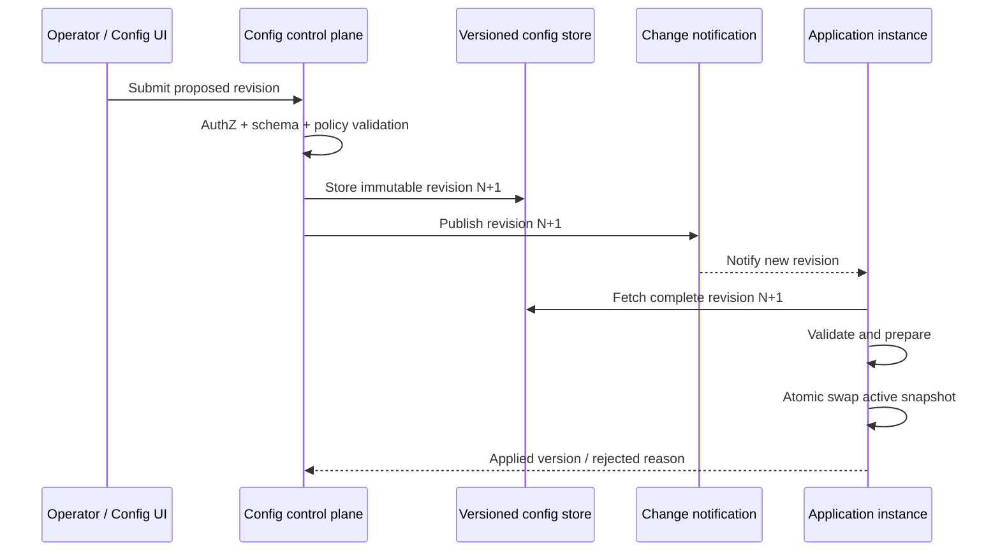
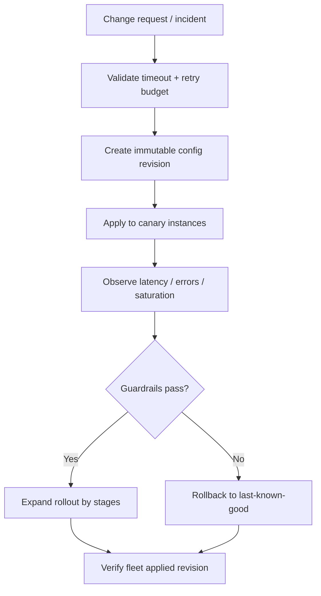

# Managing Dynamic Configuration and Safe Configuration Changes

## 1. Why Must Configuration Be Managed as Part of Architecture?

Cloud applications do not change only when source code is released. Operations teams can adjust timeouts, connection limits, autoscaling thresholds, dependency endpoints, per-tenant quotas, retry policies, or feature flags without rebuilding images. These changes enable fast incident mitigation, load tuning, and targeted feature rollouts. However, a single wrong value, an out-of-sync update, or unvalidated configuration can disrupt the entire system.

**Dynamic configuration** is configuration that can change while an application is running and be picked up by workloads without repackaging or re-releasing the entire application. Change sources may include a control plane, configuration service, database, file mount, feature flag service, or deployment platform.

Safe configuration management must answer:

- Which values are configuration, and which are secrets or business data?
- Who has permission to create, approve, deploy, and roll back?
- How do we ensure values have the right type, scope, and compatibility with the application version?
- How do instances receive new configuration and for how long can versions diverge?
- What happens when the config provider, network, or config source is unavailable?
- How do we limit blast radius and recover when a change causes failures?

This lesson belongs to the **System Operations** chapter of the **CLOUD_ARCHITECTURE** module. The module focuses on designing cloud applications from business requirements to network, compute, data, and deployment model selection, balancing reliability, security, scalability, cost, and operations with a Well-Architected mindset. Configuration management is the operational mechanism enabling controlled post-deployment architectural changes.

After this lesson, you will be able to distinguish configs/secrets/feature flags/runtime data; design sources of truth and precedence; validate schemas; apply atomic updates, versioning, staged rollouts, and rollbacks; handle consistency, cache propagation, and failures; protect changes with RBAC, approvals, and auditing; and establish metrics, alerts, tests, and runbooks.

## 2. Classifying What Is Commonly Called Configuration

Do not lump every mutable value into a single store. Each category has a different lifecycle, access control model, and consistency requirement.

| Category | Examples | Characteristics | Typically Appropriate Management |
|---|---|---|---|
| Application configuration | Timeouts, retry counts, endpoints, log levels | Controls application behavior | Config file/service, versioning, validation |
| Infrastructure configuration | CPU/memory, replica count, network rules | Affects resources and deployment | IaC, policy-as-code, reviewed deployment |
| Secret | Passwords, API keys, private keys, tokens | Sensitive, requires protection and rotation | Secret manager/KMS, workload identity |
| Feature flag | Enable new UI, swap algorithms, per-tenant rollout | Controls behavioral branches | Feature flag service or control plane |
| Business data | Pricing, booking state, committed quotas | Business data with ownership and transactions | Database/domain service |
| Operational limit | Rate limits, concurrency caps, queue thresholds | Affects availability and cost | Dynamic config with bounds, audit, and rollout |

An endpoint URL is not necessarily a secret; an API key in the same file is a secret. Feature flags can also be rules evaluated by tenant, region, cohort, or client version rather than simple booleans.

### 2.1. Configuration Does Not Replace Business Data

Timeouts or worker counts can change quickly to handle load. However, a “booking confirmed” state must flow through domain transactions and consistency rules. Do not use a config service as a general-purpose database for records requiring history, concurrency control, or business audit trails.

### 2.2. Configuration Is Not a Secret Store

If a configuration file contains both endpoints and passwords, file read permissions are often broader than secret read permissions. Separate secrets from application config; workloads should fetch secrets via their identity rather than embedding secrets in images, source code, tickets, or logs.

## 3. Configuration Sources and Precedence

A system may pull configuration from code defaults, files, environment variables, command-line arguments, config services, deployment manifests, and tenant overrides. Without defined precedence, two instances running the same image may use different values with no clear explanation.

### 3.1. Establishing a Source of Truth

For each configuration group, define the authoritative source for viewing current state, who is allowed to write to it, how it is distributed to workloads, how mismatches between the authoritative source and caches are handled, owners/reviewers, and the audit trail.

| Group | Suggested Source of Truth | Runtime Source |
|---|---|---|
| Static app defaults | Versioned code/config bundle | Image or package |
| Environment config | Config repository/control plane | Config agent/API |
| Secret | Secret manager | Workload identity fetch |
| Feature flag | Flag control plane | SDK/cache with freshness policy |
| Infrastructure | IaC repository + deployed state | Cloud control plane |

Do not let the console, VM files, and config repository write independently without reconciliation. Emergency overrides must have an owner, reason, expiration, and path back to the source of truth.

### 3.2. Precedence Must Be Explicitly Defined

Example precedence order:

```text
compiled safe defaults
    < environment baseline
    < service-level configuration
    < approved tenant override
    < emergency override with expiry
```

The order above is only an example. Do not automatically allow tenants to override security policies, credentials, data residency, or system protection limits. Such keys need separate policies and may disallow overrides altogether.

### 3.3. Avoiding Hidden Configuration

- Never manually edit environment variables on a single instance without recording it.
- Never let startup scripts silently alter config unknown to the control plane.
- Never ship differing defaults across service versions without a migration plan.
- Never let multiple admin systems write the same key without a conflict policy.
- Log the effective values and their originating sources, without logging secrets.

## 4. Schema Design and Validation

Configuration needs a data contract just like an API. Control-plane validation prevents invalid values from being stored; workload validation protects the application if a provider delivers malformed data or incompatible old/new versions.

### 4.1. Schema for Configuration

Schemas should specify key name, type, meaning, required/optional, default, nullable behavior, min/max, enum or pattern, unit/format, cross-key dependencies, applicable scope, schema version, and sensitivity.

Avoid ambiguous keys like `timeout=30`. Use unit-explicit names like `request_timeout_ms=30000` and validate reasonable ranges.

### 4.2. Conceptual Schema Example

```yaml
schema_version: 3
service: booking-api
config:
  request_timeout_ms:
    type: integer
    minimum: 100
    maximum: 30000
    default: 3000
  database_pool:
    type: object
    properties:
      max_connections:
        type: integer
        minimum: 1
        maximum: 80
  feature:
    enable_new_search:
      type: boolean
      default: false
```

This is an illustrative example, not JSON Schema or a mandatory vendor format. In implementation, use a real schema validator and define how unknown fields are handled.

### 4.3. Fail Validation Before Publishing

1. Parse syntax.
2. Validate types, required fields, ranges, and enums.
3. Validate relationships across values.
4. Check policies and change permissions.
5. Verify compatibility with running workload versions.
6. Run previews/tests if the configuration has broad impact.
7. Publish only when all required checks pass.

Do not allow invalid values to be distributed hoping each instance will reject them. Workload-side validation is still required as the final line of defense.

### 4.4. Cross-Field Validation and Unknown Fields

For example, `min_connections` cannot exceed `max_connections`; `retry_attempts` must fit within the request deadline; dependency timeouts should not exceed total request timeout; rollout percentages must fall within 0–100.

When a schema introduces new keys, the application may ignore unknown fields if optional and semantics-preserving; reject the entire config if the field affects security/correctness; or select config version based on binary capability. Ignoring all unknown fields can mask typos or unapplied security settings. Rejecting all new fields complicates mixed-version rollouts.

## 5. Immutable Configuration vs. Dynamic Configuration

| Characteristic | Release-Immutable Config | Dynamic Config |
|---|---|---|
| Change mechanism | Build/deploy new version | Publish and runtime reload |
| Testing | Tested alongside artifact | Test schema, propagation, state transitions |
| Traceability | Release artifact and deployment | Each config version and rollout event |
| Best suited for | Protocols, schema assumptions, security boundaries | Timeouts, quotas, log levels, bounded flags |
| Risk | Slower releases | Drift across instances, partial propagation |

Keep values immutable when they affect wire protocols, data formats, security boundaries, or initialization that cannot reload safely. Allow dynamic changes for keys with stable semantics, strict validation, and clear reload behavior.

## 6. Atomic and Versioned Configuration Updates

An update may include multiple keys that must be consistent together. If an app reads keys one by one while config is being written, it may observe a half-old, half-new state.

### 6.1. Atomic Publish

1. Create a new config revision with a unique ID.
2. Validate the entire revision.
3. Persist the immutable revision.
4. Update the current-version pointer via an atomic operation.
5. Emit a notification containing the revision ID.
6. Workloads fetch the snapshot, validate it, and swap the active snapshot.



Never mutate keys in place while requests read them. Workloads should construct a new snapshot, validate it completely, and swap the active pointer once. In-flight requests can continue using the old snapshot; new requests use the new snapshot under defined semantics.

### 6.2. Versioning and Optimistic Concurrency

Each revision should record revision ID/version, parent/base revision, author/approver, creation/publish timestamp, schema version, scope/environment, change reason/ticket, and a checksum when needed.

If two operators edit starting from revision N simultaneously, the control plane should detect the conflict rather than letting the last write silently overwrite the earlier change. Require a rebase or explicit override.

### 6.3. Distinguishing Publish from Apply

A successful publish only means the control plane accepted the revision. Distinguish Proposed, Validated, Approved, Published, Delivered, Applied, Rejected, Stale/Expired, and Rolled back. Applied status must be reported by workloads, not inferred from publish messages.

## 7. Runtime Reload and Propagation

How workloads receive changes depends on runtime: polling, push notifications, streams, sidecars/config agents, mounted config volumes, SDK queries to a config service, or restarts/rolling deployments.

### 7.1. Polling

Polling is simple but introduces update lag and periodic requests. Use jitter to prevent instances from polling simultaneously. Conditional fetches via revision/ETag reduce network traffic.

### 7.2. Push Notifications

Push reduces change-notification latency, but notifications can be lost, duplicated, or arrive out of order. Notifications should only announce the new revision; workloads fetch the authoritative snapshot and compare versions. Periodic reconciliation catches lost notifications.

### 7.3. File Mounts / Config Agents

Platforms may update mounted files through platform-specific mechanisms. Apps must know whether files are atomically renamed or written in place, whether file watchers are reliable, and when new contents appear. For multi-key files, agents should write a complete new file and atomically rename it; apps parse/validate the entire file before swapping snapshots.

### 7.4. Mixed-Version Rollouts

During rolling deployments, instances may run different binary versions. New configs must stay compatible with every instance still serving traffic. Use backward-compatible schemas, capability negotiation, app-before-config rollouts, or expand/contract: add the new field, migrate consumers, and only then remove the old field.

## 8. Consistency, Caching, and Stale Configuration

Not every parameter requires the same level of consistency.

| Configuration Type | Typical Consistency Need | Behavior When Stale |
|---|---|---|
| Log verbosity | Eventual consistency is usually acceptable | Instances update a few minutes late |
| UI feature flag | Eventual/near-real-time depending on UX | Temporary cache may be used |
| Rate limit/quota | Depends on abuse and fairness risks | Stale values may allow quota overruns |
| Security policy/denylist | Fast propagation, strict stale limit | May fail closed or revalidate |
| Payment/booking invariants | Do not decide via config cache | Use transactions/domain authority |
| Emergency kill switch | Requires fast propagation and confirmation | May need a dedicated priority channel |

### 8.1. Last-Known-Good and Stale Budgets

When a provider temporarily loses connectivity, workloads can use a last-known-good snapshot within allowed limits. Persist the last validated revision, record config age and source, set maximum staleness per key group, alert when breached, and disallow stale values for sensitive policies when the risk is unacceptable.

If a new revision fails validation or component initialization, keep the prior valid active snapshot. Never replace active config with a partially parsed object or partial set of new fields.

If a cold start cannot reach the config service, require safe defaults or refuse traffic until valid configuration is obtained. Never fall back to an empty config if empty disables security controls.

### 8.2. Cache Propagation

Define the authoritative revision, cache TTL/refresh, reconciliation for missed notifications, stale limits, and how to prevent delayed old revisions from overwriting newer ones. Compare versions before applying; never rely on wall-clock timestamps alone to determine the latest version.

## 9. Safe Changes: Staged Rollouts and Canaries

Config changes can impact many instances instantaneously. Risky changes should deploy in rings/canaries:

1. Local validation: schema, range, policy, and dependencies.
2. Test environment: functional, load, and compatibility tests.
3. Canary: one instance, zone, or internal tenant cohort.
4. Observe: error rate, latency, saturation, business metrics, and apply status.
5. Expand: widen percentages incrementally when guardrails pass.
6. Complete: confirm coverage and archive the change record.

| Stage | Example Scope | Decision Gate |
|---|---|---|
| 0 | Validate only | Schema, bounds, and policy pass |
| 1 | Internal/test tenants | No regressions |
| 2 | 1% workload/traffic | Errors/latency within guardrails |
| 3 | 10% | Business outcomes and utilization stable |
| 4 | 50% | No incidents or config divergence |
| 5 | 100% | Applied coverage meets target, audit complete |

Percentages are illustrative. A security kill switch may need rapid propagation; connection pool tuning is usually safer with gradual rollout.

### 9.1. Guardrails and Automatic Rollback

Predefine thresholds for error rates/SLIs, p95/p99 latency, database saturation, apply success rate, config rejections, and stop conditions. Automatic rollback must avoid oscillation: roll back once and lock the rollout, use hysteresis/cooldowns, and specify who can override. For irreversible data migrations or external side effects, compensating actions are required.

## 10. Configuration Rollback and Recovery

Every risky change needs a recovery plan before publishing.

### 10.1. Rolling Back a Revision

1. Select a target revision verified as compatible.
2. Create a new revision referencing the prior content or switch the active pointer with auditing.
3. Publish the new revision with a higher version number; do not replay old events as current revisions.
4. Monitor apply status across the entire fleet.
5. Verify SLIs and business behavior recover.
6. Record the incident/change entry and follow-up actions.

Do not delete faulty revisions because they are needed as investigation evidence. Mark them rejected/rolled back and block re-publishing until fixed/reviewed.

### 10.2. When Rollback Is Not Enough

A config change may have already sent emails/webhooks, created queue backlogs/retry storms, modified data, caused clients to cache new values, or written records under a new schema. Reverting config does not automatically undo side effects. Compensating actions, reconciliation, or reverse migrations are needed.

### 10.3. Emergency Overrides

Emergency overrides require an assigned actor/role, reason/incident ID, expiration, scope/value limits, immutable audit logs, owner/reviewer notifications, automatic expiry or post-review renewal, and reconciliation back to the source of truth after the incident.

Never allow indefinite emergency overrides to become an unmanaged second source of configuration.

## 11. Feature Flags: Behavior-Controlling Configuration

Feature flags toggle code paths or control rollouts by user cohorts. They are useful for decoupling releases, canaries, kill switches, and experimentation, but flag accumulation creates complexity.

### 11.1. Flag Categories

- **Release flag:** gradually enables a feature.
- **Operational flag:** disables functionality when dependencies fail.
- **Permission/entitlement flag:** governs product entitlements; needs dedicated policies and audits.
- **Experiment flag:** assigns cohorts for experiments.
- **Kill switch:** disables a functional path during incidents.

Never use feature flags instead of authorization. Enabling a feature for a tenant does not mean every user in that tenant is authorized to perform every action.

### 11.2. Rule Evaluation and Lifecycle

Rules may evaluate tenant, region, user cohort, app version, or rollout percentage. Define which attributes are trusted, rule precedence, default behavior when the provider is unavailable, sticky assignment, and how to prevent a single workflow from reading conflicting flag versions.

Flags need an owner, purpose, creation date, expiry/review date, and removal plan. Once rollout completes, remove the old code path and unused flag; long-lived flags multiply the state combinations that must be tested.

## 12. Configuration Security and Change Permissions

Configuration can govern networking, authentication, encryption, logging, data access, and cost. Permission to modify config therefore carries system-wide impact.

### 12.1. Access Control

- RBAC/ABAC scoped by service, environment, scope, and sensitivity.
- Separate permissions to propose, approve, publish, roll back, and administer.
- Production changes require approvals/policy checks proportional to risk.
- Tenant admins may modify only permitted keys within their tenant scope.
- Workloads read only required configs and have no write access by default.
- Break-glass uses JIT, time-bound access, and auditing.

### 12.2. Secrets and Rotation

- Fetch secrets from a secret manager via workload identity.
- Never embed secrets in Git, images, plain config exports, or logs.
- Prefer short-lived credentials and automated rotation.
- Use overlap windows during key rotation so instances transition smoothly.
- Revoke old credentials after confirming rollout completion.
- Audit secret accesses, access denials, and secret version changes.

### 12.3. Integrity and Supply Chain

The config repository/pipeline is part of the software supply chain. Enforce branch protection, signed commits/tags, reviewed PRs, policy-as-code, approvals, and immutable revisions. Distributed configs should authenticate their source and verify integrity per platform capabilities.

## 13. Observability: Knowing Every Instance's Actual Configuration

The control plane may report revision N+1 as published while some instances still run N. Observe applied configuration, not merely created changes.

| Signal | Meaning |
|---|---|
| Config revision published | Control plane released the revision |
| Applied revision by instance/group | Which version workloads are actually running |
| Apply/reload success rate | Percentage of instances parsing, validating, and swapping cleanly |
| Config propagation lag | Time from publish to apply |
| Config rejection count/reason | Schema, compatibility, or initialization errors |
| Stale config age | Time spent running last-known-good |
| Config provider latency/error | Health of the distribution dependency |
| Rollback count | Frequency of reverted changes |
| Flag evaluation distribution | Share of requests taking each branch |
| Drift count | Runtime config diverging from source of truth |

Never place secrets or sensitive configuration values into metric labels. Use revision IDs, controlled scope IDs, and reason categories.

### 13.1. Desired, Delivered, and Applied State

- **Desired state:** the revision requested by the control plane.
- **Delivered state:** the revision sent/delivered to the agent.
- **Applied state:** the revision validated and activated by the workload.

Dashboards should show instance counts across all three states alongside binary/schema versions. Never declare a rollout complete when it is only delivered and not yet applied.

### 13.2. Alerts

- A subset of instances fails to apply within the propagation deadline.
- Security policies/keys exceed stale limits.
- A revision is rejected across multiple instances.
- Prolonged desired/applied drift.
- Rising provider latency/errors.
- Emergency overrides nearing expiration or overdue for review.
- Abnormal or unowned feature flag evaluations.

## 14. Testing Dynamic Configuration

Testing must cover config contents as well as behavior during changes or dependency failures.

| Test Type | Scope |
|---|---|
| Schema/unit validation | Wrong types, missing keys, out-of-range values, unknown fields |
| Cross-field validation | Timeouts/deadlines, min/max bounds, retry budgets |
| Compatibility | New schema with old/new apps; mixed-version rollouts |
| Atomicity | Requests never observe half-old, half-new snapshots |
| Propagation | Lost/duplicated/reordered pushes; polling delays; reconnects |
| Last-known-good | Provider outage, invalid revisions, cold starts |
| Rollback | Revision rollback and side-effect checks |
| Security | Unauthorized principals, tenant scope, secret redaction, approval bypass |
| Load/stress | High-key updates, large fleets, reconnect storms |
| Failure injection | Config service down, DNS failures, network partitions, file issues |

### 14.1. Mixed-Version Testing

Suppose app v1 only understands schema v2, while app v2 understands v2 and v3. Never publish a config containing v3-only fields while v1 instances still serve traffic. Roll out app v2 first, wait for full coverage, and then publish config v3. When rolling back binaries, config must stay compatible or be rolled back first.

### 14.2. Atomic Snapshot Testing

Create a config with two coupled constraints, such as min/max pool size. During publishing, drive continuous read traffic and verify no request ever sees `min` greater than `max` due to partial state. Test across multiple threads and connection/session reuse.

## 15. Failure Modes and Runbooks

| Scenario | Required Behavior |
|---|---|
| Config service unavailable | Use last-known-good within freshness budget or fail startup/traffic per policy |
| Invalid revision | Reject new revision and retain active snapshot |
| Lost notification | Reconciliation detects version mismatch |
| Duplicate/out-of-order notification | Deduplicate and apply only newer valid revisions |
| Partial fleet apply | Halt rollout, limit traffic, identify failing instances |
| Secret rotation failure | Keep overlap credentials safe, alert; never log secrets |
| Bad config causes incident | Halt rollout, versioned rollback, inspect side effects |
| Control plane compromised | Revoke access, freeze publishing, verify revisions, restore trusted records |

### 15.1. Runbook When Configuration Causes an Incident

1. Identify revision, scope, author, approver, and publish timestamp.
2. Identify affected services/instances/tenants that applied it and their binary/schema versions.
3. Stop expanding the rollout; enable guardrails or controlled degraded mode if needed.
4. Select a compatibility-verified last-known-good revision and roll back.
5. Verify propagation across the entire fleet, not just the canary.
6. Assess side effects: queues, databases, external APIs, client caches, and feature exposure.
7. Reconcile data and SLIs/SLOs; confirm recovery before reopening rollouts.
8. Record incident/change logs, root cause, and preventive actions.

Never hot-edit individual instances to put out fires without recording state; local edits cause drift and obscure root cause.

## 16. Example: Tuning Booking API Timeouts

Suppose Booking API calls the Inventory service. Current timeout is 2 seconds, but Inventory latency rises, holding workers longer; the API's overall request deadline is 2.5 seconds. Operations wants to lower the Inventory timeout to 700 ms and adjust retries to protect thread/connection pools.

### 16.1. Risks of Changing Directly

- Only some instances update the timeout, causing inconsistent behavior.
- Higher retry counts push requests past the overall deadline.
- Too short a timeout triggers false timeouts during brief Inventory spikes.
- Non-idempotent operations are retried, creating duplicates.
- New config is incompatible with older app versions.

### 16.2. Safe Change Execution

1. Define the 2.5-second total request deadline and allocate dependency budgets.
2. Confirm retries apply only to idempotent operations or requests with idempotency keys.
3. Validate timeout ranges and relationships to retry/backoff settings.
4. Create a new revision linked to the incident/change ID.
5. Apply to a canary group of instances.
6. Observe Inventory timeouts, Booking API p99, error rates, connection utilization, and business outcomes.
7. Expand in stages if guardrails pass; roll back if errors rise.
8. Verify all instances run the same revision and archive results.

### 16.3. Change Flow Diagram



The numbers 700 ms and 2.5 seconds are hypothetical values for illustration. Real values must be grounded in latency distributions, timeout budgets, retry semantics, and production load.

## 17. Trade-offs Across Performance, Reliability, and Cost

| Option | Benefit | Trade-off |
|---|---|---|
| Config polling | Simple, recovers from missed notifications | Propagation delay and periodic requests |
| Push/streaming | Fast propagation | Reconnects, duplicates, reordering |
| Last-known-good | Preserves availability during provider outages | Risk of stale configuration |
| Atomic snapshot | Prevents partial state | Requires holding old/new revisions and swap logic |
| Staged rollout | Limits blast radius | Slower full rollout |
| Per-tenant override | High flexibility | More states, testing burden, and drift |
| Central config service | Centralized governance/auditing | Becomes a critical dependency/control-plane risk |
| Local config cache | Lower latency/network dependency | Complex reconciliation and freshness |

Do not use dynamic configuration for everything. An overly complex config service can become a major failure point and operational expense. Use static config for rarely changing values; use dynamic config where change velocity and operational agility outweigh consistency, security, and support costs.

## 18. Well-Architected Review

| Pillar | Review Questions |
|---|---|
| **Operational Excellence** | Are source of truth, versioning, approvals, rollout states, rollbacks, owners, and runbooks in place? |
| **Security** | Are propose/approve/publish permissions separated? Are secrets managed separately? Do emergency overrides expire and log audits? |
| **Reliability** | Are last-known-good, atomic apply, stale limits, reconciliation, and degraded behaviors during provider outages implemented? |
| **Performance Efficiency** | Do polling/push, caching, and reloads have reasonable overhead? Are reconnect storms prevented? |
| **Cost Optimization** | Is dynamic config used appropriately; are retention, provider capacity, and fleet metrics right-sized? |
| **Sustainability** | Are manual tasks, drift, and repeated rollouts minimized; are unused flags/configs retired? |

## 19. ADR Template for Dynamic Configuration Management

The following YAML template documents decisions and policies; it is not direct configuration for a specific vendor:

```yaml
decision_id: ADR-OPS-003
title: Safe dynamic configuration for booking services
source_of_truth:
  application_config: versioned_config_control_plane
  secrets: managed_secret_store
  infrastructure: reviewed_iac
revision:
  immutable: true
  schema_version_required: true
  optimistic_concurrency: true
validation:
  schema: required
  cross_field_policy: required
  workload_compatibility: required
rollout:
  strategy: canary_then_staged
  guardrails:
    - error_rate
    - latency_p99
    - dependency_saturation
    - applied_revision_coverage
rollback:
  last_known_good: required
  audit_record: required
security:
  separate_secret_store: true
  approval_for_production: required
  emergency_override_expiry: required
observability:
  - desired_revision
  - applied_revision
  - propagation_lag
  - stale_config_age
review_triggers:
  - config_schema_change
  - new_dynamic_key
  - provider_or_runtime_change
  - config_related_incident
```

A formal ADR should also document the owner, alternatives considered, scope/environment, rollout thresholds, freshness budgets, retention, and test results.

## 20. Design and Operations Process

1. **Classify values:** application config, infrastructure config, secret, flag, or business data.
2. **Establish owner/source of truth:** define write permissions and precedence.
3. **Design schema:** types, units, defaults, bounds, cross-field constraints, and compatibility.
4. **Choose distribution mechanism:** polling, push, agent, mounted file, or deployment reload.
5. **Design revisions:** immutable version, parent, approval, change reason, and audit.
6. **Implement validation:** validate at both control plane and workload before activation.
7. **Set failure policies:** last-known-good, stale budgets, startup behavior, and reconciliation.
8. **Roll out under control:** canary, staged expansion, guardrails, and stop conditions.
9. **Protect permissions:** RBAC, separation of duties, secret manager, JIT, and emergency expiry.
10. **Measure and review:** applied revision, propagation lag, stale age, drift, rollbacks, and cleanup.

## 21. Pre-Production Checklist

- [ ] Every key is classified as config, secret, flag, or business data.
- [ ] Owner/source of truth exists; precedence across defaults, environments, and overrides is clear.
- [ ] No hidden manual config edits exist without traceability.
- [ ] Schema defines type, unit, range, default, scope, and version.
- [ ] Syntax, cross-field, policy, and workload compatibility validations exist.
- [ ] Unknown fields have an explicit policy; security settings are never silently ignored.
- [ ] Revisions are immutable with ID, parent, actor, approval, reason, and audit.
- [ ] Publishing is atomic; workloads validate snapshots before swapping, never reading partial state.
- [ ] Desired, delivered, and applied states are distinguished.
- [ ] Push/poll includes retries, jitter, deduplication, ordering, and periodic reconciliation.
- [ ] Last-known-good and maximum stale age are defined per sensitivity level.
- [ ] Mixed-version rollouts and expand/contract patterns are tested.
- [ ] Canary/staged rollouts, guardrails, stop conditions, and rollbacks are configured.
- [ ] Rollbacks account for side effects/data migrations rather than merely flipping values back.
- [ ] Secrets live in a secret manager; workload identity and rotation have overlap plans.
- [ ] Propose/approve/publish/admin permissions are separated; emergency overrides expire.
- [ ] Dashboards show applied revisions, propagation lag, rejections, and drift.
- [ ] Provider outages, invalid configs, lost/reordered notifications, cold starts, and rollbacks are tested.
- [ ] Feature flags have owners, expiry/review dates, and removal plans.
- [ ] Config provider, audit archive, and automation have capacity plans, backups, and runbooks.

**Guiding principle:** dynamic configuration is a runtime change that can have as wide an impact as a code release. Establish an authoritative source, validate entire revisions, apply atomically, roll out in stages, observe actual applied state, and retain last-known-good for rollback. Separating secrets and business data from config protects proper boundaries; managing versions, permissions, and audits keeps every change explainable and recoverable.
