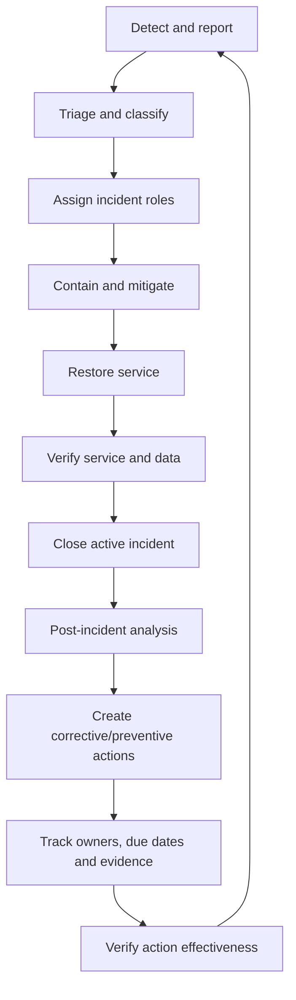
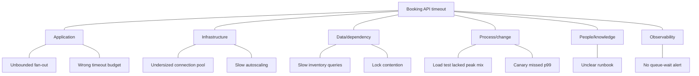
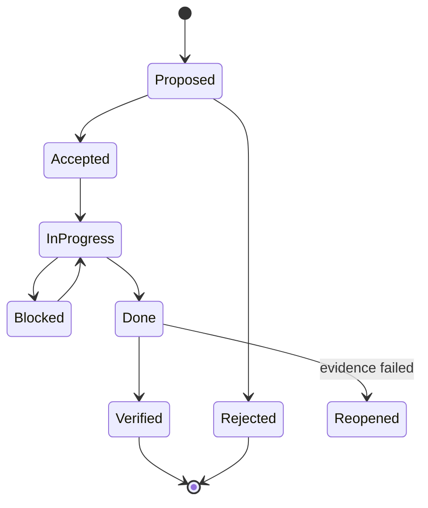

# Incident Analysis, Preventive Actions, and Remediation Tracking

A production incident does not end when dashboards turn green or users regain access to the service. Without understanding what happened, why defenses failed to stop the impact, and which changes must be completed, the system can repeat the failure in another form. Immediate fixes typically restore service; thorough analysis and remediation tracking reduce both the likelihood and severity of the next occurrence.

**Incident analysis, preventive actions, and remediation tracking** form a continuous operational loop: detecting and mitigating impact, collecting evidence, reconstructing timelines, analyzing causes and contributing factors, selecting verifiable actions, assigning owners/deadlines, tracking progress, and measuring post-deployment effectiveness. The outcome must tangibly improve system design, processes, controls, or detection capabilities.

In the **CLOUD_ARCHITECTURE** module, this capability connects observability, reliability, security, deployment, backup/DR, data platforms, and Well-Architected reviews. This lesson uses an equipment-rental platform example: booking API errors spiking when inventory slows down, payment callback backlogs, or a configuration change exposing data. The severity levels, deadlines, and metric thresholds below are examples; organizations must tailor them to their SLOs, business impact, contracts, and regulations.

## 1. What Are Incidents, Problems, and Corrective Actions?

These terms are often used interchangeably yet describe distinct scopes:

| Concept | Meaning | Example |
| --- | --- | --- |
| **Event** | An observable signal or state change | CPU spikes, a request returns 503 |
| **Alert** | Notification requiring evaluation or action | Error budget burn breaches threshold |
| **Incident** | Event degrading or threatening service, data, security, or business obligations | Customers cannot create reservations |
| **Problem** | Underlying cause or condition contributing to one or more incidents | Connection pool is unbounded across workloads |
| **Workaround** | Temporary impact-reduction measure | Disable recommendations to preserve checkout capacity |
| **Corrective action** | Change fixing the underlying condition or restoring proper state | Fix pool sizing and cap concurrency |
| **Preventive action** | Control reducing incident probability or preventing recurrence | Add load tests and pre-saturation pool alerts |
| **Post-incident review** | Post-event analysis to learn and decide improvements | Timeline, causal analysis, action register |

An incident may end within minutes while the underlying problem takes weeks to resolve. A workaround may restore service while the root cause persists. Never close a problem merely because an alert cleared or an incident ticket moved to resolved.

## 2. Objectives of Incident Analysis

Strong incident analysis must answer:

1. **What happened?** Scope, timing, users, services, data, and business processes affected.
2. **What was the impact?** Severity, duration, affected users/transactions, corrupt/lost/exposed data, and related obligations.
3. **What started or triggered the incident?** Trigger, underlying conditions, and related changes.
4. **Why did impact spread or persist?** Detection, alerting, isolation, capacity, rollback, runbooks, and access permissions.
5. **What helped limit impact?** Controls that worked well, early detection signals, and effective actions.
6. **What must change?** Concrete actions, owners, deadlines, evidence, and effectiveness verification methods.

Analysis aims to improve systems and working conditions, not to single out an individual to blame. Operators usually act based on the information, tools, time, and pressure present at the moment. The useful question is why the system made that choice look reasonable or necessary.

## 3. Incident Handling Lifecycle

A common process follows these stages:



Stages can overlap. For instance, the incident commander may assign someone to build the timeline while another team restores service. In severe incidents, never wait for root-cause analysis to finish before mitigating impact.

### Distinguishing Restore and Resolve

- **Restore:** return service to an acceptable level meeting defined demand.
- **Resolve:** underlying cause/condition has been fixed or explicitly accepted under control.
- **Close:** the incident record includes impact, timeline, decisions, and required follow-up links.

A service may be restored via a workaround while the problem remains open. Record that state explicitly.

## 4. Impact-Based Severity Classification

Severity must reflect actual impact and ongoing risk, not merely the count of firing alerts or broken technical components.

| Level | Illustrative Description | Example | Suggested Response |
| --- | --- | --- | --- |
| **SEV-1 Critical** | Widespread core service outage, severe data loss/exposure, or major safety/legal risk | Platform-wide inability to book; payment data exposure detected | Activate incident command, notify security/business leadership, frequent cadence updates |
| **SEV-2 High** | Significant degradation of a critical capability, many customers affected, or rapid SLO burn | Checkout failing in one region; payment callback backlog rising steadily | Incident lead, specialist teams, priority mitigation |
| **SEV-3 Moderate** | Limited scope, workaround exists, no sign of system-wide spread | One report delayed, one tenant cohort hitting errors | Owner handles within SLA, watch for expanding impact |
| **SEV-4 Low** | Minor defect or negligible degradation without core impact | Background job retried cleanly, internal dashboard slightly slow | Operations/backlog ticket and monitor |

### Evaluation Dimensions

- **Availability:** share of requests/transactions impacted, regions, and features.
- **Performance:** latency, throughput, queue age, and user experience.
- **Data integrity:** missing records, duplicates, wrong monetary amounts, or inconsistent state.
- **Security/privacy:** unauthorized data access, exposed credentials, or bypassed controls.
- **Financial/business:** failed transactions, revenue, partner obligations, warehouse operations.
- **Duration and trend:** elapsed time, rate of spread, and recoverability.
- **Recoverability:** whether a workaround exists and whether rollback/restore is feasible.

When impact is unclear, pick an appropriately cautious level, keep gathering evidence, and downgrade severity once evidence supports it. Never downgrade severity just to lower visibility.

## 5. Incident Roles and Coordination Responsibilities

In a major incident, one person should not simultaneously coordinate, execute every command, and update stakeholders. Separating roles reduces overload and prevents dropped information.

| Role | Responsibilities |
| --- | --- |
| **Incident commander (IC)** | Coordinate overall response, set priorities, assign tasks, decide escalations |
| **Technical lead** | Lead technical investigation, propose mitigations/rollbacks, coordinate service owners |
| **Operations/responder** | Execute runbooks, inspect systems, log actions |
| **Communications lead** | Update users, business owners, partners, and stakeholder groups |
| **Scribe** | Record timeline, decisions, command/change IDs, and evidence |
| **Security/privacy lead** | Coordinate forensics, containment, notifications, and evidence preservation when relevant |
| **Business/data owner** | Assess business impact, data correctness, and sign off on recovery |

In small incidents, one person may cover multiple roles. As scope grows, the IC should clearly separate who decides, who executes, and who communicates.

### Illustrative RACI

RACI stands for Responsible (executes), Accountable (holds final ownership), Consulted (provides input), and Informed (kept updated).

| Activity | IC | Technical lead | Scribe | Security/business owner |
| --- | --- | --- | --- | --- |
| Classify severity | A | R | I | C |
| Technical investigation | A | R | C | C |
| Production mitigation | A | R | I | C |
| Timeline/evidence | A | C | R | C |
| Security containment | C | R | C | A/R per policy |
| Business validation | C | R | I | A |
| Communications | A | C | R/C | C |
| Post-incident actions | A | R | C | R/C |

This RACI is an example; incident policies must specify who holds authority to accept risk and approve cutovers/restores.

## 6. Triage: Structured Information Gathering

Triage does not always require knowing the root cause. The primary goal is assessing the current state and picking the next safe action.

### Initial Questions

- What was the first symptom and when did it start?
- Who/which cohorts are currently affected?
- Which services, regions, tenants, endpoints, or data products?
- What are current error rates, latency, backlogs, and trends?
- Were there recent deploys, config, network, IAM, or schema changes?
- Is data corrupted, lost, duplicated, or accessed unauthorized?
- Is there a known, tested workaround?
- What actions must be avoided to prevent destroying evidence or causing further damage?

### Triage Board

Maintain a live status board:

| Item | Value to Record |
| --- | --- |
| Incident ID | Unique identifier |
| Severity/status | SEV, investigating/mitigating/monitoring/resolved |
| Start/detected time | Evidence-backed timestamp with explicit timezone |
| Affected scope | Services, regions, tenants, users, datasets |
| Impact estimate | Requests, transactions, revenue, data, and duration |
| Current symptoms | Error rate, p95/p99, queue depth, security signals |
| Recent changes | Deploys, configs, IAM, schemas, provider events |
| Hypotheses | Hypotheses with supporting/refuting evidence |
| Mitigation | Actions executed and observed results |
| Next update | Next update time and owner |

Explicitly separate known facts, unknowns, and confidence levels. Avoid presenting hypotheses as proven facts.

## 7. Containment and Mitigation Before Root Cause

During an active incident, containment limits blast radius; mitigation restores core capabilities. Both can be more urgent than immediately pinpointing the root cause.

Examples:

- Roll back a recent release if evidence shows failures started right after release and rollback is safe.
- Disable a feature flag or optional dependency to protect checkout.
- Block compromised access keys and isolate suspected breached workloads.
- Pause batch jobs that may write corrupt data.
- Cap concurrency to protect the database.
- Route traffic away from unhealthy regions/instances when failover is already tested.
- Quarantine bad records/events to prevent contaminating curated datasets.

### Pre-Mitigation Checks

For destructive or hard-to-reverse operations:

1. State the objective and scope clearly.
2. Identify owner/approver per incident authority.
3. Check dependencies and side effects.
4. Record current state, evidence, and rollback path.
5. Execute at the smallest effective scope.
6. Measure outcomes immediately after acting.

In critical incidents, do not create bureaucratic approval bottlenecks that delay containment; use predefined emergency authority and record decisions for post-incident review.

## 8. Collecting Evidence and Preserving Integrity

Root cause analysis is only as trustworthy as its evidence. Useful evidence resides in logs, metrics, traces, event histories, deployment records, audit logs, database statistics, queue offsets, and user reports.

### Evidence Sources

| Source | Questions It Answers |
| --- | --- |
| Application logs | Which requests failed, error types, tenants/operations? |
| Metrics | When did latency/errors/saturation shift? |
| Distributed traces | Which dependency slowed down or failed? |
| Cloud audit logs | Which identity altered IAM/network/KMS/resources? |
| Deployment history | Which artifact/config versions were released? |
| Database logs/metrics | Any abnormal locks, query plans, connections, or replication? |
| Queue/broker metadata | Where did backlogs start; what are offsets/retries/DLQs? |
| Security telemetry | Credential use, exfiltration, malware, or privilege escalation? |
| Customer/business reports | What impact is visible to end users? |

### Evidence Hygiene

- Record timestamps with timezones and synchronized clocks; note any skew.
- Retain raw evidence per retention and legal/incident policies.
- Save queries, dashboard time ranges, run IDs, commits, resource IDs, and change IDs.
- Distinguish raw logs from exports/summaries.
- Never alter logs or delete resources that may hold forensic evidence.
- Redact secrets/PII when sharing broadly, while preserving forensic copies in access-controlled storage.
- Avoid altering investigated systems before capturing essential state.

When a security incident is suspected, coordinate with the security/forensic lead before rebooting, re-imaging, or terminating hosts. Snapshots/volatile evidence may be required per policy and forensic capability.

## 9. Reconstructing the Incident Timeline

Timelines turn scattered events into a verifiable sequence. Each entry should capture:

- Timestamp and timezone.
- Event/action.
- Actor or component.
- Evidence reference.
- Observed outcome.
- Confidence/uncertainty.

Example:

| Time (UTC) | Event | Evidence | Notes |
| --- | --- | --- | --- |
| 09:02 | Deployed Booking API v2.8 | Deployment run 4821 | Release started |
| 09:05 | Inventory timeouts rose | Trace dashboard | p99 climbed from 80 ms to 2.4 s |
| 09:07 | Booking 503s breached alert threshold | Alert INC-204 | Checkout impacted |
| 09:10 | IC activated | Incident log | SEV-2 |
| 09:14 | Disabled recommendation fan-out | Change CHG-331 | Reduced dependency load |
| 09:19 | Error rate dropped | Metrics | Root cause not yet confirmed |
| 09:27 | Rolled back API v2.8 | Deployment run 4830 | Latency returned to baseline |
| 09:45 | Observed stability | SLO dashboard | Incident restored |

Timelines must not force causality where evidence has not proved it. A deploy preceding an error is a correlation to investigate, not proof that the release is the root cause.

### Timestamps and Clock Skew

In distributed systems, node clocks can drift. Pair timestamps with correlation IDs, trace/spans, sequences/offsets, and audit event IDs. When comparing multiple sources, note known clock skew; never treat millisecond timestamp ordering across hosts as absolute.

## 10. Distinguishing Symptom, Trigger, Root Cause, and Contributing Factors

These distinctions keep analysis from stopping at surface symptoms.

| Element | Question | Example |
| --- | --- | --- |
| Symptom | What did users or monitoring observe? | Booking API returned 503 |
| Trigger | What immediate event exposed the issue? | Inventory latency rose during peak traffic |
| Root cause/causal condition | What technical or organizational condition allowed the incident? | Unbounded fan-out lacking concurrency budgets and overall timeouts |
| Contributing factor | What increased likelihood or blast radius? | Alerts tracked CPU only, not queue age |
| Detection gap | Why was detection late? | No synthetic checkout test |
| Recovery gap | Why did recovery take long? | Rollback depended on rare deploy permissions |

In complex systems, a single root cause rarely explains everything. Multiple conditions often coexist: code changes, traffic patterns, dependency behavior, insufficient headroom, and unclear runbooks.

## 11. Root Cause Analysis Techniques

### 11.1. 5 Whys

Repeatedly ask “why?” to trace the failure mechanism. Example:

1. Why couldn't customers create reservations? Booking API timed out.
2. Why did the API time out? Requests waited too long on Inventory Service.
3. Why did they wait too long? Concurrent fan-out requests saturated connection pools.
4. Why was fan-out unbounded? The service lacked per-dependency concurrency caps.
5. Why wasn't it caught before release? Load tests lacked representative workload mixes and traffic peaks.

Conclusions must go beyond “lacked load testing.” Solutions may require concurrency caps, dependency budgets, realistic load tests, and queue-wait alerting. Verify every step with evidence; do not force exactly five whys if causation is already clear or branches into multiple paths.

### 11.2. Fishbone / Ishikawa

Group hypotheses to avoid focusing narrowly on code alone:



A fishbone diagram organizes hypotheses—it does not prove causes. Test each branch using logs, metrics, traces, deployment records, configs, and participant interviews.

### 11.3. Fault Tree Analysis

Fault trees start from an undesirable outcome and decompose event combinations that can cause it. For example, “unable to create reservation” occurs when API is unavailable OR database is unavailable OR admission controller rejects all traffic OR a mandatory dependency stops responding. Trees help pinpoint failure modes and where preventive/detective controls belong.

### 11.4. Change Correlation

Correlate incidents with deploys, configs, IAM, networking, schemas, provider changes, and traffic patterns. Use canaries, rollbacks, replays, or controlled experiments to test hypotheses safely without re-impacting customers.

## 12. Blameless Analysis of Human Factors

Blameless does not mean unaccountable or ignoring willful misconduct. It means analysis avoids reducing everything to “careless operator” when systems, processes, interfaces, and working conditions shaped the mistake.

Instead of asking “Who ran this command?”, ask:

- What information was visible to the operator at that moment?
- Did the command clearly warn about scope/environment?
- Were permissions overly broad?
- Were dry-runs, confirmations, or two-person reviews available?
- Were runbooks outdated or contradictory?
- How did recovery pressure and understaffing influence decisions?
- How can automation/guardrails make the operation safer?

Also document good decisions and controls that worked well. If a responder applied an effective workaround, capture the conditions that made it work to turn it into a controlled runbook or automation.

## 13. Writing the Post-Incident Review

A post-incident review (PIR) synthesizes the incident and learning plan. Minimum template:

```markdown
# Post-Incident Review: [Incident ID]

## Summary
- Service / environment:
- Severity:
- Start / detection / restore / close times:
- Incident commander:

## Customer and business impact
- Users / tenants / regions:
- Failed or delayed transactions:
- Data integrity / privacy / financial impact:
- Duration and SLO impact:

## Detection and response
- Detection source:
- Time to detect / acknowledge / mitigate / restore:
- What worked:
- What slowed response:

## Timeline
- [UTC timestamp] event, actor/component, evidence reference

## Causal analysis
- Trigger:
- Root/causal conditions:
- Contributing factors:
- Detection and recovery gaps:
- Evidence and confidence:

## Actions
- Action ID / owner / due date / priority / evidence / success criteria

## Lessons
- What should be preserved:
- What should change:
```

A PIR should provide enough detail for someone outside the incident to understand what happened, without turning into a dump of raw logs. Link to access-controlled, retention-governed evidence; keep credentials, PII, and sensitive forensic artifacts out of broadly shared documents.

### What Not to Do

- Use blaming language or speculate about motives.
- Write “human error,” “communication issue,” or “monitoring issue” without explaining the mechanism.
- Declare a hypothesis the root cause without evidence.
- Create dozens of vague, ownerless actions.
- Close a PIR before critical actions are entered into a tracking system.

## 14. From Findings to Corrective and Preventive Actions

A finding creates value only when translated into executable, verifiable actions.

### Action Categories

| Category | Objective | Example |
| --- | --- | --- |
| Corrective | Fix the condition that caused failure | Fix missing query index, correct misconfiguration |
| Preventive | Reduce recurrence probability | Add guardrails, validation, automated tests |
| Detective | Detect earlier | Alert on queue age or data invariants |
| Mitigative | Reduce impact when failures occur | Bulkheads, failover, feature degradation |
| Recovery | Shorten recovery time | Automate restore/rollback, rehearsed runbooks |
| Governance/process | Improve decisions and accountability | Risk-tiered approvals, access reviews |

Not every action involves code. Changes may target architecture, quotas, ownership, training, vendor contracts, escalations, or policies.

### Actions Must Trace to Findings

| Finding | Proposed Action | Success Criteria |
| --- | --- | --- |
| Unbounded Inventory fan-out | Add concurrency cap and deadline budget | Stress test keeps pool within target bounds |
| Queue backlog undetected | Alert on oldest age and burn rate | Alert fires before SLO breach |
| Rollback required rare privileges | Improve JIT runbook/approval path | Rollback drill completes within target time |
| Duplicate payment events | Idempotency keys and reconciliation | Replay test creates zero duplicate ledger entries |
| Audit logs share production admin rights | Isolate logging account and deny delete | Test proves production identity cannot delete audit evidence |

An action like “remind everyone to be more careful” lacks credible success criteria. Where training is genuinely needed, specify the skill, audience, simulated scenarios, and competency assessment.

## 15. Writing Good Action Items

Each action item should include:

- **Action ID:** tracking identifier.
- **Finding/risk:** link to the finding or incident.
- **Description:** concrete verb and expected deliverable.
- **Owner:** one accountable person; supporting teams may assist.
- **Priority/risk reduction:** why it should happen first.
- **Due date:** completion milestone.
- **Dependencies:** teams, vendors, approvals, budget, or releases.
- **Status:** proposed/accepted/in progress/blocked/done/verified/cancelled.
- **Evidence:** PR, config, dashboard, test report, runbook, or drill.
- **Success criteria:** measurable acceptance conditions.
- **Effectiveness review:** post-deployment evaluation date.

### Example Action Register

| ID | Action | Owner | Due | Priority | Success Criteria |
| --- | --- | --- | --- | --- | --- |
| ACT-101 | Add per-dependency concurrency cap for Inventory client | Booking team lead | 12/15 | P1 | 2× peak load test keeps pool below cap |
| ACT-102 | Alert when oldest queue age exceeds budget | SRE | 12/10 | P1 | Alert detects backlog prior to SLO breach |
| ACT-103 | Extend canary metrics with p99 and 5xx | Release owner | 12/20 | P2 | Canary auto-halts when thresholds breach |
| ACT-104 | Drill rollback using JIT access | On-call lead | 12/22 | P2 | Drill meets time target with complete audit logs |

Dates and criteria are illustrative. Real action registers require committed owners and capacity-aligned due dates.

### One Primary Owner per Action

Multiple teams may collaborate, but assign one accountable owner. If an action spans multiple workstreams, split it into subtasks with dependencies and one coordinating owner. “Platform team” or “everyone” is not an actionable owner.

## 16. Prioritizing Actions by Risk Reduction

Post-incident action backlogs often exceed execution capacity. Prioritize based on:

- Severity and blast radius if repeated.
- Probability of recurrence and exposure frequency.
- Ability to detect before impact spreads.
- Time required to reduce risk.
- Reversibility and implementation cost.
- Dependencies and actions that unlock downstream controls.
- Availability of temporary compensating controls while awaiting long-term fixes.

### Risk-Based Priority

| Priority | Description | Example |
| --- | --- | --- |
| P0 | Open active risk capable of causing immediate severe harm | Revoke exposed credentials, close public exposure |
| P1 | Major risk needing attention in the nearest cycle | Add guardrails preventing backup deletion |
| P2 | Important improvement with existing workaround | Enhance alerts and load testing |
| P3 | Long-term optimization or low-toil improvement | Polish internal dashboards |

Never use priority as a substitute for risk acceptance. If a critical action is deferred, record who accepts the residual risk, compensating controls, and the review date.

### Cost of Delay

Low-cost actions that block major risks should usually go first. Conversely, a long-term architectural overhaul may need smaller interim steps to lower risk early. Split “quick guardrail” and “structural fix” into linked actions instead of waiting on the multi-quarter project before any control exists.

## 17. Tracking the Remediation Lifecycle

An action register should reflect verified progress, not just self-reported statuses.



### Suggested States

- **Proposed:** finding logged, resources not yet committed.
- **Accepted:** owner, priority, and due date assigned.
- **In progress:** actively underway.
- **Blocked:** missing dependency/approval/resource; must have a blocker owner and next review date.
- **Done:** implementation finished with evidence attached.
- **Verified:** success criteria tested and effectiveness confirmed per plan.
- **Reopened:** evidence failed, risk persists, or issue recurred.
- **Cancelled/accepted risk:** formal decision with rationale, authority, and review date.

Never equate Done with Verified. Merging a PR does not prove an alert actually fires; deploying a policy does not prove a role is truly blocked from deleting backups.

## 18. Action Item Governance

To keep remediation from dropping off priority lists, establish cadence and escalation:

| Cadence | Activity |
| --- | --- |
| Daily during major incidents | Review temporary actions, blockers, and open risks |
| Weekly | Owners update statuses, evidence, and completion forecasts |
| Monthly | Reliability/security review inspects overdue items, P0/P1s, and exceptions |
| Quarterly | Analyze trends, recurring actions, systemic risks, and major investments |
| Post-Verified | Re-check effectiveness after an appropriate observation window |

### Escalation

Overdue actions must document:

- Reason and dependencies.
- Impact of delay.
- Interim compensating measures.
- Proposed new due date.
- Authority accepting the risk.

Never auto-extend due dates repeatedly without reviewing risk. If scope changes, document why and re-evaluate the finding.

### Risk Acceptance

An organization may decide not to implement an action if cost outweighs benefit or risk is acceptable. Risk acceptance must record the threat/finding, residual risk, compensating controls, approver, expiration, and review triggers. “Lack of capacity” does not automatically constitute risk acceptance.

## 19. Verifying Implementation and Effectiveness

There are two levels of verification:

1. **Implementation verification:** was the change deployed accurately?
2. **Effectiveness verification:** did the change reduce risk or improve outcomes as intended?

Example for “add alert when queue age exceeds 60 seconds”:

- Implementation: rule deployed, notifications route to the right on-call rotation, runbook attached.
- Effectiveness: during a spike test, the alert fires before requests time out; in production, responders have time to shed load.

### Appropriate Evidence

| Action Type | Implementation Evidence | Effectiveness Evidence |
| --- | --- | --- |
| Code fix | PR, build, deployment ID | Regression test; defect does not recur under representative load |
| IAM guardrail | Policy version, access test | Negative test proving unauthorized principals are blocked |
| Alerting | Rule/config, notification test | Reduced detection lead time in drills/incidents |
| Runbook | Version, owner, approval | Game day completed within target |
| Backup control | Retention policy, vault config | Restore drill and delete-protection test pass |
| Capacity control | Concurrency/config | Load/stress test passes and SLO holds |
| Training | Materials and attendance | Exercise scores/behaviors in simulations |

### Do Not Measure Only “The Issue Didn't Come Back”

An incident may fail to recur simply because triggering conditions have not repeated yet. Use proactive testing, simulations, fault injection, or leading-indicator metrics. Waiting for another outage to prove an action works leaves risk unverified for far too long.

## 20. Tracking Recurrence and Systemic Patterns

An isolated incident may be a symptom of a broader systemic issue:

- Multiple services lacking bounded concurrency.
- Multiple overdue actions bottlenecked on the same team.
- Multiple incidents tied to configuration drift.
- Late detection because alerts track CPU instead of user journeys.
- Backup restore tests missing key/network dependencies.
- Production changes routinely bypassing pipelines.

Group incidents by failure mode, control gap, service/domain, and contributing factor. Do not count identical incident titles alone; two “503” incidents may have entirely different causes, while one IAM flaw can surface as many distinct symptoms.

### Problem Records

A problem record should capture:

- Problem ID and owner.
- Related incidents.
- Causal hypotheses and evidence.
- Affected services/assets.
- Current workaround.
- Known errors or limitations.
- Permanent fix/action links.
- Risk acceptance/expiration if unresolved.
- Review date and status.

Problem management ensures recurring incidents with a shared cause get addressed through a single structured plan.

## 21. Incident and Remediation Operational Metrics

| Metric | Meaning | Careful Usage |
| --- | --- | --- |
| MTTD | Mean time to detect | Time from impact start to detection; define start time clearly |
| MTTA | Mean time to acknowledge | Time until a responder accepts ownership |
| MTTM | Mean time to mitigate | Time until impact drops significantly |
| MTTR | Mean time to restore/repair/resolve depending on definition | State exact endpoints; never compare across differing definitions |
| Incident frequency | Incidents by severity/domain | Normalize by traffic/transactions where appropriate |
| Recurrence rate | Share of incidents from previously seen failure modes/problems | Requires consistent problem and causal mapping |
| Action aging | Age of unverified actions | Slice by priority, blockers, and owners |
| Overdue rate | Percentage of overdue actions | Do not incentivize hasty closures to hit KPIs |
| Verification pass rate | Share of actions passing success criteria | Track reopen/failure rates |
| Detection coverage | Share of critical journeys with adequate signals/alerts | Measure via testing and journey mapping |
| Action effectiveness | Reduction in risk/impact or recovery time | Use leading indicators and drills |

MTTR is easily misunderstood because it can mean repair, recovery, or resolution. Dashboards must state start/end definitions, timezones, and how reopened incidents are counted.

### Avoiding Perverse Metric Incentives

- Aggressive MTTD targets can encourage noisy over-alerting.
- Aggressive MTTR targets can encourage rushed rollbacks or closing incidents before validation.
- Zero-overdue-action targets can lead to rubber-stamped closures.
- Lower-incident-count targets can incentivize severity downgrading.

Pair quantitative metrics with qualitative reviews of impact and evidence.

## 22. Problem Prevention in Cloud Architecture

From findings, choose improvements matched to the layer introducing risk:

| Failure Mode | Preventive Control | Detective Control | Recovery/Mitigation |
| --- | --- | --- | --- |
| Database pool exhaustion | Concurrency caps, query budgets, connection governance | Pool saturation/queue wait alerts | Shed optional load, budgeted retries |
| Misconfiguration | IaC validation, schema/policy tests, approvals | Drift detection, config diff alerts | Versioned config rollback |
| Data corruption | Constraints, idempotency, validation | Reconciliation, invariant checks | PITR, replay, repair |
| Credential compromise | Short-lived identities, least privilege, MFA | Identity anomaly/audit alerts | Revoke, rotate, isolate |
| Region failure | Multi-region/backups aligned with RTO | Health checks and regional signals | Failover/restore drills |
| Queue backlog | Bounded queues, producer quotas | Oldest age, lag, DLQ alerts | Scale consumers, defer/drop validly |
| Deployment regression | Canaries, staged rollouts, testing | Error budget burn, p99 regression | Automatic/manual rollback |

Never pick tooling before understanding the failure mode. A new alert does not stop database pool exhaustion; an autoscaling rule does not fix query lock contention; a new backup does not guarantee clean restores.

## 23. Change Management and Remediation

Actions may require changes to production, policies, or data. Apply appropriate change management:

- Classify risk and impact.
- Review with technical/security/data owners.
- Link changes to action IDs and incidents/problems.
- Verify tests, rollbacks, and recovery points.
- Approve per SoD and risk tier.
- Deploy via staged rollouts where feasible.
- Verify success criteria and evidence.
- Update remediation status after deployment completes.

Never patch production directly to “clear an overdue action” while skipping change records. Action completion must reference the exact change that established the new control.

## 24. Incidents Involving Security or Data Privacy

Security incidents require a dedicated process or security extension to the incident process:

- Restrict incident details on a need-to-know basis.
- Preserve forensic evidence and chain of custody per policy.
- Isolate credentials, hosts, accounts, or data paths.
- Coordinate security/privacy/legal/compliance owners.
- Assess which data, subjects, and purposes were affected.
- Determine notification obligations and deadlines under applicable laws/contracts.
- Restore only after threat containment and environment trust are confirmed.
- Verify remediation does not accidentally destroy audits or retention records.

Never conclude whether notification obligations apply based solely on a technical template. Decisions belong to authorized owners grounded in verified data and applicable regulations.

### Security PIR

Security analyses must specifically distinguish:

- Initial access and credential paths.
- Privilege escalation and lateral movement.
- Persistence and exfiltration.
- Detection/containment gaps.
- Data scope and evidence confidence.
- Whether recovery points are clean.
- Trust boundaries and controls requiring change.

Broadly distributed PIRs may use a redacted summary while detailed forensic evidence stays in restricted storage.

## 25. Incident Communications and Stakeholder Updates

Strong communication keeps stakeholders informed without constantly interrupting engineers.

Each update should cover:

- Incident ID/severity and status.
- Affected capabilities/regions.
- Confirmed impact and active areas of investigation.
- Mitigation actions underway.
- What users/business teams should do or avoid.
- Next update timestamp.

Avoid speculating on root causes or promising unverified recovery times. Separate internal technical details from customer-facing messages; never expose security-sensitive details.

### Cadence

Update frequency depends on severity and audience. Critical incidents may need brief, regular updates on a published cadence even when little has changed. A scribe/communications lead frees the IC to focus on technical decisions.

## 26. End-to-End Example: Inventory Latency Breaking Booking API

### Context

During peak hours, Inventory Service p99 latency spikes. Booking API calls Inventory multiple times per request to compute availability and suggest alternatives. Thread pools and database connections fill up, Booking returns 503, and customers cannot complete reservations.

### Timeline

1. Traffic rises due to a campaign.
2. Inventory query p99 climbs, though service CPU is not saturated.
3. Booking fan-out amplifies request concurrency.
4. Thread/connection pools exhaust and time out.
5. CPU-only alerts stay silent; synthetic checkout detects errors later.
6. On-call learns of the incident via customer support and the 5xx dashboard.
7. IC assigns one team to disable recommendations and another to inspect inventory queries.
8. Error rate drops after disabling fan-out; subsequent release rollback restores baseline latency.

### Impact

- Checkout failures across multiple regions for 18 minutes.
- Some customers retried, generating duplicate requests; idempotency prevented duplicate bookings.
- No evidence of lost payment ledger entries.
- Some analytics dashboards lagged due to backlogs.

### Causal Analysis

| Finding | Evidence |
| --- | --- |
| Unbounded Inventory fan-out | Traces show each request issuing multiple inventory calls |
| Downstream timeout exceeded caller deadline | Configs and trace timings |
| Shared pool used for core and optional calls | Runtime configuration |
| Alerts omitted queue wait/connection saturation | Monitoring rule inventory |
| Load tests omitted campaign traffic mix | Test plans and workload profiles |

Conclusion: the traffic spike was the trigger; unbounded fan-out, misaligned deadline budgets, and shared pools were the causal/contributing conditions. Do not blame the incident solely on “high traffic.”

### Action Register

| Action | Owner | Priority | Success Criteria |
| --- | --- | --- | --- |
| Cap Inventory concurrency per dependency | Booking lead | P1 | Stress test stays under pool cap |
| Isolate optional recommendations with a bulkhead | Platform lead | P1 | Optional path failure does not affect checkout pool |
| Propagate deadlines end-to-end | Service owners | P1 | Trace tests prove downstream stops once caller deadline expires |
| Alert on pool utilization and queue wait | SRE | P1 | Alert fires before checkout SLO burn |
| Add campaign workload to load tests | QA/performance lead | P2 | 2× peak and spike profile tests pass acceptance |
| Auto-shed recommendations under overload | Product/platform | P2 | Game day verifies degradation and recovery |

### Verification

- Test code/config in staging with representative traffic shapes.
- Run 2× peak load and spike tests.
- Run a game day injecting Inventory slowdowns and disconnects.
- Verify alerts, feature degradation, rollbacks, and runbooks.
- Observe production post-release across a representative window.
- Transition actions to Verified only once success criteria pass and evidence is archived.

## 27. Common Anti-Patterns

1. **Closing incidents when metrics briefly turn green.** Fails to verify data integrity or recurrence risk.
2. **Labeling failures as human error.** Ignores permissions, interfaces, runbooks, and operating conditions.
3. **Recording only symptoms.** “API 503” does not explain the failure mechanism.
4. **Treating timelines as causal proof.** Preceding events do not automatically prove causation.
5. **Forcing one root cause onto complex systems.** Ignores interacting conditions.
6. **Actions without owners or due dates.** Nobody owns completion.
7. **Vague action descriptions.** “Improve monitoring” lacks verifiable success criteria.
8. **Equating Done with Verified.** No tests or evidence of real effectiveness.
9. **Not linking actions to incidents/problems/changes.** Breaks traceability.
10. **Ignoring overdue items and exceptions.** Risks remain open without explicit decisions.
11. **Measuring MTTR without clear definitions.** Prevents accurate comparison or improvement.
12. **Treating postmortems as pure paperwork.** Fails to change policies, code, architecture, or operations.

## 28. Process for Designing an Incident Learning Loop

1. **Prepare:** severity model, roles, contact paths, dashboards, runbooks, and evidence policies.
2. **Detect/triage:** determine scope, impact, uncertainty, and incident owner.
3. **Contain/restore:** shrink blast radius, restore service, and verify data.
4. **Record:** capture evidence, timeline, change/deploy IDs, and decisions.
5. **Analyze:** symptoms, triggers, causal conditions, contributing factors, detection/recovery gaps.
6. **Review:** blameless PIR with stakeholders and owners confirming findings.
7. **Plan:** concrete actions, priorities, owners, due dates, dependencies, success criteria.
8. **Execute:** link changes, tests, approvals, and rollouts.
9. **Verify:** implementation evidence and effectiveness evidence.
10. **Learn:** update runbooks, architecture decisions, training, alerts, and risk registers.

## 29. Hands-On Exercises

### Exercise A — Alert Missed the Incident

Booking API returned 503s for 12 minutes. CPU sat at 35%, yet thread pools were 100% busy and Inventory p99 jumped 20×.

**Question:** what evidence and detectors are missing?

**Hint:** distributed traces, queue wait, pool utilization, dependency timeouts, request fan-out, and synthetic checkouts. Never rely on CPU as the sole signal.

### Exercise B — Silent Data Corruption

A migration corrupted reservation timezones for 3 days; the service stayed available and zero alerts fired.

**Question:** how do you analyze impact and design corrective/preventive actions?

**Hint:** identify affected rows/time ranges, downstream consumers, booking conflicts, and customer obligations; perform controlled restore/reconciliation; add invariants/timezone contracts, migration boundary tests, and data quality monitoring.

### Exercise C — Overdue Action

A P1 action “isolate audit logs into a security account” is two months overdue due to platform capacity constraints.

**Question:** how should this risk be managed?

**Hint:** define interim controls, who accepts residual risk, an evidence-based new deadline, resource escalation, and periodic reviews. Never just flip the status to Blocked.

### Exercise D — Action Marked Done Yet Incident Recurred

A new alert was deployed, the ticket moved to Done, yet a similar incident recurred.

**Question:** what should be reviewed?

**Hint:** whether the alert monitors the right signal, thresholds, and routing; whether responders receive and can act on it; whether the failure mode matched the hypothesis; and whether success criteria measured effectiveness. Reopen the action or problem when evidence falls short.

### Exercise E — Security Incident

Cloud audit logs show a role was granted customer data export permissions after hours. It is unclear whether data was downloaded.

**Question:** what triage, evidence, and communication steps are needed?

**Hint:** contain credentials/roles per incident authority, preserve audit/network/storage evidence, determine scope and exfiltration signals, coordinate security/privacy/legal, and never conclude absence of impact without sufficient evidence.

### Self-Assessment Criteria

| Capability | Required Evidence |
| --- | --- |
| Incident response | Severity, roles, triage, containment, and restore records |
| Evidence | Timeline, traces/logs/audits, timestamps, and confidence |
| Causal analysis | Trigger, causal conditions, contributing factors, and detection gaps |
| PIR | Impact, what worked, lessons, and action links |
| Remediation | Owner, priority, due date, dependencies, and success criteria |
| Tracking | Status lifecycle, blockers/escalations, and evidence |
| Effectiveness | Post-deployment tests/drills/metrics and recurrence reviews |
| Governance | Risk acceptance, change approvals, and audit trails |

## 30. Pre-Closure Checklist for Incidents and Remediation

- Is impact by user, transaction, data, and business documented?
- Are severity, incident roles, and communications clear?
- Does the timeline include timestamps/timezones and evidence references?
- Are hypotheses separated from proven facts?
- Are root/causal conditions and contributing factors analyzed?
- Are detection, containment, and recovery gaps reviewed?
- Is security/privacy/forensic evidence preserved where required?
- Are open workarounds and residual risks documented?
- Does every action have an ID, owner, priority, due date, and success criteria?
- Are actions linked to specific findings, problems, and changes?
- Do blockers/overdue items have appropriate escalations and risk acceptance?
- Does implementation verification have evidence?
- Does effectiveness verification have tests, drills, or leading indicators?
- Are actions truly Verified rather than merely Done?
- Are runbooks, dashboards, policies, and architecture records updated?
- Is a plan in place to review recurrence and systemic patterns?

Incident analysis creates lasting value only when connected to accountable remediation and effectiveness verification. Reconstructing evidence-backed timelines, distinguishing symptoms from causal conditions, running blameless reviews, prioritizing actions by risk, assigning owners/deadlines, and tracking through Verified turns incidents into measurable improvements. The learning loop closes only when changes make the system harder to break the same way, faster to detect, or safer and quicker to recover.
