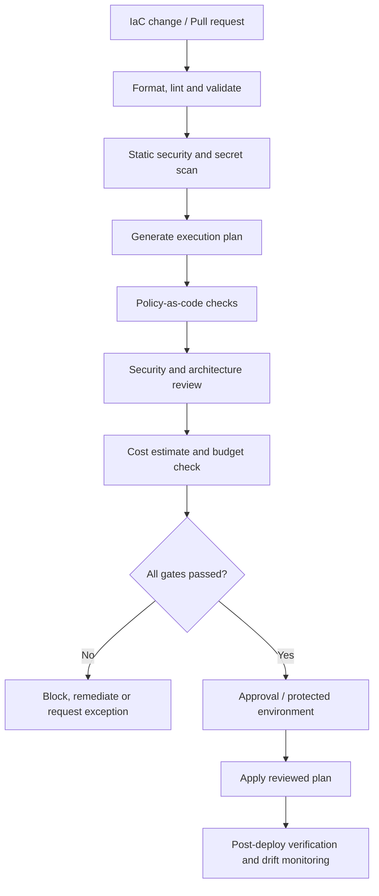

# Pre-Provisioning Policy, Security, and Cost Validation

## 1. Why validate before provisioning infrastructure?

Infrastructure as Code (IaC) describes infrastructure using source code, modules, and configurations that can be reviewed, tested, versioned, and deployed repeatedly. A single IaC change can make a database public, grant overly broad administrator permissions, open firewalls to the internet, omit encryption, or provision hundreds of unbudgeted instances. Once applied, the impact can hit production immediately and sometimes be difficult to reverse.

Therefore, before provisioning, an automated and manual verification chain must answer three questions:

1. **Policy:** do resources and configurations comply with organization, environment, and workload guardrails?
2. **Security:** do access permissions, networking, data, secrets, encryption, and logging align with the threat model?
3. **Cost:** does the change fit budgets, capacity plans, tagging standards, and unit economics targets?

**Pre-provision validation** is the practice of evaluating IaC changes before executing them against target environments. It combines source review, static analysis, policy-as-code, plan inspection, security checks, cost estimation, and approvals. These steps should live inside the pipeline so every change passes the same bar, generates evidence, and remains traceable.

Within the **CLOUD_ARCHITECTURE** module, the **Infrastructure as Code** chapter treats pre-provisioning checks as an integral part of cloud operational design. IaC does more than build consistent infrastructure; it enforces security, reliability, scalability, cost, and governance principles.

After this lesson, learners will be able to:

1. Distinguish among linting, static analysis, policy-as-code, plan review, and runtime validation.
2. Design policy gates for resource types, regions, network exposure, IAM, encryption, and logging.
3. Integrate security scanning and secret detection into pull requests and CI.
4. Read execution plans to identify create/update/replace/destroy actions and data risks.
5. Estimate costs prior to apply, detect anomalous spend, and enforce budget controls.
6. Establish tagging, ownership, exception, and approval workflows.
7. Retain evidence for auditing and monitor post-provisioning drift.

## 2. Pre-provisioning validation lifecycle

A standard pipeline can be organized into layers:



These stages do not replace one another:

| Stage | Question | Example |
| --- | --- | --- |
| Format/lint | Does code follow syntax and conventions? | Formatting, validating module inputs |
| Static analysis | Are there dangerous patterns or common misconfigurations? | Public storage, wildcard IAM |
| Secret scan | Were credentials committed? | API key in a variable file |
| Plan | What does Terraform/Pulumi/engine intend to change? | Replacing a database, opening a port |
| Policy-as-code | Does the change violate guardrails? | Prohibiting public databases |
| Security review | Are the threat model and boundaries intact? | Private endpoints, encryption |
| Cost estimate | How much is expected spend increasing? | Instance count, data egress |
| Approval | Who accepts the remaining risk? | Service owner, security, finance |
| Apply | Is the approved plan running in the right environment? | Protected deployment |
| Verify | Does live infrastructure match requirements? | Config, access, tags, alerts |

### 2.1. Fail early with clear feedback

Formatting errors, missing required tags, or disallowed public IPs should fail early in pull requests. Authors should see the exact resource, property, policy ID, severity, rationale, and remediation steps. A generic "policy failed" message frustrates developers and tempts them to bypass gates.

### 2.2. Separating deterministic checks from contextual approvals

Anything deterministically checkable should be automated: disallowed regions, mandatory encryption, denying wildcard admin, secret detection, and cost thresholds. Architecture review still requires human judgment for trade-offs, unusual data flows, or exceptions. Approvals should never substitute for repeatable automated checks.

## 3. IaC source hygiene and static validation

Before evaluating policies, confirm the IaC source is trustworthy:

- Consistent formatting and readable diffs.
- Module and provider versions pinned per policy.
- Input variables define types, validation rules, and safe defaults.
- No committed secrets or state files containing secrets.
- Resource names and tags follow conventions.
- Clear environment and workspace mappings.
- Dependencies do not pull modules from untrusted sources.
- Lockfiles and provider checksums are managed.
- Plan and apply use identical tool and provider versions.
- Pipelines never execute code from unreviewed branches.

### 3.1. Linting, validation, and static analysis

| Check | Scope | Limitations |
| --- | --- | --- |
| Formatter | Code style and structure | Does not prove configuration security |
| Parser/validator | Syntax, types, required arguments | Lacks full business policy context |
| Linter | Unusual patterns and best practices | May have false positives/negatives |
| Static security scanner | Common misconfigurations | Lacks full runtime context |
| Dependency scanner | Provider/module/package versions and CVEs | Requires exploitability assessment |
| Secret scanner | Credentials/tokens in source/history | May miss encoded or runtime-generated secrets |

Passing lint is not security approval. Nor can a static scanner catch every logic flaw or authorization bug.

### 3.2. Checking modules and providers

Pinning versions makes deployments reproducible, but version pinning does not replace patch management. Pipelines should:
- Block providers/modules outside an allowlist if policy requires.
- Verify module checksums and provenance.
- Track advisories and CVEs.
- Use internal registries or verified sources where appropriate.
- Review breaking changes prior to upgrades.
- Run tests on shared modules before releasing new versions.

## 4. Policy-as-code: turning guardrails into testable rules

**Policy-as-code** expresses governance rules as executable code or data evaluated automatically against IaC source, execution plans, or deployment requests.

A policy typically defines:
- **Subject:** the resource, principal, or change being evaluated.
- **Condition:** properties, environment, tags, region, or action.
- **Decision:** allow, deny, warn, or require approval.
- **Message:** rationale and remediation guidance.
- **Owner/version:** accountable team, policy version, and effective date.
- **Exception:** scope, justification, approver, and expiry if permitted.

Examples in natural language:
- Production databases must not have public network exposure.
- Storage holding customer data must enable encryption at rest and block public access.
- Production workloads must carry `owner`, `service`, `environment`, and `cost-center` tags.
- IAM roles must not grant wildcard administrator permissions without an exception.
- Resources may only be provisioned in approved regions.
- Backups for critical data must enforce appropriate retention.

### 4.1. Deny, warn, and require approval

| Decision | When to use | Example |
| --- | --- | --- |
| Deny | Unacceptable violation | Public database without an exception |
| Warn | Risk needing attention yet potentially valid | New unbenchmarked instance family |
| Require approval | Accountable party must accept trade-off | Cross-region data replication |
| Allow | Complies with policy | Private database with encryption enabled |

Never use `warn` for mandatory controls; warnings are easily ignored. Never use `deny` for every architectural choice if the organization requires governed exceptions. Every rule needs the right enforcement level.

## 5. Policy scope: organization, account, and workload

Policies can be layered across scopes:

1. **Organization:** regions, identity baselines, auditing, logging, and permitted services.
2. **Account/project/subscription:** network boundaries, public access, encryption, budgets.
3. **Environment:** production restrictions, approvals, change windows.
4. **Workload:** data classification, SLOs, tenant isolation, retention.
5. **Resource:** specific properties and access policies.

An organization policy may prohibit public databases across all accounts, while a specific workload needing a public webhook receiver must pass through a WAF, authentication, restricted ingress, and explicit approval. Exceptions should be scoped as narrowly as possible.

### 5.1. Policy precedence

When multiple policies apply to the same resource, define clear precedence. For example:
- An organization-level deny cannot be overridden by a project-level allow.
- Workload rules can add stricter conditions.
- Exceptions apply only to the specific rule and resource, never opening the whole account inadvertently.
- Policy conflicts must fail or require review rather than defaulting to the more permissive rule.

## 6. Security gate: IAM and privileged permissions

IAM is one of the highest-impact areas during IaC provisioning.

### 6.1. Fundamental IAM checks

- Least privilege by action, resource, and condition.
- Avoid wildcard actions/resources unless genuinely required.
- Separate human identities from workload identities.
- Use short-lived credentials/federation rather than long-lived access keys.
- Restrict trust relationships and impersonation.
- Never grant permissions to self-create admin roles or disable guardrails.
- Separate read, deploy, operate, and security administration roles.
- Enforce permission boundaries or organization controls per provider model.
- Verify service accounts and managed identities hold scoped permissions.
- Never let production pipelines use developer credentials.

### 6.2. Reviewing privilege escalation paths

A role without explicit `Administrator` actions can still become an escalation path if permitted to:
- Modify the trust policy of a stronger role.
- Attach broad policies to another principal.
- Create a service account and grant it permissions.
- Impersonate a privileged workload identity.
- Read secrets used by a privileged service.
- Modify pipeline definitions or deployment artifacts trusted by production.

Policy scanners should evaluate effective permissions and privilege escalation paths rather than merely searching for "Admin" in role names.

### 6.3. Illustrative IAM policy

```json
{
  "role": "booking-deployer",
  "scope": "production/booking-service",
  "allowed_actions": [
    "deploy.application",
    "update.service.configuration",
    "read.deployment.status"
  ],
  "denied_actions": [
    "modify.organization.iam",
    "delete.audit.archive",
    "disable.backup.protection"
  ],
  "credential": "federated-short-lived"
}
```

This policy illustrates the concept and does not reflect the syntax of any specific cloud provider.

## 7. Security gate: network exposure and segmentation

A flawed network rule can expose control planes, databases, or management interfaces to the public internet.

Pre-apply checks:
- Databases, caches, brokers, and internal admin endpoints are not public by default.
- Ingress opens only required source CIDRs/identities.
- Egress is controlled according to dependencies and threat model.
- Security groups/firewall rules avoid `0.0.0.0/0` or `::/0` on management ports.
- Private endpoints/DNS resolution have proper scope.
- Network segmentation separates production, dev, shared services, and tenant boundaries.
- Load balancer, WAF, and TLS policies match traffic requirements.
- NAT, firewalls, and routes create no inspection bypass paths.
- IPv6 policies are inspected with the same rigor as IPv4.
- Management paths and break-glass access are strictly controlled.

### 7.1. Public ingress can be valid when justified

A public website requires internet ingress; that is not automatically a violation. Policies must distinguish a protected public web edge from an exposed database or management endpoint. Required safeguards may include WAF, TLS, authentication, rate limiting, DDoS protections, and private origins.

### 7.2. Egress and data exfiltration

Unrestricted egress can allow a compromised workload to exfiltrate data. For systems handling sensitive data, consider egress allowlists, proxies, private service endpoints, DNS policies, and flow logs. Avoid overly rigid rules that break legitimate package updates or dependencies; maintain a destination inventory and change workflow.

## 8. Security gate: encryption, secrets, and data protection

### 8.1. Encryption at rest and in transit

Policies should check:
- Storage/database encryption at rest.
- TLS for external and service-to-service paths per threat model.
- Certificate validation and minimum protocol/cipher baselines.
- Valid KMS key references and least-privilege encrypt/decrypt permissions.
- Key rotation, ownership, and regional compatibility.
- Snapshots, backups, and replicas inherit encryption policies.
- Encryption is never disabled for latency or cost without an approved risk review.

### 8.2. Secret management

- IaC source contains no plaintext secrets.
- Secrets are created in or referenced from a secret manager.
- Sensitive values are not printed to CI logs or plan artifacts.
- Secret access follows least privilege and auditing.
- Pipelines use workload identity/federation.
- Rotation and revocation have designated owners.
- State backends are encrypted and access-controlled because state may retain sensitive values.

Marking a variable as `sensitive` can mask display output but does not necessarily strip secrets from state or plans. Protect all artifacts and backends accordingly.

### 8.3. Data classification and retention

Resources storing public, internal, confidential, or regulated data require different controls. IaC modules should accept data classification as a controlled input and apply matching encryption, logging, networking, retention, backup, and residency rules. Never allow developers to self-label resources as "public" simply to bypass guardrails.

## 9. Security gate: logging, monitoring, and resilience

Before provisioning, verify:
- Diagnostic/audit logging is enabled for critical control planes and data planes.
- Log destinations are isolated from workloads where tamper resistance is needed.
- Retention and access controls are appropriate.
- Metrics/alerts are provisioned for critical resources.
- Backups/restores and immutable retention are enabled per data classification.
- Health checks and failover settings do not bypass security.
- Alerts trigger if policies are modified or disabled.
- Resources have owners and on-call coverage.
- Incident response/runbooks have necessary dependencies.

Never provision critical resources without incident detection and SLO-aligned recovery capabilities.

## 10. Reviewing the execution plan before apply

The execution plan reveals which resources the IaC engine intends to create, modify, replace, or delete. Reviewers must inspect the plan rather than relying solely on the source diff.

### 10.1. Operations to distinguish

| Operation | Impact | Risks to review |
| --- | --- | --- |
| Create | Provisions new resource | Public exposure, quotas, cost, naming |
| In-place update | Modifies existing resource | Downtime, policy drift, data migration |
| Replace | Destroys old resource and creates new | Data loss, endpoint change, downtime |
| Destroy | Deletes resource | Backups, retention, dependencies, and owner |
| Read/data lookup | Queries resource info | Secret exposure, wrong environment |
| Unknown/computed | Value unknown prior to apply | Policy lacks sufficient data to evaluate |

Replacements of databases, KMS keys, networks, stateful volumes, or identity resources require heightened review. Never approve merely because a plan succeeded cleanly.

### 10.2. Plan artifacts must be protected

- Plans are generated from the reviewed commit.
- Apply executes that exact plan artifact rather than regenerating an unreviewed plan.
- Plans/state can hold secrets and sensitive metadata.
- Artifacts are encrypted, access-controlled, and kept on short retention.
- Other pipelines cannot alter artifacts after approval.
- Verify commit SHA, tool version, provider lockfile, and workspace/environment.
- The apply identity holds least privilege and environment-specific approval.

If a plan changes after approval, re-run policy, security, cost checks, and approvals per rules.

### 10.3. Destructive changes

Plans containing deletes or replacements should trigger:
- Confirmation from the resource owner.
- Backup/restore or migration plans.
- Dependency impact analysis.
- A maintenance window if needed.
- Rollback/forward recovery plans.
- Verification of retention/legal holds.
- Elevated approval for critical data.

## 11. Cost gate: estimating spend before provisioning

Cost reviews must compare the baseline against the proposed change rather than simply displaying a new total.

One model:

```text
Estimated monthly cost change =
    new compute
  + new storage
  + network / egress
  + managed service charges
  + backup / replication
  + observability
  - removed resources
  - expected discounts / commitments
```

Estimates depend on region, pricing tier, usage profile, reservations/commitments, storage IOPS, request volume, backup retention, and data transfer. Cost tools can omit certain usage-based charges, making results forecasts rather than guaranteed invoices.

### 11.1. Frequently overlooked cost items

- Internet egress and inter-AZ/inter-region transfers.
- NAT gateways, firewalls, and private endpoint processing.
- Load balancer capacity, LCUs, or connection processing.
- Backups, snapshots, cross-region copies, and retention.
- Logs, metrics, traces, and index storage.
- Database IOPS, provisioned throughput, replicas, and connection tiers.
- Public IPs, DNS, certificates, and gateways.
- Support plans, licensing, and marketplace images.
- Idle capacity and non-production environments.
- Data retrieval, archive restores, and API request volume.

### 11.2. Before/after comparison

| Cost category | Baseline | Proposed | Delta | Owner |
| --- | ---: | ---: | ---: | --- |
| Compute | $ | $ | $ | Service team |
| Database | $ | $ | $ | Data team |
| Storage/backup | $ | $ | $ | Platform |
| Network/egress | $ | $ | $ | Network |
| Observability | $ | $ | $ | SRE |
| Security services | $ | $ | $ | Security |
| Total | $ | $ | $ | Cost owner |

Values should come from actual calculators or rate cards for the target region and configuration. This table serves as a review format, not sample pricing.

## 12. Budgets, quotas, and cost guardrails

### 12.1. Budget alerts are not hard caps

Budget alerts notify when forecasts or actuals cross thresholds; they do not necessarily stop resources from being created. Quotas cap certain resource counts without guaranteeing spend stays under budget. Combine:
- Budget/forecast alerts.
- Resource quotas and service limits.
- Approvals for large cost deltas.
- Maximum instance counts/autoscaling caps.
- Storage lifecycles and retention limits.
- Egress alerts.
- Shutdown schedules for non-production.
- Emergency overrides with owners and expiry.

Never automatically delete databases or shut down production services solely because a budget was exceeded without explicit safety policies.

### 12.2. Risk-based cost thresholds

Illustrative policy examples:
- Delta below 5%: auto-pass if there are no security findings.
- Delta 5–15%: service owner review.
- Delta above 15% or creating recurring commitments: finance/FinOps approval.
- Missing cost estimate or missing owner/cost-center tags: block.
- Resources capable of runaway bills: require caps and alerts.

Organizations must set their own thresholds. Never treat percentage cost increase as the sole criterion; a cheap resource that is public or over-privileged must still be blocked.

## 13. Tags, ownership, and showback

Tags enable cost allocation, operations, security incident response, and lifecycle management.

A common metadata set:
- `owner`/`team`.
- `service`/`application`.
- `environment`.
- `cost-center`/`project`.
- `data-classification`.
- `criticality`/`tier`.
- `managed-by` (IaC/module).
- `business-unit`/`tenant` scope if applicable.
- `expiry`/`cleanup` date for ephemeral resources.

### 13.1. Required tags and trusted sources

Required tags should be injected by pipelines, modules, or control planes rather than relying purely on manual author entries. Policies should validate formatting, allowed values, and active owners.

Tags are not a security boundary if principals can edit their own tags. Never rely on client-supplied tags for sensitive access decisions unless backed by trust enforcement.

### 13.2. Cost allocation

Costs can be allocated by service, environment, owner, tenant tier, or business capability. Shared resources require consistent allocation rules—based on usage, requests, capacity reservations, or agreed splits. Otherwise, showback creates perverse incentives and ownership disputes.

## 14. Reliability and capacity policies before apply

Security and cost do not cover the whole review. IaC changes can also degrade availability or exhaust capacity.

Verify:
- Multi-AZ/replica placement aligned with workload SLOs.
- Backup/restore policies and retention.
- Autoscaling min/max bounds and quotas.
- Database connection budgets.
- Network/subnet IP address capacity.
- Queue/worker capacity and dead-letter paths.
- Health checks, readiness probes, and graceful shutdowns.
- Timeout, retry, and circuit breaker defaults.
- Resource dependencies and failure domains.
- Maintenance/upgrade strategies.
- DR region, replication, and restore requirements if applicable.

For example, scaling app instances from 10 to 100 while keeping a pool of 50 database connections per instance can generate up to 5,000 connections, exceeding database capacity. Plan reviews must examine cross-resource effects rather than evaluating resources in isolation.

## 15. Testing policies with positive and negative cases

Every policy must be tested against both compliant and non-compliant configurations.

Example test matrix:

| Policy | Positive case | Negative case |
| --- | --- | --- |
| Private database | Private subnets, public access disabled | Public endpoint enabled |
| Storage encryption | Approved key/encryption enabled | Encryption disabled |
| IAM least privilege | Scoped actions/resources | Wildcard admin grant |
| Region allowlist | Approved region | Disallowed region |
| Required tags | Complete owner/service/cost-center tags | Missing owner |
| Network ingress | Protected HTTPS public edge | SSH/RDP open to entire internet |
| Backups | Retention/lock per classification | Critical database missing backups |
| Cost threshold | Delta within budget | Delta exceeds threshold without approval |

Policy tests must run in the policy repository's CI, not only during workload deployments. When updating a policy, test against existing resources and active exceptions to avoid unexpected rollout denials.

## 16. Exception management: when policies do not fit

Not every context can be encoded into rigid rules. Certain workloads have legitimate special needs: a public endpoint, an alternate region, a custom key, a new resource type, or a temporary migration.

A valid exception requires:
- The exempted rule/policy ID.
- Specific resource, workload, and environment.
- Business justification and risk assessment.
- Compensating controls.
- Owner and authorized approver.
- Start date and expiry date.
- Monitoring/verification method.
- Closure/remediation plan.

### 16.1. Exceptions must never expand indefinitely

Avoid:
- Wildcarding resources or the entire organization when only one service needs an exception.
- Missing expiry dates.
- Approvers self-approving their own exceptions.
- Exceptions allowing indefinite disabling of auditing or security controls.
- Using easily spoofed tags to bypass policies.
- Copying exceptions across resources without review.

When an urgent exception is required, use an emergency workflow with short expiry, logging, and post-incident review.

## 17. CI/CD integration and apply protection

The pipeline must guarantee that the reviewed code is the exact code applied.

### 17.1. Pull request checks

- Format/lint/validate.
- Secret and dependency scanning.
- Static IaC security scanning.
- Plan generation.
- Policy-as-code checks.
- Cost estimation.
- Destructive change summary.
- Required reviewers based on file/resource risk.

### 17.2. Protected apply

- Only protected branches/tags deploy to production.
- Approvals bind to specific commit/plan artifacts.
- Pipeline identity uses a narrowly scoped workload identity.
- Environment protection rules and separation of duties.
- State locking and concurrency controls.
- Apply the exact reviewed plan.
- Prevent developers from modifying artifacts after approval.
- Log all operations and preserve deployment metadata.
- Post-apply verification and drift detection.

### 17.3. Pipeline compromise

If an attacker alters the pipeline or its dependencies, gates can be bypassed. Enforce:
- CODEOWNERS/reviews for workflows and policies.
- Pinned action/plugin versions and source verification.
- Protected secrets and environments.
- Isolated runners with restricted network egress.
- Ephemeral runners where appropriate.
- Signed artifacts and provenance attestation.
- Separation between release execution and policy administration.

## 18. State backend and plan security

IaC state can contain resource identifiers, metadata, sensitive outputs, and secret values depending on engine/provider. Plan artifacts can likewise carry sensitive data.

Requirements:
- Remote backend with encryption and access policies.
- Versioning/backups and tested recovery.
- State locking to prevent concurrent applies.
- Least privilege for state reads/writes.
- Never publish state/plans to public artifact storage.
- Redact outputs and restrict logs.
- Review access and audit logs.
- Never hand-edit state without a runbook and approval.
- Execute state migrations/imports through controlled workflows.

If state is lost or corrupted, IaC may create duplicate resources or destroy live resources by mistake. State integrity is therefore an essential control of the pre-provisioning process.

## 19. Drift detection and post-provision feedback

Pre-provision checks do not guarantee runtime configurations stay untouched after apply. Operators, consoles, external automation, or managed service updates can introduce drift.

Process:
1. Periodically scan actual resource state against desired state.
2. Distinguish benign drift, emergency drift, and unauthorized drift.
3. Alert owners and create remediation tasks.
4. Never automatically overwrite out-of-policy production changes without assessment.
5. Reconcile code or actual resources per audited decisions.
6. Add new rules/guardrails if drift reveals a design gap.

Cloud config/compliance services or plan refreshes can detect drift. Drift scans require appropriate read permissions and should never auto-apply changes carrying data-loss risks.

## 20. Evidence and auditability

Every production provisioning run should retain evidence:
- Commit SHA, author, and reviewers.
- Tool, provider, and module versions.
- Plan artifact hash and generation timestamp.
- Policy, security, and secret scan results.
- Cost estimate with baseline and delta.
- Approval and exception references.
- Apply identity, timestamp, and target environment.
- Provisioned resource IDs and post-deploy verification results.
- Related drift findings and remediation records.

Evidence must be protected against unauthorized modification or deletion and retained per policy. Do not store plaintext secrets in evidence; retain metadata, hashes, and secure references.

## 21. Review workflow for an IaC change

1. **Define scope:** service, environment, owner, data classification, and change risk.
2. **Review source:** modules/providers, variables, defaults, and dependencies.
3. **Run static checks:** format, validate, lint, secret/dependency/security scans.
4. **Generate plan:** using the right state, workspace, provider versions, and commit.
5. **Inspect resource diffs:** create/update/replace/destroy actions, unknown values, and dependencies.
6. **Run policy-as-code:** IAM, network, data, region, tags, logging, and resilience checks.
7. **Review security:** threat model, privilege escalation, public exposure, and secret paths.
8. **Review cost:** delta, usage assumptions, budget, quotas, and owner.
9. **Process exceptions:** scope, compensating controls, approver, and expiry.
10. **Approve:** owner, security, and FinOps per risk classification.
11. **Apply reviewed plan:** protected environment, state lock, and workload identity.
12. **Verify:** actual configuration, access, encryption, alerts, tags, and drift baseline.
13. **Record evidence:** commit, plan, outcome, approval, and resource inventory.

## 22. Practical scenario: infrastructure change for the booking service

**Context:** The booking team proposes deploying a new managed database, scaling app replicas from 8 to 24, and adding object storage for customer documents. The database currently sits privately inside the VPC. The plan proposes opening a database port for direct operations access, enabling 7-day backups, using default encryption, and omitting the `cost-center` tag. The cost estimator reports a 28% monthly increase; scaling replicas increases the connection budget from 800 to 2,400.

### 22.1. Policy and security findings

- Public database ingress lacks an approved use case or exception: block.
- Administrative access should route through a bastion, private endpoint, or identity-aware access per policy.
- 7-day backups fail to meet the booking data retention class: require policy compliance update.
- Default encryption requires verifying the key, key owner, backup encryption, and rotation policy.
- Missing `cost-center`/`owner` tags: block because cost allocation and operational ownership fail.
- Pipeline IAM role must be inspected to confirm it does not grant overly broad permissions.

### 22.2. Reliability/capacity findings

- Connection budget grows from 800 to 2,400; verify DB `max_connections` and connection pooling.
- Autoscaling max of 24 must fit subnet IP capacity and account quotas.
- Backup/restore tests must demonstrate RPO/RTO compliance.
- Database failover and application retry behavior must be tested.
- Object storage needs lifecycle rules, versioning, and classification-aligned access policies.

### 22.3. Cost gate

A 28% delta exceeds the illustrative threshold and requires FinOps/service owner approval. Review must break down compute, DB tier/connections, backup retention, storage, requests, and egress. Costs may be reduced via connection pooling, tighter autoscaling bounds, or storage lifecycle rules—never by dropping security controls.

### 22.4. Decision

Do not apply the current plan. The team must:
1. Keep the database private and provide a secure administrative path.
2. Update backup retention and demonstrate restore capability.
3. Add required `owner`/`cost-center` tags.
4. Recalculate connection pooling and database capacity.
5. Update the cost estimate, justify the delta, and obtain approval.
6. Re-run all checks against the updated plan.
7. Apply the exact reviewed artifact.

## 23. Sample ADR: policy gates before production apply

```text
ADR-152: Policy, security, and cost gates for production IaC

Context:
- IaC modifies networks, IAM, databases, and compute.
- Misconfigurations can cause exposure, downtime, or unexpected bills.
- Manual reviews are inconsistent and difficult to audit.

Options:
A. Allow developers to apply directly after code review.
B. Run static security scans only.
C. Pipeline combining plan review, policy-as-code, security, cost, and protected approvals.

Decision:
- Choose C.
- PRs run format/validate, secret/dependency scans, and static security checks.
- Plans are generated from pinned commits and provider versions.
- Policies enforce IAM, network, encryption, logging, region, tags, and resilience checks.
- Cost delta and quotas are surfaced before approval.
- Destructive/high-risk changes require owners and additional specialist reviewers.
- Production applies use workload identities and the exact approved plan artifact.
- Post-apply verification and drift detection record evidence.

Trade-offs:
- Pipeline adds operational complexity and maintenance cost.
- Policies require owners, tests, and exception governance.
- Some changes take longer to approve, while drastically reducing unreviewed risk.

Verification:
- Negative policy tests block public databases, wildcard admin, and missing tags.
- Positive tests allow protected public web edges.
- Plans with replace/destroy trigger destructive change review.
- Cost deltas exceeding thresholds require explicit approval.
- Applied artifact hash matches the approved plan.
- State, evidence, and post-deploy checks are protected.

Revisit triggers:
- Provider/resource types or pricing models change.
- Incidents expose policy gaps or significant false positives.
- Business budgets, data classifications, or compliance requirements change.
- Pipeline latency excessively slows delivery velocity.
```

## 24. Common design mistakes

1. **Running only linters:** valid syntax does not prove policy compliance or security.
2. **Scanning source while ignoring plans:** misses replacements, destroys, and computed changes.
3. **Policies matching only resource name strings:** ignores effective permissions and dependencies.
4. **Using `warn` for mandatory controls:** the gate exists yet fails to stop violations.
5. **Granting wildcard IAM for convenience:** introduces privilege escalation and huge blast radius.
6. **Ignoring IPv6:** IPv4 firewall rules look tight while IPv6 remains publicly reachable.
7. **Assuming `sensitive` flags protect secrets:** state and plans may still retain raw values.
8. **Generating a new plan after approval:** executes changes different from what was reviewed.
9. **Leaving state backends unprotected:** lost or tampered state causes IaC to mismanage resources.
10. **Estimating only compute:** omits egress, NAT, logs, backups, IOPS, and licensing.
11. **Treating budget alerts as hard caps:** spend continues accruing past thresholds.
12. **Relying on self-declared client tags:** owners or cost centers can be inaccurate or spoofed.
13. **Omitting exception expiry:** temporary exceptions turn into permanent configurations.
14. **Policies without positive tests:** new rules block valid configurations.
15. **Skipping quota/subnet/IP checks:** autoscaling fails to provision instances.
16. **Skipping post-apply verification:** plan succeeded yet runtime config or permissions differ from expectations.
17. **Ignoring drift:** console edits erode the IaC baseline.
18. **Failing to store evidence:** impossible to investigate who approved what or under which policy resources were provisioned.

## 25. Pre-production checklist

- [ ] IaC source formatting, validation, and module/provider versions are controlled.
- [ ] Secret, dependency, and static security scans run on PRs.
- [ ] Policy-as-code rules have clear owners, versions, decisions, and remediation guidance.
- [ ] Organization, account, environment, and workload policy scopes are defined.
- [ ] IAM least privilege and privilege escalation paths are checked.
- [ ] Network ingress/egress, IPv4/IPv6, and private endpoints are reviewed.
- [ ] Encryption at rest/in transit, KMS, and key rotation match data classification.
- [ ] Secrets do not leak into source, logs, plans, or state artifacts.
- [ ] Logging, alerting, backups, resilience, and recovery policies are verified.
- [ ] Execution plans are reviewed for create/update/replace/destroy/unknown actions.
- [ ] Destructive changes have owners, backups, migration paths, and rollback/recovery plans.
- [ ] Cost estimates show baseline, delta, assumptions, and usage-based charges.
- [ ] Budgets, quotas, autoscaling caps, and egress guardrails have owners.
- [ ] Required tags and cost allocation dimensions are validated.
- [ ] Exceptions have narrow scope, compensating controls, approvers, and expiry dates.
- [ ] Approvals bind to immutable commits/plan artifacts that cannot change post-approval.
- [ ] Production applies use workload identities, state locks, and protected environments.
- [ ] State backends enforce encryption, access control, versioning, and tested recovery.
- [ ] Post-apply verification and drift detection have schedules and owners.
- [ ] Evidence is stored securely under retention and audit policies.

---

**Takeaway:** Pre-provisioning validation brings policy, security, and cost guardrails directly into the IaC change stream. Static analysis catches defects early; plan review exposes real-world impact; policy-as-code blocks guardrail violations; security and cost reviews evaluate residual risk; and approvals bind to the exact artifact before apply. Afterward, post-deploy verification and drift detection ensure live infrastructure continues matching the design.
