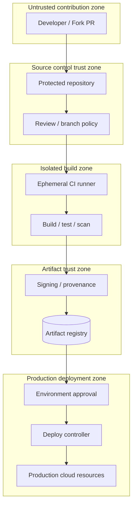
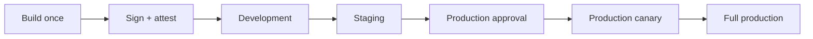
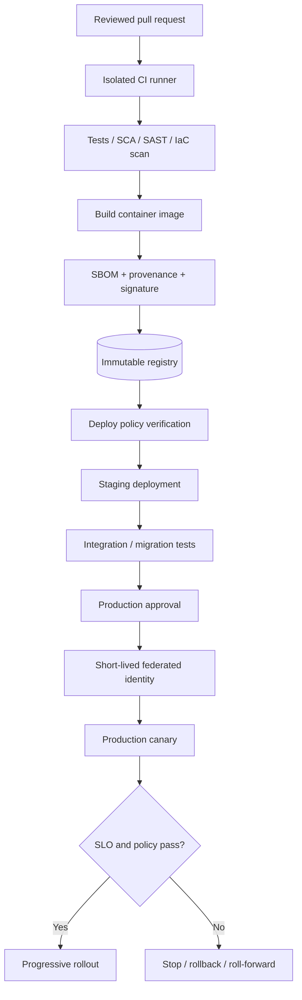

# CI/CD Pipeline Design and Deployment Trust Boundaries

## 1. CI/CD as Part of Production Architecture

CI/CD pipelines are often viewed merely as build and deploy automation tools. In cloud architecture, a pipeline is also a privileged path capable of mutating production: it reads source code, downloads dependencies, runs scripts, produces artifacts, obtains credentials, and calls the cloud control plane. If a runner is compromised, a token is leaked, or an approval is forged, an attacker can introduce malicious code into production through the legitimate release process itself.

**Continuous Integration (CI)** automatically integrates code changes frequently, running builds and checks to detect defects early. **Continuous Delivery** keeps software in a continuously releasable state; the decision to release to production may require an approval step. **Continuous Deployment** automatically promotes changes that pass guardrails to production without manual approval for each release.

A secure pipeline must clearly design for:

- Who can trigger workflows and from which code sources?
- In which trust domain do runners execute code, and what permissions do they hold?
- Where do dependencies and artifacts come from, and how are they verified?
- How long are secrets and deployment identities granted, and for which resources?
- Which checks are mandatory before promotion?
- Who approves production deployments, and to which artifact does the approval apply?
- How are changes deployed incrementally, observed, rolled back, and investigated during incidents?

This lesson belongs to the **Software Delivery** chapter of the **CLOUD_ARCHITECTURE** module. The module focuses on designing cloud applications from business requirements through networking, compute, data, and deployment models—balancing reliability, security, scalability, cost, and operations according to Well-Architected principles. The CI/CD pipeline is the mechanism that delivers changes into the running architecture; designing trust boundaries reduces the risk of supply-chain compromise and limits blast radius.

After this lesson, you will be able to:

- Design a pipeline from source to production and distinguish between CI, delivery, and deployment.
- Identify trust boundaries across developers, source control, runners, registries, and the cloud.
- Protect identities, credentials, secrets, artifacts, and deployment approvals.
- Establish policy gates, provenance, signatures, and dependency checks.
- Select runner isolation, deployment strategies, rollback, and promotion models.
- Collect evidence, observe pipeline health, and handle release incidents.

## 2. CI/CD Lifecycle and Pipeline Types

A typical pipeline consists of the following stages:

1. Source change and review.
2. Workflow trigger.
3. Source checkout and dependency resolution.
4. Build, test, lint, and static analysis.
5. Security scans and policy checks.
6. Artifact packaging and provenance generation.
7. Signing and publishing to an artifact registry.
8. Deployment to a test environment.
9. Integration, security, and performance verification.
10. Approval and promotion to production.
11. Progressive rollout and health verification.
12. Release recording, monitoring, and rollback when needed.

```mermaid
flowchart LR
    SRC[Source / Pull Request] --> CI[Build + Unit Test]
    CI --> SEC[Scan + Policy Gate]
    SEC --> PKG[Package Artifact]
    PKG --> SIGN[Provenance + Sign]
    SIGN --> REG[(Artifact Registry)]
    REG --> TEST[Deploy Test Environment]
    TEST --> VERIFY[Integration / Security Tests]
    VERIFY --> APPROVE[Promotion Approval]
    APPROVE --> PROD[Progressive Production Deploy]
    PROD --> OBS[Health / SLO Verification]
```



This is a general logical flow; each organization may add contract testing, schema migration, compliance review, canary, or progressive delivery steps. What matters is that stages have well-defined inputs, outputs, and trust boundaries.

### 2.1. Continuous Integration

CI integrates small, frequent changes, typically running when a pull request is created or updated:

- Formatting, linting, and static analysis.
- Unit tests and component tests.
- Deterministic builds from source.
- Dependency, license, and security scans.
- Detection of accidentally committed secrets.
- IaC, container image, and policy checks.

CI provides early feedback. However, passing CI does not mean an artifact is safe to run in production; provenance, deployment permissions, environment configuration, and runtime controls must still be enforced.

### 2.2. Continuous Delivery

Continuous Delivery automates up to a release-ready state. Tested artifacts are stored in a registry with metadata and can be promoted across environments. Production releases may require an approval or a change window.

Its advantage is decoupling the release decision from the build process; the exact same artifact can be deployed to staging and then production, reducing the risk of environment-specific build discrepancies.

### 2.3. Continuous Deployment

Continuous Deployment automatically releases eligible changes. This model requires reliable tests, policy gates, canary or gradual rollouts, health checks, rollback mechanisms, and strong observability. Automated deployment does not mean removing controls; controls are codified into policies and guardrails rather than relying on manual intervention.

## 3. Identifying Trust Boundaries in a Pipeline

A pipeline spans multiple zones with different trust levels and privileges. A commit from an external contributor, a workflow on a protected branch, and a runner authorized to assume a production role cannot be treated as having the same trust level.

### 3.1. Common Boundaries

- Developer workstation → source control.
- Fork or untrusted pull request → main repository.
- Source repository → CI runner.
- Runner → package registry or dependency mirror.
- CI build identity → artifact registry.
- Artifact registry → deployment controller.
- Staging environment → production environment.
- Pipeline identity → cloud control plane.
- Build logs and caches → users with workflow read access.
- Shared runner → other workloads or repositories.

### 3.2. Trust Zone Diagram



This diagram is a conceptual model. In practice, you must document identities, network paths, secret access, artifact read/write permissions, log access, and who administers each boundary.

### 3.3. Trust Does Not Automatically Increase Just Because a Stage Succeeds

A successful build does not prove the source is trustworthy. Passing tests do not prove dependencies are free of malware. An uploaded artifact does not prove it was built from a reviewed commit. An approval also holds no value unless bound to a specific digest. Every boundary crossing requires a verifiable condition: appropriate identity, policy, signature, provenance, or approval.

## 4. Protecting Source Control and Pull Requests

The source repository is the starting point of the supply chain. Anyone with permission to merge or modify workflows can alter the code executed during build and deployment.

### 4.1. Repository Protection

- Protect production branches with pull requests and policy-enforced reviewers.
- Require mandatory status checks from trusted workflows.
- Restrict force pushes, branch deletions, and approval bypasses.
- Protect pipeline files, deployment manifests, and policies with appropriate code owners and reviewers.
- Enable MFA and strong authentication for accounts with write access.
- Scope automation tokens by repository, permission, and lifetime.
- Audit changes to branch protections, collaborators, deploy keys, and webhooks.

### 4.2. Fork Pull Requests and Untrusted Code

Code in a pull request from a fork may be controlled by external parties. Workflows running this code must not receive production secrets, write-scoped tokens, or cloud credentials. Builds and tests must run in a least-privilege sandbox without sharing sensitive persistent workspaces or caches with trusted jobs.

Do not use a privileged workflow to check out and execute untrusted source while retaining the workflow's credentials. If actions are needed after a PR is reviewed, run a separate workflow triggered by a trusted event or branch and re-verify the commit and ref.

### 4.3. Workflow Definitions Are Also Code

Workflow YAML files, shell scripts, Dockerfiles, build plugins, and deployment actions can all execute commands. Changes to these files must be reviewed as security-sensitive code. Pin actions and plugins to specific versions or immutable commit hashes where appropriate; avoid dynamically downloading scripts from unverified URLs.

## 5. Runner Isolation and Execution Environment

Runners are where code executes and where secrets and credentials frequently appear. A compromised runner can steal tokens, tamper with artifacts, read workspaces, or attack subsequent jobs.

### 5.1. Ephemeral Runners

Single-use runners dedicated to a job or trusted job group reduce persistence risks:

- Provisioned from standardized, patched, and scanned images.
- Each job receives an isolated workspace.
- The runner is destroyed after completion.
- No credentials persist in the image or on persistent disks.
- Restrict network egress and access to metadata services and control planes.
- Control artifacts and caches shared across jobs.

Persistent runners may be necessary in specialized environments, but they require hardening, periodic re-imaging, access reviews, and separation by trust tier. Never share runners with production privileges with jobs from forks or lower-trust repositories.

### 5.2. Containers Are Not Automatically Complete Sandboxes

Containers package runtime environments, but they do not eliminate kernel sharing, privileged mode, host mounts, Docker sockets, or host credentials. A job with access to the Docker daemon or host paths can break out of container boundaries. Choose isolation levels based on your threat model: VM-based runners, microVMs, sandboxed runtimes, or dedicated build pools when risk is high.

### 5.3. Cache Isolation

Build caches and dependency caches accelerate pipelines but can become channels for leakage or poisoning:

- Never share caches containing sensitive content between untrusted and privileged jobs.
- Namespace caches by repository, trust domain, and toolchain.
- Control who can write to caches that production jobs will read.
- Use checksums and lockfiles to verify dependencies.
- Purge or rotate caches when compromise is suspected.

## 6. Pipeline Identities and Permissions

A single long-lived administrative credential should never be used across all stages. Each workload requires an identity with an appropriate scope and lifetime.

### 6.1. Workload Identity and Federation

Prefer workload identity or federation from the CI provider to the cloud identity provider:

1. The CI job proves its identity via a token containing issuer, audience, and subject claims.
2. The cloud validates the claims and trust policy.
3. The job receives short-lived credentials for a specific role.
4. The role grants permissions only on the required environment and resources.
5. Credentials expire after the job or within a short window.

Trust conditions should bind the repository, branch or tag, workflow identity, environment, and audience. Do not blindly trust every token issued from the same CI organization.

### 6.2. Separating Permissions by Stage

| Identity | Typically Required Permissions | Should Not Have |
|---|---|---|
| PR test runner | Read source, run tests, write reports | Production deploy, read production secrets |
| Build job | Read dependencies, produce artifacts | Modify production IAM or networking |
| Artifact publisher | Push to designated repository/package | Delete entire registry or deploy |
| Staging deployer | Deploy to staging and read staging config | Production database or admin access |
| Production deployer | Update designated workloads/resources | Unrestricted cloud account administration |
| Security scanner | Read artifacts/source, write findings | Modify production |
| Release approver | Approve promotions per policy | Modify artifacts directly or bypass all gates |

### 6.3. Least Privilege and Separation of Duties

Separate the permissions to propose, review, build, sign, approve, and deploy when risk levels warrant it. Six different people are not always required for a minor change; automated policies and role groups can enforce controls. What must be avoided is a single principal creating code, modifying the workflow, self-approving, and deploying to production without independent checks.

## 7. Secret Management in CI/CD

Secrets commonly appear as registry credentials, signing keys, cloud tokens, package registry tokens, deployment passwords, and integration test credentials. Secrets printed to logs, stored in artifacts, or left in caches can persist long after a job finishes.

### 7.1. Principles

- Retrieve secrets on demand from a secret manager; never commit them to repositories.
- Prefer short-lived credentials and workload identity.
- Scope secrets by environment, repository, and job.
- Log masking is not a standalone defense; avoid passing secrets via command-line arguments or echo statements.
- Never store secrets in build artifacts, Docker layers, caches, or test reports.
- Rotate and revoke secrets immediately when leakage is suspected; investigate everywhere the secret appeared.
- Restrict who can view workflow logs and download artifacts.

### 7.2. Secrets and Build Inputs

Builds from untrusted sources must not be granted production secrets merely to fetch private dependencies. Use a dedicated dependency proxy or read-only token, a controlled mirror, or a fetch step isolated from untrusted execution. Secrets must carry minimal read permissions and never grant publish or deploy rights.

### 7.3. Signing Keys

Private signing keys are high-value assets. Use a signing service, KMS, or HSM with protected keys, workload authentication policies, and audited signing requests. Never place long-lived private keys inside runner images or broadly scoped repository secrets.

## 8. Dependencies and Software Supply Chain

Artifacts can be compromised through dependencies, compilers, base images, build plugins, package registries, or build scripts.

### 8.1. Dependency Pinning and Lockfiles

- Pin exact versions and commit hashes where the ecosystem supports them.
- Commit lockfiles to ensure reproducible builds.
- Prefer managed registries and mirrors.
- Avoid unmaintained dependencies or packages from unknown sources.
- Review new packages, install scripts, and post-install permissions.
- Maintain a process for applying security updates instead of leaving old versions pinned indefinitely.

Version pinning reduces unexpected changes but does not prove a package is safe. A pinned version can still contain malware or vulnerabilities.

### 8.2. Scanning and Policy

Pipelines can check:

- Dependency vulnerabilities and license policies.
- Secret scanning.
- Static Application Security Testing (SAST).
- Software Composition Analysis (SCA).
- Container and base image scanning.
- Infrastructure as Code scanning.
- Dynamic testing or API security testing in an appropriate environment.
- Malware and signature checks, as well as artifact integrity.

Scanners require baselines, severity mappings, exception owners, and expiration dates. If every finding blocks a release without prioritization rules, teams will easily ignore alerts or create uncontrolled bypasses. For critical findings, establish clear policies for blocking, remediation, or formal exceptions.

### 8.3. SBOM

A Software Bill of Materials (SBOM) lists the software components inside an artifact, such as packages, versions, and dependency relationships. SBOMs aid inventory tracking, CVE impact analysis, and audits. An SBOM must be bound to the artifact digest; an SBOM generated from different source or a different build does not prove the contents of the running artifact.

## 9. Build Provenance, Artifact Identity, and Signing

To promote safely, you must know which source produced an artifact, which workflow built it, which builder and toolchain were used, and which checks ran.

### 9.1. Immutable Artifacts

Once built and published, artifacts should be referenced by digest or hash rather than mutable tags that can be overwritten:

```text
registry.example/booking-api@sha256:<artifact-digest>
```

Tags like `latest` or `release-1.2` can be useful for human reference, but deployments must pin digests to identify exact contents. Never rebuild an artifact when promoting from staging to production; promoting the same digest preserves consistency with what was tested.

### 9.2. Provenance

Provenance records can capture:

- Source repository and commit.
- Trigger/event and workflow identity.
- Builder image, toolchain, and version.
- Dependency inputs and materials.
- Non-sensitive build parameters.
- Artifact digest and outputs.
- Test, scan, and policy results.
- Timestamp and identity that generated the provenance.

Provenance must be generated by a trusted build system and verified before deployment. A self-asserted provenance file produced alongside the artifact without source authentication is insufficient proof.

### 9.3. Artifact Signing and Verification

Signing confirms that an artifact or statement was signed by an authorized identity and has not been altered since signing. The deployment controller must verify:

- The signature is valid and chains to the right trust root.
- The signer identity belongs to an authorized pipeline.
- The artifact digest matches its provenance and SBOM.
- The source repository, branch, and commit are allowed.
- The build workflow and policy results meet requirements.
- Neither the signature nor provenance has been revoked, and the policy remains in effect.

Signing does not prove the source is free of bugs or malicious logic; it strengthens verification of origin and integrity.

## 10. Policy Gates and Pre-Production Approvals

Production deployments require verifiable conditions—not assurances that "it was already tested."

### 10.1. Common Gates

- Required reviewers and status checks from branch protection.
- Passing builds/tests and appropriate coverage or quality thresholds.
- Security scans with no policy-violating findings.
- Artifacts with valid digests, signatures, and provenance.
- IaC plans free of policy violations.
- Database migrations with compatibility and rollback plans.
- Environment approvals and change windows where required.
- Post-deploy canary and SLO guardrails.

### 10.2. Approvals Must Be Bound to Artifact and Scope

Approvals must specify:

- Which artifact digest or version.
- Which environment, region, and tenant group.
- Which change, ticket, or release ID.
- Which policy and test results were reviewed.
- Who approved and when.
- Whether the approval remains valid if the artifact or scope changes.

If an artifact is rebuilt after approval, changing its digest, the prior approval must not automatically carry over to the new artifact. Likewise, staging approval does not imply production approval when policies differ.

### 10.3. Policy as Code

Policies can evaluate actors, source branches, artifact signatures, provenance, deployment targets, image digests, network exposure, and required approvals. The benefit is consistent, reviewable, and testable outcomes. Policies are also sensitive code: modifying policies requires review, versioning, positive and negative tests, and auditing.

## 11. Promotion Across Environments

A commonly used model:



The core principle is **build once, promote the same artifact**. Environment-specific configuration is injected at runtime or through deployment configs; never build separate artifacts for staging and production when the goal is to test the exact binary or container being released.

### 11.1. Separating Config and Artifacts

Artifacts should be immutable; environment configs, secrets, and runtime policies are managed separately, versioned, and audited. Never bake production secrets into images. You must know which config revision was paired with an artifact digest at deployment time to investigate incidents.

### 11.2. Schema and Database Migrations

Database migrations can break backward compatibility if application and schema deployments are out of sync. Use the expand/contract pattern:

1. Expand the schema with changes compatible with the old application.
2. Deploy the new application that reads and writes the expanded schema.
3. Backfill and verify data.
4. Shift traffic and remove legacy code paths.
5. Contract the schema once no consumers rely on old columns or formats.

Destructive data migrations require backups, validation, and restore or forward-fix plans; rolling back an application does not automatically revert schema changes.

## 12. Deployment Strategies and Limiting Blast Radius

| Strategy | How It Works | Advantages | Risks / Conditions |
|---|---|---|---|
| Recreate | Stop old version, start new version | Simple | Downtime, hard to roll back quickly |
| Rolling | Replace instances in batches | Reduces downtime | Two versions run concurrently |
| Blue-green | Two environments, switch traffic | Fast cutover, routing-based rollback | Extra capacity cost, state/schema compatibility required |
| Canary | Small percentage receives new version | Early defect detection | Requires representative metrics and traffic |
| Feature flag | Enable behavior per cohort | Decouples deploy from release | Flag drift, state combinations |
| Traffic shadowing | Send copy of requests to new version | Tests behavior without affecting primary response | Unsuitable for side effects unless isolated |

### 12.1. Canary and Automated Analysis

Select representative metrics: error rate, p95/p99 latency, saturation, business correctness, and dependency health. Compare the canary against a baseline over the same time window and load conditions. Expand only when sample sizes are sufficient and guardrails pass; if low traffic provides insufficient evidence, hold the rollout in a controlled state or supplement with synthetic or load tests.

### 12.2. Blue-Green and Stateful Systems

Blue-green is straightforward for stateless services; databases, queues, sessions, caches, and external side effects complicate cutovers. You must define version compatibility, write ownership, replication lag handling, session draining, and how events emitted from the old environment are handled.

## 13. Rollback, Roll-Forward, and Release Recovery

Rollback reverts to a previous version; roll-forward releases a fix to resolve an issue. Not every failure can be safely rolled back.

### 13.1. When Rollback Is Appropriate

- The prior artifact still exists and is verified.
- Configs and schemas remain compatible.
- External side effects will not cause the old version to behave incorrectly.
- Rolling back will not cause data loss or reopen a vulnerability.

### 13.2. When Roll-Forward or Compensating Actions Are Needed

- Irreversible database changes have occurred.
- Events have already been dispatched to partners or customers.
- Credentials or keys have been rotated.
- New data formats have already been written.
- The prior version contained a critical security vulnerability.

### 13.3. Release Evidence

Record the release ID, artifact digest, source commit, provenance/signature, config revision, deployment target, approval, rollout timeline, pre/post SLOs, and rollback/roll-forward records. This data enables root-cause tracing and proves what actually changed.

## 14. Supply-Chain Security and Pipeline Threats

| Threat | Attack Vector | Primary Controls |
|---|---|---|
| Poisoned dependency | Malicious or hijacked package | Pin/lock, trusted registry, SCA, review |
| Compromised runner | Prior job leaves persistence/tokens | Ephemeral isolation, no shared secrets, re-image |
| Workflow injection | PR modifies workflow or command inputs | Review workflows, untrusted input handling, least privilege |
| Secret exfiltration | Logs, caches, artifacts, or network egress | Secret manager, masking, egress control, scoped tokens |
| Artifact substitution | Overwritten tag or compromised registry | Immutable digest, signing, provenance verification |
| Approval bypass | Actor self-merges/deploys or alters policy | Separation of duties, protected environments, auditing |
| Build cache poisoning | Untrusted job writes cache read by release job | Cache namespacing/access policy, integrity checks |
| Cloud credential theft | Runner holds broad role or long-lived token | Federation, short-lived identity, least privilege |
| Pipeline denial of service | Job floods, oversized artifacts, exhausted quotas | Queue/concurrency limits, quotas, isolation |

The threat model must cover source control, build environments, package ecosystems, artifact stores, deployment controllers, and the cloud control plane. Securing a single CI tool is insufficient if production deploy permissions can still be obtained from another unmanaged runner.

## 15. Pipeline Operations and Observability

A pipeline is a supporting production system and must be measured:

| Metric / Event | Meaning |
|---|---|
| Pipeline duration and queue wait | Delivery efficiency |
| Build/test failure rate | Source and toolchain quality |
| Security gate findings | Pre-promotion risk |
| Artifact signing/verification results | Integrity and origin assurance |
| Deployment frequency / lead time | Delivery velocity |
| Change failure rate | Percentage of releases causing rollbacks or incidents |
| Time to restore | Recovery time after deployment failure |
| Runner utilization / isolation events | Build plane capacity and health |
| Credential issuance / denials | Identity behavior |
| Config / infra drift | Divergence between desired and deployed state |

Do not optimize solely for pipeline speed. Cutting scans short or skipping tests to save a few minutes can increase change failure rates and incident costs. The goal is fast yet trustworthy flow.

### 15.1. Auditing and Change Traceability

Each release should link the ticket/change ID, PR, reviewers, commit, workflow run, builder identity, dependency lockfile, artifact digest, signature, approval, deploy event, and runtime version. Out-of-band console changes outside the pipeline require auditing and exception records.

### 15.2. Pipeline Runbooks

Runbooks should cover:

- Hung workflows or excessive queue backlogs.
- Runner compromise or exposed credentials.
- Invalid artifact signatures or provenance.
- Critical findings detected by security gates.
- Canary deployments breaching SLOs.
- Registry or CI provider outages.
- Schema-incompatible rollbacks.

## 16. Example: Releasing the Booking API to the Cloud

Suppose a team releases the containerized Booking API onto Kubernetes or a managed container platform.

### 16.1. Source and Build

- A developer opens a PR; the protected branch requires review.
- CI runs linting, unit tests, API contract tests, and dependency scans.
- Ephemeral runners hold no production secrets.
- The build creates a container image from a deterministic commit and lockfile.
- An SBOM and provenance record are bound to the image digest.
- The image is signed via a narrowly scoped signing identity.

### 16.2. Staging Promotion

- The deployment controller verifies the signature and provenance.
- The image digest matches the built artifact.
- Staging configs and secrets are injected using workload identity.
- Integration/load tests and database migration compatibility tests run.
- Results are recorded in the release record.

### 16.3. Production Promotion

- Change approval is bound to the digest and the production environment.
- The production deployer obtains short-lived credentials via federation.
- Canary deployment targets an internal pod or tenant group first.
- Error rates, p99 latency, DB connections, booking correctness, and queue lag are monitored.
- If guardrails pass, the rollout expands; otherwise, it halts and rolls back or rolls forward depending on data migration state.

### 16.4. Deployment Trust Diagram



### 16.5. Linked Evidence

The release package contains the release ID, change ticket, PR/commit, CI workflow run, test/scan outputs, SBOM, provenance, image digest, signature verification, approval record, deploy event, and post-deploy SLO snapshot. Evidence must not contain secrets or business payloads.

## 17. Cost and Operational Trade-Offs

| Choice | Benefit | Cost / Trade-Off |
|---|---|---|
| Ephemeral runners | Reduces persistence and cross-job contamination | Provisioning time, image maintenance, capacity |
| Dedicated production runners | Stronger isolation for deployments | Dedicated resources and operations |
| Central artifact registry | Centralized provenance and access control | Availability, replication, storage |
| Full security scanning | Detects multi-layered risks | Pipeline duration, false positives, scanner upkeep |
| Manual approvals | Human review for sensitive changes | Lead time, reviewer bottlenecks |
| Automated policy gates | Consistent results, scales well | Policy maintenance, exception governance |
| Canary / blue-green | Reduces blast radius and rollback time | Spare capacity, metric and routing complexity |
| Multi-region pipelines | Resilient delivery | Cross-region secret/artifact sync and coordination cost |

TCO calculations should include CI minutes/runners, registry storage/egress, scanning/signing, log retention, environment costs, spare capacity for blue-green, operational staffing, and incident costs. Choose control levels based on criticality and blast radius, not pipeline speed alone.

## 18. Well-Architected Review

| Pillar | Review Questions |
|---|---|
| **Operational Excellence** | Does the pipeline have versioning, owners, runbooks, release evidence, automation, and rollback? |
| **Security** | Do trust boundaries, runners, identities, secrets, dependencies, provenance, signatures, and approvals enforce defense-in-depth? |
| **Reliability** | Are CI, registry, and deploy controller failures handled? Do canary, health gates, and recovery mechanisms work? |
| **Performance Efficiency** | Are build caches, parallelism, and test selection optimized while preserving coverage? |
| **Cost Optimization** | Are runners, registries, scans, environments, and release capacity right-sized? |
| **Sustainability** | Do artifact retention/lifecycle policies, runner autoscaling, and ephemeral environments reduce idle resources? |

## 19. Sample Release Policy

The following YAML illustrates promotion conditions; it is not configuration for a specific CI vendor:

```yaml
release_policy:
  service: booking-api
  source:
    protected_branch_required: true
    pull_request_review_required: true
  build:
    ephemeral_runner_required: true
    lockfile_required: true
    secret_scan_required: true
    test_suite_required: true
  artifact:
    immutable_digest_required: true
    sbom_required: true
    provenance_required: true
    signature_verification_required: true
  promotion:
    same_artifact_across_environments: true
    staging_validation_required: true
    production_approval_required: true
    approval_bound_to_digest: true
  deployment:
    strategy: canary_then_progressive
    health_gate:
      error_rate: required
      latency_p99: required
      business_correctness: required
  identity:
    workload_federation: required
    long_lived_cloud_key: prohibited
  exceptions:
    owner_required: true
    expiry_required: true
    audit_required: true
```

Formal policies should also define owners, environment scope, thresholds, exception authority, retention periods, and positive/negative tests.

## 20. CI/CD Pipeline Design Workflow

1. **Define the release model:** continuous delivery or continuous deployment, service boundaries, and criticality.
2. **Map trust boundaries:** developers, source, workflows, runners, registries, approvals, deployers, and cloud accounts.
3. **Design source protection:** branch rules, reviewers, workflow file ownership, and fork PR isolation.
4. **Isolate runners:** ephemeral/dedicated pools, workspaces, caches, network egress, and host boundaries.
5. **Design identity:** federation, short-lived credentials, and per-stage least privilege.
6. **Protect the supply chain:** pin dependencies, scan, generate SBOMs and provenance, enforce immutable artifacts, and sign.
7. **Define policy gates:** tests, security, IaC, approvals, and artifact verification.
8. **Design promotion:** build once, promote the same digest, and separate environment configs.
9. **Select deployment strategy:** rolling, blue-green, canary, or feature flags; prepare rollback/roll-forward plans.
10. **Operate and audit:** metrics, evidence, runbooks, incident response, and periodic reviews.

## 21. Pre-Production Checklist

- [ ] Pipeline stages, inputs/outputs, owners, and trust boundaries are documented.
- [ ] Protected branches, required reviews, and workflow file protections are enforced.
- [ ] Fork/untrusted PRs cannot access production secrets or deploy identities.
- [ ] Runners enforce isolation, patching, ephemeral cleanup, and cache policies.
- [ ] Privileged containers or shared hosts are not used beyond the trust model.
- [ ] Workload federation and short-lived credentials are preferred; per-stage permissions follow least privilege.
- [ ] Secrets are never committed, printed in logs, baked into images, or stored in artifacts/caches.
- [ ] Dependencies are pinned/locked and scanned; exceptions have owners and expiration dates.
- [ ] SBOM, provenance, and signatures are bound to the artifact digest.
- [ ] Artifacts are immutable; deployments reference digests rather than mutable tags.
- [ ] The deployment controller verifies signers, source, provenance, and policies.
- [ ] Approvals are bound to digests, scopes, environments, and change records.
- [ ] The same artifact is promoted from staging to production.
- [ ] IaC and database migrations have reviews, tests, compatibility plans, and recovery plans.
- [ ] Canary/progressive rollouts have guardrails, stop conditions, and health verification.
- [ ] Rollback/roll-forward plans account for schemas and external side effects.
- [ ] Change traceability links tickets, PRs, builds, artifacts, approvals, and runtime state.
- [ ] Pipelines, registries, and runners have monitoring, quotas, backups, and incident runbooks.
- [ ] Runner compromises, secret leaks, artifact verification failures, and deployment rollbacks have been rehearsed.
- [ ] Release evidence has retention/access policies and contains no secrets.

**Operating Principle:** A CI/CD pipeline is a privileged path capable of modifying production, so it must be designed as part of your trust architecture. Protecting source code, isolating runners, issuing short-lived identities, verifying provenance and artifacts, binding approvals to digests, and rolling out behind guardrails all reduce the risk of introducing untrusted changes into the cloud. A mature pipeline does not merely deploy fast; it proves what was built, who authorized it, which artifact is running, and how to recover when a release fails.
