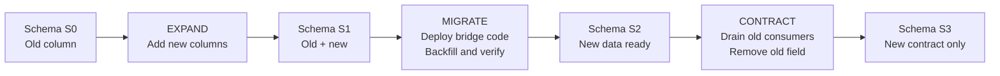
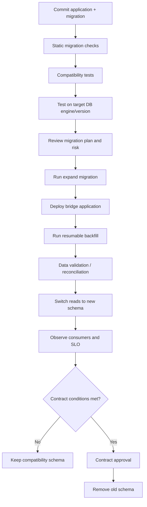

# Database Changes Using Expand–Contract

Applications typically deploy faster than the lifecycle of their data. During a rolling deployment, old and new versions can coexist for several minutes; background workers may process messages already sitting in queues; dashboards, batch jobs, or external services may continue reading the old schema after the API has upgraded. If a release renames or drops a column immediately, un-upgraded consumers will fail even if the new binary runs cleanly.

**Expand–contract** is a strategy for evolving databases across multiple compatible steps: expand the schema first, deploy bridge application code, migrate and verify data, transition consumers to the new structure, and only then contract by removing the old structure. This strategy enables continuous releases while multiple application and schema versions coexist.

Within the **CLOUD_ARCHITECTURE** module, expand–contract connects software delivery with database architecture, compute rollouts, CI/CD, reliability, data integrity, and operations. The running example involves an equipment-rental system with a `reservation` table whose `customer_name` column needs to be replaced by `customer_first_name` and `customer_last_name`. SQL, rollout durations, and test thresholds in this lesson are illustrative; exact DDL syntax, locking behavior, transactional DDL, and online operations depend on the database engine and version.

## 1. Why Are Schema Changes a Release Problem?

A database is a shared contract among multiple consumers, not just a single application. A schema change can affect:

- Old and new API instances running concurrently.
- Background workers, schedulers, cron jobs, and retry queues.
- ETL/ELT pipelines, data warehouses, BI tools, and exports.
- Stored procedures, triggers, views, and database functions.
- Other services accessing the database directly or via shared schemas.
- Mobile and desktop clients with long upgrade cycles.
- Migration jobs and operational scripts.

Consider the initial `reservation` table:

```sql
CREATE TABLE reservation (
    id BIGINT PRIMARY KEY,
    customer_name VARCHAR(200) NOT NULL,
    start_at TIMESTAMP NOT NULL,
    end_at TIMESTAMP NOT NULL,
    status VARCHAR(30) NOT NULL
);
```

Version V1 reads and writes `customer_name`. A new requirement wants first and last names stored separately. If a new release adds the two columns and immediately drops the old one, V1 instances still running during a rolling deployment will fail. Even if new code deploys first and drops the old column afterward, V1 workers or legacy reports can fail post-deployment.

The problem to solve is: **every deployment step must preserve compatibility with all active versions during the transition window.**

## 2. The Three Phases: Expand–Migrate–Contract

The strategy has three logical phases:

1. **Expand:** add new structures in a way that remains compatible with old code.
2. **Migrate:** deploy bridge code, migrate data, and transition consumers gradually to the new structure.
3. **Contract:** once verified that no old consumers remain, remove legacy structures and compatibility logic.



Each phase does not have to map to a single release. A major change may span several releases with observation windows in between. In particular, contraction should normally be its own separate release because it breaks backward compatibility with older code.

## 3. Compatibility Matrix: Defining Which Combinations Must Work

Before writing migrations, list every schema version and application version that can coexist.

Example:

| Schema | App V1 | App V2 (Bridge) | App V3 (New-Only) |
| --- | --- | --- | --- |
| S0: `customer_name` only | Must work | Must not deploy without fallback | Incompatible |
| S1: `customer_name` plus two new columns | Must work | Must work | Works only if new data is complete |
| S2: new data backfilled/verified | May still operate during rollback window | Must work | Must work |
| S3: new columns only | Incompatible | Incompatible if legacy fallback remains | Must work |

The matrix must account for both readers and writers:

- Can V1 keep inserting rows without knowing about the new columns?
- Can V2 read rows that have not been backfilled yet?
- When V2 writes new data, does it keep the old column in sync?
- Can an old worker overwrite the old field after backfill ran?
- Does V3 require every record to already hold populated new fields?
- At which stages is rolling back to V1 still safe?

Do not inspect only the primary API. A rarely invoked consumer that runs nightly can still break days after a contraction release.

## 4. Expand: Additive Schema Changes

The expand phase adds only required structures while keeping existing consumers functional.

Example:

```sql
ALTER TABLE reservation
    ADD COLUMN customer_first_name VARCHAR(100),
    ADD COLUMN customer_last_name VARCHAR(100);
```

These two new columns let V2 start writing split names while `customer_name` remains intact for V1.

### Changes Typically Safe for Expand

- Adding nullable columns.
- Creating new tables.
- Adding indexes using online/concurrent methods when supported by the engine.
- Adding compatibility views.
- Adding optional fields to event schemas under clear compatibility rules.
- Adding constraints that can be validated in a separate step.

### Changes Likely to Break Compatibility

- Dropping or renaming columns actively in use.
- Adding `NOT NULL` columns that older writers do not populate.
- Changing data types in ways that truncate or alter semantics.
- Altering enums or values that older consumers do not recognize.
- Adding constraints that cause legacy inserts/updates to fail.
- Renaming tables, schemas, or endpoints referenced by old consumers.

### Nullable Does Not Automatically Mean Online

`ADD COLUMN` may be instantaneous on one engine/version yet trigger a full table rewrite or lock on another. Default expressions, generated columns, data types, and table size all matter. Test against the exact production database engine/version and inspect lock duration and transaction behavior before running in production.

## 5. Deploying the Bridge Application

Once the expanded schema is in place, deploy bridge version V2. V2 understands both old and new structures during the migration period.

One reading pattern:

1. If the new columns contain valid data, use the new columns.
2. If the new columns are unpopulated, fall back to the old column using defined rules.
3. Emit a metric for every fallback occurrence.
4. On writes, update both representations in the same transaction if they reside in the same database.

Pseudocode:

```text
readCustomerName(row):
    if new_name_fields_are_valid(row):
        return combine(row.customer_first_name, row.customer_last_name)
    return row.customer_name

writeCustomerName(row, input):
    parsed = apply_approved_name_mapping(input)
    begin transaction
        write old representation
        write new representation
    commit
```

This logic is illustrative. Splitting human names can be complex due to multi-part names, mononyms, organization names, and locale conventions. Never apply naive whitespace splitting to multinational data without approved business rules.

### Fallbacks Must Be Observable

Never leave fallbacks active indefinitely. Fallback metrics reveal whether new data is still missing or legacy consumers are still writing old formats. When the fallback rate drops to zero over a sufficiently long observation window, the team gains evidence to switch fully to the new read path.

## 6. Dual-Writing and the Source of Truth

During transition, V2 can write both `customer_name` and the two new columns. When all three fields live in the same database, a single transaction keeps them atomic.

```sql
UPDATE reservation
SET customer_name = :display_name,
    customer_first_name = :first_name,
    customer_last_name = :last_name
WHERE id = :id;
```

Explicitly define:

- Which representation is authoritative at each stage?
- If the two representations diverge, which field wins?
- Can V1 overwrite `customer_name` after V2 has already written split names?
- Do triggers, stored procedures, and admin tools follow the same rules?
- Could backfill overwrite newer application writes?
- When dual-writing stops, are any consumers still updating the old field?

Dual-writing across two separate systems lacks a single atomic transaction. When writing to a database and an event broker—or two separate databases—one write may succeed while the other fails. When reliable propagation is required, consider the transactional outbox pattern, CDC, or reconciliation rather than assuming both writes always succeed together.

## 7. Migrating Data via Backfill

Once V2 can read and write the expanded schema, older rows must be migrated to the new representation. On large tables, avoid a single full-table `UPDATE` inside a long transaction if it causes locking, transaction log bloat, or replication pressure.

### Key-Range Batch Backfills

```sql
UPDATE reservation
SET customer_first_name = :derived_first_name,
    customer_last_name = :derived_last_name
WHERE id > :last_id
  AND id <= :next_id
  AND customer_first_name IS NULL
  AND customer_last_name IS NULL;
```

This is a range-batching example. Name transformations must follow reviewed business rules; records that cannot be converted automatically should go to an exception queue or remain flagged for manual handling.

### Pseudocode for Checkpointed Backfills

```text
checkpoint = load_checkpoint()
while true:
    batch = read_next_range_after(checkpoint)
    if batch is empty:
        break
    transform rows
    update only rows still eligible for migration
    commit bounded transaction
    persist checkpoint after successful commit
    record counts and duration
    pause or throttle when production limits are exceeded
```

### Required Properties

- **Idempotent:** re-running a batch does not corrupt already-migrated rows.
- **Resumable:** restarted jobs resume from the last checkpoint.
- **Bounded:** row counts, transaction durations, and resource consumption are capped.
- **Observable:** tracks rows processed/remaining, duration, errors, and replication lag.
- **Concurrency-safe:** never overwrites fresh application updates.
- **Auditable:** records job version, run ID, and checkpoints.

Keyset/range pagination generally outperforms large `OFFSET` queries, provided a unique key and supporting index exist.

## 8. Preventing Race Conditions Between Backfill and Application Writers

A classic race condition:

1. Backfill reads a row containing the old `customer_name`.
2. V2 updates the row with new split names from an incoming request.
3. Backfill writes derived values from the stale `customer_name` into the new columns.

The result silently clobbers the fresh update.

Use conditional updates / compare-and-set:

```sql
UPDATE reservation
SET customer_first_name = :derived_first_name,
    customer_last_name = :derived_last_name
WHERE id = :id
  AND customer_first_name IS NULL
  AND customer_last_name IS NULL
  AND customer_name = :observed_old_value;
```

If V2 already populated the new columns or `customer_name` changed, the predicate fails and backfill skips overwriting. The worker should re-read, classify, and handle per mapping rules. Alternatives include version columns or brief row locks inside bounded transactions.

Log zero-row update counts to distinguish benign races from data errors. Even after backfill finishes, run reconciliation to locate unfinished rows.

## 9. Data Validation Before Switching the Read Path

Completing a backfill does not guarantee data accuracy. Before V2/V3 reads exclusively from the new columns, measure:

- Rows still holding `NULL` in required fields.
- Rows that could not be converted under transformation rules.
- Mismatches between old and new representations where comparable.
- Duplicates, invalid values, and business invariant violations.
- Rows updated concurrently during migration.
- Verification that every partition/range was actually processed.

Example:

```sql
SELECT COUNT(*) AS missing_new_name
FROM reservation
WHERE customer_first_name IS NULL
   OR customer_last_name IS NULL;
```

If the business domain permits incomplete names, do not force both columns to be non-null merely to make this metric hit zero. Validation must reflect true domain semantics.

### Data Reconciliation

For one-to-one transformations, compare normalized display values. For lossy transformations or complex mappings, produce exception reports for business-owner review. Never treat naive string comparison as universal proof across all languages and naming conventions.

## 10. Cutover: Shifting Consumers to the New Schema

Once backfill and validation meet criteria, shift read paths to the new representation. Proceed incrementally:

1. Enable a feature flag for a small percentage of traffic.
2. Compare new vs. old outputs via shadow reads or dual-reads.
3. Gradually increase traffic as metrics stabilize.
4. Monitor fallbacks, mismatches, errors, latency, and business outcomes.
5. Shift all APIs and workers to the new read path.
6. Wait for external consumers, cron jobs, ETL pipelines, and reports to migrate.

Shadow reads should cap cost and side effects. Never execute the same mutating transaction twice solely to compare outputs.

### Consumer Inventory

Before contraction, confirm that:

- All legacy API deployments are gone.
- Background workers and scheduled jobs are upgraded.
- Legacy queued messages are drained or remain readable by a compatibility layer.
- ETL, BI dashboards, reports, and exports have migrated.
- Stored procedures, triggers, and views are updated.
- External consumers received deprecation notices and cutover deadlines.
- No queries or metrics show usage of the old field across an adequate observation window.

Finishing the V2 API deployment does not prove every consumer has migrated.

## 11. Contract: Removing Legacy Structures

Start contraction only after preconditions are proven:

- No application or worker still needs `customer_name`.
- Backfill is complete and validation passed.
- The new read path has remained stable across the observation window.
- External consumers have migrated or been handled per contract.
- The prior release's rollback window has closed, or an approved recovery plan exists.
- Appropriate backups and recovery points are verified.
- The change is reviewed according to its risk tier.

Then ship a dedicated release to remove fallbacks, stop dual-writing, and drop the old column.

```sql
ALTER TABLE reservation
    DROP COLUMN customer_name;
```

`DROP COLUMN` may be lightweight on some engines, yet you must still check metadata locks, dependent objects, and rollback implications. Never assume destructive DDL is instantaneous or transactional.

### Splitting Contraction Into Small Steps

1. Deploy code that stops reading the old column.
2. Deploy code that stops writing the old column.
3. Observe and confirm zero usage.
4. Drop the legacy column or table in a separate migration.
5. Clean up compatibility flags, temporary metrics, and dead code paths once certain they are unused.

Separate releases or observation windows may be warranted between steps.

## 12. Rollback at Each Stage

Application rollback and schema rollback are distinct operations. An older binary may fail against a newer schema, and a migration may have irreversibly transformed or removed data.

| Stage | State | Recovery Action on Release Failure |
| --- | --- | --- |
| Before expand | Schema S0 | Roll back application normally |
| After expand | S0 + new columns | Usually keep new columns; roll back code to V1 if compatible |
| After bridge deploy | V1/V2 coexisting on S1 | Halt rollout, revert to compatible version; keep expanded schema |
| During backfill | Partial rows migrated | Pause/resume or repair; do not drop fields |
| After cutover | Consumers reading new schema | Roll back code only if schema still retains old field and data was dual-written/restorable |
| After contract | Old column dropped | Old binary is incompatible; typically requires roll-forward or controlled restore/repair |

Never run automated down-migrations simply because a deployment failed. If columns were dropped or lossy transforms occurred, down-migrations cannot restore original data. Additive design keeps pre-contraction code rollbacks straightforward.

## 13. CI/CD Pipelines for Expand–Contract

Migrations are release artifacts and must be governed like code.

Reference pipeline:



### Pipeline Gates

- Migration syntax checking and linting.
- Detection of dangerous operations: `DROP`, `TRUNCATE`, `ALTER TYPE`, `NOT NULL`.
- Compatibility tests across old/new apps and old/expanded schemas.
- Testing on the exact target engine and version—not mocks alone.
- Representative datasets to measure locks, duration, I/O, and replication lag.
- Serialized/locked execution for expand jobs.
- Health checks and canaries for bridge deployments.
- Checkpointing, throttling, and stop/resume for backfills.
- Data validation prior to cutover.
- Contraction gated on consumer/runtime evidence and formal approval.

### Migration Runners

Do not let every application replica run migrations concurrently on startup unless the framework has well-understood locking or leader election. A dedicated migration job separates DDL privileges from runtime identities, runs once with auditing, and lets the pipeline verify success before proceeding with rollouts.

Migration history should track version, checksum, execution identity, timestamp, status, and output. If a job crashes mid-DDL/DML, inspect actual database state before retrying; never alter migration history manually to mask errors.

## 14. Online DDL and Database-Specific Behavior

Expand–contract solves application compatibility but does not guarantee DDL avoids locking.

Verify:

- Does `ADD COLUMN` rewrite the table?
- Must defaults be computed across all existing rows?
- Does index creation block reads or writes?
- Are online/concurrent index builds supported?
- Does adding or validating constraints scan the entire table?
- Is DDL transactional and rollback-capable?
- Can metadata locks or lock queues block traffic?
- How does replication process DDL?

PostgreSQL example:

```sql
CREATE INDEX CONCURRENTLY idx_reservation_status
ON reservation (status);
```

This syntax is PostgreSQL-specific; `CREATE INDEX CONCURRENTLY` carries specific constraints, including not running inside a normal transaction block. If it fails, it can leave an `INVALID` index that must be inspected. Other engines have different syntax and semantics.

An `ALTER` that completes instantly in a small staging database may queue behind long-running production transactions and block all incoming queries. Configure appropriate lock timeouts, monitor transaction age, and prepare retry/repair runbooks.

## 15. Adding `NOT NULL` and Safe Defaults

Suppose V2 requires a mandatory `booking_source` column that V1 does not know about. Adding `NOT NULL` without a default will break V1 inserts.

A common sequence:

1. Add the column as nullable or with a semantically safe default.
2. Deploy new code that always writes valid values.
3. Backfill historical records.
4. Check for `NULL`s and business rule compliance.
5. Add and validate the `NOT NULL` constraint using engine-supported online methods.
6. Remove temporary defaults or fallbacks in an appropriate later release.

Database defaults and application defaults can diverge. Designate a single source of truth or ensure all writers enforce identical rules. On large tables, check whether the engine supports adding a constraint as `NOT VALID` and validating it separately.

## 16. Renaming Columns, Changing Types, and Altering Semantics

### Renaming Columns

Never rename a column in place while legacy consumers remain active. Simulate a rename by adding the new column, deploying bridge code, dual-writing, backfilling, shifting reads, verifying consumers, and dropping the old column in a separate release.

### Changing Data Types

For example, changing `amount` from integer minor units to decimal major units is both a type change and a unit/semantics change. Never mutate the field in place while consumers are unready.

Add a new field, specify currency/precision/rounding rules, transform in batches, reconcile monetary totals, and transition consumers incrementally. Name the new column unambiguously to convey its unit.

### Changing Enums or States

Legacy consumers may use exhaustive switches and crash on unknown enum values. Deploy consumers that accept both old and new values before producers emit new values; backfill and verify before retiring legacy enum values.

When mappings depend on other attributes, avoid simple string mapping. For instance, `HELD` might map to `EXPIRED` if `expires_at` has passed—requiring business rules signed off by an owner.

## 17. Relationship Changes and Splitting or Merging Tables

### Splitting Tables

If `reservation` embeds payment details and you want to extract `payment` into its own table:

1. Create the new `payment` table, keys, and indexes.
2. Deploy bridge code writing via appropriate transactions or outbox patterns.
3. Backfill historical rows in batches.
4. Reconcile counts and business invariants.
5. Shift the read path.
6. Drain old consumers.
7. Stop reading/writing old fields and contract.

If `payment` moves to another service or database, a single ACID transaction no longer spans both stores. Define consistency guarantees, idempotency, outbox/inbox patterns, sagas, and reconciliation.

### Foreign Keys and Constraints

Before adding a foreign key, identify orphan rows, build supporting indexes, clean up legacy data, and evaluate locks/scans. Some engines allow validating constraints in a separate step; verify exact behavior.

## 18. Event-Driven Systems and Consumer Compatibility

Database schemas are not the only contracts. Events stored in brokers can persist long after producers deploy. New consumers must process historical messages, while old consumers may encounter new fields or enums.

Rules:

- Add fields as optional before making them required.
- Consumers ignore unknown fields when schemas/protocols allow.
- Producers emit new enum values only after required consumers are compatible.
- Maintain event versioning and schema registry compatibility.
- Handle historical event replays safely.
- Enforce idempotency to avoid duplicate side effects.
- Never drop fields while topic retention still holds historical messages needed by consumers.

Database backfills and event replays are distinct flows; ensure neither overwrites newer data nor re-triggers payment/notification side effects.

## 19. Feature Flags and Staged Rollouts

Feature flags decouple code deployment from enabling new schema paths:

- Deploy bridge code with the flag off.
- Verify the expanded schema and compatibility.
- Enable the new read path for internal or canary traffic.
- Compare outputs and metrics.
- Ramp up percentages gradually.
- Disable fallbacks once proven unnecessary.

Feature flags require owners, safe defaults, audits, and expiration/cleanup tasks. Long-lived migration flags multiply code branches, complicate testing, and stall contraction indefinitely.

## 20. Observability Across Every Stage

### Expand

- DDL duration and lock wait time.
- Table rewrites and I/O spikes if any.
- Replication lag.
- Application errors post-migration.

### Migrate

- Rows processed and remaining.
- Backfill batch duration and failures.
- `NULL`, mismatch, and exception counts.
- Application fallback rate.
- Dual-write mismatches.
- Connections, CPU, I/O, and queue lag.

### Cutover

- New vs. old read-path metrics.
- p95/p99 latency, error rates, and business metrics.
- Consumer fallbacks and unknown-schema events.
- Data reconciliation results.

### Contract

- Residual usage of legacy fields.
- Dependent stored procedures, reports, and workers.
- DDL lock waits and timeouts.
- Errors after removing compatibility code.

Never monitor migration job exit status alone. Monitor consumer behavior and data correctness too.

## 21. Security and Separation of Duties

Migrations hold power to alter or delete data, so separate identities:

| Identity | Permissions |
| --- | --- |
| Application runtime | Required DML; no general DDL |
| Migration runner | DDL and migration DML scoped to approved changes |
| Backfill worker | Scoped DML limited to target tables and columns |
| Read-only validator | `SELECT` / aggregates for reconciliation |
| Backup/restore operator | Backup and restore rights per approval |

Never embed credentials in SQL scripts, source control, or container images. Use secret managers and workload identity wherever available. Review destructive migrations, require appropriate approvals, audit executions, and verify recovery points before contraction.

For sensitive data exports or backfills, narrow scopes and avoid logging PII payloads. Data catalogs and lineage help identify downstream consumers and access policies.

## 22. Common Design Mistakes

1. **Deploying new code and dropping columns in the same release.** Rolling deployments leave older instances running.
2. **Adding `NOT NULL` when legacy writers omit the value.** Legacy requests fail.
3. **Backfilling in a single giant transaction.** Locks, log volume, and replication lag spike sharply.
4. **Dual-writing without a source of truth.** Representations drift apart.
5. **Backfills overwriting fresh updates.** Missing compare-and-set or conditional updates.
6. **Failing to inventory consumers.** Legacy workers, ETLs, or reports break post-release.
7. **Equating job completion with data correctness.** Missing reconciliation.
8. **Running migrations concurrently from every replica.** Competing DDL locks and race conditions.
9. **Assuming online DDL never locks.** Metadata locks or resource contention can still disrupt traffic.
10. **Relying on down-migrations as guaranteed rollback.** Lossy transforms cannot be inverted.
11. **Contracting immediately after V2 API deploys.** Non-API consumers may still depend on the old schema.
12. **Leaving feature flags and fallbacks uncleaned.** Compatibility code lingers forever.

## 23. End-to-End Case Study: Splitting Customer Name

### Context

`reservation` currently has `customer_name`. V2 requires `customer_first_name` and `customer_last_name`. The system uses rolling deployments, workers processing older queued jobs, and an analytics pipeline querying `reservation`.

### Release Plan

**Release A – Expand**

- Add two nullable columns.
- Test DDL and lock behavior on the production database engine/version.
- Keep `customer_name` intact.
- Confirm V1 inserts and updates continue succeeding.

**Release B – Bridge**

- Deploy V2 reading new columns with fallback to old.
- Dual-write within a single transaction.
- Emit fallback and mismatch metrics.
- Upgrade workers and pipelines per the compatibility matrix.

**Migration Job**

- Backfill by ID range.
- Parse names using approved rules.
- Checkpoint after each batch commit.
- Throttle when DB latency or replication lag rises.
- Log exceptions for unconvertible rows.

**Validation and Cutover**

- Check missing, mismatch, and exception counts.
- Shadow-read and compare outputs.
- Canary-shift read traffic.
- Monitor APIs, workers, and analytics.
- Confirm via consumer inventory that the old field is unused.

**Release C – Contract**

- Stop dual-writing and remove fallbacks.
- Deploy code using only the new columns.
- Observe through the rollback window.
- Drop `customer_name` in a dedicated migration.
- Delete temporary compatibility code and metrics.

### Rollback Decision

If Release B fails, retain schema S1 and roll back code to V1 while still compatible. If V3 (new-only reads) is active, confirm before rolling back that the old column stayed synchronized so no recent updates are lost. After contraction, recovery usually requires rolling forward or performing a controlled restore/repair rather than redeploying an old binary.

## 24. Pre-Production Migration Review Checklist

- Does the compatibility matrix cover applications, schemas, workers, ETLs, and external consumers?
- Is the expand step additive and safe for legacy writers?
- Was DDL tested on the exact target engine/version with representative data?
- Were locks, table rewrites, index builds, and replication lag evaluated?
- Does bridge code emit measurable fallback metrics, and does dual-writing define a source of truth?
- Do backfills enforce idempotency, checkpoints, throttling, and resumability?
- Is race protection implemented against concurrent application writes?
- Do data validation and reconciliation have clear criteria and owners?
- Does cutover include canary/shadow reads and a rollback path?
- Does contraction wait for legacy consumers, queued messages, and reports to drain?
- Do destructive migrations have verified recovery points and approvals?
- Does the migration runner enforce serialization, history tracking, and auditing?
- Does the runtime identity avoid excessive DDL permissions?
- Do feature flags and fallbacks have owners and cleanup plans?
- Is there a runbook for mid-flight job failures?

## 25. Hands-On Exercises

### Exercise A – Adding a Required Column

V1 writes `reservation` rows without knowing about `booking_source`. V2 requires this field.

**Question:** How do you deploy without breaking V1?

**Hint:** Expand with a nullable column or safe default, deploy new writers, backfill, validate, then add the constraint per engine capabilities. Contract only after old writers are retired.

### Exercise B – Changing Currency Units

`amount` is currently stored in integer minor units; the new schema requires decimal major units plus a currency field.

**Question:** How do you prevent old clients from misinterpreting values?

**Hint:** Add clearly unit-named fields, define mapping/rounding/currency rules, deploy bridge read/write code, backfill, reconcile monetary totals, and transition all consumers before dropping the old field.

### Exercise C – Backfill Race Condition

Backfill reads stale data while V2 updates the new name concurrently, risking overwriting fresh updates.

**Question:** Which controls are needed?

**Hint:** Conditional updates / compare-and-set, version columns, or short row locks; handle zero-row update counts; reconcile after batches.

### Exercise D – External Consumer

A partner ETL reads `customer_name` nightly. The API team migrated to the new columns and wants to drop the old column.

**Question:** What evidence is required before contraction?

**Hint:** Consumer inventory, usage/query evidence, partner deprecation notice, migration guide, cutover window, completion confirmation, and fallback/contraction dates.

### Exercise E – Partially Applied Migration

The migration runner loses connectivity after adding a column but before updating migration history.

**Question:** Should you immediately re-run the migration?

**Hint:** Inspect actual schema state, locks/job status, and migration history; determine whether the DDL completed; use idempotent recovery or audited migration repair. Never assume an exit timeout implies rollback.

### Self-Assessment Criteria

| Competency | Required Evidence |
| --- | --- |
| Compatibility | Schema/app matrix and consumer inventory |
| Expand | Additive DDL, lock assessment, and V1 compatibility |
| Migrate | Bridge code, dual-write/source of truth, resumable backfill |
| Data correctness | Validation, reconciliation, and exception handling |
| Cutover | Canary/shadow reads, fallback metrics, and SLO tracking |
| Contract | Drained consumers, rollback window, and approval |
| Delivery | CI/CD gates, migration runner, and audit trail |
| Operations | Monitoring, runbooks, recovery, and ownership |

Expand–contract transforms database changes from contract-breaking events into an observable, controllable sequence of releases. Expand keeps the legacy schema working while new structures appear; migrate transitions code and data with checkpoints, validation, and compatibility; contract removes old artifacts only once consumers have drained and recovery conditions are satisfied. When compatibility matrices, CI/CD gates, engine-specific DDL behavior, and data validation are designed together, teams can evolve schemas frequently without interrupting rolling deployments.
