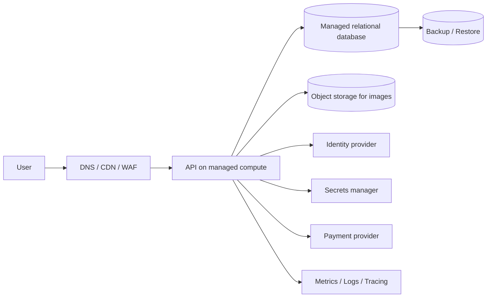

# Designing Around the Shared Responsibility Model Between Customer and Provider

When deploying applications to the cloud, the cloud service provider (**CSP**) operates part of the system, while the customer must still design, configure, and control the parts related to their own applications and data. This boundary is commonly referred to as the **shared responsibility model**.

This is an architectural design principle, not just a rule for the security team. It determines who patches vulnerabilities, who grants permissions, who backs up data, who detects incidents, who restores the service, and what evidence proves that these controls are working. For a cloud architect, misallocating responsibilities can create a system that appears fully managed yet still suffers from security vulnerabilities, single points of failure, or unanticipated operational costs.

## 1. Learning Objectives

After this lesson, learners will be able to:

1. Explain how CSP and customer responsibilities shift across IaaS, PaaS, SaaS, and managed services.
2. Identify responsibility boundaries for networking, compute, applications, data, identity, backups, monitoring, and incident response.
3. Build a responsibility assignment matrix tied to **controls, executors, and verification methods**, rather than only listing the responsible party.
4. Analyze trade-offs between level of control, scalability, reliability, cost, security, and operational effort when selecting cloud services.
5. Evaluate an architecture using Well-Architected thinking, identifying responsibilities that lack a clear owner.

## 2. Understanding the Shared Responsibility Model Correctly

A common interpretation in cloud environments is:

- **Security *of* the cloud**: the CSP protects the physical facilities, hardware, network, and platform layers that it directly operates, according to the scope of each service.
- **Security *in* the cloud**: the customer protects the data, identities, applications, configurations, and resources over which they have decision-making or administrative authority.

For example, the CSP is responsible for protecting the physical host running a virtual machine. However, if the customer creates a virtual machine themselves, they typically must update the guest operating system, secure access ports, install applications safely, and manage credentials. When moving from a virtual machine to a managed application runtime service, the CSP may take over managing the operating system and runtime platform; the customer must still fix vulnerabilities in their own source code and libraries.

**Important:** both parties can participate in the same control objective while performing different parts of the work. For instance:

- The CSP provides the disk encryption mechanism, while the customer chooses the encryption configuration, grants key usage permissions, or manages customer-owned keys.
- The CSP provides backup capabilities for a managed database, while the customer defines the backup schedule, retention period, recovery scope, and backup verification.
- The CSP protects the identity platform, while the customer decides who is allowed access, which permissions are granted, and which accounts must be revoked.

This model is **not identical by default across all services or all providers**. The exact scope must be verified against service documentation, contractual agreements, SLAs, the active configuration, and specific implementation choices.

### 2.1. Distinguishing Three Questions

To avoid an overly vague responsibility table, ask the following for each component:

| Question | Meaning | Example with a Managed Database |
|---|---|---|
| **Who executes?** | The party that directly implements or operates the control | The CSP may automatically patch the database server's operating system |
| **Who decides policy?** | The party that selects requirements, risk tolerance thresholds, and configuration | The customer decides who can query data and how long backups are retained |
| **Who verifies and is accountable?** | The party that checks outcomes, handles exceptions, and provides evidence | The customer audits access permissions and tests restores against business objectives; the CSP provides evidence aligned with its obligations |

Just because the provider *executes* an action does not mean the customer can skip *verifying that the action meets the application's requirements*.

## 3. How Responsibilities Shift by Service Model

A higher level of managed service generally reduces the infrastructure administration tasks that the customer performs directly. However, responsibility for data, secure configuration, access, and business correctness still needs to be defined.

| Component | IaaS: Virtual Machines | PaaS: Application Platform / Managed Database | SaaS: Complete Software |
|---|---|---|---|
| Data centers, physical hardware | CSP | CSP | CSP |
| Virtualization layer and underlying service infrastructure | CSP | CSP | CSP |
| Host operating system serving the application | Customer typically manages the VM's OS | CSP typically manages the platform OS; scope depends on the service | CSP |
| Runtime and platform patches | Customer | CSP or shared, depending on runtime and update mode | CSP |
| Application source code and libraries deployed by the customer | Customer | Customer | CSP for the SaaS application; customer is responsible for their own integrations/customizations |
| Accounts, roles, business authorization | Customer | Customer | Customer for tenant users and settings; CSP operates the underlying mechanism |
| Data content, classification, and retention policy | Customer | Customer | Customer or shared depending on contract, data processing role, and applicable regulations |
| Network protection and access interfaces | Customer configures firewall and network segmentation | CSP protects the platform; customer configures access endpoints, network rules, and allowed connections | CSP protects the platform; customer configures sharing permissions and available tenant settings |
| Business data backup and recovery | Customer implements/orchestrates | CSP provides the capability; customer configures and verifies within service scope | Depends on contract, export/restore features, and customer archival requirements |

The table above should not be read as a universal guarantee for every product. A PaaS offering may require the customer to select and update runtime versions; a SaaS product may not provide record-level restore as desired; a managed database service may automatically update the operating system while requiring the customer to schedule engine version upgrades.

### 3.1. IaaS: More Control, More Operational Work

In Infrastructure as a Service, the customer typically administers virtual machines, operating systems, applications, logical network connectivity, and most security configurations. IaaS is suitable when deep customization is needed, when software has OS-level constraints, or when host-level control is required.

Example: running an API on a VM requires the operations team to maintain processes for building secure images, patching the OS, configuring firewalls, rotating keys, monitoring disks, and handling backups and recovery. The CSP does not automatically perform these tasks simply because the VM resides in the cloud.

### 3.2. PaaS and Managed Services: Trading Administrative Responsibility for Service Dependency

In Platform as a Service and services such as managed databases, the provider takes on more platform operational work. The customer focuses on the application, access policies, configuration, data quality, service tier selection, and business error handling.

Example: with a managed relational database, the CSP may manage the physical server, OS, and certain engine maintenance activities. The customer must still:

- Set up private connectivity, allowlists of permitted sources, and least-privilege accounts.
- Choose availability, backup, retention, and recovery configurations aligned with RTO/RPO targets.
- Manage schemas, queries, migrations, in-DB permissions, and protection of sensitive data.
- Test the impact of maintenance and version upgrades according to the service policy.

### 3.3. SaaS: Less Application Administration, Still Requires Tenant and Data Governance

With Software as a Service, the CSP typically operates the entire application. However, the customer still decides which users are invited into the organization, what data is uploaded, who has public sharing permissions, how authentication is configured, and how access is revoked when staff leave the organization. They also need to understand data export, backup, recovery, retention, and deletion capabilities under the contract.

### 3.4. Serverless and Kubernetes Are No Exception

- **Function as a Service:** The CSP operates the servers and most of the underlying runtime. The customer still secures source code, dependencies, execution permissions, environment variables, secrets, event flows, timeouts, concurrency, and error handling.
- **Managed Kubernetes:** The CSP may operate the control plane; responsibility for worker nodes, cluster add-ons, workloads, container images, ingress, and network policies depends on whether customer-managed nodes or a managed compute mode is used.
- **Container images:** Running an image on a managed platform does not eliminate the responsibility to patch libraries, build minimal images, and scan customer-introduced components for vulnerabilities.

When evaluating an architecture, you must explicitly specify the **service name, deployment mode, and version/configuration** instead of merely writing "uses cloud" or "uses Kubernetes".

## 4. Allocating Responsibilities Across Architectural Layers

### 4.1. Data: A Business Asset That Cannot Be Delegated Away

The CSP protects the storage layers it operates under its service commitments. Architects and data owners must still decide:

- Which data is public, internal, or sensitive; who may read, write, delete, and export data.
- Which geographic regions data is permitted to be stored in; whether it may be replicated to another region.
- Whether encryption in transit and at rest requires CSP-managed or customer-managed keys.
- Retention periods, deletion capabilities, access logs, and procedures for meeting legal/contractual requirements.
- RPO (*Recovery Point Objective* – maximum acceptable data loss measured in time) and RTO (*Recovery Time Objective* – target recovery time).

**Example:** a bucket storing invoices may be encrypted by default, but if the access policy allows the entire Internet to read objects, encryption at rest does not prevent data exposure through authorized access under a misconfigured policy.

### 4.2. Identity and Privileges

The CSP provides an IAM system or identity integration; the customer configures it for the right context:

- Apply *least privilege* and separate permissions across dev, staging, and production environments.
- Prefer short-lived workload identities over long-lived API keys.
- Protect administrative accounts with MFA, emergency access mechanisms, and monitoring of sensitive operations.
- Revoke permissions on role changes; periodically review roles, policies, and service accounts.
- Avoid having applications share identities with operators or granting tenant-wide administrative privileges.

The CSP cannot inherently know whether an employee should be allowed to view specific customer data: this is a business rule that must be designed into the application and authorization system.

### 4.3. Network, Compute, and Attack Surface

The CSP protects the physical network infrastructure and the platform layers under its administration. The customer designs the application's trust boundaries: which components are exposed to the Internet, which connections must be private, which services may call which services, and how outbound traffic is controlled.

Example for a three-tier web application:

- Only the CDN / load balancer / API gateway tier needs a public access endpoint.
- Databases and background processing services are placed on private connections where supported by the platform.
- Network policies allow only the application → database flow; administrative ports are never opened to all sources.
- WAF, DDoS protection, TLS, and rate limiting are coordinated controls; you must verify which features are enabled by default by the CSP and which rules the customer must configure.

In IaaS, the customer also manages OS patches and agents. In PaaS, the customer must still pay attention to endpoint configuration and application vulnerabilities.

### 4.4. Reliability, Backup, and Recovery

The SLA of an individual component service **does not automatically become the SLA of the entire application**. An application can still go down because of a single-instance database, unenabled failover configuration, quota exhaustion, deployment errors, or an external service outage.

Architects need to evaluate:

1. Which components are single points of failure; are multi-zone mode, replication, or failover mechanisms configured?
2. When an availability zone, geographic region, or underlying service fails, how does the system degrade?
3. Can backups actually be restored, or do they merely exist on the console?
4. Do business RTO/RPO targets align with the capabilities and limits of the selected service?
5. Are there scenarios covering accidental configuration changes, accidental data deletion, or loss of access to encryption keys?

Some failover actions are executed by the CSP; however, **the decision to deploy redundancy and the verification of recovery targets** remain part of the customer's application design.

### 4.5. System Observability and Incident Response

The provider monitors the health of the platform it operates. The customer must have visibility into the health of **their own business workloads**: API error rates, latency, failed order transactions, anomalous access, capacity, cost, and recovery outcomes.

The following should be clearly defined:

| Activity | Who Typically Provides the Capability | What the Customer Must Do |
|---|---|---|
| Cloud service logs | CSP provides audit logs / service logs depending on the product | Enable appropriate logs, set access permissions, choose storage destination and retention period |
| Application and transaction logs | Logging tools from the CSP or third parties | Record sufficient investigation data, mask sensitive info, attach trace/correlation IDs |
| Alerting | CSP provides metrics and alerting channels | Define thresholds based on SLOs, staff on-call rotation, and test alerting paths |
| CSP infrastructure incidents | CSP issues notifications per their procedures | Monitor service status, activate application impact-mitigation plans |
| Credential exposure incidents | IAM mechanisms and logs aid detection | Disable exposed credentials, investigate access scope, rotate keys, and remediate root cause |

The response plan must specify provider points of contact, limitations on available logs, evidence retention duration, and user communication roles.

### 4.6. Compliance, Contracts, and Third Parties

A CSP's certifications or audit reports demonstrate **the CSP's evaluated control scope**, rather than certifying that the customer's application inherently complies with all requirements. The customer must map legal obligations, data policies, internal processes, and deployment configurations; the CSP also has its own obligations under the contract and applicable laws.

If an enterprise hires a cloud implementation partner, the boundary includes a third party: the partner may operate resources under delegation, but decision-making authority, oversight, and final accountability must still be explicitly stated in the contract and assignment matrix. Never assume the partner "handles everything" simply because they were granted administrative privileges.

## 5. Practical Example: Online Booking Application

Suppose we need to design a system allowing customers to search for accommodations, book dates, pay through a payment provider, and store photos along with related documents. Sample requirements:

- The API serves users continuously; booking and identity data require strict access control.
- The application must tolerate single-instance failures and be able to detect failed transactions.
- Small development team, prioritizing managed services to reduce OS patching and server management effort.
- Example recovery targets set by the business: **RTO 4 hours, RPO 15 minutes**. These are targets to design for and test, not features guaranteed merely by choosing a managed database.

A possible architectural option is:

The diagram only shows logical components. During actual implementation, network configuration, authentication mechanisms, fault isolation, access limits, data flows, and legal requirements must be added.

### 5.1. Assignment Table with Verification Methods

| Component / Control | CSP or Partner Provides | Customer Designs and Executes | Verification Method |
|---|---|---|---|
| Managed compute platform | Operates infrastructure, underlying servers, and runtime layer per service scope | Deploys code, configures scaling, secrets, workload permissions, and request handling | Inspect configuration, run load tests, and review permissions |
| API and booking business logic | Provides capacity to run the application | Authentication, booking ownership authorization, input validation, double-booking prevention | Test unauthorized access, test idempotency and transactions |
| Managed database | Operates committed platform layer, provides backup/failover options | Selects HA, backups, private connectivity, DB roles, migrations | Test restore into a separate environment and measure actual RTO/RPO |
| Object storage | Operates physical storage layer and policy features | Blocks public access, issues time-limited download URLs, configures encryption and data lifecycle | Scan policies and attempt unauthorized external access |
| IAM / identity | Operates underlying identity system | MFA, least-privilege roles, access revocation, auditing | Review permissions and drill key revocation |
| Connection to payment provider | Payment provider secures infrastructure within its service scope | Protects authentication credentials, verifies webhook signatures, prevents duplicate transaction processing | Test forged webhooks, replay attacks, and timeout scenarios |
| Observability / incidents | Provides platform metrics, API logs, and service error notifications | Selects SLOs, business alerts, on-call rotation, response runbooks | Drill alerts and measure detection time |
| Disaster recovery | Provides snapshot, replication, or restore features per tier | Designs recovery plan for application, data, secrets, and DNS | Conduct DR drills, record actual duration and discovered gaps |

### 5.2. A Cross-Cutting Requirement: Protecting Identity Document Photos

Suppose the feature for uploading identity documents to object storage already works functionally. The architecture still falls short if direct download URLs remain valid permanently or if the resource has public read access. Approach:

1. Classify identity documents as sensitive data that must not be publicly exposed.
2. Block public access at the bucket/container level and apply an appropriate deny policy.
3. Have the API verify ownership permissions and then issue a short-lived download URL or proxy the content as needed.
4. Enable encryption, key management, access logging, and lifecycle rules according to the retention policy.
5. Test with an unauthorized account, an expired URL, and misconfigured permission scenarios.

In this example, the CSP is responsible for the security of the object storage platform under the contract; **deciding who is allowed to read the documents** remains an application rule and configuration under the customer's responsibility.

## 6. Process for Applying This to Cloud Architecture Design

### Step 1: Translate Business Requirements into Control Requirements

Before selecting services, align on which data needs protection, availability targets, RTO/RPO, audit requirements, budget limits, and deployment constraints. Without clear criteria, it is impossible to know whether the portion of responsibility assumed by the provider is sufficient.

### Step 2: Inventory Components, Service Types, and Trust Boundaries

List all APIs, databases, storage, DNS, CDN, queues, IAM, networking, CI/CD, observability tools, and external providers. Classify each component as IaaS/PaaS/SaaS or a specific managed mode. Mark where data crosses boundaries: browser → API, API → database, API → payment partner, CI/CD → production environment.

### Step 3: Build a Responsibility Matrix for Each Control

Each row needs at least: resource, risk/control, operating party, deciding party, internal owner, and evidence. A brief template:

| Resource | Required Control | Executing Party | Internal Owner | Evidence |
|---|---|---|---|---|
| Managed DB | PITR meeting approved RPO | CSP provides capability; cloud team configures | Data owner / platform team | Retention configuration + restore test record |
| Object storage | Disallow anonymous reading of sensitive documents | Application / cloud team configures | Application tech lead | Policy scan results + permission tests |
| Operational SaaS | Revoke access when staff depart | Internal tenant admin | IT / identity management | Revocation logs and periodic review results |

For tasks involving multiple collaborating teams, RACI (*Responsible, Accountable, Consulted, Informed*) can be added. Avoid listing two people simultaneously as "ultimately accountable" for a single decision without clarifying the delegation mechanism.

### Step 4: Cross-Check Service Documentation and Contractual Limits

Read the shared responsibility scope, SLA, maintenance policy, encryption/backup/logging features, quota limits, data storage location, and support tier of **the exact service selected**. Check how scenarios such as losing an availability zone, losing a region, key expiration, version changes, or inability to access the management console are handled.

Evaluate what the service does **not** provide as well: for example, backups may restore the entire database but not an individual table; component SLAs may exclude certain scenarios; default logs may be insufficient for business investigations.

### Step 5: Design Controls and Automation

Prioritize:

- Infrastructure and policies managed as code (*Infrastructure as Code*, *policy as code*), with review and change history.
- Blocking unnecessary access by default; storing secrets in a secret manager; using workload identities instead of static keys where appropriate.
- CI/CD checks for dependencies, configurations, images, and deployment permissions; production changes having an appropriate approval mechanism.
- Alerts and runbooks tied to business services, not just CPU or server status.
- Cost controls: resource tags, budgets, consumption alerts, appropriate scaling limits, and review of retained data.

### Step 6: Verify Evidence, Not Just Checkboxes

At minimum, test insufficient permissions, over-privileged access, single-instance failure, dependency failure, DB connection loss, data restoration, quota exhaustion, and deployment rollback. Measure actual results against requirements. A configuration showing "backup enabled" is insufficient if a restore has never been tested; a feature stating "multi-zone supported" is insufficient if the system is running in a single zone.

### Step 7: Update Assignments When the Architecture Changes

When migrating from VMs to serverless, upgrading database tiers, enabling a public endpoint, adding a SaaS partner, or changing regions, update the responsibility matrix, threat model, runbooks, owners, and evidence. Responsibility boundaries are a property of **the operating architecture**, not a form filled out once at project kickoff.

## 7. Common Misconceptions and Consequences

| Misconception | Potential Risk | Design Fix |
|---|---|---|
| "Stored in the cloud means data is completely protected." | Public buckets or overly broad account permissions leak data | Classify data, configure default-deny policies, test permissions from an external perspective |
| "Managed database means no need to plan for backups." | Accidental deletion, retention too short, RPO not met | Select backup/PITR policies, separate delete permissions, test restores periodically |
| "PaaS patches everything automatically." | Outdated application libraries, exploitable dependencies | Scan dependencies, patch code, and manage customer-controlled runtime versions |
| "The CSP has an SLA so the application will always be available." | Single points of failure, misconfigurations, integration and deployment errors | Design redundancy, appropriate timeouts/retries, circuit breakers, and test failover |
| "The CSP already has compliance certifications." | Application handles data outside policy, lacks auditability | Map certification scope against the parts the customer must control |
| "SaaS manages employee accounts too." | Departed accounts retain access or share data externally | SSO/MFA, account lifecycle management, review and revoke permissions |
| "An integrator manages the cloud so the internal team needs no owner." | During an incident, no one makes decisions or accepts risk | Appoint an internal owner, define contractual roles, reporting mechanisms, and verification |

A useful review technique is to ask: **"If this control fails at 2 a.m., who receives the alert, who has permission to fix it, who makes the decision, and who confirms recovery?"** If this cannot be answered, the responsibility boundary is not yet complete.

## 8. Architectural Trade-Offs Under Well-Architected

Shared responsibility ties directly to the Well-Architected evaluation pillars:

| Perspective | Design Questions to Answer | Typical Trade-Offs |
|---|---|---|
| **Security** | Who manages keys, identities, permissions, patches, network segmentation, and auditing? | Managed services reduce the OS surface to operate, but require deep understanding of service configuration and IAM |
| **Reliability** | Who enables HA/backups, drills failover, and maintains RTO/RPO? | Multi-zone or multi-region replication increases availability but increases cost and complexity |
| **Operational Excellence** | Who monitors the system, changes configurations, handles incidents, and writes postmortems? | Managed platforms reduce toil but increase the need to monitor service limits and support agreements |
| **Performance** | Who selects resource tiers, connection limits, caching, and scaling strategies? | Autoscaling increases elasticity but has quota limits, cold starts, or sudden cost spikes |
| **Cost Optimization** | Who owns budgets, tags, retention, data egress, and shutting down idle resources? | Using managed services saves operational effort but may increase service/egress fees |
| **Sustainability** | Who reduces over-provisioned resources, unnecessary storage, and idle jobs? | Right-sizing and data lifecycle management can reduce both cost and resource consumption |

Choosing IaaS for OS control can be justified, provided the team has the capability to patch, back up, and operate it. Choosing PaaS to reduce OS administration is also justified, provided configuration limits, data portability, and recovery options meet business needs. **There is no single best service model for every system**; the right decision depends on requirements and the ability to execute the remaining responsibilities.

## 9. Practice Exercises

### Scenario A — Migrating a VM to a Managed Database

A team is running PostgreSQL on a VM, handling OS updates and backups themselves. The team plans to migrate to a managed database and delete all DB operational tasks.

**Question:** Name at least four responsibilities the team must still retain.

**Suggested answer:** configuring DB permissions and private networking; defining encryption and key management; setting retention/recovery capabilities; testing restores against RTO/RPO; managing schemas, migrations, and queries; monitoring capacity, slow queries, cost, service limits, and incidents. Items taken over by the CSP can only be confirmed after checking the specific service documentation.

### Scenario B — SaaS Containing HR Data

A company uses a SaaS document management tool. The provider has audit reports and supports MFA, but all employees currently have permission to share files outside the organization.

**Question:** Where is the responsibility boundary wrong?

**Suggested answer:** the CSP operates and secures the underlying application, but the customer must design sharing policies, configure MFA/SSO as needed, enforce least privilege, classify data, and govern accounts. The CSP's audit reports do not replace these configurations.

### Scenario C — Only a Single Database Instance

A booking application has an API running across multiple instances and a single managed database. The system owner assumes the provider's high uptime commitment means no outage scenario is needed.

**Question:** What else needs to be examined?

**Suggested answer:** zone-level HA configuration, failover duration, recovery objectives, ability to restore from backups, transaction durability, connection retries, component recovery order, and region-level quotas and limits. The database SLA is only one part of the overall application availability.

## 10. Pre-Design-Freeze Checklist

- [ ] Each resource has its service type and actual management mode explicitly documented.
- [ ] CSP / customer / third-party partner boundaries have been confirmed against relevant documentation and contracts.
- [ ] Internal owners are assigned for data, IAM, networking, applications, backups, incident response, cost, and compliance.
- [ ] Critical controls have defined configurations, evidence storage locations, and testing methods.
- [ ] RTO/RPO, availability, and SLO targets are tied to concrete implementation plans and drills.
- [ ] Architectural changes, service additions, or provider changes trigger a responsibility review.
- [ ] For every severe incident, it is known who detects it, who mitigates it, who coordinates with the CSP, and who confirms recovery.

**Key takeaway:** the shared responsibility model is not a diagram splitting infrastructure in half. It is a way to bind every architectural decision to an owner, a control, and operational evidence. Good cloud design leverages what the CSP genuinely provides while proactively taking ownership of data, configuration, business logic, and end-to-end service quality.
