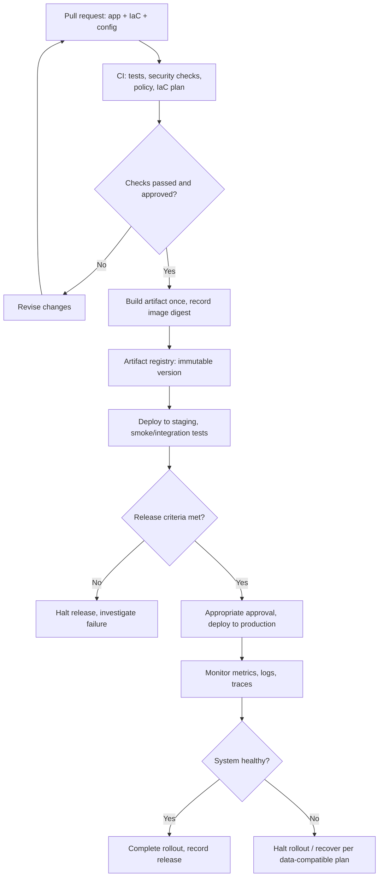
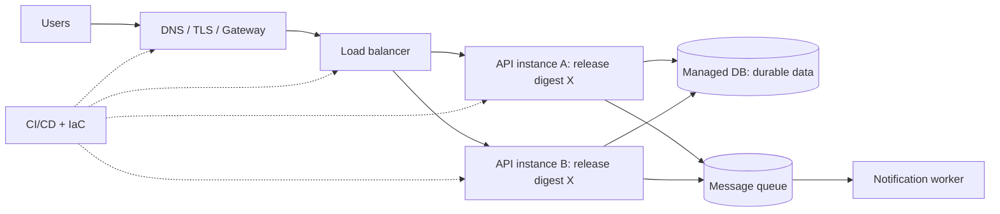

# Prioritizing Automation, Reproducibility, and Immutable Infrastructure

In cloud architecture, a system running well today is not enough. Teams must also answer: **If we need to rebuild the environment tomorrow, deploy the exact same version elsewhere, or recover after an incident, can we do it reliably?**

Three complementary principles are **automation**, **reproducibility**, and **immutable infrastructure**. Together, they shift most operational work from hard-to-track manual changes into versioned, verified, and repeatable workflows.

In the **CLOUD_ARCHITECTURE** module, this forms the foundation connecting business requirements with network, compute, data, and deployment design. The ultimate goal is to improve **reliability, security, scalability, cost, and operability**, while keeping trade-offs clear under Well-Architected thinking.

## 1. Distinguishing the Three Principles

| Principle | Question to Answer | Approach | Signs of Doing It Well |
| --- | --- | --- | --- |
| **Automation** | How is an action executed consistently with minimal manual effort? | Express workflows as pipelines, scripts, policies, or controllers; define inputs, preconditions, outputs, and error handling | Every build/deploy runs standard checks; logs and accountable owners exist |
| **Reproducibility** | Can the desired state be rebuilt from known inputs? | Version-control configurations, lock dependencies, identify artifacts and resources; record environment parameters | Another person can stand up an equivalent test environment from docs and source code |
| **Immutable infrastructure** | When changing the runtime environment, can standardized resources be **replaced** instead of modified in place? | Build a new image/artifact, provision new instances, shift traffic, then decommission old instances | Instances in a release share a predictable configuration; minimal drift from manual edits |

These three properties are **related but not synonymous**:

- You can **automate a flawed action**: a script that logs into each machine and edits configs is automated, yet results can drift depending on prior state.
- You can **reproduce manually** with extraordinarily strict documentation, but this becomes unsustainable as systems and environments grow.
- You can deploy **immutable images** yet fail to reproduce the whole system if networking, access permissions, secret references, and databases are configured ad hoc.
- You can use **Infrastructure as Code (IaC)** while infrastructure still gets edited directly after deployment; in that case both reproducibility and immutability are eroded.

Combined principle: **define desired state with versioned data → automatically build and verify artifacts → deploy standardized resources → observe and remediate drift**.

## 2. Why Do Manual Changes Create Architectural Risk?

Suppose an equipment rental booking application has staging and production environments. Initially, both environments were configured through the cloud console:

1. Engineers manually created load balancers, virtual machines, databases, and IAM policies.
2. When deploying a new release, operators SSHed into machines to replace the JAR file and edit environment variables.
3. To fix an urgent bug, someone edited configuration directly in production without documenting it.
4. When standing up a new staging environment, the team relied on outdated docs and recalled steps from memory.

Resulting risks:

| Issue | Symptom | Consequence |
| --- | --- | --- |
| **Configuration drift** | Production has firewall rules or runtime versions different from staging | Bugs appear only in production; attack surface widens |
| **Snowflake server** | One unique machine holds edits nobody can reproduce | Replacing the host or scaling out instances triggers failures |
| **Inconsistent execution** | A deploy forgets migrations or health checks | Faulty release despite code passing tests |
| **Lack of auditability** | Unknown who changed configs, what changed, or why | Hard to investigate incidents, roll back, or audit |
| **Slow recovery** | Must manually rebuild all resources after a zone outage | RTO missed; prolonged business disruption |
| **Hard-to-control costs** | Test resources created and forgotten | Ongoing spend, unowned resources |

Automation yields **repeatable processes**; reproducibility enables **restoring the desired state**; immutable infrastructure prevents in-place edits from accumulating into undocumented configurations.

## 3. What to Automate in the Cloud Lifecycle?

Automation can apply from code changes all the way to monitoring running applications. A reliable deployment pipeline typically includes these stages:

| Stage | What Can Be Automated | Control Gates |
| --- | --- | --- |
| **Change** | Format checks, static analysis, policy checks, and IaC change previews on pull requests | Peer review, merge permissions, branch protection rules |
| **Build** | Compilation, unit tests, dependency checks, building container images or packages | Stop on build failure; versions and dependencies are locked |
| **Artifact verification** | Vulnerability scanning, SBOM generation, signing or provenance attestation when needed | Rules rejecting artifacts failing acceptable risk thresholds |
| **Infrastructure provisioning** | Planning, validating, and applying network, compute, IAM, and data service configurations | Review changes that delete resources or widen permissions |
| **Deployment** | Promoting the exact tested artifact to staging and then production | Risk-based approvals; never rebuild differently per environment |
| **Verification** | Readiness/health checks, smoke tests, checking metrics, logs, traces, and error rates | Block or auto-halt rollout if thresholds are breached |
| **Recovery** | Shift traffic back to the prior version or redeploy a stable artifact; trigger runbooks | Must account for data state, migrations, and external side effects |
| **Operational governance** | Drift detection, configuration scanning, certificate/secret rotation, backups, restore drills | Assigned owners, alerts, audits, and exception-handling processes |

**Automation does not mean eliminating all human approvals.** Permission changes or deleting a production database may require an approval gate. The quality of automation lies in standardizing repetitive steps while keeping appropriate controls on high-risk decisions.

### Characteristics of a Reliable Automation Workflow

1. **Idempotent whenever possible:** re-running the operation converges the system to the same desired state rather than creating duplicate resources or repeating unintended side effects.
2. **Explicit inputs:** commit, artifact digest, target environment, configuration revision, execution identity.
3. **Preconditions and postconditions:** verify permissions, existing resources, and readiness state before shifting traffic.
4. **Bounded retries:** handle transient errors with timeouts, backoff, and guards against repeating dangerous transactions.
5. **Observable:** action logs, timestamps, deployment identifiers, metrics, and alerts.
6. **Recovery actions:** halt rollout, revert to a stable artifact, or trigger data recovery workflows when needed.

Example: a "create admin user" command is **not inherently idempotent** if running it twice creates two accounts. Automation must check existence state or use an appropriate idempotency key API; putting it in a script does not make it safe on its own.

## 4. Reproducibility: More Than Saving Application Code

A cloud environment depends on many layers of inputs. To rebuild it in a controlled manner, manage them as versioned, verifiable parameters.

| Layer | What Must Be Recorded or Managed | Example |
| --- | --- | --- |
| **Application code** | Commits, dependency lockfiles, toolchain, build instructions | Git SHA, Java runtime version, lockfile |
| **Executable artifacts** | Immutable identifiers and provenance | Container image digest, package checksum |
| **Infrastructure** | IaC code, module/provider versions, deployment parameters | Network, security groups, autoscaling policies |
| **Application config** | Non-sensitive per-environment values, config schemas | Endpoints, timeouts, controlled feature flags |
| **Secrets and identities** | Secret references, permissions, workload identity issuance | Secret manager reference, IAM role |
| **Data** | Schema migrations, sample seed workflows, and backup/restore | Migration V014, test data seeding |
| **Release process** | Pipelines and verification gates | Tests, approvals, canary, smoke tests |

Never put passwords, tokens, private keys, or personal data in Git just for "reproducibility." **Reproducibility requires reproducing structure, permissions, references, and secret-provisioning workflows**, while actual secret values live in a dedicated secrets system with its own access controls and lifecycle.

### How Exact Must "Reproducible" Be?

Depending on the goal, "reproducibility" has several levels:

- **Build reproducibility:** the same source and dependencies produce artifacts with equivalent behavior. When supply-chain verification is required, aim for **reproducible builds** yielding identical bytes/checksums under standardized conditions; not every toolchain achieves this by default.
- **Environment config reproducibility:** two environments share the same logical topology and policies, while potentially differing in resource sizing, domains, regions, or data.
- **Release reproducibility:** the same image digest and controlled configuration are deployed to staging and then production. "Build once, promote the same artifact" eliminates rebuild variance.
- **Post-incident service reproducibility:** rebuilding infrastructure and applications **combined with restoring data** to a point meeting RPO/RTO targets.

In the cloud, not every attribute is byte-for-byte reproducible: dynamic IP addresses, resource IDs, creation timestamps, data state, and managed service behaviors can vary. The target is **equivalence in configuration, contracts, and verifiable behavior**, while recording parameters that matter.

### Techniques to Improve Reproducibility

**Pin versions** of runtimes, dependencies, IaC providers, and modules instead of using floating versions. Lock dependencies with appropriate lockfiles and manage version upgrades via pull requests. For containers, prefer **digests** (sha256) or tags enforced as immutable by the registry; mutable tags like **latest** do not prove two deployments ran identical contents.

**Describe environments with IaC:** provision networks, compute services, access policies, log destinations, and required resources from peer-reviewed code. Separate shared definitions from environment-specific parameters instead of copy-pasting and manually editing diverging variants.

**Separate desired state from runtime state:** Git typically stores desired-state declarations, whereas IaC state, databases, queues, and secret stores hold live runtime state requiring separate management. **Do not commit Terraform state**, as state files can contain sensitive data and require locking, encryption, access control, and backups.

**Use ephemeral environments for testing when appropriate:** spin up short-lived environments from IaC, run integration tests, and tear them down under guardrails. Watch for services with long provisioning times, quotas, cost, and data fixtures so this does not become an operational burden.

## 5. Immutable Infrastructure: Replace Rather Than Patch in Place

**Immutable infrastructure** is an operational model for compute resources: once an instance is created from a standard image/configuration, the team **does not log in to install packages, edit files, or manually patch** that instance. When an update arrives, the pipeline:

1. Builds a new artifact/image and validates it.
2. Provisions new instances/pods/tasks from the defined image and configuration.
3. Waits for readiness checks, then shifts traffic gradually or all at once depending on strategy.
4. Observes; if stable, decommissions old instances.
5. On failure, halts the rollout and recovers using the prior version or defined incident procedure.

This model works especially well for **stateless compute**, such as API containers behind a load balancer. Instance runtimes stay consistent; user state, uploaded files, and order data live in appropriate datastores/storage services.

| In-Place Updates (Mutable) | Version Replacement (Immutable) |
| --- | --- |
| SSH into VM to edit packages/configs | Build standardized image and deploy new instances |
| Two hosts with the same version label have different patch histories | Instances in a release use the exact same artifact and defined config |
| Hard to know precisely what changed | Exact commit, image digest, config, and rollout history are known |
| Recovery may require undoing multiple manual edits | Can revert to prior application deployment if data-compatible |
| Saves temporary replacement cost in some scenarios | May temporarily increase compute resources during rolling/blue-green deployment |

"Immutable" does not mean **never updated**. It means changes are packaged into **new versions/resources**. Security patching must be performed by rebuilding the updated base image and deploying replacements; having immutable images does not exempt teams from vulnerability monitoring and regular patching.

### Where Are the Boundaries of Immutability?

- **Applications and compute:** pods/VMs/tasks can be replaced. Do not depend on data stored on an instance's ephemeral local filesystem.
- **Configuration:** values are typically injected at deploy time. Behavioral config changes may require a new release; some systems support controlled dynamic configuration.
- **Secrets:** secrets still require rotation and revocation. Use secret manager references, reload mechanisms, or rolling restarts depending on security requirements.
- **Databases, object storage, queues:** business data must survive compute replacements. Never delete or recreate production data just to pursue "immutability."
- **Stateful infrastructure:** configuration can be managed with IaC and updated under controlled workflows, but never blindly apply "destroy and recreate" to databases, data volumes, or encryption keys.

**Immutable infrastructure primarily governs the lifecycle of compute resources**, not a promise that the entire system is stateless.

## 6. IaC, CI/CD, and GitOps: What Role Does Each Tool Play?

These principles are typically implemented through a combination of mechanisms:

| Mechanism | Role | What It Does Not Guarantee on Its Own |
| --- | --- | --- |
| **Infrastructure as Code (IaC)** | Declares and manages cloud resources via versioned code; previews and applies changes | Does not prevent drift if someone edits via the console or out-of-band automation |
| **CI (Continuous Integration)** | Integrates changes and tests code, dependencies, and artifacts repeatably | Does not prove the application runs correctly in production |
| **CD (Continuous Delivery/Deployment)** | Standardizes release workflows; delivery may require approval, deployment pushes automatically to target environments | Does not guarantee safe data rollback if schemas are incompatible |
| **GitOps** | Uses desired state in Git while controllers/pipelines reconcile it against runtime state | Should not treat Git as the source of truth for transactions and business data |
| **Image baking / artifact registry** | Produces verified artifacts stored under specific identifiers for reuse | Does not guarantee vulnerability scanning, signing, or immutability policies unless configured |
| **Policy as Code** | Enforces requirements such as no public storage, least privilege, mandatory owner tags | Does not replace threat modeling and architecture reviews |

### Desired Change Flow



This diagram is a **reference flow**. The exact ordering of applying IaC changes, migrations, configuration, and application versions depends on cross-component compatibility; each release must be planned specifically. "Build once" means promoting the exact same verified artifact across environments, not requiring every environment to have identical instance counts or secrets.

## 7. Example: Rental Platform Deploying a Java Application in the Cloud

A rental service has a Java API, a transactional database, and a notification processing queue. The team wants to eliminate SSH operations and spin up new staging environments faster.

### 7.1. Start from Requirements, Avoid Choosing Tools First

Problem assumptions:

- When deploying a new release, in-flight orders must not be lost.
- Downtime must be minimized; there must be a path back to a stable version if the API fails.
- The staging environment must sufficiently mirror network flows, permissions, and data service types to catch defects before release.
- Losing the runtime environment must have a rebuild path within business-defined target times.
- Small team requiring a balance between cost, tool count, and automation depth.

These assumptions must be translated into measurable targets once baseline metrics exist: e.g., request success rate, p95 latency, deploy duration, rollback frequency, **RTO** (recovery time objective), and **RPO** (recovery point objective).

### 7.2. Organizing Inputs and Releases

The team manages:

1. **Application code and tests** in a repository with peer review and branch protection.
2. **IaC** declaring virtual networks, ingress, runtime, managed databases, service permissions, logs, and alerts.
3. **Per-environment configuration** containing only non-sensitive parameters and secret references.
4. **Versioned migrations** to evolve database schemas independently of compute replacements.
5. **Release manifest** or deployment record capturing verified artifact identifiers and configuration revisions.

Conceptual release record example:

```yaml
release:
  sourceCommit: "7f12c0a"
  containerImage: "registry.example.com/rental-api@sha256:<digest>"
  configurationRevision: "config-2026-11-18"
  schemaRevision: "V014"
  infrastructureRevision: "2d56a3e"
environment:
  name: "production"
  region: "ap-southeast-1"
```

Here the placeholder `<digest>` marks where the actual digest is inserted, not a runnable value. The record contains no passwords or access tokens. Where possible, the pipeline should also capture build provenance, timestamps, approver/approval method, and verification results for incident traceability.

### 7.3. Infrastructure and Deployment Lifecycle



API instances store neither sessions nor rental files on local disks. This enables adding or replacing instances during updates or autoscaling. The database and queue preserve data independently of the API lifecycle.

A release can operate as follows:

1. Developer opens a pull request; CI runs tests, dependency checks, policies, and generates an IaC plan if infrastructure changed.
2. After review, the pipeline builds the image and pushes it to the registry with a digest; signs and stores provenance if policy requires.
3. The pipeline deploys the exact digest to staging and runs smoke tests for creating orders, reading orders, and calling dependent APIs.
4. In production, a **rolling** or **canary** rollout launches new instances and waits for readiness checks before serving traffic.
5. Monitor error rates, p95 latency, database connections, and business errors such as failed reservation holds. If thresholds diverge, halt rollout.
6. Record the actual release, timestamp, verification results, and rollback reason if any.

### 7.4. Executing Safe Database Changes

Suppose the new version needs to add an `expires_at` column to the bookings table. Because the database is **not replaced** alongside the API, two-way compatibility is required:

- **Expand:** add the column in a way the old application version still works; use nullable or an appropriate default, avoiding an immediate NOT NULL constraint while legacy rows lack values.
- **Migrate:** update the application to write/read the new data; backfill if needed with bounded load and observability.
- **Contract:** only after verifying no component relies on the old schema, drop old columns/code paths or tighten constraints.

This is **expand–migrate–contract**. It supports rolling deployments because old and new versions can run concurrently for a transition window. Simply "rolling back the image" after a migration is unsafe if the old version cannot understand the new schema or data.

For data-destructive changes, maintain a dedicated recovery plan, backups, and restore tests; sometimes **rolling forward** with a hotfix is safer than rolling back. The choice depends on business impact, data state, and acceptable recovery time.

## 8. Designing Pipelines with Clear Trust Boundaries

Automation means the pipeline holds permissions to provision resources, ship software, or reach critical systems. **The pipeline is part of the attack surface** and must be designed like a production component.

| Risk | Design Control |
| --- | --- |
| Long-lived CI tokens leaked | Use federated session identities (e.g., OIDC/federation) where supported, short-lived tokens, permission revocation, and workflow identity controls |
| Pipeline holds admin rights across all environments | Separate staging/production roles, apply least privilege, scope permissions by repository/branch/workflow |
| Unreviewed code runs automatically against production | Branch protection, required checks, approvals for sensitive environments; handle PRs from untrusted sources carefully |
| Supply-chain attack in dependencies or images | Pin versions, scan dependencies, generate SBOMs, provenance/signing where appropriate, deploy only from trusted registries |
| Secrets printed to console or stored in Git | Secret manager, verified masking, restricted logs, workload-scoped access |
| IaC change accidentally opens network or deletes data | IaC plan, policy as code, review sensitive diffs, guardrails protecting stateful resources |
| IaC state written concurrently or exposed | Remote backend with locking, encryption, IAM restrictions, backup/versioning where supported |

**Separating plan-read permissions from apply permissions** can reduce risk. However, consider tooling and organizational context; some environments let pipelines auto-apply low-risk changes while requiring approval for network or data changes.

### Why Manage the Artifact Supply Chain?

An image with a fixed digest guarantees referencing **the exact contents stored in the registry**, but does not prove those contents are safe or built from a trusted source. Combine build source controls, dependency governance, registry write permissions, provenance attestations, and signature verification policies when risk demands. Using immutable artifacts is only one link in software supply-chain security.

## 9. Managing Drift and Out-of-Band Changes

**Drift** is the divergence between actual live state and declared desired state. For example, IaC only allows database access from the API subnet, yet someone temporarily opened Internet access and forgot to close it.

A drift management workflow can include:

1. **Detection:** run plans/state reconciliation on a schedule or upon changes; monitor sensitive configurations out of band.
2. **Classification:** is it an unauthorized change, a valid emergency change, or a dynamic attribute adjusted by the platform itself?
3. **Remediation:** for invalid changes, restore the desired configuration; for valid changes, update IaC code through review; for emergencies, document and either codify or revert post-incident.
4. **Prevention:** restrict console edit permissions, enforce policies, govern break-glass access, and set alerts.

Do not blindly apply a "delete everything differing from Git" command. Autoscalers, controllers, managed services, or recovery workflows can legitimately create **valid dynamic state**. Define resource boundaries and which tool owns which attributes, preventing two controllers from fighting over the same field.

An emergency exception may permit manual edits under a **break-glass** workflow, but must record actor identity, timestamp, scope, justification, audit logs, and post-incident reconciliation. "Prioritize automation" does not mean forbidding emergency mitigation.

## 10. Deployment and Recovery Strategies with Immutable Infrastructure

| Strategy | How It Works | Benefits | Trade-Offs and Conditions |
| --- | --- | --- | --- |
| **Rolling deployment** | Replaces subsets of instances sequentially | Usually needs minimal extra capacity; keeps serving traffic | Old/new versions coexist; API/schema must be compatible; requires readiness probes |
| **Blue–green** | Maintains two groups, switches traffic once the new group is ready | Enables fast switchback to the old group at the application tier | May temporarily nearly double compute; databases and external effects still need control |
| **Canary** | Routes a small fraction of traffic to the new version, then ramps up | Detects defects under production load before scaling out | Requires reliable metrics, traffic routing, and clear halt rules |
| **Recreate** | Stops old version then starts new version | Simple to deploy for basic systems | Causes downtime window; unsuitable if SLOs require continuous availability |

"Rollback" spans at least three distinct layers:

- **Compute/application rollback:** revert to a compatible image digest and configuration.
- **Infrastructure recovery:** reapply IaC or shift traffic, accounting for resource replacement semantics and associated state.
- **Data recovery:** requires backup/restore plans, point-in-time recovery, or business compensation; data mutations occurring after the backup point must be accounted for.

Never treat all three as a single button. A pipeline declaring "rollback succeeded" just because old pods are healthy may still leave incompatible data or already-settled payments in external systems.

### Recovery Workflows Must Also Be Reproducible

To verify recoverability, IaC alone is insufficient. Teams need **runbooks and drills**: recreate resources in the target environment, restore data from a verified backup, reissue appropriate identities and secrets, start the application, verify data invariants, and reopen traffic.

RTO/RPO must be **measured in drills**. For example, daily backups can push worst-case RPO close to one day even if spinning up containers takes only minutes. Existing backups that have never been successfully restored do not prove recovery capability.

## 11. Trade-Offs Across Well-Architected Pillars

| Evaluation Perspective | Positive Impact | Costs / Risks to Weigh | Verification Questions |
| --- | --- | --- | --- |
| **Operational excellence** | Repeatable release workflows, fewer hidden edits, easier investigations | Must maintain pipelines, documentation, ownership, and pipeline failure handling | Can we tell who deployed which artifact, when, and why? |
| **Reliability** | Less drift; fast instance replacement and config restoration | Mistakes in IaC/pipelines can propagate broadly without guardrails | Can rollouts halt automatically and data restore when needed? |
| **Security** | Peer-reviewed configs, centralized permission management, reduced SSH | CI/CD and registries become high-value targets requiring strong protection | Does the pipeline use least privilege and verify artifacts? |
| **Performance** | Demand-driven scaling, replacement releases can minimize disruption | Warm-up, cold caches, database limits, and provisioning lag | Do rollouts spike latency/error rates past thresholds? |
| **Cost** | Lower operational toil and fewer orphaned resources via automated teardown | Blue–green and ephemeral environments can raise costs; build/scan fees | Is there budget for test environments, rollback capacity, and registries? |
| **Sustainability** | Automated right-sizing, pruning idle resources | Frequent rebuilds/rollouts also consume compute and storage | Are temporary resources, old artifacts, and per-traffic efficiency tracked? |

Pillars do not stand in isolation. For example, accelerating releases via automated deployment can speed up security patching, yet skipping reviews and recovery checks lets a bad IaC change cause a widespread outage.

The right level of automation also depends on **team maturity**. A low-churn system can start with IaC, versioned builds, and verified deployment scripts; multi-environment systems shipping frequently benefit more from progressive delivery and automated controllers.

## 12. Common Misconceptions and Anti-Patterns

### 12.1. "Using Terraform means everything is reproducible"

IaC does not manage all runtime state. If dependencies drift, images use mutable tags, secrets lack provisioning workflows, or migrations are untracked, environments will still diverge. Terraform state also requires locking and protection from unauthorized access.

### 12.2. "The script finished so the deployment succeeded"

A pipeline status of "success" only confirms the scripted steps completed without exit errors. It does not prove the API serves business logic accurately, meets latency targets, or left the database safe. Smoke tests, health/readiness probes, metrics, alerts, and business validations are required.

### 12.3. "Rollback just means deploying the old image"

True at the compute layer when protocols and schemas remain compatible. However, a destructive migration or real-money transaction cannot be undone simply by swapping images. Rollback design must account for persistent state and external side effects.

### 12.4. "Immutable means configurations cannot change or bugs cannot be patched"

Changes are delivered through **new, verified versions** that replace old ones. Secrets can rotate via dedicated mechanisms. Infrastructure holding persistent data must use appropriate update/migration workflows rather than arbitrary destruction.

### 12.5. "All environments must be 100% identical"

Staging and production typically differ in instance counts, traffic levels, datasets, and admin access. What matters is **parity in attributes that affect tested behavior**, such as logical topology, network policies, service contracts, and runtime versions, while explicitly tracking known differences.

### 12.6. "Automation means removing all approval steps"

Some high-risk changes require manual gates. Standardizing via pipelines still pays off: approvers inspect diffs, test results, blast radius, and decision history instead of manually executing dozens of steps.

### 12.7. "Auto-reverting drift back to Git is always safe"

This holds only when ownership and change impact are clear. Automatically replacing/deleting a database or fighting an autoscaler can cause data loss and outages. Policies, resource classification, and reviews for destructive changes are essential.

## 13. Adoption Roadmap from Simple to Mature

You do not need to adopt every mechanism at once. Progress in risk-based stages:

| Stage | Priority Actions | Achieved Evidence |
| --- | --- | --- |
| **1. Standardize** | Inventory resources, assign owners, write runbooks, standardize naming/tags, store code/configs in Git | Can list running versions and recovery steps |
| **2. Reproduce** | IaC for critical resources; dependency locks, identified build artifacts, secret references | Can spin up a fresh staging environment from stored inputs |
| **3. Auto-Verify** | CI tests, security/policy checks, IaC plans, and release records | Changes carry verification checks and clear history |
| **4. Immutable Deploy** | Rolling or blue–green, readiness checks, artifact promotion, no direct runtime edits | Replace instances without losing business data |
| **5. Recover & Optimize** | Canary, metric gates, drift detection, backup/restore drills, cost tracking | Measure deploy time, recovery time, failure rate, and cost |

At each stage, track **lead time for changes**, **deployment frequency**, **change failure rate**, **time to restore**, and **incidents caused by environment drift**. These metrics create value when defined consistently and used to improve the system, not to pressure teams into reckless releases.

## 14. Architecture Evaluation Exercises

### Scenario A — Two Hosts with the Same Tag Behaving Differently

A service runs on two VMs. Operators SSH in to update the JAR and edit config files on each host. Despite both displaying tag **v2.4**, one host still retains an old library.

**Question:** Which principles were violated, and what should change?

**Suggested answer:** All three. Produce artifacts with checksums/digests and release records to pinpoint exact versions (**reproducibility**); move build/test/deploy into a pipeline (**automation**); deploy fresh VMs/containers and shift traffic instead of editing hosts in place (**immutability**).

### Scenario B — Database Migration Breaks Rollback

The pipeline automatically deploys a new version, drops a database column, and later detects errors. Rolling back the image fails because the old version depends on the dropped column.

**Question:** Why did an immutable deployment workflow fail to guarantee recovery?

**Suggested answer:** Immutable images only guarantee compute replacement; data/schemas are shared persistent state. You must use compatible migrations such as expand–migrate–contract, test the dual-version transition window, and prepare restore or roll-forward plans for destructive changes.

### Scenario C — IaC Drift from Emergency Configuration

During an incident, an engineer widens network access to investigate. The incident ends, but the config change is never recorded. The next night, a scheduled IaC job runs automatically and closes the connection while the team is running a data job.

**Question:** Which workflow should the team redesign?

**Suggested answer:** Govern break-glass permissions, change expiration, audits, ownership, and post-incident workflows to codify or revert emergency configs. Drift detection must classify changes before auto-applying disruptive remediations.

## 15. Pre-Production Readiness Checklist

- **Provenance:** commit, dependencies/toolchain, artifact digest, configuration, and IaC version of the running release are known.
- **Rebuildability:** new environments can be provisioned from managed code, parameters, and secret references; environment differences are documented.
- **Workflow:** build, test, apply, deploy, and verification steps have defined ordering, stop conditions, retries, and audit trails.
- **Pipeline security:** least privilege, secure secrets, review/policy gates for sensitive changes, locked and protected IaC state.
- **Immutability:** no need to edit individual instances directly; workflows exist to rebuild images, replace instances, shift traffic, and clean up old versions.
- **Persistent data:** compatible migrations, tested backups/restores, known rollback limits, and verified RTO/RPO targets.
- **Monitoring and drift:** application health is measurable post-rollout, configuration drift is detected, and exception workflows exist.
- **Cost:** temporary deployment capacity, test environments, artifact/backup retention, and standby headroom costs are understood.

**Automation** executes workflows repeatedly with fewer errors; **reproducibility** ensures you know exactly what needs to be built; **immutable infrastructure** keeps running instances consistent. Combining all three with solid data governance, security, and observability enables teams to evolve cloud architectures more frequently while keeping risk, cost, and recovery time under control.
