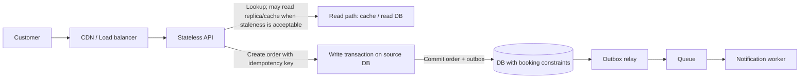
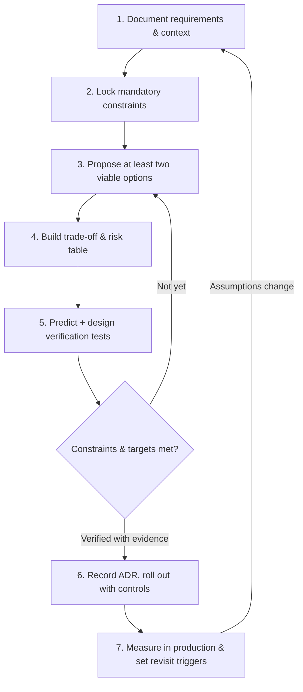

# Trade-Offs Among Reliability, Security, Performance, Cost, and Operations

## 1. Why Is Architecture Design a Trade-Off Problem?

In the **CLOUD_ARCHITECTURE** module, the goal is moving from business requirements to networking, compute, data, and deployment choices in the cloud. A system can be very fast yet expensive and hard to operate; very cheap yet slow to recover; or heavily fortified yet difficult for users to complete transactions. You cannot maximize every attribute simultaneously simply by adding more services.

An **architecture trade-off** is a decision to accept a cost, risk, or constraint to achieve another objective **within defined requirements**. A good trade-off has rationale, metrics, an accountable owner, and a verification method. Trade-offs never mean waiving mandatory requirements such as protecting personal data or preventing double-booking.

After this lesson, you will be able to:

- Distinguish **mandatory requirements (constraints/guardrails)** from **optimization goals** and explain why they cannot be scored the same way.
- Read interactions among **reliability, security, performance, cost, and operational excellence** on a cloud diagram.
- Compare networking, compute, data, and deployment options using explicit criteria rather than inferring solely from technology names.
- Record decisions as an **Architecture Decision Record (ADR)** stating assumptions, consequences, tests, and revisit triggers.
- Apply **Well-Architected** thinking to uncover residual risks after choosing an option.

## 2. Five Perspectives and How to Measure Them

| Perspective | Design Question | Example Metrics | Common Misconception |
|---|---|---|---|
| **Reliability** | When a component fails, do critical functions keep working and recover on target? | SLI/SLO, error rate, RTO, RPO, data durability, successful failovers | Having many replicas means data cannot be lost |
| **Security** | Who can access which data and actions; how are assets protected? | Authorization test results, IAM scope, patch lead time, leaked secrets, audit coverage | Having TLS/WAF means the application is secure |
| **Performance Efficiency** | Does the system respond on time as load changes? | p50/p95/p99 latency, throughput, saturation, cache hit ratio, DB wait time | Adding more servers always makes the API faster |
| **Cost Optimization** | Does delivered value match full lifecycle cost? | Total monthly cost, cost per transaction, resource utilization, egress | Picking the lowest bill configuration is always optimal |
| **Operational Excellence** | Can the team deploy, observe, handle incidents, and make changes safely? | Deployment lead time, change failure rate, MTTR, actionable alerts, tested restore time | Using managed services means no operations needed |

Measurements require **scope**: which APIs, which user cohorts, which time window, under what load growth, and which incidents fall within recovery targets. Measure **end-to-end** from user experience while keeping per-layer metrics to diagnose root causes.

### 2.1. Foundational Concepts

- **SLI (Service Level Indicator):** an actual metric, e.g., the ratio of valid booking requests handled successfully.
- **SLO (Service Level Objective):** an internal target for an SLI, e.g., 99.9% over a month.
- **Error budget:** the permissible deviation from an SLO within the measurement period. For a **time-based** 99.9% SLO over exactly 30 days, allowed unavailability equals up to **43.2 minutes**; if the SLO is request-ratio-based, compute from request counts rather than converting directly to minutes.
- **RTO (Recovery Time Objective):** the target maximum time to recover after a defined incident type.
- **RPO (Recovery Point Objective):** the maximum acceptable age of recovered data, expressed in time; not the system repair duration.
- **p95 latency:** 95% of measurements lie at or below this value within the defined sample; also inspect p99 and failed/timed-out requests.

RTO/RPO are **targets**, not guarantees simply because a system is labeled "HA." Actual restore/failover test results reveal whether the design meets them.

## 3. Set Context Before Choosing Technology

Consider a hypothetical equipment rental system: customers search for available equipment by the hour, create rental orders, and receive confirmation emails. The application serves one primary geographic market, has a small operations team, and requires controlled budgeting.

| ID | Hypothetical Requirement | Category | Architectural Consequence to Evaluate |
|---|---|---|---|
| G1 | One piece of equipment cannot be booked by two customers in the same time slot | Mandatory business invariant | Transaction/constraint or hold mechanism proven safe under concurrency |
| G2 | Only authorized users can view/edit orders; contact data must be protected | Mandatory security | Authentication, object-level authorization, encryption, secrets management, auditing |
| S1 | 99.9% of core API requests meet success criteria over a month | Reliability target | Eliminate single points of failure, track SLIs, failover, and error budgets |
| S2 | Upon losing one Availability Zone (AZ), RTO ≤ 60 minutes, RPO ≤ 15 minutes | Recovery target | Define incident scope, DB HA, backup/restore, drills |
| P1 | Search p95 ≤ 400 ms; order creation p95 ≤ 1.5 seconds | Performance target | Measure end-to-end latency, DB queries, and saturation under high load |
| P2 | Assumed peak load of 200 HTTP requests/second, 15% writes | Sizing assumption | Load test matching read/write mix; test contention on the same slot |
| C1 | Cost must stay within the budget approved by the product owner | Quantitative cost bound | Account for baseline, load-driven, egress, backup, observability, and staffing costs |
| O1 | A small team must be able to deploy, handle incidents, and recover | Operational constraint | IaC, appropriate managed services, dashboards, runbooks, drills |

**Note:** all figures are **hypothetical lesson assumptions**, not benchmarks or guaranteed outcomes. In particular, "appropriate budget" must be replaced with an explicit monetary figure and currency before approving an architecture.

Sensible decision sequence:

1. Treat **G1/G2** as non-negotiable constraints. Options lacking controls for them must be fixed or eliminated.
2. Compare options capable of meeting **S1/S2/P1** using test evidence; never pass an option on diagrams alone.
3. Among remaining options, select the **C1/O1** balance fitting operational capability and growth plans.
4. Record unverified assumptions and set triggers to revisit when load, regulations, or team capacity change.

## 4. Why Do the Five Goals Influence Each Other?

Each design decision affects multiple goals simultaneously. The table below shows **common tendencies**, not invariant rules:

| Decision | Primary Benefit | Costs or Risks That May Rise | How to Mitigate Side Effects |
|---|---|---|---|
| Add API replicas across multiple AZs | Survives instance/AZ loss, increases serving capacity | Replica/LB costs; DB connection counts and rollout complexity | Stateless APIs, connection pools, metric-driven autoscaling, health checks |
| Use managed DB with HA | Supported failover/backups, less infrastructure toil | Baseline cost, config limits, vendor lock-in; failover still interrupts briefly | Test failover, safe retries, maintain runbooks and test restores |
| Cache search data | Lower latency and DB query load | Stale data, cache/invalidation cost, risk of leaking personal data | Appropriate TTLs, data classification, scoped cache keys, enforce checks on writes |
| Send email asynchronously via queue | Bookings do not wait on the email provider | Delayed/duplicate events, backlog, retry and observability complexity | Transactional outbox, idempotent consumers, DLQ, alerts |
| Strong encryption, authorization, auditing | Protects data and supports traceability | Key/secret management overhead, logging and testing costs | Managed services, safe public-key caching, minimal necessary logging, automated permission tests |
| Split into multiple microservices | Independent deployment/scaling for certain domains | More network failure points, distributed tracing, data coordination, and on-call load | Split only with clear business boundaries and measurable gains; keep contracts crisp |
| Deploy multi-region | Improves region-fault tolerance and user proximity | Data replication, write conflicts, egress, steep cost and ops increases | Define primary/secondary roles, write locality, and rehearsed DR playbooks |

### 4.1. Reliability vs. Cost

Running an API on a single instance is cheap and simple, but losing that instance or AZ drops service availability during recovery. Placing two replicas across two AZs with a failover-capable DB typically cuts single-AZ outage risk, in exchange for higher baseline infrastructure cost and failure-coordination workflows.

**Backups** and **HA** solve different failure classes. Replication can mirror application-level accidental deletes; scheduled backups with tested restores allow rolling back before the mistake. Adding replicas without backups does not prove RPO/RTO. Measure recovery time, data loss window, and whether requests arriving mid-failover are handled safely.

### 4.2. Security vs. Performance

Token verification, per-order authorization checks, TLS, and auditing carry processing overhead. However, **skipping authorization checks to reduce latency is an invalid option** because it violates G2. The proper optimization is keeping protections while tuning execution: verify tokens locally using properly fetched and refreshed public keys, use connection pooling, enforce resource-level authorization via efficient queries, and trim redundant logging.

For example, caching **public catalog** listings can make sense; caching **private order details** under a shared URL key without identity/permission scoping risks leaking data. Caching is a **data-model and authorization** decision, not merely a speed tweak.

### 4.3. Performance vs. Consistency

A lookup page can show "available" from a slightly stale cache or read replica. However, **confirming a booking** must be finalized by a consistent write mechanism enforcing G1, such as transactions and unique constraints on discrete slots. Never rely on lookup results to guarantee a slot is still free.

This lets you optimize the **read** path while preserving correctness on the **write** path:



This logical diagram does not yet depict AZ counts or network ACLs. When using read replicas, define acceptable staleness policies; booking mutations must never trust a replica as the final decision source. Asynchronous notification delivery does not alter the order commit outcome.

### 4.4. Cost vs. Operations

Self-hosting a DB may lower certain service line items, yet introduces responsibility for security patching, backup verification, failover, I/O monitoring, version upgrades, on-call support, and recovery. For a small team, a managed service can yield a better total cost of ownership; for large organizations with specialized requirements, self-managed options may merit consideration.

Cost comparisons must include **engineering time**, not just the cloud invoice. Conversely, never assume a managed service automatically satisfies SLOs; service users remain responsible for configuration, access control, query patterns, backup policies, and application retry logic.

### 4.5. Reliability vs. Operations

Adding regions, services, or datastore types can mitigate certain failure modes while multiplying network paths, configurations, and failure modes. A **simple, well-measured, well-drilled** system is sometimes more reliable than a complex distributed topology whose failure modes the team does not yet understand how to operate.

For example, active-active multi-region accepts writes in multiple locations yet requires resolving concurrent writes to the same slot, sync lag, and data contention. When invariant G1 matters, it is never "just turn on multi-region"; write authority and conflict resolution must be explicitly designed.

## 5. Comparing Three Deployment Options

Suppose the team is selecting an architecture for the product's early phase:

- **A — Simple Single-AZ:** API and DB in one AZ, backups configured, basic deployment, no automated application/DB failover to another AZ.
- **B — Single-Region HA:** Stateless API across at least two AZs behind a load balancer, managed relational DB with HA, object storage/CDN, queue + outbox for notifications, IaC, and monitoring.
- **C — Active Multi-Region:** Application deployed across multiple regions with a dedicated write/data distribution strategy, cross-region routing, and conflict/DR procedures.

| Criterion | A — Single-AZ | B — Multi-AZ | C — Multi-Region |
|---|---|---|---|
| Single-AZ fault tolerance | Depends on restore/recovery time | Can continue or fail over if properly configured | Tolerates AZ faults and certain region faults if data paths are properly designed |
| Data recovery | Depends on backup schedule and restore | Has HA, yet still requires backups/restore | Must design cross-region replication, independent backups, and consistency |
| Scalability | May suffice for small load, resource-bound | Horizontal API scaling; DB may still bottleneck | Scales per region, but write routing/coordination is complex |
| Security | Can be strong if properly configured | Can be strong if properly configured | Must meet the same bar; broader permission and data footprint |
| Baseline cost | Typically lowest | Typically higher than A | Significantly higher due to infrastructure and data transfer |
| Operations | Fewer components; manual recovery can be hard | Requires failover, autoscaling, rollback runbooks | Requires regional drills, conflict handling, cross-region observability |
| Missing evidence | Does restore meet S2? | Does failover meet S1/S2 and p95? | Does it uphold G1 under partition/failover and fit the budget? |

You cannot conclude A is always inferior or C is always better. If an internal system tolerates long downtime, A may be sensible. If surviving a single-AZ failure with a small team is required, B is usually the **first candidate to validate**. If genuine multi-hour region outage tolerance or multi-country data residency applies, C merits deep investigation. **The descriptions above are not benchmark results.**

### 5.1. Scoring to Make Decisions Transparent

The scores below are **illustrative examples only** to guide discussion, not ratings of any specific cloud product. Each criterion has a weight; on a 1–5 scale, higher means better fit for the current context.

| Criterion | Weight | A | B | C |
|---|---:|---:|---:|---:|
| Reliability | 30% | 2 | 4 | 5 |
| Security after applying the same baseline | 20% | 4 | 4 | 4 |
| Performance under assumed load | 15% | 3 | 4 | 4 |
| Cost fitting budget | 20% | 5 | 3 | 1 |
| Current team operability | 15% | 4 | 4 | 1 |
| **Weighted Score** | **100%** | **3.45/5** | **3.80/5** | **3.25/5** |

Calculation for B:

```text
Score B = 0.30 × 4 + 0.20 × 4 + 0.15 × 4
        + 0.20 × 3 + 0.15 × 4
        = 3.80 / 5
```

Never use weighted totals to "buy permission" to violate G1/G2. If an option fails a **mandatory threshold** or lacks proof for a required target, it must be fixed or disqualified **before** scoring. Scores from 1 to 5 are subjective, so document data sources, run weight sensitivity checks, and disclose uncertainty. For instance, if evidence shows A fails the SLO, A is disqualified despite its high cost score.

### 5.2. Sensitivity Check

Test changing **weights** when business goals shift:

- If recovery time after losing a region becomes a hard requirement, C or a new DR option must be examined; B does not satisfy that requirement.
- If the operations team consists of only a few engineers on a tight fixed budget, C's on-call burden and complexity may be unacceptable.
- If measurements show the DB is the true bottleneck, adding API replicas will not necessarily lower p95; re-evaluate queries, locking, connection pools, or partitioning.

The best outcome of a scorecard is **a hypothesis to test**, not the final answer.

## 6. Designing by Measured Budgets Rather Than Gut Feel

### 6.1. Latency Budget

Suppose client-side lookup p95 must not exceed 400 ms. The team can use a **time budget for a typical request** to spot which segment consumes the most time:

| Path Segment | Expected Time in an Illustrative Request |
|---|---:|
| Client/edge/LB network | 80 ms |
| API processing and authorization checks | 70 ms |
| Connection wait + DB query | 150 ms |
| Serialization / returning response to client | 50 ms |
| **Headroom buffer** | **50 ms** |
| **Total allocated** | **400 ms** |

This is a **design allocation for a single request**, not a claim that summing individual **per-hop p95s** equals end-to-end p95. Percentiles do not add linearly in general. Measure distributed traces and end-to-end p95 under representative load to confirm P1. If DB p95 rises due to lock waits, shaving 10 ms off serialization will not fix the root cause.

### 6.2. Availability and Risk Budget

For a 99.9% monthly SLO, clearly define which requests are valid, what counts as success, and how dependency errors are counted. A delayed email may not be a failure of the **order creation API** once the transaction has committed, yet it can still breach the **notification service's** own SLO.

Managing an **error budget** guides when to prioritize new features versus reliability investments. When errors exceed budget, the team can slow release cadence, focus on recurring root causes, and add failover/rollback tests. This is risk management anchored in real objectives, not an absolute ban on deployments.

### 6.3. Cost Budget

Sum total cost across categories to avoid sub-optimizing individual hosts:

```text
Total period cost ≈ compute + database/HA + storage/backup
                  + network/egress/CDN + queue + observability
                  + third-party services + related operational cost

Cost per successful order
    = allocated booking system cost / successful orders in the period
```

Cost-per-order metrics require consistent allocation rules across periods; they can be noisy at low order volumes or when infrastructure serves multiple functions. Cloud invoices omit engineering hours spent on incidents, backup checks, or migrations, so include operational metrics in decisions.

## 7. Sample Decision: Synchronous or Asynchronous Email?

Business requirement: **successfully placed orders must be durably stored and customers must receive notifications**, yet email is an external dependency that can be slow or unreachable.

**Option 1 — call email directly inside the request:** simple to write, fewer components. However, API latency lengthens and fails easily when the email provider errors out. Sending before DB commit risks notifying customers of rolled-back orders; sending after commit right before an API crash leaves the order saved with no email sent.

**Option 2 — DB transaction + outbox + queue + worker:** write the order and `booking.created` event in the same transaction; respond after commit; relay pushes the event to the queue; worker retries email delivery when needed. Decouples API response latency from the email service, in exchange for monitoring outbox lag, queue backlogs, retries, dead-letter queues, and delivery status.

```mermaid
sequenceDiagram
    autonumber
    actor C as Customer
    participant API as Booking API
    participant DB as Transactional DB
    participant R as Outbox relay
    participant Q as Queue
    participant W as Worker
    participant E as Email provider
    C->>API: POST /bookings + Idempotency-Key
    API->>DB: BEGIN; write booking and outbox; COMMIT
    alt Commit succeeded
        DB-->>API: booking_id
        API-->>C: 201 Created
        R->>DB: Read committed outbox
        R->>Q: Publish booking.created
        Q-->>W: Deliver event (may redeliver)
        W->>W: Check idempotency/event_id
        W->>E: Send email
        E-->>W: Delivery status
        W-->>Q: Ack after successful handling
    else Transaction rejected
        DB-->>API: Conflict/rollback
        API-->>C: 409 Conflict or appropriate error
    end
```

This decision carries **consequences that must be accepted and controlled**:

1. **Business consistency:** emit events only for committed orders; order creation must prevent double-booking via transactions/constraints, never relying solely on a lookup cache.
2. **Duplicates:** relays or queues can publish/deliver duplicates after timeouts; workers handle processing idempotently by `event_id` and persist state. For real email, **exactly-once** delivery cannot be assumed unless the provider supports deduplication.
3. **Notification latency:** requires its own SLO, e.g., "95% of notifications handed to the provider within X minutes" where X is business-chosen; inbox delivery time cannot be promised outright.
4. **Operations:** track oldest message age, retry counts, DLQ, unpublished outbox count, delivery success rate, and controlled replay procedures.
5. **Cost:** incurs queue, worker, logging, and maintenance effort; weighed against lost-order/wait-time risk and manual remediation cost.

Option 2 fits better when sending email is not a mandatory precondition to acknowledge **order created**. If the business requires email delivery before confirming an order, redefine success criteria and redesign the workflow rather than attributing impossible guarantees to a queue.

## 8. A Verifiable Architecture Decision Workflow



### 8.1. Steps 1–2: Define Boundary Conditions

Explicitly write down critical functions, data scope, user roles, deployment regions, normal/peak load, retention periods, budget, team skill level, and legal limits. Flag **non-negotiable requirements** such as no double-booking, authorization checks, or protecting payment info if applicable.

### 8.2. Steps 3–4: Compare Against Identical Criteria

Do not compare "Kubernetes" against "good security" because one is a tool and the other is a property. Compare **functionally equivalent deployment models** on agreed criteria: SLOs, p95, blast radius, cost, IAM scope, rollback difficulty, and number of on-call components.

Include the simplest viable **baseline option** that meets requirements. Never pick microservices, multi-region, or self-managed DBs merely because those words sound "enterprise."

### 8.3. Step 5: Verify with Representative Tests

| Hypothesis | Test | Evaluation Data |
|---|---|---|
| B keeps serving upon losing an API instance/AZ | Fault injection in test environment; terminate a zone/instance per scenario | Failed requests, p95, recovery time, outcome of in-flight transactions |
| DB prevents double-booking | Run many concurrent requests for the same `item_id + slot_id` | Exactly one order claims the slot; remaining errors are explainable |
| API meets p95 at peak load | Load test at 200 requests/second with realistic read/write mix and data | End-to-end p95/p99, CPU/memory, DB lock waits, saturation, and errors |
| Queue does not lose notifications when workers fail | Stop workers, let queue build backlog, restart and replay | Lag, DLQ, processed event count, duplicate protection |
| Backups restore within RPO/RTO | Restore drill into an isolated environment | Duration, latest data timestamp, integrity, post-restore permissions |
| Authorization prevents viewing others' orders | Cross-user/cross-role access tests and log checks | Appropriate 403/404, no info leakage, audit trail |

Mark "PASS" only when tests have explicit preconditions, measured outputs, and acceptance thresholds. A diagram packed with standby zone icons **is not proof of compliant failover**.

### 8.4. Step 6: Record the ADR

A concise ADR can follow this template:

```markdown
# ADR-007: Process notifications after booking
Status: Accepted (under current assumptions)

## Context
Booking transactions must be durable; email provider may fail or slow down.
Target p95 POST /bookings <= 1.5s; never email for rolled-back orders.

## Options
A. Call email synchronously inside the API.
B. Transactional outbox + queue + worker.

## Decision
Choose B so the API does not depend on provider latency and events
are created inside the same transaction as the booking.

## Consequences
Accept delayed notifications, at-least-once processing, and added ops scope.
Requires idempotency, backoff retries, DLQ, metrics, and replay runbooks.

## Evidence to Collect
Load test p95, post-commit API crash test, provider outage test,
event processing time, and actual operational cost.

## When to Revisit
When event volume, notification SLOs, or legal requirements change.
```

### 8.5. Step 7: Measure, Operate, Revisit

Put dashboards, alerts, runbooks, and owners in place before going to production. When traffic grows, multi-region needs emerge, or cost/transaction crosses thresholds, reopen the ADR with fresh data. **Today's sound decision may need revision later**, but never change it solely because a new technology appeared.

## 9. Connecting to Well-Architected Thinking

Well-Architected reviews encourage comprehensive questioning. For instance, the **AWS Well-Architected Framework** defines six pillars: **Operational Excellence, Security, Reliability, Performance Efficiency, Cost Optimization, and Sustainability**. This lesson focuses on the five perspectives in the topic; sustainability should also be included when evaluating the whole system.

| Pillar / Perspective | Questions Tied to Option B | Required Evidence |
|---|---|---|
| Operations | When DB fails over or outbox backs up, who knows and what do they do? | Alerts, traces, runbooks, on-call, incident drills |
| Security | Who can access the DB, secrets, object storage, and customer data? | IAM, network policies, authorization tests, audits, encryption |
| Reliability | Does losing an AZ create duplicate orders or lose data? | Concurrency tests, failover, restores, measured RTO/RPO |
| Performance | Does end-to-end p95 still hold during cache misses or DB lock contention? | Load tests, traces, slow queries, capacity trends |
| Cost | Do HA/backup/log/egress costs align with order volume and budget? | Tagged billing, cost per booking, forecasts |
| Sustainability | Are idle compute, data copies, and long-retained logs truly necessary? | Utilization, lifecycle policies, resource efficiency |

Evaluation frameworks do not replace concrete architecture. They force teams to inspect **evidence and residual trade-offs**. A decision may improve reliability while raising cost, or cut cost while creating steep operational risk; what matters is surfacing and controlling it.

## 10. Practice Exercise: Choosing Options Under Changing Conditions

**Scenario A — Budget cut in half.** Operations proposes dropping DB HA and frequent backups. Classify which requirements are threatened, propose RTO/RPO measurements, and suggest lower-risk cost reductions (such as optimizing data, instances, or tiered logging).

**Scenario B — Cache everything.** After enabling CDN caching for all `GET /bookings/{id}` responses, user A sees user B's order. Explain which security boundary was violated, how to fix it, and why a higher cache hit ratio cannot compensate for this defect.

**Scenario C — Adding more APIs still runs slow.** At peak load, booking p95 jumps from 500 ms to 3 seconds while API CPU sits at 30% and DB lock waits rise. Identify at least three metrics to inspect, one root-cause hypothesis, and a confirming test. Should you keep doubling API replicas?

**Scenario D — Region loss.** Leadership mandates 30-minute RTO / 5-minute RPO for full-region outages. Explain why the current multi-AZ setup is insufficient; detail decisions on cross-region backup/replication, routing, data security, writer strategy, and drills. Assess new cost and complexity.

**Scenario E — Email provider offline for 30 minutes.** Orders must continue recording; describe outbox/queue state, retry counts, DLQ, idempotency, and metrics showing the notification service missed its target.

To self-assess your answers, use this table:

| Related Requirement | Proposed Option | Benefits | Accepted Risks | Test / Metric | Revisit Trigger |
|---|---|---|---|---|---|
| Example: no double-booking | Transaction + unique slot constraint | Business-correct under contention | May return 409 when slot is already held | 100 concurrent requests for same slot, claimed orders = 1 | Switching from discrete slots to arbitrary time ranges |

**Core answer guide:** scenarios A/D center on redefining RTO/RPO scope and budget; B is an authorization and cache-key bug; C requires analyzing DB/locking instead of blindly scaling compute; E evaluates asynchronous reliability decoupled from order commits. Every answer must state **what will be measured to prove it is right**.

## 11. Checklist When Defending an Architecture Decision

Before a review session, ensure the team can answer:

1. Which concrete business requirement makes this decision necessary? Which metric defines success?
2. Which requirements are **non-negotiable** (data, security, correctness, legal)?
3. Have at least two practical options been compared, including a suitably simple baseline?
4. How does the decision impact all five perspectives: reliability, security, performance, cost, and operations?
5. If a dependency times out, requests retry, an AZ drops, or a transaction partially succeeds, what state is the data left in?
6. Are tests, dashboards, runbooks, projected costs, and an accountable owner in place for residual risks?
7. Which assumptions might be wrong, and when load, budgets, or regulations shift, when should the ADR be reopened?

A reliable cloud architecture is not the diagram with the most services. It is a set of decisions with **clear constraints, transparent trade-offs, and verifiable evidence**, safe enough to operate under specific business conditions.
