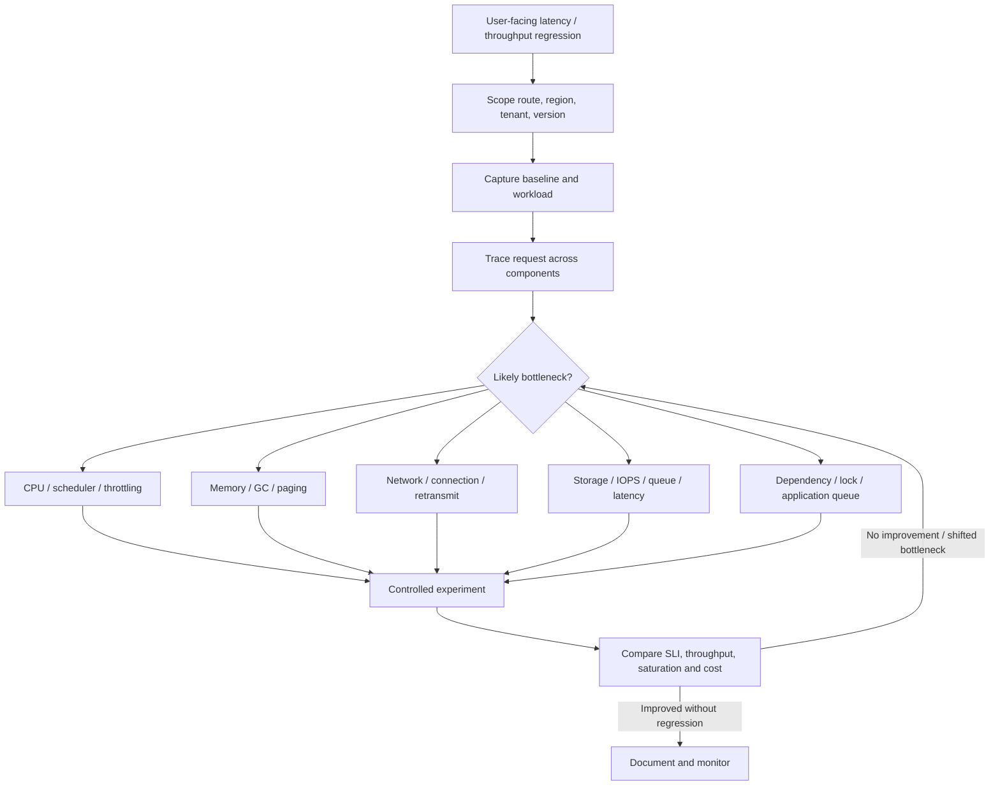
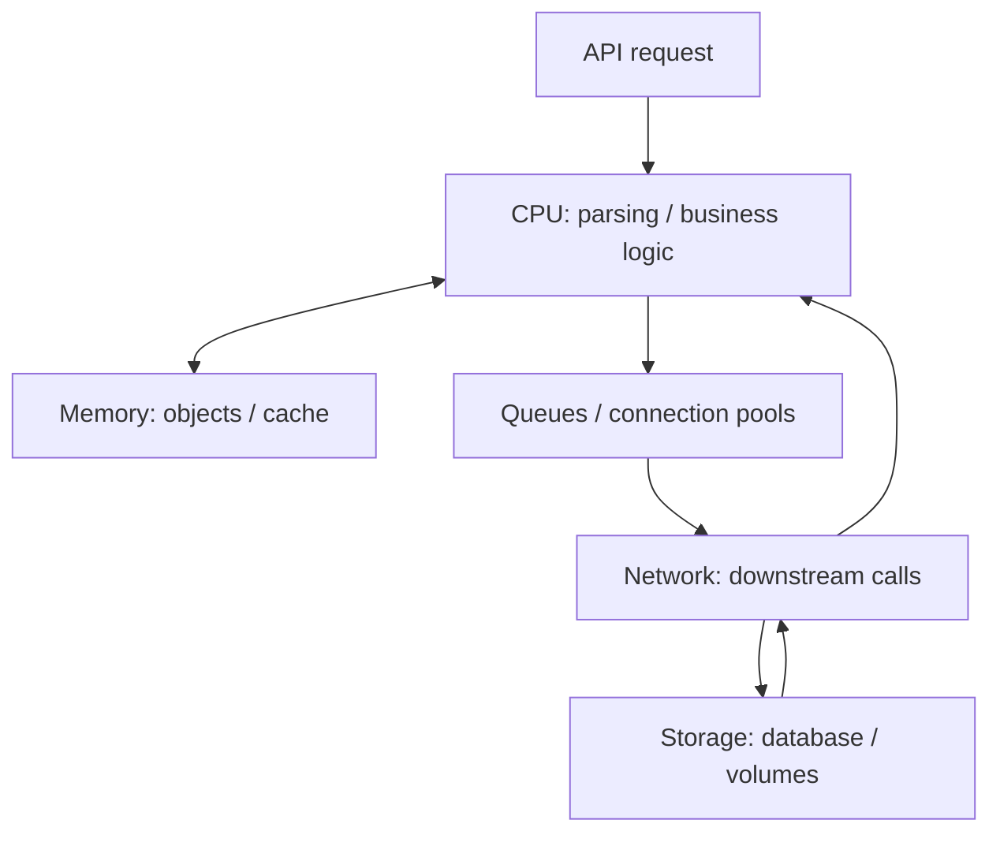

# Measuring CPU, Memory, Network, and Storage Bottlenecks

## 1. Why Measure Bottlenecks Based on Evidence?

A slow API does not automatically mean CPU is lacking. It may be waiting on a database, constrained by a connection pool, performing random disk reads, retransmitting network packets, allocating excessive memory, or getting throttled by a cloud platform quota. Adding replicas in such cases can raise costs without lowering latency; it can even overload the database or network further.

A **performance bottleneck** is the resource or processing step that limits the throughput or latency of a workload under a given load condition. Bottlenecks can shift from CPU to database, from network to storage, or appear simultaneously across multiple layers. Performance optimization therefore requires a cycle of measurement, hypothesis, experimentation, and verification rather than relying on a single metric.

This lesson belongs to the **Performance** chapter of the **CLOUD_ARCHITECTURE** module. The module teaches designing cloud application architectures from business requirements through networking, compute, data, and deployment models—balancing reliability, security, scalability, cost, and operations under Well-Architected principles. Measuring bottlenecks helps pinpoint the right place to optimize, scale, or adjust the architecture.

After this lesson, you will be able to:

- Start from user-facing SLIs, latency, and throughput to scope slowness.
- Distinguish between utilization, saturation, queueing, and throttling.
- Measure CPU, memory, network, and storage using appropriate metrics.
- Use profiling, tracing, load tests, and benchmarks to test hypotheses.
- Recognize bottleneck signals across compute, containers, databases, and cloud networks.
- Decide when to optimize code, add capacity, adjust concurrency, or reshape architecture.
- Evaluate performance alongside reliability and cost under Well-Architected.

## 2. Start from the Workload and User Experience

Before inspecting CPU or IOPS, identify which workload is degraded and under what load conditions the issue appears.

### 2.1. Characterizing the Workload

Record:

- The affected user journey or slow API.
- Workload type: request/response, batch, stream, database query, background job.
- Traffic rate, concurrency, payload sizes, and temporal distribution.
- Number of tenants, regions, routes, and operation types.
- Target latency, required throughput, and error budget.
- Recent changes around the onset: releases, configs, data volume, traffic, regions, or dependencies.

Never collapse all routes into a single average latency. A low-traffic, very slow endpoint can easily be masked by a fast, high-traffic endpoint.

### 2.2. Output Metrics

| Metric | Meaning | Question |
|---|---|---|
| Throughput | Work completed per unit time | How many requests/transactions per second does the system finish? |
| Latency | Time to complete an operation | How long does the user wait? |
| Error rate | Fraction of failed operations | Does rising load increase timeouts or errors? |
| Concurrency | Operations active simultaneously | Are too many requests competing for workers/connections? |
| Queue depth/age | Pending work and wait duration | Are producers outpacing consumers? |
| Saturation | Proximity to resource limits | Which resource is running out of headroom? |

Throughput must count completed work, not just incoming requests. A system might receive 10,000 requests/second yet complete only 4,000 requests/second while the rest queue up or fail.

### 2.3. Percentiles Matter More Than Averages in Many Workloads

Average latency can hide tail latency. For example, 99 requests take 50 ms and 1 request takes 5 seconds; the average is roughly 99.5 ms, yet a subset of users still suffers severe delay.

- p50 describes the median.
- p90/p95 helps track the slower tier of requests.
- p99/p99.9 is useful for systems with strict tail latency goals, provided sample sizes are large enough.

Percentiles cannot be simply added or averaged across instances or regions. To aggregate them, merge histogram buckets or compute over the combined sample set; never average per-pod p99 values.

## 3. Bottleneck Investigation Methodology

This workflow applies to APIs, workers, databases, or batch workloads.

1. **Confirm symptoms:** route, tenant, region, version, timestamp, latency percentiles, throughput, and error rate.
2. **Pick a representative workload:** hold payloads, dataset, concurrency, and environment constant when comparing.
3. **Establish a baseline:** measure normal state and target load.
4. **Form hypotheses:** CPU-bound, memory pressure, network-bound, storage-bound, or dependency/lock-bound.
5. **Measure across layers:** application traces, processes/containers, hosts, network, storage, and managed services.
6. **Locate saturation/queueing:** which resource hits its limit first when throughput plateaus or latency spikes?
7. **Test one change:** modify a single measurable variable; avoid changing CPU, memory, pools, and retries simultaneously.
8. **Re-measure under identical conditions:** check p95/p99, completed throughput, errors, and cost.
9. **Verify no shifted bottleneck:** watch downstream tiers and dependencies.
10. **Record the decision:** results, limits, rollback plan, and ongoing metrics.

### 3.1. Performance Investigation Flow



### 3.2. Using Distributed Tracing

Traces show requests moving through gateways, services, caches, databases, and external providers. Look for spans dominating the critical path:

- A long database span can point to a slow query, locks, connection wait, or storage.
- Many short repeated spans can indicate N+1 queries or chatty services.
- Gaps without spans can indicate queueing in the application, scheduler, or client.
- Retries produce multiple attempts and long overall duration in traces.

Design trace sampling to retain valuable error and slow-request samples. Traces rarely capture every request; correlate them with aggregate metrics and logs.

## 4. Distinguishing Utilization, Saturation, and Throttling

Three concepts are frequently confused:

- **Utilization:** the proportion of a resource actively in use, e.g., 70% CPU.
- **Saturation:** the amount of work waiting because a resource cannot respond immediately, e.g., growing run queues, I/O queues, or connection waits.
- **Throttling:** active resource caps enforced by a platform or quota, e.g., container CPU quotas or network rate limits.

Low CPU utilization does not prove CPU is not a bottleneck if threads are blocked on locks or the process is throttled by periodic quotas. Conversely, high CPU can be healthy if throughput scales linearly and latency stays within target.

| Symptom | Possible interpretation | Next check |
|---|---|---|
| High CPU, high run queue, rising latency | CPU-bound or too many runnable threads | Profile CPU, scheduler, concurrency |
| Low CPU, many pending requests | Waiting on I/O, locks, network, or connection pool | Traces, wait states, socket/pool metrics |
| Container CPU hits quota while host is idle | CPU throttling | Container quotas and throttled time |
| Memory climbs steadily, restarts/OOM | Leak or working set exceeds limit | Heap profiles, allocations, OOM events |
| High disk utilization and rising I/O latency | Storage-bound | Queue depth, IOPS, throughput, block size |
| Low NIC throughput with high retransmits | Network loss/congestion or MTU/path issues | Interface errors, TCP metrics, flow paths |

## 5. Measuring CPU Bottlenecks

CPUs handle computation, encryption, compression, serialization, parsing, query planning, and scheduling. A CPU-bound workload typically scales throughput with core count up to a point, then hits limits from contention, memory bandwidth, or serial sections.

### 5.1. CPU Metrics

| Metric | Meaning | How to use |
|---|---|---|
| User CPU time | CPU running application code | Measure process compute cost |
| System CPU time | Kernel/system calls | Spot I/O, networking, context switches |
| CPU utilization | Percentage of CPU busy | Track trends and headroom |
| Run queue/load | Tasks waiting for CPU or runnable | Detect contention |
| Context switches | Thread/process switching | Excessive rates add overhead |
| CPU throttled time | Time spent capped by quota | Crucial for containers |
| Per-core utilization | Usage per individual core | Spot a hot single thread/core |

Load average is an OS load indicator, not directly equivalent to CPU percentage; its exact calculation and meaning depend on the platform. Read it alongside core count, runnable tasks, and I/O wait.

### 5.2. CPU-Bound and Serial Bottlenecks

If a large fraction of a workload runs on a single thread, scaling from 4 to 16 cores may yield little improvement. Amdahl's Law describes the speedup limit when part of the work cannot run in parallel:

\[
Speedup(N)=\frac{1}{(1-P)+\frac{P}{N}}
\]

Where P is the parallelizable fraction of the workload and N is the number of useful processors/cores. If only 80% of the workload can be parallelized, adding infinite cores remains bounded by the 20% serial portion.

### 5.3. CPU Profiling

CPU profilers pinpoint functions consuming CPU:

- Sampling profilers capture stack samples periodically, usually suitable for production when configured with low overhead.
- Instrumentation profilers record detailed call counts/timings, but can add noticeable overhead.
- Flame graphs visualize stacks and sample shares; bar width reflects sample proportion, not necessarily exact wall-clock time.

When reading profiles, look for hot paths, CPU-heavy allocations/serialization, regexes, compression, encryption, lock contention, and functions invoked excessively.

### 5.4. Checking CPU in Containers

Containers can hit CPU quota limits even when the host has idle CPU. Check:

- CPU requests/limits or quotas.
- Throttled periods and throttled seconds.
- Pod/container restarts and scheduling.
- Worker/thread counts relative to effective quota.
- CPU steal or noisy neighbors on shared infrastructure if metrics exist.

Do not blindly raise thread pools: too many threads inside a tight CPU quota increase context switching and queueing.

### 5.5. Remediating CPU-Bound Bottlenecks

- Optimize algorithms and data structures.
- Cut unnecessary serialization/deserialization, compression, or conversions.
- Cache computation results when semantics allow.
- Batch operations to reduce per-item overhead.
- Parallelize independent sections while checking contention and ordering.
- Increase CPU requests/limits or choose compute-optimized instances once profiling confirms compute scarcity.
- Use queues/backpressure to keep load within processing capacity.

## 6. Measuring Memory Bottlenecks

Memory directly affects concurrent request capacity, cache hit ratios, garbage collection, paging, and process stability. Raising memory limits may postpone OOMs, but will not fix memory leaks or allocation churn.

### 6.1. Quantities to Distinguish

| Quantity | Meaning |
|---|---|
| RSS | Resident physical memory of the process |
| Virtual memory | Address space mapped/reserved by the process |
| Heap used/committed | Heap memory in use and committed to the runtime |
| Working set | Active memory required by the current workload |
| Page cache | OS RAM used to cache file/block contents |
| Swap/page faults | Activity paging memory out to/in from disk |
| Allocation rate | Rate of object/heap allocations |
| GC pause/frequency | Duration and frequency of garbage collection |
| OOM event | Process/container terminated for exceeding limits |

Never arbitrarily add RSS, heap, and page cache together; definitions overlap or vary across runtimes and platforms.

### 6.2. Memory Pressure

Symptoms:

- RSS or working set grows over time and does not drop after traffic subsides.
- Heap occupancy climbs across GC cycles.
- Frequent GC runs, long pauses, or high allocation rates.
- Rising major page faults/swapping alongside rising latency tails.
- Container OOMKilled events or process restarts.
- Increased cache evictions because the working set exceeds RAM.

### 6.3. Memory Leaks and Allocation Churn

A **memory leak** is memory no longer needed that remains referenced, causing the footprint to grow over time. **Allocation churn** is creating and discarding large numbers of objects continuously; total memory may not grow forever, yet GC works heavily.

Use heap dumps/heap profilers, allocation profiles, and object-retention analysis to find:

- Unbounded collections.
- Caches missing TTLs or size bounds.
- Unregistered listeners or callbacks.
- Long-lived request contexts or retained object graphs.
- Large buffers and duplicate copies.
- Excessive per-request object allocations.

When capturing production heap dumps, protect sensitive data because objects can contain tokens, PII, and payloads.

### 6.4. GC and Latency

Stop-the-world GC pauses can create tail latency depending on the runtime and collector. Inspect GC pause distributions, allocation rates, promotion/old-generation occupancy, and concurrent GC CPU. Reduce object allocations or tune heap/collector settings only after profiling reveals the cause.

### 6.5. Memory in Containers

Track memory working set/usage and limits using the platform's exact definition. A container can be OOM-killed well before host memory runs out. Headroom must cover native memory, thread stacks, direct buffers, runtime metadata, and sidecars—not just heap.

### 6.6. Remediating Memory-Bound Bottlenecks

- Fix leaks and bound caches, queues, and buffers.
- Reduce object allocations and data copies.
- Stream large payloads instead of loading everything into memory.
- Apply pagination and bounded batches.
- Tune concurrency to limit how many requests hold working sets simultaneously.
- Increase memory or select memory-optimized instances if the workload legitimately needs a larger footprint.
- Size JVM/runtime heaps with margin inside container memory limits.

## 7. Measuring Network Bottlenecks

Networking can slow requests even when CPU and databases have spare headroom. Bottlenecks can occur in bandwidth, packet rates, latency, packet loss, retransmissions, DNS, TLS handshakes, NAT, load balancers, or connection limits.

### 7.1. Network Metrics

| Metric | Meaning | Abnormal signs |
|---|---|---|
| Bytes/packets in/out | Interface traffic volume | Hitting bandwidth or packet-rate caps |
| RTT/latency | Round-trip time | Rising by region/path or under load |
| Packet loss | Dropped packets | Retransmissions and falling throughput |
| TCP retransmits | Packets resent | Congestion, loss, or path issues |
| Connection count | Open sockets/connections | Ephemeral port or pool exhaustion |
| DNS lookup latency/failures | Name resolution delay | Slow startups/requests, retries |
| TLS handshake latency | Secure session setup | CPU load, extra round trips, or certificate issues |
| NIC errors/drops | Interface errors/drops | Driver, queue, or capacity limits |
| NAT/egress metrics | Address translation and outbound traffic | Port exhaustion or quotas |

### 7.2. Bandwidth-Bound vs. Latency-Bound

**Bandwidth-bound** happens when transferred data volume nears link bandwidth limits. **Latency-bound** happens when round-trip time dominates, especially across many small sequential requests.

For example:

- Sending 20 MB over a 100 Mbps link takes at least ~1.6 seconds at ideal throughput before overhead.
- An API making 15 sequential service calls at 20 ms RTT each spends ~300 ms solely on network round trips.

Batching, parallel requests, compression, or colocating workloads can help; each trades off CPU, memory, and complexity.

### 7.3. Network Paths to Observe

- Client → DNS → CDN/WAF → load balancer → ingress.
- Service → service across VPC/VNet, service mesh, or peering.
- Workload → database/cache/object storage.
- Private subnet → NAT gateway → Internet/external providers.
- Cross-AZ and cross-region traffic.
- VPN, Direct Connect/ExpressRoute, or hybrid networks.

Trace the real packet path rather than just reading subnet diagrams. Security policies, route tables, DNS resolvers, proxies, and service meshes can add hops or alter MTU and connection behavior.

### 7.4. Connection Pools and Port Exhaustion

Too many short-lived connections generate TLS handshake and TCP setup overhead; too many concurrent connections can exhaust file descriptors, ephemeral ports, NAT translations, or database connections. Monitor pool active/idle/waiters, connection creation rates, `TIME_WAIT` sockets, resets, and timeouts.

Use keep-alive and connection pooling appropriately, sizing pools to dependency capacity. Overly large pools can overload databases; overly small pools force requests to wait even when the database has spare capacity.

### 7.5. DNS and TLS

Repeated DNS lookups per request, slow resolvers, or misconfigured cache TTLs inflate latency and failures. TLS handshakes consume CPU and round trips; connection reuse trims this overhead, while session/certificate lifecycles must still be managed securely.

Measure DNS, TCP connect, TLS handshake, time-to-first-byte, and response transfer separately where client/platform telemetry supports it. Never attribute the entire client-to-response duration to "the network" without breaking it down.

### 7.6. Remediating Network-Bound Bottlenecks

- Cut round trips via batching or bounded parallelism.
- Optimize payloads, schemas, and compression while measuring CPU trade-offs.
- Reuse connections, tune pools, and enable keep-alive.
- Co-locate services near data/dependencies or use appropriate regional endpoints.
- Reduce unnecessary cross-AZ/cross-region transfers.
- Verify MTU, routes, NAT capacity, DNS, and load balancer limits.
- Use CDNs/caches for eligible content.
- Enforce backpressure and quotas to prevent connection storms.

## 8. Measuring Storage Bottlenecks

Storage may be block volumes for databases, file systems for workloads, object storage for artifacts/blobs, or managed storage for data platforms. Identify the I/O model and matching metrics.

### 8.1. IOPS, Throughput, Latency, and Queue Depth

- **IOPS:** read/write operations per second.
- **Throughput:** bytes read/written per second.
- **Latency:** time to complete a single I/O operation.
- **Queue depth:** number of pending or in-flight I/Os.
- **Read/write ratio:** balance between reads and writes.
- **Block size:** size of each I/O operation.

A volume can hit its IOPS cap without hitting its throughput cap, or vice versa. Small random I/O and large sequential I/O exhibit very different profiles.

### 8.2. Storage-Bound Indicators

| Indicator | Likely cause |
|---|---|
| IOPS reaches provisioned cap, latency rises | IOPS-bound |
| Throughput reaches cap with large blocks | Bandwidth-bound |
| Sustained increase in queue depth | Storage cannot keep up with demand |
| High read latency, falling cache hits | Random reads, working set growth, or storage path |
| Rising write latency, slow fsync | Durability/flush bottleneck, log device |
| Slow DB queries paired with high disk await | Storage may sit on the critical path |
| Slow object uploads/downloads | Network, request pattern, object size, or service limits |

### 8.3. Analyzing Read/Write Patterns

- Sequential reads/writes usually achieve strong throughput.
- Random reads are often bounded by IOPS and latency.
- Small synchronous writes can suffer flush/fsync overhead.
- Compaction, checkpoints, and background vacuuming can contend for I/O with foreground queries.
- Snapshots/backups can trigger throughput spikes or latency increases on shared resources.

Inspect these alongside database wait events, buffer/cache hits, checkpoints, log flushes, and query execution plans. High disk utilization alone does not prove storage is the root cause; CPU waits or locks may be occurring concurrently.

### 8.4. Object Storage Differs from Block Storage

Object storage is accessed over APIs/networks, governed by request rates, latency, object sizes, multipart uploads, and per-request costs. It does not share the block-device/IOPS semantics of attached volumes. For object storage, measure request latency, throughput, throttling/5xx errors, retries, multipart concurrency, and network transfers.

### 8.5. Remediating Storage-Bound Bottlenecks

- Optimize queries, indexes, and data layouts to reduce I/O.
- Boost cache hit rates or add read replicas where consistency permits.
- Batch and make writes asynchronous when business semantics allow.
- Separate log/transaction I/O from other workloads when appropriate.
- Provision higher IOPS/throughput or pick a suitable volume/instance class.
- Throttle or reschedule competing backups/compaction jobs.
- Partition/shard when data scale and query patterns require it.
- Weigh the cost of faster storage against query/application optimization.

## 9. Queueing and Little's Law

Many bottlenecks surface first as growing queues. Little's Law links the average number of requests in a system (L), throughput (λ), and average time in the system (W):

\[
L=\lambda\times W
\]

For example, a service completes 200 requests/second and each request spends an average of 0.25 seconds in the system:

\[
L=200\times0.25=50\ requests
\]

If latency rises to 1 second while throughput stays at 200 requests/second, average concurrent requests climb to 200. Higher concurrency increases memory, connection, and lock pressure, triggering a feedback loop.

Little's Law applies to stable systems with consistent units and boundaries. When queues grow without bound, the system is unstable; measure arrival rate, service rate, queue age, and drop rate instead.

### 9.1. Arrival Rate vs. Service Rate

- If arrival rate stays below service rate long enough, queues drain.
- If arrival rate sits near service rate, small fluctuations make queues grow sharply.
- If arrival rate exceeds service rate over time, queues grow until hitting bounds or rejecting requests.

The fix is not simply adding workers. Check whether downstream resources can absorb extra concurrency; if the database is the bottleneck, adding workers only pushes more queries onto an overloaded database.

## 10. Interactions Among CPU, Memory, Network, and Storage

Resources are not independent:

- Compression shrinks network bytes at the cost of higher CPU.
- Caching improves hit rates and cuts storage/network load at the cost of memory.
- Raising concurrency increases throughput until CPU, memory, connections, or the database saturates.
- Enlarging batch sizes cuts round trips while raising memory and tail latency.
- Adding replicas increases read capacity while adding replication traffic and storage costs.
- TLS encryption strengthens security while consuming CPU; hardware acceleration changes that trade-off.

### 10.1. Example of a Shifting Bottleneck

An API is initially CPU-bound due to JSON serialization. After optimizing serialization and adding caching, CPU drops, yet network egress climbs as responses are served faster. Next, the NAT gateway or client bandwidth becomes the cap. Looking only at CPU might fool a team into declaring victory while overall throughput stays flat.

### 10.2. Resource Dependency Map



This diagram highlights that a single request can wait across multiple resources. Distributed traces and boundary metrics pinpoint the critical path instead of blaming one host.

## 11. Measurement and Profiling Tools in the Cloud

Specific tools depend on OS, runtime, and cloud provider. Pick tools to match the question while controlling overhead and access permissions.

| Layer | Common tools/sources | Used for |
|---|---|---|
| Application | APM, distributed tracing, runtime profilers | Span latencies, hot paths, allocations, locks |
| Linux host | top/htop, vmstat, pidstat, iostat, sar, perf | CPU, memory, processes, I/O, profiling |
| Network | ss, ip, ethtool, tcpdump, flow logs | Sockets, interfaces, packet paths, loss |
| Container/Kubernetes | cAdvisor, kubelet metrics, cgroup stats, pod events | CPU/memory limits, throttling, OOM/restarts |
| Database | Query plans, wait events, performance insights | Slow queries, locks, I/O, connections |
| Cloud monitoring | Provider metrics, logs, traces, service dashboards | VMs, volumes, load balancers, NAT, managed DBs |
| Load testing | k6, Locust, JMeter, Gatling, wrk (by use case) | Throughput, latency, concurrency, saturation |

Metric names and availability differ across providers and instance types. Confirm units, aggregation periods, dimensions, and sampling before comparing.

### 11.1. Safe Profiling and Observability

- Start with sampling or short profiling windows to bound overhead.
- Enforce least privilege; never expose profiler endpoints publicly.
- Never export heap dumps or traces containing PII or credentials to uncontrolled storage.
- Synchronize clocks and propagate correlation IDs.
- Record profiler versions, runtime flags, sample windows, and workloads.
- Compare baseline and candidate under matching conditions.

### 11.2. Using Cloud Metrics Correctly

Cloud metrics typically have sampling intervals and aggregation windows. A 5-minute average can hide a 20-second spike. Use appropriate resolution during incidents and cross-check against application metrics. Verify whether metrics reflect burst credits, throttling, queueing, or per-device usage.

## 12. Reliable Load Testing and Benchmarking

Benchmarks are useful only when they model realistic workloads and are repeatable.

### 12.1. Building a Workload Model

Document:

- Request mix and payload distribution.
- Arrival rate, concurrency, and ramp-up.
- Read/write ratio and dataset size.
- Warm vs. cold cache states.
- Tenant distribution and hot keys.
- Real vs. mocked dependencies.
- Duration, warm-up period, and steady-state window.
- Expected latency, throughput, and error thresholds.

### 12.2. Open-Loop vs. Closed-Loop Load

- **Closed-loop:** clients send the next request only after the previous one completes. When the server slows down, the client throttles its own arrival rate, potentially hiding overload (coordinated omission).
- **Open-loop:** generates requests at a predetermined schedule regardless of prior responses. Better reflects offered load, though queues and generator capacity must be bounded.

For latency-sensitive services, check whether the load generator itself is bottlenecked and measure both offered rate and completed rate.

### 12.3. Warm-Up and Cache State

Runtime JITs, connection pools, DNS caches, OS page caches, and application caches take time to stabilize. Cold and warm benchmarks answer different questions; state which condition applies. Do not skip warm-up arbitrarily, nor ignore cold behavior if production frequently sees cold starts or scale-outs.

### 12.4. Avoiding Unfair Benchmarks

- Run identical instance classes, runtimes, versions, and configs.
- Use datasets large enough not to fit entirely in cache by accident.
- Hold concurrency, request mix, and duration constant.
- Execute multiple runs and report variance.
- Isolate noisy neighbors or document their effect.
- Verify load generator CPU/network is not the bottleneck.
- Never change multiple variables at once.

### 12.5. Capacity Curves

Measure throughput and latency while stepping up offered load. A system typically exhibits a near-linear throughput region; at saturation, throughput flattens while latency and queues surge. Safe operating points require headroom for bursts and failures rather than running right at the saturation knee.

## 13. Diagnostic Example: A Booking API

Suppose a booking creation API sees p95 jump from 180 ms to 900 ms when traffic doubles. Error rates also rise, while pod CPU sits around 45%.

### 13.1. Signal Analysis

| Signal | Hypothetical observation | Interpretation |
|---|---|---|
| API p95 | 900 ms | Clear user impact |
| Pod CPU | 45% | CPU is unlikely to be the bottleneck |
| DB connection pool wait | Sharply elevated | Requests waiting for connections |
| DB active connections | Hitting pool/database limit | Saturation present |
| DB lock wait | Elevated on slot table | Contention |
| App-DB network RTT | Stable at 2 ms | Network is not the primary cause |
| DB disk latency | Normal | Storage shows no signs of limiting |

Traces reveal requests wait 500 ms for the pool plus another 300 ms on queries and locks. CPU stays low because workers spend most of their time waiting on the DB.

### 13.2. Hypotheses and Experiments

1. Verify the connection pool is not leaking connections and transactions are not held open unnecessarily.
2. Inspect query plans and indexes on tenant/slot/time columns.
3. Shrink transaction scope; avoid calling external services inside transactions.
4. Check lock ordering and transaction isolation levels.
5. Retest under stepped concurrency while watching pool wait and lock wait.
6. Adjust pool size only after evaluating database capacity and lock contention.

Enlarging the pool can allow more concurrent queries and push the DB into overload. Fixing queries/indexes, shortening transactions, or queueing writes is often better than simply opening more connections.

### 13.3. Post-Optimization Verification

Re-measure with the exact same request mix, dataset, and offered load. Success requires higher completed throughput, lower p95/p99, non-increasing error rates, preserved database headroom, and no regression in cost per booking.

## 14. Example: Diagnosing an Object Upload Bottleneck

A service uploading files to object storage slows down on large files:

- CPU is low and memory is steady.
- Network egress/inbound sits near path capacity.
- Throughput rises with multipart concurrency up to a point, after which retransmissions climb.
- The storage service reports no significant throttling.

The bottleneck likely lies in the network path or client-side bandwidth. Experiments:

1. Measure DNS, TLS, connect, and transfer durations separately.
2. Compare same-region vs. cross-region workloads.
3. Inspect MTU, packet loss, NAT, proxies, and gateways.
4. Tune multipart chunk sizes and bounded concurrency.
5. Re-measure throughput, retries, memory buffers, and request costs.

If raising multipart concurrency saturates the network or bloats memory buffers, enforce per-client/tenant concurrency caps and backpressure.

## 15. Capacity Planning and Headroom

Once resource bottlenecks are identified, plan for growth and failure scenarios.

### 15.1. Capacity Dimensions

- CPU cores and compute classes.
- Memory working set and cache footprint.
- Network bandwidth, packet rate, and connection/NAT capacity.
- Storage IOPS, throughput, capacity, and latency.
- Database connections, locks, and read/write capacity.
- Queue throughput, backlogs, and consumer concurrency.
- Autoscaling delay and warm-up time.

### 15.2. Headroom

Never run continuously near maximum limits. Headroom must cover:

- Peak traffic and bursts.
- Loss of an AZ, instance, or replica.
- Rolling deployments running old and new versions concurrently.
- Backups, compaction, and batch jobs.
- Tenant traffic skew or hot partitions.
- Autoscaling lag and cloud quotas.

No single headroom percentage fits every system. Size reserve margins from workload profiles, SLOs, RTOs, and failure scenarios.

### 15.3. Autoscaling

CPU utilization is one scaling signal, yet workloads can be constrained by queue age, request concurrency, memory, or custom metrics. Scaling out only helps if downstream capacity scales too or is protected. Scaling in must avoid interrupting in-flight requests or stateful consumers.

Verify:

- Scaling metrics and target tracking.
- Cooldown/stabilization windows.
- Minimum/maximum replicas and cloud quotas.
- Pod startup/readiness, image pulls, and cache warm-up.
- Connection pool sizing relative to replica counts.
- Sufficient downstream database/queue capacity.

### 15.4. Cost per Unit of Work

Beyond total spend, measure cost per request, cost per booking, or cost per GB processed. True optimization raises throughput or reduces resources per unit of work while still meeting SLOs. A larger instance may cost more individually yet cut replica counts and overhead; benchmark total TCO rather than comparing standalone VM prices.

## 16. Anti-Patterns in Bottleneck Investigation

| Anti-pattern | Why it misleads | Better approach |
|---|---|---|
| Checking only average CPU | Misses locks, I/O wait, and throttling | Check per-core, run queues, throttled time, and traces |
| Immediately adding replicas | Can push overload onto DB/network | Locate the bottleneck and downstream headroom first |
| Raising DB pools to clear waits | Can worsen DB saturation | Measure queries, locks, and connection service times |
| Looking only at p50 | Hides tail latency | Track p95/p99 alongside sample volume |
| Benchmarking with one request | Misses contention and steady state | Use workload models, ramps, and repeated runs |
| Using tiny datasets | Caching yields unrepresentative numbers | Test warm and cold caches with realistic data |
| Profiling every request | High overhead and sensitive data exposure | Use sampling, targeted capture, and access controls |
| Measuring only the application | Misses host, network, and managed services | Combine traces with resource telemetry |
| Changing multiple variables at once | Cannot isolate which change helped | Run controlled single-variable experiments |
| Optimizing a single resource in isolation | Can merely shift the bottleneck | Re-measure the entire critical path and cost |

## 17. Security and Reliability Trade-Offs in Performance Measurement

Profiling and benchmarking carry risks too:

- Heap dumps, core dumps, and packet captures can expose secrets/PII.
- Debug endpoints or profiler ports can leak internal state if exposed.
- Unscoped load tests can cause DoS against production or third-party providers.
- Synthetic traffic can inflate bills or trigger real side effects.
- Disabling TLS/auth during benchmarks produces unrealistic numbers.

Prefer staging environments with synthetic data, or strictly controlled production load tests with quotas, time windows, owners, and stop conditions. When production profiling is necessary, bound duration, sampling, permissions, and artifact storage. Never disable security controls just to get prettier benchmark numbers.

## 18. Well-Architected Review

| Pillar | Review questions |
|---|---|
| **Operational Excellence** | Are there baselines, dashboards, traces, runbooks, owners, and a controlled-experiment process? |
| **Security** | Are profilers, heap dumps, and packet captures secured? Are load tests scoped and authorized? |
| **Reliability** | Do bottlenecks have headroom? Are queue limits, backpressure, autoscaling guardrails, and dependency protections in place? |
| **Performance Efficiency** | Is the right critical path measured? Are CPU, memory, network, and storage tuned to the workload? |
| **Cost Optimization** | Is cost per unit measured, and is blind scaling avoided before finding root causes? |
| **Sustainability** | Is utilization improved efficiently while cutting wasted retries, I/O, and compute via right-sizing? |

## 19. Sample Performance Investigation Record

The YAML below is an investigation record template, not a vendor monitoring config:

```yaml
investigation:
  id: PERF-BOOKING-006
  service: booking-api
  symptom:
    route: create_booking
    baseline_p95_ms: 180
    observed_p95_ms: 900
    workload_window: peak_traffic
  workload:
    offered_requests_per_second: 1200
    concurrency: 400
    dataset_profile: production_like
  observations:
    cpu_utilization_percent: 45
    database_pool_wait_ms: elevated
    database_lock_wait_ms: elevated
    network_rtt_ms: stable
    storage_latency_ms: stable
  hypothesis:
    primary: database_connection_and_lock_contention
    rejected:
      - cpu_saturation
      - network_latency
  experiment:
    change: reduce_transaction_scope_and_optimize_query
    rollback_plan: revert_application_release
  success_criteria:
    - p95_within_slo
    - completed_throughput_increases
    - error_rate_does_not_increase
    - database_headroom_preserved
  owner: booking_platform
  status: in_progress
```

Record units, timestamps, metric sources, versions, instance types, and measurement caveats so others can reproduce findings. Numbers in the template illustrate how to structure evidence.

## 20. Workflow for Measuring and Resolving Bottlenecks

1. **Scope user impact:** route, tenant, region, p95/p99, throughput, and error rate.
2. **Describe the workload:** request mix, concurrency, payloads, data size, cache state, and arrival patterns.
3. **Collect baseline:** application traces, host/container metrics, DB/network/storage telemetry, and costs.
4. **Classify:** CPU, memory, network, storage, queue, lock, or dependency.
5. **Locate saturation:** run queues, GC, throttling, pool waits, packet loss, I/O latency, and queue age.
6. **Formulate hypotheses:** document supporting evidence, counter-evidence, and next measurements.
7. **Controlled experiment:** change one variable while keeping workload and environment comparable.
8. **Re-measure:** completed throughput, latency distribution, errors, saturation, SLOs, and cost per unit.
9. **Check for shifted bottlenecks:** verify downstream layers retain headroom.
10. **Document decisions:** changes, evidence, rollback plan, owner, and post-optimization operational metrics.

## 21. Pre-Production Checklist

- [ ] Workload models and baselines exist for critical user journeys.
- [ ] Completed throughput, latency percentiles, error rates, concurrency, and queue age are measured.
- [ ] Dashboards separate utilization, saturation, and throttling.
- [ ] CPU tracking covers per-core usage, run queues, context switches, and container throttling.
- [ ] Memory tracking covers RSS/working set, heap, allocations, GC, paging, and OOMs.
- [ ] Network tracking covers bandwidth, RTT, packet loss/retransmits, connections, DNS/TLS, and NAT paths.
- [ ] Storage tracking covers IOPS, throughput, latency, queue depth, and read/write patterns.
- [ ] Database waits, connection pools, locks, cache hits, and query plans are measured.
- [ ] Traces connect requests to dependencies and the critical path.
- [ ] Profiling/load tests enforce sampling, scope, privacy, and stop conditions.
- [ ] Benchmarks cover warm-up, realistic datasets, offered/completed rates, and multiple runs.
- [ ] Controlled experiments change one measurable variable at a time with rollback plans.
- [ ] Headroom accounts for bursts, failures, rolling deploys, quotas, and autoscaling lag.
- [ ] Autoscaling accounts for downstream capacity, startup time, and connection pool multiplication.
- [ ] Cost per unit of work is tracked before and after optimization.
- [ ] Results confirm no shifted bottlenecks or regressions in SLOs/security.

**Guiding Principle:** Start from user experience and workloads, use traces to find the critical path, use resource metrics to identify saturation, and verify via controlled experiments. CPU, memory, network, and storage interact continuously; optimizing a single layer is meaningful only when completed throughput, latency, reliability, and total system cost are evaluated together.
