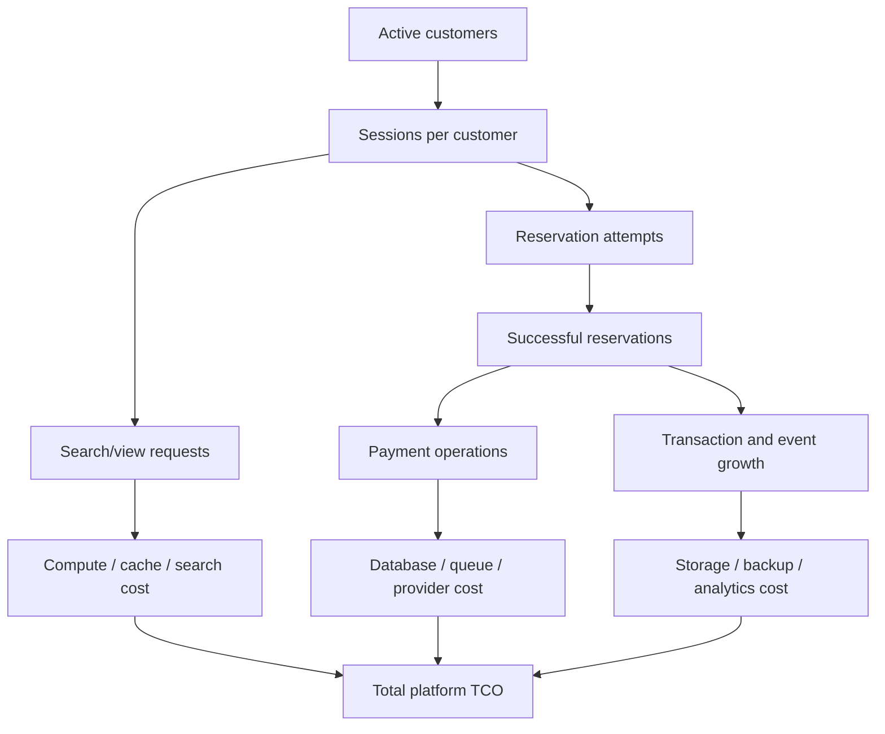

# Modeling TCO and Business Unit Economics

A cloud bill shows how much an organization spent in a period, but it does not answer whether the service is economically efficient. Rising costs can be caused by customer growth, inefficient queries, duplicate data storage, test environments running after hours, or an architecture that requires multiple replicas to achieve availability. Looking solely at the total bill makes it hard to distinguish healthy growth from waste.

**Total Cost of Ownership (TCO)** models the full cost to own, operate, and change a solution over a defined time horizon. **Unit economics** allocates those costs per meaningful business unit, such as cost per completed reservation, per successful payment, per active device, or per active customer. Combining both perspectives helps compare architectural options, build budgets, forecast, and identify where to optimize.

In the **CLOUD_ARCHITECTURE** module, TCO and business unit economics connect choices in compute, storage, network, database, observability, security, resilience, and operating model to business outcomes. This lesson uses an equipment rental platform as an example. The monetary amounts, ratios, and assumptions in this lesson are only for illustrating how to model; when building a real business case, replace them with verified quotes, usage data, contracts, taxes, exchange rates, SLAs, and forecasts.

## 1. From Cloud Bill to Architectural Decisions

A monthly bill may itemize compute, database, storage, network egress, load balancer, NAT, CDN, logging, metrics, tracing, security services, backup, replication, DR, managed services, licenses, and support plans.

However, the bill does not explain on its own which service generates the cost, how many reservations or successful payments the cost serves, which portion is fixed versus variable with traffic, which portion is shared, what business value a given redundancy level provides, and how costs will change if traffic doubles.

TCO answers the lifecycle question. Unit economics answers efficiency per unit of output. Both must be read alongside service quality: a lower cost per request accompanied by higher error rates or data loss is not good optimization.

## 2. Distinguishing TCO, Cloud Spend, Unit Cost, and ROI

| Concept | Question | Example |
| --- | --- | --- |
| **Cloud spend** | How much was billed in the period? | November cloud invoice |
| **TCO** | How much does owning and operating the solution cost over its full term? | Cloud, migration, staffing, licenses, and DR over 3 years |
| **Unit cost** | How much does one business unit consume? | Cost per completed reservation |
| **Unit economics** | How does each unit generate value and carry cost? | Revenue/contribution margin per reservation |
| **ROI** | What is the return relative to invested capital? | Operational savings and incremental revenue from migration |
| **Payback period** | How long until cumulative benefits offset investment cost? | 14 months |
| **NPV** | What is the present value of future cash flows? | Using a discount rate to compare options |

Do not equate TCO with the cloud bill. A cloud bill is one input to TCO. Do not equate unit cost with selling price: cost per reservation is an operational view; selling price also depends on demand, competition, and strategy.

## 3. Defining Model Boundaries Before Calculating

TCO is meaningful only when options share the same scope and horizon.

- **Business scope:** one product, one domain, the whole company, or a single transaction flow?
- **Technical scope:** which compute, database, network, storage, security, observability, and DR components are included in the model?
- **Organization scope:** are platform team, SRE, engineering, support, finance, and vendor costs included?
- **Time horizon:** 1, 3, or 5 years?
- **Currency and tax:** base currency, exchange rate, VAT/taxes, support fees, and discounts?
- **Workload:** normal traffic, peak, seasonal, growth, and retention?
- **Service level:** availability, latency, RPO/RTO, and security requirements?

Comparing multi-region active-active against single-region while ignoring RTO requirements biases the model. Comparing a self-managed database against a managed database without accounting for operational on-call staffing also omits costs.

### Baseline and Alternative

The model should include a baseline representing the current architecture if unchanged, a target representing the proposed architecture, and one or more plausible alternatives. The baseline is not simply last month's bill multiplied by 36. It must be adjusted for seasonality, growth, contract expiry, reserved pricing, staffing, maintenance, and refresh cycles.

## 4. Building a Lifecycle Cost Breakdown

| Category | Typical Costs | Cloud Example |
| --- | --- | --- |
| **Acquire/build** | Migration, implementation, licenses, setup, hardware | Landing zone design, database migration |
| **Run/operate** | Compute, storage, network, managed services, support, staffing | VM/container, database, SRE/on-call |
| **Change/evolve** | Upgrades, refactoring, schema changes, testing, integration | Engine upgrade, API migration |
| **Retire/exit** | Data export, archiving, contract termination, decommissioning | Egress when leaving cloud, deleting resources |

Expected loss from downtime or security incidents can be added as a separate risk model, but do not double-count it against already-recorded operational costs.

### Tangible and Hidden Costs

Tangible costs include invoices, licenses, payroll allocation, contractors, and support contracts. Commonly overlooked costs include toil, incident response, integration maintenance, training, duplicated environments, data transfer, security reviews, delayed feature delivery, and vendor exit.

Not every hidden cost needs to be monetized with false precision. Document assumptions, ranges, and confidence; use a range when direct measurement is unavailable.

## 5. CapEx, OpEx, and Consumption Models

Cloud often shifts many upfront infrastructure investments into usage-based operating expenses, but that does not mean everything is OpEx under every accounting policy.

| Model | Cost Flow | Characteristics |
| --- | --- | --- |
| On-premise hardware | Upfront equipment purchase, depreciation, and maintenance | Initial investment, capacity planning, and refresh cycles |
| Cloud on-demand | Billed per usage/hour/second/request | Flexible, suited for variable workloads |
| Reserved/commitment | Spend or capacity commitment over a term | Lower unit price may come with utilization risk |
| Managed service | Usage fee plus tier/feature fee | Reduces operational effort, may increase vendor dependency |
| SaaS | Subscription/user/volume/tier | Reduces self-managed infrastructure, must account for license growth |

CapEx/OpEx classification in financial reporting must follow accounting policy and finance guidance, not be inferred solely because a service is called cloud.

## 6. Direct Cost and Shared Cost

**Direct cost** can be attributed directly to a product, tenant, or environment. **Shared cost** is consumed jointly by multiple consumers and requires allocation rules.

| Cost Item | Type | Possible Allocation Driver |
| --- | --- | --- |
| Dedicated Booking API compute pool | Direct | Usage or resource allocation |
| Shared Kubernetes platform | Shared | CPU/memory requests, pod usage, or weighted capacity |
| Central logging platform | Shared | Ingest bytes, retention bytes, query usage |
| NAT gateway/network egress | Shared | Bytes/connections by source workload |
| Security monitoring | Shared | Asset count, workload criticality, or fixed platform share |
| Dedicated backup vault for payment | Direct | Actual storage, requests, and replication |
| Platform engineering | Shared | Product team capacity, service count, or agreed allocation |

Allocating by revenue share may not reflect infrastructure usage. Choose a driver with a sound causal relationship, measurability, and an owner. If exact attribution is not possible, surface the shared/unallocated portion and the pool owner rather than allocating arbitrarily.

## 7. Showback and Chargeback

- **Showback:** displays costs by team/product/tenant without transferring actual budget.
- **Chargeback:** uses allocations to distribute or charge internal budgets to consuming groups.

Showback is usually a suitable first step to validate tagging and drivers. Chargeback requires stable, transparent rules, a dispute process, and finance alignment.

One model can assign direct costs straight to the owner; allocate shared costs by usage drivers; allocate fixed platform baseline by agreed capacity; display unallocated costs separately; and record credits/refunds/discounts under a common policy.

Do not use chargeback to penalize teams for costs they cannot control. Cost transparency must come with optimization authority and design accountability.

## 8. Cost Allocation Tags and Metadata

| Tag | Example | Purpose |
| --- | --- | --- |
| environment | production, staging, dev | Separate environments |
| service | booking-api, payment-ledger | Identify service |
| product/domain | rental-core, marketplace | Allocate by product |
| owner_team | booking-platform | Identify owner |
| cost_center | CC-204 | Reconcile budget |
| data_classification | confidential, internal | Link security requirements |
| criticality | tier-1, tier-2 | Understand resilience cost |
| managed_by | terraform, platform | Identify change mechanism |

### Tag Governance

- Define a consistent vocabulary and format.
- Enforce tags in IaC/modules or deployment policies.
- Validate tags at resource creation time.
- Propagate tags to child resources where the platform supports it.
- Track the percentage of cost with an assigned owner.
- Establish rules for handling untagged and shared resources.
- Never place PII, secrets, or sensitive information in tags.

Tags are not always present on invoice line items. Some resources require allocation rules derived from telemetry/usage or a metadata registry.

## 9. Building a Cost Model from Workload Drivers

A good cost model starts from the business activities that generate workload, not from a list of instances.

| Business Activity | Technical Driver | Resource/Cost |
| --- | --- | --- |
| Customer searches equipment | Search requests, index size, query CPU | Search cluster, cache, network |
| Views availability | Read QPS, cache hit, database reads | Database/replica, cache |
| Creates reservation | Write transactions, locks, connection time | Compute, database, transaction log |
| Processes payment | Payment calls, callback events, ledger writes | Compute, DB, queue, audit |
| Stores contract | File count, GB-month, retrieval | Object storage, replication, CDN |
| Analytics | Events/day, bytes scanned, query frequency | Stream, warehouse, object storage |
| Operations | Logs/metrics/traces volume, retention | Observability platform |

### Workload Profile

Define average arrival rate and peak rate, request mix, payload/response size, cache hit/miss, data growth, retention, replication factor, batch/stream schedule, peak duration, seasonality, availability, and latency. A single aggregate requests/second number is insufficient if search requests are lightweight while payment transactions carry heavy lock and durability requirements.

## 10. Fixed, Variable, and Step-Function Costs

| Cost Behavior | Meaning | Example |
| --- | --- | --- |
| Fixed | Does not change significantly within a capacity band | Minimum cluster nodes, support plan |
| Variable | Scales roughly with usage | Request fees, egress bytes, storage GB-month |
| Step function | Increases at capacity or tier thresholds | Adding a database replica/node |
| Commitment | Committed spend or resource level | Reserved capacity |
| One-time | Incurred once | Migration, initial data transfer, training |

Real costs are usually a mix. A database cluster has baseline nodes and storage, plus variable I/O and backup, and then steps up when another replica is needed.

Conceptual model: **Total cost = fixed cost + variable rate × usage + step costs + one-time costs**. Each line item has its own unit, rate, tier, discount, and minimum; do not apply a linear formula across the entire invoice.

## 11. Calculating Unit Cost by Business Unit

**Unit cost = attributable cost / eligible business units**

Examples:

- Cost per successful reservation.
- Cost per completed rental.
- Cost per payment captured.
- Cost per active customer-month.
- Cost per 1,000 search sessions.
- Cost per GB-month retained.
- Cost per support ticket resolved.

### Choosing the Right Denominator

Do not divide the cloud bill by total requests if many requests are health checks, retries, or bot traffic. The denominator should reflect business outcomes: successful reservations rather than button clicks; captured payments rather than every provider call; completed rentals rather than canceled reservations; active customers under a consistent definition.

If there are multiple transaction types, you can compute them separately by class or use weighted workload units, provided the weighting is explained.

### Do Not Let Unit Cost Hide Quality

Read cost/unit alongside success rate, error rate, p95/p99 latency, fraud/chargebacks, availability, customer support contact rate, freshness, and data quality. A lower cost/reservation caused by rejecting more reservations is not an improvement in unit economics.

## 12. Unit Economics and Contribution Margin

**Contribution margin per completed rental = net revenue per rental - variable cost per rental**

Variable costs may include payment fees, transaction-based cloud costs, variable delivery/support costs, and partner fees. Fixed platform costs remain important, though they are usually evaluated separately when computing contribution margin; contribution margin is then used to cover fixed operating costs and investments.

Do not include full TCO in variable cost if the goal is to measure contribution margin. State explicitly whether a metric measures direct variable cost, fully loaded cost, or post-allocation margin.

## 13. Cost Modeling by Architecture Layer

| Layer | Cost Driver | Optimizations to Consider |
| --- | --- | --- |
| Edge/CDN/WAF | Requests, rules, cache hit, egress | Cache policies, compression, request filtering |
| Compute | vCPU/memory time, request count, concurrency | Right-sizing, autoscaling, efficient code |
| Container platform | Node capacity, reserved resources, idle pods | Bin packing, requests/limits, appropriate scale-to-zero |
| Database | Instance-hours, storage, IOPS, backup, replicas | Queries/indexes, tiers, connection pooling, retention |
| Cache | Memory GB-hours, operations, replication | TTL, eviction, key size, hit rate |
| Messaging/stream | Throughput units, partitions, retention, consumers | Batching, partition sizing, retention, and consumer lag |
| Object storage | GB-month, requests, retrieval, replication | Lifecycle, compression, deduplication |
| Network | Egress bytes, NAT, inter-AZ/region transfer | Data locality, CDN, private routing |
| Observability | Ingest volume, queries, retention, cardinality | Sampling, tiering, useful signal |
| Security | Asset/license/scan volume, log retention | Risk-based coverage, shared platform |
| Backup/DR | Copy count, retention, region, restore tests | Tiering by criticality |

An optimization that reduces cost in one layer can increase cost in another. Reducing cache memory can drive up database CPU and read I/O. The model should evaluate end-to-end cost.

## 14. Growth and Capacity Forecasting

A cost model must translate business forecasts into workload forecasts:

1. Marketing forecasts a 30% increase in active customers.
2. Search, view, reservation, and payment rates per customer are estimated.
3. Request mix and peak-to-average ratios are determined.
4. Reservation/payment volumes are translated into DB reads/writes, queue events, and storage growth.
5. Retention and replication factors are translated into storage forecasts.
6. Autoscaling/capacity steps are modeled.

Forecasting should not simply extrapolate the most recent month. Account for seasonality, marketing campaigns, regions, holidays, product changes, peak profiles, and growth capacity.

## 15. Scenario Analysis and Sensitivity

| Scenario | Assumptions | Purpose |
| --- | --- | --- |
| Low | Slow growth, high cache hit, stable retention | Check minimum spend floor |
| Base | Agreed business/engineering forecast | Budgeting and primary decisions |
| High | Rapid growth, large peaks, rising egress/retention | Check headroom and downside |

Sensitivity analysis varies each key driver: active customers +10%, peak-to-average from 3× to 5×, cache hit dropping 10 percentage points, retention from 90 to 365 days, egress/session +20%, adding a database replica, or a support fee/license tier increase.

A tornado chart can rank drivers by impact on TCO. You do not need exact predictions for every variable; you need to know which assumptions the decision depends on most strongly.

## 16. 3-Year TCO Example for the Equipment Rental Platform

Suppose the organization compares a self-managed VM architecture with a managed/container architecture. The numbers below are **illustrative cost units (CU)**, not vendor quotes.

### Scope Assumptions

- 3 years of operation.
- Identical workload forecast and SLOs.
- Includes infrastructure, database, storage, network, observability, security, support, and operational staffing.
- Includes migration/setup in year one.
- Excludes revenue, taxes, and marketing.

| Cost category (CU) | Self-managed VM | Managed/container |
| --- | ---: | ---: |
| Compute/platform | 180,000 | 210,000 |
| Database | 105,000 | 120,000 |
| Storage/backup | 48,000 | 55,000 |
| Network/egress | 42,000 | 45,000 |
| Observability/security tools | 36,000 | 39,000 |
| Vendor/support/license | 24,000 | 45,000 |
| Engineering/operations effort | 150,000 | 90,000 |
| Migration/setup | 10,000 | 28,000 |
| **3-year TCO** | **595,000** | **632,000** |

Managed/container has higher platform/vendor costs but reduces operational effort under these assumptions. Direct TCO is 37,000 CU higher over three years. A conclusion cannot be drawn from the monetary total alone; uptime, release lead time, incident impact, security capability, and scalability must also be reviewed.

### Calculating Cost per Completed Rental

| Year | Completed rentals |
| --- | ---: |
| Year 1 | 100,000 |
| Year 2 | 130,000 |
| Year 3 | 169,000 |
| **Total** | **399,000** |

- Self-managed VM = 595,000 / 399,000 = **1.49 CU/rental**.
- Managed/container = 632,000 / 399,000 = **1.58 CU/rental**.

In the base case, the VM option has lower TCO and unit cost. If managed/container reduces downtime, speeds up releases, or lowers operational risk, that value must be quantified or recorded as a separate decision criterion—do not arbitrarily add savings without evidence.

If managed/container operational effort decreases by an additional 20,000 CU due to proven automation, TCO drops to 612,000 CU. If actual volume is 20% below forecast while fixed costs remain unchanged, unit cost rises even though the total bill stays flat. This is why scenario and utilization assumptions are essential.

## 17. Allocating Shared Costs in the Example

Suppose the platform has shared costs for logging and Kubernetes. The monthly cost pool is 12,000 CU:

| Consumer | Monthly Driver | Share | Allocated cost |
| --- | ---: | ---: | ---: |
| Booking | 50% ingest/compute usage | 50% | 6,000 CU |
| Payment | 30% | 30% | 3,600 CU |
| Analytics | 20% | 20% | 2,400 CU |
| **Total** | **100%** | **100%** | **12,000 CU** |

The driver must match the type of cost pool. If logging costs are driven primarily by ingest bytes and retention, allocating by ingested/retained GB makes more sense than pod count. If the Kubernetes pool is driven primarily by reserved CPU/memory, using allocated vCPU/memory or measured usage may be better.

### Cost Allocation Bridge

The total invoice must trace through invoice line items, resource/tag mapping, direct cost assignment, shared pools and allocation drivers, discount/credit/tax treatment, product/team showback, and unit cost denominators. Reconcile the post-allocation total back to the source total; explain unallocated amounts, excluded taxes, rounding, or credits.

## 18. Resilience Costs: HA, Backup, and Disaster Recovery

| Design | Incremental Cost | Value to Evaluate |
| --- | --- | --- |
| Multi-AZ database | Replicas, storage, replication traffic | Reduces downtime during zone failures |
| Cross-region DR | Duplicate capacity/data transfer/backup | Recovery when a region fails |
| Immutable backup | Retention storage and management | Protection against accidental deletion/ransomware |
| Active-active | Multiple stacks, conflict handling | Lower RTO in certain failure modes |
| Additional observability | Log/trace ingest and retention | Faster detection, better diagnosis |
| On-call coverage | Staffing/rotation | Reduces response and recovery time |

Do not estimate multi-region cost as an arbitrary percentage of production. Estimate from the architecture: warm standby may require minimal compute during normal operation but scale up on failover; active-active requires capacity running continuously across multiple regions.

Expected annual loss can be modeled as the sum of (probability of scenario × impact cost of scenario). This is a comparison tool, not a deterministic forecast. Use ranges/scenarios because probability and impact are uncertain; avoid adding downtime loss if it is already captured in the revenue model so you do not double-count.

## 19. Migration and Dual-Running Costs

Migration typically creates a period of elevated cost:

- Assessment, landing zone, network, and identity.
- Data transfer/egress between source and target.
- Parallel environments during cutover.
- Data validation, reconciliation, and testing.
- Application, schema, and pipeline refactoring.
- Training, documentation, and change management.
- Decommissioning, contract termination, and archiving.

TCO must account for dual-running: if source and target run concurrently for 3 months, include compute/database/storage on both, along with operational staffing and the potential need to maintain a rollback window.

A migration cost curve can separate one-time assessment/build, migration waves, dual-run, cutover/validation, decommission/exit, and target steady-state. Do not compare target steady-state against the current bill while forgetting transition costs.

## 20. FinOps: Aligning Engineering, Finance, and Business

FinOps is a collaborative approach to cloud financial operations using usage data and continuous feedback. It is not merely the finance team cutting bills.

- **Inform:** visibility into cost, usage, allocation, and forecasts.
- **Optimize:** right-sizing, scheduling, commitments, architectural efficiency.
- **Operate:** budgets, policies, accountability, reviews, and continuous improvement.

| Group | Responsibilities |
| --- | --- |
| Finance | Budgets, forecasts, invoice reconciliation, accounting treatment |
| Engineering/platform | Workload drivers, architecture, resource efficiency, tags |
| Product/business | Volume, unit economics, growth assumptions, value trade-offs |
| FinOps | Cost models, allocation, anomalies, commitment analysis, governance |
| Procurement/vendor management | Contracts, pricing tiers, discounts, and renewals |

Do not assign cost-reduction targets to engineering if they lack authority to change the corresponding workloads or architecture.

## 21. Budgets, Forecasting, and Anomaly Management

A budget should have an owner/cost center, scope, period/currency, baseline/forecast, alert thresholds, actions when exceeded, and exceptions/approvals.

Budget alerts do not automatically stop workloads unless a policy is explicitly designed to do so. Shutting down a critical database or service just because a budget threshold was crossed can cause far greater damage than the cost overrun.

Forecasting combines historical spend (excluding one-time/abnormal items), business growth, seasonality, pricing/discount changes, new services/regions/retention, migrations, and decommissioning. Record forecast versions, assumption owners, and monthly actual-versus-forecast variance.

Monitor anomalies by service, region, SKU, tag, or usage driver: egress spikes, debug-driven log ingestion surges, rising database IOPS/backups, idle compute, retry loops generating billable requests, and storage version explosion. Anomalies must be investigated; they may indicate legitimate growth or misconfiguration.

## 22. Cloud Pricing Models and Commitments

Pricing models include: on-demand, reserved/capacity commitment, spot/preemptible, serverless request/duration, storage tier/retrieval, data transfer/egress, per-seat/per-core/per-transaction licenses, managed tiers, and support plans.

### Commitment Risk

Commitments can lower unit prices, but they introduce risk if forecasts fall short, workloads change instance families or regions, resources sit idle, contracts lack flexibility, or discount scope is miscalculated.

Before committing, examine historical utilization, demand forecasts, flexibility, coverage, and break-even points. Do not buy commitments for a headline discount without suitable workloads.

Spot/preemptible capacity can suit stateless jobs, checkpointed batch workloads, and retry-capable workers. Do not default to it for stateful transactions or workloads that cannot tolerate interruption.

## 23. Optimizing Cost Without Degrading Quality

- Right-size compute based on actual CPU/memory/concurrency.
- Scale on appropriate drivers and schedule dev/test environments.
- Optimize queries/indexes and connection pooling.
- Cache data with clear semantics and freshness requirements.
- Reduce log noise and sample traces appropriately while keeping required audit/security evidence.
- Apply storage lifecycle policies by access pattern and retention.
- Reduce egress via data locality, CDN, and compression.
- Fix retry loops, duplicate events, and inefficient small batches.
- Separate workload priorities to avoid resource contention.
- Automatically delete unowned resources after a review process.

Never disable immutable backups, reduce replicas below committed availability, shorten security log retention in violation of policy, drop testing/monitoring, or run non-interruptible transactions on spot capacity just to lower the bill. Always evaluate cost alongside reliability, security, performance, and sustainability.

## 24. Sustainability and Carbon-Aware Decisions

Financial cost and environmental impact are related but not identical. A cheaper design is not necessarily lower-carbon if workloads run in regions with different carbon intensity or replicate large volumes of data. More efficient compute can reduce both cost and energy for the same output.

Opportunities include increasing utilization, reducing idle capacity, choosing appropriate compute, scheduling environments that do not need to run continuously, pruning data with no remaining value, reducing data movement/duplicate copies, and batching efficiently when work can be deferred.

Do not infer exact carbon emissions from a cloud bill without proper factors and methodology. Document sources, boundaries, locations, and uncertainty when reporting.

Metrics can include estimated carbon per 1,000 reservations if supported by the provider, storage GB-month per active customer, compute utilization, data transfer bytes per business transaction, and the proportion of data transitioned through lifecycle/archiving on schedule.

## 25. TCO Through the Well-Architected Lens

| Pillar | TCO Components | Suggested Unit Metric | Risks/Trade-offs |
| --- | --- | --- | --- |
| **Operational excellence** | SRE, monitoring, automation, training, support | Cost per service/release/incident | Underinvesting in operations increases toil and MTTR |
| **Security** | IAM, KMS, WAF, detection, audit retention, compliance | Security cost per protected workload | Cutting logging/scanning increases residual risk |
| **Reliability** | HA, replicas, backup, DR, on-call, testing | Cost per successful transaction at target SLO | Over- or under-provisioned resilience relative to BIA |
| **Performance efficiency** | Compute, cache, database, network, queries | Cost per successful request/rental | Optimizing unit price hurts latency and error rates |
| **Cost optimization** | Allocation, FinOps, rightsizing, commitments | Fully loaded unit cost | Misallocation leads to wrong decisions |
| **Sustainability** | Idle compute, storage, data movement | Resource/energy per business output | Missing carbon data or misaligned optimization scope |

Do not pick an architecture solely for the lowest nominal TCO. Weigh cost against SLOs, risk, delivery speed, operational capability, and business value.

## 26. Cost Model Governance

A cost model should be governed like a data asset:

- Assign an owner and purpose.
- Define sources for invoices, rate cards, usage, and business denominators.
- Maintain a data dictionary for cost categories and units.
- Version allocation rules.
- Document assumptions and scenarios.
- Establish a refresh cadence.
- Perform reconciliation and quality checks.
- Keep a change log when pricing or discounts change.

Verify whether line items reconcile to the invoice; whether credits, refunds, and taxes are treated consistently; whether untagged resources are excluded from allocation; which source of truth provides denominators; whether FX rates and cutoff periods are clear; and whether shared pools are double-allocated.

If the cost data is wrong, unit economics can be arithmetically exact yet meaningless.

## 27. Common Pitfalls

1. **Multiplying last month's bill by 36.** Ignores growth, seasonality, contracts, and migration.
2. **Counting only the cloud invoice.** Omits staffing, licenses, security, support, and exit costs.
3. **Comparing different scopes.** One option includes DR while the other does not.
4. **Using cost/request instead of cost/business outcome.** Retries, health checks, and failed requests distort the denominator.
5. **Allocating shared costs arbitrarily.** Teams receive costs that do not reflect usage.
6. **Ignoring untagged costs.** Unowned resources slip outside showback.
7. **Tracking unit cost without SLOs.** Lower cost comes from rejecting requests or running slower.
8. **Forgetting dual-running and decommissioning.** Makes the migration business case look artificially cheap.
9. **Counting discounts as guaranteed savings.** Commitment utilization falls short.
10. **Cutting backups/logs/security to shrink the bill.** Converts cost into risk.
11. **Relying on a single forecast.** Fails to show sensitivity or downside.
12. **Having no owner for cost anomalies/actions.** Dashboards display data while nothing changes.

## 28. Case Study: Cost per Completed Rental

### Context

The platform has three workload groups: Booking/availability with variable traffic; Payment/ledger requiring durability, auditability, and consistency; and Search/analytics with heavy reads and batch processing that can be cached or deferred.

The organization wants to reduce fully loaded cost per completed rental while maintaining checkout SLOs.

### Cost Tree

| Cost pool | Driver | Allocation |
| --- | --- | --- |
| Booking compute | CPU/memory usage weighted by request class | Booking |
| Payment/database | Transaction count, storage, and I/O | Payment |
| Search/cache | Search QPS, memory, and egress | Search |
| Shared observability | Ingest bytes and retention | By service usage |
| Platform/SRE | Agreed capacity share and criticality | Shared |
| Backup/DR | Protected GB and recovery tier | By data product |

### Current Month Assumptions

| Metric | Value |
| --- | ---: |
| Fully allocated platform cost | 180,000 CU |
| Completed rentals | 60,000 |
| Cost per completed rental | 3.00 CU |
| Checkout success rate | 98.8% |
| p95 checkout latency | 420 ms |

### After One Optimization Cycle

The team eliminates N+1 queries, raises cache hit rates for browsing, schedules test environments, and samples traces on non-critical spans, while keeping audit, backup, and checkout capacity intact.

| Metric | Before | After |
| --- | ---: | ---: |
| Fully allocated platform cost | 180,000 CU | 168,000 CU |
| Completed rentals | 60,000 | 61,500 |
| Cost per completed rental | 3.00 CU | 2.73 CU |
| Checkout success rate | 98.8% | 99.0% |
| p95 checkout latency | 420 ms | 360 ms |

Unit cost drops by roughly 9% in this example. Because volume grew and success/latency improved, savings from efficiency must be separated from cost changes driven by growth. In real operations, comparisons must normalize for workload mix, seasonality, pricing, and scope changes.

## 29. Process for Building TCO and Unit Economics

1. **Define the decision:** identify whether the model supports an architecture choice, migration, region selection, managed service adoption, or capacity model.
2. **Lock scope/horizon:** business, technical, organization, currency, tax, and timeframe.
3. **Describe the workload:** business volume, traffic, peaks, data growth, retention, and SLOs.
4. **Build the architecture bill of materials:** resources, tiers, replicas, regions, network, backup, and observability.
5. **Apply rates/pricing:** on-demand, discounts, commitments, licenses, and support.
6. **Add people/transition costs:** build, migration, operations, training, dual-run, and exit.
7. **Classify direct/shared:** define allocation drivers and an unallocated bucket.
8. **Calculate TCO:** baseline/target/alternatives by period.
9. **Calculate unit economics:** select business denominators and fully loaded/direct unit costs.
10. **Build scenarios/sensitivity:** low/base/high cases and high-impact variables.
11. **Cross-check SLOs/risks:** performance, security, reliability, and sustainability.
12. **Review with finance/business/engineering:** align on assumptions, owners, and confidence.
13. **Track actuals:** reconcile invoices, forecast variance, and unit cost over time.
14. **Iterate:** assign anomalies to action owners and measure realized savings.

## 30. Practice Exercises

### Exercise A — Comparing Managed vs. Self-Managed

A managed database has a 20% higher bill, but saves 0.5 FTE of operational effort and reduces patching-related incidents.

**Question:** Which has lower TCO, and what additional data is needed?

**Hint:** include licenses/support, staffing, patching/upgrades, backup/DR, incident costs, migration, and SLAs. Quantify the 0.5 FTE at fully loaded cost and verify whether freed capacity can be redeployed to deliver other value.

### Exercise B — Lower Unit Cost but Degrading Service

Cost per request drops 15%, but success rate falls by 4 percentage points and payment retries increase.

**Question:** What metric is more appropriate?

**Hint:** cost per successful payment or completed rental; add retry cost, errors, latency, and reconciliation. Do not use total requests as the denominator when a portion fails.

### Exercise C — Shared Logging Pool

Three teams share a 10,000 CU logging bill. Booking generates 70% of ingest, Payment 20%, and Analytics 10%; retention varies by team.

**Question:** What should the allocation rule be?

**Hint:** separate ingest and retained storage costs; allocate by GB ingested and GB-month by retention, with query costs separate. Verify that total allocations reconcile with the bill.

### Exercise D — Commitment

A vendor offers a three-year compute commitment for a 35% unit price discount, but traffic remains uncertain.

**Question:** What needs to be analyzed before signing?

**Hint:** utilization, forecast scenarios, coverage, flexibility, workload migration, contract terms, break-even, and opportunity cost. Do not apply the discount across the entire forecast if part of the scope is ineligible.

### Exercise E — Backup Cost

Storage costs rose 25% due to retention and cross-region copies. The business asks for a 15% reduction.

**Question:** How can you optimize while preserving DR requirements?

**Hint:** inventory data criticality, retention/legal holds, deduplication/compression, lifecycle tiering, backup frequency aligned to RPO, rebuildable data classes, and restore time. Do not delete critical immutable copies just to hit a target.

### Exercise F — Sensitivity

TCO depends heavily on egress and cache hit rate.

**Question:** What should be measured and tested?

**Hint:** bytes per session, cache hit by endpoint, cross-AZ/region transfer, CDN hit rate, payload size, compression, and cost per completed rental on a representative workload.

### Self-Assessment Criteria

| Competency | Required Evidence |
| --- | --- |
| Scope/TCO | Baseline, target, alternatives, and time horizon |
| Cost completeness | Cloud, people, licenses, migration, run, change, exit |
| Workload model | Business drivers, peaks, growth, retention, and SLOs |
| Allocation | Direct/shared pools, tags, and justified drivers |
| Unit economics | Business denominator and consistent formula |
| Forecast | Low/base/high, sensitivity, and variance review |
| Decision quality | TCO evaluated alongside reliability/security/performance/value |
| FinOps governance | Owners, budgets, anomaly workflow, and action tracking |

## 31. Pre-Approval Architecture Review Checklist

- Are the decision to support and business outcomes clearly defined?
- Do baseline, target, and alternatives share the same scope, SLOs, and time horizon?
- Do workload drivers reflect request mix, peaks, seasonality, and data growth?
- Does the cost breakdown include compute, database, storage, network, security, observability, backup/DR, and support?
- Are labor, licenses, migration, dual-run, training, change, and exit included?
- Are fixed, variable, step-function, and commitment costs distinguished?
- Do direct and shared costs have measurable allocation drivers?
- Are untagged/unallocated costs surfaced?
- Does the unit denominator reflect business outcomes rather than raw traffic?
- Is cost/unit evaluated alongside success rate, latency, availability, and data quality?
- Are low/base/high forecasts and sensitivity analyses on key variables included?
- Do discounts/commitments have utilization and break-even analyses?
- Are resilience costs linked to BIA, RPO/RTO, and risk?
- Have tax, FX, credit, and accounting assumptions been confirmed by finance?
- Does the cost model have sources, owners, versioning, and reconciliation?
- Is there a cadence for tracking actual-versus-forecast and unit economics?
- Does every cost anomaly/action have an owner, deadline, and success criteria?

TCO reveals the cost of owning a solution across its entire lifecycle; unit economics reveals the cost and value per business outcome. A model is trustworthy only when it has consistent scope, realistic workload drivers, complete direct/shared costs, meaningful denominators, and transparent assumptions. Combining forecasts, sensitivity analysis, SLOs, and FinOps governance enables teams to choose architectures based on total business value rather than the lowest cloud bill alone.
