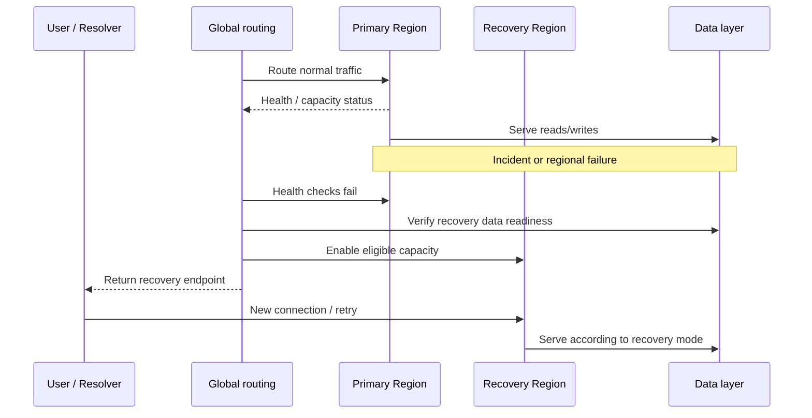
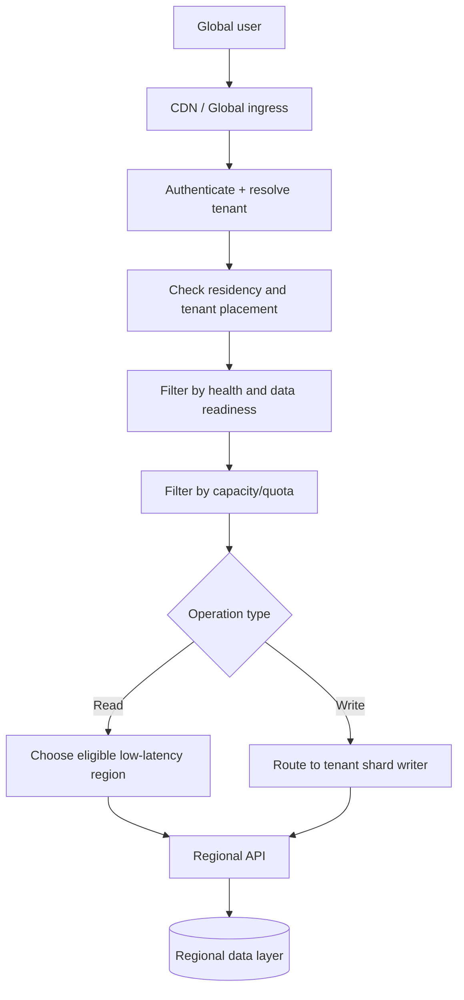

# Global Routing by Location, Latency, and Service Health

## 1. What Problem Does Global Routing Solve?

When an application serves users across multiple countries, a single entry point can expose distant users to high round-trip times, unstable international links, and total reliance on a single region for every request. Multi-region deployment brings compute closer to users and increases recovery options when a region experiences an outage. However, having multiple regions does not automatically make a system fast or reliable: traffic can still go to the wrong place, health checks can misjudge availability, a region may be alive yet overloaded, or data may not be ready to serve.

**Global traffic routing** is the process of deciding which endpoint, region, point of presence (PoP), or service cluster a user's request or connection is directed to. The decision can be based on geographic location, network latency, weights, health status, capacity, data policies, and user session state.

This lesson belongs to the **Global Architecture** chapter of the **CLOUD_ARCHITECTURE** module. The module teaches how to design cloud applications from business requirements down to networking, compute, data, and deployment models, balancing reliability, security, scalability, cost, and operations according to Well-Architected principles. Global routing connects the user access layer with multi-region topology, fault tolerance, and data constraints.

After this lesson, you will be able to distinguish between DNS-based routing, Anycast, CDN/edge, and HTTP routing; choose policies based on geography, latency, health, weight, and capacity; design health checks and failover/failback; and integrate routing with sessions, data locality, consistency, residency, security, cost, and observability.

## 2. Start from User Journeys and Topology

Before choosing a DNS service or global load balancer, determine which features users need to access, where the data lives, and which regions are actually capable of serving requests.

### 2.1. Requirements to Gather

- User distribution by country, ISP, mobile network, and time of day.
- Critical user journeys, APIs, protocols, and traffic types.
- Latency/availability SLOs by population and region.
- Locations of primary data, replicas, caches, object storage, and dependencies.
- Residency, sovereignty, privacy, and contractual requirements.
- Recovery time objective (RTO) and recovery point objective (RPO).
- Capacity, quotas, and headroom required when a region is lost.
- Compute, replication, inter-region transfer, and egress costs.

Do not count only the number of users per country. Users in the same city may traverse different ISPs or peering paths; the closest region on a map does not necessarily have the lowest network latency.

### 2.2. Region Roles

| Model | Purpose | Trade-offs |
|---|---|---|
| Active-active | Multiple regions simultaneously serve production traffic | Cost, consistency, and conflict complexity |
| Active-passive | One primary region, one standby region | Standby capacity and regional failover time |
| Warm standby | Standby region runs minimal active infrastructure | Requires scaling and warm-up during an incident |
| Pilot light | Keeps core components/essential data running | Longer RTO than warm standby |
| Backup/restore | Stores only backups and IaC | Lower cost, typically the longest RTO |

Roles can differ by service. Web/API tiers may be active-active while the database is primary-secondary; static content may be served via a global CDN while write APIs run in only a few regions.

### 2.3. Routing Eligibility

A region should receive a given request type only if it is properly provisioned, runs a compatible version, has access to the required data, meets business freshness/consistency requirements, still has capacity/quota, is permitted to process the data under policy, and satisfies security controls. An endpoint returning HTTP 200 is not enough to prove that a region can serve every operation.

## 3. Global Routing Layers

Routing can take place across multiple layers. Each layer sees different information and has its own limitations.

### 3.1. DNS-Based Global Routing

DNS returns records or endpoints according to the policy of an authoritative/global DNS service. Common policies include:

- **Geolocation:** maps the resolver or source IP's country/region using a geolocation database.
- **Geoproximity:** selects an endpoint based on proximity, optionally adjusted with a bias.
- **Latency-based:** selects the endpoint with the lowest measured latency from the service's vantage points.
- **Weighted:** splits traffic across endpoints according to assigned weights.
- **Failover:** returns the primary endpoint and switches to the standby when health checks fail.
- **Multivalue:** returns multiple healthy addresses/endpoints for the client to choose from.

DNS routing is simple, scales well, and operates at the hostname layer. However, DNS caching and TTL mean record changes do not reach every client immediately; recursive resolvers have their own caching behavior. Do not treat DNS failover as an instant switch for already-open connections.

### 3.2. Anycast

Anycast advertises the same IP prefix from multiple network points. Internet routing directs packets to the point selected by the current topology/BGP path. Anycast is commonly used for edge, DNS, CDN, or network ingress.

The advantage is that users can reach a nearby PoP along the network path and clients do not need to know multiple regional IPs. The limitation is that "closest" in BGP does not necessarily mean lowest application latency; routes change with Internet policies and network conditions; Anycast does not inherently solve session affinity, database write ownership, or data residency. An already-open TCP connection is also not guaranteed to migrate smoothly to another PoP when routes change.

### 3.3. CDN and Edge Routing

A CDN brings static or cacheable content to an edge location close to users. Dynamic requests can be proxied back to an origin or routed to an origin based on policy.

CDNs reduce asset-load latency, cut origin bandwidth, and absorb part of traffic bursts. You need to define cache keys, TTLs, invalidation, cookie/header forwarding, authenticated content handling, and behavior when an origin fails. Misconfigured caching can leak content across tenants or serve stale data.

### 3.4. Global Load Balancers and HTTP Routing

A global application delivery controller can terminate TLS, inspect requests, select a region, and route HTTP/gRPC by path, host, header, tenant, or health. This layer has more context than DNS but adds a dependency and an extra network hop.

For example: static assets go to the CDN; read APIs go to a region with a sufficiently fresh replica; write APIs go to the region owning the partition; tenants with EU data residency are routed only to approved regions.

### 3.5. Comparison of Routing Layers

| Layer | Decision Basis | Strengths | Limitations |
|---|---|---|---|
| DNS routing | Resolver/source IP, policy, health, latency estimate | Simple, global hostname | Caching/TTL and resolver behavior |
| Anycast | Internet routing topology | Nearby ingress along the network path | Limited application context |
| CDN/edge | PoP, cache key, origin policy | Acceleration, edge security | Cache correctness and origin dependency |
| HTTP global routing | Host/path/header/health/capacity | Per-request decisions | Extra hop and control-plane complexity |
| Client-side routing | Client latency/config/discovery | Can measure from the client network | Outdated clients, manipulation, and policy consistency |

Layers can work together: DNS selects the edge, the edge selects the region, and a load balancer/service mesh selects an instance within the region.

## 4. Geographic Routing

Geographic routing directs users to a nearby region or one permitted to serve their data.

### 4.1. Geolocation and Geoproximity

Geolocation maps the source IP to a country/region and applies policy. Geoproximity uses endpoint and source locations, sometimes combined with a bias to expand or shrink the served area.

For example, Southeast Asian users may be directed to Singapore or Jakarta depending on coverage and latency; tenants with residency requirements are routed only to approved regions.

This is a directional policy and does not guarantee that requests reach the physically closest region. The resolver IP may be in a different country from the user; VPNs, mobile carrier NAT, and corporate egress also distort estimated locations.

### 4.2. Geography Does Not Equal Data Residency

IP-based routing only selects the access path. It does not by itself guarantee that data is stored or processed exclusively within a jurisdiction. A request can enter an allowed region and then call a database, logging, analytics, or support service located elsewhere.

Data residency must be enforced across primary/replicas, backups, caches, logs, traces, search, analytics, support access, encryption keys, and export/deletion paths.

### 4.3. Jurisdiction-Aware Fallback

Routing users to a region outside their jurisdiction is not always allowed. Policies must clearly state whether failover may go to another region within the same jurisdiction, serve in read-only/degraded mode, temporarily reject operations, or use an approved alternative region. This is a business/legal/security decision and should not be left to health checks alone.

## 5. Latency-Based Routing

Latency-based routing selects the endpoint with the lowest estimated latency in the candidate set, based on vantage points or measurements from the routing system.

### 5.1. End-to-End Latency

User-perceived latency can include DNS resolution, TCP/TLS handshakes, client-edge-region RTT, load balancer/service queueing, compute, database/cache/dependencies, response transfer, and client rendering. Choosing a low-RTT region does not guarantee low end-to-end latency if the region is overloaded or the data lives elsewhere.

### 5.2. Measuring Latency by Population

- Synthetic probes from multiple countries, ISPs, and cloud vantage points.
- Real user monitoring (RUM) where appropriate.
- Separating DNS/connect/TLS/TTFB from application latency.
- Tracking p50/p95/p99 by region, route, and user population.
- Tracking error rates, packet loss, and retries alongside latency.

Do not infer every user's experience from a single probe running inside the same cloud network. Group measurements into broad geographic regions to avoid high cardinality and protect privacy.

### 5.3. Hysteresis and Thresholds

When two regions have similar latency, routing can oscillate on small measurement fluctuations. You can use hysteresis (switching only when the difference exceeds a threshold), dwell time, smoothing via moving windows/percentiles, capacity guardrails, and a minimum improvement threshold.

These mechanisms reduce route flapping but slow reaction time; tuning must account for incident duration and network variability.

## 6. Health- and Capacity-Based Routing

Health-based routing removes endpoints that fail to meet serving conditions from the candidate set. Health is not merely a boolean.

### 6.1. Health Check Layers

| Check | Scope | Question |
|---|---|---|
| Network reachability | IP/port | Is it reachable? |
| Liveness | Process | Is the process running and free of deadlocks? |
| Readiness | Service instance | Is the instance ready to accept traffic? |
| Dependency health | Database/cache/queue | Are required dependencies working? |
| Synthetic transaction | User journey | Does a representative operation complete properly? |
| Capacity health | Resource saturation | Does the region have enough capacity to accept load? |
| Data health | Replication lag/consistency | Is the data sufficiently fresh and accurate? |

A health endpoint returning 200 might not check database or data freshness. Conversely, if readiness depends on every minor dependency, a failure in a non-essential dependency can take down an entire region even while core journeys still work.

### 6.2. Avoiding False Positives

- Verify the exact capabilities an endpoint needs in order to serve.
- Use appropriate timeouts/retries; do not let a single transient probe drop a region immediately.
- Use multiple vantage points where available to distinguish local failures from regional outages.
- Separate public and internal health endpoints by scope.
- Do not let probes impose significant load on dependencies.
- Monitor for probes that fail to run or fail to report.
- Define consecutive failure and recovery thresholds.

### 6.3. Capacity-Aware Routing

A region can be healthy yet close to its limit. Selecting a region based on health alone can push traffic into a place where CPU, DB connections, queues, or quotas are already saturated.

Capacity signals can include current load/headroom, concurrent requests, compute throttling, database connection/write capacity, replication lag, queue age, network egress/NAT, and cloud quota/autoscaling delays.

Routing should send new traffic only to regions with remaining headroom. If all regions are near saturation, use admission control, rate limiting, or degraded mode instead of bouncing traffic around.

## 7. Common Routing Policies

### 7.1. Weighted Routing

Splits traffic according to weights—for example, 80/20 to roll out a new region or test capacity. Weighted DNS is probabilistic per query; it does not guarantee exact request ratios due to DNS caching, client behavior, and connection reuse.

### 7.2. Priority/Failover

Uses a primary endpoint and standby endpoints. When the primary is unhealthy, routing shifts to a secondary according to policy. You must define recovery thresholds, failback delays, and data readiness.

### 7.3. Combining Geography, Latency, Health, and Capacity

A safe decision order is:

1. Filter out ineligible regions based on security/residency.
2. Filter out unhealthy regions or those lacking data readiness.
3. Filter out regions with no remaining capacity.
4. Choose the best latency among the remaining set.
5. Apply weights/biases to balance load or serve canaries.

Latency must never override mandatory constraints such as residency or health.

| Condition | Decision |
|---|---|
| Closest region is healthy, has data ready, and has capacity | Route to that region |
| Closest region is overloaded | Select the next region with sufficient capacity |
| Good latency, but replica lag is too high | Do not route operations requiring freshness |
| Region fails, but another region exists in the same jurisdiction | Fail over within the jurisdiction per policy |
| Only regions outside allowed data boundaries remain | Enter degraded mode or reject the operation |
| All regions are unhealthy | Apply admission control/incident response; do not pick a falsely healthy region |

## 8. Global Failover

Failover shifts traffic away from a failing endpoint/region to another location capable of serving. You must plan for failure modes and verify that the target can absorb the load.

### 8.1. Failover Sequence



DNS caching, client retries, and connection lifetimes can cause some traffic to keep hitting the primary after a routing change. Applications need timeouts, backoff retries, and idempotency; routing does not automatically migrate in-flight requests.

### 8.2. Controlled Failover Sequence

1. Confirm the incident and scope of impact.
2. Verify health from multiple perspectives.
3. Block or drain new traffic to the failing endpoint.
4. Verify that the recovery region has sufficient compute, quotas, networking, and data freshness.
5. Promote the database/leader if needed, using fencing to prevent dual writers.
6. Ramp traffic in stages and monitor errors/latency/business correctness.
7. Confirm that critical user journeys have recovered.
8. Record evidence, timelines, and failover decisions.

### 8.3. Preventing Split-Brain

If two regions both believe they are the primary writer, data can diverge or overwrite itself. You need quorum/consensus or leader election with fencing tokens; monotonically increasing epochs/leases/versions; disabling writes on standbys until promotion; verifying that the old leader is fenced before opening a new writer; and conflict resolution rules.

Changing DNS alone is not enough to guarantee a single writer.

### 8.4. Failback

When the old region recovers, do not automatically swing traffic back immediately. Verify that infrastructure/dependencies are stable, synchronize data, check lag, establish writer ownership, reconcile data, shift traffic in stages, and keep a rollback option. Failing back too early can trigger another outage or data loss.

## 9. DNS Caching and Open Connections

DNS-based failover incurs lag from authoritative DNS TTLs, recursive resolvers, operating systems, browsers/runtimes, and application connection pools. A low TTL can shorten cache duration but increases query volume and does not guarantee strict compliance by all clients. Already-open TCP/HTTP2 connections can keep using the old endpoint even after DNS changes.

The design needs appropriate TTLs, bounded client retries/re-resolution, connection draining/reconnection, sensible timeouts, idempotency for write APIs, and monitoring of traffic still reaching the old region after cutover.

Do not treat `TTL = 0` as an instant switch; many resolvers enforce minimum caching behavior, and applications may not re-query DNS for every request.

## 10. Global Routing and Data Architecture

Routing decides where a request goes; data architecture decides whether the request can be processed correctly there.

### 10.1. Multi-Region Data Models

| Model | How It Works | Advantages | Trade-offs |
|---|---|---|---|
| Single-writer, remote read replicas | One primary write region, other regions read replicas | Easier conflict control | Cross-region write latency, replication lag |
| Active-passive database | Standby is promoted during failover | Clear write ownership | RTO depends on promotion/readiness |
| Multi-writer | Multiple regions accept writes | Write locality | Conflict, ordering, and consistency complexity |
| Partitioned by geography/tenant | Each region owns a slice of data | Local writes, less cross-region access | Tenant movement, global queries, hotspots |
| Globally distributed database | Database coordinates replication/consistency | Can provide global semantics | Cost, latency, and consistency limits |

### 10.2. Read Routing and Freshness

Reading from a replica near the user lowers latency but may return stale data. Feeds/profiles may tolerate bounded eventual consistency; balances, payments, and booking capacity may require strong consistency or reading from the authoritative writer. Immediately after a user writes, use session stickiness/read-your-writes tokens or route reads to the data owner.

Do not assume every GET can read from the nearest replica. Define freshness objectives and how replication lag is measured.

### 10.3. Sessions and Affinity

Session affinity keeps a user in the same region, but it should not rely on local in-memory state if failover is required. Use a shared/replicated session store or stateless signed tokens where appropriate. Affinity needs a TTL and clear behavior when the old region becomes unhealthy.

### 10.4. Idempotency and Retries

Clients may retry on timeout even when the initial operation already committed. Write APIs need idempotency keys and durable deduplication at the authoritative store. Retries need backoff, jitter, deadlines, and attempt limits; retry storms can overload the recovery region.

## 11. Global Security and Trust Boundaries

Traffic routing does not replace authentication, authorization, or network policies.

### 11.1. Risks

- Inaccurate GeoIP or spoofing via proxies/VPNs.
- Host header/SNI manipulation causing routing to the wrong tenant or origin.
- Unauthenticated edge-to-origin traffic allowing WAF/CDN bypass.
- Health endpoints leaking topology or internal details.
- Failover sending data to a region outside residency policy.
- Cross-region replication expanding who or what can read data.
- Compromise of the routing control plane redirecting traffic to a malicious endpoint.

### 11.2. Controls

- Appropriate TLS; authenticate edge-to-origin traffic with mTLS or origin authentication.
- Restrict origins to accept traffic only from permitted edges/load balancers where the architecture allows.
- Validate Host, SNI, tenant context, and signed forwarding headers.
- Do not trust forwarding headers unless they come from a trusted proxy.
- Have health checks return minimal signals without exposing secrets.
- Enforce RBAC, MFA/JIT, approvals, and auditing for global routing policies.
- Use policy-as-code to block unapproved targets or wrong jurisdictions.
- Apply least privilege and separation of duties for DNS, certificates, and the routing control plane.

### 11.3. Geo Routing Is Not a Security Boundary

Do not use IP location as sole proof of identity or authorization. VPNs can change apparent location; attackers can also operate from within the target country. Geo-restriction is only an auxiliary policy layer; authorization must be grounded in identity, entitlements, and trusted context.

## 12. Capacity and Traffic Engineering

Failover can concentrate load onto the remaining regions. Active-active with each region running at 50% traffic is not guaranteed to survive 100% load when one region drops.

### 12.1. N-1 Capacity

Verify whether surviving regions can absorb the required traffic; whether cloud quotas, database connections, IPs/NAT, and egress are sufficient; whether autoscaling reacts faster than queue growth; whether promoted replicas can handle throughput; and whether background jobs could run twice.

If full service cannot be maintained, define business priorities: bookings/payments before reports/exports; apply admission control or load shedding by business priority.

### 12.2. Weighted Traffic Management

Weighted routing can balance load, but DNS weights are not a real-time load meter. Under variable load, global load balancers/application routing can react to near-real-time metrics; smoothing, cooldowns, and guardrails are still required.

### 12.3. Retries and Thundering Herds

When a region fails, many clients may retry simultaneously. Use exponential backoff, jitter, retry budgets, circuit breakers, and load shedding. Avoid synchronized fixed-interval retries that overwhelm the recovery region.

## 13. Observability for Global Routing

To know whether routing is working properly, measure both routing decisions and end-to-end user experience.

| Signal | Purpose |
|---|---|
| Requests/traffic by region and route | Identify traffic distribution |
| User p50/p95/p99 by geography | Evaluate population experience |
| DNS answer/TTL/cache behavior | Understand convergence time |
| Health status and probe location | Distinguish regional failures from vantage-point issues |
| Failover/failback events | Trace routing decisions |
| Capacity/headroom by region | Prevent shifting load into saturated regions |
| Replication lag/data freshness | Determine which regions are eligible |
| Error/timeout/retry rate | Detect partial outages and retry storms |
| Old-region traffic/connection reuse | Track clients still pinned to old endpoints |
| Cost/inter-region egress | Analyze trade-offs |

### 13.1. Synthetic and Real-User Measurement

Synthetic probes run on a schedule from fixed locations, useful for early warning and comparison. RUM observes real user experience but is affected by devices, networks, and privacy policies. Combine both sources to avoid drawing conclusions from a single vantage point.

### 13.2. Routing Decision Logs

For critical decisions, record decision ID/time, candidate regions, reasons candidates were excluded, policy/version, health/latency/capacity signals, selected region, and fallback reason. Do not log sensitive data or full IPs unnecessarily; use aggregation/pseudonymization in line with privacy policies.

## 14. Global Routing Incident Runbook

1. Identify affected geography/ISP, route, tenant, client version, and timestamp.
2. Check synthetic probes/RUM to distinguish local issues from widespread incidents.
3. Compare DNS answers, edge paths, regional health, and application SLIs.
4. Check data readiness, replication lag, capacity, and dependencies.
5. Verify routing policies and whether target regions are eligible.
6. Shift traffic in a controlled manner or enable degraded mode per the runbook.
7. Monitor old connections, DNS caches, retries, and recovery-region load.
8. Verify critical user journeys, data correctness, and SLOs.
9. Plan a separate failback once the region stabilizes and data is reconciled.
10. Record the timeline, evidence, routing policy revisions, and action items.

Do not fail over or fail back based solely on a single ping or synthetic check. Verify the serving path, data state, and capacity.

## 15. Example: Multi-Region SaaS Platform

Suppose a booking platform serves Southeast Asia, Europe, and North America. Static assets are distributed via CDN; APIs run in Singapore, Frankfurt, and Virginia. Some tenants require EU data residency; booking writes use a single-writer model per tenant shard.

### 15.1. Routing Policy

- CDN serves public assets and cacheable content.
- DNS/edge routes users to ingress by geography and latency.
- API gateway authenticates requests and checks tenant policy/residency.
- Read requests can go to the nearest region if the replica meets freshness objectives.
- Write requests route to the region owning the tenant's shard.
- Unhealthy or capacity-constrained regions are excluded from candidates.
- EU tenants fail over only within approved regions inside the data boundary.

### 15.2. Decision Flow



### 15.3. Regional Outage

If Singapore loses serving capability, the edge stops selecting that endpoint for eligible traffic. Tenants whose writer resides in another region can continue based on shard ownership. Tenants whose data exists only in Singapore must follow the recovery plan: promote a replica within an approved jurisdiction, switch to read-only, or temporarily reject writes. Traffic shifts to remaining regions under capacity guardrails; when Singapore recovers, synchronize data, fence the old writer, and fail back in stages.

Do not assume every tenant automatically shifts to Frankfurt or Virginia; placement and residency govern what is allowed.

## 16. Trade-Offs and Anti-Patterns

| Anti-Pattern | Consequence | Improvement |
|---|---|---|
| Picking the closest region on a map | Actual network path may be slower | Measure from multiple vantage points; check health/capacity |
| Treating low DNS TTL as instant failover | Resolvers/clients still cache; connections stay open | Retries, draining, timeouts, and convergence tracking |
| Port-ping-only health checks | App/data path fails while endpoint stays healthy | Readiness, synthetic transactions, data health |
| Checking health without capacity | Pushes load into an almost-saturated region | Capacity-aware routing and N-1 testing |
| Failing over via DNS change alone | Split-brain or stale data | Writer fencing, data readiness, and runbooks |
| Failing back as soon as ping turns green | Flapping, unsynchronized data | Stability windows, reconciliation, staged failback |
| Using GeoIP as authorization | VPNs/proxies mislead and can be spoofed | Identity-based authorization |
| Active-active without write-conflict handling | Data loss or silent overwrites | Partition ownership, consistency, and idempotency |
| Replicating all data everywhere | Violates residency and increases cost | Data classification and regional placement |
| Unlimited retries after an outage | Recovery region hit by thundering herd | Backoff, jitter, retry budgets, circuit breakers |

## 17. Testing Global Routing Architecture

| Test | Objective |
|---|---|
| Geographic mapping | Different locations receive targets matching policy |
| Latency routing | Appropriate candidates are selected based on measurements |
| Health failure | Unhealthy endpoints are excluded after thresholds |
| Partial failure | Minor dependency failure does not drop a region if core journeys remain safe |
| Capacity exhaustion | Regions lacking headroom stop receiving additional traffic |
| DNS convergence | Measure how long clients/resolvers take to stop using old endpoints |
| Open connections | Clients reconnect/retry properly after cutover |
| Data lag | Reads/writes go only to regions meeting consistency/freshness |
| Split-brain | Old writer is fenced before promoting a new writer |
| Residency | No data paths leave permitted regions |
| N-1 capacity | Remaining regions absorb load or enforce degraded policies properly |
| Failback | Reconciliation/cutover completes without data loss |
| Security | Origin bypass, spoofed forwarding headers, and unauthorized routing changes are blocked |

Chaos/game days require approved scope and stop conditions. Exercise the control plane, data plane, DNS/edge, and dependencies—not just shutting down a single VM.

## 18. Well-Architected Review

| Pillar | Review Questions |
|---|---|
| **Operational Excellence** | Do routing policies, health signals, runbooks, failover/failback, and game days have clear owners? |
| **Security** | Is geo routing confused with authorization? Are origins, the control plane, residency, and admin access protected? |
| **Reliability** | Are multi-region readiness, N-1 capacity, data fencing, DNS/client convergence, and recovery tested? |
| **Performance Efficiency** | Is routing driven by end-to-end latency, caching, network paths, and capacity? Are unnecessary cross-region hops avoided? |
| **Cost Optimization** | Are active-active, replica, egress, CDN, and standby costs weighed against user/SLO benefits? |
| **Sustainability** | Does traffic reach efficient regions, reducing long-haul transfers and idle standby resources? |

## 19. Sample Global Routing Policy

The following YAML describes a conceptual policy, not a provider-ready configuration:

```yaml
global_routing:
  service: booking-api
  policy_version: 1
  candidate_filters:
    residency_required: true
    health_required: true
    data_freshness_required: true
    capacity_headroom_required: true
  selection:
    primary: latency
    secondary: weighted_capacity
    hysteresis_ms: 25
    minimum_stable_window_seconds: 30
  regions:
    - id: ap_southeast
      role: active
      eligible_operations:
        - read
        - tenant_owned_write
    - id: eu_central
      role: active
      residency_scopes:
        - eu
    - id: us_east
      role: active
      residency_scopes:
        - us
  failover:
    require_data_readiness: true
    require_writer_fencing: true
    staged_traffic_ramp: true
    automatic_failback: false
  observability:
    record_policy_version: true
    measure_user_latency_by_region: true
    track_dns_convergence: true
    track_replication_lag: true
```

A real policy must add endpoints, health thresholds, freshness limits, capacity limits, fallback behaviors, jurisdiction mappings, owners, and approvals. Do not use sample values as production defaults.

## 20. Global Routing Design Process

1. **Define user populations/journeys:** geography, ISPs, routes, SLOs, latency, and availability.
2. **Map the topology:** edge, DNS, ingress, regions, services, databases, caches, queues, and dependencies.
3. **Define region eligibility:** health, capacity, data readiness, security, and residency.
4. **Choose routing layers:** DNS, Anycast, CDN, global HTTP router, or a combination.
5. **Select policies:** geography, latency, weighted, priority/failover, and operation-specific routing.
6. **Design health/capacity:** probes, timeouts, thresholds, hysteresis, and saturation handling.
7. **Design data semantics:** writer ownership, replica freshness, session affinity, idempotency, and conflict handling.
8. **Plan failover/failback:** sequence, fencing, DNS convergence, admission control, and degraded modes.
9. **Secure the routing plane:** IAM, approvals, origin auth, policy-as-code, and auditing.
10. **Measure and rehearse:** RUM, synthetics, regional SLIs, game days, N-1 capacity, and evidence.

## 21. Pre-Production Checklist

- [ ] User geography, ISPs, critical journeys, latency SLOs, and RTO/RPO are documented.
- [ ] Topology covers DNS/edge/CDN, ingress, regions, dependencies, and data placement.
- [ ] Routing eligibility considers health, capacity, data freshness, security, and residency.
- [ ] Distinctions among DNS routing, Anycast, CDN, and HTTP-layer routing are clear.
- [ ] Geolocation accounts for resolver IP, VPN, carrier NAT, and proxy limitations.
- [ ] Latency is measured from multiple vantage points/user populations, not just maps.
- [ ] Health checks distinguish reachability, liveness, readiness, data health, and capacity.
- [ ] Hysteresis/stability windows and anti-flapping measures are in place.
- [ ] Weighted routing accounts for DNS caching and connection reuse limits.
- [ ] Failover defines sequence, data readiness, writer fencing, and admission control.
- [ ] Failback requires stability, replication/reconciliation, and staged cutover.
- [ ] DNS TTL, resolver caches, connection draining/reconnection, and retries are tested.
- [ ] Read routing checks consistency/freshness; writes route to the authoritative owner.
- [ ] Sessions, idempotency, and retry budgets are designed for multi-region operation.
- [ ] N-1 capacity, quotas, autoscaling delays, and downstream headroom are verified.
- [ ] Data residency covers DBs, replicas, backups, caches, logs, analytics, and support.
- [ ] Routing control plane enforces least privilege, approvals, auditing, and policy validation.
- [ ] Observability tracks region, geography, route, health, replication lag, and convergence.
- [ ] Partial outages, regional failures, split-brain, failback, and origin bypass have been rehearsed.
- [ ] Runbooks define owners, stop conditions, degraded modes, and post-incident evidence.

**Guiding Principle:** global routing is not just picking the closest region. Filter out disallowed or ineligible regions, evaluate health and capacity before optimizing latency, and align routing with data consistency, sessions, security, and recovery. Measuring from the user's perspective and rehearsing failover/failback are what prove a multi-region architecture works under both normal operations and incidents.
